# 从单细胞图谱到功能证据

::: {.book-source}
论文：[DOI 10.1038/s41467-026-77107-w](https://doi.org/10.1038/s41467-026-77107-w)。原有图注和许可说明见正文；未明确许可的图版标记为**授权待确认**。
:::

论文：Single-cell landscape of human adipose tissue reveals THBS1 as a potential driver of fibro-inflammation in metabolic disease。Nature Communications，首次上线 2026-10-27。[DOI](https://doi.org/10.1038/s41467-026-77107-w)

本页合并已核验的完整公众号解读，保留全部正文、引文、图注、阅读边界和证据限制；仅去除重复分篇标题、封面及明确导航。末节为 take-home messages。微信草稿已保存并回读核验，未发布；归档不代表用户已实质审读或纳入精选 Reading 笔记。

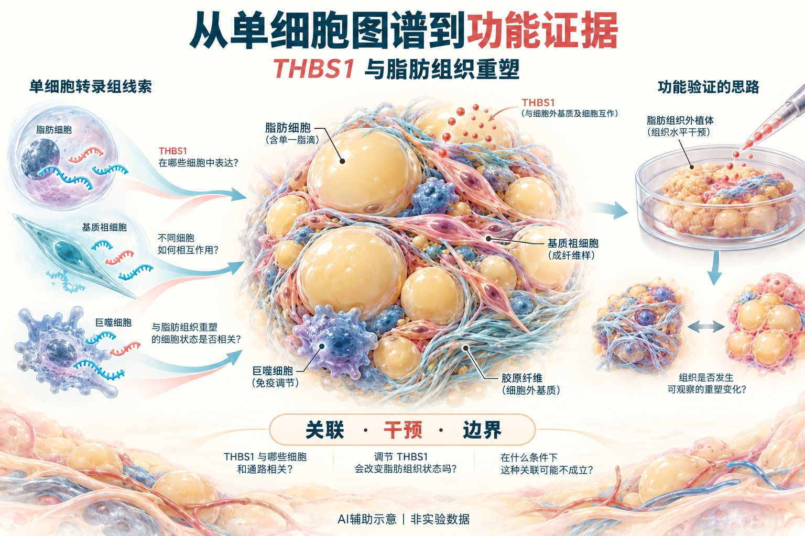

## 从供体设计到细胞状态

同样是肥胖，为什么有些人的脂肪组织仍能扩容、储存脂质，有些却出现胶原沉积、炎症和代谢失调？一张单细胞图谱可以指出哪些细胞变了，却很难单凭聚类回答：哪种改变是原因，哪种只是病变的伴随现象。

Jung等于2026年10月27日在Nature Communications发表的研究，把人内脏脂肪单核转录组、组织蛋白、原代细胞培养和局部干预串联起来，提出THBS1可能参与脂肪组织的纤维化与炎症。它值得读的地方，是如何逐步增加证据；同样值得学的，是每增加一层实验，仍有哪些问题没有解决。

本篇拆解“人群取样—细胞状态—功能线索”，未重跑测序流程或复现实验。

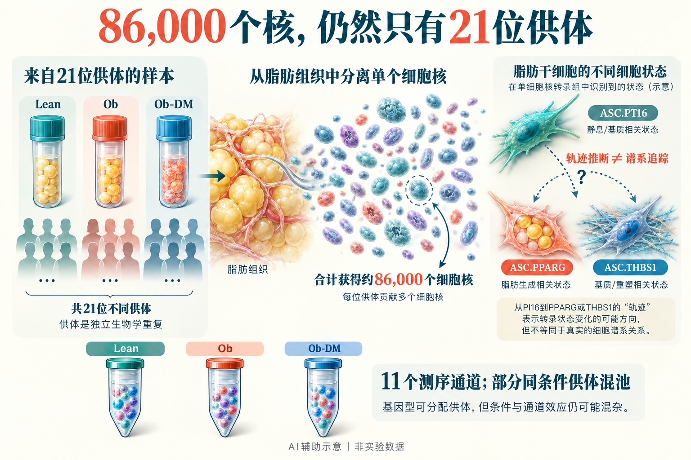
*AI辅助原创示意，非实验数据。三个临床组并非混成一个样本；细胞核很多，也不能替代独立供体。*

### 研究的起点是21个人，不是86,000次独立重复

发现队列来自韩国的21位手术供体，分为Lean、Ob、Ob-DM三组，分别8、5、8人。Lean的入组条件为BMI＜23且HbA1c＜6.5%；Ob为BMI≥30且HbA1c＜6.5%；Ob-DM为BMI≥30且HbA1c≥6.5%。共有13位女性、8位男性。这里的阈值属于这一发现队列，不能直接套到论文后续所有独立验证样本。

Lean样本来自活体肾脏捐献手术，肥胖组来自袖状胃切除术。组织可得性让这项研究成为可能，也带来临床取样背景不同的问题。三组是不同人的横断面比较，不是追踪同一人从健康走向肥胖、再走向糖尿病。后文的“疾病相关状态”，因此不能自动写成疾病演进的先后阶段。

成熟脂肪细胞体积大而脆，常规单细胞解离容易丢失它们。作者采用单核RNA测序，保留下86,000个高质量细胞核，同时对相同队列做组织bulk RNA-seq；其中一个bulk样本未通过质控，bulk分析为20人。单核数据能纳入成熟脂肪细胞，但核内转录本不能完整代表胞质RNA和所有炎症分子。同队列bulk是互补测量，不是另一个独立人群的重复验证。

测序设计值得单独看。21人分布在11个测序通道，4个通道是单供体，其余通道合并同一临床组内、最多3位供体。作者用基因型信息拆分供体，去掉不确定归属和双细胞；技术性重处理样本也按原供体合并。这比把混池当作独立患者清楚得多。然而，恢复供体身份，并不等于消除了条件与测序通道的混杂：如果一个通道只装某一临床组，部分技术变化就可能跟疾病条件一起出现。

这不是一句“用了Harmony就解决批次效应”可以带过的事。整合算法能改善相似细胞的对齐，却不能从完全重合的实验设计中创造出未观测的对照。后续独立流式和培养实验能支持某些生物学方向，但不能追溯性地证明图谱中每一个组间差异都无技术贡献。

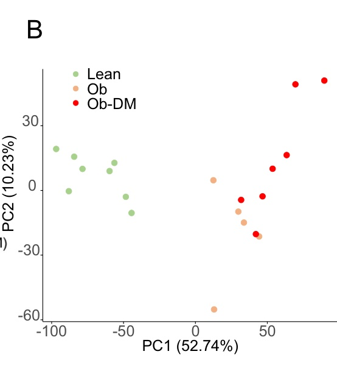
*图1B。每个点为一位bulk供体，共20人；绿、橙、红对应Lean、Ob、Ob-DM。横轴PC1解释52.74%的变异，纵轴PC2解释10.23%。组间分布提示组织层面差异，不是诊断分类器的测试结果。*

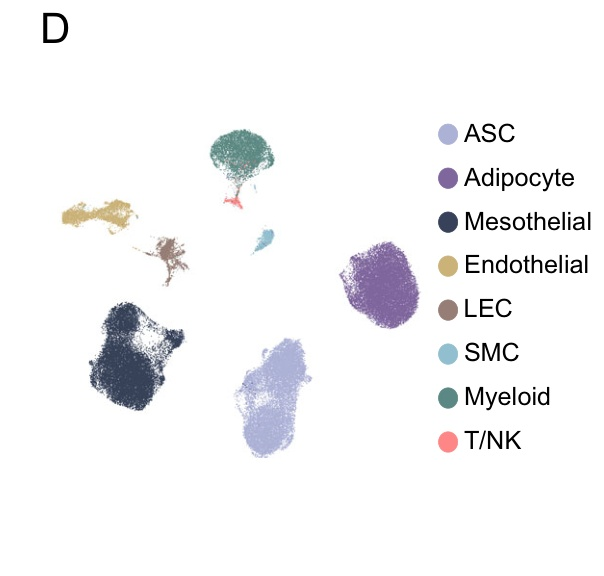

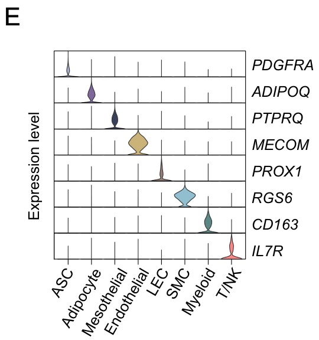

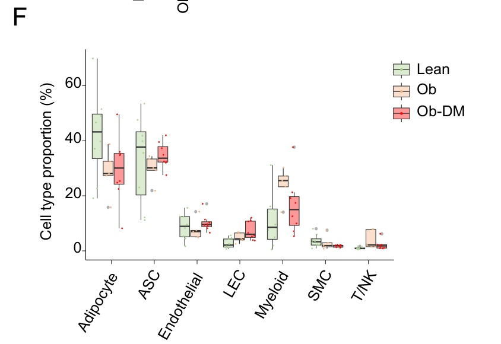
*图1D–F。D的点是细胞核，颜色为注释类型；E展示标志基因表达；F的点才对应供体，三组n为8、5、8，纵轴是相对细胞比例。箱体为Q1–Q3、中线为中位数，须延伸至1.5倍IQR范围，不能把核的数量充作患者数。*

### 质控把什么噪声拿掉，又留下什么不确定性

原始测序经过Cell Ranger比对与计数，CellBender处理环境RNA，随后结合UMI、线粒体比例和双细胞检测筛选细胞核。作者报告的阈值包括log10(UMI)≥2.5、线粒体转录本比例≤10%。这些步骤是为了降低空液滴、低质量核和混合信号带来的误注释，不能把“通过质控”理解成所有细胞都同样容易被观察到。

一个容易忽视的区别是：环境RNA校正处理背景污染，基因型拆分回答“这个核来自谁”，批次整合处理技术结构；三个问题不能互相代替。若成熟脂肪细胞在某种组织状态下更容易破损，单核方案虽然缓解整细胞解离偏倚，也未必完全消除核回收率差异。为此，图谱内比例变化最好由组织学、流式或绝对计数作互补核查。

论文还将细胞状态与已有脂肪图谱作映射比较。这能检查“这个标志组合是否只在本队列出现”，不能把外部图谱标签直接当作本实验功能的金标准。对自己的项目，更值得保留的材料包括每位供体各细胞类的核数、每个通道的构成、去除前后比例，以及关键结论对低细胞量供体的敏感性。以上是我们提出的分析检查项，本轮没有替作者执行这些重分析。

### 怎样从一张“细胞地图”找到跨细胞的疾病程序

图谱识别出8大细胞类型，包括脂肪细胞、脂肪基质祖细胞（ASC）、髓系细胞、血管及其他间质细胞。细胞比例是组成数据：某一群比例升高，可能来自它增加，也可能来自其他群减少或捕获效率变化。仅凭这个比例，不能断言某类细胞在单位组织内绝对扩增。

作者随后用scITD寻找跨细胞类型的共同转录程序。直观理解，它先把每位供体、每类细胞的表达合在一起，再把“供体—基因—细胞类型”的多维变化分解成若干模式。这让问题从“一个基因在哪个群上调”，变成“哪些细胞共同参与同一套与临床状态相关的变化”。供体层面汇总比把每个核都当独立样本更合理，但汇总门槛最低仅3个细胞，稀少群的表达稳定性仍值得检查。

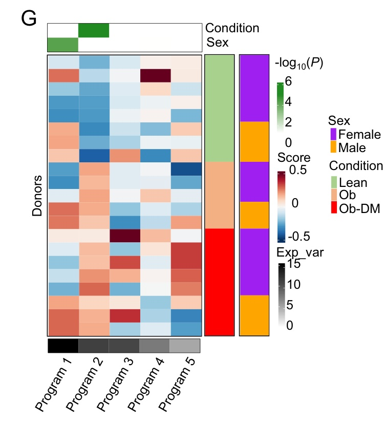

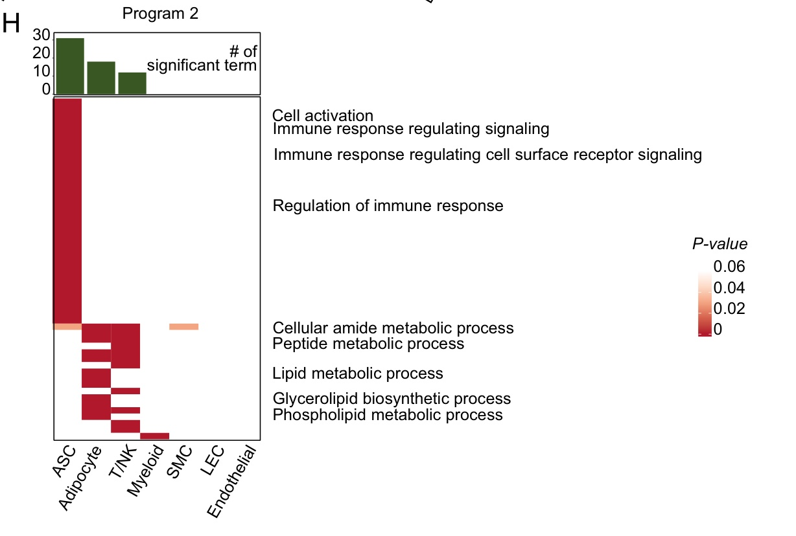
*图1G–H。G行是供体、列是分解程序，红蓝表示程序得分，顶部为条件/性别关联；H按细胞类型展示富集功能及显著项数量。H图内及正文写Program 2，而图注写factor 4，存在编号不一致；这里保留原样，不能自行宣布两者等价。*

组织层面的Program 2与疾病条件关联，Program 1更多反映性别差异。疾病相关程序同时涉及ASC的免疫反应和脂肪细胞的脂质代谢。这是一个有用的选题指南：如果病变是多个细胞共同重塑组织，后续就不应只围绕一个漂亮的细胞簇做文章。

但“程序”不是一条已经测到的分子通路。它是数据分解的结果，编号依赖本次模型，不能与另一轮分析中的同号程序混用。论文对免疫细胞另做的Program 4便属于另一套分解，不是把全组织Program 2简单改名。

分解模型还有两个容易被漂亮热图遮住的假设。其一，合并计数后的某类细胞表达，仍可能随这一类内部亚群比例改变；“同类细胞程序变了”未必意味着每个细胞都发生同等改变。其二，程序得分与临床组关联，仍可能承载年龄、性别、用药及手术来源等共同变化。把性别相关程序单独识别出来很有帮助，但不是对所有临床混杂因素已经充分调整的证明。

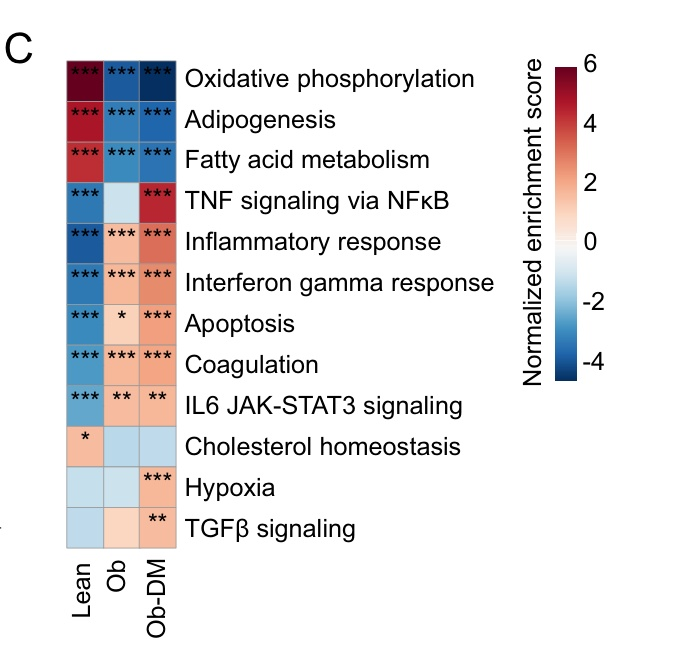
*图1C。行是通路、列是临床组，色标为归一化富集分数，星号对应作者的校正显著性。排序输入与差异统计量不同，解读限定见下文。*

图1C的通路热图也需按实际构造来读：Methods描述以各组平均log2(FPKM＋1)进行排序，再做富集。这与把疾病对照的差异统计量排序不是同一个问题。富集得分可提示表达特征，却不宜直接读成某条通路在患者中被激活了几倍。转录组的通路得分、蛋白磷酸化、代谢通量是不同层次的量，研究若要声称后两者，需要对应实验。

### 巨噬细胞：把RNA状态带回独立供体的蛋白测量

髓系细胞中，作者重点区分Mac.SLC11A1和Mac.LYVE1两类状态。前者更富集炎症、TNF相关功能，后者更多关联血管、内吞和基质黏附。它们可帮助定位疾病相关的巨噬细胞，但不要直接把前者写成所有“M1”、后者写成所有“M2”：体内细胞常呈连续而混合的状态，两个经典标签不能装下全部生物学。

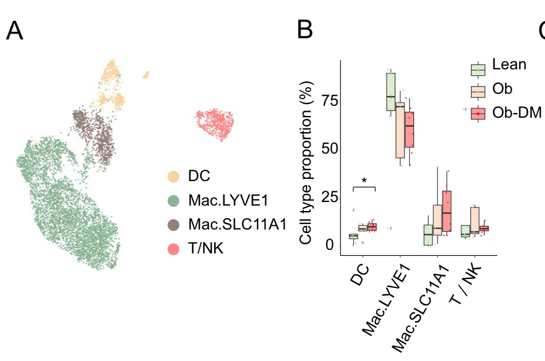

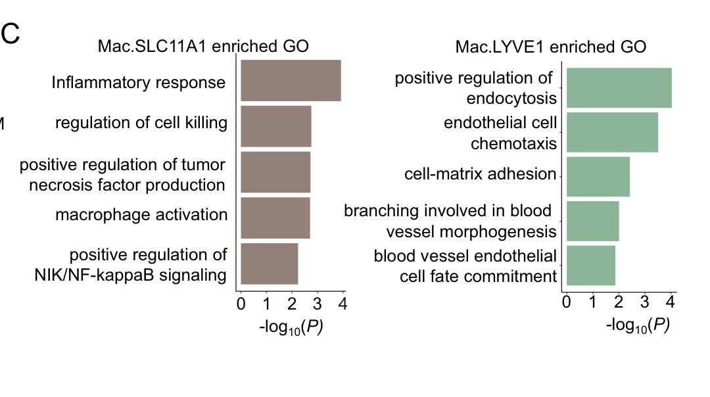
*图2A–C。A为免疫细胞嵌入图；B展示各供体的相对比例，实际可用供体为8、5、6；C横轴为−log10(P)，条形是标志基因的GO富集。C使用作者所述topGO检验、未作多重比较校正，功能名称是解释线索，不是直接测量的细胞行为。*

图谱中的Mac.SLC11A1在Ob-DM更突出。作者没有停在RNA热图上，而是在另一批样本做流式：Lean、Ob、Ob-DM分别5、6、6位供体，SLC11A1阳性巨噬细胞比例在Ob-DM较高。这个实验的价值不在于柱形上有星号，而在于换了测量层次、又回到供体层面。

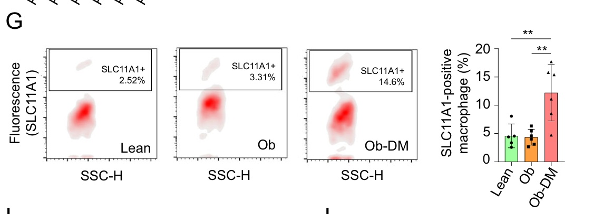

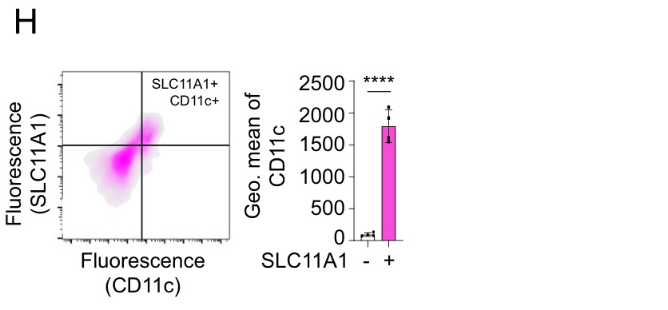

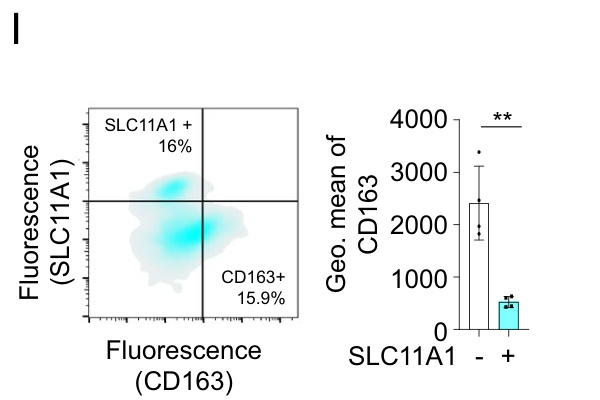

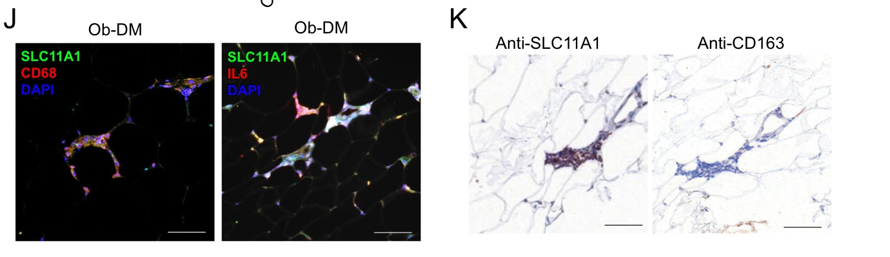
*图2G–K。G纵轴为SLC11A1阳性巨噬细胞比例，点为供体，n＝5/6/6，误差为SEM；H、I在4位Ob-DM供体内配对比较阳性/阴性群，纵轴是CD11c或CD163的几何平均荧光。J的绿/红分别对应标注蛋白，蓝为DAPI；K为组织免疫染色。代表性视野及比例尺完整保留，不能把每个染色细胞当成独立患者。*

SLC11A1阳性群的CD11c更高、CD163更低，组织染色也把这些细胞放回病变微环境。这些结果共同支持“疾病相关的炎症性巨噬细胞状态”。仍未解决的是方向：它们推动纤维化，还是被已纤维化的组织招募？两者也可能相互增强。相关性和空间同现都不能单独排除这个反馈环。

### ASC.THBS1：一个标志基因，怎样变成待检验的功能线索

ASC是脂肪组织中兼具祖细胞和基质相关功能的一组细胞。作者识别出ASC.PI16、ASC.PPARG与ASC.THBS1：PI16群偏向较早的祖细胞状态，PPARG群偏向脂肪生成，THBS1群则突出细胞外基质、炎症和缺氧相关表达。

THBS1编码血小板反应蛋白1，是细胞外基质相关蛋白。这里用它命名一个细胞群，意思是它有助于描述这群细胞的转录状态；这并不意味着THBS1只存在于这个群，也不代表THBS1一个基因就决定了该群的全部功能。

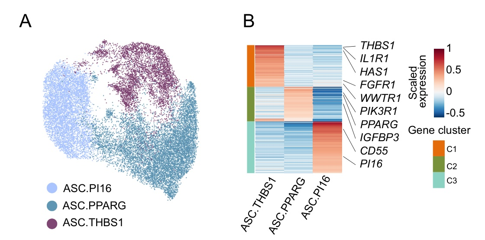

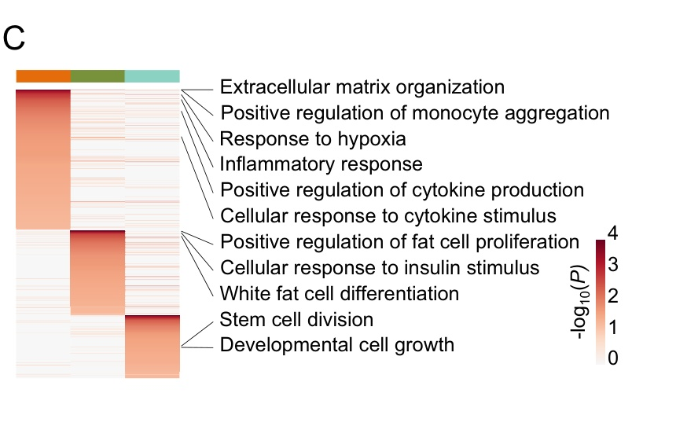

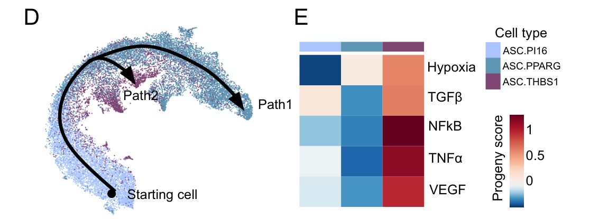

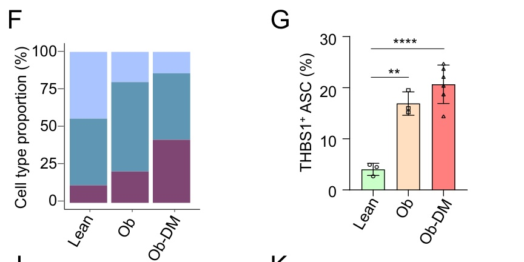
*图3A–G。A、B为细胞嵌入与缩放后的表达；C颜色是GO富集−log10(P)，不是蛋白量；D是指定起点后的伪时间路径；E为PROGENy推断得分；F为三类状态相对比例；G是独立流式验证，点为供体，n＝3/3/6，误差为SD。颜色随panel各自图例解释，不应跨图当作统一数值。*

这里最容易误读的是那两条箭头。作者先选择PI16相关细胞为起点，再用Palantir排序，得到朝PPARG或THBS1方向的路径。补充材料中的RNA velocity提供另一种模型视角，但仍主要利用同一批核转录数据。它们支持状态之间存在相容的变化方向，不能替代在活体中标记祖细胞、追踪后代的谱系实验。

起点选择本身也是假设。如果把伪时间结果写成“发现PI16细胞必然分化成两种终末细胞”，就把计算模型的前提偷偷变成了结论。更妥当的问题是：沿这个候选方向，脂肪生成能力与基质生成是否真的发生可测变化？

在独立流式样本中，THBS1阳性ASC的比例在肥胖相关组更高；在5位Ob-DM供体中，THBS1阳性ASC的ACTA2、COL6A1荧光也高于同一供体的阴性群。这里利用供体内配对，减少了人与人之间基线差异的影响。

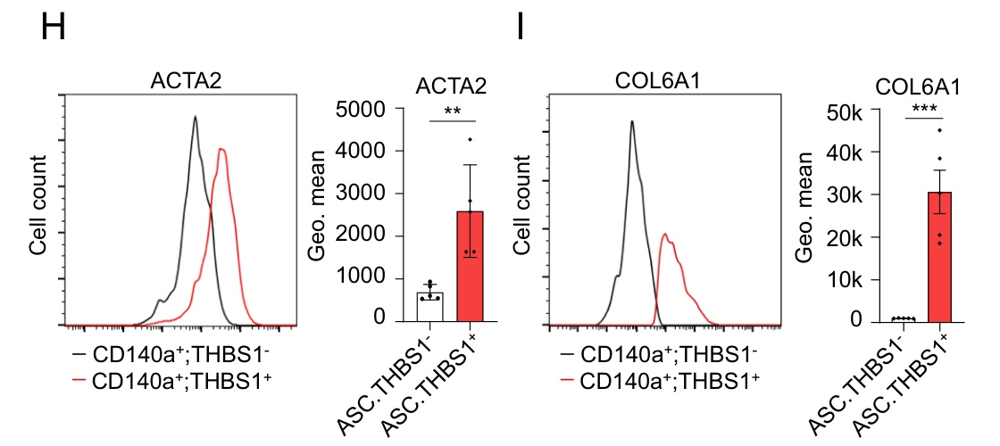

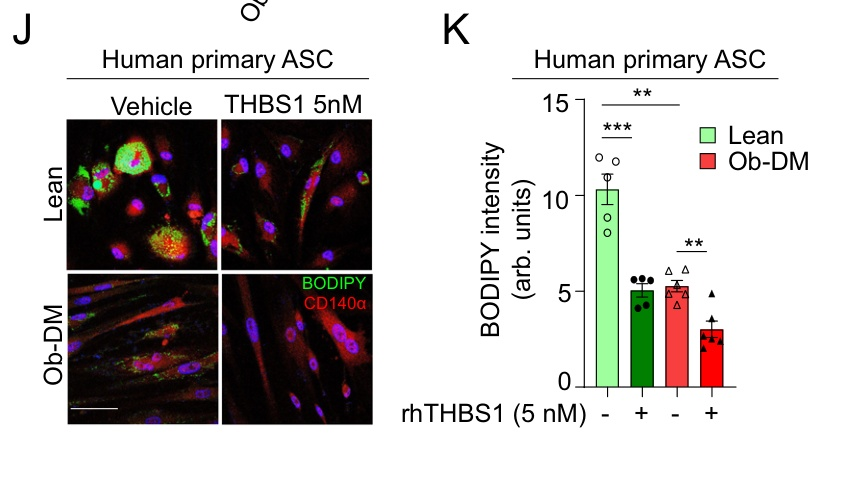
*图3H–K。H、I比较5位供体内THBS1阳性/阴性ASC，纵轴为标志蛋白几何平均荧光，误差为SD；J、K以重组THBS1处理人原代ASC，BODIPY绿色反映脂质，红色为CD140α，蓝色为细胞核。K的Lean及Ob-DM分别5、6位供体，比较同供体的处理/对照配对培养，误差为SEM。*

真正把THBS1从“标签”往“功能候选”推进的，是外源蛋白干预。原代ASC在重组THBS1存在时脂质积累下降；人源ASC52Telo细胞系的时间序列也显示，脂肪生成相关读数下降，而基质相关标志增加。

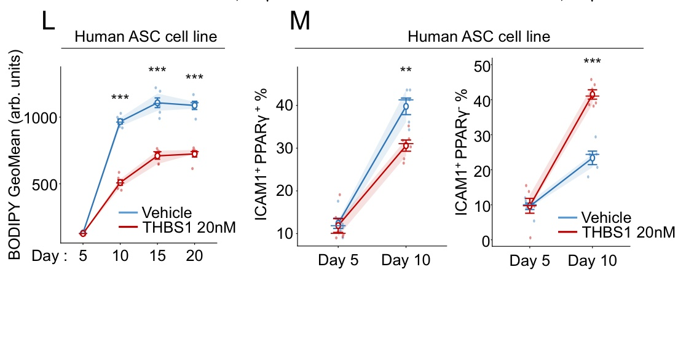

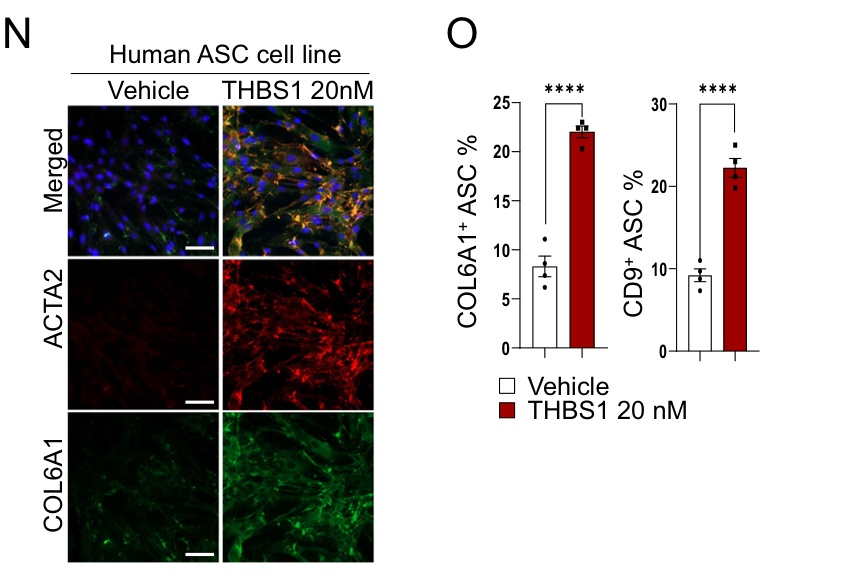
*图3L–O。L横轴为培养天数、纵轴为BODIPY几何平均信号，蓝为对照、红为20 nM THBS1；通常6次独立实验，部分时间点5次。M分别观察ICAM1+/PPARγ+与ICAM1+/PPARγ−双标细胞比例；N显示ACTA2、COL6A1原始染色；O统计COL6A1及CD9阳性比例，n＝4，误差为SEM。细胞系实验重复不是患者样本。*

这支持一个有限而重要的结论：在所测试的培养条件和剂量下，加入THBS1足以改变ASC的脂肪生成与基质标志。它还不能证明人体内这条转变一定由THBS1启动，更不能证明抑制THBS1就能把所有异常ASC恢复为健康祖细胞。蛋白浓度、培养环境、细胞系背景，以及患者组织中其他分泌因子，都可能改变响应。

### “纤维化相关”不是一枚可以无限延伸的标签

ACTA2、COL6A1、CD9以及脂滴信号，分别捕捉细胞骨架/收缩相关程序、胶原相关成分、细胞表面状态和脂质积累。多个指标方向相合，比单个标志更有说服力，但它们不等价：细胞中胶原标志升高，不自动等于组织已经形成力学上可测的瘢痕；BODIPY降低，也可能受到细胞数量、成熟程度或存活状态影响。解读应始终把观察到的读数写出来，而不是只用“功能改善/恶化”概括。

此外，外源蛋白加入是一种充分性测试：在这个环境中施加因素，能否使结果改变。必要性测试则要问，去掉内源因素后结果是否消失；救援实验还要检查重新引入因素能否恢复。本文后续确实增加敲低和抗体干预，但发生在不同模型与组织部位。不能在读到这里时，就提前把整套必要性、特异性和临床可逆性都算作成立。

### 到这一层，哪些结论已经站稳

可以带走三点。人内脏脂肪的疾病相关变化跨越多种细胞；THBS1相关ASC状态在独立蛋白测量中得到支持；外源THBS1能在培养模型中推动部分纤维化相关表型并抑制脂质积累。还不能带走的，是疾病的自然时间顺序、完整的细胞谱系，以及已经成立的患者治疗策略。

对准备设计类似研究的人，一个实用做法是提前画出“临床组×供体×通道”的表，而不只追求更多核；分析时把供体作为人群推断的基本单位；发现候选后，再明确需要哪一种扰动去检验哪一个方向。论文报告未做事先统计功效计算，样本量取决于手术组织可得性，因此不能把21人称为已被证明足以回答所有问题。

**来源与范围。** 全文24页、补充图1–10图注及Reporting Summary已读；关键补充panel目视核查，Source Data仅部分核对。Figure 1A的BioRender复用权利未确认，不转载，原始实验图仍完整展示。原创示意非实验数据。

本篇全部原图：Jung等，Nature Communications 17,11136（2026-10-27），[论文及补充](https://doi.org/10.1038/s41467-026-77107-w)。依[CC BY-NC-ND 4.0](https://creativecommons.org/licenses/by-nc-nd/4.0/)用于非商业科普；原样panel保留轴/图例/标签，仅技术格式转换，无实验内容改动。

## 从候选THBS1到细胞间机制

单细胞分析常会给出一张细胞通讯网络：某群细胞“发出”配体，另一群细胞“接收”信号，连线粗细仿佛已经告诉我们谁在驱动病变。真正困难的一步，是把这张基于表达和数据库的预测，转成能被实验否定的机制问题。

作者在人脂肪图谱中发现与纤维化、炎症相关的细胞状态，接着测蛋白、扰动细胞、转移培养上清并阻断候选受体。本篇关注这条机制链：THBS1能否改变成熟脂肪细胞？巨噬细胞是否参与传递作用？TGFβ又能解释多少变化？

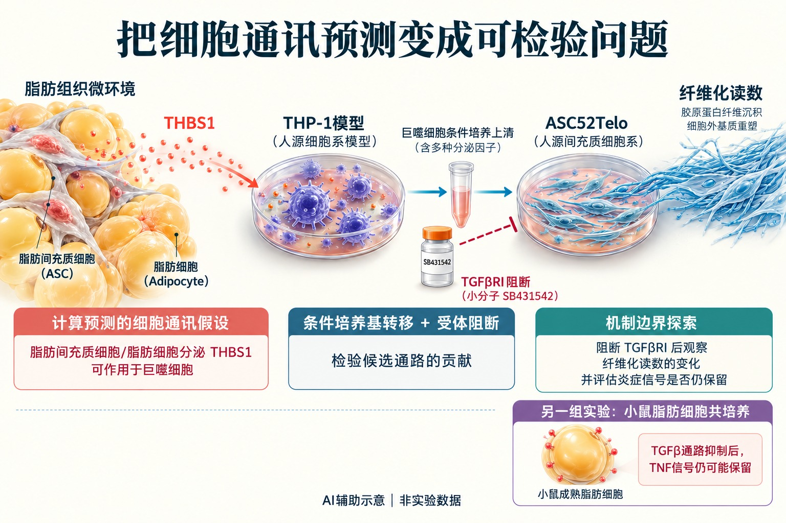
*AI辅助原创示意，非实验数据。主图为条件培养基转移与小分子受体阻断的教学表示；右下是另一组成熟脂肪细胞共培养实验。两套实验的细胞和读数不能混为一谈。*

### 脂肪细胞也有状态差异，不能只当脂质仓库

在人内脏脂肪单核数据里，成熟脂肪细胞分为PIK3R1、PLIN4和THBS1相关状态，分别突出代谢、脂质储存以及基质/炎症相关表达。这个划分让脂肪细胞从“被炎症影响的背景”变成可能参与组织重塑的成员，但名称仍是转录状态标签，不是证明了互斥且永久稳定的三条谱系。

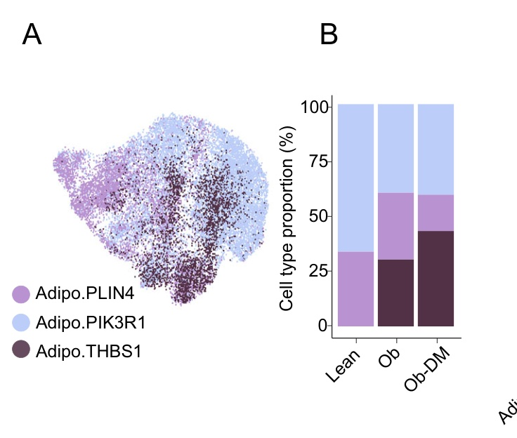

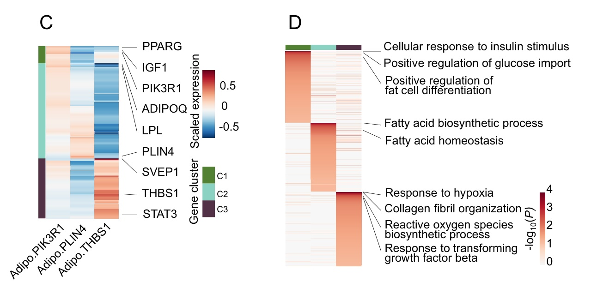
*图4A–D。A为细胞核嵌入；B为组间相对比例；C为缩放表达；D颜色对应GO富集−log10(P)，该GO检验未多重校正。细胞核比例不等于组织内绝对细胞数，功能富集不等于直接测到代谢通量。*

作者分离原代脂肪细胞，测其裂解液中的THBS1蛋白，Lean、Ob、Ob-DM分别11、9、11位供体。THBS1与BMI、HbA1c的相关性，又把分子线索接回临床表型。这比整组织匀浆更贴近脂肪细胞，但未进一步按转录组中的三个亚群分选，也不是单个细胞的实时分泌测量。BMI与血糖同时受多种因素影响，相关没有确定因果方向。

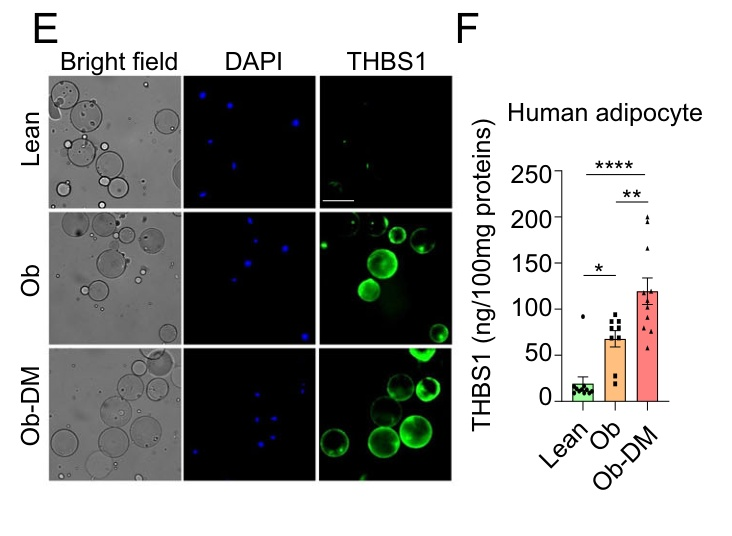
*图4E–F。E为分离脂肪细胞THBS1染色，F纵轴为原代脂肪细胞裂解液THBS1，三组n＝11/9/11位供体，误差为SEM；这是分离脂肪细胞的裂解液蛋白测量，不是单个细胞的分泌量。*

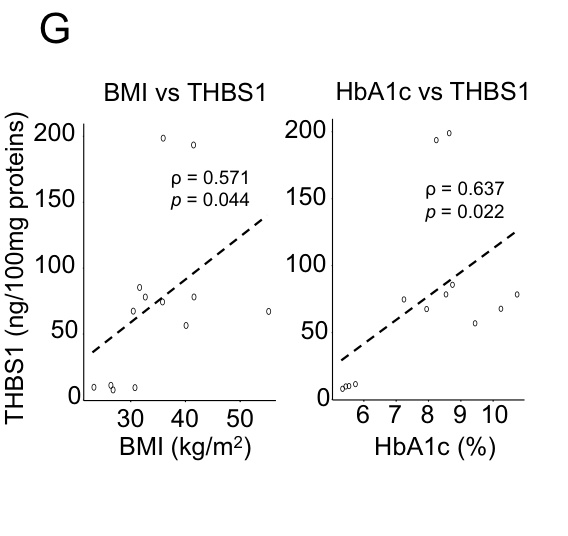
*图4G。每个点对应一份样本，图注n＝13；BMI及HbA1c对应的Spearman相关系数为0.571、0.637。回归线与显著性不能替代外部预测验证，也不能确定每一个脂肪细胞亚群的贡献。*

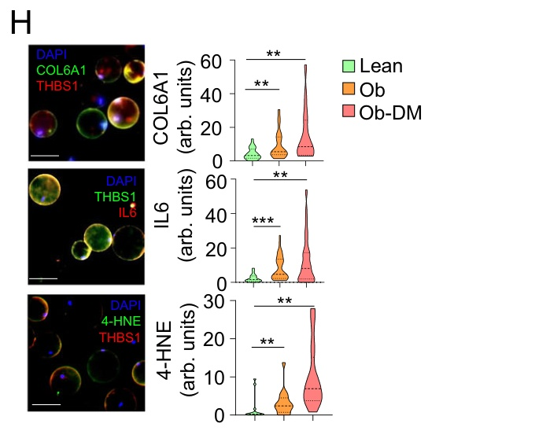
*图4H。新鲜分离脂肪细胞染色：第一行COL6A1绿/THBS1红，第二行THBS1绿/IL6红，第三行4-HNE绿/THBS1红，核均蓝；横向比较三组、纵轴为荧光读数。三项测量的细胞数分别28/22/15、19/36/90、13/16/26，对应供体仅5/4/4、6/7/10、4/5/6。细胞嵌套于供体，不能把这些细胞数当作独立患者数。*

图4H尤其适合训练“先找分母”的习惯。某组有90个被测细胞，看起来点很多，却只来自10位供体。如果同一患者的细胞共享组织环境，按所有细胞彼此独立计算的不确定性，可能比真正的供体层面不确定性小。本文没有重新拟合层级模型；我们能做的是保留作者的读数，并明确细胞层面统计与人群推断之间的距离。

### 加入与敲低THBS1，分别回答什么

作者将小鼠成熟脂肪细胞置于培养体系中，给予重组THBS1。脂肪生成相关基因下降，部分基质与炎症标志增加；COL6A1和TNF阳性细胞比例也改变。这比单纯相关性向前迈了一步：在给定培养条件下，THBS1可以诱发某些表型。

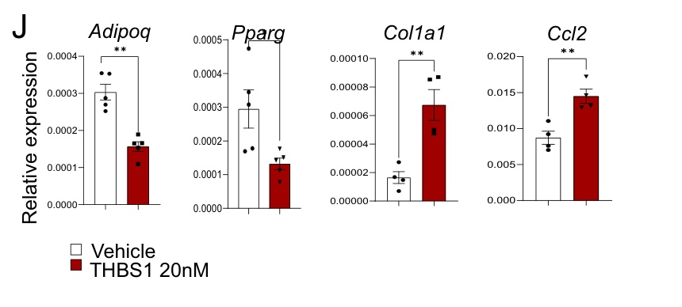

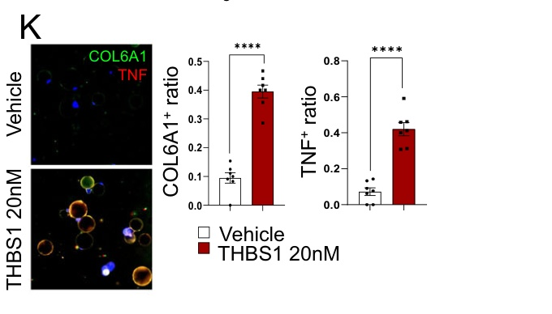
*图4J–K。J为小鼠成熟脂肪细胞处理后的相对基因表达，Adipoq/Pparg为5次、Col1a1/Ccl2为4次独立实验；K为COL6A1/TNF阳性比例，n＝7次独立实验。纵轴、对照及误差按原图保留。外源蛋白干预不能直接等同于人体生理浓度下的效应。*

另一套实验从高脂饮食小鼠取得成熟脂肪细胞，敲低内源Thbs1，并与scramble对照比较。2-NBDG摄取、AKT磷酸化与GLUT4相关读数的变化，支持THBS1与这些细胞的胰岛素反应有关。这里的2-NBDG是葡萄糖类似物摄取读数，不是整只动物、更不是患者血糖控制的直接结果。

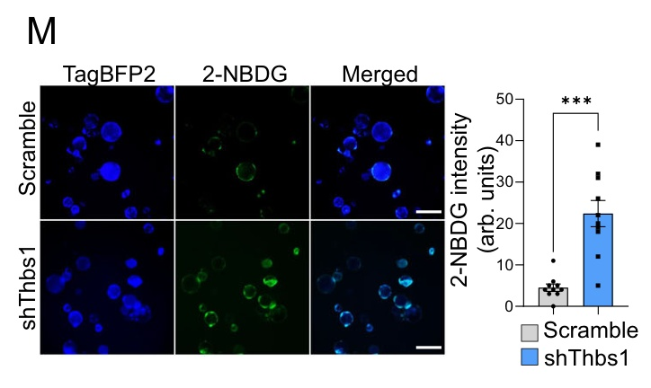

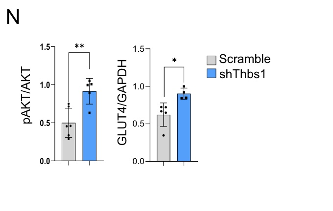
*图4M–N。M比较scramble与shThbs1的2-NBDG荧光，n＝10个生物样本，多个视野先在生物样本内汇总；N为蛋白印迹的比值定量，pAKT/AKT两组n＝6/5，GLUT4为5/4，误差为SD。对照、原轴及误差完整保留；N展示定量而非原始条带，不能把视野或条带重复解释为患者重复。*

加入蛋白与敲低内源表达提供两个方向的证据，但并不自动消除特异性问题。外源剂量是否贴近组织局部浓度？敲低是否有非靶效应？换一种遗传工具，或补回不受敲低影响的THBS1，能否救援？这些是下一轮可检验的问题，不是我们声称本文已经完成的实验。

### bulk RNA-seq给出组织背景，也暴露可复现性需要追问的地方

20份bulk样本显示，肥胖相关组既有共同改变，也有Ob-DM特有的表达差异。作者报告Ob与Lean比较1778个差异基因，Ob-DM与Lean比较2520个，两者共享1555个。这里的“特有”通常是跨过某一统计阈值的集合差，不等于该基因在另一组完全不变。

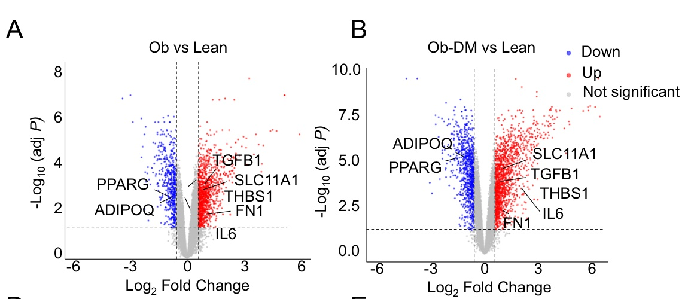

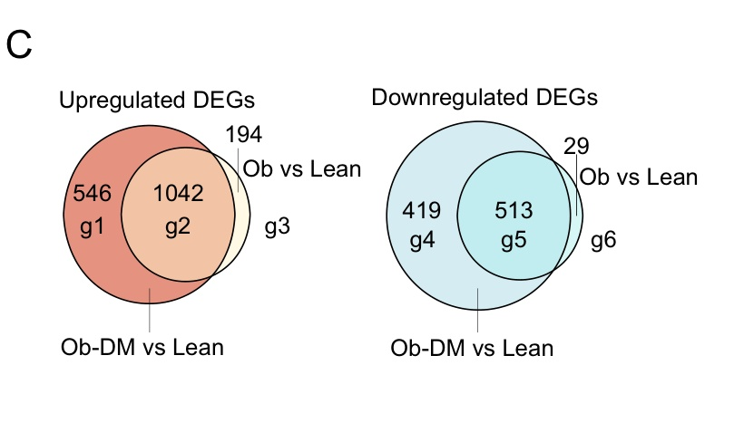
*图5A–C。A/B横轴log2FC、纵轴−log10(校正P)，红为上调、蓝为下调、灰为不显著；C维恩图表示阈值化后的重叠集合。作者阈值为|log2FC|＞0.58、BH校正P＜0.05；下文所述输入尺度问题尚未澄清，因此不把这些数目当作已独立复算结果。*

一个必须如实指出的方法细节是：Methods写明将未经log转换的FPKM直接输入limma，却用log2FC阈值解释结果。通常RNA-seq的limma分析需要适当的计数归一化、log尺度及均值—方差处理；直接在原始FPKM尺度拟合的线性系数，不能未经说明便等同于log2倍数变化。

我们没有拿到可核查的实际分析脚本，不能判断执行过程是否与这段方法描述完全一致，也不能据此宣判全部生物学结果无效。准确的结论是：这一差异表达环节存在待澄清的尺度问题，不宜直接照抄其流程。组织蛋白、独立流式和干预结果有各自证据来源，不能与这个问题一并抹掉。

作者还用WGCNA将共同变化的基因组织成模块，再关联BMI、HbA1c等表型。这里Methods写明使用log2转换的FPKM，但未明确是否加伪计数，不能与fgsea的log2(FPKM＋1)写法混同；也与上面的差异表达输入描述不同。模块反映共变，既可能来自细胞内调控，也可能来自组织中细胞组成改变；在20个样本上做许多临床关联，需要尤其注意稳定性。

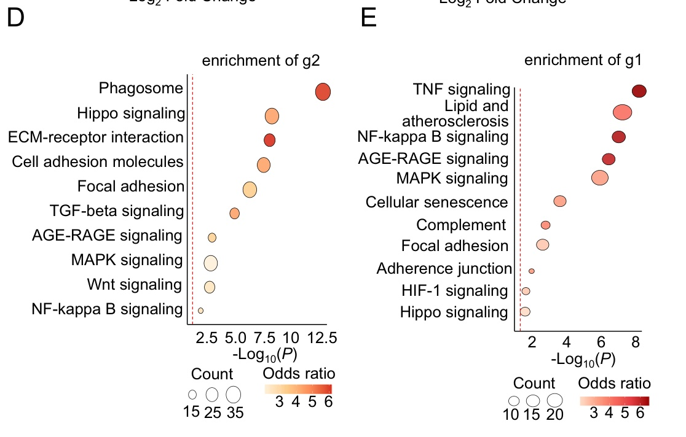

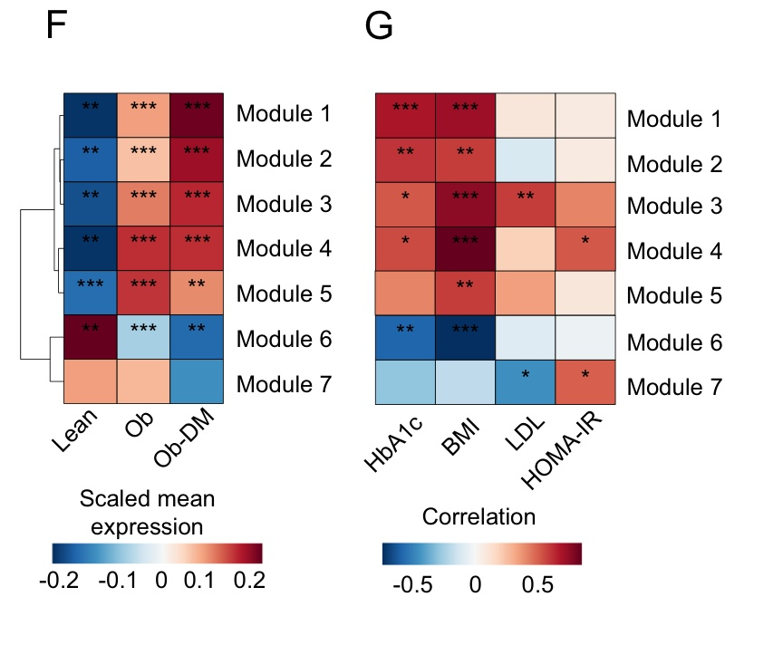
*图5D–G。D、E横轴为−log10(P)，点大小为基因数、颜色为odds ratio；F色标为模块缩放平均表达；G色标为模块与临床指标的Pearson相关系数。富集与相关的显著性不等于驱动关系，组织组成可影响两者。*

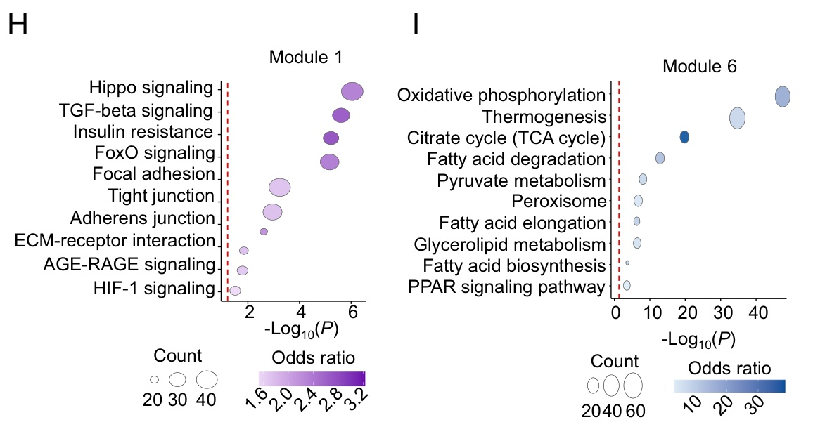

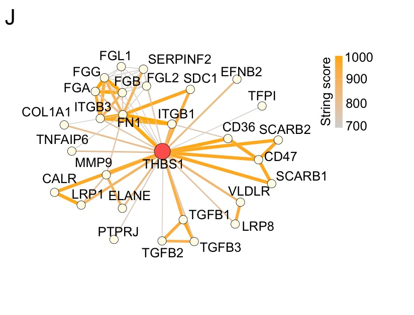
*图5H–J。H/I分别为模块1/6的通路富集，横轴−log10(P)、点大小为基因数、色为odds ratio；J网络线的颜色及粗细反映STRING分数，THBS1以红点标出。连线不是本研究新测出的物理结合。Figure 5J图注的STRING阈值700与Methods所述combined score＞0.9不一致，本文不自行选择一个替代作者说明。*

这类图的正确用途，是缩小实验空间，而不是让候选基因因为位于网络中心就自动获得因果地位。THBS1在组织模块、ASC和成熟脂肪细胞中反复出现，足以成为值得实验追问的对象；“出现多次”仍需判断这些分析是否共用同一数据。共用数据的不同算法可以提高解释一致性，却不是多次独立验证。

如果想借用这个项目练习生信，而不是照着文章复制一套“显著结果”，最先需要保存的是原始计数、样本元数据、设计矩阵和每一步软件版本。可用的数据不等于可追踪的分析：作者公开的GEO记录列有单核矩阵、bulk FPKM及离体处理相关文件，但本轮未找到能够逐行核验主要模型的实际分析脚本。Methods列出包名可帮助重建思路，不能证明默认参数、对比方向和过滤规则都一致。

对差异分析的合理核查，应先确认原始输入及尺度，再比较有统计依据的流程是否保留THBS1相关方向；对WGCNA，应检查模块在剔除个别供体后是否稳定，以及是否主要反映细胞比例。这些属于我们建议的后续敏感性分析，没有在本轮运行，因而不报告所谓“复现成功率”或纠正后的基因数。

### 从CellChat连线到培养上清：把通讯假说拆成可反驳的步骤

作者用CellChat比较Ob与Ob-DM的候选通讯，又用MultiNicheNet考虑患者间差异，筛出与THBS1及TGFβ相关的路径。配体和受体表达、先验网络以及下游转录响应，是这些推断的输入；它们没有直接测量两种细胞之间的蛋白流量。

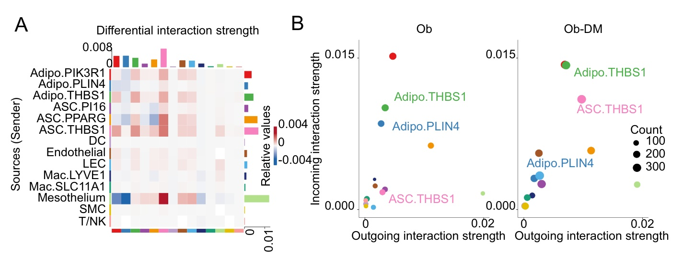
*图6A–B。A热图比较推断通讯；B横轴为outgoing、纵轴为incoming interaction strength，点大小为显著相互作用数，不是细胞数或实测分泌速度。比较的是Ob与Ob-DM的表达模型，不能单凭网络证明方向性因果。*

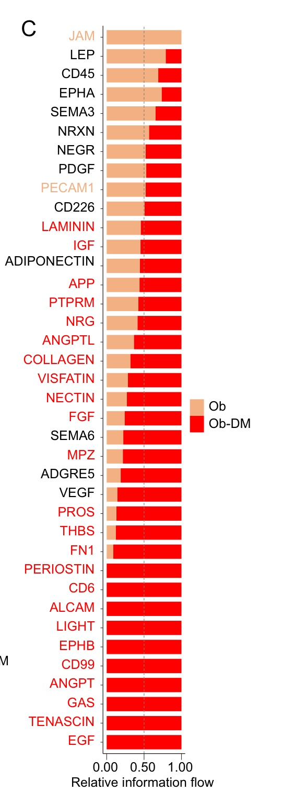
*图6C。横轴为模型的相对信息流、纵轴为候选通路，颜色区分两组。信息流是计算评分，不是血液或培养基中的配体浓度。*

补充空间分析提供了相邻位置的线索，但只有两张Visium切片：一张Lean、一张Ob。spot可能混合多种细胞，相邻spot也有空间相关。局部邻近支持候选细胞有接触同一微环境的机会，不证明THBS1从某个细胞流向另一个细胞，更不能把许多spot当作许多独立患者。

实验部分则把假说拆开。作者先用THBS1处理THP-1来源的巨噬细胞模型，测培养上清中的TGFβ，并加入LSKL这一干预条件；再将条件培养基转移给ASC52Telo，观察ACTA2、COL6A1等标志；最后用TGFβ受体I小分子抑制剂SB431542，检查受体端通路是否参与响应。

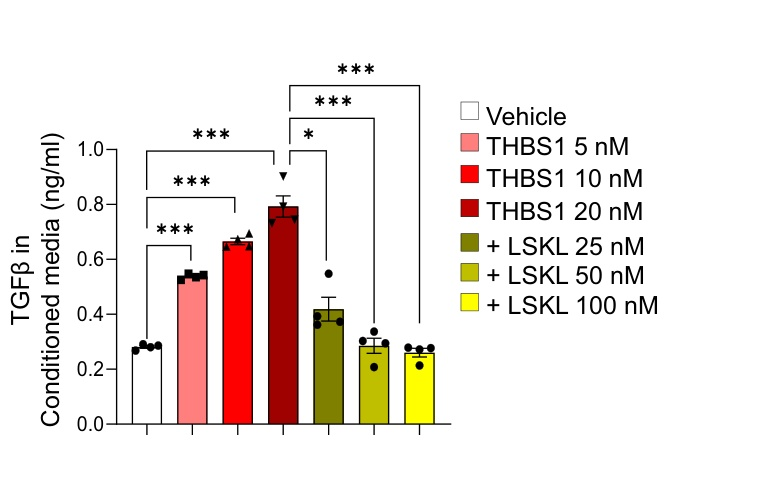
*原文Figure 6E实验数据原样片段（面板字母未纳入，未重绘）。横轴为THBS1及LSKL组合，纵轴为上清TGFβ浓度，每条件n＝4，误差为SEM。该检测支持培养体系中的TGFβ相关响应，不应额外宣称已直接区分潜伏型激活与总量分泌的每个分子步骤。*

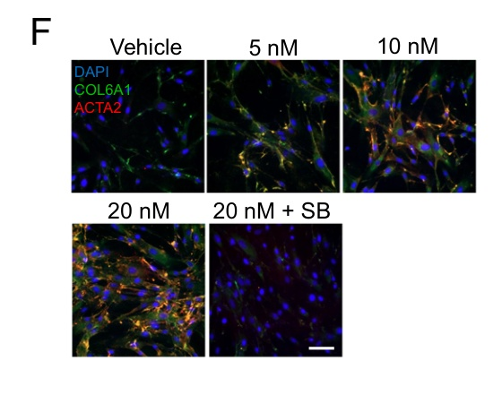

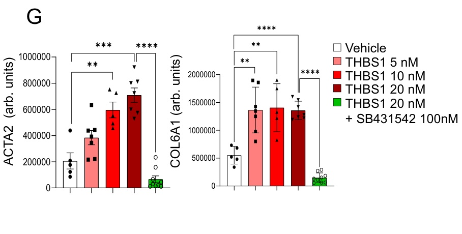
*图6F–G。比较不同来源培养上清及阻断条件下ASC52Telo的纤维化相关标志；各组独立样本数为5/7/5/7/9，按原图排列，误差为SEM，ANOVA＋Šidák比较。绿为COL6A1、红为ACTA2、蓝为DAPI；G纵轴为对应荧光强度，比例尺保留。它检验模型中的通路贡献，不代表新鲜人组织所有ASC都同样响应。*

这套设计比单次共培养更有信息量：上清可转移，提示可溶性成分参与；受体阻断能减弱部分效应，支持TGFβ相关通路的贡献。仍须考虑上清不是纯化TGFβ，其中有多种分泌因子，且报告有低浓度残留THBS1。它们没有被逐个清除，因此“只由一种配体、经过唯一通路解释全部作用”过强。

怎样让这类实验更有辨别力？可以把备选解释逐个变成对照。若怀疑残留外源蛋白，需比较与残留浓度匹配的直接处理；若怀疑上清中其他分子共同作用，可以加入配体耗竭及补回；若要归因于某个受体，遗传干预和药理阻断的方向一致通常比单一种药更有解释力。这里列的是一般实验设计建议，不能写进本文的已完成证据栏。

还要区分“激活潜伏型TGFβ”与“检测到更多TGFβ”。前者涉及潜伏复合物和活化过程，后者取决于检测所测的分子形式及样本预处理。本文的ELISA、LSKL与受体端阻断共同支持TGFβ相关机制，但仅凭我们核到的方法细节，不额外断言每一次检测都已经把活性、总量、分泌与释放完全拆开。保持这一限定，不会削弱已经观察到的阻断响应，反而能明确下一步最该补什么实验。

### 一项没有同步下降的读数，让机制图更诚实

Transwell实验分别把THP-1模型与ASC52Telo、或与小鼠成熟脂肪细胞分隔培养，让可溶性成分交换而不直接接触。两套实验的纤维化相关读数与TGFβ通路干预相容；在成熟脂肪细胞那一套中，TNF信号没有像COL6A1那样随抑制条件消退。

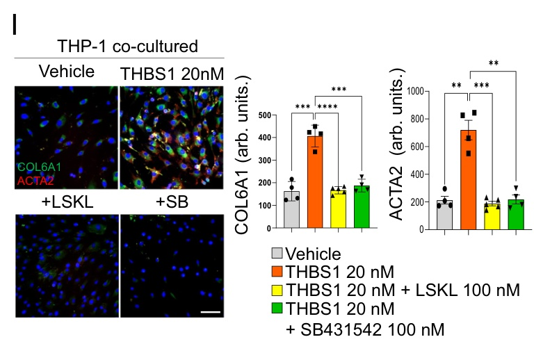

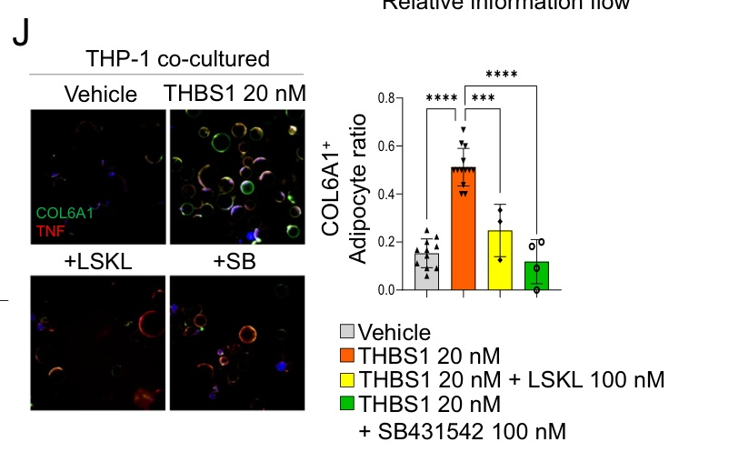
*图6I–J。原图显示基质相关标志及COL6A1/TNF染色；I各条件n＝4/4/5/4，J各条件n＝11/13/3/4，均按作者所报独立样本数，误差为SEM。I为THP-1与ASC52Telo，纵轴为COL6A1/ACTA2荧光强度；J为THP-1与小鼠成熟脂肪细胞，量化COL6A1阳性比例。不是患者内直接观测的通讯过程。*

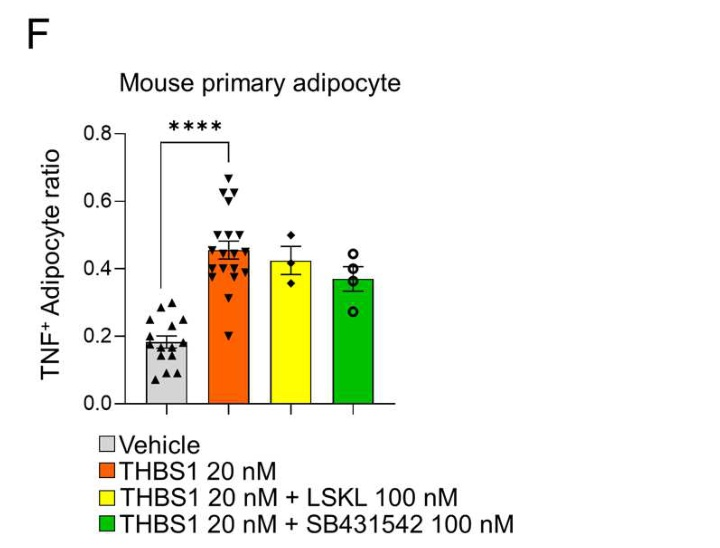
*补充图8F。按原横轴比较处理及阻断条件，纵轴为TNF阳性成熟脂肪细胞比例；与纤维化读数对照阅读。它不支持“抑制TGFβ就消除所有炎症效应”的概括，也没有单凭这个结果鉴定出替代受体。*

这并不是机制故事失败，而是说明需要分支。THBS1可能通过不止一种受体或细胞过程影响组织；CD36、CD47等在讨论中是可追问方向，不能写成本文已经证明TNF残留由其中哪一个引起。THP-1是人源细胞系，ASC52Telo也是细胞系，部分实验混合人源与鼠源细胞，这些模型优势在于可控，代价是不能完整重建人组织的细胞组成与生理浓度。

要点：通讯分析负责提出明确候选，转移与阻断实验负责检验部分路径，而未被解释的读数负责限制结论。用不同方法重复得到同一主题，不等于已经知道唯一机制；真正有价值的闭环，应同时写明支持的路径和仍需实验区分的替代解释。

**来源与核验。** 研究为Jung等2026年10月27日发表的原创论文；主文、补充图1–10图注及Reporting Summary已读，关键补充panel已目视核查，部分Source Data核对，未重跑分析。关于limma尺度的判断，另核对[官方User’s Guide第15.3–15.5节](https://bioconductor.org/packages/release/bioc/vignettes/limma/inst/doc/usersguide.pdf)，并非复现作者代码。Figure 4I/L、6D/H为BioRender流程图，单独复用权利未确认，未转载；原实验panel仍在相应段落展示。本篇全部原图及补充图均出自下列Jung等论文，仅作原样片段和技术格式转换，依[CC BY-NC-ND 4.0](https://creativecommons.org/licenses/by-nc-nd/4.0/)用于本非商业科普；原创示意非实验数据。

原文：Jung等，Nature Communications 17,11136（2026-10-27），[论文及补充](https://doi.org/10.1038/s41467-026-77107-w)。

## 从人体组织到动物干预的证据边界

一个候选分子在患者组织中升高，加入培养体系能引起变化，中和它又改善了小鼠局部组织——这离诊断标志物或治疗靶点还有多远？THBS1研究最值得仔细读的，恰是最后几幅图：看似连成一条转化链，实际每一段使用的组织、物种、干预与统计单位都不一样。

本篇把人血浆、人离体脂肪、小鼠局部干预和上游调控分别放回各自的实验边界。目标不是给论文贴“可靠”或“不可靠”的单一标签，而是辨认哪些结论可以迁移，哪些仍需要新的数据。

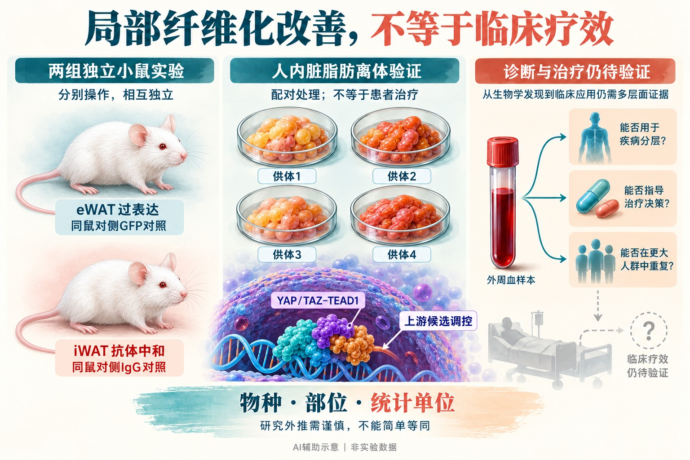
*AI辅助原创示意，非实验数据。两只鼠表示两套独立的同鼠对侧实验；四个培养皿仅表示人内脏脂肪供体，不表示观察到的颜色或效应差异。上游机制画面是候选调控示意，不是分子结构实测。*

### 表达丰富，不等于来源特异；疾病相关，不等于遗传因果

作者先用GTEx展示THBS1的组织表达分布，再用scDRS把细胞转录状态与代谢性状相关遗传信号联系起来。这些分析帮助判断候选是否值得关注，但各自的回答范围很有限。

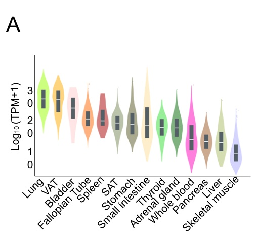
*原文Figure 7A，原样片段。来自GTEx v8，54类组织、17,382份样本、948位供体；组织样本数不等于独立人数。图内纵轴标log10(TPM＋1)，图注写log2，尺度描述不一致，保留原图且不据此计算效应倍数。来源：Jung等，2026，CC BY-NC-ND 4.0。*

图7A用的是GTEx v8；补充图10A对同一供体的内脏/皮下脂肪比较，则使用v11，涉及233位男性、96位女性。这是两项不同分析，不能因为版本不同就指责前后矛盾。真正需要核实的是同一幅图中坐标和说明是否一致，以及每一类比较是否按供体配对。

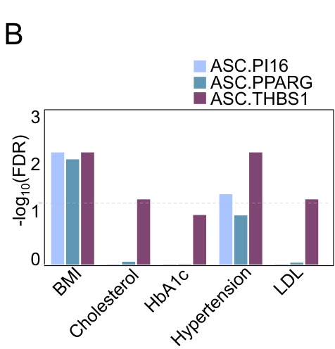
*原文Figure 7B，原样片段。横轴为性状，纵轴为−log10(FDR)，颜色区分三种ASC亚型；它连接的是细胞表达特征与性状相关基因集合，不是直接测量THBS1变异的致病效应。来源及许可同上。*

若某个细胞状态更富集BMI或血脂相关遗传信号，可以说这一状态可能与性状相关生物学有关。不能直接写成“遗传学证明THBS1导致糖尿病”：这需要明确的位点、效应基因及因果识别设计，不能从一个细胞层面综合评分跳过去。相似地，THBS1在脂肪组织表达较多，也不意味着外周血里的THBS1必然由病变脂肪释放；其他组织和血小板等来源仍须区分。

### 血浆结果是候选标志物线索，还不是可用诊断

论文测了Lean、Ob、Ob-DM三组血浆THBS1，分别9、7、9位供体，观察到疾病相关差异，并报告与BMI、HbA1c的相关性。

*原文Figure 7C–D，原样片段。C纵轴为血浆THBS1，n＝9/7/9，误差为SEM；D为THBS1与BMI/HbA1c关系，图注报告n＝13。公开Source Data对应区域有24条完整记录，缺少与作图样本的筛选映射，因此本解读不独立确认D的相关系数或P值。来源及许可同上。*

这里有一个需要保留的原始资料不一致：补充Source Data的Figure 7工作表中，7D区域列出了24条完整的BMI、HbA1c和血浆THBS1记录，图注却写n＝13。记录更多可能涉及不同筛选、重复或未说明的子集；没有映射就无法知道哪一种解释正确。我们没有把24行直接改称24位独立患者，也没有自行重算后宣布纠正作者。

另一个容易造成误读的地方是队列。发现图谱的21位供体有明确BMI/HbA1c阈值，但后续血浆验证表中的个别分组记录并不完全遵循那套界限。合理做法是分开描述发现队列与验证样本，不能把一处入组标准机械套到所有图，更不能自行调整临床标签让它“整齐”。

即便相关性完全无误，诊断价值仍需更多信息：预先定义的使用场景、独立外部人群、与现有指标的增益、批次稳定性、阈值及假阳性/假阴性的代价。本文没有建立经外部验证的诊断阈值，也没有证明检测THBS1比现有临床指标更能改变决策。把它称为候选生物标志物线索是合适的，把它介绍成现成检测方案则超出证据。

可以用一个假设研究设计理解这个距离：若计划在新门诊人群判断谁存在某种代谢风险，应先固定人群与结局，再在训练阶段之外评估检测表现，不能从同一小样本选择阈值后又报告其表现。还应比较“已有临床信息”与“已有信息加THBS1”两种模型，而不只是问THBS1单独是否相关。这是我们提出的设计示例，没有真实性能数值，也不是本文已经做过的诊断研究。

同样，群体平均差异并不保证个体可区分。两组均值不同，分布仍可能高度重叠；统计显著也不说明足以指导决策。本文的血浆结果适合支持“值得在独立队列继续评估”，不适合支持个人依据某个THBS1值作健康判断。

### 人离体组织让证据更贴近患者，但患者并没有接受治疗

作者将人内脏脂肪组织放入离体培养，给予THBS1抗体5天，再观察bulk转录响应；这一环节并未证明人组织胶原或FAT组织学评分被逆转。组织外植体保留了部分细胞间关系和基质背景，相比单一细胞系更接近组织状态；它又缺少完整循环、神经、内分泌及长期免疫环境。

*原文Figure 7F，原样片段。抗体处理后下调基因的KEGG富集：横轴−log10(P)，点大小为基因数，颜色为odds ratio。它是离体组织的表达响应，不是患者临床终点，也不能仅凭富集图判断代谢功能已恢复。来源：Jung等，2026，CC BY-NC-ND 4.0。*

*原文Supplementary Figure 10G，原样片段。4位供体的人内脏脂肪各分两条件，共8份样本，纵轴为表达Z-score，小提琴图及供体点按原样保留，不是组织学评分。统计单位是供体的配对组织，不是每个视野；局部组织反应不等于人体用药的有效性或安全性。来源：Jung等补充材料，2026，CC BY-NC-ND 4.0。*

这一步回答的是“保留部分人组织结构后，候选干预是否仍有可观察反应”。它尚未回答抗体在人体内能否到达目标组织、需何种剂量、作用维持多久，或是否影响其他THBS1参与的正常过程。非商业科普也不能把实验条件写成治疗建议；这里没有患者用药方案。

### 两套小鼠实验不能合成“同一内脏脂肪的正反验证”

第一套是增益实验。在普通饲料雄性小鼠的附睾白色脂肪组织（eWAT）局部表达THBS1，同一只鼠的另一侧用GFP对照；在2周及4周观察纤维化等组织变化，每个时间点5只配对动物。

*原文Figure 7H，原样片段。横轴为不同时间及局部表达条件，纵轴为FAT组织学评分；每个时间点5只小鼠，两侧在同鼠内配对。它支持特定模型下局部THBS1过表达可促进组织纤维化，不证明生理表达的细胞来源特异性。来源及许可同上。*

*原文Figure 7I–J，原样片段。第一排为合并图，第二排Reporter（GFP或His-tag）为绿色，第三排分别为I的COL6A1、J的SLC11A1红色，比例尺保留；代表性图像来自作者报告的5只动物实验。局部染色变化与功能读数相关，但不能凭代表视野估计所有动物的效应大小。来源及许可同上。*

第二套是减弱功能的干预：高脂饮食雄性小鼠的腹股沟皮下白色脂肪（iWAT），局部给予THBS1中和抗体，同鼠对侧为IgG。4周和6周观察分别7只、6只动物，局部FAT评分下降。

*原文Figure 7L，原样片段。比较高脂饮食模型中抗体与同鼠对侧IgG，4/6周分别7/6对，纵轴为局部组织FAT评分。iWAT是皮下脂肪，与增益实验的eWAT不同；不能称为同一内脏脂肪库的完整双向验证。来源及许可同上。*

增益与中和方向相容，是候选机制的重要支撑；但两套实验既有脂肪库差异，也有饲养背景差异。因此更准确的总结是：局部THBS1操作在所测试的小鼠模型中影响纤维化相关表型。它没有直接证明全身血糖改善，更没有证明能够治疗人类糖尿病。

同鼠对侧设计能控制很多个体差异，却不等于自动完成随机化。Reporting Summary明确：控制侧固定左侧、处理侧固定右侧，没有正式的左右随机分配；人组织FAT评分由3名研究者盲评，其他量化没有普遍实施正式盲法。两侧是否存在局部解剖差异，干预是否通过循环影响对侧，都仍是设计需要考虑的问题。

这类信息不应只在“局限”里用一句样本量小带过。配对解决的是一类变异，侧别随机化解决另一类偏倚；盲法降低观察判断受预期影响的风险。它们不可互相替代。论文也未事先做统计功效计算，不能由若干显著P值倒推全部阴性结果都有足够排除力。

理解“局部”还需要看测量尺度。组织评分针对取出的某一块脂肪，其变化可能具有生物学意义，但全身代谢由多个器官、脂肪库及反馈系统共同决定。干预一个局部组织后的改善，既不能保证没有其他部位代偿，也不能证明长期获益。若下一步关心系统代谢，就必须预先定义对应的系统终点与观察时程，不能把局部组织学结果直接换一个更大的结局名称。

同理，干预靶点的合理性不只取决于方向。它在正常组织中的作用、暴露范围、可达性及持续性都需要专门评价。本文报告了局部模型的功能线索，没有给出这些问题的完整答案。保留这个边界，不会降低发现价值，而是避免让读者把一个研究起点误认成现成应用。

### 上游YAP/TAZ–TEAD1线索：把分子名称和证据层次对齐

为什么THBS1相关状态会出现？作者注意到ASC中YAP/TAZ相关靶基因表达，以及分离脂肪细胞中的WWTR1/TAZ荧光变化，继而检查THBS1启动子区域的富集和药理扰动。

*原文Figure 7M–N，原样片段。M的三列为ASC亚型、各行为相关基因，颜色为缩放表达；N比较WWTR1荧光强度，而非核/胞质比。图注报告18/17个脂肪细胞、各来自4位供体；Source Data相应列有39/38个数值，缺少明确筛选与供体映射。本解读不把这些行数改称新的n，也不独立确认N的P值。来源：Jung等，2026，CC BY-NC-ND 4.0。*

WWTR1相关信号与转录靶基因相符，可以支持候选通路变化，但它们并不单独证明上游机械力学因素。脂肪细胞肥大、基质硬度与微环境改变，都可能参与；本文没有把每一种可能原因通过独立扰动逐一排除。

*原文Figure 7P，原样片段。人内脏脂肪整组织ChIP-qPCR，以IgG为对照，n＝3配对实验；纵轴为相关富集读数。支持TEAD1/WWTR1相关复合物在THBS1启动子区域富集，不证明WWTR1直接识别特定DNA序列，也非脂肪细胞特异ChIP。来源及许可同上。*

WWTR1/TAZ属于转录共激活因子；将其与DNA结合蛋白TEAD1放在同一调控链中合理，但不能把“相关复合物在启动子区域富集”写成“TAZ已被证明直接序列特异结合DNA”。此外，这里的材料是整块人内脏脂肪，而非分选后的纯脂肪细胞，因此不能仅凭ChIP确定是哪一种细胞贡献了信号。

*原文Figure 7Q，原样片段。三条件为Vehicle白色、GA-017 1 μM紫色、GA-017＋verteporfin 1 μM绿色；纵轴为相对基因表达。Thbs1、Acta2图注n分别为6/5/5、3/4/4次独立实验，误差为SEM。Pparg的图注n为4/3/3，而Source Data对应三列为3/3/4个数值，映射未解释，不据此重算或确认该项P值。来源及许可同上。*

方向也必须讲清。LATS1/2是Hippo核心激酶的一部分，抑制它们可释放YAP/TAZ活性；因此不能把“抑制Hippo核心激酶”与“抑制YAP/TAZ–TEAD输出”混写为同一种作用。药理结果为上游候选调控提供支撑，但药物有选择性与非靶效应问题，不等于脂肪细胞特异遗传敲除。小鼠原代细胞药理实验与人整组织ChIP是两层互补证据，不是一个已经完成所有因果环节的实验。

### 怎样公允地处理原始资料中的不一致

我们核对公开Source Data时，Figure 7C、7H、7L、7P对应记录数与图注相容；7D、7N及7Q的部分读数则存在上述不匹配。把两类都写清，比只挑支持或只挑问题更有价值。

记录数不一致不自动证明结果错误，可能来自隐藏筛选、技术重复或整理问题；但在缺少样本映射时，也不能替作者补上一个看似合理的解释。因而本系列保留原图、准确报告图注与公开表的差异，并把无法独立核查的具体统计结论降到合适的证据层级。我们没有复算显著性，没有声称完成了独立重复，也没有把这些问题扩展成科研不端指控。

从研究设计看，下一步最有价值的并非继续堆更多相关热图。应优先补齐供体—细胞—图点的映射，检验局部干预能否在随机化、盲法及不同脂肪库中重复，再决定是否需要更大的人群预测研究或细胞来源特异干预。这些是我们的研究建议，不是原论文已经实现的结果。

本篇最终可以支持的判断是：THBS1是一个有多层实验支撑、但仍有重要边界的脂肪组织重塑候选因子。人离体组织与小鼠局部干预增强了功能解释；血浆相关、上游药理与综合组学则还不足以单独承担临床诊断、治疗或唯一机制的强结论。

**核验与利益冲突。** 全文、补充图、Reporting Summary已读；Source Data选择性核对，未重跑组学或复现实验。部分作者申报相关专利申请10-2025-0130870；这不直接否定数据，但转化性措辞需结合证据审读。Figure 7E/G/K/O及Supplementary Figure 10C为BioRender流程图，单独复用权利未确认，不转载；对应核心原实验panel照常展示。原图为完整原样片段，仅技术格式处理，用于本非商业科普并依[CC BY-NC-ND 4.0](https://creativecommons.org/licenses/by-nc-nd/4.0/)署名，原创图非实验数据。

原文：[Jung等，Single-cell landscape of human adipose tissue reveals THBS1 as a potential driver of fibro-inflammation in metabolic disease](https://www.nature.com/articles/s41467-026-77107-w)，Nature Communications 17,11136，2026年10月27日。DOI：[10.1038/s41467-026-77107-w](https://doi.org/10.1038/s41467-026-77107-w)。

## Take-home messages

### Take-home messages：让结论与证据的分辨率相匹配

读完一篇有单核图谱、通讯网络、培养实验、组织干预和人血浆验证的论文，最值得留下的未必是某个分子的名字，而是一套判断方法：我们究竟在什么层次观察到了什么，又在哪一步开始超出数据？

Jung等的THBS1研究将人内脏脂肪中的细胞状态，连接到纤维化和代谢相关功能线索。本文作为独立的take-home messages，把可迁移的研究启发整理成可用于读论文、设计项目和写讨论的检查框架。以下建议是我们的综合，不冒充作者已经完成的实验。

*AI辅助原创教学示意，非实验数据。图中的组织、培养器皿及研究笔记是通用方法表达，不是该论文的真实样本或实验截图。*

### 一、先写实验单位，再写样本量

这项研究的发现队列是21位供体、86,000个细胞核。两个数字都重要，却回答不同问题：更多核让稀有细胞状态和细胞内异质性更容易被看见；更多独立供体才有助于估计人群差异。

阅读任何图时，可以先在旁边补一行：点代表细胞、视野、培养批次、组织块，还是供体？如果同一人贡献多个细胞，同一只鼠贡献两侧组织，统计模型就必须考虑这种关系。把技术重复、生物学重复、配对测量和嵌套测量分清，往往比先看P值更能判断证据强度。

本文提供了两个鲜明例子：流式验证不少分析以独立供体或供体内配对为单位；部分分离细胞荧光却展示了多位供体中的许多细胞。后者不是不能做，而是需要避免用细胞层面的精确性，替代人群层面的不确定性。

### 二、三个“校正”解决三个不同问题

环境RNA校正处理污染，基因型拆分恢复混池中的供体身份，批次整合处理技术结构。把这三个步骤都做了，也不能保证临床组与通道完全混杂的设计已经被挽救。

THBS1研究中，部分通道仅混合同一临床组的供体。基因型拆分后，谁是谁变清楚了，但某种组间表达差异仍可能部分来自通道。独立蛋白和功能实验能够支持具体候选，却无法反向保证整张单核图谱上的每一条差异都正确。

迁移到自己的项目：在实验开始前保存“条件×供体×批次”的表，尽可能让条件跨批次平衡。已有数据则做供体层面汇总、留一供体或留一批次敏感性分析，明确哪些对比在设计上不可识别。这是建议检查项，本轮没有替作者执行重分析。

### 三、区分状态、轨迹与命运

ASC.PI16、ASC.PPARG、ASC.THBS1是描述性状态。以PI16为起点的伪时间，可以提出朝脂肪生成或基质相关状态变化的路径；RNA velocity可以补充模型视角，但同一批转录数据中两种算法方向一致，并不等于两次独立谱系实验。

所以，写作时把“转录状态”“推断轨迹”“活体谱系关系”分开。实验上也相应分工：表达测量定位状态，持续追踪检验命运，扰动检验某个因素是否改变转换。不要让算法输出的箭头同时承担三个任务。

### 四、通讯网络的终点应该是具体对照，而非更复杂的网络图

CellChat及MultiNicheNet将THBS1/TGFβ等路径推到前台，培养上清转移与受体阻断才进一步检验它们。预测与实验相接的关键，是把一句“甲细胞影响乙细胞”拆成：可溶性因素是否足够？候选受体是否参与？直接作用和上清作用能否区分？阻断后哪些读数消失、哪些保留？

本文中，纤维化相关变化与TGFβ路径相容，但成熟脂肪细胞共培养中的TNF信号没有同步消退。这提醒我们，好的机制图应该容纳尚未解释的分支。只画最顺畅的一条箭头，容易把真实的复杂性删掉。

对自己的课题，可以在做实验前写下可能推翻假说的结果。如果无论什么结果都能被解释为“通路发挥作用”，这个假说就还不够具体。

### 五、充分性、必要性与救援，不能互相冒名

加入THBS1后出现表型，支持特定条件下的充分性；敲低或中和后部分表型减弱，支持内源因素参与。若要进一步增强特异性，应考虑不同干预工具及救援设计。这里并不是每项都已经完成，且不同证据来自不同细胞、物种和脂肪库。

特别是小鼠实验：增益在eWAT，抗体中和在iWAT；不能合并写成“在同一内脏脂肪中完成正反证明”。同鼠对侧配对是一项优势，但左右固定而非随机分配、部分定量未盲法，也需要与优势一起呈现。

### 六、用实际读数替换“大词”

“纤维化改善”应尽量落实到FAT组织评分、胶原相关标志或相应组织图；“代谢改善”要说明是培养细胞的2-NBDG摄取、AKT磷酸化，还是整只动物的代谢终点；“治疗有效”则需要真正的临床证据。

人离体脂肪对抗体出现响应，仍不是患者接受治疗。血浆THBS1与临床指标相关，仍不是完成诊断验证。把读数名称写出来，可以自然限制夸张外推，也让别人知道下一步应当测什么。

### 七、方法或图注有疑点时，具体限定，不替作者修补

本文有几个必须继续澄清的事项：limma输入尺度的Methods描述与log2FC解释之间的关系；部分图的程序编号、STRING阈值和GTEx坐标说明；Source Data中Figure 7D、7N及7Q部分记录数与图注的映射。

面对这些问题，既不能假装没看见，也不应凭一处不一致否定所有独立实验。可以把判断分成三栏：已核到什么、缺少什么、这一缺口影响哪一项结论。例如缺少图点与供体映射，会妨碍独立确认某个P值；它不自动推翻另一批配对动物的组织学观察。

可复现性还包括能否获得实际脚本、输入与版本。公开数据和包名是好的起点，却不等于已经复现。本系列未运行作者的组学流程，也不提供“亲测复现成功”的结论。

### 八、把下一步资源投到最能区分解释的实验

对THBS1这类候选，继续增加同一队列中的相关分析，收益可能小于补齐关键设计。优先事项可以是：公开供体—图点映射与分析脚本；在条件与批次平衡的队列确认状态差异；用来源特异的遗传扰动区分ASC、脂肪细胞与其他来源；在盲法、随机化和明确脂肪库条件下重复局部效应；再评估血浆检测是否提供超出现有指标的临床信息。

这些方向不代表每个项目都必须一次完成。关键在于，结论的力度要与已经完成的那部分一致。一个清楚界定的候选机制，通常比提前宣称临床突破更有长期价值。

### 最后留下的一句话

**THBS1值得继续研究，因为它从人群转录线索走到了多种功能实验；它尚不能被直接包装成诊断或治疗方案，因为不同证据仍有设计、统计、模型与外推边界。**

这也是读单细胞机制论文最可迁移的能力：知道每幅图增加了什么证据，并且知道它没有增加什么。

**阅读范围与来源。** 本系列以2026年10月27日正式发表的24页全文为主，结合补充图1–10、Reporting Summary及部分公开Source Data核查；不声称重新分析全部源数据或复现实验。关于scITD与既有脂肪图谱，仅核查原始来源摘要/元数据及本文的方法描述，没有把其他论文写成已经完整精读。原始实验图在前三篇对应位置展示，本篇为独立综合，不用教学示意代替原始证据。

主文：[Jung等，Single-cell landscape of human adipose tissue reveals THBS1 as a potential driver of fibro-inflammation in metabolic disease](https://www.nature.com/articles/s41467-026-77107-w)，Nature Communications 17,11136，DOI：[10.1038/s41467-026-77107-w](https://doi.org/10.1038/s41467-026-77107-w)。方法参考：[scITD原始论文](https://www.nature.com/articles/s41587-024-02411-z)、[Emont等脂肪图谱](https://www.nature.com/articles/s41586-022-04518-2)、[limma官方指南](https://bioconductor.org/packages/release/bioc/vignettes/limma/inst/doc/usersguide.pdf)。
