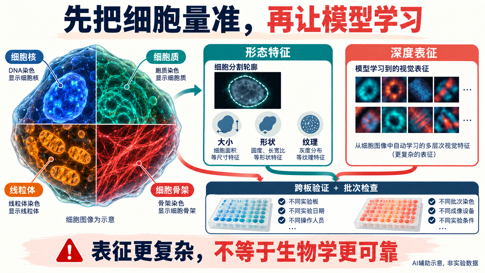
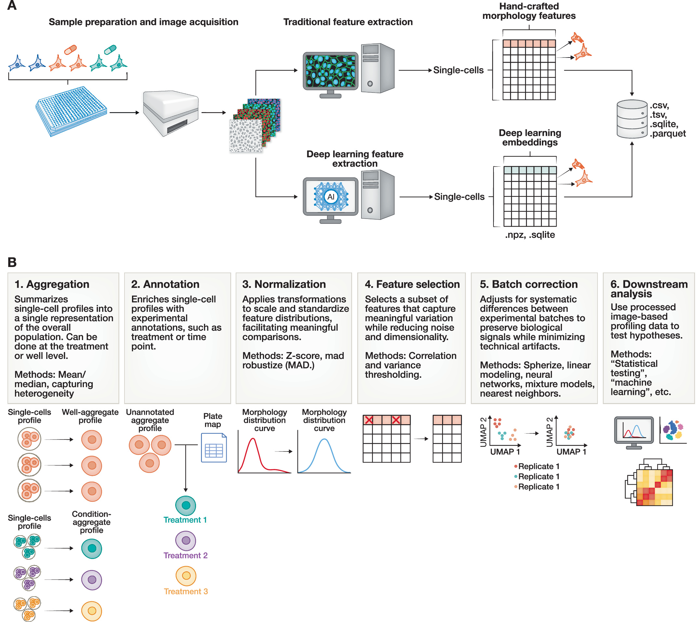
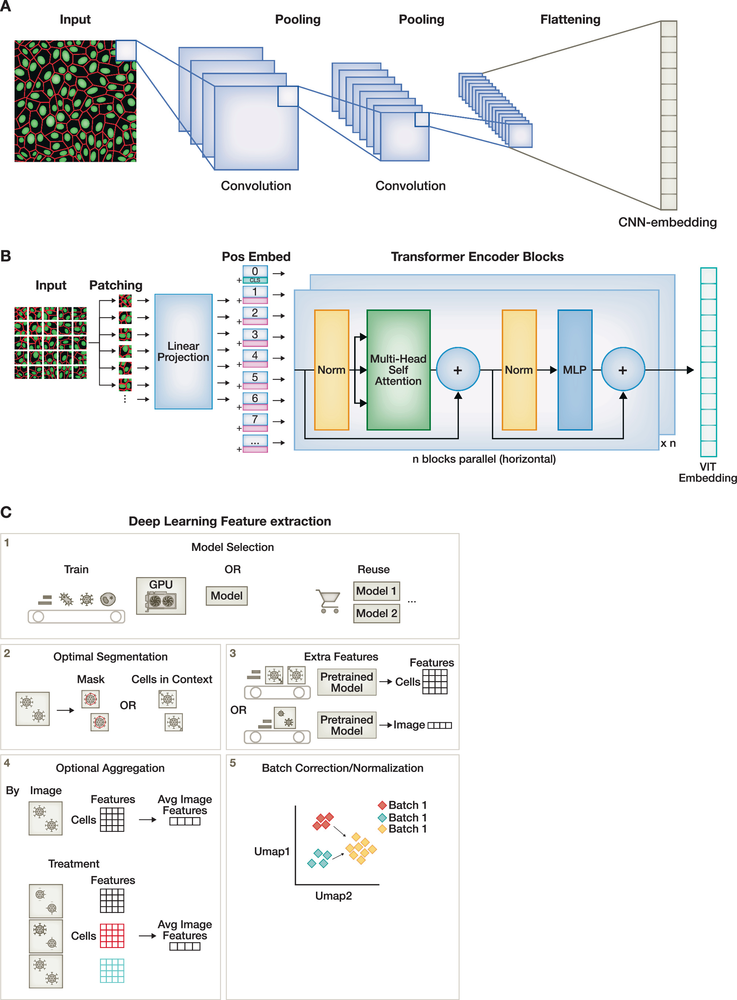
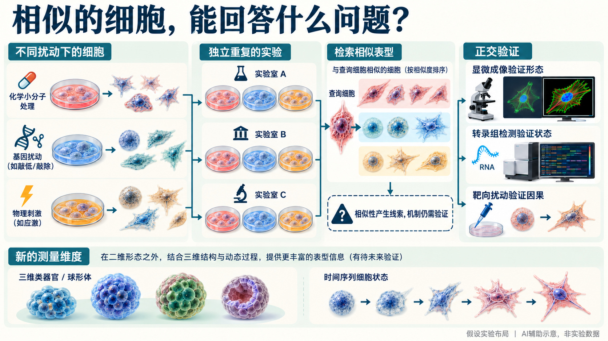
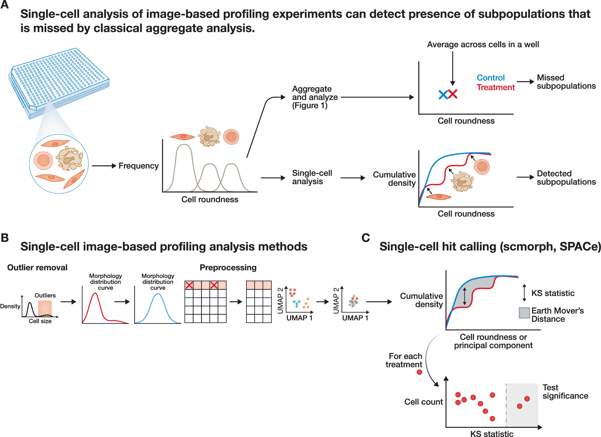
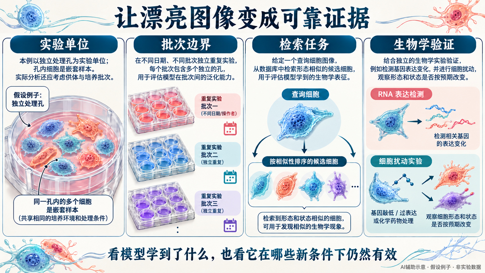

# AI看懂细胞了吗？从显微图像到可信生物学

::: {.book-source}
论文：[DOI 10.1038/s44320-026-00197-7](https://doi.org/10.1038/s44320-026-00197-7)。原有图注和许可说明见正文；未明确许可的图版标记为**授权待确认**。
:::

论文：Progress and new challenges in image-based profiling

类型：Review；Molecular Systems Biology；首次上线：2026-03-27；版本：Version of record

DOI：https://doi.org/10.1038/s44320-026-00197-7

归档说明：合并已交付全文与配图，保留原稿措辞、图注、引用及结尾 Take-home messages；未重新改写。

导读示意｜AI辅助绘制，非实验数据，也不是原论文图。形态特征与深度表征是可选择或组合的并列路线，不要求先计算传统特征再训练深度模型；两条路线都需要跨板验证和批次检查。细胞结构与分色为概念示意，不代表固定的Cell Painting染色配置。

## 一张细胞照片，怎样成为可以相信的数据

给细胞加一种药，第二天拍照。有人看到细胞变圆了，有人注意到细胞核变大，还有人发现线粒体分布发生变化。过去，这些观察常被压缩成几个手工选择的指标。现在，研究者可以同时记录大量形态信息，把每个细胞转换成一串数字，再比较不同药物、基因扰动和实验条件。

这就是基于图像的表型分析，image-based profiling。对做转录组的读者来说，它有一个熟悉的外形：最后也会得到矩阵，也要做质控、归一化、批次校正和统计比较。但矩阵里的列通常不是基因，而是面积、纹理、强度、位置关系，或者深度学习得到的表征维度。一个维度有变化，不能直接翻译成某条通路被激活。

2026年3月，Serrano、Peters、Wagner等人在《Molecular Systems Biology》发表了一篇长篇Review，梳理了这套技术从实验设计到计算分析的整个链条。它最有价值的地方，是把讨论从“哪个AI模型更大”拉回到“怎样得到可靠的细胞表型”。本文以这篇综述为主线，并核对关键原始研究，分两篇讲清方法与证据，第三篇单独整理Take-home messages。综述全文：https://doi.org/10.1038/s44320-026-00197-7

先把问题说具体：当两种药物的图像表征很相似，我们希望知道，相似来自可重复的生物反应，还是同一块培养板、同一天染色、同一台显微镜留下的共同痕迹？这个问题会贯穿整个系列。

## 1\. 从观察表型，走到系统测量

传统成像实验通常先有一个明确指标，比如细胞核里的某种蛋白信号，再围绕它优化染色、分割和分析。表型profiling把范围放宽，希望在一次实验里保留多种可能有用的信息，让此前未被预设的形态变化也有机会被发现。

Cell Painting是其中一种常见实验。它用多种荧光染色覆盖不同细胞结构，再在多个通道中拍摄图像。细胞核的形状、胞质纹理、不同结构的空间关系，都能进入后续分析。这里的“广泛测量”仍有实验边界：没有染到的结构、光学分辨率以下的细节、固定时已经消失的动态过程，不会因为后面接了AI就自动出现。

因此，读一项成像研究，首先应确认它看见了什么。用了什么细胞系？观察哪个时间点？药物剂量是多少？哪些通道对应哪些结构？测的是单个细胞，还是整片视野？这些问题和转录组里的组织来源、取样条件、建库方案一样，决定了结果能够回答的范围。

另一个容易忽略的维度是细胞数量。药物可能改变单个细胞的形态，也可能主要导致细胞死亡或增殖减慢。模型如果利用视野中的细胞密度区分处理组，并不一定是在“作弊”；细胞数量本来可以是有效表型。但若论文把这种区分进一步解释为细胞器机制，就需要额外证据。应该把细胞数量、总体毒性与更细致的形态变化分开检查。

## 2\. 图1的重点：实验设计已经是分析的一部分

图1｜原综述Figure 1，A为实验与图像获得，B为特征处理流程。读图时沿着箭头检查信息如何传递，也要检查哪一步可能丢失信息。图中的分布形状是示意；归一化并不保证数据变成正态分布。B中部分重复编号在原图中重复标为“Replicate 1”，不应据此推断真实重复设计。图片来自Serrano等，Molecular Systems Biology，2026，DOI:10.1038/s44320-026-00197-7，CC BY 4.0：https://creativecommons.org/licenses/by/4.0/，原图未改变科学内容。

先看图1A。处理组与对照组怎样分布在培养板上，往往比后面选择哪个模型更早决定可分析性。如果一种处理永远位于边缘孔，另一种永远位于中央孔，处理效应就可能与位置效应混在一起。板边蒸发、接种密度、培养时间和曝光条件，都会改变图像。

增加同一孔里的拍照数量，可以更充分地描述该孔的细胞，但不能替代独立重复。在同一个培养孔里拍一万个细胞，与在独立实验中重复观察同一种处理，回答的是不同问题。前者帮助估计孔内异质性；后者才更直接地检验结果是否能在新的实验实现中重现。

对照也有不同任务。阴性对照帮助界定背景变化；阳性对照帮助确认实验确实能检测到预期反应；跨批次重复的参考处理则提供连接不同实验的共同坐标。它们不能简单互相替代。对照的数量和分布，应结合预期效应、实验噪声与统计目标设计，不能把某篇文章推荐的重复数当成所有实验的最低通用答案。

随后才是图像质控。失焦、过曝、染色异常、碎屑和污染，会让计算程序认真测量错误对象。均匀照明也不是理所当然的：同一视野中央与边缘的亮度差，可能被误当成细胞之间的强度差。照明校正、质量过滤及其参数，都是测量过程的一部分，应留下可复查的记录。

分割再把图像中的对象变成“细胞”“细胞核”或其他结构。边界画错，会影响面积、纹理、信号归属，甚至制造出不存在的稀有亚群。两个相邻细胞被合成一个，可能看起来像异常巨大的细胞；一个细胞被拆成多个，可能改变细胞数量与形状分布。采用Cellpose或其他深度学习分割工具，也仍需在本实验条件下抽查边界质量。

这条链条中，元数据不能最后补。培养板、孔位、视野、细胞身份、处理、剂量、时间点、重复与批次，需要能相互追溯。一个脱离原始图像和实验条件的特征矩阵，即使可以顺利聚类，也很难判断异常究竟来自生物学还是技术问题。

## 3\. 两种特征路线，各自保留了什么

第一条路线是预先定义测量：用CellProfiler等工具计算大小、形状、强度、纹理和空间关系。它的优点是列名与计算方式比较明确。例如，细胞核面积变大，可以回到分割图确认；某个纹理指标变化，可以查看它对应的图像结构。

“定义明确”与“机制明确”仍有距离。一个纹理特征能够描述像素组织方式，却未必只对应一种细胞过程。面积变化也可能由细胞周期、应激、分割失败等多种原因产生。传统特征适合追溯测量，但不能省略机制验证。

第二条路线让神经网络从图像学习表征。卷积网络逐层组合局部模式；视觉Transformer通常把图像划分成patch，再学习不同部分之间的关系。输出可能是几百或更多维的向量。它们可以捕捉难以手工列举的组合形态，同时也使每个维度的含义更难直接解释。

输入单位会改变表征的意义。对单细胞裁剪图提取特征，更方便研究细胞之间的差异；对整个视野提取特征，可以保留密度、群体排列和周围环境，往往还省去精细分割。但整个视野的向量不能自动当作单细胞状态，单细胞裁剪也可能因裁剪尺寸不合适而丢失上下文。

如果最终任务只是比较不同处理，一种常见做法是把同一孔中细胞的特征聚合成一个向量。中位数可以减轻少量极端值的影响，方便计算孔与孔之间的相似性。代价是某些群体结构会被压平：少数细胞强烈响应，与全部细胞轻微响应，可能得到相近的中心值。下一篇会进一步讨论这个问题。

两条路线并不是非此即彼。可以保留传统特征作为可解释的参照，再测试学习表征是否提供额外信息；也可以融合不同特征。是否值得融合，应由独立测试决定，不能因为向量变长就默认信息更有用。

值得留意的是，比较对象也包括计算负担。一个预训练模型提取向量可能很快，但训练成本、显存需求、数据转换和后续调参并不会消失。传统特征计算可能较慢，却可以直接查看测量定义，并在较小实验中建立清楚的基线。评价效率时，应区分从零训练、适配新数据与批量推理，不能用一个阶段的速度代表整套流程。

2026年正式发表于Cell Systems的Ewald等研究，提供了一个具体参照。在原代人肝细胞中，研究比较传统CellProfiler特征、面向Cell Painting的卷积网络和预训练视觉Transformer。正式论文摘要指出，三种提取方式在该研究的预测任务中总体表现相近。这不表示每项分数完全相同，也不意味着深度学习没有价值；它说明性能需要在目标细胞和目标任务上验证。正式论文：https://doi.org/10.1016/j.cels.2026.101566

把这个结果用于选方法，比较合理的顺序是先建立可复查的传统基线，再考察学习表征是否改善独立测试中的有效读出。如果提升主要发生在某一类终点，就把它报告为这类终点的优势；如果两种特征提供互补信息，再测试融合的收益。模型名字、参数量与预训练规模，可以解释资源与能力来源，不能替代实验结果。

## 4\. 学习目标，决定模型在努力忽略什么

同样一种网络结构，训练目标不同，得到的表征可能相差很大。

弱监督学习可以把“接受同一种扰动”当成近似标签，让模型寻找这些图像的共同点。这个标签很方便，但并不保证每个细胞都真的受到相同程度的影响。基因编辑效率、细胞周期和响应时间，都可能使同一处理组包含多种状态。对没有明显形态效应的扰动，强行要求模型区分，也可能让它转而利用技术细节。

自监督学习则从数据本身构造任务。例如，遮住一部分图像，让模型学习恢复；或对同一图像制造不同视图，让两者得到相近的表征。它减少了人工标签需求，却仍包含研究者的假设：哪些变化应该被忽略，哪些信息必须留下？

在普通照片里，适当改变颜色或裁剪范围，常被用来增加训练多样性。细胞图像却可能把荧光强度、细胞大小、结构间距离当作真正的研究终点。如果增强操作把这些信息抹掉，模型可能获得漂亮的稳定性，同时失去最需要的生物学敏感性。训练增强应服务于测量目标，不能照搬自然图像配方。

跨批次构造同一种处理的正样本对，是让模型学习生物共同点的一种思路。但前提是实验里确实存在可比较的重复。若处理标签与批次完全绑定，模型没有可靠信息判断哪部分差异应保留，哪部分应去除。数据设计的缺口，无法仅靠更复杂的损失函数补齐。

荧光通道也需要谨慎处理。通道数量、染色对象与强度范围并不等同于自然照片的RGB。直接套用预训练模型之前，应检查输入转换是否保留通道身份、跨通道关系，以及目标实验里的强弱差异。所谓基础模型的可迁移性，必须在这些变化下实际测试。

原综述图2C把这条路线概括得很清楚：选择模型与训练策略，视需要做分割，提取表征，视需要聚合，最后仍要进行归一化与批次处理。深度学习替换了部分特征提取方式，后面的统计责任依然存在。

图2｜原综述Figure 2整图。A为卷积网络，B为视觉Transformer，C为深度学习表型分析流程。原图文字需结合图注纠正：B的“parallel”不准确，标准Transformer块依次堆叠；C的“Optimal Segmentation”应为按需分割，“Extra Features”应理解为特征提取，批次图例也重复标为“Batch 1”。这些标签不能用作真实实验设计或架构执行顺序的依据。分割和聚合是否需要，取决于分析单位。来源同图1，CC BY 4.0：https://creativecommons.org/licenses/by/4.0/，原图保留，勘误在此说明。

## 5\. 批次校正：要看见两个方向的证据

假设两块板上都测了同一种药，但第二块板整体更亮。逐板缩放可以减轻这类差异。困难在于，强度本身也可能具有生物学意义。如果整块板几乎都被强效处理改变，用全板分布作为共同基准，就可能把真实变化一起消掉。

这也是阴性对照归一化的价值：它用相对明确的参考建立尺度，而不是默认所有处理的总体分布相同。不过，对照自身不稳定、分布不均，或者各批次根本缺乏可比较的对照时，这个参照也会失效。

常见的稳健缩放使用中位数和中位绝对偏差来降低极端值影响。它调整的是中心与尺度，并不承诺消除所有技术效应，更不会自动把复杂分布变成正态。进一步的批次校正还可能利用特征协方差、共享状态或学习到的表示，每种方法都带着假设。

Arevalo等人的原始benchmark直接检验了这件事：研究在JUMP Cell Painting数据中比较10种方法，设置5种批次复杂度场景，并同时评价去除技术变化与保留生物信号的能力。这里使用的是由单细胞特征求均值得到的孔级CellProfiler profiles，结论有明确的数据层级。原始研究：https://doi.org/10.1038/s41467-024-50613-5

因此，即便某种方法在这些场景里总体表现靠前，也不能直接推广到所有单细胞表征、所有深度模型或所有成像平台。尤其是跨来源、跨仪器的复杂数据，仍然可能存在难以充分消除的批次差异。一次benchmark提供选择方法的证据，不提供脱离条件的冠军名单。

实际分析中，校正前后应同时看两件事。第一，原本由板号、采集日期等技术变量解释的结构是否减弱；第二，同一扰动的独立重复、已知阳性对照和预先设定的生物关系是否仍然保留。把所有点混成一团，也可能意味着有效信息被一起抹平。只展示一张“混得更好”的UMAP，无法回答第二个问题。

## 6\. 在模型比较之前，先定义什么叫“新数据”

训练集与测试集怎样分开，决定了性能数字回答哪一种问题。如果随机拆分同一孔中的细胞，训练集和测试集共享培养、处理与成像条件，评估的是对相近环境中其他细胞的识别能力。它不能自动证明模型在新批次、新实验室或新化合物上也有效。

同样，“没见过的图像”与“没见过的处理”并不等价。研究希望应用到新药物时，就应认真检查化合物是否跨集合重复；希望推广到新细胞系时，就需要相应的留出实验。多个药物具有相同已知作用机制，也可能让任务难度与完全未知机制的场景不同。

这不是要求每篇研究同时解决所有推广问题，而是要求结论与测试范围对齐。数据允许检验什么，就说明什么。把测试单位写清楚，比笼统使用“泛化能力强”更有信息。

预处理也要遵守这条边界。利用目标标签筛选特征、调参或训练表征时，测试样本不应提前参与。若一种批次整合方法需要同时访问待分析批次，这属于另一种使用设定，应公开说明。无标签地访问测试数据与完全独立地预测新样本，在部署条件上也有区别。

比较传统特征与深度表征时，还应尽量保持后续分类器、调参预算、数据划分和评估指标一致。否则，看到的提升可能来自不同预处理或更多调参，而不完全来自表征方法。原综述也强调，跨论文的任务和协议并不统一，不能把零散提升百分比拼成通用性能榜。

还可以做一个很简单的反向检查：表征能多容易地预测板号、孔位或采集批次？如果技术标签比生物标签更容易被区分，这是一条需要调查的线索。它不直接证明所有特征都无效，因为真实实验也可能存在不均衡设计；但至少提示应检查标签混杂、参考处理覆盖和跨批次测试，而不是直接进入机制解读。

另一项有用的检查是回看相似样本的原始图像。在向量空间中相近的两组细胞，究竟共享核形态、细胞密度还是某种背景纹理？相似性被映射回可观察对象后，研究者更容易发现模型是否抓住了预期信息。这个检查不能独立证明机制，却能避免分析停留在无法追溯的坐标上。

走到这里，我们已经有了一张经过质控、具有实验上下文、尽量控制技术差异的表型矩阵。下一步才轮到“相似”：同一种处理能否找回自己的独立重复？相似形态是否指向相近的生物过程？少数响应细胞会不会被平均值淹没？下一篇从这些问题继续，把模型输出接回可验证的生物学。

## 本篇文献与阅读边界

主线为Serrano等的同行评议Review，Molecular Systems Biology，2026年3月27日在线发表，22:624–658，DOI:10.1038/s44320-026-00197-7。本文为主题化解读，并非逐段翻译。实验层级、数据切分与泄漏风险的例子为基于方法原理的解释，不是综述新增实验结果。

批次校正结论另核对Arevalo等，Evaluating batch correction methods for image-based cell profiling，Nature Communications，2024，DOI:10.1038/s41467-024-50613-5。原始数据层级与评估场景已在正文限定。本文不使用跨研究汇总提升值作为性能结论，也不把图中的示意分布当成统计保证。

表征比较补充来源：Ewald等，Cell Systems，2026，DOI:10.1016/j.cels.2026.101566。正式版核到官方摘要与元数据；详细方法比较阅读的是综述所引2025年预印本v1。因此正文只采用正式摘要支持的总体结论，不转述预印本的具体成绩。

导读示意｜AI辅助绘制的假设实验布局，非原论文实验结果。每个实验室均包含全部处理组，避免把处理身份与实验室绑定。检索结果提供候选关系；右侧是可选择的验证路径：独立成像检查形态，转录组补充分子状态，靶向扰动检验具体因果假设，不能把任意一次扰动当作完整机制证明。

## 从相似的图像，走向可检验的生物学

上一篇沿着显微图像到特征矩阵的流程，讨论了实验设计、分割、表征学习和批次校正。这一篇继续追问：得到表型矩阵之后，怎样判断结果值得相信？

一个常见分析是画出相似性地图。某些药物聚在一起，某些基因扰动靠得很近，看上去很容易讲出一条机制故事。但空间距离首先反映的是选择了哪些特征、怎样预处理、用什么相似度，以及如何降维。它可以帮助提出问题，尚不足以单独回答机制。

Serrano等的Review把这个问题放在评估、单细胞异质性与新型成像技术的交汇处。真正困难的步骤，是让图像中的规律经过不同层次的检验，逐渐成为有边界的生物学证据。综述全文：https://doi.org/10.1038/s44320-026-00197-7

## 1\. 相似度之前，先确定要比较哪种相似

两种处理都让细胞核变大，却让线粒体纹理向相反方向变化，我们应该说它们相似吗？答案取决于问题和表征。若关心细胞周期，核相关特征可能重要；若关心线粒体应激，另一组特征更值得关注。把所有维度直接放进同一个距离，也是一种需要解释的选择。

欧氏距离衡量向量的整体差异，容易受到尺度较大的特征影响。余弦相似度更关心向量方向，对整体幅度变化不敏感；这在某些任务中有用，却可能弱化效应强弱的区别。相关系数关注特征之间的共同变化模式，也依赖预处理和有效特征的组成。

如果很多特征高度相关，同一种形态信息可能在距离计算中被反复计权。利用协方差的距离或白化变换，可以尝试降低这种冗余，但高维条件下的协方差估计又需要足够的参考数据和适当正则化。没有一种相似度能在所有数据上自动选出“真正的生物关系”。

因此，相似度应接受任务检验。最基本的问题是：同一种扰动在不同实验重复中，能否得到稳定关系？然后再问：已知具有相关生物功能的不同扰动，能否相互找回？两个问题难度不同，也不能用同一个“效果很好”概括。

UMAP之类的二维图主要用于探索和质控。看到一个漂亮簇之后，应回到原始表征或预先设定的评估空间，量化重复一致性，并检查这个簇是否只是由板号、孔位或细胞数量组成。二维布局中的远近，不应直接等同于高维数据中所有距离关系。

## 2\. 把“像不像”变成检索任务

Kalinin等人在2025年的Nature Communications原始研究中提出一个可复用的评估框架：把每个profile当作查询，在其他profiles里寻找预先定义的相关样本。相关可以指同一种处理的重复，也可以指已有知识支持的生物联系。根据相似度排序后，检查相关样本是否出现在前面。原始研究：https://doi.org/10.1038/s41467-025-60306-2

这个思路把“这片点云看着挺好”变成了可计算的问题。以重复一致性为例，如果某种药物有多个独立重复，查询其中一个时，其余重复应该比不相关样本更靠前。若只在同板样本中表现好，跨板后就明显下降，需要怀疑表征保留了实验环境的共同痕迹。

average precision，简称AP，用一个数概括相关结果在排序中的位置。可以用一个纯教学例子理解：假设需要找回两个相关样本，分别排在第一与第三位，那么在两个命中位置的precision分别为1和2/3，AP就是两者的平均，约为0.83。若两者都排在最前面，AP会更高。

这个0.83不是“机制正确概率83%”，也不是“83%的细胞有反应”。它只是给定相关标签、候选集合和排序规则下的检索成绩。再按照明确规则汇总查询的AP，才得到mAP。在该论文的活性任务中，同一扰动的重复查询合并为扰动级mAP；比较共享生物注释的扰动时，则可形成注释组级mAP。相关样本数量、候选池大小以及是否排除同批次配对，都可能影响成绩，比较研究时必须一起看。

原始论文进一步通过置换构造零分布，判断观测到的检索表现是否超出随机情况，并进行多重检验校正。在这个框架中，percent retrieved指接受检验的扰动或注释组中，多重校正后p&lt;0.05者所占比例，与mAP的数值不是同一件事。一个是排序质量，一个是分组对象通过统计阈值的比例，均不能理解成“有反应的单细胞比例”。

统计显著仍有条件。置换需要与数据结构相容，独立重复数量太少会限制判断；批次与处理相互混杂，也可能让看似稳定的检索结果缺乏生物解释。我们希望看到的是，在合理设计的比较中，真实重复持续靠前，而不是仅仅找到一种让数字好看的分组方式。

把这套评估用于新模型时，可以依次检查三个层次：是否能区分有效处理与阴性对照，是否能检索独立重复，是否能恢复已知生物关系。前一层通过不保证后一层通过。某个模型很容易识别强烈毒性，却未必擅长分辨不同药物的细致作用方式。

还要为“没有明显表型”留出位置。某种扰动在当前细胞、剂量和时间点下，可能确实没有产生可检测的图像变化。此时检索成绩接近背景，不一定说明模型失败，也不应为了让所有处理都能分开而不断调参。换用更相关的细胞背景、时间窗口或独立读出，才能判断是生物效应缺失，还是测量能力不足。

剂量序列则有助于检查关系如何出现。同一化合物的低剂量可能没有明显变化，中间剂量出现较特异的形态，高剂量进入广泛应激或毒性。若只比较高剂量，不同机制可能因为共同损伤而看起来相似。将剂量、细胞数量和形态变化一起呈现，可以帮助读者判断相似性来自哪个效应范围，而不把某一个条件的关系推广到整种化合物。

## 3\. 图3提醒我们：平均值可能丢掉最有趣的细胞

图3｜原综述Figure 3。A比较群体聚合与单细胞分析；B展示单细胞流程；C用累积分布示意KS统计量与Earth Mover’s Distance如何识别分布变化。图为概念示意，没有提供某一种药物的实测效应量；B中的分布变化也不意味着归一化保证正态。图片来自Serrano等，Molecular Systems Biology，2026，DOI:10.1038/s44320-026-00197-7，CC BY 4.0：https://creativecommons.org/licenses/by/4.0/，原图未改变科学内容。

设想两种响应。第一种处理让所有细胞的某个特征都轻微上升；第二种只让少数细胞发生强烈变化，其余基本不动。均值可能接近，细胞群体的组成却很不同。如果后续机制恰好发生在那一小群细胞里，单一中心值可能掩盖线索。

读图3A时，关注的应该是分布的形状，而不仅是中心位置。细胞群体可能变宽、出现长尾、形成双峰，或者某个亚群的比例改变。使用分位数、分布距离、亚群频率或学习式聚合，可以保留不同层次的信息。哪种表示适合，仍取决于研究要识别什么变化。

图3C中的KS统计量寻找两条累积分布曲线之间的最大差异；一维情形下，Earth Mover’s Distance可以直观理解为把一个分布搬成另一个分布需要付出的“搬运成本”。这些方法让分析不必只盯着均值。EMD距离本身不产生p值；KS统计量也需结合适当的零分布或检验解释。显著性判断还需要相应的统计方法与有效重复设计。不过，分布不同本身没有告诉我们原因：真实响应、细胞周期组成改变、不同密度、分割错误，都可能造成差异。

尤其要注意统计单位。一个孔里几千个细胞共享环境，不能轻易当成几千个独立实验重复。细胞数量增加，可以让孔内分布估计更精细，却不能凭空增加独立实验的数量。跨孔、跨实验的重复结构应在统计设计中保留，避免把很小的技术差异解释成极强证据。

单细胞质控也更敏感。被误合并的两个细胞可能落入“巨大细胞亚群”，碎屑可能形成“低信号亚群”。反过来，真正受到强烈扰动的细胞也可能被通用异常值过滤误删。因此，筛除规则需要结合图像抽查，对异常群体保留可回看路径，不能简单把偏离主群的细胞全部认定为坏数据。

这类分析最好回答一个可检查的问题：某种处理是否在独立重复中，持续增加某类形态状态的细胞比例？然后再通过其他标志物、时间信息或功能实验，判断这个状态意味着什么。这样，异质性才从漂亮的分群，变成可以继续验证的生物现象。

## 4\. 一张终点照片，为什么可能遗漏整个过程

大多数固定细胞实验只记录某个时间点仍然留在视野中的细胞。那些早已死亡、脱落或离开观察区域的细胞，可能已经不在数据里。此时看到的“耐受状态”，也许主要反映幸存者，而不是最初群体的全部反应。

时间序列成像可以补充这部分信息，但要区分两种设计。在不同时间点拍摄群体，能够观察总体分布如何变化；连续追踪同一细胞，才能更直接地连接某个起始状态与后来命运。前者不能自动恢复每个细胞的真实轨迹。

单细胞追踪因此需要可靠身份匹配。细胞移动、分裂、相互遮挡，都可能导致追踪中断或身份交换。一条看起来突然转变的轨迹，有时是程序把两个不同细胞接在了一起。手工修正少量视频尚可，大规模筛选中则会成为主要限制。

时间采样也要与生物过程匹配。间隔过长，快速变化可能被漏掉；拍摄过密，又会增加光照负担、存储和计算成本。活细胞染料与标记方法还需要考虑毒性及对目标过程的扰动。更多帧并不自动意味着更接近真实过程。

三维成像把另一个缺失维度补回来。细胞突起、细胞器空间关系以及类器官内部组织，在二维切片中可能被截断或重叠。代价是更复杂的分割、更多计算和存储，以及更难获得的标注真值。选二维还是三维，应由需要分辨的现象决定，而不是把维度数量当成研究质量分数。

对于时间与三维数据，评估也应跟着变化。静态图像中有效的特征，不一定能描述动态轨迹；二维上表现好的分割，也不保证在厚组织中稳定。新模态增加了可观察的信息，同时增加了需要验证的测量环节。

## 5\. 虚拟染色的考题，是下游生物信息

另一条快速发展的路线，是利用明场或相差图像预测荧光样式的图像，也就是虚拟染色。它有吸引力：无标记成像通常更适合持续观察，也可能降低染色负担，并让已有荧光分析工具处理这些预测图像。

但预测通道与实际染色测量有不同的证据地位。模型只能利用输入中可识别的信息，以及训练中学到的规律。当某个目标结构与输入外观的对应关系不稳定时，输出仍可能很像荧光图，却没有忠实保留目标实验中最重要的变化。

Tonks等在2023年ISBI的同行评议研究中，使用18种细胞系评估虚拟染色，把像素层面的图像相似、形态特征和筛选质量放在一起检查。研究中的核与胞质读出总体更接近真实染色，但部分胞质强度指标仍有偏差，DNA损伤相关斑点的细节则更难保留。视觉可信与下游读出可信，在这个具体设置里发生了分离。原始研究：https://doi.org/10.1109/ISBI53787.2023.10230501

这项结果不意味着所有虚拟染色模型都会在相同结构上失败。它提供的是一种应当保留的检验逻辑：用真正关心的生物读出评估预测图，而不只看示例图片或全图相似度。对稀疏的小斑点而言，大片背景预测正确，可能掩盖局部关键信息的损失。

还有更隐蔽的情形：某个筛选质量指标改善，也未必全部来自真实信息恢复。若生成模型系统地减小组内差异，甚至根据条件信息产生固定样式，就可能使两组看起来分得更开。需要结合真实染色、未见过的条件及细胞层面的对应关系，判断改善来自何处。

因此，虚拟染色结果应显式标为预测。验证可以从目标结构、目标特征、目标筛选任务逐层展开，并把细胞类型、处理条件或实验批次留作独立测试。特别是用于发现新现象时，更应警惕模型把偏离训练分布的真实变化“修正”成它熟悉的外观。

## 6\. 形态与组学，怎样相互补足

对转录组研究者，最有吸引力的下一步是把形态状态接到分子层面。图像能保留细胞结构、定位、邻近关系和部分动态；RNA测量提供分子表达信息。两者观察同一系统的不同方面，结合后可以提出更具体的问题。

不过，联合测量有不同层级。来自同一种处理的图像与RNA数据，建立的是条件层面的联系；来自同一细胞的两种测量，才更直接对应细胞层面。不能因为两套数据都写着“单细胞”，就默认每一行可以一一配对。

光学混合筛选又提供了一条连接方式：先在混合细胞中记录形态，再通过原位读取条形码等方法，识别细胞接受了哪种遗传扰动。这样可以在共享环境中分析许多扰动，但条形码解码、细胞匹配、扰动效率和对照设计仍决定结论质量。给细胞标上一个guide身份，并不等于已经测量了它全部的分子变化。

计算整合也需要区分“共同变化”与“机制解释”。某个形态状态与某组基因表达相关，可以帮助选择后续实验；若模型据此预测缺失的表达值，预测值仍应与实际测得的RNA区分。将一种模型输出作为另一种模型的验证标签，可能使两边共同的假设形成循环论证。

联合分析还要核对时间。图像变化与RNA表达变化可能先后出现，采样间隔不同会改变两者的相关性。一次不一致，既可能来自噪声，也可能提示真实的调控时序。比较之前应对齐实验条件，并保留时间信息；不能把所有不一致都交给整合算法消除。对成像和组学各自的阴性、阳性对照做独立检查，也能减少两种测量共同受到处理批次影响的风险。

走向机制时，可以从相似性提出候选通路，再使用独立扰动、剂量与时间变化、靶向测量或救援实验逐层检验。每一步增加的是不同类型的证据。相似形态可能由共同下游应激造成，真正的上游作用靶点仍可能不同。

解释模型的工具也放在这个层级看。注意力图或特征归因可以提示模型依赖哪个区域，帮助发现背景泄漏、分割问题或者值得追查的结构。但“模型看了这里”与“这里导致了表型”之间，还有实验要做。尤其是输入根本没有记录的动态过程，无法只靠解释算法恢复。

## 7\. 一套结果，怎样让别人重新检查

综述最后花了相当篇幅讨论数据与软件基础设施，这部分很容易在阅读时跳过，却直接决定科学结论能否复查。

只分享一张降维图，别人无法判断分群来自哪些特征；只分享最后的向量，别人无法检查分割是否错误；只分享原始图像而没有板图和处理信息，也难以重建比较。不同层级的材料需要相互连接，才能从结果回到实际观察。

图像格式、特征表格式和分析流程解决的是不同问题。OME-TIFF或OME-Zarr帮助组织影像及元数据，适合不同存储和访问场景；列式特征表帮助处理大规模数值；流程管理工具则记录步骤、参数、软件版本与依赖。使用某一种开放格式，并不自动补齐缺失的实验信息。

公共数据也不是天然无偏的测试场。综述特别提醒，部分数据中的孔位与扰动对应关系可能固定，批次覆盖也可能不均。如果训练和测试共同继承这些关系，模型可能通过实验布局识别标签。分析公开数据时，同样需要先读实验设计与元数据。

所谓“标准答案”也有局限。已知蛋白互作、通路成员或药物靶点数据库有助于评价生物关系，但没有记录的关系未必不存在，已经记录的关系也未必会在当前细胞和剂量下产生可见形态。评价标签的来源与适用范围，应与模型成绩一起报告。

一套有说服力的表型研究，最终应能回答：原始观察是什么，哪些处理改变了它，这种变化能否在独立重复中找回，结论依赖哪些分析选择，以及下一步如何用不同方式检验。AI扩大了可以从图像中提取的模式，也让这些问题变得更重要。

下一篇独立整理Take-home messages，把本系列收束为读论文、设计实验和检查分析结果时可以直接使用的清单。

## 本篇文献与阅读边界

主线Review：Serrano等，Progress and new challenges in image-based profiling，Molecular Systems Biology，2026，DOI:10.1038/s44320-026-00197-7。

检索评估原始研究：Kalinin等，A versatile information retrieval framework for evaluating profile strength and similarity，Nature Communications 16:5181，2025，DOI:10.1038/s41467-025-60306-2。已核相关主文段落与方法，包括AP/mAP、任务分组和置换检验定义；未逐项审计所有数据集实验。正文0.83仅为教学算例，不是论文实测数据。

虚拟染色原始研究：Tonks等，Evaluating virtual staining for high-throughput screening，IEEE ISBI，2023，DOI:10.1109/ISBI53787.2023.10230501。已读5页同行评议稿的正文、方法、结果和讨论；正文限定到其数据与模型设置。原综述在这一处误写了特征提取软件，本文依据原始论文描述，不沿用该工具名。

时间成像、三维与多组学部分是Review层面的主题整理与方法学解释，未逐篇复核该综述引用的所有应用研究；因此不转述其中具体成功率、成本倍数或新增机制数量。

导读示意｜AI辅助绘制，非实验数据。本例以独立处理孔为实验单位，孔内细胞为嵌套样本；实际分析还需考虑供体、培养与批次层级。检索可以在细胞或孔级profile上定义，须与任务相匹配；图中细胞形态不代表真实实验轨迹。

## Take-home messages：把一张细胞照片变成可靠证据

前两篇围绕Serrano等2026年发表在Molecular Systems Biology的Review，走过了基于图像的表型分析流程。本篇独立收束：读一篇新论文，或者准备启动自己的实验时，哪些判断最值得带走？Review原文：https://doi.org/10.1038/s44320-026-00197-7

一句话概括：图像经过计算得到的是一种测量与表征；可信的生物学结论，还需要实验设计、独立重复、匹配任务的评估和后续验证共同支撑。

## 1\. 先认清矩阵的每一行、每一列

行可能是细胞、视野、培养孔或一种处理，它们不是可以随意交换的分析单位。一个孔里增加几千个细胞，有助于刻画孔内分布，不等于增加几千个独立实验。

列可能是有明确计算定义的形态特征，也可能是模型学习的匿名表征维度。两者都可以有用。传统特征的名字清楚，不代表机制清楚；深度表征能够预测标签，也不代表每个维度都能翻译成某条生物通路。

读论文时先找这两句话：每个profile代表什么？一个独立重复如何定义？如果找不到，后面的性能数字很难解释。

## 2\. 先解决测量问题，再比较模型

染色对象、细胞状态、采样时间、照明、曝光与分割，决定了哪些信息进入数据。模型无法凭空补回实验从未记录的细节。

至少应能回看一批原始图像及分割边界，并知道质量过滤排除了哪些对象。特别要检查异常亚群：它可能是关键响应细胞，也可能是错误合并、碎屑或污染。过滤规则需要证据，不能只靠“离主群远”。

保留实验与图像元数据，和保留特征矩阵同样重要。板号、孔位、时间点、剂量与处理身份，是识别混杂、重建分析和定位错误的基础。

## 3\. AI表征值得测试，传统基线也值得保留

模型架构只是分析的一部分。训练目标、增强方式、输入通道、裁剪范围和聚合策略，都可能改变最终保留的信息。

如果研究关注荧光强度或细胞大小，就要检查训练增强是否把这些信息当成应当忽略的变化。若使用整个视野的向量，也应检查模型是否主要依赖细胞数量、背景或孔位痕迹。

比较模型时，尽量对齐数据划分、后续预测器、调参预算与指标。将“预训练推理很快”与“从零训练成本低”分开说。Ewald等在原代人肝细胞的研究提供了一个提醒：在其测试任务中，不同特征路线总体表现相近，复杂度并不自动兑换成优势。正式论文：https://doi.org/10.1016/j.cels.2026.101566

## 4\. 批次校正必须同时回答两个问题

技术差异是否减弱？真实生物差异是否保留？

只展示批次混合得更好的降维图，证据不够。应该结合跨批次重复、阳性对照、预设生物关系和技术标签一起看。处理与批次完全混在一起时，算法没有可靠依据替实验作出区分。

Arevalo等的benchmark比较的是JUMP中的孔级CellProfiler profiles，覆盖10种方法和5类实验场景。它支持按数据条件选择方法，不支持给所有成像数据排出一个永久冠军。原始研究：https://doi.org/10.1038/s41467-024-50613-5

## 5\. 让性能数字对应一个明确问题

随机留出同一孔中的细胞，和留出新培养板、新化合物或新细胞系，检验的是不同推广能力。论文应该说明自己测试了哪一种，读者也应按这一范围理解结论。

检索指标同样需要上下文。mAP评价相关profiles在相似度排序中的位置；它不是机制正确概率，也不是有反应的细胞比例。查询是什么、哪些匹配算正确、候选池有哪些样本、是否排除同板比较，都应公开。

Kalinin等的框架还把排序成绩与置换检验结合。在该框架中，mAP按扰动或生物注释组汇总；percent retrieved是这些受检对象中，经多重校正后p&lt;0.05者的比例，应与mAP本身区分，更不能当作显著单细胞占比。重复少、对照少或混杂明显时，显著性解释也会受限。原始研究：https://doi.org/10.1038/s41467-025-60306-2

## 6\. 看见分布，再决定要不要聚合

群体中心值方便比较，但可能掩盖少数强响应细胞、亚群比例变化或双峰结构。单细胞分析能补充这些信息，也会更直接地暴露分割错误与细胞层面的噪声。

分布距离、亚群频率和学习式聚合，保留的信息各不相同。使用哪一种，应先说明想检测什么现象，再用独立重复检验。一个显著的分布差异，只说明观察到变化；它的来源仍要回到实验与图像中寻找。

## 7\. 新模态增加信息，也增加验证任务

时间序列可以观察固定终点遗漏的过程，但群体在不同时间点的照片不能自动当作同一细胞的轨迹。单细胞追踪要检查身份交换、丢失和分裂处理。

三维成像有助于保留结构和组织关系，也提高了分割、标注和计算要求。是否值得采用，由研究需要分辨的现象决定。

虚拟染色必须标为预测。图片逼真、全图相似度高，不能保证稀疏结构或目标读出被正确保留。Tonks等的研究显示，在其特定模型与数据里，DNA损伤斑点的下游读出可以明显偏离真实染色。因此要用目标生物任务检验预测图。原始研究：https://doi.org/10.1109/ISBI53787.2023.10230501

## 8\. 让形态线索引导下一次实验

相似形态可以帮助寻找候选机制，却可能来自不同上游原因引发的共同下游应激。注意力图指出模型使用了哪里，也不能单独证明哪里造成了变化。

结合RNA、蛋白或其他读出时，先确认两种数据是在同一细胞、同一样本，还是仅在同一处理条件下对应。实际测量与计算预测要分清，避免让一套模型的输出循环验证另一套模型。

更有说服力的路线，是从可复现形态出发，提出候选过程，再用独立扰动、时间与剂量变化、靶向读出或救援实验检验。每一步都说明它新增了哪一种证据。

## 最后，带着五个问题读下一篇论文

- 图像真正测到了什么，哪些过程没有被观察？

- 独立重复和测试数据如何定义，是否与目标应用匹配？

- 模型输出能否回到原始图像，排查技术来源？

- 性能提升来自哪里，在什么条件下成立？

- 从相似表型到生物解释，还缺哪一步独立验证？

如果这些问题都能得到具体回答，即使模型不新，研究也可能很有价值。相反，再漂亮的图、再大的模型，也不能代替这条证据链。

## 阅读说明

主线Review为同行评议正式文章，2026年3月27日发表，DOI:10.1038/s44320-026-00197-7。本系列完整阅读其主文、三张主图与图注、三张表和两份补充数据表；并围绕批次校正、检索评估和虚拟染色核对原始研究的对应方法与结果。Tonks研究完整读取5页同行评议稿；Arevalo、Kalinin为重点方法与相关结果核查，未重跑全部分析。Ewald正式版核到摘要与元数据，详细方法参考其2025预印本，正文未使用未经正式版全文复核的具体性能数字。

这是一组主题化解读与方法学解释，不是综述引用文献的全覆盖审计，也不把流程示意图当作实测结果。
