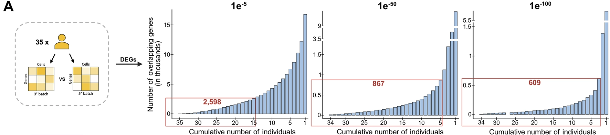
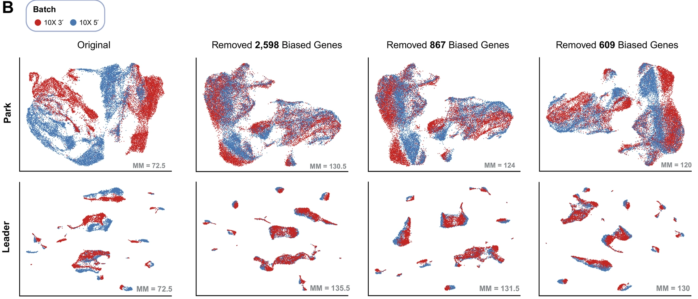
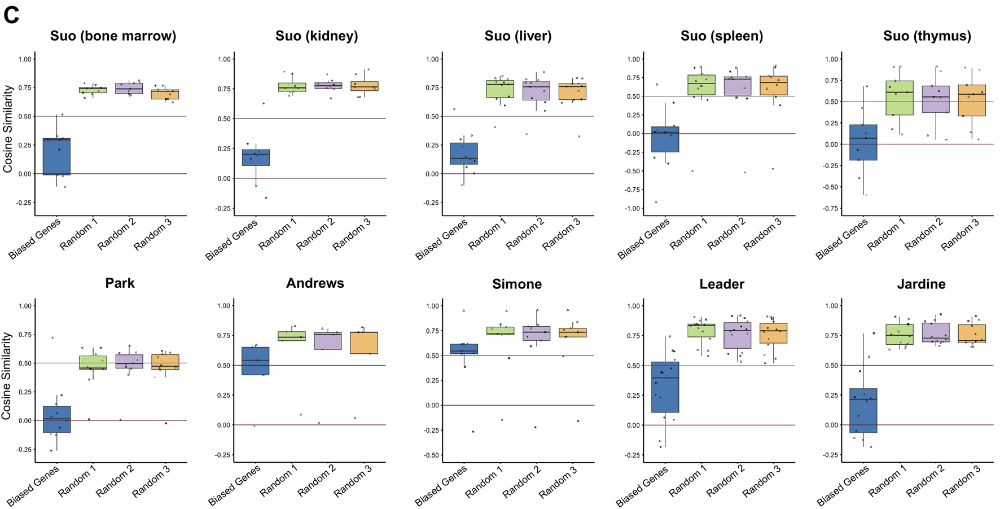
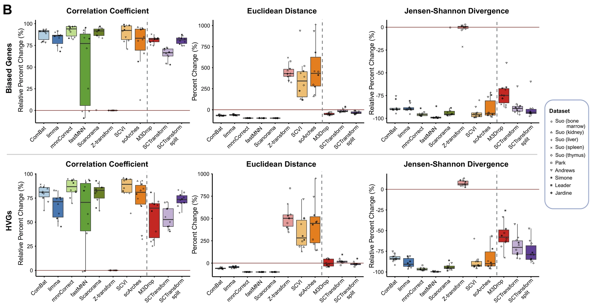
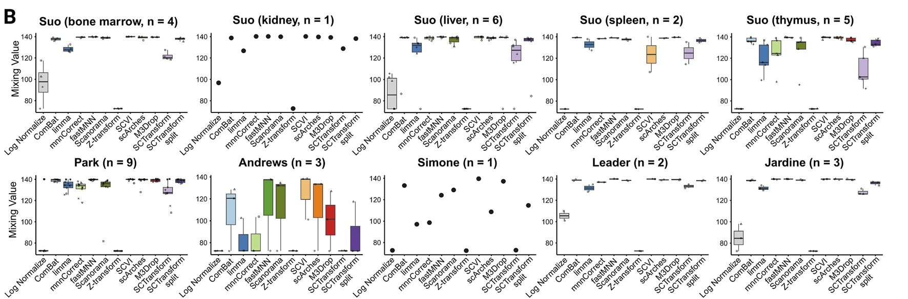
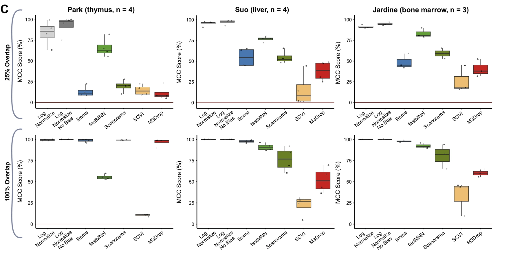
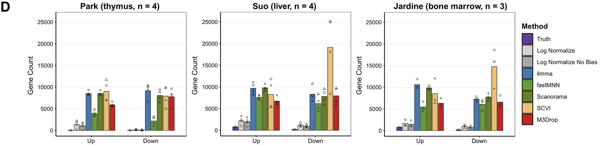
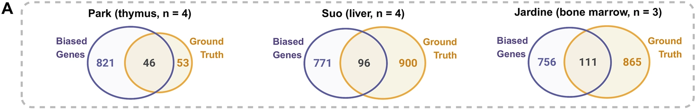
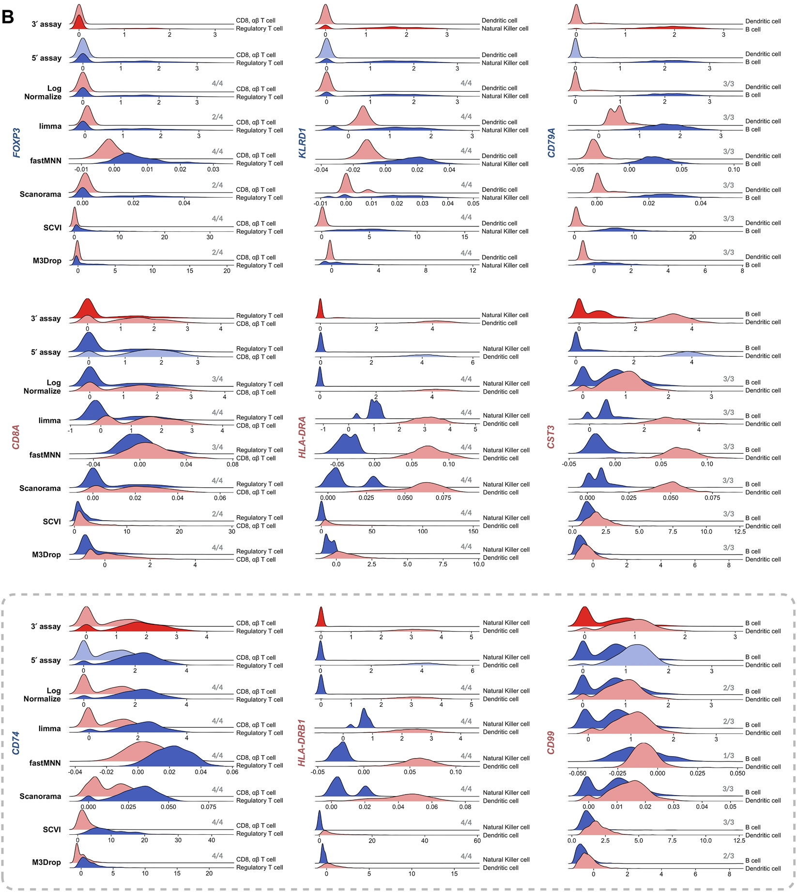

# 单细胞去批次：混得好就靠谱吗

::: {.book-source}
论文：[DOI 10.3389/fbinf.2026.1931243](https://doi.org/10.3389/fbinf.2026.1931243)。原有图注和许可说明见正文；未明确许可的图版标记为**授权待确认**。
:::

Characterizing and mitigating protocol-dependent gene expression bias in 3′ and 5′ single-cell RNA sequencing。Frontiers in Bioinformatics，首次上线 2026-10-08。[DOI](https://doi.org/10.3389/fbinf.2026.1931243)

本笔记合并完整解读，保留正文、证据边界、图注和引用；不代表公众号已发布或用户已实质审读通过。

AI辅助原创示意，非实验数据。

## 找出867个偏倚基因，再看11种方法

AI辅助示意，非实验数据。 原创导读示意｜协议混合与基因表达保真需要分别检查，不代表论文实测数据。

### 先问一个常见问题

把10X的3′和5′单细胞数据放在一起，原本按技术分开的两团点，经过校正终于混到了一起。接下来，你会直接使用这份表达矩阵寻找细胞标记吗？这篇研究提醒我们：协议标签不再清晰可见，与基因之间的差异得到正确保留，是两个需要分别验证的目标。一张整齐的UMAP，不能独自替后续差异表达分析作答。

本文解读的是2026年10月8日发表于Frontiers in Bioinformatics的正式研究论文。作者先寻找反复出现的3′／5′表达偏倚，再比较11种归一化或校正配置，最后构造细胞组成不充分重叠的场景。它的价值在于把“看起来混合了”拆成可检查的不同问题，同时公开了可以追溯的样本信息、偏倚基因名单与分析代码。

### 3′和5′究竟改变了什么

这里的3′和5′指RNA的不同端点。常见10X表达计数并不是把每条完整RNA从头到尾均匀测量，而是依赖特定的建库、捕获与计数流程。两种方案都可以估计基因表达，却未必以相同比例捕捉每个基因。因此，同一来源的细胞即使没有真实状态变化，也可能因协议不同而呈现某些基因偏高、另一些偏低的系统差异。

“批次”则是更宽的概念。不同供者、组织、处理日期、分选方式、化学版本和计数流程，都可能与批次标签纠缠。本文重点考察3′与5′协议差异，并尽量在匹配来源内比较；它并没有证明所有实验室差异都能用同一套基因名单解释。实际项目仍应先整理实验设计，判断哪些技术因素与真正关心的生物变量重合。

输出层级也需要先分清。低维嵌入可以帮助聚类、注释和观察细胞邻域，表达矩阵则常用于解释具体基因的变化。某种方法可能提供很好的坐标，却不能据此保证重建表达适合直接做差异检验。本文把注意力放在基因层面的结果，这也决定了它为什么不能替只输出低维表示的其他方法作全面评价。

### 先看匹配设计，再数样本量

作者从CELLxGENE整理了六项研究的数据，覆盖胸腺、骨髓、肝脏、脾、肾等组织背景。主文按36组匹配比较报告，研究／组织进一步分成10个子集。匹配意味着两种协议来自相应的样本来源，并不意味着同一个细胞被测量两次。因此，细胞类型比例与取样差异仍然可能影响比较，需要在预处理与解释阶段处理。

尤其不能把36直接写成36名独立供者：补充表S1包含同一供者的不同组织或分选组。图1A示意又写了35×，与主文36组的说法存在不一致。我们的解读保留这项差异，不替作者编造补充样本。类似基准研究中，“点的数量”“样本比较数”和“独立生物学重复数”必须分开，箱线图漂亮并不自动增加独立证据。

作者进行了细胞质量控制、注释整理和组成检查，排除了部分组成差异过大的匹配组，对某些过细注释作了合并，也没有把稀有小群体全部纳入评价。这能降低明显的不匹配干扰，却也限定了结论范围：本文主要回答经过这些筛选的数据怎样表现。极稀有细胞、强烈组成失衡或完全不同组织，不应被默认为已经充分验证。

### 图1A：867个基因如何进入名单

作者先在各匹配组内检验3′与5′表达差异，再找跨组反复显著的基因。图1A右侧三幅柱状图使用不同显著性阈值，横轴涉及基因在多少比较中反复出现，纵轴为共享差异基因数量。读图要留意横轴数字的方向和纵轴断点，不能只凭柱高判断三个阈值之间差多少；红色框和数字指出后续分析选取的名单规模。

三份名单分别包含2,598、867和609个基因，下载的三个CSV与这些唯一基因数相符。作者重点使用867个这一折中集合，结合10的负50次方量级阈值及至少五组比较的重复出现条件。主文与补充材料对p值、FDR的术语使用并非完全一致，复现时应回到脚本核对，不能把不同统计口径悄悄当作同一个阈值。

显著性极强并不等于每个基因都有同样巨大的偏移。细胞数较多、方向较稳定，都可能使统计证据变强；重复出现也会更容易捕捉高表达、广泛表达的基因。名单的意义是提供一组值得警惕的协议相关信号，而不是宣判这些基因只有技术作用。后面会看到，有些名单成员同时具有清楚的细胞类型信息。

原文图1A｜不同阈值下反复出现的偏倚基因集合，注意横轴方向与纵轴断点。 来源：Shydlouskaya等，Frontiers in Bioinformatics（2026），DOI: 10.3389/fbinf.2026.1931243。CC BY 4.0（https://creativecommons.org/licenses/by/4.0/）。原样面板裁切，数据、坐标和标签未改动。

### 图1B和1C：删去少数基因为什么有帮助

图1B按列比较原始结果和移除三份偏倚名单后的UMAP，红点表示3′，蓝点表示5′；两行示例来自Park与Leader数据。角落的MixingMetric按协议标签计算，数值越高意味着两种协议的细胞在邻域中混得越充分。删去名单后，部分原本分开的点云更接近，说明这批基因确实参与了低维空间中的协议分离。

但删基因后的坐标会重新计算，UMAP中靠得更近不能直接翻译为某个基因的表达数值恢复真实。它首先说明：移除这组特征能够改变由协议主导的邻域结构。若下游问题正依赖被删除的基因，这种做法还意味着相关信息已退出分析。改善后的图形需要与剩余生物结构、基因覆盖和具体用途一起评价。

原文图1B｜Park与Leader示例中移除偏倚基因后的协议混合变化。 来源：Shydlouskaya等，Frontiers in Bioinformatics（2026），DOI: 10.3389/fbinf.2026.1931243。CC BY 4.0（https://creativecommons.org/licenses/by/4.0/）。原样面板裁切，数据、坐标和标签未改动。

图1C进一步问：是不是随便去掉一批基因也会这样？横轴是偏倚集合和三次随机集合，随机集合匹配了基因数量与表达水平构成；纵轴是3′与5′细胞类型平均表达向量的余弦相似度，点的形状表示细胞类型。多数小图里，偏倚集合对应的蓝色箱体明显更低，说明这些基因确实集中承载了较多协议差异。不能把某个小图的相似度当成全部数据统一的准确率。

这里的随机对照很关键。如果任何一组相同数量的基因都得到同样表现，867这个特定名单就没有多少额外价值。表达构成匹配的对照进一步避免把“挑到的都是高表达基因”简单等同于发现了协议偏倚。另一方面，图1C是在比较被选中基因本身的一致性，并不是证明删除这些基因后所有生物差异都完整保留下来。

原文图1C｜867基因集合与表达构成匹配随机集合的余弦相似度对照，形状表示细胞类型。 来源：Shydlouskaya等，Frontiers in Bioinformatics（2026），DOI: 10.3389/fbinf.2026.1931243。CC BY 4.0（https://creativecommons.org/licenses/by/4.0/）。原样面板裁切，数据、坐标和标签未改动。

补充图还将867名单用于七组未参与发现的匹配比较，包括独立肾脏数据和原研究中未使用的样本。这支持一定的可迁移性，但七组比较不等于七名完全独立的新供者，更不等于任意组织都适用。验证中的细胞数、类型组成和表达覆盖仍会影响能检出多少偏倚基因，应与验证结果一起阅读。

### 偏倚来自哪里，证据推进了多远

作者发现，这批偏倚基因偏向较高表达及翻译、能量代谢等基础功能，并检查了转录本两端GC含量与长度等特征。这些分析帮助描述名单，却不足以给所有偏倚指定唯一机制。没有检测到某个序列特征的强关联，也不意味着捕获效率、转录本结构或计数流程一定无关，尤其在分析基因与组织范围有限时。

作者还在一个匹配脾样本中重比对，比较只计外显子与纳入内含子读段的结果，部分基因的显著性和偏移会变化。这说明上游计数定义也能进入所谓“协议偏倚”。不过，一个样本的重比对不是全部数据的独立重复实验；它提供的是机制线索，不能据此概括所有样本的偏倚均由内含子计数造成。

### 11种方法，实际比较的是11种配置

比较名单包括ComBat、limma、mnnCorrect、fastMNN、Scanorama、Z变换、scVI、scArches、M3Drop，以及两种SCTransform设置。SCTransform分别按协议运行，和把协议作为回归变量处理，是两种配置。因此“11种”更适合理解为11个实际评价对象，不能简单转写成11套互不相关的软件。

这些配置的输出并不处于完全相同的数值空间：有的移除基因层面线性偏移，有的借助共享邻域建立对应，有的输出残差或重建表达。基线也分成两组：ComBat到scArches主要对照对数归一化数据，M3Drop与SCTransform则对照对数归一化后再标准化的数据。图2B的竖虚线就是在提醒读者，这两边并非同一条起跑线。

### 图2B：相关性提高以后，距离仍可能变大

图2B上排使用867个偏倚基因，下排使用3,000个高变基因；每列是一项指标，每个箱体对应一种方法，点形状区分10个研究／组织子集，不能读成36位独立供者。相关系数关注两组表达变化的共同趋势，通常越高越好；欧氏距离关注数值差距，越低越好；Jensen–Shannon散度衡量分布差异，也以更低为佳。作者将结果换成相对于各自基线的变化，因此红色零线代表没有改善，而不是表达量为零。

相关系数和散度有边界，图里使用的是根据基线与变化方向、按对应边界间可变化空间归一化的百分比；欧氏距离则按普通百分比变化处理。于是“相关性改善80%”不能翻译成“准确率80%”，也不能与距离下降80%直接当作同一份分数。不同方法又可能输出不同尺度的矩阵，距离指标尤其需要结合输出单位阅读。补充图S8提供原始指标值，有助于避免只盯着变化比例。

在这套数据与参数下，ComBat和mnnCorrect在多项数值一致性指标上表现较强，fastMNN也有改善；scVI与scArches可以提高相关性，同时在距离类指标中出现不利变化。两者并不矛盾：表达向量的升降趋势更相似，与每个数值更接近，是不同条件。这类结果首先要求检查输出尺度，不能直接改写成某软件普遍准确或普遍失效。

SCTransform的两种配置同样提醒我们，软件名不是完整的方法描述。分别处理协议的版本与回归协议标签的版本表现不同，输入数据、参数和输出层都影响结论。对于使用者，比记住榜单更有帮助的是留下这些可复现细节：究竟输入原始计数还是已归一化矩阵，是否先合并对象，比较的又是哪一层结果。

原文图2B｜数值一致性指标的相对变化，竖虚线两侧使用不同基线。 来源：Shydlouskaya等，Frontiers in Bioinformatics（2026），DOI: 10.3389/fbinf.2026.1931243。CC BY 4.0（https://creativecommons.org/licenses/by/4.0/）。原样面板裁切，数据、坐标和标签未改动。

### 图3：混合得更好，只回答了一部分问题

图3B沿方法排列各个箱线图，纵轴是按协议标签计算的Seurat MixingMetric，点形状表示组内的不同样本比较；不同研究／组织子集分开显示。在这个定义下，数值高通常意味着跨协议邻域混合更充分。ComBat、fastMNN和M3Drop在这些检查中较突出，limma、Z变换与SCTransform回归配置则相对较弱。

但是，同一个混合指标换成细胞类型标签以后，期望方向就会变：不同类型保持一定可分性，通常比无条件混在一起更符合生物问题。补充图S10进行了这项检查。不存在一个脱离标签定义的“混合越高越好”；甚至同一方法也可能一边改善协议混合，一边削弱部分细胞类型边界，两项证据应该并排读。

Scanorama提供了具体例子：补充图S9分别展示从校正表达矩阵重新计算的UMAP，以及直接使用该方法嵌入得到的UMAP，两种结果并不等价。使用者若只展示嵌入的漂亮图形，却让差异分析使用另一份矩阵，就可能把一种输出的优点误当作另一种输出的保证。本文的比较不能代替这种逐层核对。

标记基因重叠率也有类似陷阱。两份名单交集增加，可能因为真正恢复了共同生物信号，也可能因为两边检出的名单同时变长。补充结果把重叠分数与基因数放在一起，帮助识别这两种情况。重叠得更多只是一项现象，只有结合方向、名单规模以及已知标记分布，才能进一步判断它是否值得信任。

原文图3B｜按协议标签计算的MixingMetric，较高数值代表更充分的跨协议混合。 来源：Shydlouskaya等，Frontiers in Bioinformatics（2026），DOI: 10.3389/fbinf.2026.1931243。CC BY 4.0（https://creativecommons.org/licenses/by/4.0/）。原样面板裁切，数据、坐标和标签未改动。

### 本篇结论应停在哪里

可以比较稳妥地说，在本文筛选的匹配数据中，一组反复出现的基因承载了较多3′／5′差异；移除这些特征或使用若干校正配置，能够改善某些一致性与邻域指标。但尚不能据此确认所有细胞类型标记都得到保留，也不能决定真实项目该不该校正。下一篇将减少两批数据共享的细胞类型，让基准评价更接近难处理的实际场景。

本节来源：

 https://www.frontiersin.org/journals/bioinformatics/articles/10.3389/fbinf.2026.1931243/full

 https://www.frontiersin.org/journals/bioinformatics/articles/10.3389/fbinf.2026.1931243/full#supplementary-material

 https://github.com/Val554/10X_3prime_vs_5prime/tree/44410289f9fc67101a063af58427cea042b5ea9f

## 当两批细胞不再相同，排名为何翻转

AI辅助示意，非实验数据。 原创导读示意｜共享细胞组成改变时，批次校正与标记保留需要重新评价，不代表论文实测数据。

把两批细胞放到同一张图上，颜色终于混在一起，分析者往往会松一口气。可接下来真正要交付的，可能是一张差异基因表：哪类细胞更活跃，哪个标记仍然可靠，哪些变化值得做实验。这时，图上的靠近还不够。一次让总体表达更相似的校正，也可能把原本有用的细胞差异改写了。

Shydlouskaya等人在这项3′与5′单细胞测序研究中，把评估推进到了这一关。前面的配对分析已找到867个反复呈现协议偏倚的基因，并比较了多种表达校正配置；接下来，作者故意让两批数据的细胞组成不再对称，检查校正后的矩阵还能不能找回细胞标记。Figure 4和Figure 5最值得读的，是排名改变背后的实验条件。

### 先把两批数据之间的“桥”拆掉一部分

压力测试来自胸腺、肝脏和骨髓三个组织，分别包含4、4、3组配对比较。作者先选出在两种协议中都足够多、彼此又可以区分的两类细胞，再进行人工删减：让其中一类只留在3′数据，另一类只留在5′数据，其余共同出现的类型提供两批之间的连接。

所谓25%重叠，指两种协议共同拥有的细胞类型所包含的细胞，约占删减后全部细胞的25%。它不表示同一批细胞被重复测了两遍，也不表示只保留四分之一基因。100%重叠则采用原来的完整样本作为较容易的对照，目标类型不再被人为限制在单一协议中。

这个设计把现实中常见的困难放大了：当某种细胞身份与测序协议绑在一起，算法看到的一段表达差异，究竟有多少来自技术、有多少来自生物学？共同细胞可以提供线索，但线索变少以后，校正对细胞组成及模型假设的依赖就更容易显现。这里模拟的是特定的不完全重叠，不能代表所有病人与健康人、所有跨组织整合。

这一轮只比较limma、fastMNN、Scanorama、scVI和M3Drop，另设普通对数归一化、先去掉867个偏倚基因再对数归一化两条基线。它没有把前面全部11种配置重新跑一遍。作者以limma代表这一轮的线性调整方法，也意味着不能顺手给未进入压力测试的方法排出胜负。

对真实项目来说，桥的多少还不是唯一问题。同一来源的配对样本，帮助作者尽量隔离协议差异；跨研究合并时，取样、组织处理、疾病状态与供者差异可能同时出现。若实验分组恰好与协议完全重合，单靠一张校正后的矩阵，未必能把这些原因拆开。这里的人工删减是可控的压力测试，不能替代对原始实验设计的检查。

### 所谓正确答案，是怎样得到的

要说“找回标记”，先得知道参照是什么。作者在未删减的数据里，分别于3′、5′内部比较同样的两类细胞，只保留在两种协议中都显著、且上调方向一致的基因；然后继续跨样本取交集，得到每个组织的一份参照DEG集合。显著性门槛为FDR小于0.05。

这是一份同源数据内的共识参照。它的优点是不用把某一个协议当作绝对标准，也减少了偶然显著结果的影响；代价是更偏爱在多个样本中反复可检出的强标记。稀疏表达、个体特异或只在部分状态出现的真实差异，可能在取交集时消失。本文将其称为内部参照，而不把它当作独立实验验证过的完整生物学真值。

这个区别会影响后面的每一句结论。某种方法多检出一个参照之外的基因，既可能是制造了差异，也可能是恢复了共识交集遗漏的信号；少检出一个基因，也可能与统计功效有关。作者因此没有直接使用最常见的二分类规则，而是为Matthews相关系数，简称MCC，设计了自己的分类方式。

按方法正文，同向且在参照与测试中都显著的基因计为TP；同向、参照显著但测试不显著的计为FN；两边都不显著的计为TN，不要求方向相同；两边都显著却方向相反的计为FP。这些类别强调“该在哪类细胞里更高”，并不是把所有新检出的基因都归为假阳性。

还要多看一步公开代码。已核对的UseCase.R实现，会排除参照不显著而测试显著、且方向一致的基因；其FP条件则把方向相反的基因纳入，并不要求两边都显著。方法文字、图示与代码因此没有完全对齐。本文未重跑这套评估，不能据此给出修正后的分数，也不能断言某个差异足以推翻排名。

MCC以TP×TN－FP×FN为分子，分母是（TP＋FP）、（TP＋FN）、（TN＋FP）、（TN＋FN）四项乘积的平方根。四类计数由上述自定义规则得到，参与评分的基因及排除规则都会影响它。图中乘以100展示的分数，不是“正确基因百分比”，更不是通常定义的假阳性率。对复现者而言，先固定代码版本并逐条列出分类条件，比照抄一个MCC公式更重要。

### Figure 4C：对照条件变了，优势也会变

Figure 4C按列分为胸腺、肝脏、骨髓，上排是25%重叠，下排是100%重叠。横轴列出处理方法，纵轴为MCC Score（%），不同点形状标识具体样本比较，箱体概括其分布。在作者这套评分规则下，越高表示与内部参照越一致；每列只有3或4个比较，箱体不能营造出大样本检验的错觉。

最醒目的现象在上排：先删偏倚基因的对数归一化基线处在高位，普通对数归一化也保持较高分数。五种校正方法中，fastMNN在三个组织的部分重叠场景里表现相对稳健，但仍低于这些简单基线。于是，一个能提高整体表达相似度的方法，并未自动赢下跨协议找细胞标记这场考试。

沿着同一列往下看，limma在完整重叠时明显回升；Scanorama在胸腺的变化也很突出。这个对照支持一个有实际意义的判断：方法表现依赖两批数据能提供多少共同细胞背景。它不支持“重叠越少，所有方法都按相同比例变差”，更不能把一个组织中的次序推广为永久排行榜。

另一条容易被忽略的信息是：删基因基线改变了可分析的基因范围。更高的一致性分数，回答的是保留下来的基因如何表现，无法保证被移除的基因仍能服务于原来的生物学问题。要判断这种策略值不值得，必须继续看删掉了什么，而不是在最高的箱体旁画一个勾就结束。

原文图4C｜25%与100%共同细胞类型覆盖下的自定义MCC分数，三列分别为胸腺、肝脏和骨髓。 来源：Shydlouskaya等，Frontiers in Bioinformatics（2026），DOI: 10.3389/fbinf.2026.1931243。CC BY 4.0（https://creativecommons.org/licenses/by/4.0/）。原样面板裁切，数据、坐标和标签未改动。

### Figure 4D：基因表变长，需要怎样解释

Figure 4D换了一个问题：各种处理最后报告了多少显著差异基因？横轴的Up、Down表示两类目标细胞比较中的两个方向，纵轴是基因数量。紫色Truth表示内部参照，灰色对应两条归一化基线，其余颜色对应校正方法；图上的样本点提醒我们，柱子的概括背后仍有重复间差异。

在这张图里，一些处理把几百或几千的基因表推到了更大的规模。肝脏和骨髓中，scVI的Down方向尤其突出；fastMNN相对于部分简单基线也有明显增长，不能概括成处处只是“略微增加”。这些图形足以提示校正显著改变了下游检出的规模，却不足以逐个判定新增基因是真是假。

这里的纵轴是数量，没有除以受检基因总数，也没有给出一份独立验证的错误数。更何况内部参照本身经过跨协议、跨样本取交集，比单次测试更保守。把“多检出一万”直接写成“制造一万个假阳性”，会跨过现有证据能支持的边界。合理的下一步是检查新增基因的效应方向、分布、重复性，以及是否有独立证据。

原文图4D｜不同处理检出的上调与下调基因数量，不能直接当作假阳性数量。 来源：Shydlouskaya等，Frontiers in Bioinformatics（2026），DOI: 10.3389/fbinf.2026.1931243。CC BY 4.0（https://creativecommons.org/licenses/by/4.0/）。原样面板裁切，数据、坐标和标签未改动。

### Figure 5A：偏倚基因也可能是真标记

Figure 5A的韦恩图把代价摆到了台面上。左圈是867个协议偏倚基因，右圈是各组织的内部参照标记；交集依次为46、96、111。图中数字都是集合的绝对数量，并无横纵轴，也没有把圆面积定义成可供精确测量的比例尺。

以“参照标记中多少会被删掉”为问题，分母应取右圈总数：胸腺为46＋53＝99，肝脏为96＋900＝996，骨髓为111＋865＝976。于是重叠约为46.5%、9.6%、11.4%。如果改用867作分母，得到的是偏倚清单中有多少属于该组织参照，回答的已经是另一件事。

胸腺最能说明问题：这份有限的参照里，接近一半同时带有协议偏倚。一个基因完全可以既反映真实细胞身份，又受捕获技术影响。正文把三个组织都概括为“至少10%”只能近似理解，肝脏的96/996严格说略低于10%。删基因是一种主动缩小分析范围的取舍，不能包装成清除了一批毫无生物价值的噪声。

原文图5A｜协议偏倚基因与内部参照标记的交集，需明确使用哪一个集合做分母。 来源：Shydlouskaya等，Frontiers in Bioinformatics（2026），DOI: 10.3389/fbinf.2026.1931243。CC BY 4.0（https://creativecommons.org/licenses/by/4.0/）。原样面板裁切，数据、坐标和标签未改动。

### Figure 5B：直接回到单个基因的分布

Figure 5B是山脊密度图。每列对应一个组织中的细胞比较，每组行依次展示原始3′、原始5′、对数归一化及不同处理方法。最上方两行分别用红色和蓝色表示3′与5′协议，每行再以深浅区分该协议内的两类细胞；后续处理行的红蓝曲线，才对应分别保留在3′与5′中的两类细胞。右侧细胞名称和横轴数值都必须一起读，不能在全部行套用同一套颜色解释。

横轴表示该行所用矩阵中的表达或校正数值，山脊的高度表现分布密度，不能读成测到了多少分子、多少细胞。各行横轴尺度并不统一：有的在零附近，有的延伸到几十甚至上百。曲线看起来更窄、峰更高，可能与尺度变化有关，不能单凭视觉宽度判定技术噪声减少。

这些尺度差异来自输出对象的不同。对数归一化值、Pearson残差、重构表达并非同一种量；出现负值可以是中心化或校正后的结果，不代表负数个RNA分子。fastMNN、Scanorama的部分图行落在很小的数值区间，也不意味着细胞的真实转录活动被压低到了原来的百分之一。

可以先从FOXP3读起：在胸腺所选两类T细胞中，它提供了有方向的标记信息。右侧灰色4/4或2/4，表示该基因在多少个样本比较中仍被检为相应细胞类型的标记；分母是这里的4个比较，骨髓则为3。这是跨样本检出的次数，不是预测准确率、表达细胞比例或显著性大小。

再看灰色虚线框内的CD74、HLA-DRB1和CD99，它们兼具内部参照标记与协议偏倚基因两种身份。尤其是CD99，两类细胞的分布本就有较多重叠，不同处理对分布形状和标记检出次数的影响更容易看见。这样逐个核对，比“平滑后的曲线更漂亮”更贴近研究者实际关心的问题。

这组示例并未覆盖所有基因，也不能靠几个典型峰形证明某个算法总会抹掉生物学信号。它支持的结论是：全局得分不足以描述每个基因遭遇了什么。零附近细胞是否整体移动，原有双峰是否保留，目标细胞之间的方向是否一致，都值得与标记列表一起检查。

原文图5B｜原始协议与不同处理后的标记基因分布，各行横轴尺度不同。 来源：Shydlouskaya等，Frontiers in Bioinformatics（2026），DOI: 10.3389/fbinf.2026.1931243。CC BY 4.0（https://creativecommons.org/licenses/by/4.0/）。原样面板裁切，数据、坐标和标签未改动。

### 把结论带回自己的流程，还差哪一步

论文的主要评估对象是校正或重构后的细胞×基因矩阵，再把这些输出交给统一的下游分析。某个方法在这里表现欠佳，适用范围也应限定在所测试的输入、配置、输出和检验组合。对于只输出潜在空间的方法，或使用原生模型完成差异表达的方法，这份研究并没有做同样完整的比较。

scVI尤其需要把实现讲清。已核对的代码使用counts层，基因似然设置为负二项分布；不能沿用讨论里关于高斯假设的表述，推导出“scVI把原始计数当作高斯数据”的解释。这里使用解码后的归一化表达进入基准，并未对scVI原生贝叶斯差异表达流程作同等评估。因此，“所有scVI都不适合差异分析”超出了研究范围。

计算成本也要连同环境保留。补充材料的耗时来自特定样本规模与实现，scVI、scArches和Scanorama使用Apple M3 Pro，其他方法主要运行在所述集群CPU环境。它可以提示哪些配置值得先做小规模测试，却不能直接整理成同硬件速度排行榜，更不能据此估算百万细胞项目的总耗时。

如果要复现这部分结果，最先固定的应是样本子集、细胞标签、协议间删减规则、867基因清单、参照集合及MCC分类代码。随后再核对表达矩阵的层、尺度、受检基因范围和软件版本。公开代码提供了追溯入口；但代码与文字有差异、部分参数影响下游时，“可以下载”与“已经严格复现”之间仍有一段需要实际运行和核验的距离。

实操时可以把保留全部基因与排除偏倚清单的结果并排查看，尤其追踪自己的关键候选是否落在清单里。如果结论随过滤而改变，应报告这种敏感性，并保留被排除基因的原始证据供后续核验。否则，一份变得整齐的结果表，可能只是把最难回答的生物学问题移出了分析范围。

这项压力测试最有用的启发，是把成功标准提前写清。若目标是找细胞群，需要检查整合后的结构；若目标是比较某个基因，需要回到表达分布；若目标是生成可验证的标记表，就必须同时考虑参照、方向、检出规模与被删除的候选。不同任务可以需要不同的分析出口。

在这些配对数据和人工部分重叠条件下，简单归一化以及排除已知偏倚基因的策略，值得作为认真评估的基线；但删基因的代价也真实存在。最稳妥的结论并非选出一个永远优胜的方法，而是保留原始信息，明确每一步改动了什么，并让最终的生物学判断有机会接受独立检验。

本节来源：

 https://www.frontiersin.org/journals/bioinformatics/articles/10.3389/fbinf.2026.1931243/full

 https://www.frontiersin.org/journals/bioinformatics/articles/10.3389/fbinf.2026.1931243/full#supplementary-material

 https://github.com/Val554/10X_3prime_vs_5prime/tree/44410289f9fc67101a063af58427cea042b5ea9f

## Take-home messages

AI辅助示意，非实验数据。 原创导读示意｜跨协议分析的检查步骤，不代表论文数据或软件性能排名。

### THM：先用一句话记住

跨3′与5′整合后的点云混合良好，不能独自证明表达矩阵保留了细胞类型差异。本文发现并公开了一组反复出现的协议偏倚基因；数值一致性、协议混合、标记恢复三类目标需要分别检查，真正适用的方法取决于你接下来要用哪一种输出回答什么问题。

### 这篇论文做了什么

研究以六项公开研究、主文所称36组匹配比较寻找偏倚，再评估11种归一化或校正配置，最后在胸腺、肝脏和骨髓中构造共享细胞类型减少的压力测试。36是比较口径，不宜写成36位独立供者；后一个测试只使用部分方法，也不是11种配置的完整统一排名。

### 关键数字应该怎样读

867是重点使用的偏倚基因集合，另有609和2,598两个名单；七组是未参与名单发现的匹配验证比较，不等于七位全新独立供者。25%表示共享类型约占场景内细胞的比例，既不是相同细胞被重复测量，也不是基因重叠率。

### 检查一：技术与生物因素是否重合

列出供者、组织、分选、处理、3′／5′版本、计数流程与细胞组成。如果某一种目标细胞只出现在一种协议中，就不能指望软件凭空区分全部技术效应与真实差异。先识别实验设计的约束，再讨论参数和方法。

### 检查二：你正在使用什么输出

把原始计数、对数归一化值、标准化残差、重建表达和低维嵌入分开记录。写清软件版本、输入层、关键参数与输出用途，不要用一份嵌入图的优势为另一份表达矩阵背书。相关性改善也不等于距离、计数尺度或差异检验全部改善。

### 检查三：给简单基线留一个位置

保留未经额外批次校正的分析，同时比较移除偏倚名单会怎样改变结果。过滤能够减少干扰，也会改变参与检验的基因集合；它没有恢复被删基因的表达，更不能保证所有核心生物标记都还在分析范围内。

### 检查四：先确认混合指标的标签

按协议计算时，更充分的混合通常是目标；按细胞类型计算时，保留合理的类型区分同样重要。图3与补充图S10应结合阅读。指标的名字相同，并不意味着在不同标签下都该向同一个方向优化。

### 检查五：标记名单为什么变长

观察两批标记重叠时，同步检查各自的基因数、方向与单基因分布。新增显著结果既可能来自噪声减少，也可能与尺度变化、平滑或检验前提有关。只凭名单变长不能宣判全部是真发现，也不能把它们全部归为假阳性。

### 检查六：评价分数实际在计什么

本文MCC使用作者自定义的方向与显著性分类，部分基因被排除；公开UseCase.R与正文、图4B的分类规则还存在不完全一致。不要将其换算为普通DEG假阳性率。复现时先固定版本、核对分母与排除条件，再解释方法之间的分数差距。

### 检查七：回到与你的问题有关的基因

图5显示协议偏倚名单与细胞类型标记存在交集。若核心问题涉及这些基因，直接删去名单可能使问题本身无法回答。逐样本检查原始表达、处理后数值范围与标记方向，同时注意密度图不同行的横轴尺度并不一致。

### 三句话不能从本文推出

不能推出“所有单细胞项目都无需去批次”；不能推出“固定删掉867个基因就保证无偏”；也不能推出“本文某个配置表现欠佳，所以这套软件的所有功能都不适用”。结论边界是本文的数据、版本、输入输出与评价任务。

### 复现入口与阅读范围

正式全文、补充图S1–S12、表S1–S7和三个CSV提供研究细节；作者仓库提供分析脚本。本解读完成了全文与关键代码的静态核查，没有重新处理原始数据，也没有重跑基准。运行时间使用了不同硬件，不能直接整理成同条件速度排名。

### 留下一个分析习惯

当下一张整合图看起来非常整齐时，先挑一个与你的问题直接相关的基因，回到原始样本、细胞组成和当前输出层，确认“混得更好”是否真的帮助你回答了那个问题。

本节来源：

 https://www.frontiersin.org/journals/bioinformatics/articles/10.3389/fbinf.2026.1931243/full

 https://www.frontiersin.org/journals/bioinformatics/articles/10.3389/fbinf.2026.1931243/full#supplementary-material

 https://github.com/Val554/10X_3prime_vs_5prime/tree/44410289f9fc67101a063af58427cea042b5ea9f
