# 把单细胞变异表补满，肿瘤克隆就更可信了吗？

::: {.book-source}
论文：[DOI 10.3389/fbinf.2026.1962436](https://doi.org/10.3389/fbinf.2026.1962436)。原有图注和许可说明见正文；未明确许可的图版标记为**授权待确认**。
:::

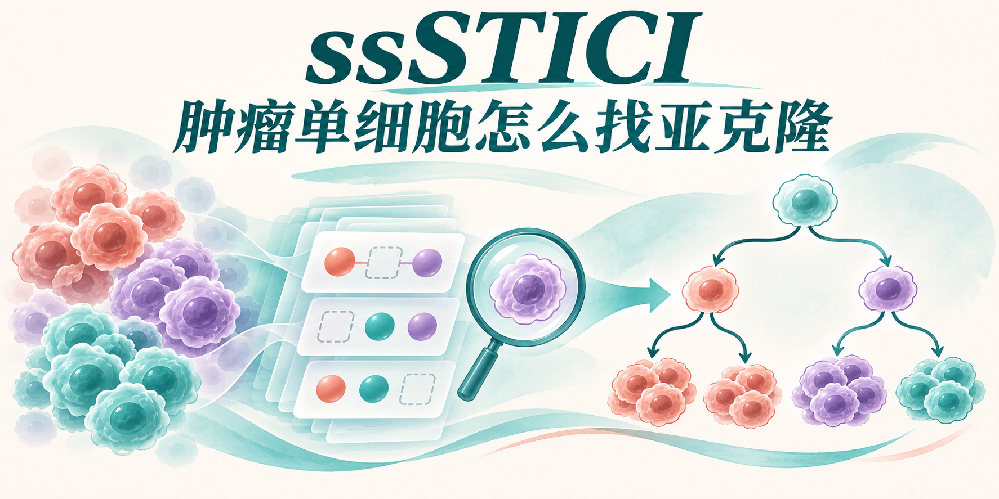

AI 辅助原创概念示意，非实验数据。

Craig JM、Mowlaei ME、Miura S、Shi X、Kumar S，*Frontiers in Bioinformatics*，2026-11-19 正式发表的原创研究，DOI [10.3389/fbinf.2026.1962436](https://doi.org/10.3389/fbinf.2026.1962436)。本稿为中文独立精读，不是论文译文或实验复现。阅读以正式主文 PDF 和在线 HTML 为底本。先说结论：模型能在一些稀疏数据里恢复**更像已知克隆**的结构，但同一份图里，模拟的真值、真实病例的替代标签，以及模型新画出来的分支，可靠程度不同。

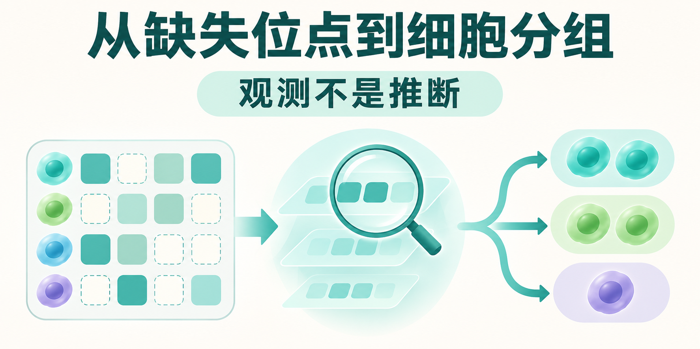

AI 辅助原创概念示意，非实验数据。

Craig JM、Mowlaei ME、Miura S、Shi X、Kumar S，*Frontiers in Bioinformatics*，2026-11-19 正式发表的原创研究，DOI [10.3389/fbinf.2026.1962436](https://doi.org/10.3389/fbinf.2026.1962436)。本稿为中文独立精读，不是论文译文或实验复现。阅读以正式主文 PDF 和在线 HTML 为底本。先说结论：模型能在一些稀疏数据里恢复**更像已知克隆**的结构，但同一份图里，模拟的真值、真实病例的替代标签，以及模型新画出来的分支，可靠程度不同。

## 一、从“哪些基因在用”到“哪些细胞可能同源”

单细胞 RNA 数据通常被拿来分细胞类型，看的是基因表达，即细胞当下是什么状态。Craig 等想从同一批既有数据里问另一件事：这些细胞是否还有携带共同体细胞变异的证据，可能来自同一条肿瘤谱系？表达很像的两群细胞不一定同源；同一克隆的细胞也可能因为组织位置或状态不同而分到不同表达簇。于是论文中的 genetic type（GT）不是“又一种表达细胞类型”，在这里是用遗传信息定义的细胞群。

用 RNA 推这个问题，有两个先天困难。第一，RNA 不是完整基因组。一个位置没读到不等于没变异；对应基因未表达、表达低或覆盖不足，都可能留下空白。第二，少数读到的位置也未必完全可靠。论文将细胞放成行、可比较的候选变异位置放成列。Fig. 1 用彩色碱基与大片问号展示输入的真实难题：两条细胞记录往往只在很少位置能直接相互对照。它不是表达零值表，更不能把问号填成参考等位，再把填出来的模式叫作证据。读者如果只从一张树开始看，数据究竟有多少直接观测，会被树的整齐线条遮住。

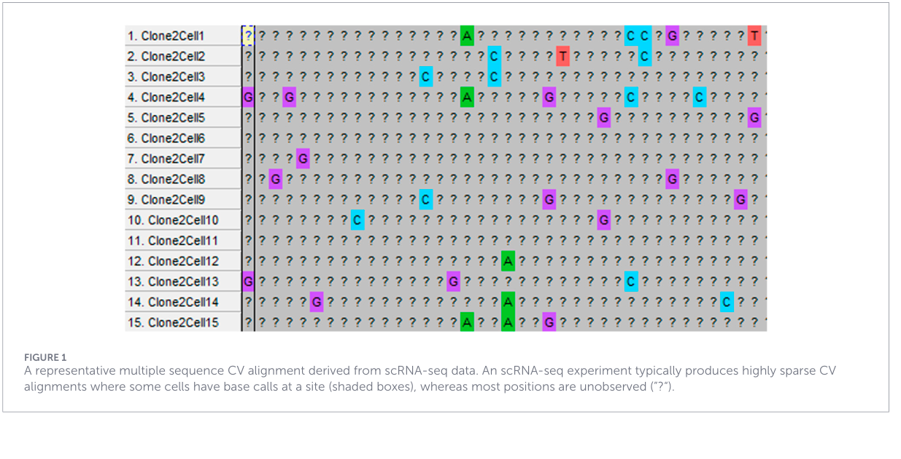

图1｜沿着同一列找共享的观测：彩色格是记录碱基，灰问号是缺测。行名只是论文展示中的细胞编号；原图并未给来自这几行的诊断标签。

有些研究用复制数改变（CNA）给肿瘤细胞粗分群。大片段信号相对容易从聚合读数推断，但相同的大段变化并不是每个单核苷酸变异（SNV）的真值。另一方面，可靠的 SNV 信息有机会看到更细层级；两类信号问的颗粒度本来就不同。该论文值得读的点不是主张用 SNV 替掉 CNA，而是它把问题切开：先在有明确答案的模拟里看补全和复群，再问两份实际数据里结果可否与 CNA 粗标签对照。后面的证据层级正由这道分界决定。

## 二、一个样本一个模型：为什么有机会，又为什么不能直接迁移？

作者借来最初用于人群基因型补全的 STICI 架构，但用于肿瘤时不是直接套用人群参考数据的结果。他们将 ssSTICI 分别拟合到某一张细胞×变异表，从这张表里实际观测的组合学习关系。直觉是，若细胞继承了共同祖先的一组体细胞变异，在树上可能共享一个模式；即便单个细胞缺很多，其他细胞的局部观测仍可能提供线索。论文比较的 BEAM、PhylinSic 与 CellPhy 并非同一种方法：大体各自借助树、概率补全或联合误差/演化模型，作为不同思路的参照。

自监督的关键是：只把已观测格子的一部分暂时挡住，让模型猜回去；从来没读到的格子不作为已知标准答案。在 95% 稀疏的模拟中，训练时挡住已观测格子的 80%，也就是约占整张表的 4%，其余约 1% 可作当轮输入；不是把 80% 的细胞扣出来做外部验证。这也解释 “de novo” 的用法：针对每一份数据重新学自己的结构，不证明模型已在另一个病人可靠工作。

这里尤其容易把三个好听的短语弄混。“自监督”回答标签从何而来，不等于没有标签误差；“高置信”表示模型输出的 softmax 分数高，不等于这格已经被又一种技术确认；“保留的位点很准”只说明过了分数门槛的预测子集，不说明被拒掉的那些位置。若一批错误在同位置、同技术批次或同一表达状态中反复出现，模型没有机制保证忽略它；这项工作的随机误差模拟也不能直接替这种系统误差背书。

最有启发的是作者没有把原来用于训练的已观测格子与预测格子一股脑合并。模拟里，对原始已观测位置的预测准确率约 93.0%，低于在阈值 0.99 下接纳的新补预测 98.2%；作者认为旧观测中的部分错误被模型学回去了。后续构树用的是原先未观测的接纳预测，训练用的原观测位置在该矩阵里剔除。于是“补全”不能理解成原始矩阵原封不动加一层颜色，也不能把旧观测和新猜测共同当成两个独立证人。反过来，这也不证明所有高质量实测都应该丢掉：这个策略是在本文的错误模型和比较设计下评估的，换一套数据应重新核验。

方法上，团队保留 STICI 架构里的一维卷积和注意力等原有结构，改的是单细胞碱基任务的前后处理和训练目标。正式方法说保留分类交叉熵和 KL 散度，去掉为胚系等位基因剂量服务的 Mach-Rsq 损失；未观测位置不进入监督损失。换句话说，输入来自 RNA，不表示这个模型学的是表达量，而是离散碱基模式。本文也没有用模型训练的损失曲线代替临床误差估计。

## 三、模拟效果有多大？先把两个分母抄清楚

模拟里共有五组，每组 1,000 个细胞、500 个候选变异位置，同组的真序列一致；模拟源含假阳、假阴误差，再使约 95% 的格子未观测。这个设计给了作者真实研究无法知道的答案：每格真实碱基是什么、哪个细胞属于哪组。它同时也把真实肿瘤中本来可能连续或复杂的组内演化简化了。Fig. 2G 图注明说同组真分支长度为零，这一点不宜从图里漏读。较大的树间距改善不等于模型已经恢复一个具有同等复杂度的真实谱系。

作者沿用的一套模拟原来用二元值记录是否突变，包含 1% 假阳性和 20% 假阴性，再随机赋碱基状态并加缺失。这里的假阴性不是最终 95% 缺失，也不能将 20% 和 95% 相加。因为五个真组各有千个细胞且组内真序列相同，模拟评估的是在这组可控结构和噪声下找回预设的类别。换成克隆高度不均衡、小组只有寥寥几十细胞、或覆盖偏向某一状态，即使同样总体缺 95%，问题也不同。

Table 1 显示，同一个模拟矩阵，TBP 门槛越高，接纳的格子越少。在 0.95 门槛，接纳预测的正确率是 97.2%，矩阵完整度 76.3%；到 0.99 是 98.2%、67.0%，接纳了 1,676,209 个预测；再提到 0.9999 是 99.3%、39.6%。**正确率的分母是被接纳的预测，完整度的分母是整张候选矩阵。** 另外，用来训练的 5% 原观测不计入这个回填矩阵，所以表中最高完整度约 95%，不是对 100% 全基因组做了检测。在真实案例，两份数据都没有同样可核对的真实缺失碱基，不能把模拟 98.2% 贴上去。Methods 另外报告的模拟全位点 94.5% 也不是 Table 1 被接纳子集 98.2% 的同一口径；不要替作者把这两个比例平均成一个准确率。

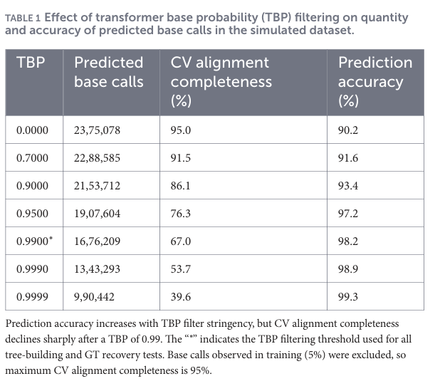

表1｜横向读过一行：先看模型分数门槛，再看留下多少格，最后看完整度和正确率。列出的这些数字回答的问题不同。原表采用南亚数字分组，例如 16,76,209 即 1,676,209。

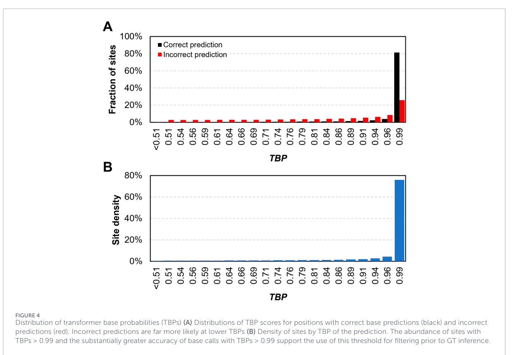

图4｜横轴是模型分数 TBP 的分档；A 纵轴是各预测结果类型中分到分档的频率，黑为正确、红为错误；B 纵轴是位点的分档密度。高分档集中且仍有红色错误，不能凭红黑柱的高度看成指定分档的错误概率；那需要分档内正确、错误的原始计数。

只看碱基对不对，还答不出树有没有变好。因此 Fig. 2、3 的两项指标值得分开。NI 看一个细胞的树上最近邻是否同标签，接近 1 表示局部更容易抱团；DR 是不同标签细胞之间的平均树路径距离，除以同标签内的平均路径距离，衡量大体分离度。一个组可以局部团起来，却仍和另一个组靠在一起；长的组间枝或短的组内枝也会把 DR 拉高，分支长度本身不是独立校验过的分化时间。模拟的原始树到 ssSTICI，平均 NI 0.63→0.85，DR 1.73→4.96；这些是同一模拟真值下的比较。Fig. 3 也画出门槛高过 0.99 之后，多数组的 NI 下滑，DR 方向变得不一致。门槛不是越严越科学，得看清筛完后还剩多少可用的谱系信息。更稳妥的做法是提前定选择标准，并用不同缺失构形和独立样本考察敏感性，而不是看哪个阈值能让待解释的树最漂亮。

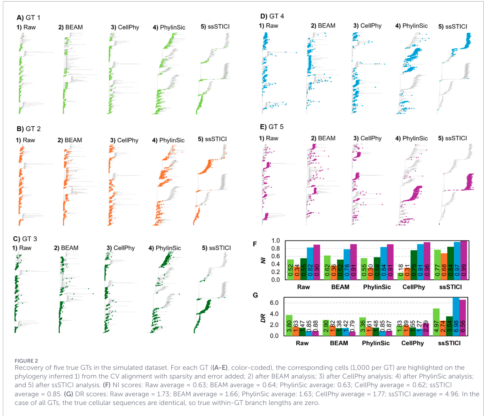

图2｜A 至 E 逐个取出五个真组，用同组颜色在各棵树上标出；灰色是其他细胞。找的是原先散在不同分支的同标签细胞是否更常排在一起，不是看树画得是否整齐。F、G 用同一标签对不同方法计算 NI、DR。

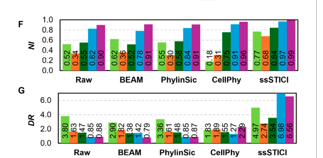

图2F、G｜上图纵轴 NI，下图纵轴 DR；横轴均为 Raw、BEAM、PhylinSic、CellPhy、ssSTICI，彩色柱是五个真组。平均值见正式图注。小面板为原图放大，未改柱或者坐标。

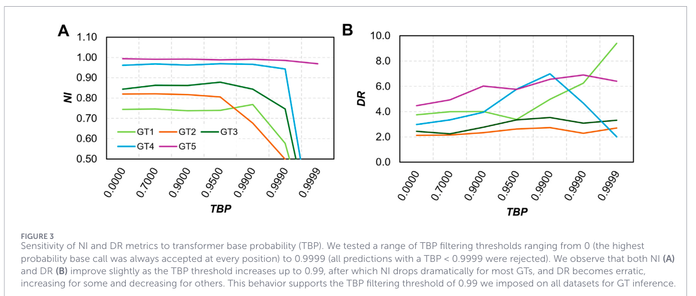

图3｜横轴由低至高的 TBP 门槛，五种颜色分别是五个真组。A 是 NI；B 是 DR。观察的是同一个模拟改变筛选时的波动，不是独立患者验证，也不能从线的走势反推真亚克隆数。

NI 在这里取最近的拓扑邻居。如果最近的一支含多个细胞，原文按其中最常见的克隆身份赋标签，平票时随机打破并列。DR 用树上的路径总枝长，而非图的页面距离。举个只为说明的数值例：组内路径均值从 2 变成 1，组间仍是 4，DR 会从 2 升到 4；不必同时改变最近邻。这解释了为什么观察到一个指标改善，不该把另一个指标也自动写成改善。实际图2更应看 Raw 有些组已抱团，但另外一些组仍混在外面；原文比较留下来的方法分数都依赖同一套组标签和拟树设定。

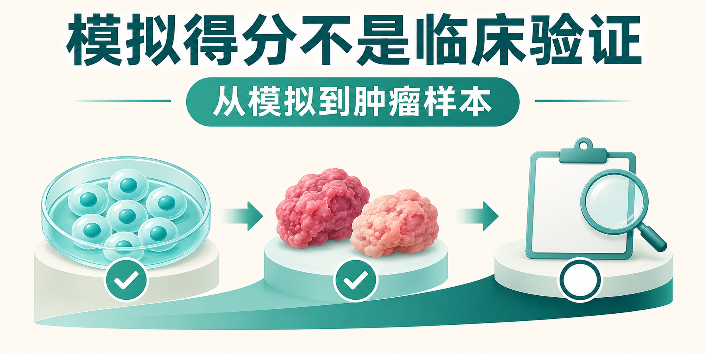

AI 辅助原创概念示意，非实验数据。

## 四、真实数据有几千细胞，但究竟验证了什么？

**卵巢癌是同一患者六个部位样本，不是六个患者。** 筛选后的 1,827 个细胞在 2,970 个候选位置上比较。按 CopyKAT 推得的两个 CNA 群作为参照，Fig. 5 的平均 NI：原始 0.84、BEAM 与 CellPhy 均 0.97、ssSTICI 0.99。原始和 ssSTICI 的平均 DR 是 1.11 与 3.23，说明在这项比较里后者按粗标签分离更明显，不能抹去其他方法对两组已经分得相当好的事实。Fig. 5D 的 CellPhy 两柱标 1.09、1.30，图注给平均 1.17，直接照两个展示值取简单平均对此并不吻合；论文未在这里解释口径，本稿不替它强行更正，也不靠这一对数决定结论。PhylinSic 没在这个尺寸运行成功，不能把它记成准确率 0。

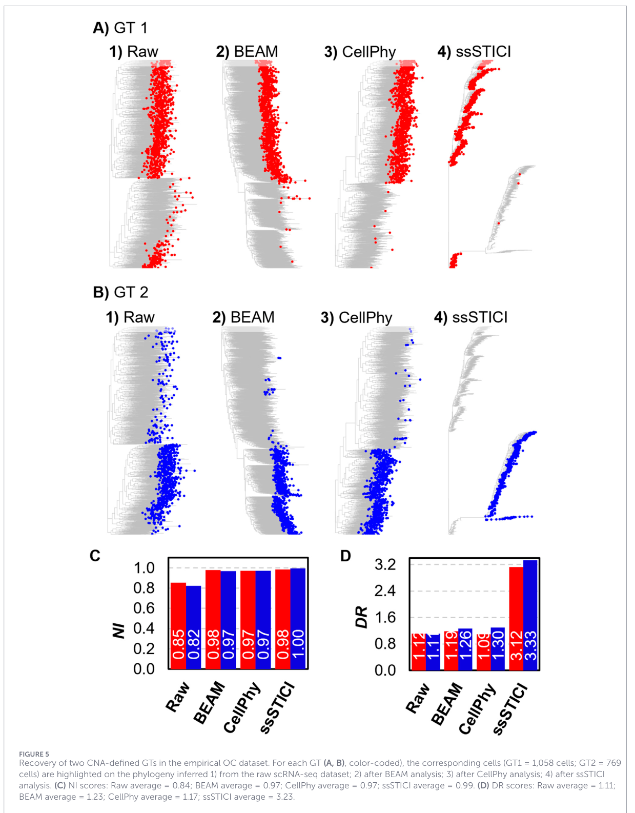

图5｜A、B 按两个 CopyKAT 群着色，红 1,058 个细胞、蓝 769 个；灰枝是其他群。在对应列比较 Raw、BEAM、CellPhy、ssSTICI；C、D 才是分别量化 NI 和 DR 的柱图。每列还是这一个患者的这一批细胞。

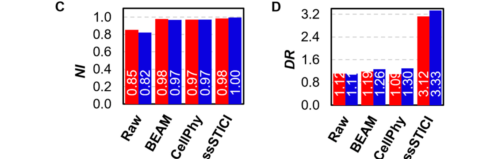

图5C、D｜原面板放大，横轴是方法，纵轴分别是 NI 和 DR。留意 D 的 CellPhy 图内为 1.09 与 1.30，图注给 1.17，原文没在这里交代汇总口径，本文保留两处记录，也不借它决定排名。

**三阴性乳腺癌是另一位患者的单个样本。** 筛选后有 3,425 个细胞、19,576 个位置，CNA 参照为六群。Fig. 6 的平均 NI 显示从原始 0.27 到 BEAM 0.65、ssSTICI 0.70；平均 DR 分别 1.06、1.17、1.64。不应把后两种方法之间的 0.05 平均增幅写成每一群都更准。例如第 3 群（104 细胞），原始 NI 0.03，BEAM 0.23，ssSTICI 0.22；第 2 群两者都是 0.79。DR 第 2、3 群也不优于 BEAM。两个计算参照因规模没完成，这说明本文特定比较中存在可扩展性限制，不给没完成的算法虚构一根性能柱。作者在 H100 上报告该案例约 10 小时、38 GB 显存，这是作者条件而非我们实测，也不能据此承诺普通电脑能按相同时效处理。

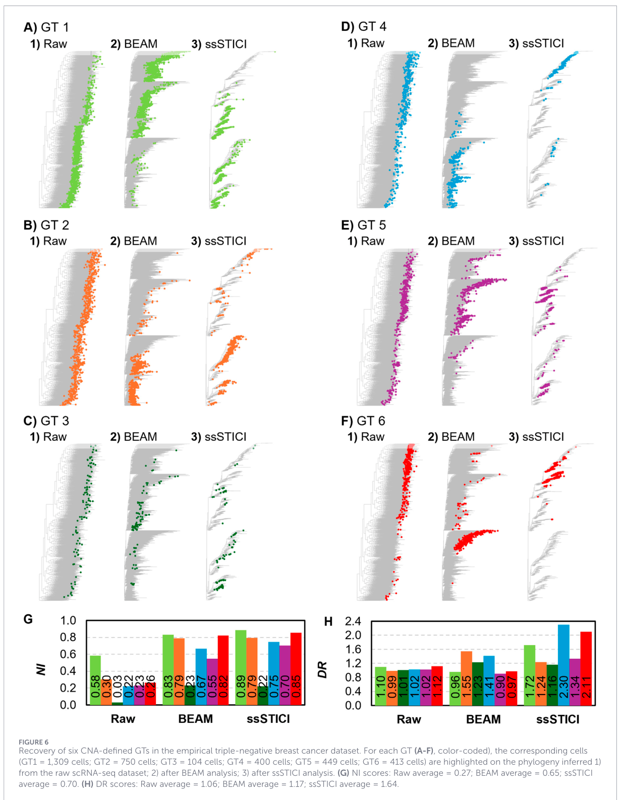

图6｜A 至 F 分组看彩色枝条，三列从左到右为 Raw、BEAM、ssSTICI。G 为 NI，H 为 DR。乳腺癌六组参照仍由 CNA 定义。A 或 F 里一组出现多段彩色枝条，可列作细分候选，但单看图不能确认是新克隆。

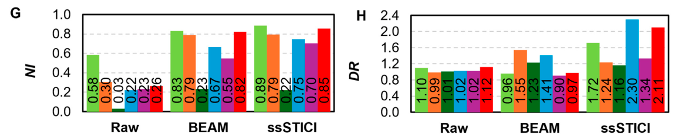

图6G、H｜六色柱各对应一群，横轴仍为这三种方法；第3群深绿的 G 依次 0.03、0.23、0.22。不要把组均值优势抄成每组都赢；图没有为未运行完成的参照提供零值。

两份数据的 CNA 标签另走了一条分析路线，但仍来自同一观测体系，不是独立 DNA 金标准。锚点相近可以支持发现模型，更细的分支则既可能是 CNA 区分不到的真实 SNV 结构，也可能是由输入稀疏、技术共享或模型偏好得到的划分。作者讨论第 1、6 群内可能有子群，明说没有独立 SNV 克隆标签。写成“发现并证实新克隆”，得先回答一个问题：**哪个实验或独立参考确认了它？** 本文没有给出那一步。

病例部分的处理还有两处读者容易略过。第一，用于树的细胞并不是公开队列的全部样本：卵巢癌先估计倍性，保留 CopyKAT 推断的非整倍细胞；不同数据集分别建立 CV 表，不把两个病人混成一棵树。第二，方法部分给卵巢癌和模拟的全碱基矩阵采用 FastTree 的 GTR 设定，而乳腺癌是二元矩阵，采用同工具的标准核苷酸设定。两图的 NI/DR 是各自病例内按同一参照做比较，直接拿绝对数值给两个病人排序没有同样解释力。

## 五、下一次做基准，怎样不被整齐的树说服得太早？

首先问缺失是否真的随机。本文模拟把格子随机置为缺失；实际表达方差、组织部位、扩增与技术深度，都可能让某类细胞和某些位点同时不容易被看见。高置信的输出可以在模型内部彼此一致，也可能同样继承这些选择偏倚。文章报告过随机打乱行列及持出部分位点的敏感性，但这是既有数据内的测试，不是对另一患者或非随机缺失的外部检验。其卵巢癌实验置换后 NI 变化不大，DR 平均下降约 52.4%，训练时间约七倍；乳腺癌的报告也并非两个指标同方向。讨论中“多数情况下较稳健”不能消掉这些条件性变化。

另一个看似能说服人的数字，是最终轮在训练遮盖格上猜回的比例。论文报告卵巢癌 80.4%、乳腺癌 77.2%。它们只针对已观测而暂时遮盖的格子，可能包含原观察错误，不是从来没读到位置的真实补值准确率，也不能和模拟被接纳预测的 98.2% 横向比较。写评估报告时可以把每一行明确标成「被藏起来的观察」「真值已知的模拟缺失」或「实际未知的临床缺失」，读者一眼就知道哪行能算准确率。

代码核对（未运行）：作者公开仓库固定版本的[标准训练入口](https://github.com/ErfanMowlaei/ssSTICI/blob/cfcfca03d1598a103013588084408ca54353de7e/ssSTICI.py#L1475-L1523)在调用 `model.fit` 时未传验证数据；[作者 README](https://github.com/ErfanMowlaei/ssSTICI/blob/cfcfca03d1598a103013588084408ca54353de7e/README.md)列出的默认监控指标是训练重建损失 `rec_loss`。这与正文另报的模拟三折实验不同：后者每折随机留出三分之一位置的全部碱基读数后重训，用来考察看不到这些位置时的表现。既不能用前者的遮盖训练准确率顶替后者，也不能把同一模拟的持出结果说成独立患者验证。单独补件未取得，三折和置换结果仅按正式主文转述。

其次，明确要增强哪一层的证据。问模型预测准不准，就另外分开留出可核对位置，报告被接纳比例、错误率和哪些细胞/位置总被丢弃。问已知克隆有没有复现，就报告各克隆的 NI/DR 和组间不确定性，别只给不透明的平均数。问新克隆是否存在，则需要独立基因型证据（例如与同一患者已有 DNA 型资料做正交确认），而不是用由同一 RNA 训练的第二棵树自证。比较多部位的一人数据时，部位可以给出体内层次，不构成多人的泛化；若想谈跨患者迁移，外部单位要以患者分开。可以拿这三句话检查阅读报告：**补对了什么？分开了谁？谁能够独立确认？** 要是只回答了第一问，就不要抢答最后一问。

最后，这项工作真正拿到的是一条有用但有限的路线：当同一样本的变异共现有足够结构时，自监督补全可能将稀疏 RNA 读数里的克隆线索抬起来。从“值得安排独立验证”跳到“替代 DNA 实测、证实演化时间或指导临床判断”，中间仍隔着研究没有做的比较。把这段距离说准确，比把 98.2% 当成封面大字更值得教给学生。

## 读图与来源说明

[期刊正式 HTML](https://www.frontiersin.org/journals/bioinformatics/articles/10.3389/fbinf.2026.1962436/full)｜[正式 PDF](https://www.frontiersin.org/journals/bioinformatics/articles/10.3389/fbinf.2026.1962436/pdf)。原图、表及放大面板：Craig、Mowlaei、Miura、Shi、Kumar © 2026，[正式主文](https://doi.org/10.3389/fbinf.2026.1962436)，[CC BY 4.0](https://creativecommons.org/licenses/by/4.0/)。截取正式 PDF 中的图表及局部放大；未更改作者坐标、标注或数据。

本稿核对了可访问的主文与图表，未取得单独补件，不做测序、操作实验、软件运行或数据重算。临床样本来自作者转用的既有公开研究；未附个体原始数据。封面与三张导读为 AI 辅助原创示意，不代表实验结果。

## Take-home message｜补出来的，不是测出来的

AI 辅助原创概念示意，非实验数据。

**要把三个答案分开写。** 第一，填了多少格，和接受的格子有多准，不是同一个百分比：Craig 等的模拟在 TBP 0.99 达到接纳预测 98.2% 正确、矩阵 67.0% 完整。两项局部指标不能移到真实患者。第二，树与已知粗群更相符，不等于找到了真实的细分克隆。两名真实患者的参照是同一数据体系里推断的 CNA 分组，不是逐碱基 DNA 真值。第三，同一个人的六个部位也只是一个人；跨病人可用，需要把测试单位真正换成独立病人。

组会读图时，把“真实观测”“模型补值”“独立验证”分三栏。如果最后一栏为空，结论最多写到“提出可正交验证的候选分支”。

出处：[Craig 等正式论文](https://doi.org/10.3389/fbinf.2026.1962436)，Figure 2、3、5、6，Table 1。这里只读结果和局限，未运行模型。

我会把复盘分成三个动作：先在表1写下“接纳格”和“整张矩阵”两个分母，再到图6挑一个不随均值变好的组，最后回实验设计查参照标签来自哪里。即使没有其他技术确认，前两步也有价值：它们帮我们筛出该先核的假说。
