# 空间通讯图上的箭头，究竟说明了什么？

::: {.book-source}
论文：[DOI 10.1093/bib/bbag477](https://doi.org/10.1093/bib/bbag477)。原有图注和许可说明见正文；未明确许可的图版标记为**授权待确认**。
:::

论文：Decoding cell–cell communication in spatial transcriptomics: mechanistic insights, modeling constraints, and analytical caveats

DOI：https://doi.org/10.1093/bib/bbag477

归档说明：完整合并已核验正文，保留全部图注、归因和证据限制；仅删除分篇标题和重复导航，未再次缩写。公众号4篇草稿已保存并回读核验，未发布；封面ID未返回，未完成封面回读核验。

## 观测、统计背景与模型边界

一张组织切片上，成纤维细胞围着肿瘤细胞，内皮细胞也在附近。分析软件画出几十条配体–受体连线，附着显著性星号。现在可以写“成纤维细胞通过某通路驱动肿瘤进展”吗？

这一步经常走得太快。空间转录组直接给我们的主要是 RNA 计数、位置，以及后续注释得到的细胞身份。配体蛋白是否分泌、受体是否形成有效复合物、信号有没有进入接收细胞，通常没有被同时测量。箭头可以组织假设，却不能替我们补齐这些观测。

本文精读 Wu、Su 与 Cui 的正式综述《Decoding cell–cell communication in spatial transcriptomics: mechanistic insights, modeling constraints, and analytical caveats》。文章于2026年9月7日上线，属于本次扩大到近12个月范围选取的 Review，并非昨日新文。它值得仔细读的地方，是把模型假设、组织背景和验证缺口放在了方法名单前面。我们据完整正文展开独立教学分析，并核查部分原始研究；没有运行这些软件，也没有把作者示例当作自己的测试。

本篇先解决一个最基础的问题：输入数据能支持哪一种箭头，统计检验又在排除什么解释？

### 一、先把三种“传递”分开

综述使用的 CCI，指广义细胞间相互作用，可以包括化学信号，也包括机械、电学及其他过程。CCC 在本文语境中聚焦化学通讯。不能因为一个模型预测了邻近细胞对表达的影响，就把它自动翻译成某条配体–受体通路。

化学通讯内部还要分三层。细胞间传递（conduction）关注配体从发送方到接收方受体；细胞内转导（transduction）关注受体之后的信号分子、转录因子与靶基因；多细胞接力（relay）则要求中间细胞收到信号后，再改变其输出，影响第三类细胞。

这三层缺一层，结论就应缩到相应范围。A 的配体与 B 的受体在空间上匹配，支持一个候选发送–接收关系。若再看到 B 的下游响应，可以增加机制一致性。若想说 A 经 B 影响 C，还需要解释 B 如何把输入变成新的输出，不能只把两条已画好的边接起来。

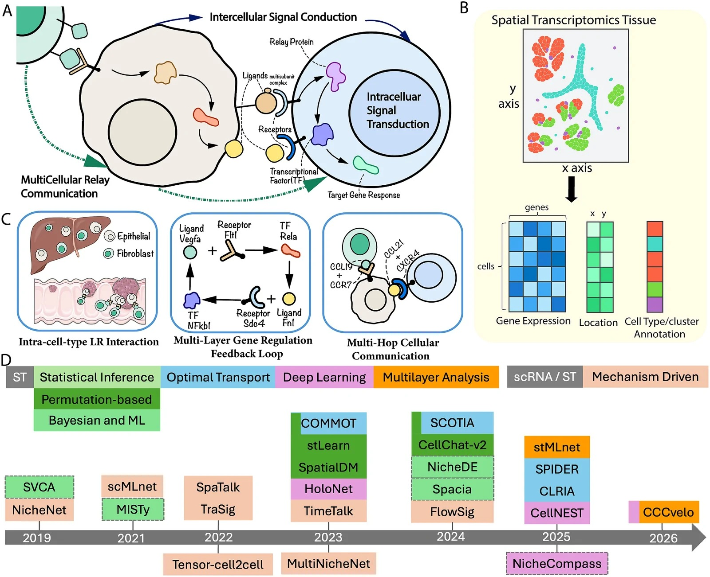

图1来源：Wu 等，2026，原文 Fig.1，CC BY 4.0；仅作格式转换，未修改内容。图1C 的结肠癌图标据原注来自 Servier Medical Art，CC BY 3.0；健康肝脏图标经 Bioicons 获取，CC0。许可链接见文末。

读这幅图时可以沿 A→B→C 看。A 把跨细胞的分子联系、细胞内部的转导、多细胞链路分开；B 是输入层，包括表达矩阵、坐标和注释；C 提醒细胞类型内部的配体–受体关联也有异质性，并区分反馈与多细胞接力结构。D 才是方法时间线，颜色区分统计建模、最优传输、深度学习、多层及机制驱动方法。这里没有准确率坐标，没有实验组和对照组，也没有说明哪种颜色“更先进”。虚线框标出的部分方法面向更广的 CCI，可被用于相关问题，不等于原生的配体–受体检测器。

自分泌、接触依赖、旁分泌和内分泌的距离约束也不同。接触依赖信号适合检查细胞是否真正相邻；短程分泌可以引入局部空间范围。对长程内分泌，切片内的近邻规则可能根本不是正确几何。神经元尤其需要警惕：胞体离得远，不代表沿轴突的通讯路径远；胞体坐标与传导路径不是同一个量。

### 二、一个 spot 内有两种 RNA，不代表两个细胞在对话

空间测量的分辨率决定了推断的基本单位。多细胞 spot 同时检测到配体和受体，可能是不同细胞贡献，也可能来自同一细胞，甚至混合了细胞碎片。把 spot 标成“主要是肿瘤细胞”，并不会自动排除其中少数免疫细胞的转录本。

去卷积提供细胞组成或表达分解，但这仍是一次估计。若下游把估计结果当作无误差观测，通讯网络会显得比数据实际更确定。把解离单细胞重新映射到切片得到的“细胞位置”，也应与直接测得的细胞坐标分开描述。

即便达到单细胞分辨率，细胞边界分割、转录本归属、不同细胞体积和检测效率也会影响邻接关系与表达强弱。跨组比较之前，至少应确认不是某组切片分割得更碎，或同类细胞的检出基因更多。

一个有用的写法是先把结果单位钉住：“在某组 spot 间”“在去卷积得到的细胞类型组合间”或“在分割得到的单细胞间”。这几种句子提供的证据不同，不能在摘要里悄悄变成同一种“细胞通讯”。

### 三、显著性取决于你允许哪些背景重新出现

给某对配体–受体算出一个高分，只完成了排序。要得到 P 值，还要说明：如果我们关心的结构不存在，什么样的分数仍然可能出现？置换检验通过重排某些信息构造背景，但重排对象决定了零假设。

打乱细胞类型标签，问的是当前类型组合相对于可交换标签是否异常；移动表达谱的空间位置，问的是当前表达与几何关系是否异常；打乱基因身份，又把问题转向这对分子是否比某类背景基因更特殊。它们保留的东西不同，因此不能互相替代。

“随机打乱”也不是天然公平。肿瘤核心与边缘的组成、细胞密度和表达状态可能截然不同。如果把它们随意混合，检验可能主要捕获区域差异；如果只在极其同质的小区域里重排，又可能无法破坏想检验的结构。背景不是越大越好，也不是越局部越可信，而要与具体科学问题一致。

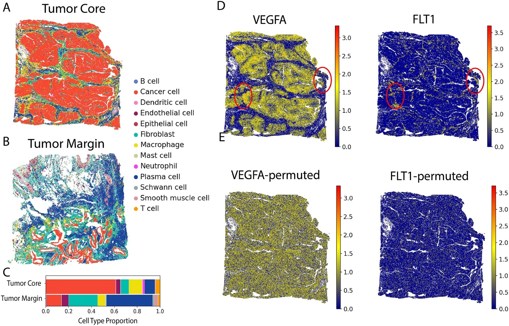

图2来源：Wu 等，2026，Fig.2，CC BY 4.0；原样展示，技术转码。图中数据示例引用的原始研究见 Review 参考文献42；本解读未重新分析该原始数据。

图2A、B 展示肿瘤核心和边缘的细胞类型空间分布。C 的横轴是细胞比例，从0到1；每根条的分母是图示相应区域内的细胞，而不是患者人数。核心区域癌细胞占比较高，边缘更混合。这直接提醒我们：两个区域可供抽样的背景细胞并不一样。

D、E 对照 VEGFA、FLT1 的原始分布与位置置换后的分布。颜色表示各基因表达，不能把两种基因的色阶当作完全相同的绝对浓度标尺。原作者用圈注强调：如果 VEGFA 在核心里本就广泛出现，移动位置后，FLT1 阳性细胞附近仍然容易遇到 VEGFA。所谓随机背景因此仍可能保留较强的共定位。

这幅图支持“组织结构影响零分布”的解释，不提供患者组间显著差异，也没有证明某一算法在所有组织都会失效。对特定检验，背景仍然很强可能降低检出能力；换一种不合理的背景则也可能夸大显著性。偏差的方向要看统计量与重排规则，不能统一喊成“所有方法假阳性很多”。

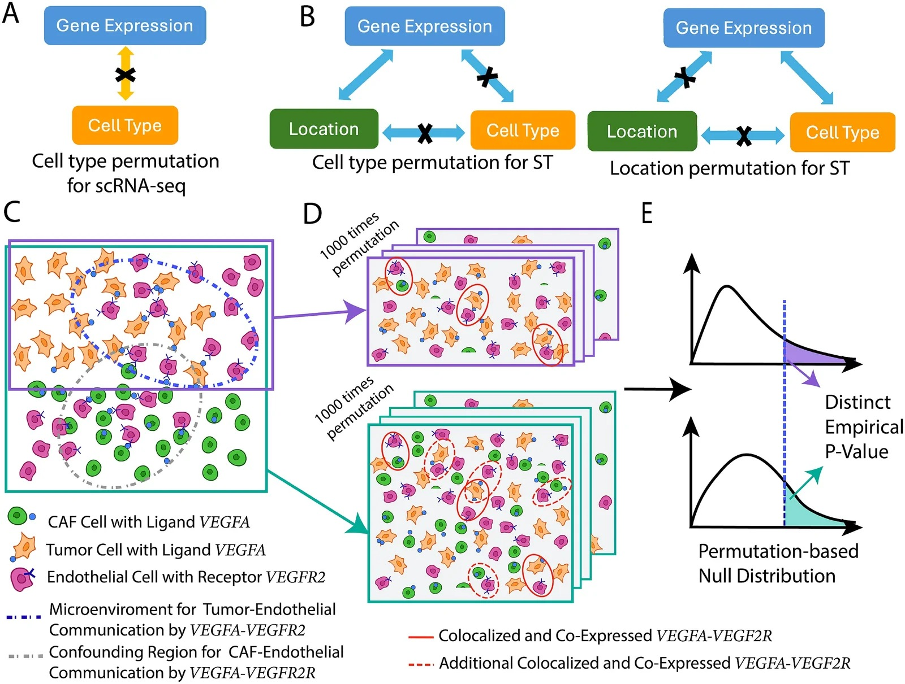

图3来源：Wu 等，2026，Fig.3，CC BY 4.0；原样展示，技术转码。此图的置换和密度曲线是概念说明，不是本解读实测的模拟结果。

图3A、B 把基因表达、细胞类型和空间位置之间的关系拆开，说明不同置换破坏不同联系。C 中绿色成纤维细胞、橙色肿瘤细胞和粉色内皮细胞组成一个教学场景；紫色框选取较偏肿瘤的区域，绿色框包含更多成纤维细胞；两者提供的置换池在范围和组成上都不同。因此，不能把背景变化仅仅归因于窗口大小。这里的受体示例是 VEGFR2，不应与图2的 FLT1 混为同一对分子。

D 示意重复置换；图上的1000次是构造背景的次数，不是1000名受试者。E 横轴是通讯统计量，纵轴是零分布密度，没有给出用于临床比较的数值刻度。蓝色竖线表示同一观测统计量，背景曲线改变，竖线右侧尾部面积就变，P 值也跟着变。它说明统计判断有条件性，而非生物学在换一个窗口后突然改变。

实务上，应在分析前写下希望控制的背景因素，例如细胞类型、组织区域、密度及样本。然后检查重排是否保留这些因素，是否仍能破坏目标联系。不要看到某个窗口不显著，就反复缩放直到得到喜欢的 P 值。

#### 一个可以在分析前写下的零假设

下面是我们的教学建议，不是综述已经完成的验证实验。假设你问的是“在肿瘤边缘、同一细胞类型内部，配体高表达细胞是否更倾向靠近特定受体细胞”。这时，直接把整个切片的所有位置重排，会同时破坏边缘与核心差异、细胞类型分布和目标联系。最终显著，可能只说明边缘与核心不同，未必回答同类细胞内部的配对问题。

更贴近问题的方案，是先考虑保留样本、区域及相关细胞身份，再检验剩余的空间配对结构。但这也有代价：分层过细，能够交换的对象很少，背景不稳定；分层太粗，已知异质性又会混入。需要报告每个置换层里有多少可交换对象，并做合理范围内的敏感性检查，而不是只报最终最小的 P 值。

还有一个容易混淆的分母：假如病例组只有一位患者，切片里有两万细胞，这并不等于有两万个独立病例重复。细胞共享组织环境、制备过程和个体背景。若目标是推广到患者群体，应优先在每位患者内产生可比较的通讯摘要，再用患者层面的重复评价条件差异。只有一位患者时，可以报告该组织中的探索性结构，但应收窄群体结论。

同理，在同一张切片中随机抽出一部分细胞做验证，训练与测试仍可能共享局部环境。按患者、切片或空间区域留出的测试，回答的是不同尺度的泛化问题。它们不是可以互换的“独立验证集”，应该根据研究目标预先选择。

### 四、统计方法其实在问几种不同的问题

#### 从类型均值到局部富集

CellChat 的空间扩展在表达证据之外加入距离信息，但不同版本和输出层级的聚合方式并不相同。以细胞类型平均表达描述通讯时，少数局部亚群的高表达可能被稀释，空间上分散的同类细胞也可能被放入同一统计单元。加入距离项改善了约束，却不保证平均后的边能定位到某一对真实细胞。

stLearn 更强调局部配体–受体共现及邻域中的细胞类型关系。局部富集回答的是某种组合在邻域里是否突出，与“这个邻域分泌了多少有效蛋白”之间仍有距离。检验所用的非相互作用基因或类型标签背景，同样需要检查可交换性。

SpatialDM 以双变量 Moran 统计量评估配体和受体表达之间的空间关联，再定位局部关联区域。直观上，它把一个位置上的配体表达，与空间权重连接到的其他位置上的受体表达相配；空间权重的衰减和范围决定哪些邻居参与。

这里需要补上一处原始文献核查：SpatialDM 的正式论文同时提供置换与解析近似的 z-score 路径，并非所有显著性都靠实际打乱上千次位置。解析计算减少了置换成本，却不免除模型条件和空间权重的合理性检查。算法给出的是空间关联及其检验，不能直接读成受体结合概率。

#### 从邻居预测表达，到分解表达变异

MISTy 将细胞自身、紧邻环境和更远环境等视角分开，用预测模型分析它们对目标表达的解释贡献。问题变成“加入哪一种空间信息，预测会更好？”这适合寻找微环境相关模式，但强预测特征可能只是共同状态的标记。

例如缺氧同时改变肿瘤细胞和邻近基质细胞。一个邻居基因因而很能预测肿瘤细胞表达，并不意味着这个基因编码的蛋白直接发出了信号。随机森林特征重要性在相关特征间也可能重新分配，因此不能把数值直接写成分子机制的贡献百分比。

SVCA 则以协方差结构分解细胞内因素、空间环境和邻近细胞相关成分。这里的“解释方差”属于统计模型：某一协方差项能解释多少变化，与某分子实际传递了多少信号是不同问题。若多个成分在数据中高度相似，区分它们本身就困难。它可帮助发现 CCI 相关结构，不应被包装成直接确定配体–受体边的工具。

NicheDE 使用计数模型，将细胞类型本身与邻域类型富集等信息联系起来，寻找同类细胞在不同邻域中的表达差异。NicheLR 进一步借助配体和下游先验缩小候选。优势是把微环境依赖的表达状态纳入问题，限制是邻域尺度、组成及先验都会影响结果；全局回归关系也不等于已经找到了某一个发送细胞。

#### 允许同一邻域里只有部分细胞真正相关

Spacia 将候选发送细胞视为一个“袋”，学习其中哪些细胞更可能与接收方的表达状态相关。原始公开补充方法采用两层 probit 模型：一层描述发送细胞成为主要发送者的概率与距离的联系，另一层连接被选发送者的表达与接收方基因或通路的高低状态；隐变量和参数通过贝叶斯推断处理。

这比把半径内所有细胞一视同仁更灵活，但候选袋仍先由较宽松的空间阈值构成，不能称为“完全不需要邻域设定”。发送者基因的系数是模型条件下的关联，也不会自动变成因果效应。本次能核查正式论文的公开补充方法，未取得其订阅版完整主文；综述表中的 logit 表述与该方法文档的 probit 不一致，这里按原始补充说明，保留核验边界。

### 五、从“这个工具显著”退回到“这个问题清楚吗”

如果问题是找空间配对，局部共表达与空间统计很直接；如果想知道邻域如何关联细胞状态，预测视角和计数模型可能更贴切；如果希望拆解发送者候选，可考虑显式处理多个发送者的模型。没有一种输出能替代另外所有问题。

分析报告至少写清三句话：观测单位是什么；分数测量什么；显著性相对于什么背景。随后才谈某条边是否值得做下游验证。把这三句补齐，往往比再叠加一个算法更能减少结论跳跃。

### 来源与阅读边界

- 核心 Review：[Wu 等，2026，完整正文](https://pmc.ncbi.nlm.nih.gov/articles/PMC13548332/)，DOI [10.1093/bib/bbag477](https://doi.org/10.1093/bib/bbag477)。本次通读正文、图1–4和表1–2；未取得补充表S1，未声称复核其全部数据。
- SpatialDM：[原始论文完整主文](https://pmc.ncbi.nlm.nih.gov/articles/PMC10325966/)，DOI [10.1038/s41467-023-39608-w](https://doi.org/10.1038/s41467-023-39608-w)。本次通读主文，未复核补充、未实测软件。
- Spacia：[正式论文](https://doi.org/10.1038/s41592-024-02408-1)及[公开补充方法](https://media.springernature.com/original/springer-static/esm/art%3A10.1038%2Fs41592-024-02408-1/MediaObjects/41592_2024_2408_MOESM1_ESM.pdf)。核查补充第25–28页；正式主文仅可读预览。
- 原图许可：[CC BY 4.0](https://creativecommons.org/licenses/by/4.0/)；图1第三方图标另依[Servier CC BY 3.0](https://creativecommons.org/licenses/by/3.0/)及[CC0](https://creativecommons.org/publicdomain/zero/1.0/)。封面和导读图为AI辅助原创示意，非实验数据。

## 传输、图学习与多层机制

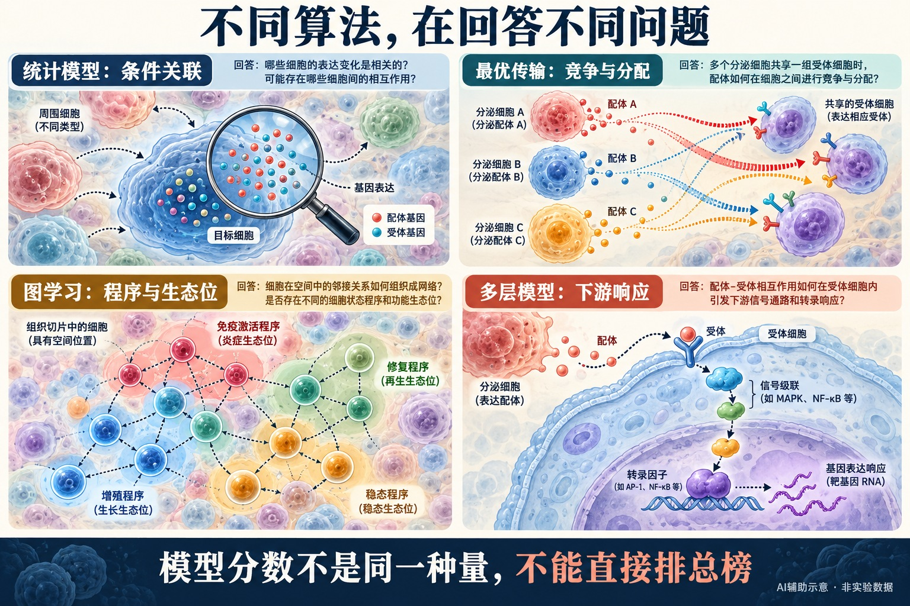

导读图为AI辅助原创示意，非实验数据。图中的免疫激活、修复、增殖和稳态生态位是**假设教学例子**，不对应本文或所引研究的实验输出；多层模型中的下游响应也指待验证的模型推断。

同一份空间转录组，用一种方法得到几十对显著配体–受体，换一种方法得到传输强度，再换一种得到细胞微环境和多跳网络。哪个结果才是真的？

这个问题常常混合了不同任务。一个统计量测空间关联，一个优化结果分配候选联系，一个神经网络学习有助于重建表达的表示，它们本来就不必给出同一张图。比较之前，应先弄清输出对象和加入的约束。

本篇依据2026年9月7日发表的正式 Review《Decoding cell–cell communication in spatial transcriptomics: mechanistic insights, modeling constraints, and analytical caveats》，解释最优传输、图模型、多层网络及机制驱动扩展。我们完整阅读了综述，并另行通读 COMMOT 原始主文；其余方法的细节主要按综述归因，不声称逐篇运行或独立复现。目标是帮助读者判断：更复杂的模型，究竟给你的问题增加了什么，又要求你接受什么？

### 一、最优传输：给全部候选联系一起算账

假设某种受体能与两种配体结合，两类发送细胞都在附近。逐对打分时，两条边可以分别很强，却没有检查它们是否在“使用”同一份有限接收能力。最优传输把多个发送者和接收者放进一个联合分配问题，让它们彼此约束。

在最简化的理解里，发送方的配体表达提供供给代理，接收方的受体表达提供需求或容量代理，细胞间距离提供代价，模型求出一张兼顾这些因素的分配表。分配表的每个元素是隐含耦合，不是显微镜观测到的分子流量。

距离代价体现“远处联系通常更不容易”的假设。它可以随距离平方增加，也可以采用其他形式。熵正则帮助求解并让分配更平滑，代价是分配形状也会受正则强度影响。参数改变后箭头更集中或更分散，可能只是优化偏好变化，并不自动对应真实扩散距离。

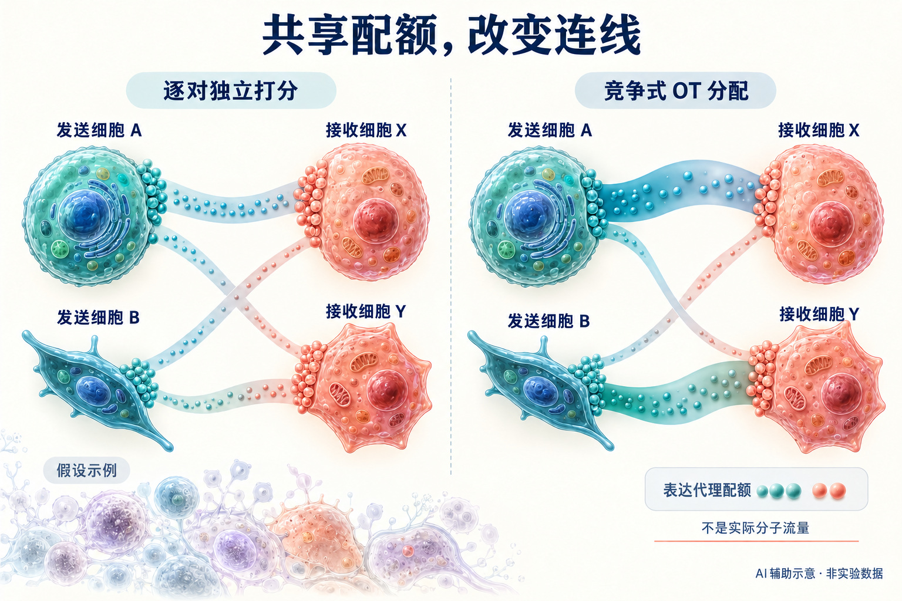

原创教学图：AI辅助示意，非实验数据，假设示例。图中的配额由表达代理构成，不代表实测蛋白浓度、结合常数或分子数量；线条仅说明联合约束的含义。

#### COMMOT 的关键区别在共享约束

COMMOT 使用 collective optimal transport，把多种配体、多种受体及细胞间联系共同考虑。数据库不允许结合的配体–受体组合不能分配联系；超过设定空间范围的组合被赋予不可达的高代价。对每种配体或受体，所有相关联系的总量不能超过相应表达代理给出的上界。

这样，一条边获得更多分配，就可能影响其他竞争边。它给出的“强度”不仅与该对基因本身有关，也与可竞争的其他分子和细胞有关。因此，更换数据库、过滤掉某些配体，可能改变保留边的分配，即使这些边自己的表达没有变化。

COMMOT 原始主文明确承认，真实的配体作用距离受蛋白和细胞外环境影响，难以为每条候选准确估计。大规模筛查可以先用统一且较宽松的距离范围，重要候选再精细化。不能把这个实用设定写成“算法已学习每种配体真实扩散半径”。

其方向场由推断的细胞间耦合汇总而来，适合描述模型认为信号主要朝哪里发送或接收；它并非活细胞成像测出的流动轨迹。接着沿“收到的信号”寻找相关靶基因，仍要面对状态、位置及其他调控因素的混杂。随机森林加入细胞内相关基因，有助于比较解释信息，却不能单靠特征重要性证明外源信号的因果作用。

原始论文还给出细胞类型标签或位置置换等检验选项。这提醒我们：优化产生分配，显著性评价还需要另一个问题定义。优化器收敛不代表生物学假设通过检验。

#### 另外三种 OT 方法，改变的是问题结构

SPIDER 将细胞之间的“界面”作为分析对象，将配体–受体关系转换成可定位的界面相互作用，再寻找具有空间变化的模式，并结合下游调控证据。这样更贴近“哪里存在特殊通讯界面”的问题。空间变化检测检验的是推断分数的空间结构，仍不能跳过分数本身依赖的先验。

CLRIA 面向脑区间联系，把连接组相关约束纳入传输代价。对于跨脑区信号，仅用欧氏近邻并不充分；网络路径与胞体直线距离不是同一种空间。其非平衡传输允许边缘分布软性偏离，而低秩结构进一步约束高维耦合。软约束与 COMMOT 的硬上界不可混称，数值也不应直接比较。此处按综述讨论连接组约束，不把综述表格中较简略的模态标签扩写为已核验采集流程。

SCOTIA 先考虑空间聚集结构，再用传输与差异分析比较候选联系。若有多位患者，混合模型可以把患者差异与条件差异分开，比把所有细胞拼在一起更接近真实研究设计。但分组、局部聚类以及置换范围都会改变背景。局部区域过于同质时，置换可能保留大量原有模式；这要求审查零模型，而不是简单扩大抽样池来追求更小 P 值。

因此，选择 OT 方法时至少看四项：是否联合处理竞争；边缘约束是硬还是软；距离/网络代价从哪里来；最后比较的是细胞、界面、脑区还是样本。都叫“传输”，也可能回答完全不同的问题。

### 二、图神经网络：学到有用结构，不等于发现所有真实边

图模型把细胞及其候选联系组织成图，适合利用邻域和多种先验。问题在于，训练目标通常是预测、重建或区分真实与扰动结构，而非直接测量某对分子的实际结合。因此必须把“用于优化的目标”与“最终想解释的生物学机制”对齐。

#### HoloNet：哪些通讯视角有助于解释靶基因

HoloNet 为不同配体–受体关系构造多视角图，并将细胞内部因素与邻域通讯信息共同用于预测目标基因表达。相比只给一条 LR 边打分，它试图把外部候选信号联系到接收细胞的表达响应。

这适合问：“在给定先验下，哪些候选通讯视角更能解释这个靶基因？”但高预测贡献也可能来自共同空间状态。模型还把受体到靶基因之间复杂的调控压缩进表示，若缺少足够转录因子或信号传导证据，就不能把拟合成功直接画成一条完整分子通路。对少量 spot 或高度相关的候选图，泛化检验尤其重要。

#### CellNEST：两跳边不自动组成生物学接力

CellNEST 结合图注意力与对比学习，利用位置、配体–受体先验及表达关系学习候选通讯图。注意力帮助排序模型强调的联系，但保留最高一定比例的边，是筛选规则，不等于同样比例的假发现率。例如“保留前20%”不能写成“控制 FDR 在20%”。

多跳关系很有吸引力：A 的配体连到 B 的受体，B 的另一配体再连到 C。真正的机制接力还要求 B 的受体输入促成相应输出，中间缺少的转导环节不能由两条外部边自动补全。先验蛋白网络与转录因子证据可以检查路径是否合理，仍需要具体时序或扰动支持。

对比学习依赖“破坏后的图”构造参照。如果组织本来很同质，某种全局打乱可能仍保留关键结构。它与置换检验不是同一算法，但同样提醒我们：人工负例是否真的去掉了模型应该学的联系？

#### NicheCompass：通讯程序定义的微环境

NicheCompass 将先验基因程序与图变分自编码器结合，学习细胞自身及邻域相关的表达结构，也可容纳新发现的程序。其输出有助于辨认通讯相关的微环境，未必与传统细胞类型簇一一对应。

同一种细胞在两个微环境中表现不同，本来就是值得研究的现象。反过来，同一个嵌入簇也不代表所有成员之间都有直接 LR 接触。先验程序覆盖不足、靶向面板基因缺失、正则权重及新程序数量，都会改变模型能学出的结构。解释时应同时展示哪些观测支持该程序，哪些是模型推断，并比较不依赖同一先验的证据。

### 三、多层网络：把“接收以后发生什么”写进模型

仅有 LR 共表达，机制链条到受体就停了。多层模型继续连接受体、转录因子与靶基因，让候选关系与下游响应相容。这是有价值的增强，但也把更多数据库误差和模型假设串在一起。

stMLnet 构建 LR–受体后信号–TF–靶基因等层级，并以空间衰减及表达预测约束网络。其距离建模含有类似稳态、径向扩散的简化。真实组织里的屏障、定向分泌、细胞外基质结合和动态降解可能违反这些条件。模型产生的反馈结构主要应在其定义的细胞类型与网络尺度上解释，不能逐边声称是单个活细胞已经发生的反应。

CCCvelo 进一步用微分方程和非线性调控关系描述变化，把空间接触、扩散和潜在进程联系起来。这里的动力学方向不应与经典依赖剪接/未剪接 RNA 的 velocity 混同。潜在时间也不是实际测量的分钟或小时：如果数据混合多个不连续状态、分支命运或不同患者，强行放进单一连续过程可能产生看似顺畅的方向。

动态模型尤其需要问“哪些参数可由当前数据辨识”。相同的静态表达模式可能对应多个生成机制；增加方程并不会凭空增加观测。可以利用模型提出时间采样或扰动设计，但不要把模型内部的时间顺序直接当成实验验证的因果顺序。

### 四、机制驱动方法还有八类角色，空间约束只是其中一层

综述表1还纳入八个机制驱动框架，它们不能全部归成同一种空间 LR 工具。逐项读其任务，才能理解它们如何与前述模型衔接。

NicheNet 根据连接配体、信号网络和靶基因的先验，优先排序可能解释接收方转录变化的配体。它适合从响应出发寻找发送候选。若实验没有位置证据，排序并不能证明发送者与接收者有机会接触；先验缺失也会让真实但少研究的配体落榜。

MultiNicheNet 把问题扩展到多样本和多条件，综合差异表达、表达特异性与配体活性等信息。这里的重点是条件差异和重复结构，不能把多细胞数量当作多患者样本量。多个指标组合得到的优先级，需要保留每个指标的来源，避免总分掩盖某一关键证据缺失。

scMLnet 聚焦多层调控关系，为从 LR 到细胞内调控建立网络基础；它提供的是机制先验和表达支持的整合，空间邻接与真实动态仍需额外证据。与 stMLnet 的空间扩展相比较，最重要的差别应落在数据与约束，不是名称是否多了一个字母。

SpaTalk 将空间数据、细胞组成重建与知识图谱结合，尝试接到下游信号路径。对低分辨率 spot 重建出的单细胞表示是估计结果，其精细程度不能当作原始测量分辨率。若重建错误把两个细胞的信号错配，后续路径再完整也可能建立在错误起点上。

FlowSig 将输入信号、细胞内部基因表达模块和输出信号组织成有向网络，利用结构学习探索信号流。这里的方向依赖图模型假设、约束及观测信息；不同输入模态对“流入”的构造也不同。满足某套统计方向规则，不足以单独排除隐藏混杂或证明干预效应。

Tensor-cell2cell 将样本、配体–受体、发送类型与接收类型等维度组织为张量，寻找跨条件共享或特异的模式。它擅长提炼多维结构，但分解因子不是一条单细胞时间轨迹，也不能自动确定哪条边发生了直接分子结合。

TraSig 关注沿拟时间变化的通讯模式；TimeTalk 利用时间相关设计分析动态联系。拟时间排序与实际采样时间应明确区分。即便两个细胞群在某一阶段的配体和受体同步变化，没有位置或独立机制证据，仍需考虑共同发育程序等替代解释。

这八个角色补齐了响应、多样本、知识整合与时间轴，却不会自动解决空间可达性。将它们组合使用前，应画出数据流：哪一步使用了哪些基因、标签和先验，后面的“验证”有没有再次用到同一份信息。

### 五、复合物和反馈，不能靠基因清单凑齐

多亚基受体是常见陷阱。假如一个功能复合物需要多个亚基，仅一个亚基高表达，不足以证明完整复合物存在。使用最低亚基表达或几何均值，是模型对短板或联合可用性的近似，既不是蛋白组装的直接测量，也不等价于真实结合动力学。

另一方面，靶向面板没有测到某个亚基，属于“未观测”，不能简单当作生物学上不存在。分析者应分别标出缺失测量与测量后为零，检查结果到底被面板设计还是组织状态限制。

辅助因子、共受体和抑制分子也会改变信号。不同数据库和算法纳入这些信息的方式不同：有的将其列为注释，有的显式进入打分。这意味着“同一条 LR 边”在两个实现中可能使用了不同分子条件。比较时应保留复合物组成与规则，而非只对齐一列名称。

反馈与多跳同理。完整路径可以增加生物学可解释性，但路径越长，先验缺失、表达误差和间接关联越可能累积。应优先验证关键中间环节，而不是以路径更长作为机制更完整的证明。

### 六、表1该怎样用，而不是怎样排名

原 Review 表1列出24个框架，逐项比较数据模态、推断框架、细胞类型处理、数据库及空间信息的用途。前面已经按具体问题解释其各组；表中的 CCC/CCI 双标签提示读者注意任务外延，而非“适用越广就越可靠”。

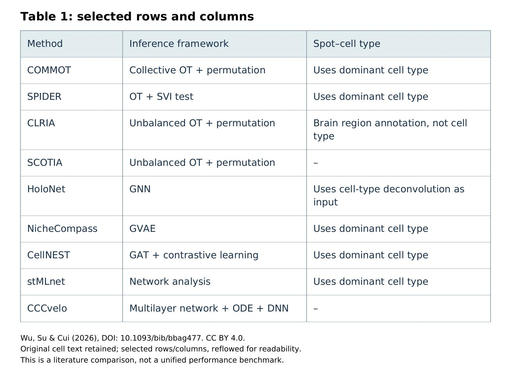

表1摘录来源：Wu 等，2026，CC BY 4.0。仅选取与本篇主要方法对应的行，以及方法名、推断框架、spot–细胞类型处理三列；单元格原文保留，重新排版便于阅读，未展示数据库与空间公式等其他列。“Uses dominant cell type”等描述属于该综述的概括，并非这些软件所有运行模式都强制要求相同注释。完整内容以原表及原方法为准。

阅读此表时，建议先核对输入与细胞类型处理，再看空间项作用在何处，最后看输出是否回答当前问题。表里的统计框架是压缩摘要，例如 SpatialDM 的解析 z-score 路径需要回到原始论文补足；Spacia 的 probit 也应按原始公开补充核对。综述表可以建立索引，关键决策仍要回到原方法和具体版本。

[查看原文表1完整内容](https://pmc.ncbi.nlm.nih.gov/articles/PMC13548332/#TB1)。表1为文献比较表，没有性能纵轴、实验对照或统一测试集，不能据此排出准确率总榜。

### 本篇带走的问题

面对一个复杂方法，先问它优化什么、约束什么、输出什么。OT 的耦合、图网络的注意力、表达预测的重要性和动力学潜在方向，分别有自己的单位和证据边界。复杂度增加带来的价值，是使某些假设更明确、某些候选更可检验；其代价是需要更多数据、先验和独立检验。

### 来源与阅读边界

- 核心 Review：[完整正文、表1](https://pmc.ncbi.nlm.nih.gov/articles/PMC13548332/)，DOI [10.1093/bib/bbag477](https://doi.org/10.1093/bib/bbag477)，2026年9月7日。通读正文、全部主图主表，未取得补充表S1。
- COMMOT：[完整原始主文](https://pmc.ncbi.nlm.nih.gov/articles/PMC9911355/)，DOI [10.1038/s41592-022-01728-4](https://doi.org/10.1038/s41592-022-01728-4)。本次通读主文及其中图注、Methods；未读其补充、未运行软件。文中只解释其作者报告的方法，不声称独立复现性能。
- SpatialDM：[正式原始主文](https://pmc.ncbi.nlm.nih.gov/articles/PMC10325966/)。其他方法按核心 Review 的归纳解读，未逐一声称完整阅读全文或核验当前软件维护状态。
- 所有原创教学图为AI辅助示意、非实验数据；假设情境不代表作者实验结果。

## 数据库、可靠性与独立验证

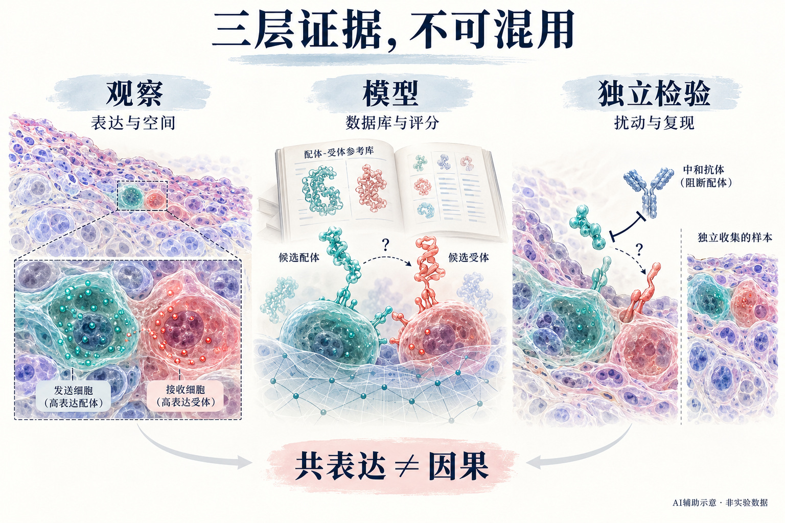

一条候选通讯被三种算法共同选中，数据库里也收录了，空间上又相邻。是否已经足够可靠？要看这几份“证据”是否独立。如果三种算法共享数据库、都用相同的距离先验，而验证又只是检查空间邻近，那么你可能把同一条信息计算了好几遍。

本篇精读2026年9月7日正式发表的 Review《Decoding cell–cell communication in spatial transcriptomics: mechanistic insights, modeling constraints, and analytical caveats》，围绕数据库、benchmark 和研究设计展开。我们会把“复现得稳定”“符合先验”“得到独立测量支持”分开，最后形成一套可落地的选择与报告流程。本文没有运行软件；性能描述只按原作者证据讨论，不提供未经实测的工具排名。

### 一、数据库决定你有机会发现什么

数据库不是装进软件后就可以忘记的附件。它决定哪些分子组合进入候选空间，如何表示复合物，是否保留抑制关系，以及怎样连接到下游。某条边没出现，可能是组织没有相关表达，也可能只是数据库没有收录。

综述表2将资源分成四层：配体–受体相互作用、细胞内信号路径、转录因子–靶基因调控，以及整合多层知识的资源。这四层分别解决不同问题，不能用一个覆盖范围很大的列表替代所有机制知识。

#### 配体–受体资源：覆盖和特异性要一起看

FANTOM5 提供基于多种细胞与组织表达及已有证据整理的 LR 资源；connectomeDB 强调人工整理的配对；CellPhoneDB 包含复合物信息；CellChatDB 进一步纳入辅助因子、共受体与通路注释；NeuronChatDB 面向神经递质、神经肽及相关神经通讯。

这些差别会影响分析。例如，有限靶向面板没有覆盖某个必需亚基时，复合物感知算法可能无法给出充分支持；只保留单个基因名称的方法则可能仍产生较高分数。差异来自证据规则，而不只是算法“灵敏度”。

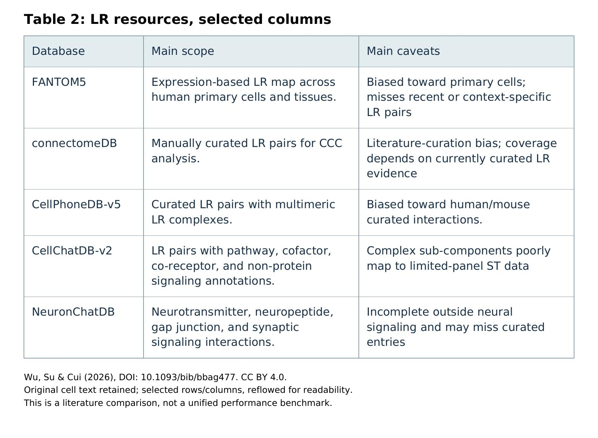

表2摘录，Wu 等，2026，CC BY 4.0。保留数据库、主要范围、主要限制三列的原文；按类别分段重新排版，省略原表更新状态列。此处描述 Review 所使用的资源版本，不声称已实时核查2026年10月的软件维护状态。

每行应横向读：它收录什么，在哪些情境可能不足。FANTOM5 的既有版本可能遗漏后来报道的联系；人工整理资源偏向被充分研究的分子；复合物注释与低覆盖面板可能不匹配；神经专用库的优势也不能自动外推到其他组织。表中没有实验组/对照组，没有统计分母或统一准确率，这些是资源适用边界，不是性能排行榜。

扩大候选库有可能找出原来遗漏的联系，也会引入更多不适合当前组织的候选，改变多重检验负担。将蛋白序列或大模型预测加入候选生成，可以提出值得验证的新关系，但“模型认为可能结合”和“已有实验支持”应分列，不能混成同一置信等级。

#### 路径和调控资源：连接不等于当前组织中正在发生

KEGG 提供路径层面的知识组织，Reactome 更细到反应与分子事件，SIGNOR 保留有向的激活/抑制关系。TRRUST-v2 与 DoRothEA 则将转录因子连接到靶基因，其中证据来源、置信等级和组织特异性并不相同。

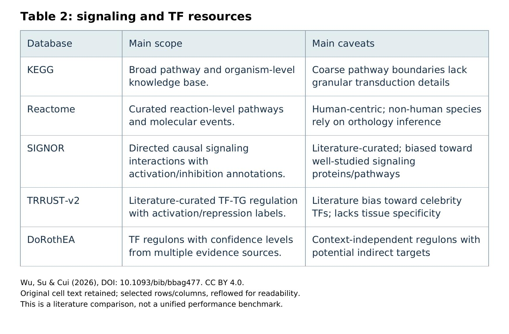

来源与改动同上：原表选列、按功能分段重排，单元格文字未改；不是本次对数据库现状开展的新评测。

这些资源能回答“生物学上是否存在一条合理路径”，却不能单独回答“这份切片中的该路径是否被激活”。同一个 TF 在不同细胞状态下可以有不同调控集合；RNA 检出也未必代表蛋白处于相应活性状态。若用一组已知靶基因推断 TF 活性，再用同一组靶基因证明结果正确，证据就发生了循环。

数据库中的“激活”或“抑制”还需要保留作用层级。某蛋白激活下游分子，与最终靶基因表达增加不是永远同方向；路径中存在多个抑制环节或反馈时，简单把所有边当正向会改变解释。

#### 多层整合：信息更多，也继承更多偏差

NicheNet 连接配体与可能响应的靶基因，OmniPath 整合多来源分子相互作用和注释，stMLnetDB 组织 LR–受体后信号–TF–靶基因等层级。

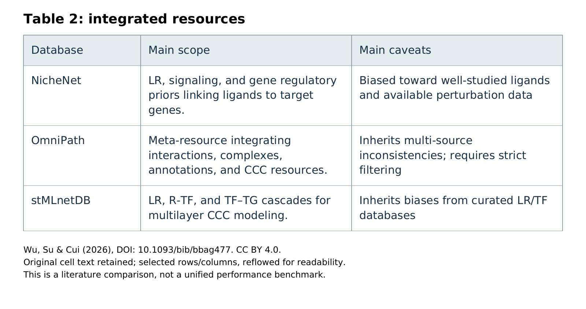

来源：原 Review 表2，CC BY 4.0，选列与重新排版。此图与前两段合起来解释原表各类资源；原表完整五列可在文末直接链接核查。

整合库的价值是把分散证据组织起来，但多来源合并也可能带来物种映射、名称映射、重复证据和方向冲突。多个库都收录某条关系，有时只是共同引用同一项实验，并不等于获得了多项独立支持。

实际分析建议冻结数据库名称、版本、下载日期、物种映射规则及过滤方式。还应记录候选空间：多少配体、受体、复合物和有效 LR 组合真正进入计算。若更换数据库后显著边变多，应先分清是候选变多、测试次数改变，还是相同候选的结果确实更稳健。

### 二、没有完备真值时，benchmark究竟测了什么

空间通讯尚缺覆盖广泛、可直接当作完整真值的实验网络。未验证的边通常不是已证伪的负例，现有证据又偏向热门通路。因此，benchmark 的参考答案与任务定义，常常比一张综合排名更重要。

#### 仿真检验的是特定生成机制

仿真可以明确哪些联系存在，适合检查算法是否在已知条件下恢复信号。但生成器若强调局部扩散与竞争，恰好显式编码这些条件的模型可能更有优势；若生成器使用简单均值变化，也可能偏向另一类方法。

判断时要看模拟是否改变了密度、细胞组成、表达稀疏度、复杂分子关系以及背景共变，是否覆盖方法不擅长的条件。只在与方法假设一致的场景胜出，说明模型能解决该类问题，不能推出真实组织中的普遍最优。

以 COMMOT 为例，原论文使用偏微分方程生成的模拟检验传输结构，并与相关传输变体比较。这种设计直接对应其竞争和空间约束，是有解释力的任务内评估；它不会为所有统计、图模型和多层方法建立统一排名。

#### 稳定性衡量可重复，不衡量真伪

将数据下采样，再比较结果与完整数据是否一致，是常见稳健性评价。Jaccard 相似度衡量两套边重叠多少；方向场可以比较余弦距离。它们告诉我们结果是否对抽样敏感，却没有提供生物学真值。

一个总是输出很少、很保守的边集，可能非常稳定；一个始终拾取技术偏差的方法，也可能在重复抽样里表现一致。细胞注释误差、数据库改变与空间范围变化应另做检查，不能由单一采样稳定性代替。

综述提到的相关评价还可能把原始分析中排名最高的一批预测当作参考。这里“参考集合”仍是计算结果，不应改写成“已实验验证的若干条真实通讯”。

#### 用距离验证距离，会高估独立证据

如果模型已经利用近邻图筛边，最后证明这些边大多连接相邻细胞，是必要的自洽检查，却不是强独立验证。它可以发现实现错误或异常结果，但无法证明邻近表达对应真实信号交换。

近距离作为伪真值还偏向短程机制。对长程内分泌、脑区间联系或沿神经突起传递的信号，这个标准可能把合理候选判成错误。基准选择应先确定通讯类别，而不是先规定所有真边都必须很近。

#### 蛋白和下游响应更接近机制，仍有分层

受体蛋白检出比仅有受体 RNA 更接近功能条件，但仍未必证明配体结合和下游激活。CITE-seq 等数据常用于支持细胞类型间受体表达的特异性，不能自动当作完整通讯网络的真值。

下游基因签名同样有价值，但其活性常是由表达推断。这里我们核查 Dimitrov 等2022年研究相关 Results、Methods 和 Discussion：作者综合比较资源与方法，并用空间、蛋白及下游活动等间接证据评价一致性；他们明确指出缺少 gold standard。其 CytoSig 分析用43个细胞因子响应签名估计活性，不是直接测量每条通路的实验激活状态。

读相关富集图时，还要看横向比较用了哪个排名范围，纵向统计量是否为优势比，显著性是否来自 Fisher 检验。不同数据集或排名阈值可能给出不同方向，不能把局部一致性概括为“所有方法都得到独立验证”。此处只是核查该原始研究的相关章节，未声称完整精读其全部补充。

#### 精确率的分母，也需要一份可信的负例

把通讯评价写成分类任务时，除了正例，还必须决定哪些候选算负例。数据库未收录、某次实验未检出，通常不足以证明一条联系不存在。如果把它们一律置为负例，某个方法找到少见但合理的新候选，反而可能受到惩罚。

AUROC 和 AUPRC 也不是可以脱离候选集合比较的常数。真实正例很稀少时，精确率会受到正例比例影响；扩大未标注候选作为负类，可能改变曲线和排名。比较不同资源或过滤规则时，应固定或明确展示候选总体、正负例定义、类别比例及未标注项如何处理。否则，分数变高有时只是任务变容易。

这也解释了为什么“多方法交集”不自动成为金标准。交集可能偏向多个工具共同熟悉的经典通路，而遗漏特定组织的新机制。它可以作为保守候选集合，却不能反过来证明不在交集里的预测都是错误。

#### 扰动更强，但也要检查它扰动了哪一层

阻断候选配体或受体，并观察接收方响应，有机会排除部分替代解释。理想设计还包括对照、时间顺序、剂量或救援等，具体组合取决于问题。但扰动某个因子后产生的全部差异基因，并不全是其直接靶点：细胞状态变化、增殖或存活差异也会传递到表达层。

培养体系中验证的联系，是否适用于原组织里的细胞状态和空间环境，也需要桥接证据。因此，我们更应提出“下一步需要什么测量”，而不是寻找一个万能指标为整张网络盖章。

### 三、三位供体和三万个细胞，是两种规模

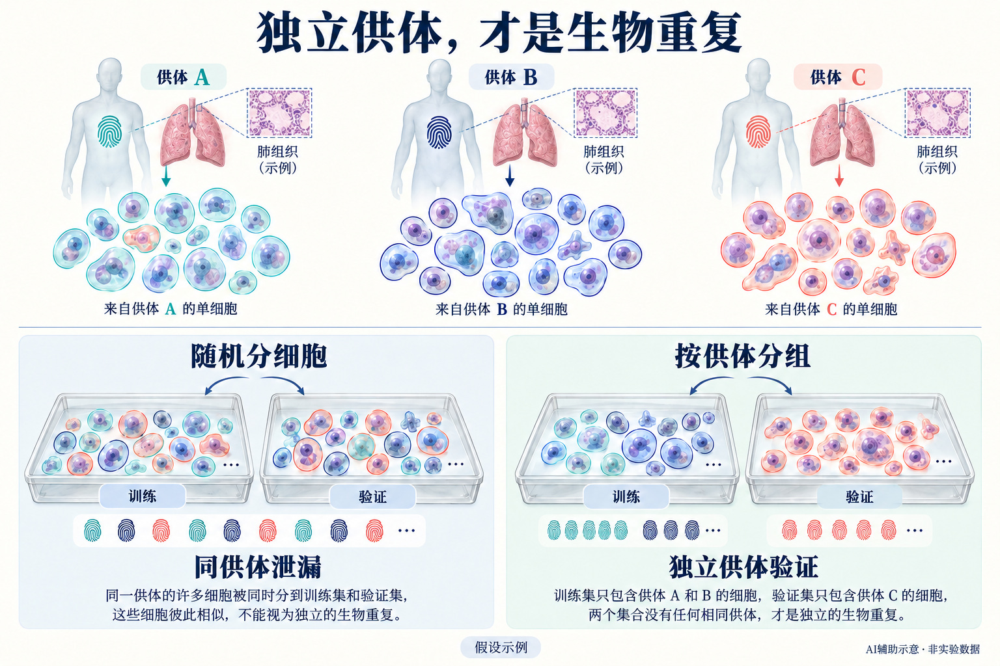

AI辅助原创教学图，非实验数据，假设示例。图中同类组织的三位供体仅用于说明分组验证；没有对应真实受试者或实验结果。正确的留出单位取决于目标，患者级推广不能仅用同一供体内随机细胞拆分来支持。

空间依赖让数据量与有效独立信息量不成简单比例。同一切片相邻细胞共享组织环境，多张切片可能来自同一患者。研究目标若是疾病组与对照组的群体差异，应让患者层面的重复进入统计设计。

下面是一种我们提出的分析方案，而非综述已经实施的标准流程：先在各患者内按一致规则得到通讯摘要，保留区域、细胞组成和质量信息；再比较患者层面的效应，并检查差异是否由某个样本驱动。若使用混合模型，明确哪些因素为固定效应、哪些重复结构为随机效应，同时报告样本数和不确定性。

多样本比较还要分解“细胞更多”与“同类细胞通讯状态改变”。某类发送细胞数量增加，可以使总体候选联系增加，即使每个细胞的表达没有改变。两种现象都可能有生物学意义，但应分别解释，不能把丰度变化一律称为通路增强。

对有限数量供体，模型再复杂也不能补出未观察到的人群多样性。探索阶段可以诚实报告每位供体方向是否一致；若条件和批次完全重合，则不能仅靠算法校正宣称已消除混杂。研究设计的信息缺口需要新数据，而不是更密集的箭头。

### 四、如何挑方法：从数据允许的结论往回选

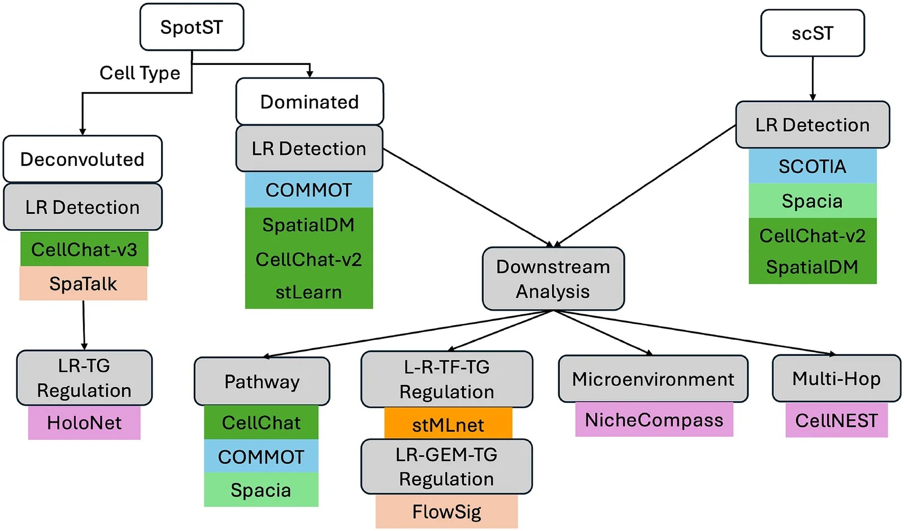

图4来源：Wu 等，2026，CC BY 4.0；原样展示，仅技术转码。它是选择流程图，不是性能比较图，没有准确率轴或实验样本量。

上游先分 SpotST 与单细胞/亚细胞 ST。SpotST 再区分使用去卷积信息还是主要细胞类型标签；后续分支按 LR 检测、通路、LR–TF–TG、通讯相关微环境和多跳接力等任务组织。图中的箭头表达选择路径，不表示这些方法串联后一定提高可靠性。

有完整或较广表达覆盖时，可以考虑下游调控或多层模型；靶向面板若缺少关键受体、转录因子或靶基因，应先做可观测性审计，而不是把未测分子补成零再运行最复杂的框架。对缺失机制层，最合理的处理可能是收窄问题。

如果关心局部空间配对，选能解释零模型和距离约束的方法；如果关心多对多竞争，检查联合传输与容量假设；如果关心微环境程序，关注表示是否在独立样本中稳定；如果要研究条件差异，优先考虑重复结构与可比较的输出定义。

资源要求也应按具体实现确认。协方差类模型可能受到细胞规模限制，深度模型的训练与超参数检查需要额外成本，多层分析依赖较完整的先验和基因覆盖。综述提供概念地图，不等于当前版本的安装和硬件说明；正式选型后还应读取目标版本文档，不能据旧文章推断现行依赖。

### 五、把一张网络转成一份可审查的结果

实际报告可以保留五个互相衔接的部分。

第一部分是输入：平台、空间单位、分割/去卷积方法、供体和切片数量、实际覆盖的分子以及质量控制。第二部分是模型：数据库版本、距离定义、邻域、复合物规则、零模型、主要参数和输出量的含义。

第三部分是结果本身：候选边、效应或分数、适用的显著性、对应细胞与区域，以及不确定性。不要只展示经过挑选的漂亮网络；保留完整候选与过滤规则，才能判断结论是否依赖事后筛选。

第四部分是敏感性：合理范围内改变邻域、注释、数据库过滤或采样，结论是否改变。报告变化的原因比机械求多个工具交集更有用。若一个候选只在极窄参数下出现，就把它降为探索性，而不是隐藏这些运行。

第五部分是独立证据与下一步实验：哪些只是输入自洽，哪些来自未用于建模的蛋白、响应、时间或扰动数据。把“支持空间关联”“符合机制先验”“支持功能作用”分开写，读者才知道当前结论站在哪一层。

### 六、这篇Review的贡献与仍未解决的问题

这篇综述的长处是把空间异质性、统计背景与机制层级连起来，避免仅按工具名称分类。它的数据库分层和选择流程也适合作为研究计划检查表。

不过，它不是统一条件下重新运行所有方法的 benchmark。方法表压缩了实现细节，个别表述需要回查原始资料；本文已明确 SpatialDM 的解析检验与 Spacia 的 probit 核查。作者讨论的改进方向，例如重新组织打分和空间检验的关系，应当作为待研究方案，而非已经证明普遍有效的修复。

未来最关键的工作，是建立任务明确、负例可信且跨组织可迁移的验证数据，以及将位置、蛋白状态、下游响应和扰动逐步接起来。对今天的分析者而言，最稳妥的进展通常来自一个范围清楚、可以独立检验的候选，而不是一张越来越密的全局网络。

### 来源与阅读边界

- 核心 Review：[完整正文](https://pmc.ncbi.nlm.nih.gov/articles/PMC13548332/)、[表2](https://pmc.ncbi.nlm.nih.gov/articles/PMC13548332/#TB2)，DOI [10.1093/bib/bbag477](https://doi.org/10.1093/bib/bbag477)。全文、主图主表已读；补充表S1未取得。
- 方法评估原始研究：[Dimitrov 等，2022](https://www.nature.com/articles/s41467-022-30755-0)，DOI [10.1038/s41467-022-30755-0](https://doi.org/10.1038/s41467-022-30755-0)。核查相关 Results、Methods、Discussion，非整篇及全部补充精读。
- [COMMOT 原始主文](https://pmc.ncbi.nlm.nih.gov/articles/PMC9911355/)与[SpatialDM 原始主文](https://pmc.ncbi.nlm.nih.gov/articles/PMC10325966/)已通读，未运行或复核补充。其他 benchmark/方法按 Review 归因，不宣称独立复现。
- 原图、表摘录依[CC BY 4.0](https://creativecommons.org/licenses/by/4.0/)署名使用；表格仅选列分段重排，不改原单元格内容。原创图为AI辅助示意、非实验数据。

## Take-home messages

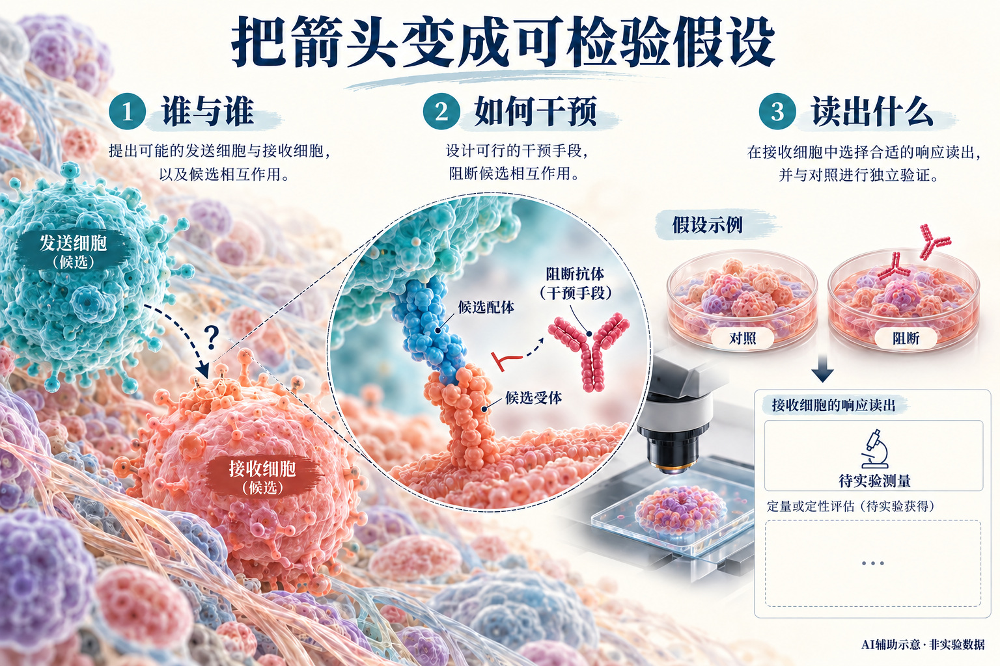

这篇独立的 take-home messages，服务于一个具体时刻：空间通讯结果已经跑出来，你准备选候选、写结论或设计实验。此时最有价值的问题往往是“这条边还缺什么证据”，而不是“能不能再画得复杂一点”。

我们精读的正式综述是 Wu、Su 与 Cui 于2026年9月7日发表的《Decoding cell–cell communication in spatial transcriptomics: mechanistic insights, modeling constraints, and analytical caveats》。文章覆盖空间统计、最优传输、图模型、多层信号网络及数据库与验证问题。以下是结合全文和部分原始方法核查形成的教学综合，不是作者发布的统一标准，也不是我们实测软件的排行榜。

导读图是AI辅助原创示意，非实验数据。图中“待实验测量”表示未来需要获得的读出；没有生成或展示任何真实实验结果。

### 1. 把箭头翻译成一句有条件的话

不要只写“A 向 B 通讯增强”。先补上观测单位和模型对象，例如：“在某患者的肿瘤边缘，某类发送细胞与接收细胞的候选 LR 空间关联更强。”

这句话仍然有限，但读者知道它来自哪个区域、对应哪种统计量，也知道尚未到达“驱动疾病”的因果层。对于多细胞 spot，单位就保留为 spot 或空间区域；对于去卷积重建的细胞，明确其位置与表达经过估计。

措辞不只是保守程度的问题。它决定后续实验要验证什么，也决定其他人能否复用结果。

### 2. 区分三个层级，再判断证据是否跨了层

细胞间配体到受体的联系、细胞内受体后的转导、多细胞间的接力，是三个相关但不同的层级。

看见 LR 共表达，只覆盖候选联系的前端。加入靶基因响应，提供更深的机制一致性，但仍可能受共同状态影响。要讨论 A 经 B 影响 C，则需解释 B 如何把输入转换为输出；两条外部 LR 边在图上相接，并不会自动证明这一步。

同样，邻域模型捕捉到广义 CCI，也不必然等于识别了化学信号 CCC。不要让一个宽泛的模型名称替代机制论证。

### 3. 在运行前写零假设，别在看完结果后挑背景

P 值不是某条边为真的概率。它依赖一个具体背景：你打乱了标签、位置、基因，还是只在某些区域和细胞类型内重排？

置换范围改变，细胞组成与表达状态也可能改变。检验得到不同结果，不一定意味着真实生物学变了，而可能是换了问题。预先说明需要保留哪些背景因素，并检查可交换对象是否足够，是比“多置换几次”更根本的步骤。

合理的敏感性分析可以改变邻域或背景设定，但应展示结果变化，而非只保留显著的一次。

### 4. 方法要按输出量选，不按网络图的复杂度选

空间关联分数用于判断共现结构；表达预测的重要性用于说明模型依赖哪些信息；最优传输耦合用于在给定代价和容量代理下分配候选关系；图注意力及潜在表示用于组织学习到的模式；动力学模型给出条件于方程和潜在进程的方向。

这些数值没有共同单位。把它们归一化成同一色阶，并不意味着就能比较“谁的通讯更强”。如果要合并证据，应明确各方法提供的互补信息，而不是平均一组含义不同的分数。

复杂模型最值得使用的情形，是它新增的约束恰好对应你的科学问题，并且数据足够支持这些约束。

### 5. 数据库和测量面板共同限定可发现范围

一个候选没有出现，先问它是否在数据库里，相关配体、受体及亚基是否真的被测量。靶向面板没收录的分子，不应被当作组织中不存在。

复合物、辅助因子、通路方向和 TF–靶基因关系需要保留。只有单个亚基表达时，不要自动升级为完整受体活性；数据库收录了一条机制，也不代表它在当前细胞状态中正在运行。

冻结数据库版本、物种映射和过滤规则，并记录真正参与分析的候选空间。否则，下一次“网络变了”可能只是资源更新，而不是生物学发现。

### 6. 交集、稳定性和相邻，都属于有用但有限的检查

多个算法一致，值得关注；但如果共享同一数据库和距离先验，一致性并不是多份完全独立证据。

下采样后边仍稳定，可以说明对该种扰动不敏感，不能说明边真实。一个稳定的技术偏差也会重复出现。推断边大多相邻，则可能只是模型遵守了自己输入的近邻规则。

这些检查应当保留，只是不能给它们超出范围的解释。更强的验证通常来自未用于建模的观测，以及能排除替代解释的实验。

### 7. 把生物学重复写在最显眼的位置

细胞数、spot 数、切片数和供体数分别报告。来自同一供体的大量细胞，不会自动提供相同数量的独立人群重复。

如果目标是跨患者推广，可以考虑按供体留出、在样本层面汇总效应、检查单个患者是否主导差异。若条件与批次完全重合，应说明设计限制；若只有一个样本，则将结果定位为该组织中的探索性假设。

同一细胞类型的数量增加，与其单位细胞的候选通讯状态改变，也应分开。两者均可重要，却对应不同的机制问题。

### 8. 为下一步实验写一张“缺口清单”

对于最关注的候选，可以依次写出：发送方是否具有相关配体蛋白；接收方是否具备完整功能受体；两者是否在适当空间和时间接触；下游响应是否存在；阻断后是否改变；替代解释有哪些。

并非每个项目都能完成所有实验，但清单能帮助选择最能减少不确定性的下一步。例如，现有证据全部来自 RNA，那么补充独立蛋白或下游状态测量，通常比再运行一个共享先验的方法更能推进机制判断。

扰动实验也应明确读出层级。表达改变可能经过间接状态变化，不宜把全部差异基因都称为直接靶点。时间、合适对照以及必要的救援设计，需围绕具体假设安排，而非机械照搬模板。

### 一个可以直接放进分析报告的结果段落骨架

下面仅是写作骨架，没有假定任何数据结果：

“我们以……作为观测单位，使用……版本和……数据库，在……空间范围及……零模型下筛选候选联系。……候选在……样本/区域中呈现……关联，其稳定性对……设定表现为……。当前支持的是……层级；蛋白结合、下游因果效应或跨样本推广仍未直接验证。下一步计划用……区分……替代解释。”

填空时若有一格无法填写，就把它当作需要补充的方法说明或证据限制，而非用更强的动词跳过去。

### 最值得留下的一条原则

空间坐标缩小了不合理候选的范围，机制先验帮助组织解释，复杂模型能把多种假设写得更明确。但它们不能替代未测量的蛋白、时间过程与干预。

有研究价值的通讯结果，不必拥有最多的边。一个来源清楚、背景合理、单位准确、能提出下一步验证的候选，往往比一张无法追溯推断条件的密集网络更有用。

### 来源与阅读范围

- 核心 Review：[全文与原图表](https://pmc.ncbi.nlm.nih.gov/articles/PMC13548332/)，DOI [10.1093/bib/bbag477](https://doi.org/10.1093/bib/bbag477)，2026年9月7日。通读完整正文、图1–4和表1–2；未取得补充表S1。
- 原始方法核查：[SpatialDM](https://pmc.ncbi.nlm.nih.gov/articles/PMC10325966/)与[COMMOT](https://pmc.ncbi.nlm.nih.gov/articles/PMC9911355/)主文通读，未复核补充或运行软件。
- 限定核查：[Dimitrov 等方法比较](https://www.nature.com/articles/s41467-022-30755-0)相关结果、方法与讨论；[Spacia 正式论文](https://doi.org/10.1038/s41592-024-02408-1)的公开补充方法第25–28页，正式主文未全文取得。
- 本篇为独立 take-home 教学综合，不新增实验结果，不代表所有列举方法均经过实测。原创图由内置图像生成工具制作，已核对文字与关系，非实验数据。
