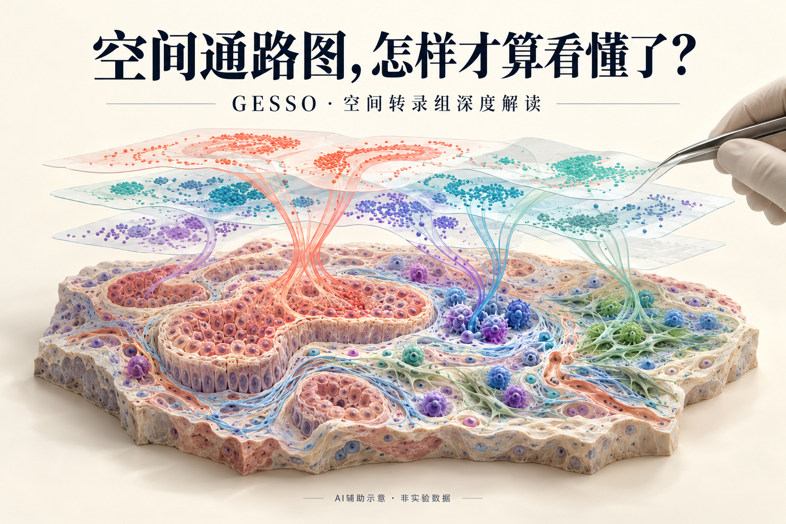
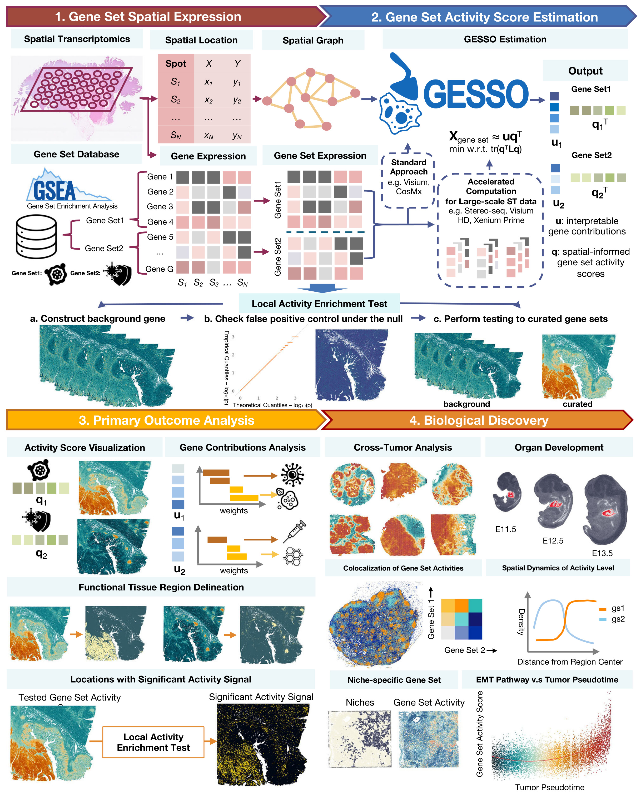
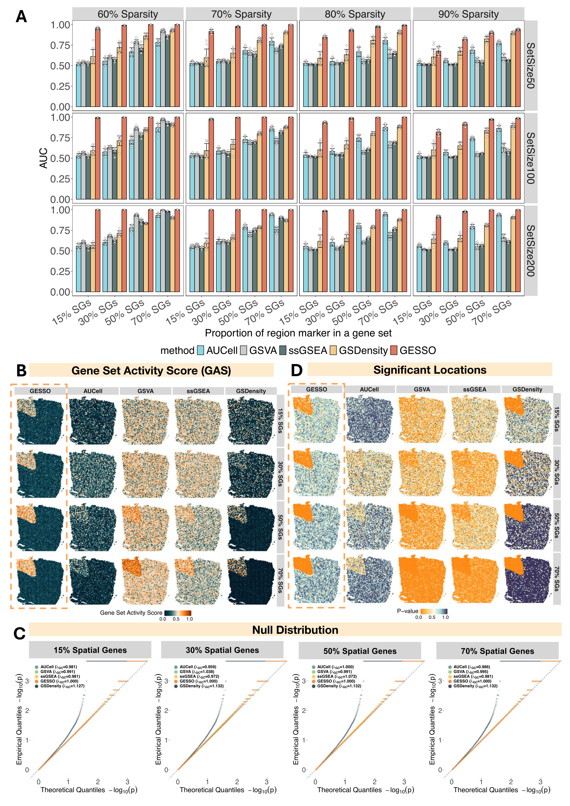
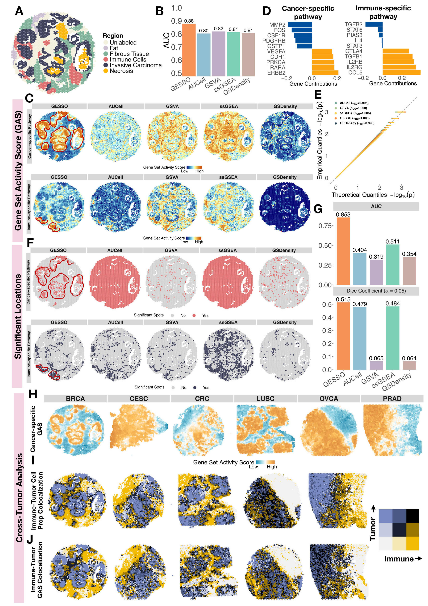
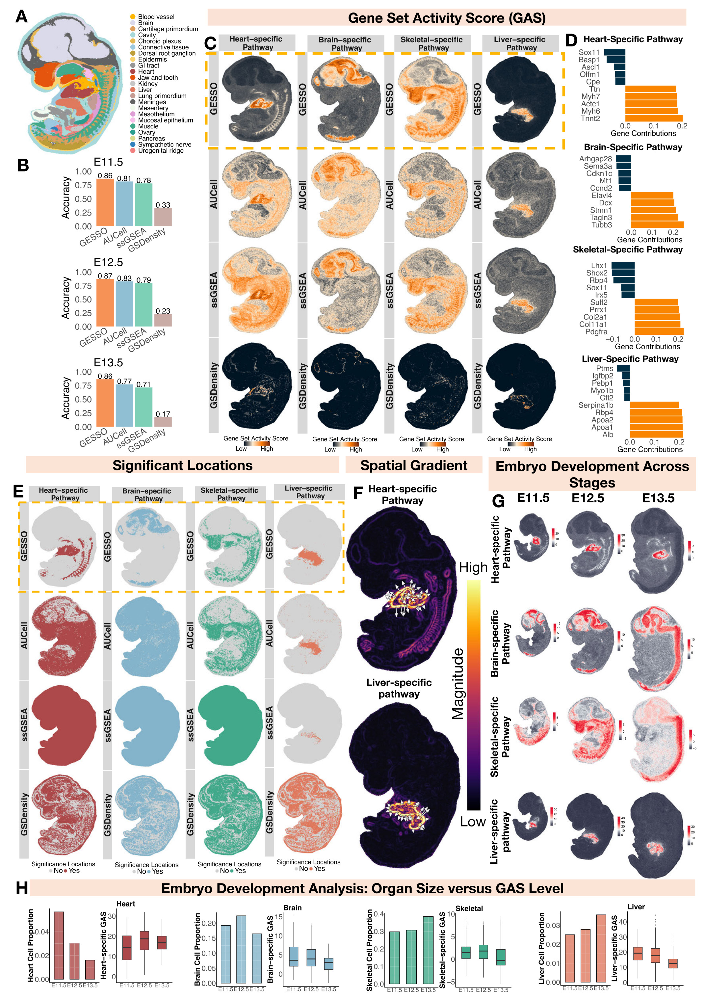
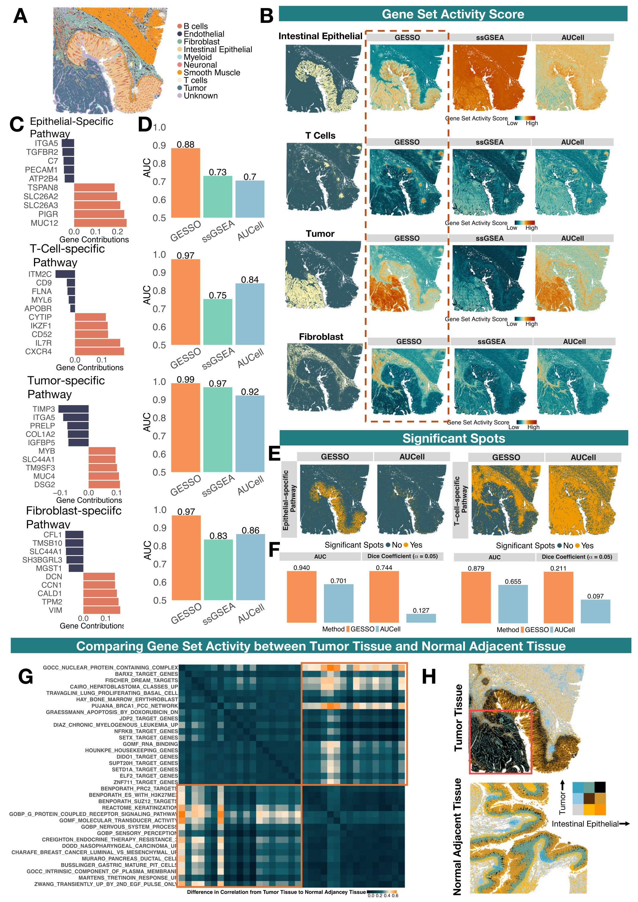
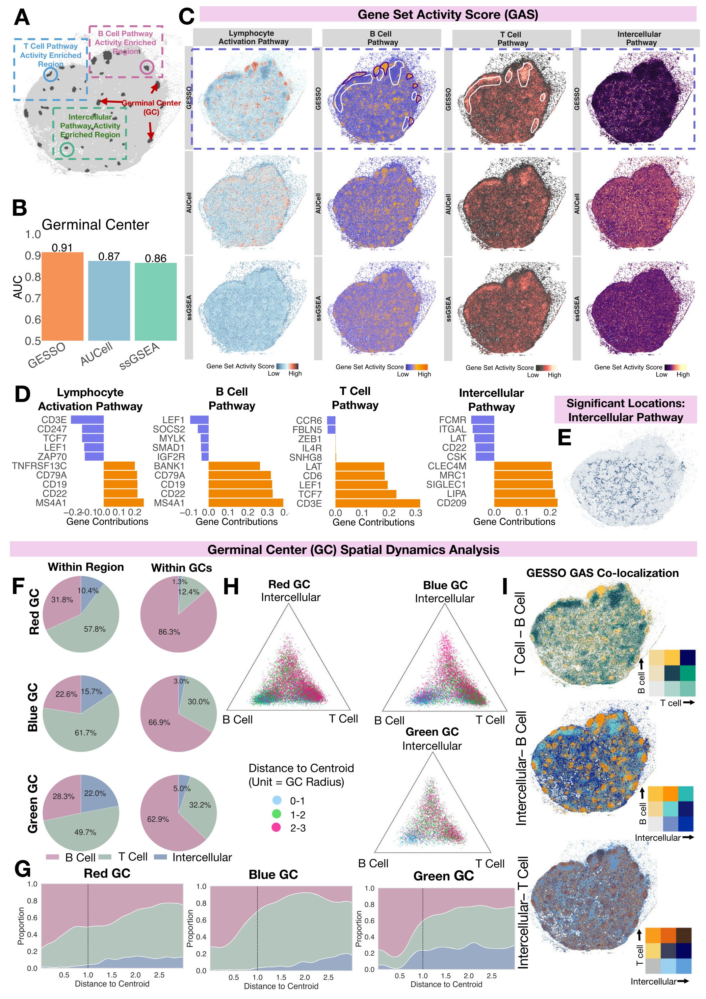
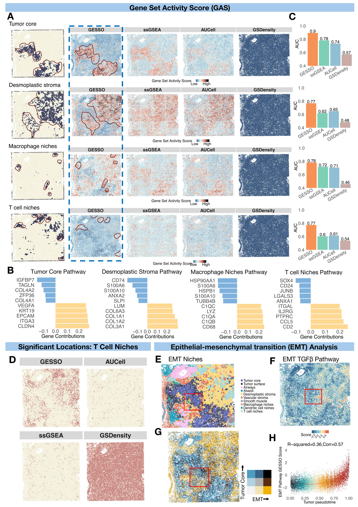

# 空间通路图，怎样才算看懂了？

::: {.book-source}
论文：[DOI 10.1038/s41467-026-78316-z](https://doi.org/10.1038/s41467-026-78316-z)。原有图注和许可说明见正文；未明确许可的图版标记为**授权待确认**。
:::

## 原理、模拟与Visium证据

一张空间通路图很容易让人产生信任：肿瘤区亮起来，免疫细胞附近出现另一片颜色，组织边界也相当整齐。但这里至少有三个不同的问题：这组基因在哪里共同变化？变化是否超出了随机基因集的背景？这些变化能否支持我们想讲的生物学机制？回答了第一问，不意味着后两问自动成立。

GESSO值得读，正因为它把前两问放进了一套可解释的空间评分框架。它利用表达和空间邻近关系，为预先指定的基因集估计每个位置的分数，同时给出基因贡献与局部显著性。本文将从原始图逐步检查：方法到底利用了什么信息，实验比较支持了多大的结论，哪些地方仍需要另做验证。

论文是Yang、Tan和Ma的原创研究《Interpretable and scalable spatial gene set activity analysis with GESSO uncovers functional tissue architecture》，2026年10月14日上线于Nature Communications，目前为Article in Press。本文依据该版本完整正文及补充说明，不把早期上线稿写成最终排版版本；软件与实验结果均为作者报告，我们没有重新运行分析。

### 一个“通路分数”，到底压缩了什么

先想象一张组织切片：每个点都有一列基因表达，旁边还有坐标。我们选出一个免疫相关基因集，希望把几十、几百个基因压缩为一个空间分数。最直接的做法是算平均表达，但基因的背景水平、稀疏程度和细胞类型特异性不同，平均值可能被少数高表达基因主导。

AUCell一类方法采用每个细胞或位置内部的表达排序，观察基因集成员是否聚集在高排名区域；GESSO则把“邻近位置往往具有相关组织功能”作为建模信息。它先取出指定基因集的表达子矩阵，再寻找一个共同变化模式。输出的q是各位置分数，u是各基因对这个模式的载荷。原理上可以理解为：用一条空间变化曲线和一组基因权重，近似重构这组基因的表达。

“一个模式”很重要。GESSO使用秩一分解，一套基因集首先被概括成一个主要方向。若同一基因集包含两个互相独立、出现在不同细胞群的子程序，一张分数图未必足以把它们都讲清楚。基因集也不必等于一条经过实验界定的信号通路；它可能是细胞标记集合、GO细胞组分或某项研究的表达签名。读图前就应先打开基因清单，而不是只看名字。

### Fig.1：空间信息怎样进入评分

按图上方的输入区读，必须同时有表达矩阵、空间坐标以及基因集定义。图里的邻接网络不是细胞通信网络：连边表示位置相近，不表示受体配体作用，更不表示调控方向。方法用近邻图的拉普拉斯矩阵，把相邻点分数差异过大所产生的代价加进优化目标。

这就出现一组需要平衡的要求：分数要解释表达中的共同变化，也不能在邻居之间无根据地剧烈跳动。作者用β调节空间平滑强度，主分析取0.33。β为零时不加入空间平滑；过大的β可能让组织几何压过表达本身。这个参数不是“可信度为33%”，也不是实验测出的邻居贡献比例。

图中u和q的可解释性也有边界。矩阵分解有符号不唯一的问题：同时把两者取反，重构结果不变。作者用该基因集的平均表达作为方向参照，必要时一起翻转符号。于是一个正载荷可以说“这个基因沿当前评分方向共同变化”，负载荷表示相反方向；不能把它们直接翻译成通路激活因子和抑制因子。载荷是在这份数据和这套模型下得到的相对贡献，并非跨组织固定不变的生物学常数。

图中加速分支解决的是大样本计算问题。大型切片先按坐标做分层，再把每个空间层中的点分配到多个子集，使每个子集尽量覆盖整张组织，分别评分后合并。它不是简单把组织切成互不联系的几块，也不是额外测到了更高分辨率。补充实验在较小Visium数据上比较了近似与完整计算；分得越多，计算负担下降，但近似误差也可能增加。使用这一步应保留分区数和随机种子，不能只记录最后一张图。

### 图中央的显著性检验，问的是一个特定问题

GESSO对每个位置构造背景：从全部基因中反复随机抽取与目标集合大小相同的基因集，重新评分，数一数随机分数超过目标分数的次数。于是它问的是：“在这个位置，目标基因集的分数，相对于同样大小的随机基因集是否偏高？”

这个问题有明确用途，也有明确范围。它没有把患者分组标签打乱，不是在检验治疗效应；它也没有把坐标打乱，因此不能仅凭这张p值图宣布发现了超出空间自相关的机制。补充说明描述的是基因集大小匹配，没有描述按平均表达、检出率逐基因匹配；读者不能替作者补上这些控制。

通常作者用1,000个随机集合估计背景，另外生成独立的1,000个集合检查零假设校准。Visium HD和Xenium为了计算可行性各降至100个。背景估计与校准是两批集合，不能合并说成“做了2,000次检验”。100次抽样意味着经验p值分辨率较粗；按文中计数公式出现零值，只表示有限次抽样没有观察到更大的背景分数，不表示事件绝不发生。

另一个尤其容易误读的地方：主文显著区域采用原始p<0.05，补充材料明确把多重检验校正交给使用者选择。因此图上的亮点不能称为“FDR控制在5%的发现”。若你扫描几千条基因集和几十万个位置，还需要为自己的科学问题定义检验族、校正方法以及后续验证。这些是我们对实际研究的建议，并非本文已经完成的验证。

### Fig.2：先把一场有利于空间方法的考试读清楚

模拟不是从零生成一张随意的图。作者借用人脑皮层切片的3,611个空间位置，其中513个位于白质，用白质富集模式构造一部分空间变化基因，再加入大量随机基因和不同程度的稀疏性。这样有一个已知目标：包含白质相关基因的集合，应当在白质区域给出较高分数。

A面板按基因集大小、稀疏程度以及集合中空间基因比例排布。横轴是空间相关基因占比，纵轴是判断白质区域的AUC，不是基因表达量；不同颜色代表评分方法。每种条件的10个重复是抽取的基因集，不是10个脑样本；不同方法使用配对的同一组集合，误差线为一个样本标准差。补充图注还说明，这个模拟中的逻辑回归拟合与评估使用同一批位置，所以这里衡量的是对已知空间结构的恢复，而非外部预测能力。

B面板把分数放回切片。颜色从低到高表示该图内部缩放后的评分；可以看是否沿白质富集，却不能用橙色深浅比较两种方法的绝对生物学活性。D面板展示局部检验的p值空间分布。原图标题和图注称“显著位置”，但色条实际为0到1的连续p值；不能把它当成二值显著区域，颜色所编码的是p值，而不是B中的评分大小。按p<0.05另行判断，才得到显著位置。这里连续评分与相对背景的显著性回答的是不同问题。

C面板是QQ图，横轴是均匀零假设下的理论负对数p值分位数，纵轴是实际分位数。接近对角线支持当前随机基因集背景下的校准；系统性偏离提示p值分布有问题。它不能证明所有真实组织、所有基因集都已校准，更不能替代对假阳性率、检验依赖性和多重比较的进一步评估。

在这些设置下，GESSO总体更好地恢复白质模式。合理的解释是，空间邻近信息帮助它在稀疏表达中抓住组织结构。需要同时看到，模拟的真值本来就是空间连续的白质区域，恰好符合模型的先验。若你的问题是散落在组织中的罕见状态、跨边界突变的反应，或者某个细胞内部与邻居不同的程序，这场模拟并没有直接替你验证适用性。

### Fig.3：真实组织比模拟多了一层解释风险

A面板给出乳腺癌切片的组织区域标注，B面板比较用基因集评分预测这些标签的AUC。GESSO为0.88，其他方法约0.80至0.82。这支持评分中包含较强的组织区分信息。真实数据采用按位置随机80%训练、20%测试，同一切片中相邻点可能分到两侧；空间相关和整片无监督评分使这个结果不能等同于独立患者、独立切片或空间分块外推验证。

C面板具体看癌症相关和免疫相关集合。红色轮廓提供组织区域参照，连续颜色显示评分。D面板再打开黑箱，展示两套集合中的正负载荷。ERBB2等基因对癌症相关模式贡献较大，是值得继续检查的线索；免疫集合中的负载荷也不能仅凭符号就赋予免疫抑制的因果含义。更可靠的读法是将载荷、单基因图、细胞组成和组织标注一起对照。

E再次检查随机背景的p值分布，F展示阈值化区域，G则报告显著性对应的AUC和Dice。两者不能混用：AUC评价排序区分，Dice评价给定阈值后的区域重叠。本文GESSO癌症与免疫区域的Dice分别约0.52、0.31，即使优于这里若干基线，也远未达到把病理区域精确描出的程度。只有一根最高的柱子，不能说明分割已经足够好。

H展示多个癌种的癌症相关评分，I给出基于CARD推断的肿瘤和免疫细胞比例，J展示两套分数的联合分布。联合颜色能提示两种程序在哪些地方共现，无法单凭共现证明细胞之间发生了作用。CARD也是从表达中推断组成，不能当作完全独立的实验真值；作者因缺少匹配参考而没有在该比较中纳入CESC，同样提醒我们外部参考决定了验证范围。

到这里，GESSO的优势可以讲得很具体：在本文考察的数据和任务里，加入空间信息的基因集评分更容易找回连续组织结构，并提供可追溯到基因的贡献。还不能直接讲成“发现了组织的真实功能”“能够预测新患者”或“证明两类细胞互相调控”。分辨率提高到几十万个点以后，这些优势和限制还需要继续检查。

### 为什么不能先把几种评分当成同一把尺

把五种方法的输出都叫“活性”，很容易忽略它们测量的统计对象不同。AUCell侧重集合成员在单个位置表达排序前端的恢复程度；ssGSEA沿排序表累计集合内外基因的相对富集；GSVA转换跨样本表达与排序信息；GSDensity以基因和细胞嵌入中的图结构进行评分。GESSO则在指定集合内寻找与空间结构相容的主要共同变化。相同颜色的地图，背后并非同一种单位。

这会影响哪些对照值得加。假如一个基因集在所有位置都具有较高但几乎不变的表达，排序型分数与寻找主要变化方向的模型可能给出不同感受。又假如只有少数位置具有异常状态，但它们没有连成片，空间平滑可能削弱这个状态。两种结果并不自动意味着其中一个“算错了”，应先检查研究问题是否需要共同变化、绝对表达、相对富集，还是局部稀有事件。

这些例子是教学假设，不是本文新增实验结果。它们说明，选工具之前先写清想恢复的信号，比在柱状图里找总冠军更有价值。本文的比较框架主要将评分用于恢复已知组织区域；若研究目标换成扰动响应或临床结局，需要建立对应验证任务。

同样要检查输入的预处理。作者使用归一化、对数转换后的表达，并在模型中对基因行进行标准化；原始测序计数不是直接等价的输入。一个几乎没有检出、方差很小的基因，即使属于知名通路，也未必能提供可靠信息。基因命名体系、物种、重复符号、过滤后实际交集，都可能改变最终被分解的矩阵。方法图画的是理想流程，真正上手时应先把这些输入检查写入记录。

### 漂亮的零假设图，还要追问检验单位

把所有位置的p值放在一起做总体QQ图，和在每个位置分别检查随机集合的分布，是两种检查。一个整体分布看起来合理，并不排除某个组织区域出现系统性偏差。作者同时考察总体与局部校准，这比只展示一条全局对角线更有信息；但局部校准仍然是在选定的随机集合背景下完成的。

为什么强调背景？因为随机抽取的基因集可能在平均表达、基因间相关性或细胞类型偏好上，与研究者精心整理的目标集合不同。大小一致只控制了其中一个因素。若我们打算用局部显著性支持很强的生物学主张，就应考虑改变背景设计后结论是否稳定，并说明这些检查尚未由当前主图代为完成。

此外，同一个组织里的数千个点具有相关性。增加点数可以让地图更细，却不会自动增加同样数量的独立生物学样本。论文里的基因集重复、空间位置数、切片数、患者数应分开列出来。把所有点放进一次检验而不说明它们来自哪里，会让读者高估证据的独立程度。

### 阅读范围与图像来源

本篇已通读GESSO的Article in Press完整正文及补充说明，核查对应原始图和方法段；没有运行其代码。AUCell的原理另核SCENIC官方论文页面和Bioconductor说明，未在此声称重新阅读全文并复现该研究。全部数值均归因于GESSO作者结果。

论文与原图：Yang AJ, Tan C, Ma Y. Nature Communications，2026-10-14，Article in Press。https://doi.org/10.1038/s41467-026-78316-z 。Fig.1–3完整原样展示，仅进行技术性栅格化和JPEG压缩，无panel重排、数据或标签改动。文章许可CC BY-NC-ND 4.0：https://creativecommons.org/licenses/by-nc-nd/4.0/ 。手机请点开原图放大；文字按面板解释，不以缩小后的预览判断细节。

Fig.1中Noun Project图标另按CC BY 3.0署名：Blackonion（immune-6624432）、Denicon（needle-7518968）、James Fenton（cells-7259482）、visual language（cell-7060585）、Alzam（database-5079143）、MUHAMAD KHOTIBUL UMAM（immune-7976980）、komsiatun（tumor-7667276）。各原始页均为https://thenounproject.com/icon/后接上述名称和编号加/；许可https://creativecommons.org/licenses/by/3.0/ 。本文不将这些图标视为文章作者独立授权的自有素材。

代码：https://github.com/YMa-lab/GESSO 。AUCell原始来源：https://doi.org/10.1038/nmeth.4463 。封面与导读图为AI辅助生成示意，不是实验数据。

## 胚胎、Visium HD与边界检查

分辨率更高，通路图是不是就更接近真实生物学？GESSO的胚胎和结直肠癌分析提供了两个很适合追问的例子。一个有连续的发育阶段，容易让人把空间箭头读成生长方向；另一个有几十万个位置，容易让人把大量点误当作大量独立样本。本篇对照原文Fig.4和Fig.5，看看哪些结果支持方法实用，哪些仍然只是下一步实验的起点。

本文依据Yang、Tan和Ma于2026年10月14日在Nature Communications上线的GESSO原创研究，版本为Article in Press。它把预定义基因集的表达与空间邻接信息结合，通过秩一分解得到位置评分和基因载荷；局部显著性则比较同样大小的随机基因集。以下数值和图均为作者报告，没有重新运行代码。

### 先搞清楚这两类数据的困难在哪里

Stereo-seq小鼠胚胎包含E11.5、E12.5、E13.5三个阶段，分别约3.0万、5.1万、7.7万个位置。器官边界提供了直观参照，但数据仍是切片上的表达测量。一个器官相关基因集在对应区域富集，说明它可以找回区域功能特征，不能直接说明捕捉到了发育过程中的全部调控变化。

Visium HD结直肠癌示例更大：原始肿瘤切片541,968个位置，邻近正常组织435,773个位置；补充表记录质控后分别460,894和319,782个。这几个数字对应不同处理阶段，不能混着当作同一批分析点。更重要的是，这里肿瘤与邻近正常组织来自同一患者。几十万个位置提供的是丰富的组织内部信息，不是几十万个患者的重复证据。

空间点、bin与细胞也不能随意互换。Visium HD图中的位置与细胞类型标签来自原始分析流程，对一个细胞程序的评分，可能受到该位置细胞组成、测量深度以及分箱方式影响。只有细胞尺度更细这一点，不能保证每个点都等于一个独立而纯净的细胞。

### Fig.4A–D：找到器官，是有意义但有范围的成功

A面板给出胚胎的解剖区域标注。B面板比较不同阶段用评分预测这些标注的准确率，横向是方法，纵轴是accuracy。GESSO在三个阶段约为0.86、0.87、0.86；AUCell约为0.81、0.83、0.77。它在这里恢复器官组织结构较好，但这些不是把一只胚胎训练出的模型拿去预测另一只胚胎的成绩。

还要检查特征从哪里来。补充说明写得很清楚：这组分析通过基因集名称中是否包含已标注的器官词筛选出313个集合。因此这是在有先验知识的条件下检查器官相关信号，不能包装成“算法在完全不知道器官是什么的情况下自动发现全部器官”。这种选择本身可以服务于功能解释，只是要与无监督新发现分开。

C面板挑出心脏、脑、骨骼和肝脏四套集合，沿列比较器官，沿行比较方法。评分颜色由低到高显示局部相对水平，黑暗区域不是“没有这个器官”，也不必表示对应过程绝对关闭。红亮区域与器官标注重合，是空间一致性的证据；离开标注出现信号，则需要追问共享基因、邻近结构和细胞类型组成。

D面板展示对应基因载荷，横轴是贡献数值，颜色区分正负方向。心脏集合中的Tnnt2、Myh6、Actc1，神经相关集合中的Tubb3、Tagln3、Stmn1，给出了检查评分来源的入口。合理的下一步是回看这些基因的空间图，判断是不是少数标记支配了结果。不能因为载荷前几名具有已知功能，就推导出模型已经证明它们在该切片中的因果作用。

骨骼和肝脏集合的例子也有相同边界：标记合理性增加了结果的可解释性，却不等于完整复现了骨形成或肝脏分化机制。原图中的基因贡献是对数据模式的描述，不能当作基因敲除后的效应量。

### Fig.4E–F：显著区域和空间箭头不是同一种证据

E面板从连续评分切换到显著位置。这里的阳性是相对于随机基因集背景、按原始p值阈值定义的结果，不是多重检验已校正的器官定位。把C与E一起读，能看出“分数较高”和“相对背景偏高”有哪些差异。不同方法的局部检验表现也依赖统一比较框架和各自分数分布，不能据此否定某个方法的所有原生应用。

F面板最值得放慢速度。作者在每个位置及其邻居之间，用评分差与二维坐标差做局部回归，估计空间梯度。颜色表示变化有多陡，箭头表示变化方向。补充说明特意指出，图中箭头取负梯度，即从高评分指向低评分，视觉上从峰值区域向外展开。

所以箭头没有直接测量细胞迁移，也没有跟踪同一群细胞在时间中的运动。它描述的是这张切片上评分随位置变化的几何性质。高梯度沿器官边界出现，支持评分能表现区域转换；要把它解释为组织扩张方向、发育速度或形态发生的驱动力，需要额外时间序列、谱系或扰动证据。

这里还有一个方法学上的自我检查：空间平滑本来就鼓励邻居相似，得到平滑梯度不应被当作独立验证。更有说服力的是检查平滑有没有把真正的边界一起抹掉。作者在补充材料中比较了不同β，并引入边界对比指标：跨器官边界相邻点的评分差，除以器官内部邻居的平均差。这个指标直接追问“内部更平滑”是否仍伴随“边界保留”。

在所测E12.5数据上，默认β=0.33时四个器官平均边界对比约1.48；极端β=1时约1.01。前者表示边界差异比内部差异更大，后者接近无差别。这支持默认值在该示例中较合理，却不能升级为所有平台的最优参数。作者没有在最高分辨率数据上全面重复β扫描，原因是计算成本；我们应保留这个覆盖范围。

### Fig.4G–H：三个阶段，不是一部连续电影

G面板沿阶段展示四类程序，H同时放出器官位置比例与评分分布。柱状图的分母是该切片中的空间位置，不能直接解释成整个胚胎的器官体积比例；箱线图中的众多点或观测值也不是等量独立胚胎。

更容易忽略的是，不同阶段的组织经过各自处理和模型拟合。基因载荷、评分尺度、细胞组成及切片位置都可能变化。即使看到某一阶段的分数分布更低，也不宜直接写成“这个器官的生物学活性随发育下降”。要做跨阶段定量比较，需要先明确评分是否处于共同可比尺度，并控制取样和组成差异。

这并不削弱阶段图的价值。它可以告诉我们哪些空间模式值得进一步关注，例如一个程序的高分区域是否随解剖结构改变位置或范围。正确的研究动作，是把这类观察转成有明确采样设计的问题，再用独立胚胎重复和相应的实验读出判断。

### Fig.5A–D：到了几十万个位置，先分开速度与准确性

A面板显示细胞类型参照；B沿行展示肠上皮、T细胞、肿瘤和成纤维细胞相关集合，各列是方法。深浅反映图内相对评分，不是染色强度。D则把对应区域的区分能力量化为AUC：例如肠上皮相关集合GESSO约0.88，ssGSEA约0.73，AUCell约0.70。这说明选定集合在当前切片中更好地对齐了上皮区域。

C面板把这种对齐拆到基因层面。一个重要细节是，肠上皮示例使用的GOCC_INTRINSIC_COMPONENT_OF_PLASMA_MEMBRANE属于细胞组分集合。即使PIGR等基因具有较大权重，我们也只能说这些基因共同变化与上皮位置相关，不能把分数解释成测量了细胞膜的生理功能。名字里有“membrane”，并不等于实验记录了膜运输效率。

上百种集合合起来进行细胞标签预测时，GESSO的准确率为0.90，AUCell为0.86，ssGSEA为0.88；AUC四舍五入后GESSO与ssGSEA均为0.98。它的总体表现强，但不是每个指标都严格优于所有对照。只摘一个领先指标，会让读者错过方法各自的取舍。

还有计算筛选效应。文中仅GESSO、AUCell和ssGSEA在作者资源和时限内完成评分；GSVA和GSDensity未在两天内完成。局部检验又只由GESSO和AUCell完成了100个随机背景集合。这能说明给定实现和配置下的可行性差别，不能宣称另外两个软件在任何机器、任何参数下都无法处理这类数据。

### Fig.5E–F：同一张图里，藏着不能跳过的反例

E面板显示肠上皮与T细胞程序的显著位置，F给出相应AUC和Dice。肠上皮的显著性定位中，GESSO约为AUC 0.94、Dice 0.74，AUCell约0.70、0.13；T细胞示例也显示GESSO在当前比较中的优势。注意Dice评价阈值后区域重叠，不等于AUC，也不是细胞类型注释准确率。

不过，补充结果中的肿瘤相关集合是反例：AUCell的显著性AUC约0.83、Dice约0.50，高于GESSO的0.78和0.41。这个反例应当保留，因为它帮助我们理解方法适用条件：空间平滑和数据驱动权重，并不保证每一套基因集、每一种阈值定位任务都受益。

如果你的目标是圈定肿瘤区域，应优先在自己的切片上检查这个具体任务，而不是因为“GESSO总体表现好”就替换全部原有分析。建议同时保留连续分数图、阈值结果及多种参照，不要只交付一张显著区域图。对阈值不稳定的边缘位置，标注不确定性通常比强行给出二元标签更诚实。

### Fig.5G–H：相关性的差异，不等于细胞互作的差异

G面板是基因集评分间相关性的差值热图，行列都是不同集合。图例把肿瘤相对邻近正常组织更强或更弱的相关关系编码成不同颜色。它没有直接测量配体与受体结合、信号传递或物理接触；多个集合共享基因、同时反映细胞组成，或者都依赖相同的空间结构，也可能产生相关。

H面板把肿瘤相关与肠上皮相关程序放回组织，联合颜色显示两种评分同时偏高的位置。局部放大的组织区域帮助定位具体结构，但不能让相关分析自动成为机制实验。比较的还是同一患者的两类组织，病理差异、取样位置和细胞丰度都可能改变评分相关结构。

这组结果适合生成下一步假设：例如在重复患者中，某种上皮状态是否稳定伴随特定免疫邻域？要检验它，可以预先定义区域、检查细胞组成，再补充蛋白、原位检测或扰动。这里的验证路线是我们的研究建议，不是GESSO已经展示的新增实验。

### 计算“能跑完”之后，还要记录什么

作者的大数据近似通过空间分层抽样降低单次矩阵分解规模。补充比较在六种Visium肿瘤数据、按字母排序选出的前500个集合中进行；分区数增加时，与完整结果的一致性会下降。这样的验证支持近似实用，但不等于最高分辨率的每个稀有结构都完全保真。

计算资源也应按两项分别估算：一次评分和反复背景评分。补充运行时间实验使用10个CPU，所测峰值内存低于200 GB；这个量级不能轻率称为普通笔记本的轻量任务。显著性计算要重复100或1,000次背景评分，通常比单张评分图更昂贵。本文没有给出我们自己的耗时或硬件体验。

准备自己的分析时，可先选择几个有明确组织参照、基因覆盖足够的集合，在小范围运行并检查边界；再评估完整切片、多个背景和敏感性分析的预算。需要记录实际入模位置数、过滤标准、基因集版本、β、邻居数、分区数、随机种子及软件版本。否则一次漂亮的图，很难被后来的人解释或复现。

这两组应用最值得借鉴的是：把“恢复区域”“保留边界”“跨阶段变化”“相关结构”拆开验证。分辨率增加能够提供细节，但独立样本、可比尺度和机制证据仍须另外建立。

### 怎样设计一个比“随机分点”更贴近问题的验证

如果目标只是描述当前切片，利用整片空间信息计算评分是合理的；若目标变成预测新患者，验证设计就必须改变。这不是措辞上的差别，而是决定哪些信息可以在拟合时被看见。位置随机拆分允许组织中的近邻同时出现在训练和测试中，能检验局部标签恢复，却难以代表跨样本的真实难度。

一种可迁移的做法，是把完整切片或患者作为留出单位；若暂时只有单张切片，可至少尝试空间分块留出，观察离开训练邻域后表现怎样。需要同时说明：评分是否在全片先计算，基因集是否根据全片标签挑选，以及参数是否看过测试结果后调整。未解决这些信息来源的问题，不能只换一个交叉验证名字就声称泛化成立。

在本文HD等应用中，作者先根据原有细胞类型做富集，再挑选相关集合。这个步骤有助于围绕已知细胞程序进行解释，但它并非对未知组织的盲测。若我们借鉴这套流程进行预测研究，应把集合选择纳入训练环节，或者预先使用独立知识定义集合，再把验证数据留到最后。这是对研究设计的建议，不能反过来说本文已经证明发生了监督标签泄漏。

还有一个很实用的核查：把颜色图旁边附上未做显示缩放的评分分布及定义。min-max把每张图压到相同范围，能够方便看形状，却可能把非常小的波动和很大的波动画得同样鲜明。原图用于展示的缩放没有错，但论文读者和实际使用者都应知道，视觉上的“同样红”没有自动建立跨样本量纲。

最终可以把评价分成三个彼此独立的终点：当前组织能否找回已知区域，模型在独立组织中能否稳定表现，某个功能解释是否经正交实验支持。这三层都重要，也不应由一项AUC互相代替。GESSO的主图主要增强了第一层证据，后两层仍要围绕具体项目继续建设。

### 来源、阅读范围与图像说明

GESSO完整正文、补充说明及原图已阅读；本篇重点核查补充Notes 3、4、8、9、11及数据表。原始Visium HD研究另核官方论文页面的样本设计与数据来源，未在此声称完整复现其所有实验。数据来源论文包含更广样本，不能把它的总患者数直接搬来当作GESSO此项比较的重复数。

主文：https://doi.org/10.1038/s41467-026-78316-z 。Yang AJ, Tan C, Ma Y，Nature Communications，2026-10-14，Article in Press。Fig.4、Fig.5完整原样展示，仅技术性栅格化和JPEG压缩，未重排或更改实验内容。许可CC BY-NC-ND 4.0：https://creativecommons.org/licenses/by-nc-nd/4.0/ 。手机请点开图放大查看完整标签和图例。

原始Visium HD研究：Oliveira等，Nature Genetics，2025-06-05，https://doi.org/10.1038/s41588-025-02193-3 。软件：https://github.com/YMa-lab/GESSO 。封面及导读图为AI辅助示意，非实验数据。

## 淋巴结、肺癌生态位与解释范围

当一张图能够同时展示B细胞、T细胞与肿瘤相关程序，很容易顺手写下“揭示细胞互作”。GESSO在淋巴结和肺癌组织上的应用提醒我们：空间关系确实有价值，但从评分分布走到作用机制，中间还隔着细胞组成、基因覆盖、独立重复和功能验证。本篇结合原文Fig.6–7，尽量把这几步拆清楚。

研究为Yang、Tan和Ma的GESSO方法论文，Nature Communications于2026年10月14日上线，目前为Article in Press。我们已经阅读完整正文和补充说明，下文报告的是作者结果，没有自行运行模型或复现实验。GESSO依赖预定义基因集，并通过空间约束估计共同表达模式；它提供功能线索，不直接测量生化通量。

### Fig.6前，先把“几十万个细胞”放回采样设计

Xenium淋巴结数据原始约70.9万个细胞，补充表列出的质控后数量约68.2万。作者根据形态图像人工标注生发中心，用这些区域评价淋巴细胞相关评分。细胞很多，能够看见组织内部细节；但图中重点展示的三个生发中心仍来自当前数据，不是三个独立临床队列。

这也是靶向测量的应用。一个基因集在数据库里可能有数百个成员，实际被panel覆盖并通过过滤的只是一部分。评分使用的是交集。分数很漂亮，并不表示模型知道那些没有被测到的基因表达了什么。

原文称该数据为Xenium Prime示例，同时补充表列有具体基因数量。平台名称、厂商panel规模和最终矩阵维度不是同一个概念；实际复现应读取原始对象和特征类型，不能仅凭名称替作者推定输入含哪些特征。这里不把未核实的矩阵来源细节写成确定事实。

### Fig.6A–E：先定位区域，再检查信号来自哪些基因

A面板标出感兴趣区域以及红、蓝、绿三个生发中心位置。B面板比较识别生发中心的AUC，GESSO约0.91，AUCell约0.87，ssGSEA约0.86。这仍是对当前数据所给区域标签的恢复能力，不能解释成诊断淋巴结疾病的临床准确性。

C面板按列展示淋巴细胞激活、B细胞、T细胞与囊泡介导运输相关集合（原图标为Intercellular），按行比较方法。要看的是区域之间的空间模式，而不是把不同列同一种颜色当作相同强度。每个集合经显示缩放后产生的色彩，不能作为跨通路的绝对量尺。

D面板横轴为基因贡献，正负条形表示在当前共同变化模式中的相对方向。B细胞集合中的MS4A1、CD22、CD19，T细胞集合中的TCF7、LEF1等，让人能够追溯分数为什么与区域对齐。这些已知标记有助于生物学解释，但也提示另一种可能：评分的相当一部分信息来自细胞类型组成。

囊泡运输相关集合尤其值得谨慎。CD209、LIPA、SIGLEC1等贡献较大，可能与某些细胞群或功能状态相关；原图使用“Intercellular”标签，也不能据这个GO集合直接证明细胞间运输或通信。表达签名没有直接观察运输囊泡移动，也没有测量运输速率。若想进一步讨论抗原处理、细胞吞噬或特定物质转运，需要与对应蛋白定位、功能测量或细胞类型分层分析联系起来。

E面板为这套囊泡运输集合的局部显著性结果。该高分辨率数据中，作者在给定预算下只对GESSO完成了相应显著性分析，不能把其他方法缺失的p值图理解为“已经被证明没有信号”。一项方法没有完成测试，和完成后表现较差，是两件应分别报告的事。

### Fig.6F：86%究竟是什么的86%

F面板中的饼图很吸引人。三个生发中心内部，B细胞相关程序成为主导评分的比例分别约86%、67%、63%。这个数字很容易被误写成“生发中心有86%的B细胞”，但原文的操作不是用独立细胞身份标签直接数细胞。

作者先对B细胞、T细胞和囊泡运输三套分数做min-max缩放，再把每个细胞分给三者之中分数最高的一类。因此这里的分母是选定区域内纳入比较的细胞，分子是某个程序在三项缩放分数中排名第一的细胞。它表示当前规则下的相对评分主导，而不是该细胞只有这一种功能，更不是三种生物过程加起来刚好构成全部功能。

这个定义为什么重要？假如再加入第四套基因集，或者换一种缩放方法，最高分归属就可能改变。一个细胞的T细胞相关评分不是最高，也不代表它不能具有T细胞特征。对于细胞身份判断，仍要参考独立注释、标记组合及测量质量。

两组饼图还比较了感兴趣区域整体与生发中心内部。它们回答的是嵌套空间范围中的评分构成差异。比较比例之前，应确认采用的是哪个区域作为分母，不能把外部区域和内部区域的百分比直接相减，再赋予细胞迁入迁出的含义。

### Fig.6G–I：径向规律有意思，但不能把组织压成一个完美圆

G面板以到生发中心质心的距离为横轴，并用该中心的半径尺度归一化；纵轴展示不同主导程序随距离变化的平滑频率。三种颜色分别对应前面定义的三类主导评分。距离增加时颜色构成变化，提示程序在中心与外围的组织方式不同。

这是空间径向总结，不是时间轨迹。真实生发中心形状不规则，质心距离会把不同方向上的结构合并；归一化半径附近也不等于每个方向都恰好到达真实边界。因此它适合揭示总体趋势，也可能掩盖局部不对称。我们建议把径向曲线与原始组织坐标一起检查，而不是只保留一条平滑曲线。

H面板是三元图：三个顶点对应三类程序的相对评分，点的位置描述它们的相对组合，颜色标记距离。三元坐标是评分构成，不是直接量出的三种细胞比例或三种物质浓度。I面板回到组织，联合色标显示两类评分的组合，高高共现的颜色能定位值得关注的区域，却没有指向哪个细胞作用于哪个细胞的因果方向。

这套分析的实际价值，在于把一个模糊的“这里可能有免疫结构”细化为可检验问题：中心与外围的哪些程序稳定不同？这种模式是否跨生发中心和个体重复？控制细胞身份后还在不在？本文提供前期空间描述，后面的验证需要新的设计。

### Fig.7A–D：一个960基因panel，能讲到哪一步

CosMx示例包含57,993个细胞和960个测量基因，原始研究还提供生态位标签与肿瘤伪时间。GESSO考察肿瘤核心、促纤维化基质、巨噬细胞和T细胞生态位相关集合。A面板左侧为区域参照，其余列显示各方法评分；红色轮廓帮助把评分与区域位置对应。

C面板给出这些集合区分相应区域的AUC。比如肿瘤核心相关集合GESSO约0.90，其他方法较低；这说明该签名在当前组织内能较好区分指定区域。B面板展示载荷，说明这种区分由哪些基因贡献。看这两块时应同时问：是生态位状态的变化，还是原本就能识别细胞身份的标记在起主要作用？

用多套评分一起预测所有标签时，作者报告GESSO准确率约0.56、F1约0.46。相对基线有改善，并不意味着注释已经足够可靠。AUC、accuracy和F1关注的错误结构不同；数据类别不平衡时，一个总体看似不错的排序指标，也可能掩盖某个少数生态位识别不佳。

D面板展示T细胞相关集合的显著位置。其他生态位的补充结果同样提醒我们不要只摘亮点：巨噬细胞相关显著区域的Dice仅约0.08。即使有一定AUC，给定阈值下区域重叠仍然很弱。若研究目标正是圈定巨噬细胞生态位，这个数字比“总体最好”更影响是否能直接使用结果。

原始数据来自一项将三维空间转录组与细胞外基质成像结合的肺癌研究。我们核查了其论文元数据和摘要来源；它为GESSO提供数据及参照，但我们没有在本次解读中独立复现原始三维重建或其所有细胞互作结论。两层研究的证据不应混为一谈。

### Fig.7E–H：EMT分数与伪时间相连，还缺什么

E面板显示原有生态位标签，F是EMT相关基因集的评分图，G把肿瘤相关和EMT相关评分联合展示。两类分数同时较高的位置，有助于提出肿瘤区域内部存在状态异质性的假设。

但EMT集合中的COL1A1、COL5A1、FN1、MMP2等，也与细胞外基质、成纤维细胞及周围组织有关。仅看到这些表达签名，就写成“恶性细胞正在完成上皮间质转化”，证据仍然不足。需要确认信号落在怎样的细胞中，排除组成差异与邻近细胞影响，并用更完整的上皮和间质状态证据支持解释。

H面板横轴是肿瘤伪时间，纵轴是EMT相关评分，点表示相应位置或细胞。图中采用二次拟合，R²约0.36；图注定义的相关系数约0.57，是评分与伪时间平方的Pearson相关。不能把它简化成一次线性相关，也不能把伪时间当作真实观察到的时间。

伪时间是由数据推断的状态排序，相关性能够说明两种表示在一定程度上共变，却无法证明一个状态必然发展到另一个状态。如果两者都利用表达中的某些共同信息，相关还可能部分来自共享输入。只有加入独立时间、谱系追踪或扰动，才能继续检验状态转变与因果机制。

方法比较也有值得保留的细节：EMT显著性相关的AUC中GESSO约0.69，领先本文几种对照；但是Dice约0.42，略低于ssGSEA的0.44。指标不同，排序会变。因此这里适合说“对EMT相关空间结构有一定恢复能力”，不适合写成“全面准确定位EMT”。

### 对靶向panel，5%的建议应该怎么用

补充材料专门做了删基因敏感性分析：选择Xenium和CosMx各一套有明确区域信号的集合，逐步减少保留基因，观察区域区分能力。GESSO在这些例子中较稳健，作者建议保留至少5%基因覆盖的集合，并对更低覆盖谨慎解释。

这只是来自两个示例的实用建议，不能当作普适的充分性阈值。一个100基因集合测到5个标记，与一个20基因机制模块只测到1个成员，即使覆盖率接近，信息量和代表性都不同。覆盖到的基因如果都指向同一种细胞身份，评分可能主要回答“哪里有这种细胞”，而非“这个机制是否被激活”。

因此实际报告至少要列出集合原始大小、panel交集、过滤后入模数量和主要载荷；若结论依赖少数基因，再检查删除单个高贡献基因后图是否大幅改变。这是建议的稳健性检查，不是宣称当前论文已经对所有集合完成了这样的逐基因验证。

### 使用之前，还应明确它与你现有工具的分工

GESSO适合围绕已知集合解释空间程序；Hotspot、NMF、SpatialPCA、MEFISTO等则更偏向发现模块或学习潜在表示。作者补充比较了这些方法，但任务并不完全相同：预指定集合和事后选出的最佳潜在因子，各自携带不同先验与选择过程。一个区域恢复指标上的优势，不能直接说明另外一类问题已经没有必要做。

软件公开在YMa-lab/GESSO，代码采用MIT许可；这与论文图片的CC BY-NC-ND许可是两套权利。复现时应记录安装环境和具体版本，结合分析仓库检查预处理与参数；本文没有安装运行，也没有做自己的速度测试。先从少量集合验证输入和输出，再扩大规模，比一次性把所有数据库集合扫一遍更容易发现问题。

把这两张原图读完，最重要的收获是一个顺序：确认测到了哪些基因，检查评分反映哪些细胞和空间模式，再讨论统计显著性，最后设计独立验证。顺序越清楚，空间图越能为实验提供有用问题，而不是提前替实验给出答案。

### 先解决三个可能的替代解释

第一个是基因集重叠。两套程序在组织中共现，可能因为它们都包含同一批表达活跃的基因。作者在乳腺癌例子中检查了细胞周期与糖酵解、血管生成集合之间的共享基因：这些候选多效性基因贡献较小，移除后评分高度相似。它是有用的稳健性检查，但覆盖的是所选集合与数据，不能推断任何两个通路的相关性都与共享成员无关。

如果自己的结论依赖两套程序共现，可以报告交集规模，再比较移除交集后的空间模式。即使模式保留，也仍需考虑两套集合是否共同标记同一种细胞类型。前一项控制解决共享基因，后一项控制解决组成，两者并不等价。这里没有一个统一阈值能够替代具体组织背景。

第二个是细胞组成。一个区域的B细胞评分较高，可能是B细胞更多，也可能是B细胞内部的状态改变。把分析限定在可信的同一细胞类型内，有助于区分两种解释；但限定后位置减少、图结构变化，又需要重新检查稳定性。不能只在混合组织上观察一个分数，就把它解释成单细胞内部程序上调。

第三个是空间先验本身。若目标区域连成片，邻域平滑容易提升区域恢复；如果关心的是边界上一小群异常细胞，过度平滑反而可能降低敏感性。一个合理的对照是同时检查无空间约束、默认约束和较强约束的结果，并特别观察罕见区域是否消失。当前论文在部分数据中做了参数敏感性分析，我们的建议是把同样的问题落实到自己的目标结构，而不是只接受默认值。

这些检查的目的不是不断追加分析直到得到期待结果。最好在看最终图前写清：什么现象算稳健，什么变化会迫使我们降低结论强度，哪些对象需要外部实验确认。这样，模型输出就能成为筛选研究假设的依据，失败的检查也有信息，而不会只剩下挑选最漂亮地图的过程。

### 来源与图像说明

主文：https://doi.org/10.1038/s41467-026-78316-z 。Yang AJ, Tan C, Ma Y，Nature Communications，2026-10-14，Article in Press。Fig.6、Fig.7完整原样展示，仅技术性栅格化和JPEG压缩，无panel重排或实验内容改动。许可CC BY-NC-ND 4.0：https://creativecommons.org/licenses/by-nc-nd/4.0/ 。手机点开原图可查看标签；原图、原始结果与本文建议分别归因。

CosMx数据来源论文：https://doi.org/10.1016/j.cels.2025.101261 ，本次仅核其摘要与元数据。SpatialPCA方法定位另核官方文章页面：https://doi.org/10.1038/s41467-022-34879-1 ，未声称复现。代码：https://github.com/YMa-lab/GESSO ；分析仓库：https://github.com/YMa-lab/GESSO-Analysis 。封面与导读图为AI辅助示意，非实验数据。

## take-home messages

### Take-home messages：读完以后，怎样改变自己的研究

GESSO给出的最有用启发，不是以后每张空间切片都必须换一种评分工具。更值得带走的是一个思路：空间坐标能帮助我们从稀疏表达中提取组织程序，但每引入一层先验，就要准备一项能够检查它的证据。评分、显著性、区域定位和机制解释，各有各的任务。

这篇独立收束稿将GESSO研究转成可以迁移到自己项目的决策清单。主文是Yang、Tan和Ma于2026年10月14日上线的Nature Communications原创论文，目前为Article in Press。以下研究设计建议是我们的延伸分析；它们不是作者已经完成的新增实验，也不是经过我们运行验证的操作教程。

### 先写一句具体问题，再决定要不要算分

“我想看看通路”通常不够具体。可以把它改写成：“在独立标注的肿瘤边缘，某套预先定义的免疫相关基因是否呈现稳定的空间富集？”这样至少明确了对象、区域、基因集和希望观察的现象。

如果问题是发现从未定义过的基因模块，预定义集合评分不应独自承担全部工作；如果问题是某个信号通路是否真正被激活，RNA评分也不能替代蛋白修饰或功能测量。先确定终点，才能判断GESSO、AUCell、潜在因子模型或其他方法是否适合当前目的。

一个实用的记录方式，是给每个候选集合附上“我为什么选它”和“什么结果会改变我的判断”。这能减少事后在成千上万张图里寻找漂亮解释的机会，也方便向合作者说明哪些是预先假设，哪些是探索性发现。

### 给输入做一张清单，比给结果换配色更重要

需要记录的输入至少包括：样本和切片身份、测量平台、实际入模位置数、表达预处理、基因命名规则、集合来源版本、集合原始大小、实际交集以及过滤后成员。靶向panel尤其需要看最后两项。

作者在两个示例中提出至少5%覆盖的建议，可以作为提醒，不能当作普适通行证。若一个集合最后只剩少数标记，就应把结论限定在这些被测基因支持的层面。没有测到的成员，不会因为地图连续而自动补齐。

还应保存正负载荷与单基因空间图。某个结果若完全由一个高贡献基因驱动，我们需要知道；一个权重为负的基因，也不能仅凭这个符号被写成抑制因子。把统计表示翻译成生物学语言时，应保留“在当前数据中共同变化”的限定。

### 让空间先验接受检查

GESSO的优势来自利用邻近信息，这同时带来一个明确风险：真正的细小或不连续结构可能被平滑。检查不能只停在整体AUC，更应落到关心的边界、罕见细胞群和散在区域。

可先比较无空间约束、默认约束及较强约束下的模式，观察目标结构是否稳定。β、邻居数、分区数及随机种子都要随结果保存。如果稍改参数，核心区域就从存在变为消失，结果仍有探索价值，但不宜写成稳健的组织功能单元。

大数据近似同样需要检查。作者的分层分区让每个子集覆盖整张组织，在资源可控时近似完整计算；它并非无损。自己的数据若包含很小的特殊区域，最好专门检查其在不同分区设置下是否被保留。这里的建议需要项目自行执行，我们没有把它包装成已完成的测试。

### 把p值的问题，翻译成一句普通话

GESSO的局部背景检验比较同样大小的随机基因集。得到小p值，支持目标集合相对这个背景偏高；它不直接证明治疗响应、跨患者差异或细胞互作。

使用者需要说明抽样背景控制了什么、没有控制什么，以及用了多少随机集合。100次抽样得到的经验p值分辨率，与1,000次不同；有限背景下的零p值也不意味着零错误概率。

如果同时检验很多位置和集合，应在研究设计中明确多重比较处理。原文p<0.05的区域图没有自动成为FDR<5%的发现清单。还可以区分探索图和需要正式推断的预设终点：前者用于形成问题，后者需要更严格的统计与验证计划。

### 把测试数据放在真正需要泛化的地方

随机拆分同一切片上的位置，可以评价局部组织标签恢复。要回答能否迁移到新患者，最好把患者或完整切片留出；要检查空间外推，可考虑空间分块。两类任务不能靠相同的“测试集”字样混为一谈。

集合选择、参数调节以及任何依赖标签的筛选，应跟着验证设计一起安排。若用全数据的细胞标签选出了集合，再报告位置分类表现，应明确它包含先验信息，不能写成对未知组织的盲发现。

独立样本数也要单独报告。几十万个细胞可以帮助描述一张组织的异质性，不能代替多个患者；10次抽样基因集不能写成10次生物学重复。一个结果是否值得推广，取决于重复来自哪一层，而不仅是点数有多大。

### 对每个功能解释，至少准备一种替代解释

看到两套程序共现，可以先问：是否共享基因？是否都反映同一种细胞组成？是否共同受测量深度或空间平滑影响？这些问题不会让结果失去价值，反而能帮助决定下一步最值得做的实验。

看到EMT相关评分与伪时间共变，也应先确认细胞身份、基质信号与共享输入。伪时间是推断排序，空间梯度是位置变化，二者都不等于直接观察到的真实时间过程。

建议给最终结论配上一个证据阶梯：当前图支持空间关联；独立样本支持可重复性；同一细胞类型内的分析减少组成解释；蛋白或原位测量提供正交支持；扰动和恰当对照进一步检验机制。不是每个项目都要一次走到最后，但应明确自己站在哪一级。

### 看见反例，才能做出可靠选择

GESSO在本文许多任务中表现出优势，但HD肿瘤相关显著区域中AUCell的AUC和Dice更高，CosMx的EMT区域中ssGSEA的Dice略高。保留这些结果，才能把“哪种方法更好”改写成“对我的目标，哪种方法的错误更能接受”。

若目标是排序候选区域，可以关注AUC；若目标是圈定具体范围，就必须看阈值敏感性、Dice和漏检区域；若目标是解释机制，需要超出这两类指标的证据。不同评价终点得出不同排序，是正常且有信息的现象。

资源也参与选择。单次评分跑完，不代表几千集合的随机背景检验都可承受。作者计算实验使用的资源不应被误读成普通笔记本保证可运行。先围绕具体问题选择少量集合，把方法验证和计算预算一起安排，通常比盲目全库扫描更有收益。

### 一份合格结果，应该让后来的人能追问

最终交付可以包含：清楚的科学问题；样本与输入清单；基因集和参数版本；连续评分及载荷；未经视觉缩放的定义；局部检验背景与校正规则；原始组织参照；主要敏感性检查；失败例子；仍待验证的解释。源代码和数据入口应与这些记录一起保存。

图注则应明确每个点是什么、横纵轴是什么、颜色是否独立缩放、分母是什么、重复来自哪一层。一个饼图里的86%可能只是三套缩放评分取最大值后的主导比例；一支箭头可能只是高分到低分的负空间梯度。把定义写出来，比增加夸张标题更能帮助读者真正学会使用方法。

如果只带走一句话：让空间图帮助你提出更具体、更容易被证伪的问题。好的分析不只是把组织画得更连续，也要让我们知道，下一份证据应该从哪里来。

### 来源与范围

本系列已阅读GESSO完整正文及补充说明，结合7幅原文图解释方法与结果；没有重新运行软件。此篇为独立take-home messages，重点是原创研究设计分析，因此不重复堆放前文证据图，也没有新增实验结论。

Yang AJ, Tan C, Ma Y. Interpretable and scalable spatial gene set activity analysis with GESSO uncovers functional tissue architecture. Nature Communications，2026-10-14，Article in Press。https://doi.org/10.1038/s41467-026-78316-z 。代码：https://github.com/YMa-lab/GESSO ；复现分析：https://github.com/YMa-lab/GESSO-Analysis 。AI辅助封面与本篇导读图均为概念示意，画面中的样本和实验为假设教学场景，非作者实验数据。
