# 细胞分割榜单，为什么会换冠军

::: {.book-source}
论文：[DOI 10.1038/s41592-026-03272-x](https://doi.org/10.1038/s41592-026-03272-x)。原有图注和许可说明见正文；未明确许可的图版标记为**授权待确认**。
:::

原文：[Benchmarking segmentation methods for spatial transcriptomics](https://doi.org/10.1038/s41592-026-03272-x)，首次上线 2026-10-23。

阅读与核验范围：main：Complete legally accessible publisher HTML including Abstract, introduction, all Results/Discussion, Methods, data/code availability, article credits and all 6 figure captions read. Main PDF download not needed because complete official HTML available.；supplement：All 38 pages reviewed: 17 supplementary figures and 6 tables, captions and visual panels. Key quantitative table4/5/6 and HVG supplementary Fig2 closely inspected. Not a recomputation of every supplementary value.；source_data：Official Fig1–6 XLSX read with openpyxl; category scores/rankings compared with Figure3 and Supplement Tables4/5. Underlying raw spatial datasets not downloaded or reanalysed.；code：Official repository README, Nextflow README, Evaluation README, Evaluation_example.R scaling/aggregation and F2_plot_generation.py read; repository tree metadata recorded. No installation, benchmark execution or hardware measurements.；primary_references：Paper method identities and CellSPA/Nextflow/Giotto usage checked from paper references and official repository/docs. No claim of full-text rereading of every underlying algorithm paper; no extra primary study experiment presented as independently validated.；unread_optional：Reporting summary and peer-review file not used for scientific claims.

限制：Proxy biological reference is not traced cell-boundary ground truth.；15 datasets total versus7 showcased;11 considered versus9 ranked with per-dataset failures.；Original vs collapsed summary scores must retain labels; not compared as one scale.；Exact SCS unadjusted Overall differs .48 in narrative vs .46 Supplement Tables4/5; no key claim relies on that value.；Fig1 schematic retains18 score label vs15 final evaluation columns; disclosed.；Supplement Table5 embedded original truncates column headings; disclosed, not redrawn.；Fig5b displayed endothelial-specific panel; other cell types only supplementary Fig16.；Fig5c distance bins not monotonic in original left panel; no decay fit or diffusion-scale inference.；Cross-platform datasets not matched aliquots; no universal platform superiority claim.；No tool execution or independent reproduction.

图像许可：CC BY-NC-ND 4.0。逐图来源、原样片段或技术格式处理、补充原始研究身份及AI示意标记均保留于正文图注。

## 1. 一条边界，同时改变了几个问题

做空间转录组时，一张分割图很容易给人确定感：边界勾好了，每个RNA点也有了归属，后面似乎只需按标准流程聚类、注释、找通讯。真正麻烦的是，同一张组织图换一个分割方法，细胞数、每细胞基因数，甚至某群细胞表达什么，都可能一起改变。此时该相信看起来更漂亮的轮廓，还是综合分更高的软件？

2026年10月23日，Nature Methods发表了原创基准研究《Benchmarking segmentation methods for spatial transcriptomics》，官网文章类型为Analysis。Martínez-de-Morentin、Khan等人把多种分割工具放进统一流程，并把评价延伸到细胞组成、标记基因和通讯推断。本文不把它压成“安装第一名”的推荐清单，而是用它回答一个更实用的问题：当我们借用别人的benchmark选工具时，究竟借用了哪些前提？

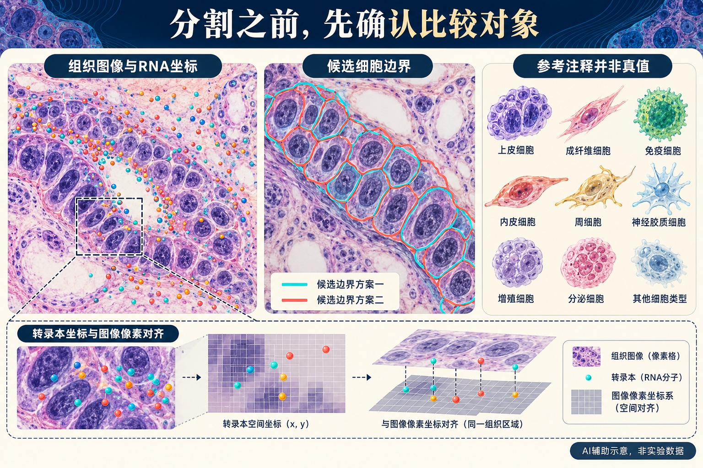

图示｜AI辅助教学示意，非实验数据。组织、RNA点和参考细胞图谱均为概念画面，不代表论文样本或真实软件输出；参考注释不能证明某条候选边界就是真实细胞膜。

### 一条边界，同时改变了几个问题

可以先想一个假设场景：肿瘤细胞与免疫细胞紧靠在一起，两者之间恰有几个转录本。如果边界向外扩，肿瘤细胞的总RNA数可能增加，免疫标记也可能被纳入。如果边界向内缩，表达轮廓可能更“纯”，但本属于该细胞的胞质RNA会丢失。把一个大细胞拆成两个，细胞数升高；把相邻细胞合并，每个对象的基因数可能升高。单看某一项“越多越好”的数字，四种变化都可能被误认作进步。

这里至少有三层目标。第一层是几何问题：细胞在哪里，是否被切开、合并或遗漏。第二层是分子归属：哪些RNA进入哪一行表达矩阵。第三层是研究结论：有没有保住稀有细胞、区域组成和可解释的分子关系。三层有关联，却不能互相替代。轮廓好看不必然意味着RNA归属合理；标记纯度高也可能是过度收缩的结果。

这也是本研究值得精读的地方：它没有只比较图像掩膜，而是把分割后的分子与生物学结构放进评价框架。但这项优点同时带来一个需要始终记住的边界——生物学一致性是证据，不是每条细胞边界的直接真值。

### 先看实验版图，而不是先看排行榜

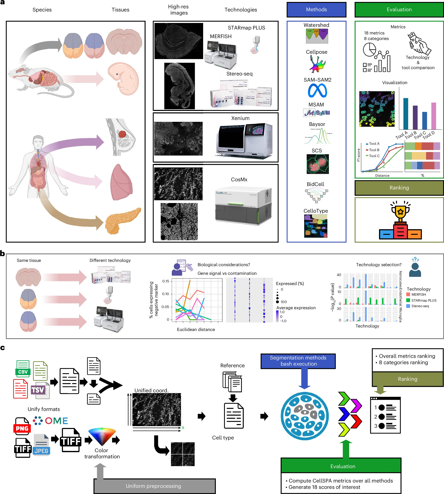

图1｜原文Fig.1完整原图，仅转换JPEG格式，未改动图内内容。a是物种、组织、技术、方法和评价的研究设计；b是可比小鼠脑区域的跨技术分析；c是统一输入、分块、运行与评价流程。这是设计示意，不是实测性能图。来源：Martínez-de-Morentin等，Nature Methods（2026），DOI：10.1038/s41592-026-03272-x，CC BY-NC-ND 4.0。图中仪器、标识不表示本号推荐或商业关联。

作者的研究版图包括15个数据集、5类空间转录组技术、12种组织类型，涵盖人和小鼠，合计约230万细胞。技术包括Stereo-seq、Xenium、CosMx、STARmap PLUS和MERFISH。数据规模从约数百细胞到接近80万细胞，基因面板、组织形态和成像条件都不同。这个跨度让我们能观察方法是否只在某种输入下占优，也让“一个平均分概括所有场景”变得危险。

另一个容易读错的数字是方法数。作者考察了11个方法，但Swin-S和Cascade Mask R-CNN在本文运行条件下产生了不符合生物形态的网格状结果，因此没有进入主要定量排名。主排名比较的是其余9种方法：Watershed、Cellpose、BIDCell、SCS、SAM、SAM2、mSAM、Baysor和CelloType。补图17展示了被排除结果。这样的排除应当透明记录，不能让读者误以为11个工具都完整参加了每一项比赛，也不能据此宣布两个模型在所有任务上无效。

主图2只画了7个代表性数据集，完整15个数据集的信息在补表中。阅读时必须把“为了排版展示的子集”和“实际评估范围”分开。对自己的项目，优先找到组织和技术最接近的一项，比先背全局第一名更有帮助。

这里还有一个统计层面的提醒：多组织、多平台意味着广度，并不自动产生独立生物学重复。一个组织切片里的几万细胞，不等于几万个独立病人；15个异质数据集也不能直接当作某一种组织上的15次重复实验。平均表现可以描述这批任务，却未必给出未来样本排名的不确定性。

### 统一格式，是公平比较的必要条件，不是全部条件

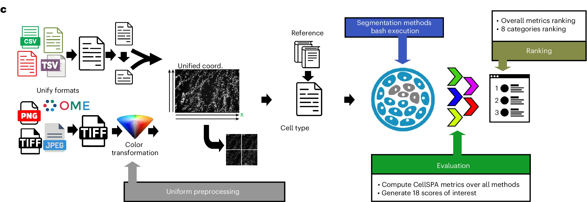

图1局部｜原文Fig.1c完整面板原样截取，保留流程标签和箭头；仅裁出面板、转换格式，无数据重绘。注意原图流程框保留“18 scores”字样，而正文与主要评分图采用15项指标、8类汇总；本文讨论评分时以实际评分列和补表为准，不把示意框里的数量当作最终指标清单。来源与许可同图1。

先从这个流程图的左端看起。不同平台的转录本表和图像格式被转成一致输入，RNA坐标与图像像素进入共同坐标空间，再把大图切块，运行各方法，最后回到原始组织位置进行评价。坐标配准看似只是工程步骤，实际决定了我们比较的是否还是同一块组织：一次轴方向、单位或缩放错误，就足以让正确模型看起来失效。

论文把转录本整理为包含geneID、MIDCounts、cellID、x和y等字段的表，并对图像作格式、灰度和空间尺度处理。分块尺寸随数据集调整，例如部分脑、肺和胰腺输入采用1200×1200像素的块，乳腺与胚胎设置不同。这里的像素大小不能直接当作相同物理面积：不同技术分辨率和图像缩放不同，同样的像素边长不保证同样的细胞邻域。

分块也不是无害操作。贴着边缘的细胞可能缺少上下文；依靠邻近转录本建模的方法，可能比只看局部图像的方法更敏感。我们没有重新运行流程，因此不会声称论文已经消除了所有边缘效应。可迁移的做法是：将分块策略、边缘处理和结果重组列为配置的一部分，而不是把它们藏进“预处理一致”五个字里。

“公平”还存在两种合理但不同的定义。一种是让方法面对尽可能一致的输入，避免有人获得额外信息；另一种是让每种方法使用其设计上最合适的输入与设置，比较实际可达到的效果。图像方法、转录本方法和多模态方法的先验并不相同，统一输入可能牺牲部分方法的优势；各自充分优化又会增加调参成本和人为选择空间。因此，这份研究给出的首先是其公开配置下的比较，不是所有方法理论上限的终局判决。

### “默认参数”也需要留下完整身份

论文的Cellpose使用cyto3及相应去噪模型；SAM使用ViT-H及特定的掩膜筛选阈值；Baysor在这里不使用核先验，而以转录本信息运行。类似差异会改变预测对象的大小、数量和筛选行为。不能只写“比较了Cellpose和Baysor”就认为实验身份完整，至少还需要模型、参数、输入通道、先验和输出过滤条件。

这点尤其适用于发展迅速的软件。后来发布的版本、重新训练的权重或另一种核先验，可能已经不是这次benchmark里的那个系统。反过来，不能因为软件版本更新就宣布原研究失效；正确问题是，更新是否改变了与当前任务相关的输入、算法或行为，是否需要重新比较。

这里我们只核对了论文方法、官方代码仓库的README、流程文档及部分评价/绘图代码，没有安装或运行这些方法，也没有验证本机性能。下文所有运行时间和性能结果都属于作者报告；教学建议则是基于这些证据提出的分析设计，不是“亲测推荐”。

### 基因筛选不是单纯的加速按钮

部分显式使用转录本的算法受内存与时间限制，作者在必要时把输入限制为1000个高变基因。减少特征既改变计算负担，也可能改变用于区分相邻细胞的分子线索。如果一个细胞类型的关键标记被滤掉，边界推断和随后评价都可能发生变化。

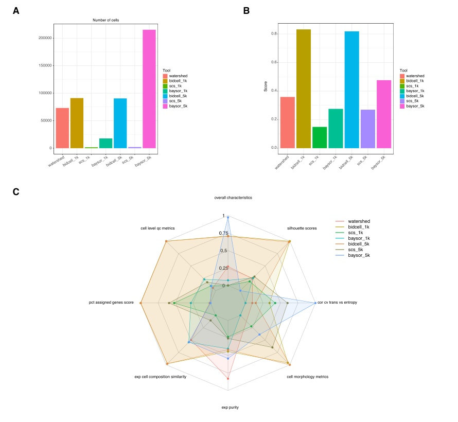

图2｜原文Supplementary Fig.2完整面板组原样呈现，取自补充PDF第4页，保留A–C、轴与图例；去掉页面外侧空白及英文长图注，中文说明另列，不改图中数据。A纵轴为分割细胞数量，B为综合分，C为各指标类别的归一化表现；颜色区分方法与1k/约5k基因配置。仅为一个黑色素瘤皮肤数据集的敏感性比较，不是多组织重复。来源与许可同图1。

补图2给了一个实际检验：在黑色素瘤皮肤数据中，比较1000个高变基因和约5000个完整基因集合。A看产出多少细胞，B看综合评分，C看不同指标类别的改变。BIDCell的两种配置在图中较接近，而其他方法的产出和得分变化更明显。这里最重要的观察不是“1000个基因够不够”，而是同一种预处理决定对不同方法的影响并不相同。

这幅图没有提供跨所有组织的普遍保证，也不等于经过独立重复证实的稳定效应。若自己的项目主要依赖少数稀有细胞或低丰度标记，我们提出的更稳妥做法是：在小规模代表区域上，先把全基因与筛选基因作为敏感性对照，比较边界、标记保留和目标结论，而非只比较运行是否成功。

### 最容易被当作“真值”的，是参考数据

该研究使用已有空间分割结果及对应单细胞参考、标签转移等信息组织评价。方法中采用Seurat v5相关流程进行标准化和细胞类型转移。这个参考让不同方法有共同的比较坐标，也使细胞类型比例、表达轮廓和标记纯度能够量化。然而，原有分割、参考细胞构成和注释过程都可能带有误差。

假如参考图谱缺少某个过渡状态，一个真实存在的新状态可能被强行归入已知类型。假如原参考本身合并了相邻细胞，复现它的比例也不必然等于更准确的边界。因此，“更接近参考”应按字面理解为一致性更高，不能偷换成“更接近真实世界”的证明。这不是否认参考价值，而是给每个指标加上它应有的条件。

同样重要的是评价入口。作者只对通过质量过滤的分割对象开展相关分析，方法中采用总转录本数20–2000、检测基因数大于20等条件。阈值有助于排除明显不可靠对象，也会改变被评价细胞的组成；高RNA细胞、很小的细胞或低表达群体可能受不同影响。这些阈值是本文分析设置，不应机械移植成所有空间技术的通用质控标准。

如果一个方法只留下最容易识别的细胞，它可能得到很漂亮的平均纯度和聚类分离度，却漏掉研究最关心的区域。要识别这种选择效应，必须同时记录过滤前后细胞数、转录本归属比例、组织覆盖和类型覆盖。下一篇将沿着这个问题拆开综合分：为什么高质量和高覆盖可以指向不同的“第一名”，为什么换一种合理的加权方式，榜单也会变化。

### 本篇带走的判断方法

拿到一张分割排行榜，先写下五件事：比较的样本是什么；方法实际获得哪些信息；分块与特征筛选如何改变输入；参考是人工真值还是代理基准；哪些对象在评分前已被过滤。只有这五件事与自己的任务相容，后面的高分才值得继续讨论。忽略它们，往往比选错第二名或第三名更危险。

原文：https://www.nature.com/articles/s41592-026-03272-x

官方代码：https://github.com/TranslationalBioinformaticsUnit/Benchmarking-SegmentationMethods-ST/

许可：https://creativecommons.org/licenses/by-nc-nd/4.0/ 。原图按非商业科普用途原样分享并署名；全文解读为独立教学分析，非逐段翻译。本文已阅读全文及可得补充材料；未重新运行分割或独立复现实验。

## 2. 先把气泡图读对：大圆不是多一个病人

一份benchmark里出现几个不同的“第一名”，不一定是计算出了错。常见原因是，问题已经悄悄改变：这次在问留下来的细胞有多好，下次在问整块组织覆盖了多少细胞；这次每项指标等权，下次先把相近指标合并。对空间转录组分割来说，这些选择会直接影响我们接受哪种误差。

本文继续精读2026年10月23日发表于Nature Methods的原创研究《Benchmarking segmentation methods for spatial transcriptomics》。本篇从原始评分图、补表和公开评价代码拆开综合分，重点不是给软件重新颁奖，而是学会判断：一张排名表回答的，是否正好是自己的研究问题。

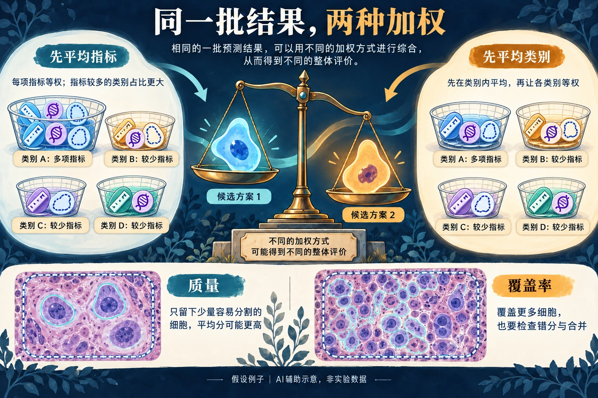

图示｜AI辅助教学示意，非实验数据。上方篮子代表指标类别，令每项指标等权与令每类指标等权，会产生不同隐含权重；下方是质量与覆盖的假设例子，不是同一组织的配对输出或论文实测结果。

### 先把气泡图读对：大圆不是多一个病人

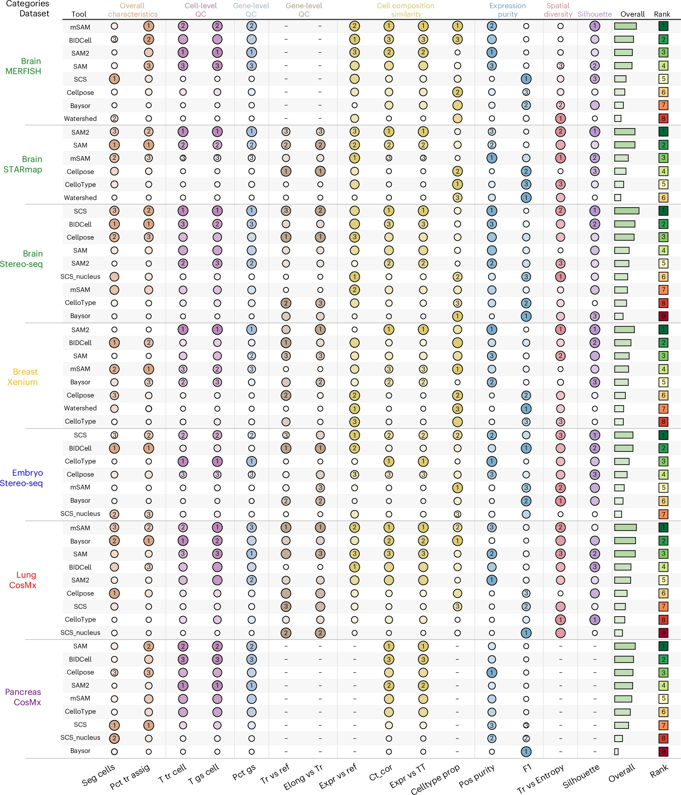

图3｜原文Fig.2完整原图，未改图内数据，仅转换格式。按实际版面，纵向分组为7个代表数据集及各工具，横向为评分指标、Overall和Rank；颜色区分指标类别，圆大小反映归一化指标值，圆内1–3标出该项靠前名次。绿色横条为综合分，右端方块为本数据集排名。空缺不能视为零。来源：Martínez-de-Morentin等，Nature Methods（2026），DOI：10.1038/s41592-026-03272-x，CC BY-NC-ND 4.0。

从图左侧挑一个与自己最接近的数据集，再横着看一个工具，通常比纵览最后一列更有价值。这里并不是每种工具在每项指标上都一样强：有的方法每细胞转录本和基因较多，有的方法保留更多细胞，有的方法更接近参考类型组成。浅色的小圆与深色的大圆描述的是这个比较中的相对表现，不是“成功分割了百分之多少真实细胞”。

图中还出现SCS_nucleus等基线条目，不能把每一行都当作新增独立算法；不同数据集的可比较条目与可计算指标也不完全一致。空白和短横线应回到原始表查看缺失原因，不能补零后硬做跨数据集平均。

全研究评估15个数据集，这张图只展示7个。图中某方法在肺数据上排名靠前，不能直接推导它在全部肿瘤组织上占优；“脑”也不是一个没有内部差别的单一条件，脑区、基因面板、成像和组织状态都可能改变难点。

### 15项指标，实际在奖励什么

第一类奖励产出与归属：通过质量过滤的细胞数量，以及有多少转录本被分配进细胞。它们能发现只分割少数对象的算法，但数量多并不能排除过度拆分，转录本归属多也不能排除向外扩张吞入邻居RNA。

第二类奖励每细胞信息量：平均转录本数与基因数。丰富的表达信息有助于注释，却必须与细胞大小、类型和污染一起理解。把两个细胞合并，往往也能提高这一组数字。

第三类比较基因、形态和组成是否与参考相符，包括基因检出比例、表达相关、细胞类型比例，以及形态与转录本内容的关系。它们把“看起来像细胞”推进到“表达和组织组成合理”，代价是引入参考选择。参考缺少某种细胞或本身存在分割偏差时，一致性评分的含义也会随之改变。

第四类关心表达纯度、空间多样性及嵌入空间中的类型分离。正负标记是否符合预期，有助于识别混入邻居信号；但把边界缩到核附近、丢掉许多胞质RNA，也可能让某些纯度指标变好。类型分得很开不等于所有细胞状态都保留得好，尤其不能把过渡状态消失后的“整齐聚类”直接当作优点。

论文中的指标并非15份彼此独立的证据。部分复合指标同时包含表达相关与转录本数量，一种共同变化就可能推动几列一起升高。若只数“赢了多少列”，容易把同一优势重复计算。

### 0到1，是相对标尺，不是准确率

作者将指标归一化到0–1。公开评价代码中的scale_scores函数使用最小—最大缩放：从当前值减去候选中的最小值，再除以最大值与最小值之差。它解决了不同指标量纲不一致的问题，也带来一个很重要的解释限制：1表示在这组候选和这份数据里处于标尺上端，不表示完全正确。

假设三个方法的原始指标相差极小，缩放后仍可能占据0、中间值和1；如果加入一个表现很差的新方法，原来几个方法的相对距离也会改变。这个假设例子说明，归一化方便画图，却不能代替原始效应量。不同数据集上同样是0.8，也不一定代表相同的误差大小或生物学损失。

因此，阅读总分时最好同时问：原始单位是什么？方法之间实际差多少？缺失值如何处理？参考规模是否一致？这些问题没有答案时，小数点后两位不能自动变成精确、可迁移的质量承诺。

本文核对了公开代码的缩放与均值步骤，但没有重新输入全部原始输出生成评分表。代码中还能看到按类型抽样计算嵌入分离度的设置；这意味着复现时需要关注抽样、随机性和具体嵌入，而不能只按图名推断所有实现细节。关于聚类分离度，我们将其限定为该分析流程里的代理指标，不当作直接几何精度。

### 先平均指标，还是先平均类别

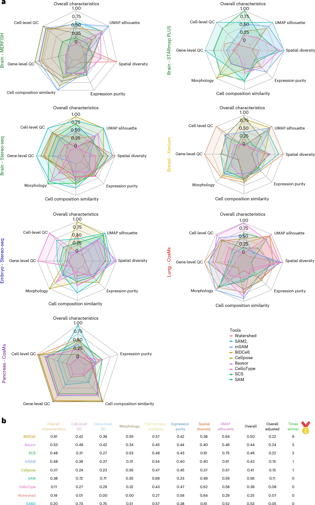

图4｜原文Fig.3完整原图，仅转换格式。a中每条辐射轴为一个评价类别，离中心越远表示相对分数越高，颜色代表方法；不同数据集缺失的类别不同，雷达面积不能直接跨图比较。b列出类别分数、Overall、覆盖调整后分数与获胜次数；这些列回答不同问题，不应当作同一排序的重复表达。来源与许可同图3。

图3把指标组织成8类，帮助我们识别方法究竟靠什么得分。雷达图最有用的不是“哪个多边形面积最大”，而是看某个方法在哪一条轴上突出、在哪一条轴上明显退缩。由于轴的数量、顺序、缺失项和缩放都会影响视觉面积，面积不能直接代替综合分，更不能当作统计显著性。

等权平均也需要说清楚“谁”等权。假设一类包含四项指标，另一类只有一项：若把五项直接平均，前一类获得四倍的总权重；若先求类内平均，再让两类等权，两类各占一半。两种算法都可以合理，但对应的价值判断不同。前者信任指标清单的密度，后者信任类别划分的合理性。

这不是一个纯粹排版问题。某个方法若主要提高转录本回收，而该特点通过几项相关指标反复出现，它可能在逐指标均值中获得额外优势。改用类别均值，等于重新分配“回收”“纯度”“形态”等目标的影响力。

要注意，本文把这段数学解释作为阅读框架，并不把它等同于论文所有“collapsed”实施细节。正文还讨论了减少相关类别冗余、保留代表项的压缩方案；补表5明确并列Original ranking与Collapsed version ranking。引用其数值时必须沿用原标签，不能把15项、8类展示、去冗余压缩三个层次混写成同一个步骤。

### 评分方案改变，有时比方法差距更重要

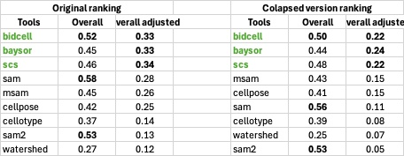

表1｜原文Supplementary Table 5完整表格原样提取，保留左右两套方案、方法名和数值，未重绘。左侧是Original，右侧是Collapsed version；每侧均区分Overall与调整后Overall。原文件左右末列标题显示不全，均为Overall adjusted，本文未修绘原图。原表分辨率有限，关键数值在正文解释；不把表格行顺序直接当作某一数值列从高到低的排序。来源与许可同图3。

原始汇总中，SAM的未调整Overall为0.58，SAM2为0.53，BIDCell为0.52。若再把覆盖纳入，作者报告SCS的调整后分数为0.34，BIDCell和Baysor均为0.33，顺序就与只看未调整均分不同。这里无需争论哪个数字“才是真的”：它们衡量的目标本来就不同。

补表5的Collapsed一侧又给出另一组值，例如Baysor调整后为0.24，BIDCell与SCS为0.22，SAM为0.11。它们不应与前一套0.33、0.34等数字拼接成同一排行榜，也不能用这种跨口径比较宣称方法性能突然下降了多少。

我们核查补表4、补表5和主图3，是为了防止把这些差异误报为整篇论文自相矛盾。原文个别位置的小数并非完全一致，因此这里仅保留有清楚方案标签、对教学结论必要的数字；不使用某个微小差值建立强结论。真正稳健的观察是：一旦评价从留下的对象质量扩展到覆盖，或重新组织冗余指标，方法的相对位置会变化。

“获胜次数”则是第三种摘要。BIDCell和Baysor分别得到较多的数据集获胜次数，并不意味着它们的每一项平均分都最高。赢六次、其余任务略差，与赢一次但在其他任务都接近第一，可能产生不同均值。平均分、获胜次数和最差情形都值得看，任何一个都不是另两个的替身。

### 覆盖调整修正了什么，又遗漏什么

作者把综合质量与分割细胞相对参考细胞的比例结合，试图避免“只留下少数干净细胞”的方法凭高均分获胜。这个出发点很重要：如果研究问题是组织组成或稀有细胞分布，漏掉细胞本身就是损失，不能从评价中消失。

但数量比例仍不是准确的召回率。它没有逐细胞证明预测对象与真实细胞一一对应；把一个细胞拆成两个，可以提高对象数，却不等于增加了真正覆盖。一个预测对象也可能吞入两个邻居。数量接近参考时，漏分和过分甚至可能互相抵消。

因此，我们建议把覆盖调整看作一道防线，而不是最终认证。对重要项目，还需要在代表区域检查漏检、合并、拆分与边缘对象，分开统计细胞数覆盖、组织面积覆盖和类型覆盖。尤其对稀有细胞，整体覆盖高不保证目标群体没有系统性损失。这些是我们提出的额外验证建议，不是论文已完成的实验。

### 相关性热图告诉我们：指标会一起投票

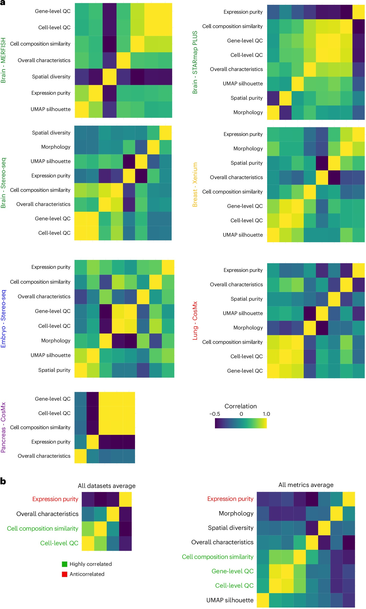

图5｜原文Fig.4完整原图，仅转换格式。a为不同数据集内评价类别间相关性；b左为所有数据集共有类别的平均，右为具有完整类别的5个数据集汇总（不含胰腺与MERFISH）；横纵方向对应同一组类别，颜色条由约−0.5到1，紫色较低、黄色较高。统计对象是方法表现形成的评分关系，不是独立病人的分子相关，也没有给出因果方向。来源与许可同图3。

图4中，细胞层面、基因层面和部分组成指标常一起变化，表达纯度则与这些维度不总是同向。这个现象帮助解释为什么高表达量或高回收不能替代纯度检验，也提示某些平均分可能对相似信息重复加权。

但不能从热图推出“高覆盖一定导致污染”这样的因果关系。相关性会受到参与方法、共同归一化、参考结构及数据集难度影响；不同场景也可能呈现不同关系。更合理的用法是据此组织互补证据：让边界、分子归属、类型覆盖和目标结论分别有自己的检查，而不是把所有检查压成一串高度相关的高分。

如果自己要做benchmark，我们提出三项具体改进。第一，同时报告原始单位与归一化值，让读者分辨差异大小。第二，把评分权重、缺失值规则和覆盖分母写进方法，而不是只展示最终名次。第三，给出合理权重变化、样本留一或数据子集变化下的稳定性；若名次不稳定，就报告条件依赖，而不是执意选出一个总冠军。

### 怎样把一张榜单用于自己的实验

先确定你最不能接受哪种错误。如果目标是稀有细胞定位，漏检目标群体比平均转录本数略少更严重；如果目标是相邻细胞通讯，跨边界污染可能比少量丢失更危险；如果只是粗粒度区域描绘，对精细边界的要求又可能不同。重要的是提前确定优先级，而不是看到哪个工具胜出后再为它选择指标。

然后在匹配的组织区域保留两到三个候选，检查多维表现及失败样例。本文并没有证明一种工具在所有平台、所有目标上最好；它更有价值的结果是展示了取舍。把这些取舍带回实验设计，比把一列Rank复制到自己的流程里更可靠。

原文：https://www.nature.com/articles/s41592-026-03272-x

官方代码：https://github.com/TranslationalBioinformaticsUnit/Benchmarking-SegmentationMethods-ST/

许可：https://creativecommons.org/licenses/by-nc-nd/4.0/ 。本篇已核对全文、相关补图补表、官方源数据和选定评价代码；未重新运行软件或复现全部数值。原图原样署名分享，教学分析与假设例子独立于作者实测结果。

## 3. 同样叫“小鼠脑”，仍不是严格配对实验

选分割工具，最终不是为了得到一张高分表，而是为了让下游问题站得住：某个细胞群真的表达这套标记吗？邻近细胞之间的信号是否可能来自错误归属？一种平台上没有发现的通讯，究竟是生物学差异，还是面板与分割带来的不可见？

Nature Methods于2026年10月23日发表的《Benchmarking segmentation methods for spatial transcriptomics》，把这些问题放进了三个小鼠脑空间数据的比较。本篇沿着原文图5逐层追踪：边界如何进入表达指纹，怎样影响污染诊断和通讯统计，以及为什么最后的技术选择树不能当作采购答案。

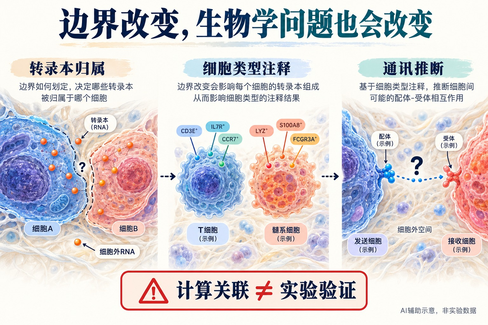

图示｜AI辅助教学示意，非实验数据。标记组合、细胞外RNA和配体—受体均为假设例子；虚线表示计算分析依赖，不表示实验确认的信号传递。图中细胞不是原研究样本。

### 同样叫“小鼠脑”，仍不是严格配对实验

作者选择Stereo-seq、STARmap PLUS与MERFISH中可比的小鼠脑区域，比较表达指纹、负标记出现及配体—受体推断。这样的设计很有价值：如果一种分割方法在不同测量体系下得到不同生物学读出，就提醒我们别把软件效果与平台属性割裂开看。

但可比组织不等于同一组织切片被三种技术无损、同步测量。不同样本、切面、面板、检出范围和原始参考都可能介入差异。研究能呈现“在这些数据和配置里，技术与分割共同影响结果”，却不能把每个差异唯一归因于某个平台本身，更不能据此宣布一个平台全面优于另一个。

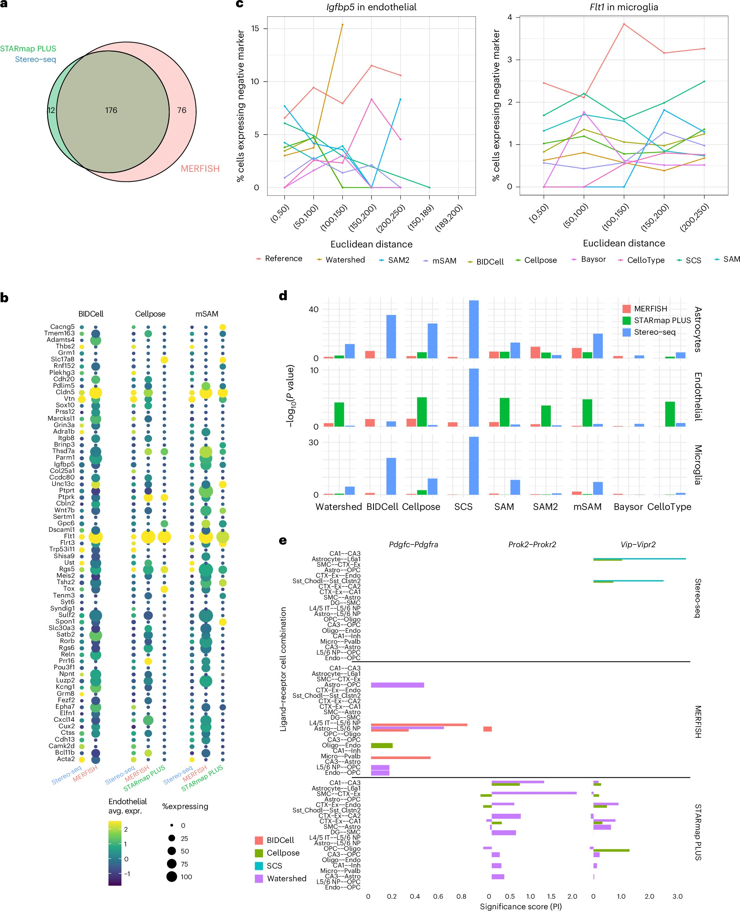

图6｜原文Fig.5完整原图，仅转换格式，未重绘数据。a为检出基因重叠，b为标记表达点图，c为负标记与距离分箱，d为标记基因集合富集的t检验显著性，e为Giotto推断的配体—受体统计。各面板分母和单位不同，应分别阅读。来源：Martínez-de-Morentin等，Nature Methods（2026），DOI：10.1038/s41592-026-03272-x，CC BY-NC-ND 4.0。

从a开始，Venn图描述的是经过相应共享基因空间与非零表达条件筛选后的检出集合。它不是三种平台所有理论可检测基因的完整能力图，也不是所有基因都在每个细胞类型中被稳定检出的证明。方法中用于点图的共同标记子集又经过进一步筛选，所以不同面板出现不同的基因数，不应自动当作互相矛盾。

分析跨平台结果时，共同基因集合能减少面板不一致，但也会把平台独有的信息排除。若自己的研究恰好依赖一个不在交集里的标记，交集上的高一致性并不能回答这个标记是否可靠。选择可比空间是为了控制问题，不是让其他信息从科学上变得不重要。

### 点的大小、颜色，回答的是两个问题

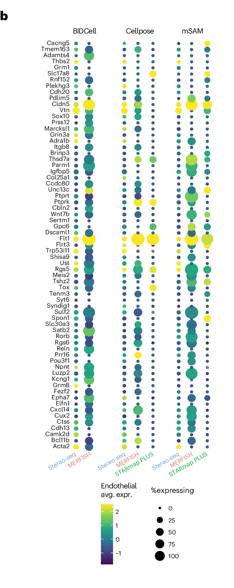

图6局部A｜Fig.5b原样面板，保留全部基因行、技术标签和大小/颜色图例。纵向为基因，横向为BIDCell、Cellpose、mSAM及技术组合；点大小为表达该基因的细胞比例，颜色为缩放后的平均表达。原图此面板的图例标注为内皮细胞；其他细胞类型见补图16，不能把本面板说成同时展示了三种细胞类型。来源与许可同图6。

点图中，一个又大又亮的点同时提示更多细胞检出该基因、且其缩放后表达较高；一个大而暗的点则可能表示普遍但较弱的表达。二者都不能直接换算成原始RNA分子数量。尤其在分别缩放的数据之间，相似颜色不保证相同绝对表达，反过来，颜色不同也不等于相同倍数的技术差异。

作者比较的是标记组合能否形成预期表达指纹，而不是单个标记是否出现过。这个判断比看一个最漂亮的基因更稳健，因为一个标记可能受细胞状态、低计数或背景影响。也要记住，预期指纹来自现有注释知识；它能支持结果的可解释性，不能排除真实但不典型的状态。

我们的审读重点是“保留了哪部分证据”。如果一种方法留下更少细胞，却留下了最典型的内皮细胞，它的标记图可能更整齐；若另一方法保留了更多边缘状态，图谱可能更杂。应同时查看细胞群数量与组成，而不是因为图案清晰就直接判定边界更准。

### 负标记是有用的报警器，不是绝对污染真值

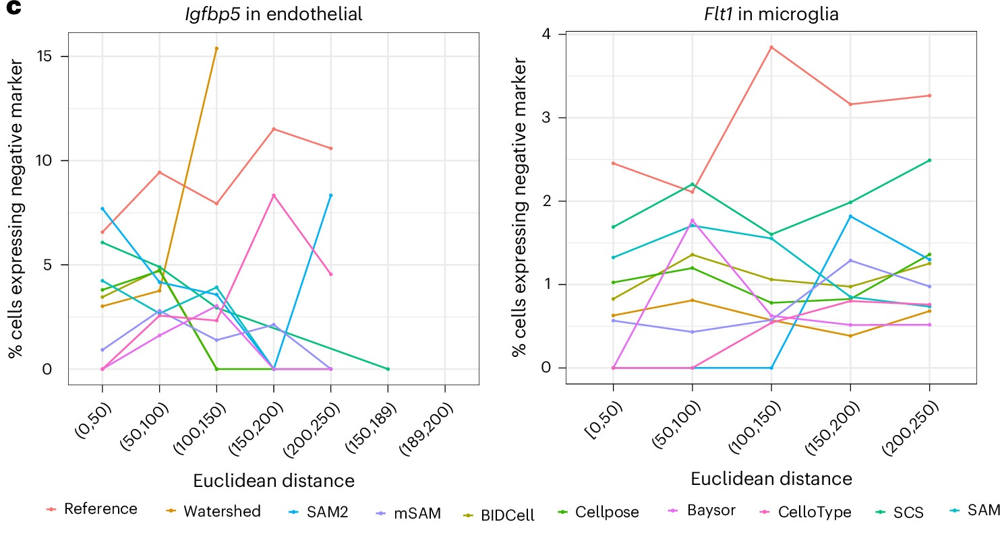

图6局部B｜Fig.5c原样面板组，保留两幅折线图及共用方法图例。纵轴为目标细胞中表达指定负标记的比例，横轴为到预期来源细胞的欧氏距离分箱；左为内皮细胞中的Igfbp5，右为小胶质细胞中的Flt1。不同颜色代表分割方法与参考。原图左侧距离箱标签并非全程按数值单调排列，本文不将连线拟合为连续衰减曲线，也不据其读出精确扩散尺度。来源与许可同图6。

如果某种标记通常不应出现在目标细胞类型，却频繁出现在它与另一类型紧邻的位置，边界混入是一个值得调查的解释。作者用这样的负标记比例诊断转录本“泄漏”。图中不同方法曲线差异明显，说明下游表达洁净度确实会随分割选择改变。

不过，负标记也依赖生物学语境。它不等于任何条件下都绝不表达的基因；注释偏差、真实状态变化、环境RNA、相邻细胞合并，都可能产生类似现象。参考曲线本身也不是零，进一步说明参考不是无误差答案。

读这种图时，我们关心比较对象、细胞类型、基因选择和距离定义。分母是特定分箱内的目标细胞，不是整张切片所有细胞；同一切片里的细胞彼此空间相关，曲线上多个点也不是独立病人的重复。没有重复样本、分箱计数与不确定性信息，不能只凭折线高低给出普遍泄漏概率。

若项目结论高度依赖相邻细胞的标记差异，我们建议回到原始图像和转录本位置检查代表区域，并选多组有明确语境的正负标记。单个异常基因足以触发排查，却不足以独立证明某个分割方法全面失败。这里的局部检查是额外建议，本文没有声称已替作者完成这项人工验证。

### 更显著，不等于更多真实信号

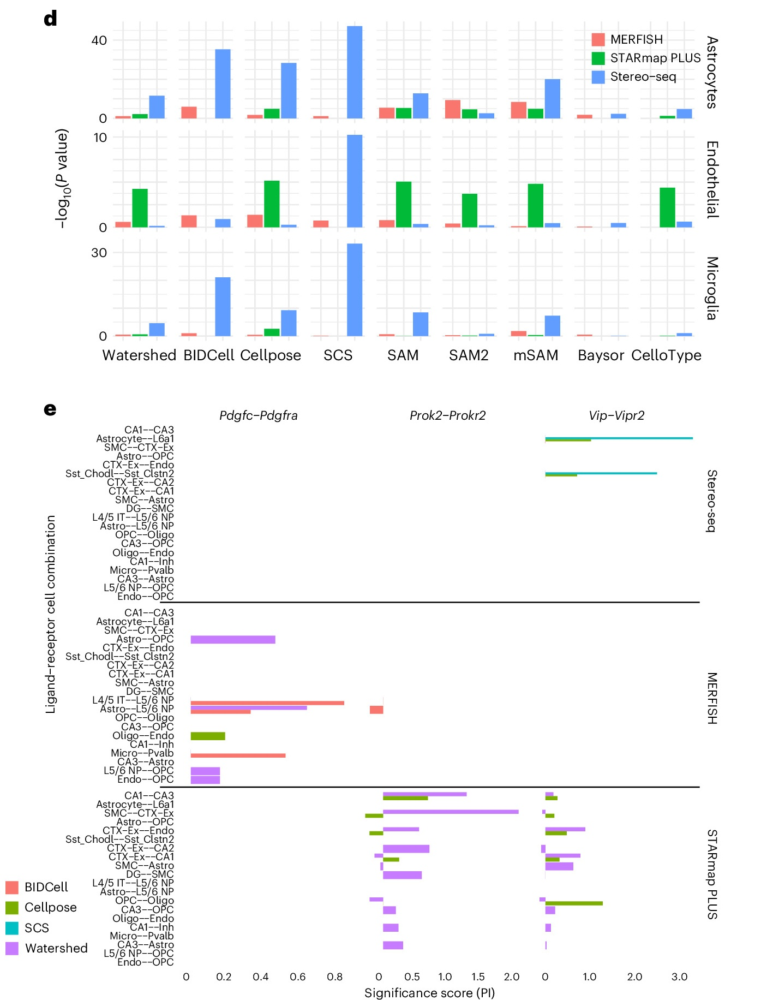

图6局部C｜Fig.5d–e原样面板组，保留坐标、分组、图例。d横向为方法，颜色为技术，三个分面为星形胶质、内皮和小胶质细胞；纵轴为−log10(P)，不是效应量。e按技术分块，行为细胞类型对，列为Pdgfc–Pdgfra、Prok2–Prokr2、Vip–Vipr2，颜色为分割方法，横轴为Giotto显著性评分PI；作者使用500次置换。来源与许可同图6。

d中高柱表示检验给出的P值更小，不表示细胞数更多、标记表达更强，或平台的准确率更高。P值同时受效应、样本量、分布和统计假设影响。不同方法改变了进入分析的细胞数量与组成，因此显著性差异可能来自多种因素。若研究目的在于比较信号恢复，应同时看效应量、检出比例和可重复性，而不是只按柱高排序。

e进一步进入通讯推断。作者选择三个配体—受体对，利用Giotto及空间邻接关系计算统计信号。换一种边界，至少可能改变三件事：配体或受体RNA被分到哪个细胞；细胞被注释成哪一类；细胞坐标和邻接网络如何连接。因此，通讯结果对分割敏感，在逻辑上并不令人意外。

这幅图最有力的支持是“推断对上游处理有条件依赖”。它不能证明每条显著边都是真实信号传递，也不能把某个方法得到更多边当作更灵敏的直接证据。观察到RNA和空间邻近，距离蛋白表达、配体释放、受体激活和功能响应之间还有多个层级。

同样，不显著也不能直接当作没有通讯。面板遗漏、低计数、细胞群样本量不足、空间网络定义与置换策略，都会影响检出。图中只有预选的三个配体—受体对，不能外推成所有通讯通路的综合排名。

一个可以迁移的分析设计是：在两个合理分割结果上，保留相同的下游参数，比较核心候选关系是否稳定；对不稳定关系标记为敏感性结果，而不是挑更符合故事的一套。若准备作机制性论断，再为关键边安排独立实验或正交证据。这样的稳健性检查比单纯增加通讯分析工具数量更贴近问题来源。

### 决策树是一份经验总结，不是自动判定器

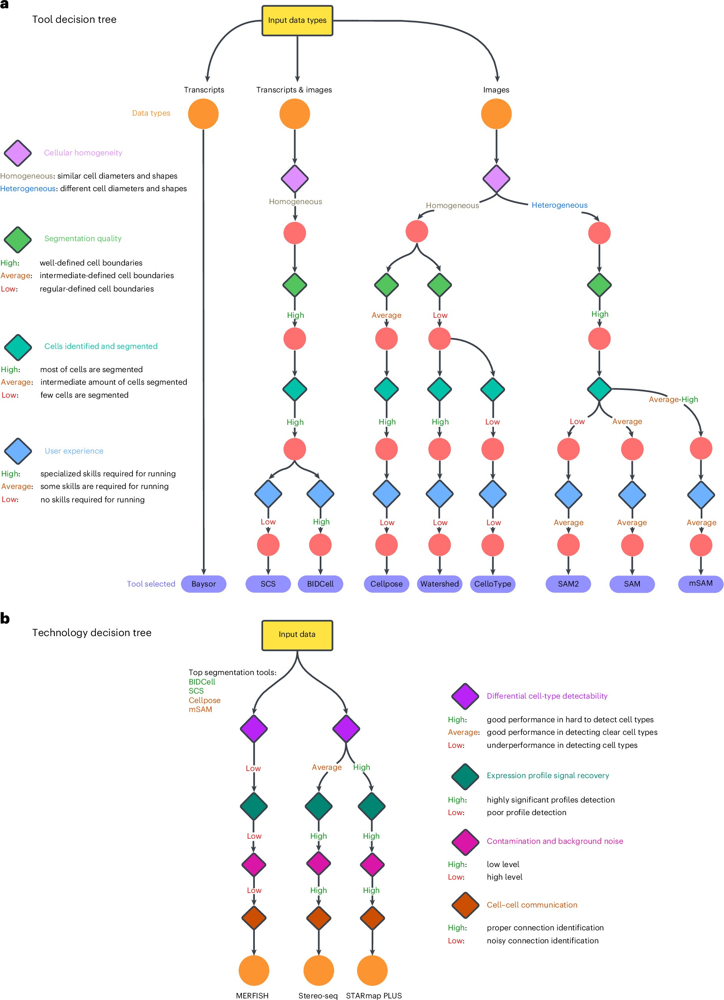

图7｜原文Fig.6完整原图，仅转换格式。a按输入模态、细胞形态异质性、分割质量、细胞覆盖和使用要求组织工具选择；b归纳本研究数据中的技术相关观察。圆点、菱形与颜色为分类和分支提示，不是经过独立验证的概率或因果图。来源与许可同图6。

图6的价值在于迫使我们把约束说出来：只有转录本还是也有图像？细胞形态相似还是差异很大？优先考虑质量、覆盖还是实现成本？这些问题比“哪个算法最先进”更接近实验室真正的选择。

但树上某些条件，例如“分割质量高”“覆盖高”，往往要先试过才能知道。它不是读入新样本就能无偏预测最佳工具的模型，也没有在独立未来数据上验证每条分支。图6b的技术分支尤其应限定在本研究所用组织、面板与分析流程，不能替代完整的技术选择评估。

作者把使用经验也纳入条件，但这不是由我们实际安装所得的体验。对自己的实验室，学习成本、集群支持、环境维护和故障恢复能力可能比图上的粗分类更重要。决策树适合帮助列候选，不适合绕过本地小规模验证。

### 运行成本也是科学设计的一部分

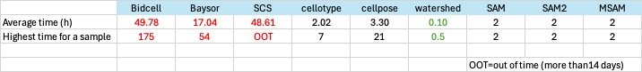

表2｜原文Supplementary Table 6完整表格原样提取，单位小时；分别列平均运行时间与单样本最高时间，OOT在原表定义为超过14天。该表是作者环境下的运行报告，没有给出适用于所有硬件的速度保证。来源与许可同图6。

补表6显示，方法之间的计算负担差异明显，部分转录本方法的平均运行时间达到数十小时，并存在超时情形。表内时间应与对应数据规模、特征筛选及资源设置一起解读，不能拿一项平均值估算自己项目的精确耗时。

论文报告的计算环境包含V100 32GB GPU、数十核CPU及大内存节点，评价阶段也使用了高内存资源。这说明大规模benchmark需要认真安排资源，但不能倒推每一种方法的最低硬件要求都如此。我们没有购买算力、安装环境或运行例子，因此不提供“本机几分钟跑完”之类未经验证的结论。

如果计算预算有限，先在覆盖典型与困难区域的小数据上检查流程，再扩大范围，是我们建议的顺序。小样本验证要保留密集细胞、边缘、坏图像和罕见群体，不能只挑最容易成功的视野。否则省下的计算成本可能换来错误的信心。

### 有公开代码，不等于已经一键可复现

官方仓库提供Nextflow流程、环境配置、各方法脚本与评价代码，这是可复现性的积极条件。我们核读的README仍保留较早的数据示例范围，与论文最终15个数据集并非逐字同步；部分评价示例也包含研究环境路径。应把它视作作者研究代码与复现入口，而不是已经替读者适配好的通用软件产品。

实际复现需要固定代码提交、模型权重、环境、输入文件、坐标变换、分块、高变基因、随机种子和过滤规则。出现失败时，保留失败类型与日志，而不是从结果表里静默删除。比较成功率与比较成功后质量同样重要，因为一个只能完成少数任务的方法，不能仅凭成功任务的高分被认为更可靠。

我们这次完成的是文献、补充材料、源表和选定代码的核查，不是独立复现。这个范围并不妨碍提炼有用的设计原则，却要求对数值可信度保持正确措辞：作者报告了这些结果，我们核对了其表达与关键口径，没有证明所有结果在另一环境下都能重现。

### 从软件选择，回到结论稳健性

这项研究最值得带回实验室的，不是某个固定名字，而是一条工作方式：把分割当作会影响生物学结论的分析决策，让目标结论经历合理的上游变化。如果两个可靠候选产生一致结论，我们增加的是对结论的信心；如果不一致，我们得到的是需要查清的不确定性，而不是必须马上选边的麻烦。

原文：https://www.nature.com/articles/s41592-026-03272-x

官方代码：https://github.com/TranslationalBioinformaticsUnit/Benchmarking-SegmentationMethods-ST/

许可：https://creativecommons.org/licenses/by-nc-nd/4.0/ 。原图及完整面板原样署名分享；本文不是软件实测或平台采购建议，作者统计结果与我们的额外验证建议已分开标注。

## 4. Take-home messages

### Take-home messages：把benchmark变成可复用的判断

如果你今天必须为一个空间转录组项目确定分割策略，最有帮助的答案通常不是一个软件名字，而是一份能解释选择、暴露风险、允许复核的方案。

2026年10月23日发表在Nature Methods的《Benchmarking segmentation methods for spatial transcriptomics》，用跨组织、跨技术的比较提醒我们：方法的表现与输入、参考、评价目标和计算条件共同决定。这篇独立take-home不再复述每个排名，而把全文精读凝结为可以带进组会、项目方案和方法学审稿的判断规则。

图示｜AI辅助教学示意，非实验数据。输入、参考、评分和下游验证构成四个检查方向；组织图、RNA点、图谱和量尺均为概念表达，不对应论文实测数量或真实软件界面。

#### 1. 方法名只是实验身份的一部分

“用过Cellpose”不足以让别人理解实验。模型权重、版本、输入图像通道、转录本特征、核先验、分块尺寸、坐标处理、过滤规则和随机性，都会参与定义这个系统。一个方法在论文里的结果，只属于那套可识别的配置。

可以把这条原则推广到其他生信任务：算法名称相同，不代表评价对象相同；算法名称不同，也不代表所有差异都来自核心模型。如果输入与预处理一起变化，结论应写成系统级比较，而不是把全部优势归给模型结构。

#### 2. 先说明参考是什么，再解释“准确”

人工边界、已有平台分割、单细胞图谱、标签转移和标记集合，可以提供不同层级的参考。它们不是同一种真值，也可能共享误差来源。

更接近参考的类型比例，支持的是组成一致性；更符合预期标记，支持的是表达可解释性；二者都不能独立证明每条边界位置正确。反过来，偏离参考也不必然错误，可能是遗漏状态、样本差异或新生物学。好的分析需要可检查的替代解释，而不是给参考贴上“真值”标签后结束讨论。

这项研究的核心读法因此是多证据互补：用几何检查发现错分，用分子信息检查归属，用类型与空间结构检查研究相关性。各层证据互相约束，但不要互相冒名。

#### 3. 质量与覆盖必须一起看，但不能简单互换

只保留少量容易分割的细胞，可能得到漂亮均分；多切出一些对象，也可能在数量上看似更完整。论文引入覆盖调整，回应了第一种风险，却没有把细胞数比例变成逐细胞召回率。

面对自己的数据，建议把漏检、拆分、合并、组织覆盖和目标细胞群覆盖分别记录。若项目要回答稀有细胞的位置，目标群体漏检可能比平均基因数略低更严重；若要研究相邻细胞通讯，跨界混入可能更需要优先排查。错误的成本由研究问题决定，不能由最后哪个指标最好看决定。

#### 4. 综合分需要一份公开的“配方”

归一化范围、指标方向、缺失值、类别分组、权重和覆盖分母，都应能被读者找到。0–1的相对分数不是准确率；等指标与等类别也不是同一种权重。

本研究中原始评分与压缩评分的数值必须按各自方案阅读。一个表里的Overall、覆盖调整后Overall和获胜次数，也不能相互替换。与其只给一个精确名次，不如同时给出多维表现、原始效应量和合理设置变化下的稳定性。

对方法作者，这意味着不要让主要结论依赖一种未解释的加权；对使用者，这意味着先问自己是否认同这份配方，再决定是否相信它产生的冠军。

#### 5. 很多细胞，不等于很多独立重复

分割评价中常见的统计单位包括细胞、基因、局部区域、方法和数据集。一个箱线图里成千上万个点，可能只是同一切片中的细胞分布。方法得分间的相关热图，也不是病人层面的关联证据。

当结论要推广到未来样本时，需要考虑独立样本、组织区域、平台批次和失败情形。跨任务的平均分可以描述眼前这批任务，但不能自动提供下一批样本的误差范围。若证据不支持普遍优越，报告条件依赖，比把小差值写成确定胜负更诚实。

#### 6. 生物学读出是终点，也会受上游选择塑造

标记点图、负标记比例、富集P值和配体—受体评分，分别回答不同问题。颜色不必然是绝对表达，显著性不是效应量，推断的通讯也不是功能实验。

论文的下游分析说明，边界选择可以改变这些读出。可迁移的启发是：核心结论应经历合理的分割敏感性检查。若结论只存在于一套选择性处理下，它应被标记为依赖条件，而不是从另一套结果里消失。

这不是要求所有项目无限比较软件。更有效的做法是按任务风险选择少数有代表性的替代方案，检查真正影响结论的环节，把资源集中在可能改变解释的地方。

#### 7. 决策树帮你列候选，不替你完成验证

作者的决策树把输入、形态、覆盖与操作要求串起来，适合讨论约束。但“分割质量高”往往需要实际试验才知道；平台分支也来自特定数据和分析设置，没有成为适用于所有组织的普遍选择器。

使用这类总结图时，可以把每个分支改写成一个待回答的问题：我拥有哪些输入？哪个错误最危险？失败时有没有可替代方案？实验室能否维护环境？用问题组织选择，通常比照箭头走到一个名字更可靠。

#### 一份可以带进项目的最小验证方案

下面是我们根据全文提出的设计建议，不是本次已经运行的实验。

先固定研究终点：例如目标细胞群的空间分布，或某一组相邻细胞的标记与通讯候选。写清哪些变化会推翻解释，哪些变化只是数值波动。

再选代表区域：同时包含典型形态、密集邻接、边缘、低质量图像和目标稀有群体。区域应来自预先确定的规则，避免看过结果后只保留漂亮视野。

随后保留少数合理候选及基线，固定可比输入并记录各自必要先验。把几何错分、分子归属、目标类型覆盖、下游结论和运行失败放在同一份审读记录里。对于高变基因、分块和过滤阈值，至少检查与研究目标最相关的一种替代设置。

如果几个合理设置支持相同结论，报告稳健的范围与仍未检验的条件；如果结论不稳定，优先定位由哪个输入、参考或步骤引起，再决定是否需要人工标注或正交实验。不要用“平均分最高”掩盖关键结论尚未稳定。

#### 读完后，最值得保留的一句话

分割不是一个在生物学分析之前已经完成的技术细节，而是决定我们把哪些分子称为“同一个细胞”的分析假设。好的benchmark帮助我们看见这个假设的代价；好的应用研究则让这些代价在自己的证据链里可见。

这项研究的贡献，是把不同方法、数据与生物学指标放进可讨论的共同框架。它的边界同样重要：参考不是无误真值，多平台并非严格配对，综合分依赖权重，通讯仍是计算推断，公开代码也尚未由我们独立重跑。保留这些边界，不会降低论文价值，反而让它更容易被正确迁移。

原文：Martínez-de-Morentin等，Benchmarking segmentation methods for spatial transcriptomics，Nature Methods，2026年10月23日，原创Analysis。https://www.nature.com/articles/s41592-026-03272-x

官方代码：https://github.com/TranslationalBioinformaticsUnit/Benchmarking-SegmentationMethods-ST/

阅读范围：完整正文、方法、38页可得补充信息、官方源数据及选定代码/文档；全文系列为独立教学分析。未安装或运行分割工具，未独立复现作者benchmark。本篇无新增实测图，仅用原创AI辅助示意归纳判断框架。
