# 一管血里的疾病地图，能告诉我们什么

::: {.book-source}
论文：[DOI 10.1038/s41467-026-78440-w](https://doi.org/10.1038/s41467-026-78440-w)。原有图注和许可说明见正文；未明确许可的图版标记为**授权待确认**。
:::

原始论文：Whole blood transcriptomics atlas across human diseases

DOI：https://doi.org/10.1038/s41467-026-78440-w

首次上线：2026-10-12；阅读版本：Article in Press

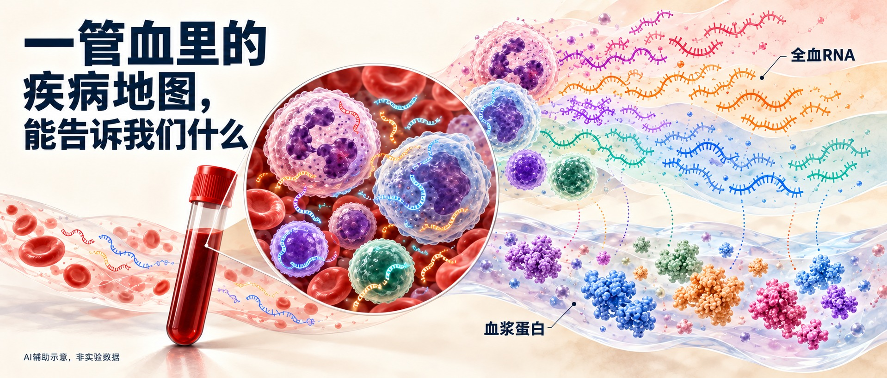

AI辅助示意，非实验数据。

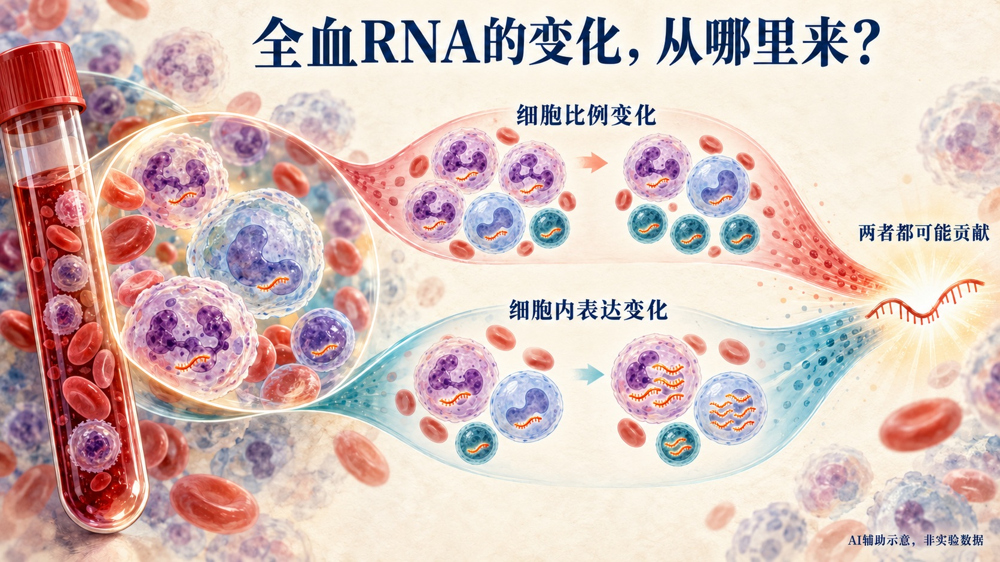

AI 辅助示意，非实验数据：细胞组成和细胞内表达都能影响全血 RNA，示意数量不代表测量值。

## 先看清楚，血液里是谁在说话

抽一管血，能不能看见一种疾病留在全身的痕迹？这个问题很诱人，也很容易被说过头。血液里的白细胞会响应感染、炎症和组织损伤，年龄与用药也会改变它们；测到某种 RNA 变多，并不意味着已经找到病灶，更不意味着可以据此给一个人下诊断。

2026 年 10 月 12 日以 Article in Press 形式在线发表于 Nature Communications 的《Whole blood transcriptomics atlas across human diseases》，把这个问题放进了一张规模较大的全血转录组图谱。研究纳入 4,444 位独立参与者，覆盖 98 种健康状况；其中 1,280 人还有配对的血浆蛋白组。它最值得读的地方，是把单基因、通路、细胞组成、共表达网络和预测模型放在同一批样本上，逐层检查彼此能否对得上。

这一篇先读原文图 1—3。我们要回答三个基础问题：这些人是谁？所谓“疾病特征”相对谁而来？一份全血 RNA 信号，到底有多少是在反映血液里的细胞构成？这三问决定了后面所有漂亮网络和分类结果应当怎样理解。

### 4,444 人很重要，98 这个数字也需要解释

这里的 98 指健康状况，包含健康对照与长寿组，不能改写成“同时诊断 98 种疾病”。4,444 指不同参与者，作者明确说明没有把同一个人的技术重复或生物学重复当成独立样本。采样来自土耳其埃尔祖鲁姆的两家医院，时间为 2022 年 1 月至 2025 年 9 月。两院采用一致的采集、处理和保存流程，有助于减少前分析差异，但这仍然是特定地区的观察性医院队列。

每人采集 2—3 毫升全血，使用含稳定试剂的 PAXgene 管保存 RNA。建库时去除了大量核糖体 RNA 与珠蛋白 RNA；后者若占据大量测序读段，低丰度转录本就容易被淹没。作者报告，处理后 HBB、HBA1、HBA2 三种珠蛋白相关转录本合计低于总表达的 0.85%。这类看似琐碎的实验步骤，决定了图谱能不能稳定看见白细胞相关信号。

“全血”也要按字面理解。它主要捕捉白细胞 RNA，同时可包含红系细胞、血小板及少量其他来源的 RNA。它与从血浆里寻找游离 RNA 的检测并非同一种实验，更不能直接当作各器官组织的转录组替身。

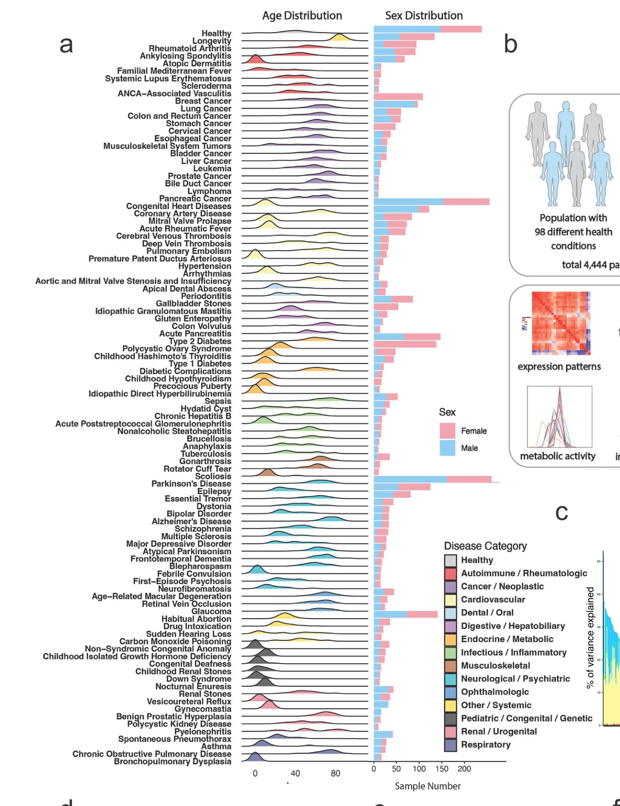

原文图 1a：年龄与性别构成｜原图来源及CC BY 4.0许可见文末。

读图 1a，先看每一行右侧的条形：横轴是人数，蓝色为男性、粉色为女性；左侧的山脊图是年龄分布，横轴单位为岁；原PDF底部轴名显示不完整，这里按图注说明，未擅自补画原图。年龄分布的颜色表示所属健康状况大类，不代表基因表达强弱。两侧放在一起，能看见这张图谱并非由大小一致、年龄匹配的方格组成。

健康组有 238 人，平均年龄 39.3 岁；长寿组 134 人，平均 84.6 岁；特应性皮炎组 68 人，平均只有 0.7 岁；先天性心脏病组 255 人，平均 10.1 岁；脓毒症组 53 人，平均 71.5 岁。这些数字不是附录里的背景装饰。同样一条免疫通路，如果在婴幼儿皮炎组和成年健康组之间不同，其中可能同时包含疾病、发育阶段、细胞比例和其他临床因素。

研究覆盖 0—99 岁，平均年龄 42.3±25.1 岁，男女总体比例接近。这扩大了观察范围，也增加了需要拆解的异质性。总体均衡不等于每个疾病组均衡；有些病组人数很少，有些本身具有性别限制。随机拆分出的训练集和测试集，也可能保留同样的年龄与性别结构。

### 图 1 真正支持了多强的年龄结论

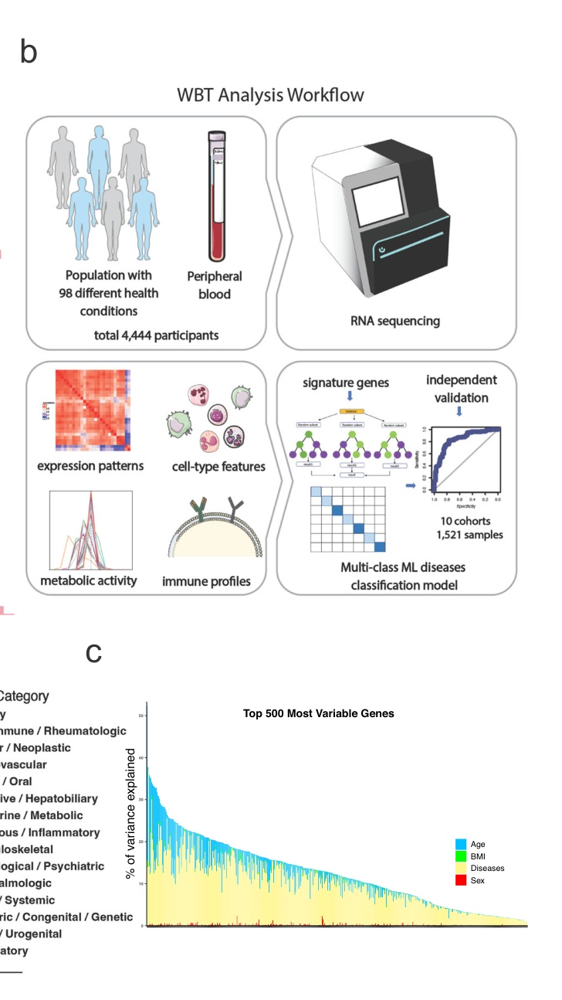

原文图 1b–c：研究流程与表达变异分解｜原图来源及CC BY 4.0许可见文末。

图 1c 对变异最大的 500 个基因做方差分解。横轴逐个排列基因，纵轴是解释的变异百分比，颜色区分健康状况、年龄、BMI 和性别。作者发现，健康状况通常贡献最大，年龄排在其后。

这说明，在当前队列和模型里，诊断标签与许多基因的变化紧密相关。它没有把疾病“单独造成”的变化直接测出来：标签还会与年龄、治疗、病情严重度等共同变化，而且 98 个类别与一个连续年龄变量的参数复杂度不同。这里的解释比例，适合描述这批数据的结构，不能直接搬到一般人群，更不能当作因果贡献的百分比。

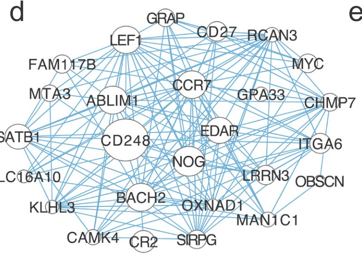

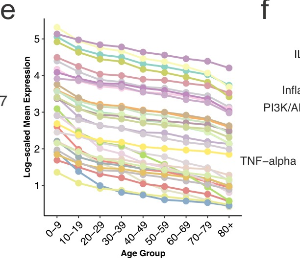

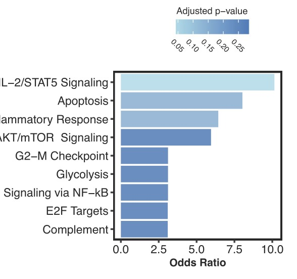

原文图 1d–f：年龄相关基因及通路｜原图来源及CC BY 4.0许可见文末。

作者随后把年龄解释度最高的前 50 个基因，与既往研究的年龄相关基因相交，得到 32 个候选。图 1d 每个圆是一个基因，圆越大，年龄对应的 η² 效应量越大；连线表示表达相关，线越粗，相关越强。它是一组同向变化的表达网络，不是已经确定方向的调控线路。

图 1e 的横轴按十岁分组，纵轴为对数尺度的平均表达。32 条曲线大体随年龄下降。最直观的观察是：这批年龄相关基因在较年轻的参与者中普遍更高。需要保留的限制是，这是一张横断面图，不是追踪同一批人几十年的下降轨迹。不同年龄段的人患什么病、有哪些细胞，也可能不同。

这组基因能否预测年龄？作者在 4,444 人中开发模型，用另一个队列的 100 名健康人测试，得到 R²=0.31、平均绝对误差 8.17 年。这个结果支持一定的跨队列年龄信息，却离“精确判断生物年龄”很远。模型预测的是日历年龄；若要证明预测残差代表衰老速度，还需要纵向结局与独立验证，不能仅凭误差或相关性赋予它这一含义。

图 1f 也值得多停一会儿。横轴是通路过度代表分析的优势比，颜色对应多重校正后的 P 值。优势比大，表示这组基因在某通路中相对富集，不代表通路活性增加了相同倍数。更关键的是，源数据里 IL-2/STAT5 的校正 P 值为 0.042135；凋亡与炎症反应为 0.143626，另外几项约为 0.283178。因此可以说这些基因提示了若干免疫和代谢联系，却不能把图中全部通路都写成“经过多重校正后显著富集”。这是读到源数据后，解释应当比主文概括更克制的一处。

### 图 2 把疾病放到一起，参照系随之改变

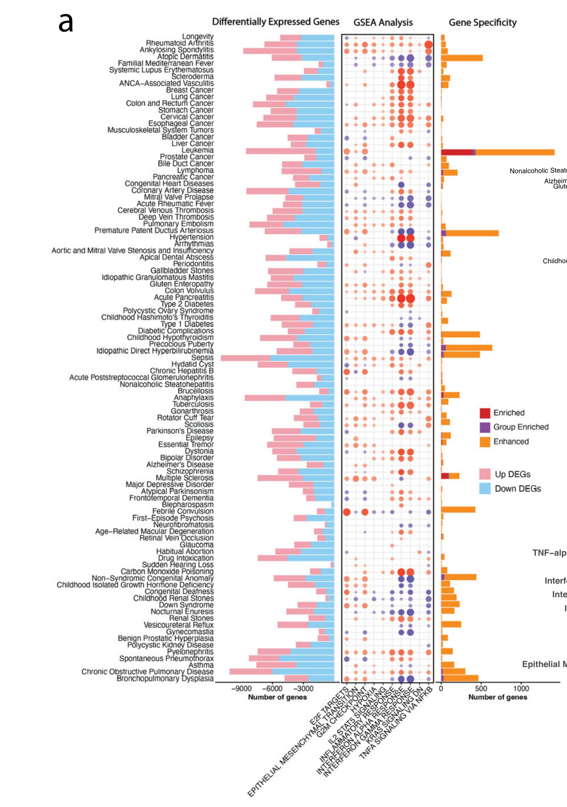

原文图 2a：差异基因、GSEA 和特异性｜原图来源及CC BY 4.0许可见文末。

图 2a 的左边先问一个常规问题：每种健康状况相对健康组，有多少基因表达不同？粉色为上调，蓝色为下调，横轴表示基因数。条形为了版面向左延伸，坐标出现负数，不能把它读成“负的基因数量”，也不能仅凭延伸方向判断上调或下调。

RNA 的差异分析使用 DESeq2，并纳入性别、标准化年龄及其平方项。作者发现很多基因与年龄的关系并非简单直线，因此加入二次项比只调一条直线更合理。判定阈值为校正 P<0.05。脓毒症、慢阻肺、强直性脊柱炎和严重过敏反应有较多差异基因，眼睑痉挛较少。

但差异基因多，不等于病情更重；少，也不等于疾病没有分子基础。数量受效应大小、组内变异、样本量、采样时点和测量组织共同影响。神经系统疾病的关键改变可能发生在脑内，而全血只捕捉到有限的系统反应。对这种疾病而言，少量血液变化仍可能有预测价值，只是不能据此评价全部病理活动。

图 2a 中间把基因排序结果交给 GSEA，追问某条通路的成员是否倾向于集中在表达上调或下调的一端。图中使用红色与紫蓝色圆点呈现通路结果，但这个版本没有给出完整的颜色与点大小数值标尺，不能凭颜色深浅或圆点大小读出精确的富集分数或 P 值。类风湿关节炎和强直性脊柱炎出现 TNF-α/NF-κB 相关信号，若干肿瘤组出现干扰素反应。通路分析让零散基因变得较容易解释，但它仍是在全血混合物中观察共同变化，并没有定位是哪类细胞启动了通路。

右边的柱形换了一个问题：一个基因相对其他健康状况，是否在某一种或一组状况中特别突出？红、紫、橙分别对应作者依据 HPA 规则定义的 enriched、group-enriched、enhanced。这样的“特异”依赖纳入的比较范围；未来加入更多感染、自身免疫病或治疗状态，特异性可能改变。白血病在这里尤其突出，也符合血液细胞本身参与疾病过程的背景。

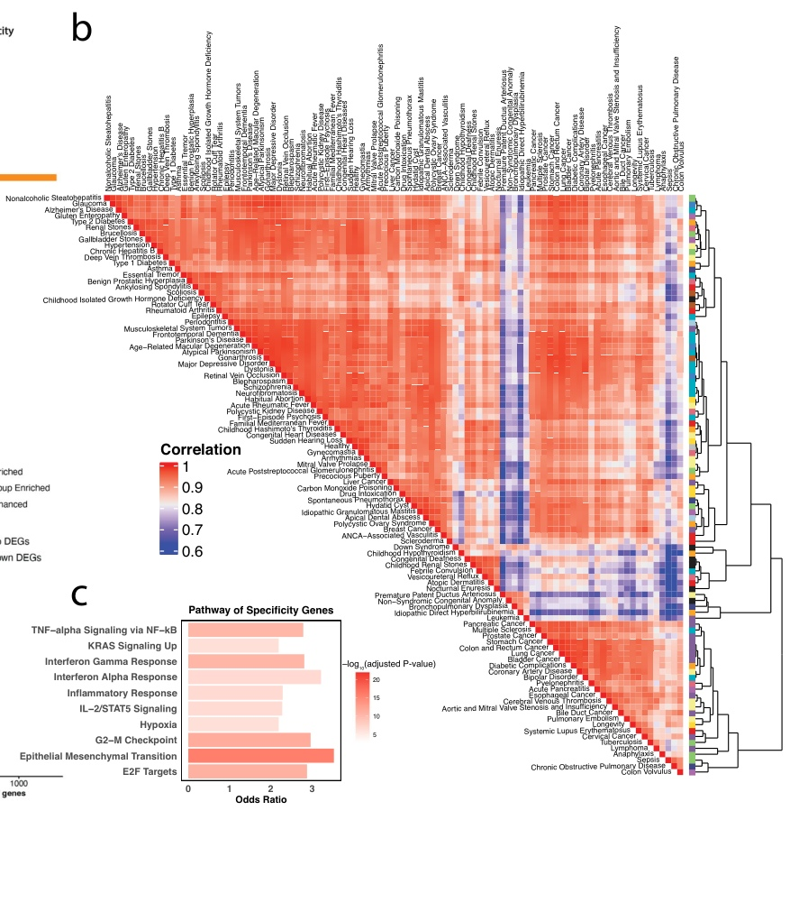

原文图 2b–c：健康状况间相关性与通路｜原图来源及CC BY 4.0许可见文末。

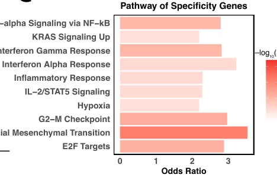

原文图2c单独放大，来源及CC BY 4.0许可同上；原样裁片，保留轴和色标。

全研究共归入这些类别的基因有 4,266 个。图 2c 展示它们的通路富集，横轴仍为优势比，颜色为校正 P 值的负对数。免疫和炎症相关通路居多，说明很多疾病在血液中留下的是系统反应。两种疾病共享炎症信号，并不表示它们拥有同一病因。

图 2b 则让每种健康状况与每种健康状况相互比较。作者取变异最大的 1,000 个基因，先计算各病组的平均表达，再计算 Spearman 相关。横、纵轴都是健康状况，颜色标尺约为 0.6—1：红色代表更高相关，蓝紫色代表相对较低相关。因而一个蓝色格子仍可能是正相关，不应写成两病“表达方向相反”。

这张热图不是每位患者的位置图。组内平均会抹平亚型、病程和离群个体；图上相邻只表示在这组选定基因、这套距离度量下较相似。它适合寻找跨疾病共同模式，也提醒我们：如果多种病共享同一类血液反应，分清“有病与健康”往往比在疾病之间做鉴别容易。

### 图 3 追问：究竟是细胞变了，还是细胞里的表达变了

想象把两种细胞混在一起。一种主要表达基因 A，另一种几乎不表达。只要第一种细胞占比增加，整管血的 A 就会上升，哪怕每个细胞内部完全没有变化。因此，“这个基因上调”至少可能来自两条路径：单个细胞表达改变，或者表达它的细胞变多。两者都可能有诊断价值，但生物学含义不同。

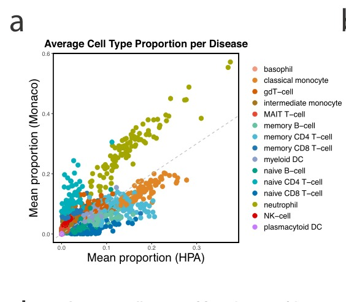

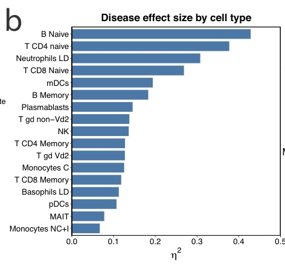

原文图 3a–b：两种参考估计及效应量｜原图来源及CC BY 4.0许可见文末。

作者用 CIBERSORTx，从混合 RNA 中估计免疫细胞相对比例，并分别使用 HPA 与 Monaco 两套参考。图 3a 横轴是 HPA 估计的平均比例，纵轴是 Monaco 估计的平均比例，每一个点对应“一个健康状况中的一种细胞”，不是一位患者。两者整体同向，高丰度细胞尤其一致；中性粒细胞的点却明显偏离等值线，提示相关不等于数值可互换。

质量筛选后，HPA 参考保留 4,444 份，Monaco 参考保留 4,442 份。这里的小分母差异需要记住：相邻面板未必使用完全同样的样本。反卷积给出的是基于参考谱的估计，不能等同于流式细胞术或血常规直接测得的绝对细胞数。

图 3b 横轴为 η²，比较健康状况标签与不同细胞比例的关联，初始 B 细胞、初始 CD4 T 细胞和中性粒细胞位居前列。

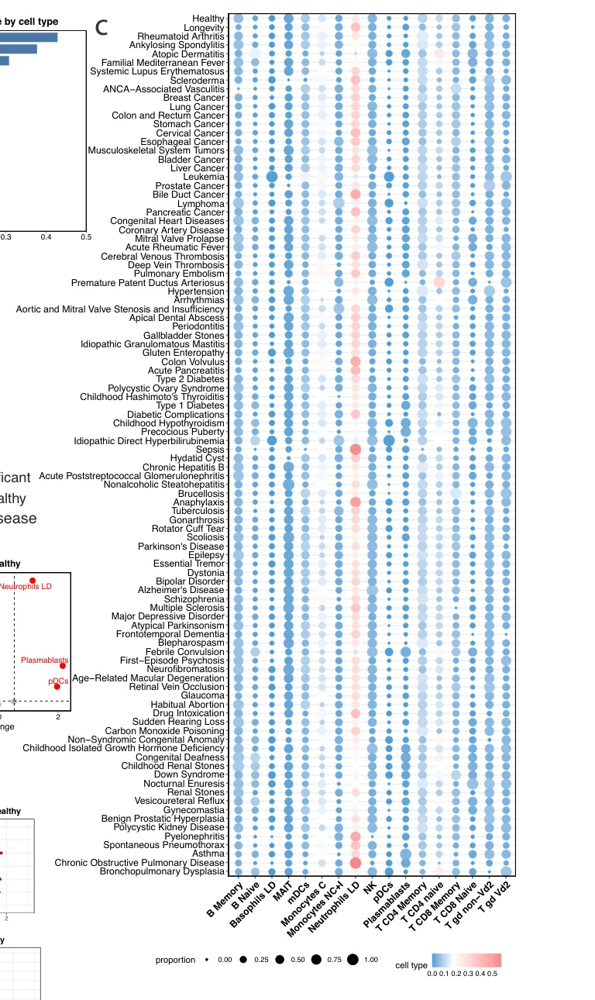

原文图 3c：细胞比例矩阵｜原图来源及CC BY 4.0许可见文末。

图 3c 每行是一种健康状况、每列是一类细胞；颜色表示该病组中该细胞的平均比例，圆的大小则是同一细胞类型跨病组归一化后的值。一个大蓝点，可以代表“在这种细胞的各病组比较里相对较高”，但它在整管血里的绝对占比仍然很小。颜色与大小回答的是两个不同问题。

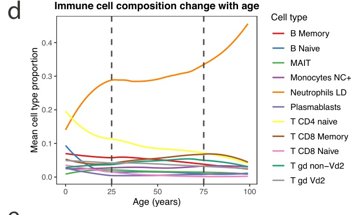

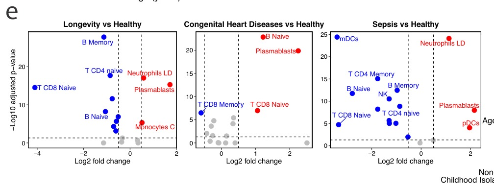

原文图 3d–e：年龄曲线与比例差异｜原图来源及CC BY 4.0许可见文末。

图 3d 把年龄摆到横轴，纵轴为平均细胞比例。作者先用包含疾病状态的线性模型筛出 11 类年龄相关细胞，再展示平滑的年龄轨迹。中性粒细胞随年龄增加，初始 CD4 T 细胞下降；曲线在约 25 岁和 75 岁附近变化较明显。这里没有给出变点估计的不确定区间，因此适合称作图中的转折趋势，不宜把它宣布为人体免疫系统两个精确的年龄开关。

图 3e 用三组火山图展示长寿、先天性心脏病及脓毒症相对健康对照的比例差异。横轴为 log₂ 倍数变化，纵轴为校正 P 值的负对数；红色表示疾病或长寿组较高，蓝色表示健康组较高，灰色未达显著。长寿组初始淋巴细胞减少、中性粒细胞增加；先天性心脏病组某些初始淋巴细胞更多；脓毒症表现为中性粒细胞比例增加，多类淋巴细胞减少。

方向具有生物学可解释性，但这几个面板不能跳过年龄差。84.6 岁的长寿组和 39.3 岁的健康组有区别，并不能单独证明“长寿特有的机制”；平均 10.1 岁的先天性心脏病组也不是与健康儿童匹配比较。主文的 RNA 差异分析调整了年龄，不意味着每个细胞比例比较都进行了同样的调整，更不等于创造出原本不存在的匹配对照。

### 代谢图很丰富，测到的仍然是 RNA

图 3f—h 将转录组输入 COMPASS，并结合 Recon3D 人体代谢网络，推断 95 个代谢子系统中的 6,135 个反应。模型利用酶相关基因的表达及网络约束，形成可比较的代谢活动分数。它没有直接测量氧耗率、ATP 生成速度或代谢物浓度，也没有做同位素示踪。

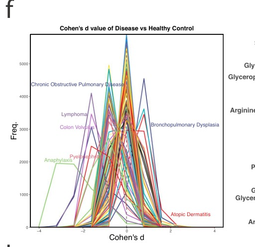

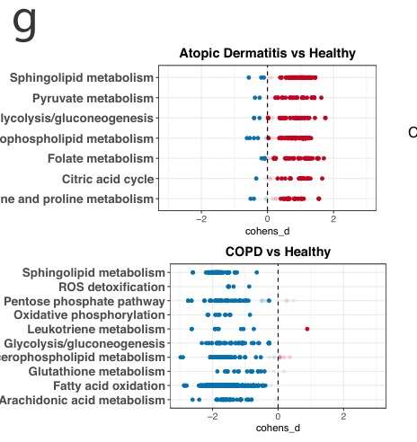

原文图 3f–g：推断的代谢反应效应｜原图来源及CC BY 4.0许可见文末。

图 3f 横轴是疾病相对健康组的 Cohen’s d，纵轴为相应反应的数量分布；左移代表预测活动偏低，右移代表偏高。图 3g 将代表性子系统展开，每个点是一项反应，横轴同样是标准化效应量，没有每分钟或每毫升的物理单位。慢阻肺多种能量相关反应偏低，特应性皮炎多种反应偏高。

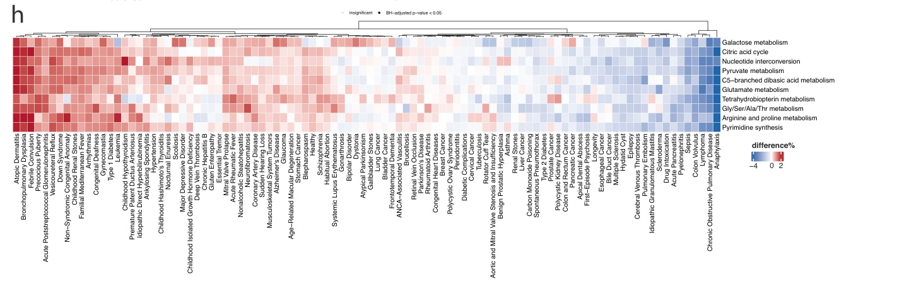

原文图 3h：代谢子系统相对活动｜原图来源及CC BY 4.0许可见文末。

图 3h 取变异最大的十个子系统，横轴是健康状况，纵轴是子系统。按图注，应读作标准化相对活动，红色较高、蓝色较低。原图色标却写作“difference%”，与图注的 z-score 表述不一致；因此不能从颜色读出代谢通量升降了百分之几。本文只保留较高、较低的方向性观察。

特应性皮炎组以婴幼儿为主，这再次影响解释。它的高代谢相关信号，可能包含发育与细胞组成的作用，不能直接外推为成年特应性皮炎的统一代谢特征。慢阻肺组平均年龄 70.8 岁，也需考虑年龄、治疗和疾病状态的共同影响。模型图能给实验提供值得验证的方向，真正把结论落到某条代谢反应，还需要代谢组或功能实验。

### 读完前三张图，先保留两个层次

这份图谱确实说明：很多健康状况在全血里留下了可重复组织起来的表达差异，而且这些差异与免疫、年龄和代谢相关过程相连。它也清楚展示，血液信号来自混合细胞群，病组之间的人口学结构差别很大。

因此，好的下一步不只是从显著基因里挑出一个名字。我们还要问：若把一群同向变化的基因放在一起，能否形成稳定、可解释的模块？这些模块与另一种测量方式得到的血浆蛋白有没有联系？下一篇转向原文图 4—6，看看“谁一起变化”能够告诉我们什么，又在哪一步仍需要保留相关性与机制之间的距离。

## 原文与图像授权

- Li M, Tatar A, Green E, et al. Whole blood transcriptomics atlas across human diseases. Nature Communications, 2026. [论文与补充材料](https://doi.org/10.1038/s41467-026-78440-w)
- 本篇依据公开主文、Supplementary Information 中的 Supplementary Table 1、补充图及 Source Data 的 Fig.1F、Fig.2B、Fig.3 系列表核对。阅读版本为 Article in Press；后续正式编校版本可能修正标签或数字
- 图 1—3 © The Author(s) 2026，按 [CC BY 4.0](https://creativecommons.org/licenses/by/4.0/) 转载，未重绘或改变数据；中文解释不代表原作者审定

本篇原图统一说明：从原PDF高分辨率裁取，保留对应坐标、标签与图例，不改变数据；少数边缘保留相邻面板。图2a包含较多病组，正文显示概览，点开原图可逐行查看。

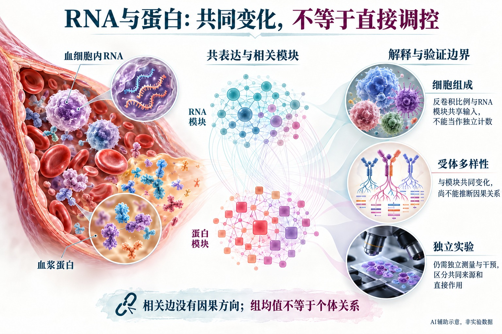

AI辅助示意，非实验数据。血细胞内RNA与血浆蛋白具有不同来源；图中分子和连接仅帮助理解共同变化，不代表实测网络或已确认调控。

## 把几万个分子连成网络以后，我们究竟多知道了什么

一份全血RNA数据里，很多基因会一起升高或降低。原因可能很直接：表达它们的细胞一起变多了；也可能是同一类细胞启动了某种反应。若再测同一个人的血浆蛋白，是否能把这两层信息接起来？

《Whole blood transcriptomics atlas across human diseases》的图4—6围绕这个问题展开。研究先在4,444人的RNA中寻找共表达模块，再在1,280人的配对RNA与蛋白中寻找跨组学联系，最后把这些联系与免疫细胞、受体谱联系起来。这部分适合学习怎样组织一张组学图谱，也特别适合练习：一条相关边离调控机制还有多远。

### WGCNA把共同变化压缩成模块

作者没有直接拿全部检测基因建网，而是选择变异最大的10,000个基因，用4,444位参与者的表达计算基因间相关。方法使用有符号邻接矩阵，软阈值为12，再依据拓扑重叠矩阵做层次聚类，最小模块大小设为30，最终得到21个共表达模块。

这些术语背后可以这样理解：两基因在不同人身上变化方向越一致，网络联系通常越强；软阈值进一步突出较强联系；拓扑重叠还考虑它们是否拥有相近的邻居。模块把一群共同变化的基因收在一起，而不是先按已知疾病机制强行分组。

参数并不是无关紧要的技术细节。改变纳入基因、相关计算方式或切树设置，模块边界可能变化。“符合无标度拓扑”是算法建网时的参考准则，不是证明人体调控网络已被完整还原。这里的C5、C16只是这次分析的编号，也不能直接拿去与另一篇论文的同号模块对应。

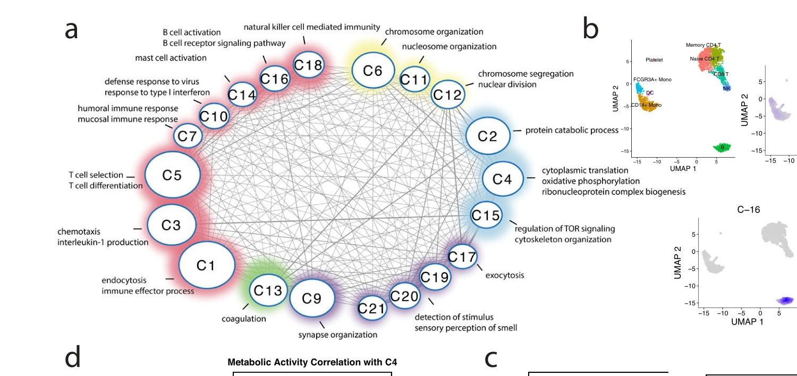

图4a每个圆是一个模块，大小表示所含基因数，边粗表示模块间相关强弱；颜色归纳功能主题。红色偏免疫和细胞因子，黄色偏细胞周期，蓝色偏代谢和线粒体，紫色偏信号转导，绿色偏组织修复。原文结果写明，21个模块中20个具有显著功能富集；不能因图注的概括表达，就将21个全部写成已通过显著富集检验。

功能标签来自GO过度代表分析：模块中的基因与某一功能集合重叠得是否比背景预期更多。它帮助命名模块，却不等于已经测量该功能的强弱，更不能从“线粒体相关”直接跳到“线粒体功能受损”。数据库注释也有重叠，同一模块可能对应多个相关词条。

### 给模块贴上细胞标签，要看证据从哪里来

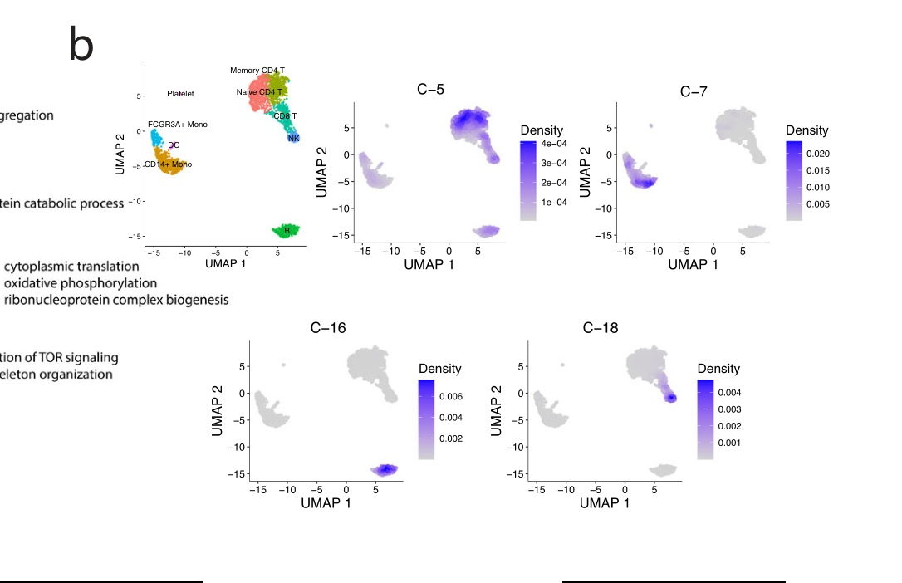

作者把模块投到一个外部健康供者的PBMC单细胞数据中，用UCell计算基因集合的富集分数。图4b左侧先展示细胞注释，右侧各图显示模块在同一低维空间中的分布，颜色越深表示相应信号更集中。横纵轴是UMAP坐标，没有细胞数量、表达倍数或物理距离的单位。

C5主要落在T细胞，C7偏单核细胞，C16偏B细胞，C18偏NK细胞。这为模块的细胞来源提供了支持。但参考来自健康供者的PBMC，不能代表98种健康状况中的全部免疫状态；PBMC本身也不能完整覆盖全血中的粒细胞。某模块在这份参考中很有特异性，不等于疾病中的同类细胞不会改变表达程序。

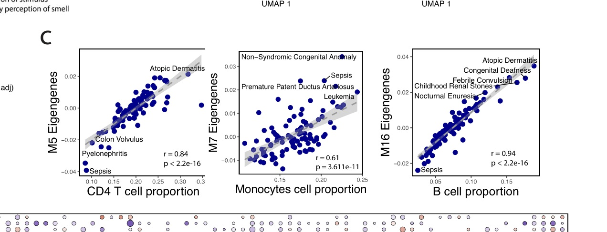

图4c进一步比较模块eigengene与对应细胞比例。eigengene通常是模块表达矩阵的第一主成分，用一个综合坐标代表共同变化；它不是某个具体“特征基因”，也不是细胞数。横轴是反卷积得到的细胞比例，纵轴分别为C5、C7、C16的模块坐标。图中每个点对应健康状况的汇总，标注的相关系数分别为0.84、0.61、0.94；虚线为线性拟合，灰带为95%置信区间。

这里有两层限制。病组均值间的强相关，不保证每个病组内部、每位患者之间也同样强。其次，模块与细胞比例都来自同一份全血RNA，二者可能共享标记基因和数据结构。这是不同分析视角的一致性，不能当作独立流式实验验证。

对做机制研究的人，这个结果还有一个提醒：模块升高可能主要反映对应细胞更多，而不一定是每个细胞更活跃。若目标是区分这两种解释，就需要直接细胞计数、分选细胞或适当设计的单细胞分析。

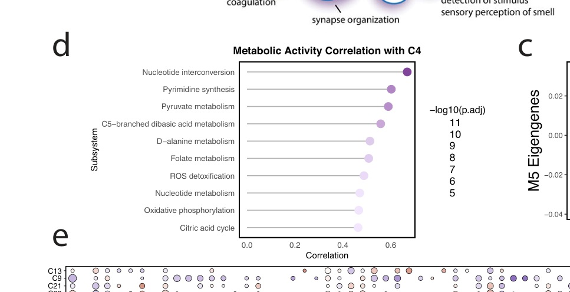

图4d对C4做了类似检查。纵轴列代谢子系统，横轴为相关系数，颜色表示校正P值的负对数；95个子系统中显示排名靠前的十个。氧化磷酸化、核苷酸相关过程等与C4共同变化，符合其代谢和线粒体注释。但这里的代谢活动由COMPASS基于转录组推断，与模块共享RNA输入，并非直接测得通量。这个一致性适合提出实验方向，不足以单独确认代谢机制。

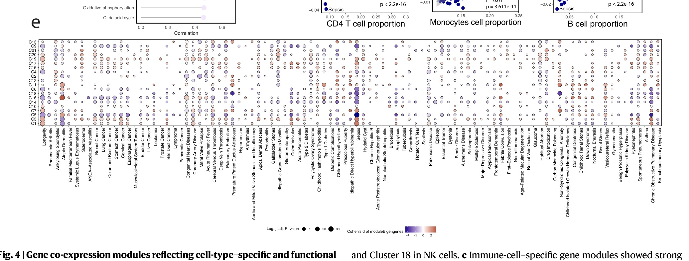

图4e每行一个模块，每列一种健康状况。颜色表示相对健康对照的Cohen's d，点大小表示多重校正后的显著性。效应量与显著性是两个维度：大点不一定代表变化幅度最大，更不意味着疾病最严重。模块坐标也没有通用的生物物理单位，不能把d=2理解成表达增加两倍。

作者观察到，长寿组的T、B细胞相关模块偏低，若干先天炎症相关模块偏高；COPD和脓毒症也有多类淋巴细胞相关模块降低。它们与前面细胞组成的结果相互呼应。不过长寿组与健康组年龄明显不同，观察到差异不能单独归因为长寿保护机制。疾病、年龄、治疗和细胞构成依然需要分开考虑。

### 同一个人的RNA与蛋白，为何不总是同向

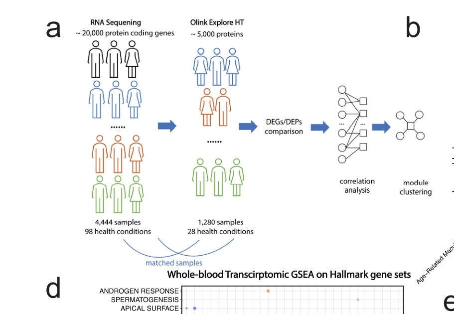

图5a说明第二层分析的分母：4,444份RNA中，1,280人有Olink Explore HT配对血浆蛋白数据，覆盖28种健康状况。配对使两种测量来自同一个人，减少了把两批参与者差异误当组学差异的风险，但没有使它们变成同一种测量。

全血RNA主要包含血细胞中的转录本；血浆蛋白还可能由肝脏、其他器官、免疫细胞等产生，受分泌、释放、降解和清除影响。因此，某个基因在血细胞里的RNA与同名血浆蛋白不一致，并不令人意外，也不能一律解释成翻译调控。

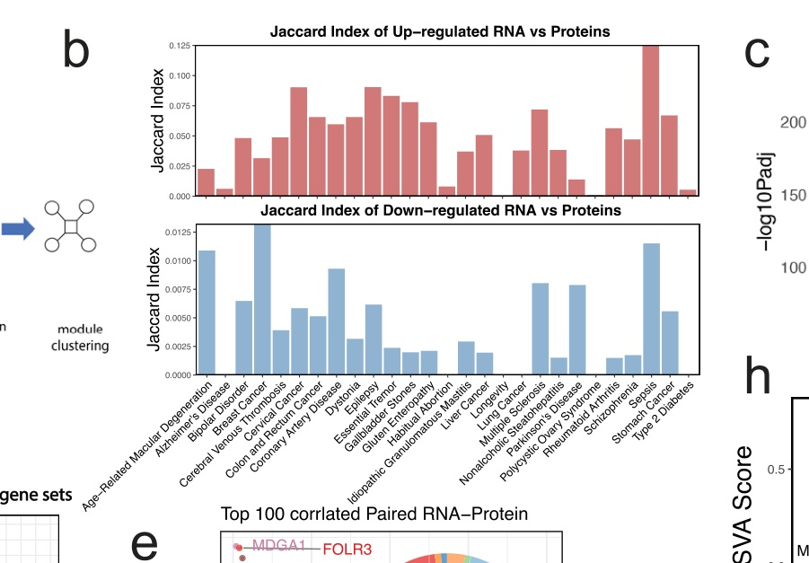

图5b分别比较上调与下调分子的集合，横轴是健康状况，纵轴为Jaccard指数，即交集大小除以并集大小。作者报告各组重叠有限，约在0到0.13之间。这不能读成“只有13%的RNA可以翻译”：分母是被判定差异的两个集合的并集，不是全部RNA，更不是翻译成功率。

此外，RNA覆盖约两万基因，蛋白平台覆盖约五千蛋白，测量范围、检测灵敏度和统计功效并不一致。差异名单还受阈值影响。若要更严格比较同名分子的一致性，应明确共同可检测背景、有效样本及效应方向，并考虑连续效应量，而不只看过了显著性门槛的名单。本文主图能支持名单重叠低，不能仅凭这个比例断言两层生物信息互不相关。

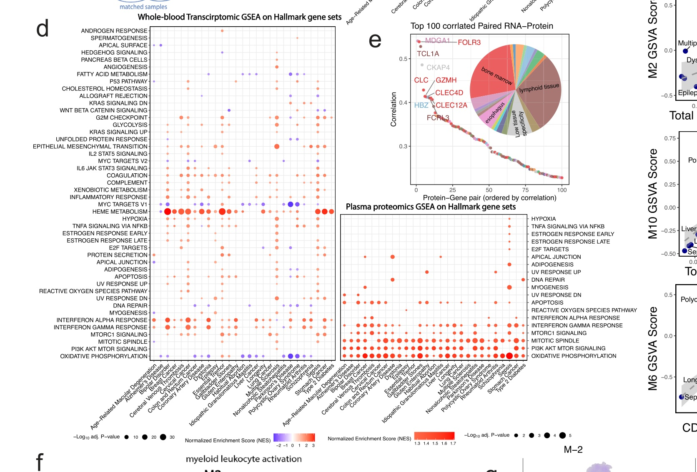

图5d将比较推进到Hallmark通路。横轴为健康状况，纵轴为通路，颜色为标准化富集分数，点大小对应显著性；RNA与蛋白各有自己的色标，应分别读数，不能凭两个面板颜色的视觉深浅直接量化差距。

干扰素相关通路可在两层中同向，氧化磷酸化等则可能不同向。作者将这些现象联系到转录后或翻译后调节，但数据本身尚不能排除组织来源、细胞构成、蛋白清除与技术覆盖的影响。尤其“RNA显著通路更多”，不等于RNA在所有用途上更全面：检测分子数量与统计功效也会影响这一结果。更稳妥的结论是，两种测量提供了有共同部分、也有差别的观察窗口。

### 同名配对与全组合相关，是两种不同的问题

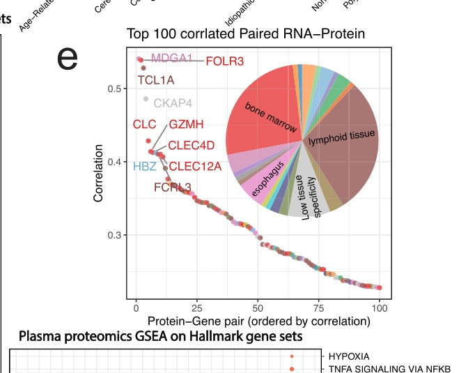

图5e先限定同名RNA—蛋白配对，展示相关程度最高的一百对。横轴按相关程度排序，纵轴为相关系数，圆饼和颜色用组织注释描述这些分子的来源特点；骨髓、淋巴组织相关分子较突出。这是被选出的高相关尾部，不能把其分布当成所有RNA—蛋白配对的平均水平。

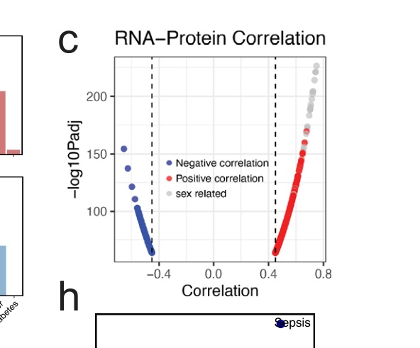

图5c则将19,314个RNA与5,348个蛋白做全组合相关，搜索范围约一亿个配对。横轴是Pearson相关系数，纵轴是校正显著性的负对数；正负方向分开显示，灰色标出了性别相关的强关联。最终以r>0.45筛得3,523个正相关配对，去掉性别相关联系后剩3,480个，用于后续建网。

性别相关分子同时出现尤其值得注意。Y染色体基因与男性生殖组织相关蛋白的强相关，并不自动证明前者直接控制后者；共同的性别因素就可能产生这种结构。作者剔除了这些明显配对，但剔除一个已知因素不等于清除了全部共同驱动。疾病类别、年龄、细胞比例或治疗仍可能令一群分子一起变化。

而且，这个网络主要保留强正相关联系。没有出现的边可能是负相关、较弱关联、测量不足或未过阈值，不能理解为两个分子在生物学上没有关系。

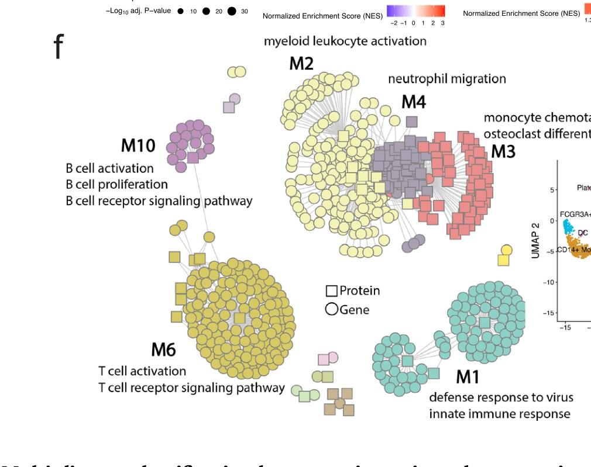

图5f中圆形为基因，方形为蛋白，颜色区分Louvain划分的模块；连线表示筛选后的相关关系，没有因果方向。方法报告得到12个模块，图中可辨认出T细胞活化相关M6、B细胞相关M10以及单核细胞相关模块等。网络布局用于展示连接结构，圆圈在纸面上靠得近并不意味着分子在细胞内靠得近。

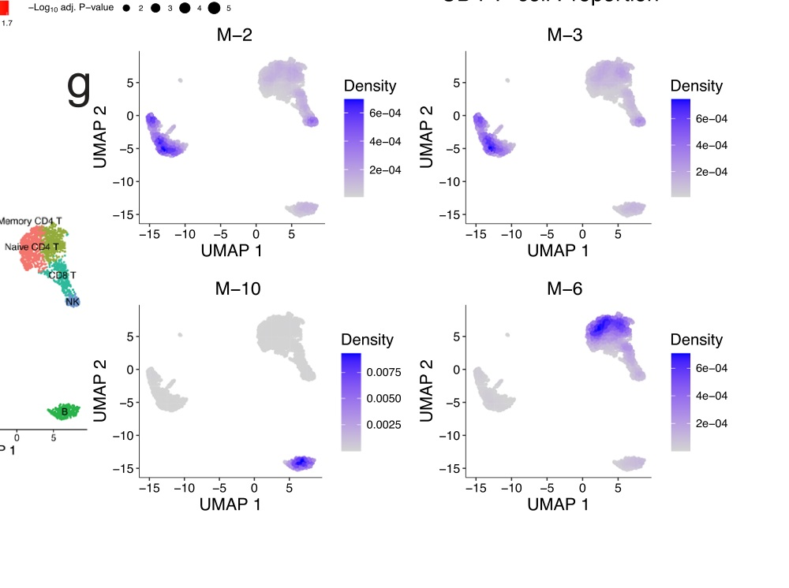

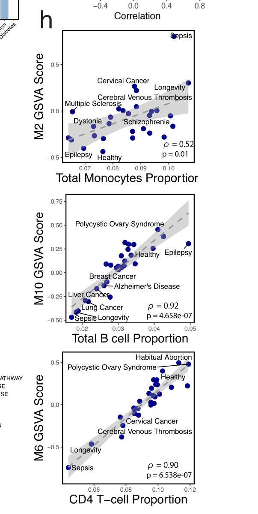

图5g把模块中的RNA放回PBMC参考，图5h把病组GSVA得分与反卷积细胞比例关联。5h横轴为相应细胞比例，纵轴为模块GSVA得分，点为健康状况，报告的是Spearman相关；它与图4c的Pearson不能混写。M6、M10的细胞主题得到支持，但这两步仍主要检验RNA成员，不能据此宣布模块里的每个蛋白都已被定位到相同细胞来源。

### 图6的重叠率，分母换一下就完全不同

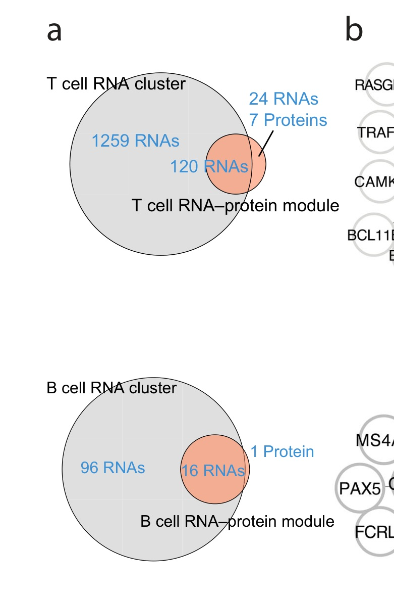

图6a把两种建网结果对应起来。T细胞跨组学模块含144个RNA，其中120个也属于RNA共表达模块，另24个在外，加上7个蛋白。以跨组学RNA为分母，重叠约83%；但RNA共表达模块共有1,379个成员，以它为分母则不到9%。两句话描述同一张图，含义却不同：前者说明较小集合的集中性，后者说明它只覆盖大集合的一小部分。

B细胞图的交集为16个RNA，RNA共表达模块还有96个不在交集中，跨组学模块另有1个蛋白。这里同样不能把“跨组学RNA都落在已有模块中”改成“两套模块完全相同”。蛋白与RNA也不应不加区分地混进同一个重叠分母。

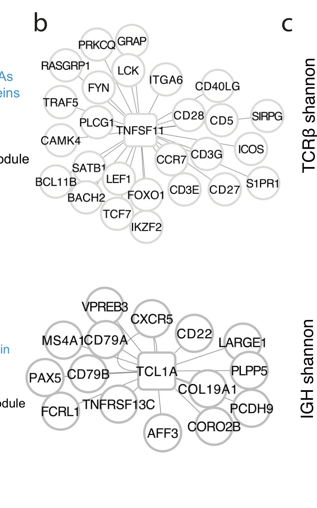

图6b放大T、B细胞模块的分子名字，适合据此形成候选清单。它仍是相关网络，没有展示结合实验、干预后的下游响应或因果方向。要从某条边发展机制课题，下一步应提出能够区分共同细胞来源和直接作用的实验，而不是先把边改画成单向调控箭头。

### 受体多样性增加了一层证据，也有测量边界

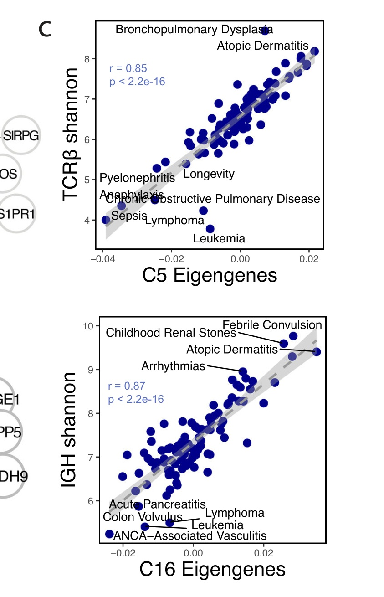

研究用MiXCR从RNA测序FASTQ提取TCR和BCR克隆型，4,398份样本成功进入后续分析，分母不再是4,444。Shannon指数同时反映克隆种类及其丰度均匀程度；高值不能简单等同于免疫功能更强。

图6c横轴分别为C5和C16 eigengene，纵轴为TCRβ或IGH的Shannon指数，每个点是一个健康状况的汇总，相关系数约0.85和0.87。它提示淋巴细胞相关表达与受体谱结构共同变化，但病组层面的相关不能直接代替个体关系。RNA测序深度、对应细胞数量、受体转录水平和克隆采样都可能影响可检出的多样性，普通全血RNA也不等于专门的深度受体测序。

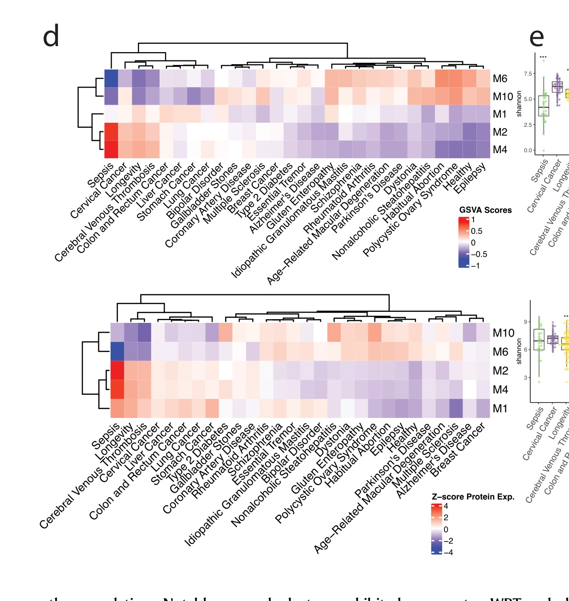

图6d上图展示模块RNA的GSVA得分，下图展示对应蛋白的组均值标准化表达；横轴为健康状况，纵轴为模块。两张图的行列排序和色标不同，应对照名字阅读，不能把同一位置的色块机械配对。脓毒症的T细胞相关模块较低，是文中强调的一项观察；它可能同时反映细胞数量与状态，不代表已经鉴定某一条分子抑制机制。

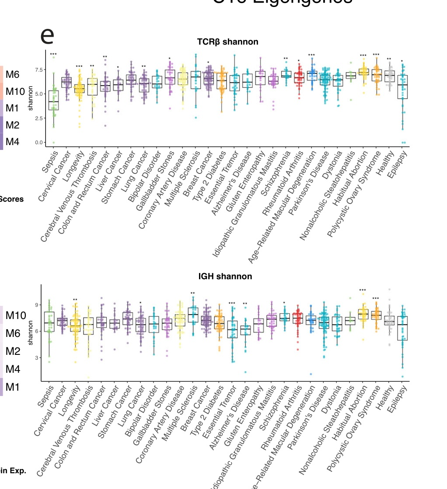

图6e与前一个相关散点不同，每个点代表一位独立参与者，箱体为中间50%的分布，中心线为中位数，须延伸至1.5倍四分位距范围内的极端点。作者以每一病组和其余所有病组作比较，使用Wilcoxon检验并做BH校正；星号不是一律相对健康人。

作者报告脓毒症TCR多样性较低、习惯性流产组较高。较高不等于“免疫更健康”，较低也不自动揭示哪个克隆发生了功能障碍。若要把它用于具体疾病解释，还应检查个体分布、年龄、细胞比例、用药和测序覆盖，而不是仅凭病组均值和星号下结论。

## 这一层分析真正留下了什么

图4—6把大量分子组织成可解释的免疫主题：RNA共表达模块、跨组学相关模块、细胞注释与受体谱可以相互对照。配对蛋白测量增加了不同层面的信息，也让研究者有机会挑出值得继续验证的候选。

边界同样清楚。共享输入的多种算法不构成多次独立实验；组均值不能代替个体；相关模块不能直接变成因果线路。对我们最有用的下一步，是问每条解释还缺哪种独立测量，而不是把网络画得更复杂。

## 来源、阅读范围与图像说明

Li M等，Whole blood transcriptomics atlas across human diseases，Nature Communications，2026-10-12，Article in Press。https://doi.org/10.1038/s41467-026-78440-w

本篇依据完整主文的图4—6、对应结果与方法重建，核对图上标签及集合数字；未在本次恢复中重新获取补充表，不能把文中作者报告写成已经独立复算。没有运行WGCNA、MiXCR或重新分析个体数据。

本篇全部原文图片来自Li等上述论文，© The Author(s) 2026，CC BY 4.0，许可：https://creativecommons.org/licenses/by/4.0/。为手机阅读从PDF高分辨率裁取原样面板，保留轴、标签与图例，未更改实验内容；部分边缘保留相邻面板。中文解释为独立教学分析，不代表原作者审定。

AI 辅助示意，非实验数据。训练、留出测试与外部验证分别检验不同范围的泛化能力，图中人物和场景不对应真实队列。

## 模型得分很高以后，还要问它经历了哪一种考试

前两篇看到，全血 RNA 可以组织成疾病相关基因、免疫模块和跨组学网络。到了原文图 7—8，问题终于变成了预测：把一份样本交给模型，它能不能分辨对应的健康状况？加入血浆蛋白，是否比只看 RNA 更好？

论文给出了一项清楚的内部结果：在配对测量的 1,280 人、28 种健康状况中，RNA 与蛋白联合模型的测试集 F1 约为 0.74，准确率约为 0.75，高于单组学模型。外部数据也支持一部分签名具有跨队列判别能力。

不过，这里的“判别能力”有明确范围。它不是对 98 种疾病的临床筛查，不是从尚无症状的人群预测未来发病，也没有完成联合多组学模型的广泛外部多分类验证。认真读懂这部分，需要把几种考试拆开：病人与健康人之间的二分类、多个病类之间的内部多分类，以及选定疾病的外部二分类。

### 第一道考试：病人与健康人能否分开

研究首先选出样本量超过 40 的健康状况，得到 2,970 人、29 个类别。按类别分层后，70% 的人进入训练集，即 2,079 人；30% 进入独立留出的测试集，即 891 人。29 类包含健康状态，因此最好沿用“健康状况”，避免把它写成 29 种疾病。

第一种任务，是每次拿一种病与健康对照比较。作者在训练数据中用 XGBoost 配合 SHAP 给 RNA 排序，分别测试每病前 10、50、100 个特征及更多特征。模型选择通过训练集的交叉验证完成，最后再看留出测试集。

补充图 4a 报告，前 10 个 RNA 的内部测试 AUC 约为 0.89—1.00，与更大特征集合相近。这个结果的含义，是一些疾病相对健康组存在较强的血液信号，较小的特征集合已经能抓住其中相当一部分。

“每病十个”必须保留。不同疾病可以选出不同的十个分子，不能写成用一套共十个 RNA 同时识别全部疾病。病人与健康人容易区分，也不代表病人与另一个具有相似炎症反应的病人容易区分。若目标是临床鉴别诊断，后者往往更接近实际问题。

### 第二道考试：29 个类别同时摆在面前

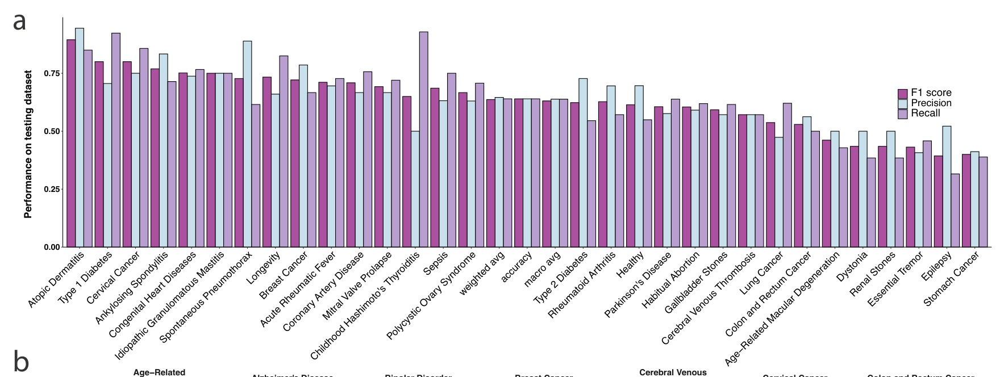

原文图 7a：内部多分类性能｜原图来源及CC BY 4.0许可见文末。从原图裁取对应面板，保留数据、轴及图例，未重绘；边缘可含相邻面板。细节可点开放大。

图 7a 才是真正的内部多分类。横轴逐类列出健康状况，纵轴为测试集指标；深紫为 F1、浅蓝为 precision、浅紫为 recall，均在 0—1 范围，没有百分浓度等物理单位。某类 recall 高，表示真实属于该类的人较少漏掉；precision 高，表示被模型判为该类的人中，实际属于该类的比例较高。F1 综合这两个方面。

总体 F1 与准确率都约为 0.64。图上不同类别表现并不齐整，有的较好，有的明显较低。比如一个模型可能善于识别年龄和血液状态非常鲜明的类别，却难以分清系统反应较弱或相近的病组。总体均值因此不能代替每类的表现。

这里还要区分加权平均和宏平均。前者按类别样本量加权，大类对总分影响更大；后者给每类相同权重。对罕见病组或少数类别而言，一个整体加权 F1 可能掩盖较多错误。图 7a 同时展示类别和汇总指标，比只放一个漂亮总分更有信息量。

尽管病人的身份在训练、测试之间独立，二者仍来自同一地区、同一招募框架和相似流程。随机分层切分检验的是模型对这一来源中新样本的表现。若年龄、治疗或采样模式与病名相关，这些关联可能同时存在于两边；随机切分不会自动消除它们。

因此，这一轮考试支持内部可分性。要知道模型换一家医院以后是否仍然有效，还需要按中心、时间或独立队列进行另一层测试。

### 第三道考试：多花一次测量成本，换来了什么

为了公平比较 RNA 与蛋白，作者重新把问题限制在两种数据都齐全的 1,280 人、28 种健康状况。训练集 896 人，测试集 384 人，仍按 70/30 分层切分。在这部分比较中，不同模型面对同一批参与者，避免把两种组学各自的队列差异误当成技术优劣。

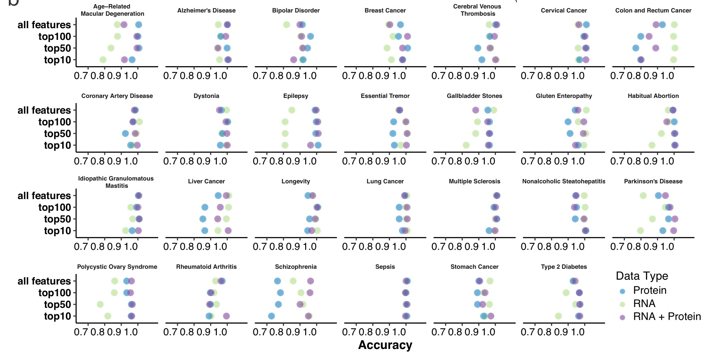

原文图 7b：二分类准确率｜原图来源及CC BY 4.0许可见文末。从原图裁取对应面板，保留数据、轴及图例，未重绘；边缘可含相邻面板。细节可点开放大。

图 7b 展示病人与健康对照的二分类。每个小面板对应一种健康状况，纵轴是特征集合大小，横轴明确标为 Accuracy；蓝点为蛋白，绿点为 RNA，紫点为联合。这里不能把横轴读成 AUC，更不能将它与前述补充图的 AUC 范围直接互换。

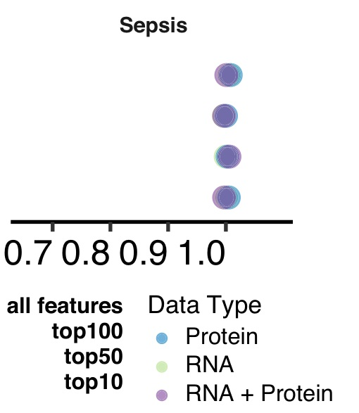

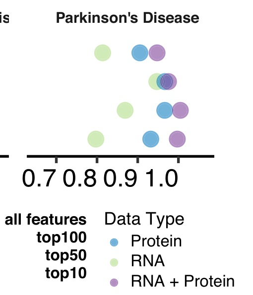

原文图7b两处局部放大，来源及CC BY 4.0许可同上。分别保留该病组的四种特征集合和Accuracy横轴刻度；共用纵轴从上至下为全部特征、前100、前50、前10。原图共享图例移到每幅局部下方便于对照，未重绘或修改任何数据。这两种状况只是读图示例，全部类别仍以上方概览为准。

大多数情况下，联合模型表现较好；但有的状态更适合蛋白，有的更适合 RNA，强信号的脓毒症在多种输入下都较容易识别。这说明“互补”的价值与疾病背景有关，不能据平均表现断言每种病都必须同时测两种组学。

多分类特征选择采用每类相对其余全部样本的 one-versus-rest 任务，在训练集中选出每类排名前十的 RNA 或蛋白，再取并集。最终得到 264 个独特 RNA、244 个独特蛋白。联合输入因此包含数百个特征，并不是每位参与者只测二十个分子就完成全部分类。

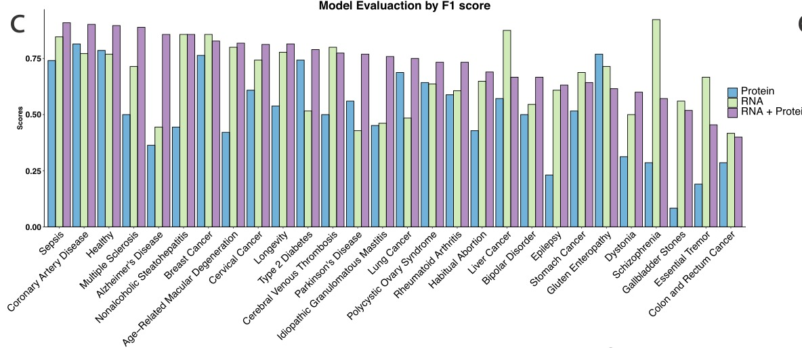

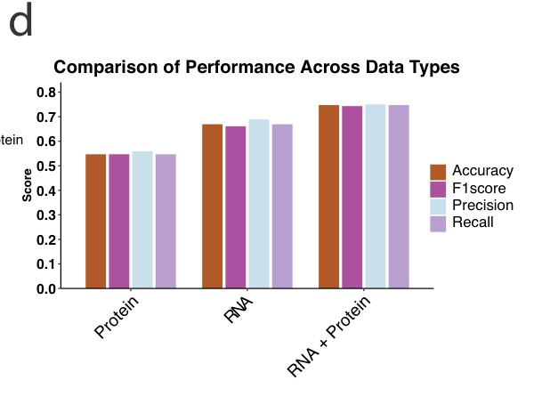

原文图 7c–d：配对组学多分类比较｜原图来源及CC BY 4.0许可见文末。从原图裁取对应面板，保留数据、轴及图例，未重绘；边缘可含相邻面板。细节可点开放大。

图 7c 是每个类别的 F1，图 7d 汇总三种输入的表现。蛋白模型的测试 F1/准确率约为 0.55/0.55，RNA 为 0.66/0.67，联合为 0.74/0.75。联合相对 RNA 的准确率提升约 8 个百分点，这是这组样本和这条分析流程中的实际增益。

作者还做了一个有用的对照：单组学每类取前 20 个，联合每类取 10 个 RNA 加 10 个蛋白，尽量让每类候选名额相近。相应 F1 约为 0.516、0.624、0.743，联合仍最好。这减少了“只是因为联合模型拿到了更多候选特征”的一种解释，但不同类别间特征重叠会影响最终并集维度，仍需留意具体输入数量。

另外，三种输入经模型选择后不一定用同一个分类器。RNA 最优的是随机森林，蛋白和联合最优的是逻辑回归。因此结果比较的是各输入在相同选择框架下得到的最优流程，不能说它只隔离了“多加一种组学”的唯一因素。若要进一步衡量增益稳定性，还应报告重抽样置信区间、多个切分和各类误差变化。

### 方法中哪些防护已经写明，哪些还需要核对

作者明确声明：在预处理之前先划分训练集与测试集，特征选择、模型选择和调参只使用训练集；测试集只用于最终评估。这一声明应当得到尊重，没有依据把论文描述成使用测试标签挑选特征。

多分类方法还明确把填补、缩放和 SMOTE 过采样放进交叉验证流水线，SMOTE 只作用于训练折。这样做的目的，是避免用验证折的信息构造训练数据。SMOTE 产生的是用于训练的合成点，不会增加真正独立受试者的数量。

仍需进一步核对的细节，是 SHAP 特征选择是否在每个交叉验证训练折里重新进行。方法说明它只在总训练集内进行，但这句话本身不能证明整个特征选择也完全嵌套在每一折内。如果先用总训练集挑特征，再在其内部做交叉验证，内部选模分数可能偏乐观；这和独立留出测试集被直接用于选特征，是两种不同的问题。

合理的读法，是承认已经说明的留出测试隔离，同时把交叉验证嵌套细节列为复现检查项。是否真的存在实现问题，需要代码与运行过程核对，不能从文字未展开的地方直接推定已经发生数据泄漏。

细胞组成的补充实验也要同样谨慎。作者比较 RNA、细胞比例、二者联合，发现加入比例没有明显改善 RNA 模型。这支持所选 RNA 已经包含大部分可用于该预测任务的信号。它并不能证明 RNA 信号全部来自细胞内调控：如果 RNA 已经编码了细胞组成信息，再加入同源推断的比例也可能没有增益。

公开审稿文件中，一项 RUV 探索分析受到负控基因选择方式的质疑。作者明确表示，该分析只在回复中出现，没有进入正文，也没有用于支撑报告结论。因此不能引用它来声称“研究已彻底消除细胞组成混杂”。

### 图 8 解释模型在看什么，暂时不解释什么导致了疾病

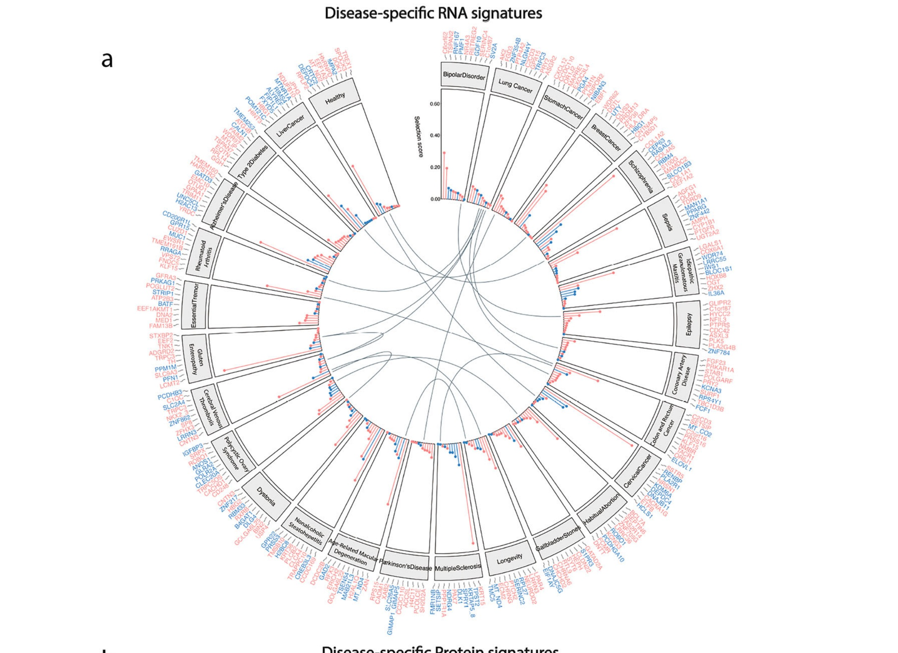

原文图 8a：RNA 签名｜原图来源及CC BY 4.0许可见文末。从原图裁取对应面板，保留数据、轴及图例，未重绘；边缘可含相邻面板。细节可点开放大。

图 8a 是 RNA，8b 是蛋白。每个扇区对应一种健康状况，外侧列出排名靠前的分子；柱长表示 SHAP 重要性。按原图图注，红色表示将预测推向目标类，蓝色表示推离目标类；圆心处的弧线连接在不同类别中重复出现的特征。

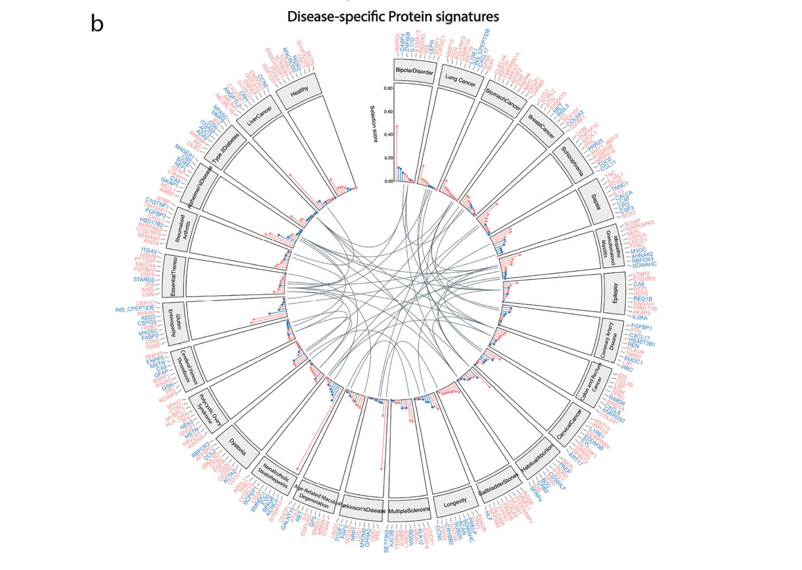

原文图 8b：蛋白签名｜原图来源及CC BY 4.0许可见文末。从原图裁取对应面板，保留数据、轴及图例，未重绘；边缘可含相邻面板。细节可点开放大。

SHAP 描述一个已训练模型如何利用特征，不是药物靶点评分，也不是基因对疾病的因果效应。一个特征重要，可能因为它反映炎症、细胞比例、年龄、治疗，或者这些因素的组合。相关特征之间还可能分担或替代重要性，换一个训练样本或算法，排名未必完全稳定。

因此，图 8 的红色不能直接理解为“这个分子促病”，蓝色也不表示“增加它就能治疗”。同样，RNA 与蛋白签名在分子名称上不重叠，支持两种输入选择了不同的判别线索，却不能证明两套信息在统计上完全独立。

作为研究资源，这些名单很有用：它们缩小了下一轮验证的范围。更有说服力的后续工作，会报告特征在重抽样中的入选频率、跨中心稳定性，以及加入年龄、血常规和常规临床指标后还剩多少增量价值。

### 外部验证，究竟验证了哪部分

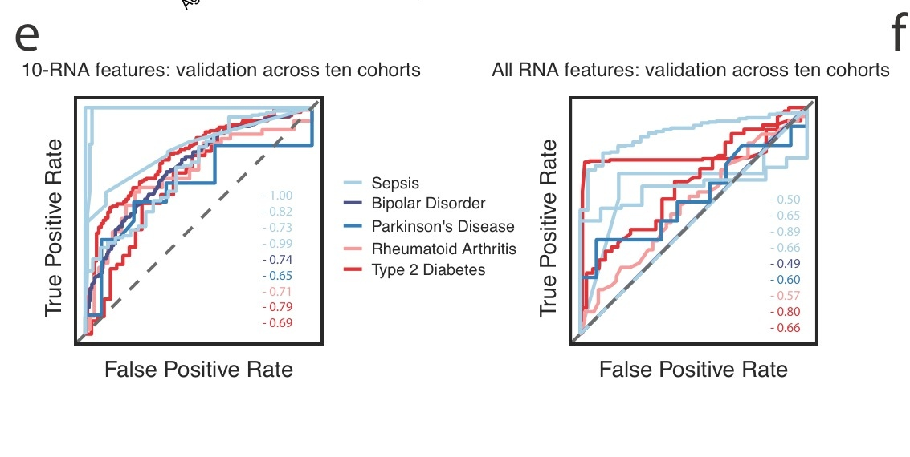

原文图 7e：外部 RNA 验证｜原图来源及CC BY 4.0许可见文末。从原图裁取对应面板，保留数据、轴及图例，未重绘；边缘可含相邻面板。细节可点开放大。

回到图 7e。作者把内部发现的疾病特异 RNA 签名，拿到外部转录组数据中做二分类，覆盖脓毒症、双相障碍、帕金森病、类风湿关节炎和 2 型糖尿病。ROC 图横轴是假阳性率，纵轴是真阳性率，越靠近左上角通常代表排序判别越好。它们不是 29 类或 98 类的外部混淆矩阵。

论文报告外部 RNA 平均 AUC 为 0.79、平均平衡准确率为 0.73；对照为 0.65 和 0.56。平均数背后差异很大。补充数据里，帕金森病队列 AUC 约 0.65，而某脓毒症队列接近 1；另一脓毒症队列约 0.73。写成“所有疾病均保持接近完美的表现”会抹去真正需要解释的差异。

外部平台不一定测到全部候选分子。实际输入是原候选与外部数据的交集，每病约 4—10 个特征，平均约 8.9 个，而不是所有外部实验一律完整使用十个。对照也需说清：方法将全部可用 RNA 或蛋白先标准化、再投影到前十个主成分，用这些主成分建模。它支持所选签名优于这套 PCA 基准，不能扩展成十个分子必然优于任何使用全基因的机器学习方法。

外部 RNA 样本数有一处尚未统一：图 1 写 1,521，正文与图 7 图注写 1,621；方法具体列出九个疾病 GEO 队列，并另使用 GSE134080 的健康参考，而补充性能表有九个外部 RNA 结果条目。本文保留这个版本差异，不自行把不同来源、独立人数和测试样本使用次数合并成一个确定数字。这也提醒读者，Article in Press 仍应与源表逐项核对。

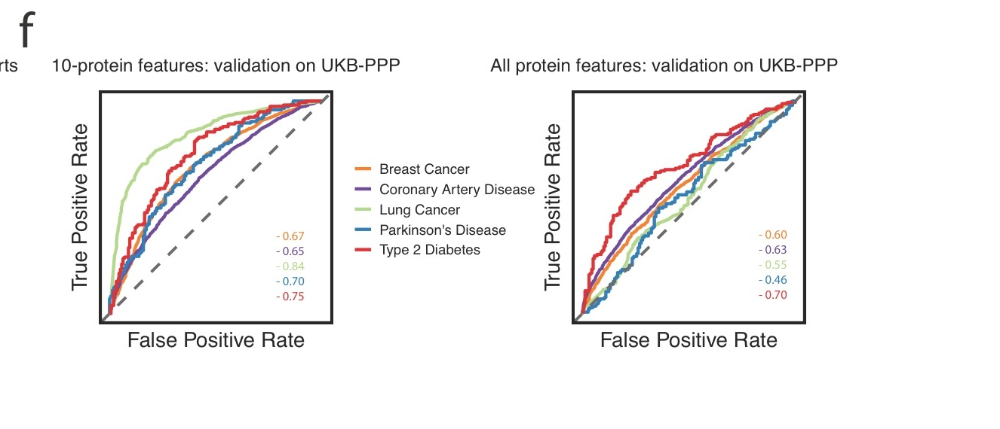

原文图 7f：外部蛋白验证｜原图来源及CC BY 4.0许可见文末。从原图裁取对应面板，保留数据、轴及图例，未重绘；边缘可含相邻面板。细节可点开放大。

图 7f 的蛋白验证来自 UKB-PPP，作者报告纳入 9,998 人，覆盖乳腺癌、冠心病、肺癌、帕金森病和 2 型糖尿病，以及健康对照。每种病随机抽取等量健康人组成二分类测试。平均 AUC 约为 0.73，对应 PCA 基准约为 0.59。这里验证的是蛋白签名，不能拿它来声称 RNA+蛋白联合多分类模型已经在 UKB 完整复现。

### 两个特别影响落地的外部验证细节

第一个是跨队列对照来源。某些外部数据只有患者，没有健康人，作者为这些队列加入 GSE134080 的 100 名健康参与者。这样可以构造二分类任务，也使病例和对照来自不同研究。疾病标签于是可能与测序批次、样本处理或招募方式纠缠，较高 AUC 中可能有一部分来自队列差异。

这不等于结果必定由批次造成，却意味着这类验证的证据强度应与同一研究内同时招募病例和对照的验证分开。最直接的改进，是在多个独立中心内各自同时纳入病例与对照，再检验模型跨中心迁移。

第二个是列方向的秩转换。为了缓解平台差异，作者对每个分子在队列内的所有样本排序，再用排名除以样本数，将值映射到 0—1。这样减少了量纲差异，却使一个人的特征值依赖同批还有哪些人，以及这些人的表达分布。

这个处理本身没有使用疾病标签，不能自动称为标签泄漏。但它与门诊一次只来一个新样本的部署场景存在距离：新样本应参照哪一个固定分布？患者构成改变以后，排序坐标是否变化？论文尚不能据此保证已经具备稳定的单样本推断流程。部署前需要冻结训练参考、校准与阈值，并在真正独立的新样本流中测试。

### AUC 到临床用途，中间还隔着患病率与错误代价

AUC 描述的是跨阈值的排序能力，不直接给出一个阳性结果有多可信。可以用一个与本论文无关的假设算例说明：在人群患病率为 1% 的情况下，假设某测试灵敏度 90%、特异度 95%，一万人中约有 90 个真阳性，同时会有约 495 个假阳性。阳性结果里的真病例只有约 15%。这里的参数只是示例，不是本文模型的临床性能。

因此，在平衡的病例—健康对照数据中取得不错 AUC，不能直接保证低患病率筛查具有足够阳性预测值。真实就诊人群还可能同时患多种病、接受治疗，或属于训练中从未出现的状况。一个被迫在固定标签中选一类的模型，也需要考虑“不确定”或“未知类别”的出口。

这项研究最稳妥的定位，是有价值的多疾病分子图谱，加上一套显示内部互补性、并在选定外部任务中获得支持的候选签名。它把血液分子研究向临床应用推进了一步，真正的临床检验还需要锁定模型、明确使用场景、匹配的独立对照、校准和前瞻性评估。

## 原文与图像授权

- Li M, Tatar A, Green E, et al. Whole blood transcriptomics atlas across human diseases. Nature Communications, 2026. [论文与补充文件](https://doi.org/10.1038/s41467-026-78440-w)
- 本篇核对主文图 7—8、Methods 的机器学习与外部验证章节、Supplementary Data 6 的性能表，以及公开 Peer Review File。阅读版本为 Article in Press
- 图 7—8 © The Author(s) 2026，按 [CC BY 4.0](https://creativecommons.org/licenses/by/4.0/) 转载；原图由 PDF 截取，未修改数据。中文解释不代表原作者审定

AI 辅助示意，非实验数据。人群、测量、模型与独立验证分别对应研究设计需要交代的环节；图中的分子关系为教学示意，非实测网络。

## THM：把一篇组学图谱，读成可以迁移的研究方法

一篇大队列组学论文，最容易带走的是几个数字：多少人、多少疾病、多少分子，以及模型最高能达到多少分。真正能用到自己课题里的，往往是这些数字之间的关系：谁进入了哪一步分析，哪个结论用了什么对照，哪些验证改变了证据的性质。

2026 年 10 月 12 日在线发表的《Whole blood transcriptomics atlas across human diseases》，提供了一个很适合练习的案例。4,444 位参与者、98 种健康状况构成发现图谱；配对蛋白组、内部分类和外部验证又各自使用不同子集。它同时展示了多层组学可以怎样组织，也展示了从相关性走向临床用途时必须补上的环节。

这一篇不再复述每张图。我们把它整理成几条可迁移的做法：如果手头有一个临床队列，怎样让下一步分析更可信，也更容易被别人检验。

### 先写清楚要估计什么，再决定怎样调整

做队列分析时，很容易从“把能拿到的变量都放进模型”开始。更好的起点，是先写一句话：这项分析想估计什么？

如果问题是“血液能否提示某种临床状态”，细胞比例改变可以是有用信号；如果问题是“同一种细胞内部发生了什么调控改变”，细胞比例就需要被单独拆开。两个目标都合理，却不能共用一句没有限定的“疾病特异表达”。

这篇研究中，全血模块与推断细胞比例高度相关。对预测任务而言，这可能是可利用的信息；对机制解释而言，它提示我们还缺少分选细胞、单细胞或直接细胞计数。一个分析变量究竟是混杂因素、疾病过程中的中介，还是预测特征，要由研究问题决定，不能只靠软件默认设置。

实际设计时，可以先画出几条有依据的路径：年龄影响疾病分布，也影响血细胞；疾病影响治疗，治疗又影响表达；细胞比例改变也会影响混合 RNA。随后说明本次分析希望保留哪条路径、控制哪条路径。这样才能解释为何某个模型调年龄，另一个模型研究细胞组成，而不是事后根据显著性挑选调整方案。

### 给每一步准备一张分母账本

图谱规模很大，不代表每个结论都使用了全部样本。这里至少有几个清楚的分母：总体 4,444 人；RNA 分类 2,970 人；配对 RNA—蛋白 1,280 人；后者测试集只有 384 人。外部验证又只涉及选定疾病的二分类。

迁移到自己的研究，建议为每个图和指标保存最小记录：独立参与者数、样本数、类别数、纳入排除规则、缺失情况、训练测试身份和分析单位。特别要区分一位患者、一份样本、一个疾病组均值，以及一个测序细胞。它们不能互换成同一种 n。

比如在疾病组均值之间得到很强相关，支持的是病组之间的共同变化。要断言个体之间也成立，就需要个体层面的分析。使用同一批健康人给两个疾病队列补对照，也不能在描述独立人数时简单相加。

这份论文的外部 RNA 总数和队列条目存在版本口径差异，恰好说明分母账本不只是行政工作。它决定读者能否理解模型到底经历了几次、什么性质的外部测试，也决定别人能否复现同一个结果。

### 调整年龄之后，仍然要看有没有可比较的人

在回归中加入年龄，通常是必要步骤；但如果病组主要是婴幼儿，健康组主要是成年人，统计模型仍要在年龄支持不足的区域作出假设。加入二次项可以容纳非线性，却无法凭空增加同龄健康对照。

因此，看到显著结果后，下一步应当回到样本分布：病组和对照年龄是否重叠？相同性别、相似用药和采样时间的人有多少？结论是由全部样本支持，还是主要由几个分布极端的类别推动？

可执行的改进包括：增加年龄匹配对照；在共同支持的年龄范围重复分析；分年龄层检查方向；把药物和疾病严重度纳入敏感性分析；明确报告限制外推的范围。这些分析可能降低样本量，却能让估计更接近真正想比较的人群。

同样，医院两侧采用一致流程是一项优点，但不能替代跨中心验证。未来若要服务不同地区或不同年龄结构的人群，就应把这些差异纳入验证设计，而不是等模型表现下降以后再解释。

### 先区分“换了一种算法”与“换了一种证据”

一份 RNA 数据可以做差异表达、通路富集、WGCNA、细胞反卷积和代谢预测。结果彼此一致很有意义，说明信号具有结构，解释不是完全随意的。然而，它们可能共享同一批基因、同一份表达矩阵和相近的参考注释。

因此，五种算法得到同一主题，不应被写成五次独立实验。真正增加证据独立性的，是另一种测量、另一批参与者、另一种采样设计，或者能改变结果的干预。

例如，RNA 模块与 COMPASS 活动相关，支持转录组分析的一致性；若再测到氧耗变化或代谢物通量变化，就增加了不同测量层面的证据。模块与反卷积比例相关，支持细胞主题；若再有流式细胞计数，则可以检查估计是否可靠。相关网络若得到时间先后与扰动实验支持，才更接近调控解释。

一个实用做法，是为重要结论标出四类依据：同数据再分析、外部参考注释、独立队列复现、直接实验验证。它能帮助团队判断下一笔资源应投入哪里，而不是不断在同一矩阵上添加新的可视化。

### 把公平比较写成流程，不能只写成一句保证

多组学模型优于单组学，最有说服力的前提，是它们面对相同参与者、相同划分和相近的开发机会。这篇研究使用配对样本比较，并增加相近候选特征名额的对照，是值得迁移的设计。

在自己的项目里，可以先锁定参与者级别的测试集，再把填补、归一化、特征选择、过采样和调参串成一条完整流水线。任何会从数据中学习参数的步骤，都要明确在哪些人上拟合，随后如何应用到没有参与拟合的人。

如果用交叉验证选择模型，特征选择也最好在每个训练折内重做。否则，验证折可能已经参与决定“哪些特征值得看”，让内部选模分数偏乐观。独立测试集仍应完全留出，不能在看过结果之后反复调整特征，再把最后一次分数称作第一次检验。

比较结果时，还应给出与用途相称的基线。年龄、性别、血常规和少量常规指标能做到什么？复杂组学增加了多少信息？如果对照是全部分子经 PCA 压缩成十个主成分，就应明确这一点，避免把一个具体基准概括成“所有传统方法”。

最终应该同时报告平均指标、每类表现、不确定区间和错误去向。模型把某类患者判成了健康，还是判成另一种相似疾病，临床后果可能完全不同。

### 外部验证之前，先冻结单样本怎样进入模型

跨平台外部数据往往需要归一化。按队列内的分子排名转换，能降低量纲差异；但某个人的坐标会依赖同批人的分布。如果将来一次只接收一个新样本，就必须事先决定它参照什么。

这提示我们，模型产品并不只是一个保存好的分类器。它还包括采样要求、实验质控、缺失特征处理、固定参考分布、输入变换、输出校准和决策阈值。任何一环临时根据新队列改动，都可能改变实际接受验证的对象。

一个更接近部署的验证，可以这样设计：先在开发数据中冻结整个处理过程；由另一个中心按预先规定的流程采样；不看结局地生成预测；最后统一揭盲评估。若目标是早期筛查，还要在症状或确诊之前采样，不能用已有确诊病例的分类表现替代。

病例与对照的来源同样应在设计时处理。跨研究补入健康对照可以用于探索，但较高分数可能混有队列差异。更强的检验是每个中心同时有病例和合适对照，并有足够相似但不同的疾病作为鉴别对象。模型还应允许不确定输出，而不是遇到任何人都强行选一个已知标签。

### 最后，把“可复现”拆成别人真正能完成的步骤

这篇研究公开了代码和疾病层面的资源，但个体级数据受同意书与法律限制，需要申请。代码公开具有价值，却不等于任何读者都能立即从原始数据重跑全部结论。这两句话可以同时成立。

准备自己的资源型论文时，值得优先交付几样具体内容：逐图源数据；特征和模块清单；数据字典；环境与版本；固定划分规则；完整预处理参数；最终模型；以及受限数据的申请范围和流程。在无法公开个体数据时，可提供不泄露隐私的小型测试输入与预期输出，让别人至少验证计算接口是否工作。

图也需要同样的可复核性。色条究竟是 z-score、百分比、效应量还是相关系数？星号相对健康组，还是相对其余所有组？一个通路的原始 P 值与多重校正 P 值是否被混用了？这些细节常常比再增加一张复杂网络图，更能提高结果的可信度。

### 真正值得带走的结论

全血组学的优势，是容易采样，并且能同时捕捉多种系统反应。它的难点也来自这里：年龄、细胞构成、病情、治疗与技术流程，会一起写进同一份读数。

一套可靠的研究方法，应当让这些来源逐步变得可区分。先讲清问题和分母，找到合理对照；用多层分析组织信号，再用不同测量或独立人群增加证据；最后冻结处理流程，让模型面对接近真实用途的新样本。

做到这些，图谱的价值才不仅是一篇论文中的彩色图。它会成为一套可以质疑、修订、扩展，也值得被下一项研究接着使用的结果。

### 阅读来源

Li M, Tatar A, Green E, et al. Whole blood transcriptomics atlas across human diseases. Nature Communications, 2026. [论文、方法、补充材料与公开审稿文件](https://doi.org/10.1038/s41467-026-78440-w)。本文的方法建议由这项研究的设计、结果与局限提炼，建议部分并非声称原作者已经完成这些额外分析。
