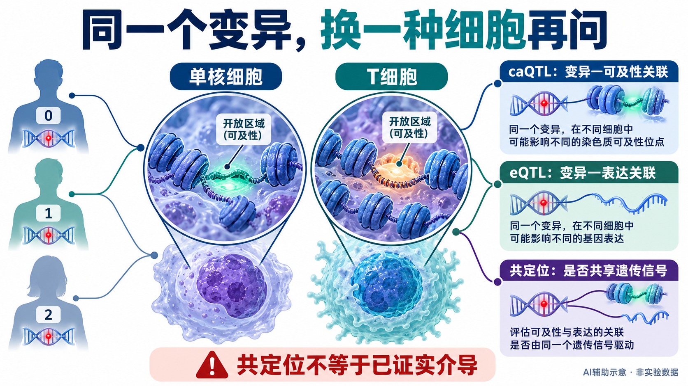
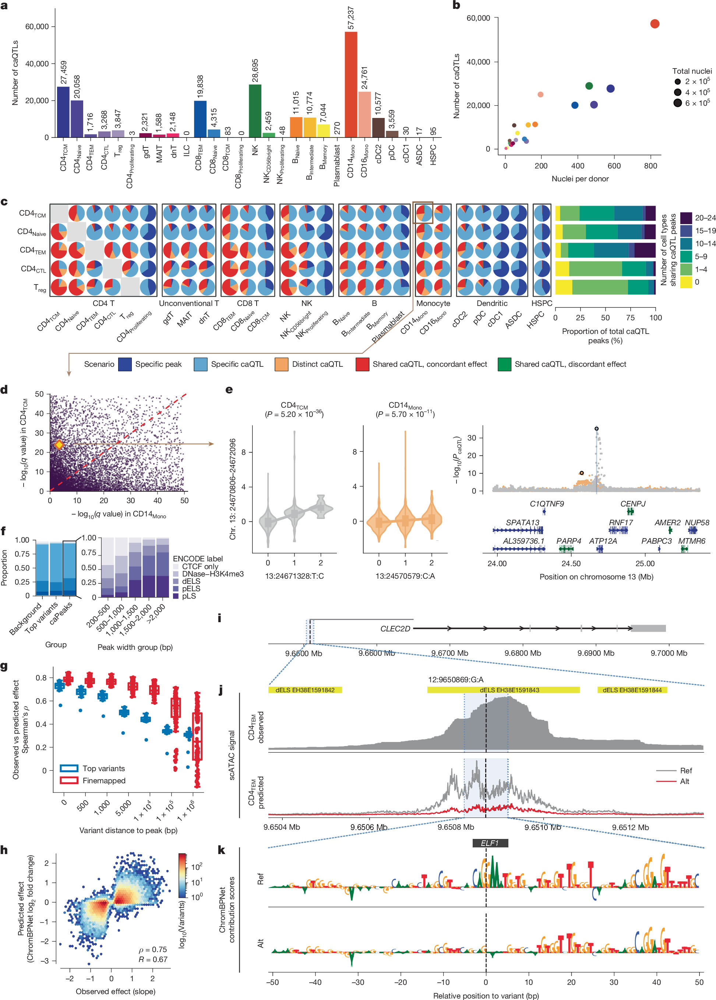
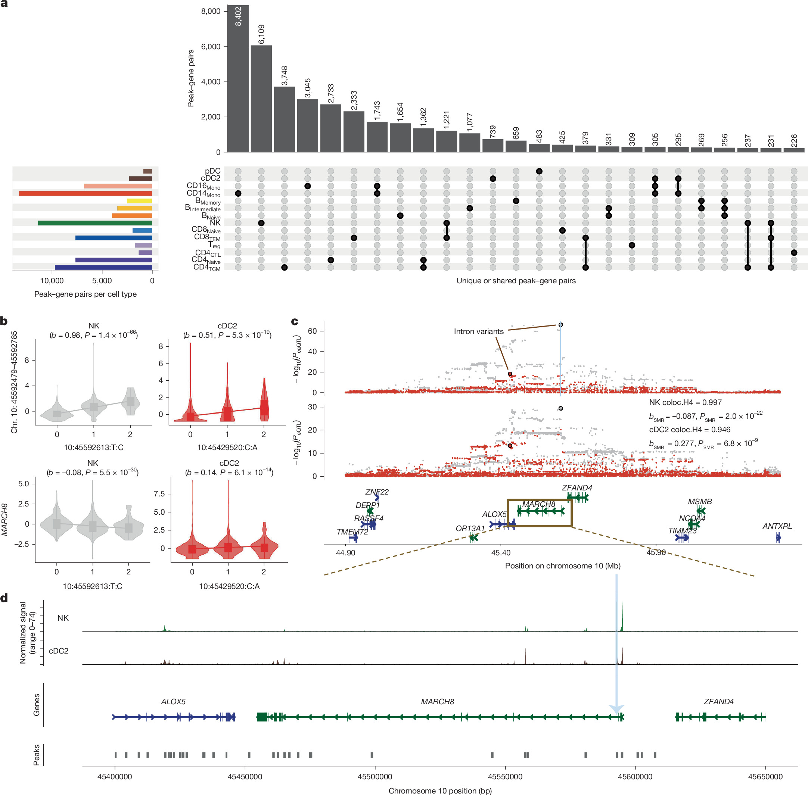
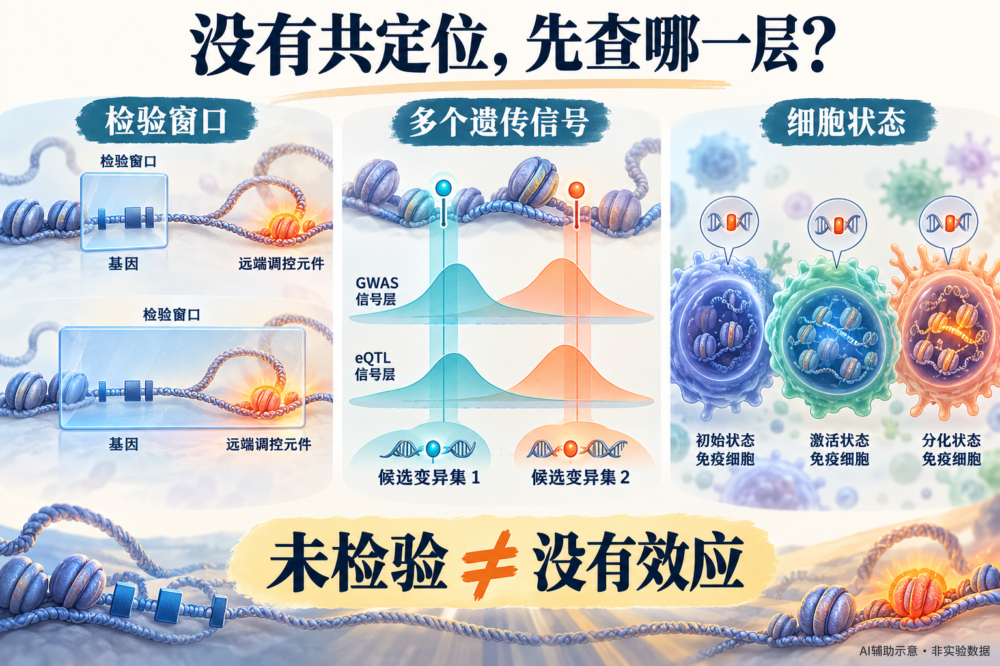
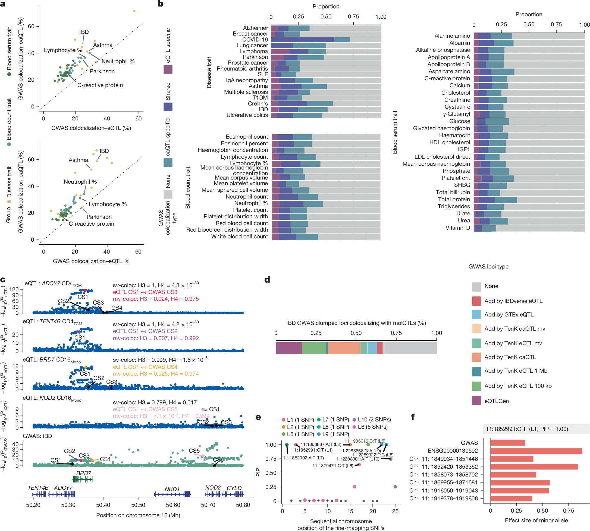
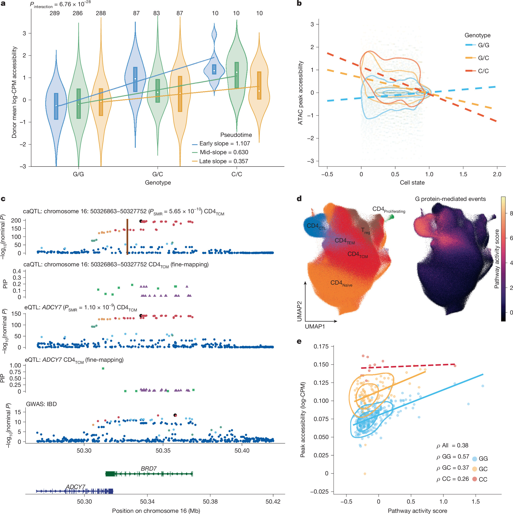
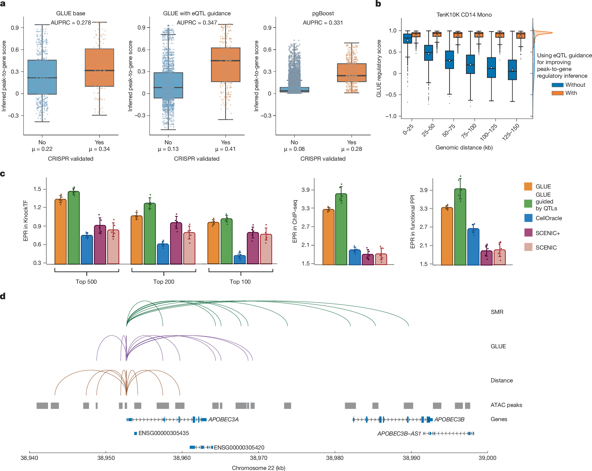

# 表达量之外，遗传调控还藏在哪

::: {.book-source}
论文：[DOI 10.1038/s41586-026-11173-4](https://doi.org/10.1038/s41586-026-11173-4)。原有图注和许可说明见正文；未明确许可的图版标记为**授权待确认**。
:::

> Xue等《Genetic variants shape single-cell chromatin accessibility and disease risk》，Nature，2026年10月28日正式上线，[DOI](https://doi.org/10.1038/s41586-026-11173-4)。官方PDF仍有日期占位符，日期依据出版社文章页。本页完整合并已保存且回读核验的四篇公众号草稿；不代表已发布或经用户实质审定。与已归档的[TenK10K表达遗传学研究](cell-specific-variants.qmd)为不同DOI、不同组学问题，不重复计作同一论文。

*AI辅助原创示意，非实验数据。封面和四张hero实际使用当前内置图像生成工具，底层型号未核实；原图Fig.1–5完整原样分享，CC BY-NC-ND 4.0，限当前非商业科普用途，未改数据或图例。BioRender署名的Extended Data Fig.1未使用；正文核心实验证据图均保留。未上传论文PDF或受控个体数据。*

## 供体、可及性与峰—基因联系

一个免疫疾病风险位点已经在GWAS中反复出现，你拿它去查单细胞eQTL，却找不到可靠的表达关联。下一步应该增加RNA测序深度，换一种细胞，还是考虑测量染色质？这个选择不能只靠“多组学信息更多”来回答。我们需要分清：原来的分析究竟没有检验到合适的区域、没有覆盖合适的细胞状态，还是调控确实没有表现为当前条件下的稳态RNA变化。

Xue等人在2026年10月28日发表于Nature的研究，为这个问题补上了大规模单细胞染色质可及性这一层。它来自TenK10K项目，但本篇关注的不是项目中RNA表达的遗传调控目录，而是另一个问题：在什么细胞里、哪些开放染色质区域与遗传变异关联，这些信号又能否帮助把调控区域接到基因上。读完这一篇，你应该能分辨“找到caQTL”“发现峰—基因联系”和“证明该峰调控该基因”之间还隔着哪些证据。

### 先确定我们测到的是什么

scATAC-seq测量的是染色质上可被转座酶接近的片段。一个区域形成ATAC峰，说明这里在一批细胞中相对可及；它不自动等于增强子，更不自动告诉我们它调控哪一个基因。开放区域可能位于启动子、远端增强子样元件、CTCF相关区域，也可能受到峰识别策略的影响。

caQTL把一个问题变成跨供体比较：在某一细胞类型内，不同基因型供体的某个峰是否存在系统性的可及性差异？eQTL问的则是同类比较中某个基因的RNA表达是否不同。两者共有“遗传差异作为解释变量”，但测量终点不同。RNA是转录与降解等过程共同形成的结果，ATAC是染色质可及性的读数；前者没有显著关联，并不能直接推出后者也没有。

这里还要避免一个单细胞分析中很常见的误会：几百万个细胞不等于几百万个独立基因型样本。这项研究常见变异caQTL的主要分析，先把同一供体、同一细胞类型的峰计数汇总成pseudobulk，再做跨供体关联。细胞帮助估计供体内的细胞类型特异信号；提供遗传比较独立性的核心层级仍然是供体。用“350万个样本证明一个变异”来介绍这项工作，会把细胞数量和独立样本量混为一谈。

### 从上千名供体到可分析的染色质矩阵

项目采集了1,042名参与者的相关数据；主发现队列经过细胞质量控制、供体识别和全基因组测序匹配后，保留922名供体、3,472,552个高质量scATAC细胞核。另外的multiome数据用于注释桥接和复制等分析。922不是全文所有分析唯一的分母，1,042也不是每个关联模型都使用的供体数。查看具体结果时应跟着该分析的纳入流程走。

研究建立了28种免疫细胞类型的注释框架，但常见变异关联分析排除了供体数不足的两种极稀有细胞类型；方法部分说明，实际可检验的类型有26种。每类细胞可用供体数又不完全相同。这个区别看似只是报数，却决定了我们能不能把某类细胞的“零发现”理解成生物学上的“没有遗传调控”。

作者分别在细胞类型内识别峰，再合并为440,996个区域。常见变异分析检验峰中心附近±1 Mb内的变异，模型纳入年龄、性别及遗传与可及性主成分等协变量，使用置换及峰层面的多重检验控制。这意味着每个显著结果都依赖一套明确的峰定义、窗口和统计流程，而不是一张与分析设置无关的永恒调控地图。

这个流程也给做实验设计的人一个实用提醒。对于稀有细胞，增加总捕获细胞数未必足够：关键是每名供体能分到多少该类型细胞，以及有多少供体仍可纳入比较。细胞类型划分得越细，生物学解释可能越清楚，但每一类的可用计数也越稀疏。论文采用的分辨率，是注释可信度和关联功效之间的折中，不是所有研究都应照抄的固定层级。

### 原图1：先看功效，再谈特异性

图1来源：Xue等，Nature，2026，Fig. 1，DOI:10.1038/s41586-026-11173-4。依CC BY-NC-ND 4.0用于非商业科普，完整原图原样展示；未改动数据、坐标、图例或颜色。原图信息密集，阅读时请点开大图，下面按panel引导。

图1a的横轴是细胞类型，纵轴是显著caQTL数目，不同颜色帮助区分细胞谱系。CD14单核细胞的发现量很高，但这并不是它“比其他细胞重要”的证据。紧接着看1b：横轴为每名供体的细胞核数，纵轴仍为caQTL发现量，点大小表示该类型总细胞核数量。发现量与每供体细胞数明显相关。它首先提醒我们，检验能力会参与塑造这张图。

作者报告243,225个caQTL，对应100,483个至少存在一个关联的独特峰。不要把前者直接读成243,225个彼此独立、已经验证的增强子：同一个峰可以在不止一种细胞里贡献关联，峰与变异的关联也不等于功能元件已经经过扰动实验验证。

图1c进一步把跨细胞类型的比较拆成五种情况。深蓝对应另一个细胞类型中峰本身不够可及；浅蓝对应峰可测、却没找到显著caQTL；橙色对应同一峰由不同的低连锁变异标记；红色与绿色则分别表示共享信号且等位基因效应方向一致或相反。右侧条形展示峰的效应由多少类型共享。

这五种情况比笼统说“细胞类型特异”更有用。峰本身未开放、峰开放但检验不显著、两个类型存在不同的关联信号，是三个不同问题。尤其第二种情况，不能仅凭一个显著、另一个不显著，就认定两者效应存在显著差异。较少的细胞核、更少供体或更稀疏计数都可能造成这种表面特异性。

1d比较两个细胞类型中同一峰的关联显著性，横纵轴都是负对数转换后的q值。离开对角线的点表示统计支持强度不一致，但它不是效应差异检验。1e把一个例子展开：左边按基因型剂量0、1、2分组，纵轴是标准化可及性，小提琴呈现供体分布，箱体标中位数和四分位范围；右边把关联显著性放回染色体位置。观察重点是两个细胞类型的领先变异不同，条件分析和精细定位又能揭示共享与额外信号并存。不能只凭“两个lead SNP不一样”，就把整个区域宣布为完全不同的调控机制。

1f比较峰、关联变异及背景区域的功能注释比例，也按峰宽度分层。这里的柱高是注释组成，不是某个峰的调控强度。远端增强子样注释富集使生物学解释更合理，但ENCODE注释仍是支持证据，不能替代在本研究细胞状态下的功能检验。

### 预测模型为变异排序，不替代扰动

图1g、h把ChromBPNet的序列模型预测与观察到的遗传关联效应作比较。1g横轴按变异到峰的距离分组，纵轴是观察与预测效应的相关系数；蓝色为领先变异，红色为精细定位后的变异，每个点对应一个细胞类型。1h则把变异级观察斜率与预测log2变化直接对照，颜色表示点密度。图中相关性支持模型能够捕捉部分序列相关的可及性变化，但相关系数不是“准确预测了多少疾病变异”。

为什么精细定位可能比只拿lead SNP更合适？关联最强的标记未必就是起作用的碱基，它可能只是与真实功能变异处于连锁不平衡。序列模型只看到送进去的序列，替换一个“跟随标记”而不是功能碱基，自然可能与观察到的区域关联效应不一致。作者看到的距离分层差异，与这一解释相容；但单个变异仍需要独立功能证据。

1i–k展示CLEC2D附近一个罕见变异的具体例子：1i给基因组位置，1j并列观察到的ATAC信号及模型预测的参考/替代等位基因信号，1k显示模型对序列位置的贡献及ELF1 motif解释。图中的“Predicted”必须保留在理解中：预测的替代等位基因峰形不是在同一细胞上完成基因编辑后测到的结果，序列贡献图也不是ELF1真实占位的直接实验。

本轮核验还发现，文章结果段与方法段对条件分析后稀有变异关联数量采用了不同数值，而方法明确使用集合检验。我们没有独立运行原始数据去解开这一统计口径，因此不把该总数作为本篇结论，也不把集合关联转换成已证实的单变异机制。更稳妥的收益，是学会把“群体关联—序列预测—候选motif”放在不同证据层，而不是把三者连起来就宣布因果链闭合。

### 原图2：开放的峰应该连到哪个基因

仅有caQTL仍然没有回答靶基因问题。离峰最近的基因很容易成为默认候选，但调控元件可以跨越相当距离；相邻也不意味着调控。作者把caQTL与单细胞eQTL的区域关联模式作共定位，询问：可及性和表达是否可能共享同一个遗传信号。

图2来源同上，Fig. 2，完整原样转载，许可CC BY-NC-ND 4.0；未裁切、重排或改写原图。图1和图2均为原论文证据图，不是生成图。

图2a是一个集合交集图。左侧横条表示各细胞类型具有共定位支持的峰—基因对数；上方柱子对应下方黑点连接的细胞类型组合，表示某一组类型独有或共享的联系。它不是表达量热图，黑点多少也不等于某个基因效应多强。论文以PPH4>0.8作为共享遗传信号的支持阈值，识别出一批候选峰—基因联系。这个阈值是统计模型下的后验判据，不是实验验证率。

MARCH8的例子把一个常被简化的事实讲得很清楚：可及性增加并不必然与表达增加同向。图2b上排比较一个区域的可及性，下排比较MARCH8表达；横轴都是对应领先变异的基因型剂量。灰色为NK细胞、红色为cDC2。两类细胞中可及性均随所示剂量增加，但表达方向不同。图2c比较两种细胞的caQTL区域关联曲线，并标出峰—基因共定位与SMR支持、领先变异及基因位置；2d再展示更细的基因组轨道和峰所在位置。横轴是基因组坐标，轨道高度与显著性曲线不是同一个量，不应混读。

作者进一步做SMR，把遗传信息作为工具，估计可及性与表达的关系；MARCH8例子的估计方向在两个细胞类型中相反。这提示同一候选区域可能处在不同调控背景中。但这里至少有三道边界。第一，连锁的不同功能变异仍可能制造看似相连的关联；第二，共享变异可能分别影响两个表型，而不是通过可及性这一中介传递；第三，工具变量假设和细胞状态覆盖不可能仅由一个显著P值保证。

因此，SMR、HEIDI与coloc应该作为互相校验的证据组合，而不是三张可以互换的“因果证书”。主文中甚至有SMR显著、但coloc更支持独立因果变异的例子集合，说明只取SMR显著名单会混入不同解释。一个严谨的靶基因优先级，应记录共享信号支持、异质性提示、效应方向、细胞背景，以及哪些信息尚未经过扰动确认。

### 把这篇论文变成自己的分析习惯

如果你正在分析一个疾病位点，可以先做一张小型证据表：变异/可信集合、可及性峰、候选基因、细胞类型、检验窗口、共定位模型、SMR与异质性结果、是否有独立扰动。不要只存一个“靶基因”字段。这样，当另一个组织、另一种细胞状态或更大队列出现不一致时，你能找到具体分歧，而不必推翻一整条模糊的故事线。

这项研究最可迁移的价值，是把RNA以外的调控层纳入遗传解释，同时保留不同层之间的边界。找到caQTL，意味着有一条细胞背景下的遗传关联；找到共定位支持，意味着可以进一步优先考虑某个峰—基因联系；要证明该区域确实介导疾病风险，还需要更贴近机制的实验设计。这三句话可以同时成立。

阅读与核验范围：本篇依据完整主文、方法、扩展图图注和可合法取得的补充说明；主图1、2已实际目视核对。文中数字是作者报告，不是我们复现的结果；没有运行队列分析。对版本间或段落间尚未明确的统计口径采用限定，不据此作强结论。独立分析不构成原文逐段翻译。

原文：https://www.nature.com/articles/s41586-026-11173-4

公开分析代码：https://github.com/powellgenomicslab/tenk10k_phase1_multiome

公开汇总结果：https://huggingface.co/datasets/anglixue/TenK10K_multiome

原图许可：https://creativecommons.org/licenses/by-nc-nd/4.0/

## 从GWAS位点到分子证据：共定位的分母与边界

### 一个疾病位点，为什么总是接不上表达量？

你已经拿到一组可信的 GWAS 位点，又找来与疾病有关的细胞类型 eQTL。按直觉，如果风险变异通过调节基因表达起作用，二者应该能接起来。实际分析却经常停在一句话：没有发现共定位。

这句话至少可能对应三种完全不同的情况：真正不存在共享的调控信号；存在，但当前实验没有测到正确的细胞环境；存在，模型却把它拆错了。把它们都写成“该位点不通过表达调控起作用”，会在研究刚开始时就过早关掉一条路径。

TenK10K 的染色质研究提供了一套有用的排查顺序。作者把 PBMC 的染色质可及性 QTL、表达量 QTL 和疾病关联放在一起，追问：为什么某些 GWAS 信号能接到染色质，却接不到 RNA？这里最值得借鉴的，不是把 caQTL 当成 eQTL 的替代品，而是把“没有接上”拆成可以逐项检查的分析问题。

本文围绕主图 3 和主图 4 展开。原始研究是 2026 年 10 月 28 日上线的 Nature Article，DOI：10.1038/s41586-026-11173-4。下文数值与结果均归于作者；我们没有重新运行其大规模关联分析，提出的排查流程属于基于论文证据的分析建议。

### 共定位究竟在回答什么？

先把三个问题分开：变异是否与染色质开放程度相关，是否与表达量相关，以及这两组相关性是否可能由同一个遗传信号驱动。

一个区域里往往有许多相互连锁的变异。GWAS 最显著的 SNP 和 eQTL 最显著的 SNP 即使相邻，也不保证它们指向同一个作用来源。反过来，两者的最显著 SNP 不相同，也不能直接判定作用来源不同。抽样误差、连锁不平衡和多个信号叠加，都可能改变“第一名”。

共定位利用的是一整段区域的关联图样，而非只比较两个 lead SNP 的坐标。论文使用的常规 coloc 区分五类模型：两种表型都没有关联、只有第一种有关联、只有第二种有关联、两者有关联但由不同变异解释，以及两者由共享变异解释。最后一类的后验概率称为 PPH4；作者把 PPH4 大于 0.8 作为较强共定位支持。

PPH4 不是显著性检验的 P 值，也不是某个基因已经被证明是疾病靶点的概率。它是在所用区域、候选变异、先验及模型假设下，对“共享遗传信号”这一解释的支持。特别是，染色质与表达共定位并不自动决定因果方向。可能是开放程度影响表达，也可能二者同时受某个上游过程影响。若还要主张“变异先改变这个增强子，再改变基因，最后改变疾病风险”，仍需比共定位更完整的证据。

这一点决定了我们怎么看主图 3：作者展示的是更多 GWAS 位点找到了分子层面的关联线索，而不是这些位点的全部致病机制已经被实验验证。

**怎样读主图 3？** a 的每个点对应一种疾病或血液性状，横轴是与 eQTL 共定位的 GWAS 位点比例，纵轴是与 caQTL 共定位的比例；上图采用 coloc，下图采用 SMR。虚线表示二者比例相等。b 把每个性状的位点分成仅有 eQTL 支持、仅有 caQTL 支持、两者都有、两者都没有四类；灰色仍然存在，提醒我们增加一个组学层并没有消除所有未知。这里的分母是经作者筛选和归并的 GWAS 位点，不是患者人数、所有人类变异或疾病遗传力。

作者先按 GWAS 显著性和连锁不平衡归并独立位点，再考察每个位点是否至少有一个基因或峰达到指定的共定位条件，并汇总不同细胞类型。因而，多检测到一些分子特征、增加细胞类型覆盖或改变候选范围，都可能改变这一比例。不能把“可解释位点更多”直接换算成预测疾病风险更准。

### 排查一：不是没有作用，而是目标根本没进检验窗口

常见的表达调控分析会为每个基因划定一个 cis 区域。这能控制计算量，但也划出了“什么根本没有机会被发现”的边界。

论文用 IBD 的 ETS2 区域说明这一问题。一个疾病相关变异位于 ETS2 下游约 269 kb 的基因荒漠增强子区域。如果表达 QTL 只检查较窄的 ±100 kb 范围，这个远端位置就可能不在相应的候选检验中。与此同时，变异本身位于一个染色质峰附近，因此更容易进入以峰为中心的 caQTL 分析。表面上看，是“染色质有、表达没有”；实际上，二者一开始就没有得到同样的检验机会。

作者扩大表达 QTL 的窗口后，在这个位点恢复了很强的共定位支持。这不是证明远端调控总能通过加大窗口解决，而是提醒我们：比较两种组学的发现能力之前，应先检查两者是否真正比较了同一批候选变异。

扩大窗口也不是免费午餐。它带来更多检验、更复杂的连锁结构，以及更多可能被误连到邻近基因的信号。尤其当参考基因组版本、基因坐标、峰中心定义和等位基因编码不一致时，扩大区域只会把不一致扩得更大。

一个实用检查是：对每个“caQTL 特有”位点，先问对应 SNP 是否进入了 eQTL 的原始检验，而不是只问显著结果表里有没有它。若原始结果根本没有覆盖该位置，应标记为“未检验”，不能当作阴性证据。这一步不需要引入新的生物学故事，却可能避免许多不必要的机制推测。

本研究也没有把所有差异都归于窗口。作者在更宽表达窗口下仍观察到 caQTL 的额外共定位贡献。因此，窗口问题应当先排除，但排除之后还有下一层。

### 排查二：一个区域不一定只有一个作用来源

传统 coloc 的重要简化是：在所分析区域内，每种表型由一个主要因果变异解释。这个假设在信号较单纯时很有帮助；当一个区域包含多个独立信号时，它可能过于简化。

想象一个区域里有两个作用来源，A 更明显地影响表达，B 更明显地影响疾病风险。只比较各自最强的整体图样，容易得到“不同来源”的结论。但疾病数据里也可能存在较弱的 A 信号，或者表达数据里还存在 B 的次级信号。此时需要先把多条信号拆开，再检查是否有其中一对可以匹配。

主图 3c 展示的 ADCY7 周边区域正适合说明这种思路。图的横轴是染色体位置，纵轴是不同表型的关联强度；不同颜色标记在多信号分析中相互匹配的可信集合。作者使用 SuSiE 分解候选信号，再对不同可信集合进行共定位，识别出常规单信号分析未能支持的细胞类型相关联系。

注意“可信集合”不是“集合内所有 SNP 都有作用”。它表达的是在模型和数据条件下，对作用来源位置的不确定性；集合内变异往往因连锁不平衡而难以区分。进一步精细定位可以缩小范围，但仍然不能把统计优先级当作完成了编辑验证。

主图 3e、f 把染色质、表达和 IBD 风险放入联合精细定位框架。e 的纵轴是后验纳入概率，横轴特意使用 SNP 的顺序而非真实物理距离；不能按点间空隙推断基因组间隔。f 比较某个优先变异在不同分子表型及疾病上的估计效应，支持同一遗传信号可能同时关联多个层面。即便模型把一个 SNP 的概率推得很高，也应写“模型优先支持的候选变异”，而不是“已经证实唯一致病碱基”。

对自己的数据，稳妥顺序是先检查局部是否存在多信号、连锁参考是否匹配，再选择合适的共定位模型。不能因为单信号模型没有得到 H4 支持，就直接宣告该区域没有共享遗传来源；也不能在看到多信号模型更容易阳性后，无条件把它当作更正确的答案。

### 16% 到 65%，究竟增加了什么？

主图 3d 很容易被写成一句夸大的标题：“染色质解释了 65% 的疾病风险。”这不是这张图测量的东西。

这张堆叠条形图讨论的是 **IBD 的 GWAS 位点中，有多少获得了分子 QTL 共定位证据**。起点约 16%，在逐步加入单细胞表达、染色质、较宽窗口、多因果变异模型，以及其他组织或疾病相关表达 QTL 资源后，累计达到约 65%。图例还明确包含 GTEx 和 IBDverse eQTL 的增量；因此，不能把全部提升归功于 caQTL 一个数据层。

它不是解释方差比例，不是患者诊断准确率，也不是“65% 的病因已经找到”。结论的适用范围是这一疾病、这组数据和这些分析设置。论文还比较了其他疾病与血液性状，但不能把 IBD 的累计数值平移给所有疾病。

这张图真正给研究设计的启发是：寻找机制的效率，取决于覆盖了哪些组织和细胞、纳入了哪些分子层面，以及模型允许什么样的信号结构。某个阴性结果有时反映的是观察范围不足，而不一定是生物学不存在。

同样需要保留另一面：加入越来越多数据后，总会有更多机会出现支持性结果。研究者仍需检查新增证据是否独立、是否共享同一批个体和参考数据、是否经过一致的多重检验控制。累积证据不等于简单累积“阳性票数”。

### 排查三：把细胞放在同一类，还可能平均掉状态依赖效应

细胞类型之外还有细胞状态。同属 CD4 T 细胞，并不意味着每个细胞处于相同的调控环境。如果一个遗传效应在某种状态下增强、在另一种状态下减弱，简单汇总可能低估其存在。

作者为 CD4 细胞推断拟时间，并在部分供体的单细胞数据中检验基因型与状态的交互。这里要明确三层单位：细胞提供状态差异，供体提供遗传差异，统计模型还需要处理同一供体细胞之间的相关性。不能把数十万个细胞当作数十万个独立的人。

**怎样读主图 4？** a 的横轴是基因型，纵轴是供体层面的平均染色质可及性；不同颜色对应早、中、晚拟时间分组，图上方数字是各组供体数。三条斜率不同，是“遗传效应随状态变化”的直观表现。C/C 组只有约 10 位供体，阅读其形状和趋势时应记住这个样本量，而不是仅被很小的交互 P 值说服。

b 从另一方向展示同一问题：横轴是细胞状态，纵轴是峰可及性，按基因型分组的趋势并不平行。c 结合局部 QTL、精细定位及 IBD 关联轨迹，说明这个状态依赖现象处在一个具有疾病关联线索的区域。它增加了机制解释的具体性，但没有直接观察患者发病过程。

d 的 UMAP 和通路分数提供状态背景，e 则在 pseudobulk 层面显示峰可及性与推断通路活动分数的关系。这里的 G 蛋白相关通路活动来自表达数据和模型推断，不是直接测定的 cAMP 浓度、蛋白活性或受体信号强度。相关系数在基因型之间不同，不能独立证明某条通路驱动了该峰开放。

拟时间也不是时钟。它是从横截面数据重建的相对状态排序，不意味着研究者追踪了同一人的细胞从早期走到晚期。因而，“沿拟时间出现遗传效应差异”不能改写成“该变异在患者病程后期失去作用”。本研究主要基于静息外周血细胞，对组织微环境、炎症刺激和实际病程的外推都需要额外验证。

还要避免一个容易混淆的说法：论文总体报告了部分状态交互在主效应分析中没有被检测到，但不能据此断言主图 4 的 ADCY7 示例“完全没有主效应”。该图自身显示了很强的局部 caQTL 关联。更稳妥的解读是，这个例子展示了平均遗传效应之外的状态依赖性。

### 把这篇论文变成一张排查清单

面对一个没有与 eQTL 接上的疾病位点，可以按以下顺序推进。

**先确认是不是同一场比较。** 统一基因组版本、变异编码和细胞类型；检查候选 SNP 是否真的进入了表达分析，区分“未检验”“功效不足”和“得到反对共享信号的证据”。

**再检查局部模型。** 看 lead SNP 之外是否还有独立信号，比较单信号与多信号共定位结论，并记录连锁参考、可信集合和不确定性。不要只保留一个最终的“共定位/不共定位”标签。

**然后补充正确的环境。** 染色质、细胞状态和相关组织可以提供新的线索，但新增数据必须回答明确问题。不要看到 RNA 阴性，就自动讲成增强子预激活或转录后缓冲；这些在本研究中也仍有未经直接检验的机制成分。

**最后让实验针对最窄的假说。** 如果要证明一条“变异—元件—基因—疾病相关表型”的路径，需要安排相应的扰动与对照。改变候选碱基、干预元件、检测目标基因及表型，并考虑救援实验，分别对应不同的因果环节。这里是我们的研究设计建议，不是作者已经完成的实验。

最值得带走的判断是：eQTL 没有接上 GWAS，既不是机制分析的终点，也不是随意补充故事的许可。先检查比较范围，再检查模型，再检查细胞环境，才能知道下一份数据究竟应该补在哪里。

#### 来源与阅读范围

原文：Xue A. 等，*Genetic variants shape single-cell chromatin accessibility and disease risk*，Nature，2026-10-28，https://doi.org/10.1038/s41586-026-11173-4 。本稿依据完整主文、Methods 及原文主图 3–4；未独立重跑作者分析。研究关联数据不能替代干预验证。

图 3、图 4 来源为上述论文，© The Author(s) 2026，CC BY-NC-ND 4.0，https://creativecommons.org/licenses/by-nc-nd/4.0/ 。用于非商业科普的原图原样分享，正文中的中文解读独立撰写；不更改实验内容、轴、图例或标签。保留完整图与来源；原图较密，请点开大图按正文所指panel阅读。

## 峰—基因网络与实验验证：预测之外还缺什么

### 一张峰—基因网络，怎样才不只是“连得很漂亮”？

做完单细胞 RNA 与 ATAC 整合，最容易得到的结果之一，是一张有许多弧线的基因组轨迹图：一个开放峰连到一个基因，多个峰再连成一组调控关系。图很直观，但如果下一步要挑选增强子做 CRISPR，真正的问题是：哪条线值得花实验资源验证？

距离近、在细胞间一起变化、受到同一遗传信号影响，都可以支持一个峰与基因有关，却不是同一种证据。把这些证据混成一个“调控分数”，容易让漂亮的网络比实际证据走得更远。

TenK10K 的染色质研究在主图 5 讨论的，正是如何让遗传信息帮助峰—基因和转录因子网络推断。它没有提出“只要加入 QTL，网络就成为因果网络”。更值得学习的是：利用人群遗传变化补充细胞状态共变，再用不同来源的验证材料检查推断是否更有用。

本文依据 Xue 等于 2026 年 10 月 28 日上线的 Nature 原创研究，DOI：10.1038/s41586-026-11173-4。我们通读了相关主文和 Methods，并核查作者官方代码仓库 README 及 GLUE 官方调控推断文档；没有运行其软件、重新训练模型或复现作者 benchmark。

### 三种连线依据，各自回答什么？

**基因组距离提供候选范围。** 峰距离某个基因的转录起始位点很近，值得优先考虑；但近不等于调控，远也不等于无关。一个增强子可能绕过最近的基因，作用于更远的目标。因此，距离更适合承担“先搜索哪些连接”的角色，而不是直接给出真实靶基因。

**细胞间共变提供功能线索。** 如果某个峰在一组细胞里更开放，相应基因也表达更高，它们可能存在联系。但它们也可能共同反映细胞类型、激活状态、测序深度或其他上游因素。两者一起变化，并不能区分“峰推动基因”与“同一调控程序同时改变二者”。

**遗传关联提供另一种观察角度。** 若不同供体的基因型变化同时关联峰可及性与基因表达，且局部信号支持共定位，这对连接的解释就多了一层约束。它不再仅依赖细胞之间的状态差异，而引入了供体之间的遗传差异。不过，同一个变异影响两个表型仍不等于一个表型介导了另一个；连锁、多效性和细胞环境都需要考虑。

三种依据不是互相替代的投票。更合理的组织方式，是让距离限定搜索空间，让细胞数据提供共变结构，让遗传证据提高某些候选关系的可信度，最后再由独立实验检查重要连接。

### GLUE 的指导图，为什么会影响最后的调控分数？

RNA 数据以基因为特征，ATAC 数据以峰为特征，两者不是同一套列名。整合模型不仅需要把细胞放入可比较的表示空间，还需要知道两套特征之间可能有什么联系。

本研究采用的 GLUE 框架可以接收一张“指导图”：节点是基因或峰，边表示已有知识支持的候选关系。作者先加入基于位置的连接，例如启动子附近一定范围内的峰，再把表达 QTL 相关的峰—基因线索加入图中。模型学习时，这些边为不同模态的特征表示提供约束。

GLUE 官方文档说明，调控分数来自特征嵌入之间的余弦相似度。这里的“相似”是在模型学到的表示空间中计算的，不能直接读成一个峰调控某基因的概率，更不能把 0.9 写成“90% 已验证”。官方调控推断还需要限制候选搜索图，并以相应的统计过程评估连接，而不是对所有可能的峰—基因组合无差别画线。

这也带来一个重要解释边界：如果某条遗传关系已经作为先验加入训练，训练后它的分数升高，并不能单独证明模型发现了新生物学。它可能表明模型成功利用了我们给它的信息。要证明加入先验确实改善了推断，必须看那些不只是重复先验本身的验证证据。

论文中，作者先在细胞类型内整合 RNA 和 ATAC，再对候选峰—基因关系评分；在此基础上进一步结合 caQTL—eQTL 的 SMR 结果，扩充后续转录因子网络推断的输入。峰—基因连接与转录因子—靶基因连接是两个层级，不能省略中间步骤，直接把开放峰附近的 motif 写成已经确认的转录因子调控作用。

### 主图 5a：先看验证集合，再看分数高低

主图 5a 把 GLUE、加入 eQTL 指导的 GLUE，以及 pgBoost 的峰—基因分数，按是否有 CRISPR 调控支持分成两组。横轴是验证分组，纵轴是各方法的推断分数；图上还标出 AUPRC，用于衡量排序对正例的识别情况。

理想的改进不是让所有分数都更高，而是让有外部支持的连接，与缺少该支持的连接更容易区分。假如正负两组分数同时上升而排序不变，实验候选的筛选未必会变得更好。

这张图也需要带着限制阅读。图注给出的候选数量在不同方法之间并不相同：原始 GLUE、有 eQTL 指导的 GLUE 和 pgBoost 纳入的 CRISPR 支持与不支持连接数都不同。因此，不能只截取三个 AUPRC 数字，就宣布得到一份适用于所有数据的性能排行榜。评价覆盖范围、正例比例和候选基因集合都会影响指标。

AUPRC 对正例比例尤其敏感。只有当评价目标、候选集合和验证标准足够一致时，它才更适合用来解释方法间差异。否则，一个方法覆盖更多困难的远端连接，可能面对与另一个方法不同的任务。

论文 Methods 还描述了基于验证连接富集、共同召回范围和基因层面 bootstrap 的比较框架。我们应把图中结果理解为作者在指定数据和验证集上的 benchmark，而不是脱离细节的“加遗传信息必然更准”。摘要中的 17.2% 也对应特定细胞类型、特定 CRISPR 对验证的区分提升，不能改写为通用准确率提高 17.2 个百分点。

“没有 CRISPR 支持”还需要进一步分清：是实验测试后没有检测到相应作用，还是根本没有测试？作者在相应 CRISPR 分析中限制到实验测试过的候选，这比把所有未收录连接都当阴性更合理。但即使测试过，一次阴性也可能受扰动效率、细胞状态、检测时间和统计功效影响；它仍然不是对所有环境都成立的绝对否定。

### 怎样防止模型把答案提前看见？

加入遗传先验时，最容易被忽略的风险是训练和评价之间的信息重复。

假设我们用一批 eQTL 关系指导模型，然后又用同一批 eQTL 关系证明模型更好。如果没有清楚划分用途，得到的结果更像是“模型记住并保留了输入知识”，而不是“模型能够预测未知连接”。这不意味着模型无用，却改变了 benchmark 能支持的结论。

本研究同时利用 GWAS、eQTL 和 CRISPR 等不同验证来源，提供了更丰富的检查角度。不过，对读者自己的项目，仍应逐项记录：哪些连接进入指导图，哪些只用于调参，哪些保留到最后评价；同一条边、同一区域或高度连锁的信号是否跨越了这些集合。我们没有对作者全部训练与验证文件做逐行泄漏审计，因此不把它写成“已排除所有信息泄漏”。

一种可迁移的研究方案，是在分析开始前冻结评价集合：比较距离基线、无 QTL 指导、匹配细胞类型 QTL 指导，以及适当的错误匹配或随机先验对照；尽可能在共同候选范围内评价，并另外报告各方法的覆盖范围。若需要调参，最终测试集合不参与选择参数。

还可以按基因组区域或基因划分保留集，减少相邻、共享结构的候选同时落入训练和测试。具体划分要与研究问题相容，不能把“随机留出几条边”自动当作完全独立验证。这些是我们的设计建议，不是本研究已经完成了全部这些对照的声明。

### 为什么远端连接和细胞类型匹配值得单独看？

主图 5b 按峰与基因的基因组距离分组，比较加入指导前后的 GLUE 分数。距离越远，可疑的目标基因通常越多，单纯最近基因规则也越难可靠。因此，额外的遗传线索可能对部分远端候选更有价值。

但请留意，这张图的纵轴仍然是模型分数。先验使远端连接分数升高，必须结合外部支持来判断是否真的提高了候选质量，不能仅凭橙色箱线图高于蓝色就宣称远端调控被证实。

细胞类型匹配则决定先验是否适用。论文报告，匹配 Treg 的 eQTL 指导对相应推断更有帮助，而更大规模但不匹配的 CD14 单核细胞先验并不能简单靠数量取胜。这个结果给小样本项目的启发很直接：挑选外部参考时，不应只比较参考的供体数或关联条目数，还应检查细胞类型、组织、刺激条件及表型定义。

如果参考来自静息血液，而目标是肿瘤组织中的激活细胞，把先验直接搬过去可能把真正的新连接压低，也可能强化在目标环境里并不成立的连接。较稳妥的做法，是分别保留“由目标数据支持”和“主要由外部先验支持”的边，并报告两类证据的重叠及冲突，而不是只交付一个无法追溯来源的总分。

本研究本身也限制了 GLUE 的候选范围和高变基因集合。未进入搜索空间的远端连接，不应该被解释为模型判定不存在。比较方法之前，先比较它们有机会回答哪些问题，往往比比较最后一个性能数字更重要。

### 主图 5c、d：从峰—基因走到网络，还缺哪一步？

主图 5c 比较的是转录因子—靶基因网络，不再只是峰—基因关系。作者使用转录因子敲除后的表达变化、ChIP-seq 和功能性蛋白互作等不同验证材料，计算 early precision ratio，简称 EPR。

EPR 关注排在前面的候选边，并把其正确边比例与随机预测的期望水平比较。它适合回答“如果我只验证前一批候选，排序是否有用”，却不代表完整网络每条边都可靠。不同验证材料的含义也不同：结合证据、扰动响应和蛋白互作不能自动互相替代。

图中的误差线来自五次独立计算运行，对应不同随机种子，而非五个独立生物队列。因此，它主要显示所用设置下的计算波动，不能当作跨人群或跨疾病的泛化置信区间。一个方法重复运行很稳定，仍可能稳定地继承同一种参考偏差。

主图 5d 的 APOBEC3A 区域把三种连线并排放在基因组轨迹上：距离规则、GLUE 推断，以及 SMR 证据。横轴是染色体位置，灰色块为 ATAC 峰，弧线表示各来源提出的峰—基因联系。这正是适合交给实验合作者的表达方式：看到的不只是最终网络，还有每条候选线来自哪里。

作者在 CD14 单核细胞网络中获得了额外的转录因子—靶基因候选，并提出了与已知药物靶点有关的研究线索。这里仍需保留“候选”二字。一个转录因子有获批抑制剂，并不意味着对它的干预就能在目标疾病中产生预期疗效；基因调控方向、细胞环境、剂量和安全性都尚需具体验证。

### 不重跑百万细胞，也能从哪里开始？

这项研究区分了两类资源。个体层面的原始测序和处理后的计数矩阵通过 EGA 提供，需要遵守相应访问程序；论文同时在公开数据平台提供峰注释、QTL 汇总、精细定位、共定位和网络链接等结果。公开代码不意味着所有原始人类数据都可任意直接下载。

对于已有一个候选基因或疾病位点的研究者，更可行的起点可能是公开汇总结果：检查该位置在相关细胞类型是否有峰、关联是否达到作者阈值、峰—基因关系由哪些证据支持，再回到原始方法确认窗口和过滤条件。这是一项定向证据查询，不能宣称完成了全流程复现。

如果要把方法迁移到自己的数据，先做小范围、可核验的分析：统一参考基因组和基因注释；固定候选连接与评价集合；记录有无先验及不同先验来源；挑选少量能形成互相区分假说的连接进行验证。计算硬件需求取决于数据规模和训练设置，本文没有实际运行，不给出虚构的显存需求、耗时或“一键复现”承诺。

最终交付也不应只是一张弧线图。更有用的是一张可追溯候选表：峰坐标、基因、细胞类型、距离、模型分数、QTL 与共定位支持、验证状态，以及未进入分析范围的原因。这样实验失败时，团队能够判断是候选机制不成立、环境不匹配，还是原来的证据本就不足，而不是只剩下“AI 预测错了”一句话。

这篇研究留给我们的实用结论是：遗传先验可以帮助网络推断，但价值要靠独立证据和清楚的比较设计确认。模型分数负责排序，来源记录负责解释，实验负责检验关键机制，三者不能互相代替。

#### 来源、许可与核验范围

原文及 Methods：https://doi.org/10.1038/s41586-026-11173-4 。作者代码与项目说明：https://github.com/powellgenomicslab/tenk10k_phase1_multiome 。GLUE 官方调控推断文档：https://scglue.readthedocs.io/en/latest/reginf.html 。公开汇总数据入口按原文：https://huggingface.co/datasets/anglixue/TenK10K_multiome 。个体数据入口按原文：EGA EGAS50000001653；WGS 为 EGAS50000001654。

阅读范围：完整研究主文与相关 Methods，主图 5 实际目视检查，官方仓库 README 与上述 GLUE 文档；未运行软件，未逐行审计全部训练和验证数据。本文提出的迁移方案是我们的建议，不冒充作者已完成实验。

图 5 来源为上述论文，© The Author(s) 2026，CC BY-NC-ND 4.0，https://creativecommons.org/licenses/by-nc-nd/4.0/ 。用于非商业科普的原图原样分享；不改实验数据、坐标、图例及标签。中文解释独立撰写，保留完整图与来源，阅读细节请点开大图。

## Take-home messages

一个疾病风险位点没有找到eQTL，不代表它没有调控功能；补上一层ATAC，也不代表因果链已经自动闭合。读完Xue等人的TenK10K染色质研究，最值得带走的不是一组更大的发现数量，而是一套能用于自己项目的判断顺序：测量有没有覆盖、比较是否公平、模型假设是否合适，以及下一步实验到底要排除哪一种解释。

这是独立的take-home messages。即使没有读前面三篇，你也可以用它检查自己的GWAS、单细胞多组学或峰—基因推断结果。原研究为2026年10月28日发表于Nature的正式原创研究，DOI:10.1038/s41586-026-11173-4。我们讨论的是该论文带来的方法启发，不是对所有组织、疾病和算法作普遍性能承诺。

### 1. 先问“有没有被检验”，再问“有没有效应”

一个基因在结果表中没有显著关联，至少可以有三种含义：区域根本不在检验窗口内；可用样本与计数不足以检测；已经充分检验但当前证据不支持。把三者都记成零，会让后续机制解释走偏。

本研究里，标注28种免疫细胞不等于28种都具有足够供体用于常见变异关联。某个峰在另一个类型中没有显著caQTL，也不等于两种细胞效应真的不同。你的结果表最好保留“未检验”“检验但低功效”“检验且不显著”等状态，而不只有一个P值阈值。

实际可以做的改动：每个候选记录窗口、可用供体数、每供体该类细胞数、峰可检测比例和过滤原因。它们比在图上多标几颗星号更有助于解释阴性。

### 2. 单细胞给分辨率，供体给遗传比较

常见变异caQTL主分析把细胞核按供体和细胞类型汇总；同一人的很多细胞并不是很多独立基因型样本。状态交互分析虽然直接使用单细胞数据，也需要模型处理供体内相关性。

设计自己的研究时，不应在“多测供体”与“每人多测细胞”之间凭总细胞数做决定。常见细胞可能已足够稳定估计可及性，此时增加供体更有价值；稀有类型则可能因为每名供体只有少数细胞而无法形成可靠信号。具体取舍应通过目标细胞的预期比例、效应大小和缺失情况评估，而不是照搬该论文的规模。

### 3. 峰、变异、基因是三个对象

一个开放峰不等于一个增强子，一个显著caQTL不等于一个功能碱基，一个距离最近的基因不等于靶基因。遗传关联、序列模型、共定位和扰动各自缩小候选范围，但回答的问题不同。

在笔记或分析表中，最好分别给峰坐标、变异及可信集合、候选基因建字段，再用明确证据连接。不要只留下“位点→基因”一条箭头，否则很难追溯这条联系究竟来自距离、表达相关、共享遗传信号，还是实验干预。

### 4. 共定位比重叠更严格，但不是介导证明

两个表型的显著区域重叠，可能只是连锁结构造成；coloc进一步比较是否支持共享遗传信号。可是即使共享，也可能是同一变异分别影响两个过程，而非通过一个过程传到另一个过程。SMR能补充方向与效应方面的统计支持，仍依赖工具变量和遗传结构假设。

因此，“支持某细胞中峰—基因联系”是合适的结果描述；“已经证明峰介导该疾病风险”通常需要更多证据。下一步实验应围绕可区分的假设设计，例如在相关细胞状态下编辑候选碱基或抑制候选元件，并同时测量可及性与靶基因响应。这里是我们提出的验证思路，不是本文已经完成的实验。

### 5. 同一个区域可能有不止一个遗传信号

如果一个表型有两个独立信号，另一个表型只共享其中一个，单因果变异假设可能把一个有用的共享关系掩盖掉。论文借助SuSiE与共定位组合，说明为什么不能仅比两个lead SNP是否相同。

但换成复杂模型不保证结果就更真实。需要对齐基因组版本、变异与效应等位基因，检查LD参考与研究人群是否匹配，并确认区域的关联强度和覆盖足以支持精细定位。统计模型输出的PIP是指定数据与假设下的后验量，不是每个高PIP碱基都已通过实验认证。

### 6. 拟时间是状态排序，不是病人的时间轴

ADCY7相关示例显示，基因型与可及性的关联会随推断细胞状态而改变。这个结果提醒我们，混合不同状态可能稀释效应。但它并不把横断面细胞变成真正随访到的同一个细胞，也不能直接推出患者疾病进展顺序。

通路活性评分同样是从数据中推断的表示，不等于直接测量某个代谢物或信号分子。把这些状态变量用于解释时，应该写清来源、模型和比较单位，并核查基因型组的供体数是否平衡。

### 7. 给网络加先验，需要更独立的验证

把QTL信息加入GLUE等方法，可以帮助区分距离相近但调控证据不同的峰—基因组合。然而，模型分数上升本身不能证明正确连接变多；如果验证资料与训练先验高度重叠，漂亮的分离也可能来自信息复用。

读benchmark时至少检查四件事：各方法是否在相同候选集合上比较；正负样本比例是否一致；未验证是否被当成阴性；误差条是生物重复还是不同随机种子的计算重复。本文图5a的方法候选集合并不完全一致，不能仅凭其AUPRC给方法排通用总榜。图5c的五次运行也不是五个独立病人队列。

### 8. 一个好资源，可以先用于候选排序

这项研究的原始个体数据通过受控访问提供，公开汇总结果和代码则可以支持方法理解和候选核验。不要为了“复现”默认把受控原始数据视为可直接下载，也不要把论文用到的数据清单当作当前环境已经具备的输入。

如果现在只有自己的GWAS结果，合理的第一步可以是：在可用公开汇总统计中查询相关区域，列出可能的细胞类型、峰与基因，把窗口和模型假设写清，再决定是否值得投入新的单细胞实验。能减少错误候选，也是资源的价值，不必每次都从头跑整个人群图谱。

### 最后留下一张证据清单

对一个准备深入的位点，建议保存以下内容：

- 研究人群、基因组版本、等位基因方向与LD来源。
- 细胞类型和状态定义，以及每类供体与细胞覆盖。
- 实际检验窗口、峰定义、缺失与过滤记录。
- 共定位采用单信号还是多信号模型，结论对选择是否敏感。
- caQTL、eQTL、SMR、序列预测和扰动分别提供了什么支持。
- 哪一条链路仍是推断，下一步什么观察能够推翻当前解释。

这里没有一项能单独完成因果证明。把它们分开记录，恰恰能让后续的综合判断更可靠。表达量之外确实还有重要调控信息，但最有用的“多组学整合”，是增加可以被检验的解释，而不是增加看上去完整的箭头。

阅读范围与边界：全文、方法、主图及可获得的补充说明已核查；这组文章为独立教学与批判性分析。未运行原始数据分析，没有把作者benchmark写成亲测结果。原研究中部分统计口径和段落表述仍有差异，本系列避免将未解明数字作为主要结论。原图在对应正文分篇完整展示，本篇为独立总结，hero仅为AI辅助示意、非实验数据。

原文：https://www.nature.com/articles/s41586-026-11173-4

代码：https://github.com/powellgenomicslab/tenk10k_phase1_multiome

汇总资源：https://huggingface.co/datasets/anglixue/TenK10K_multiome

共定位多信号方法原始论文：https://doi.org/10.1371/journal.pgen.1009440
