# 遗传变异，为何只在某些细胞起作用

::: {.book-source}
论文：[DOI 10.1038/s41586-026-10721-2](https://doi.org/10.1038/s41586-026-10721-2)。原有图注和许可说明见正文；未明确许可的图版标记为**授权待确认**。
:::

> 对 Cuomo 等《Rare and common genetic variants shape single-cell immune gene expression》的独立教学分析。Nature，2026年10月28日，DOI: [10.1038/s41586-026-10721-2](https://doi.org/10.1038/s41586-026-10721-2)。研究论文，正式发表版。

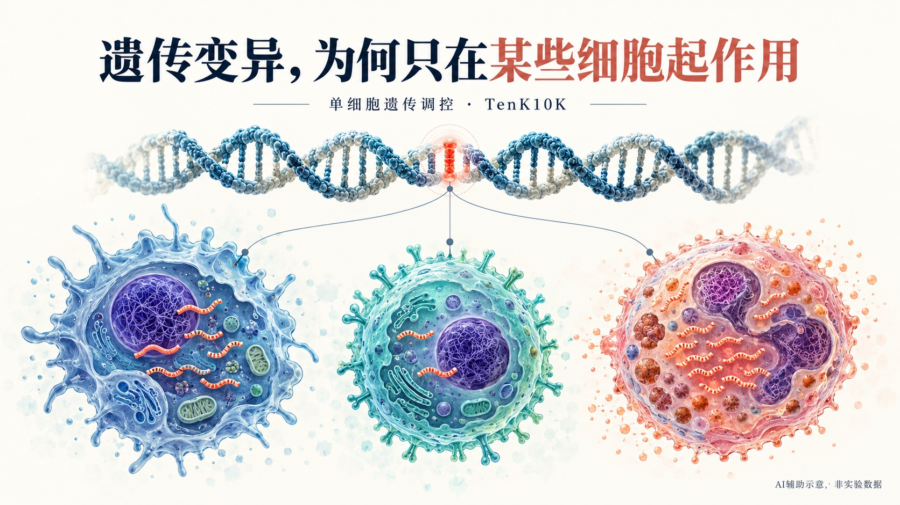

*AI辅助原创示意，非实验数据。封面与hero使用当前内置图像生成工具，不宣称无法核实的底层型号。*

## 供者、细胞与常见/罕见变异的检验单位
一个血液样本里，同一个人的单核细胞、T细胞和B细胞带着几乎相同的基因组，却执行不同任务。某个遗传变异让一个基因的表达升高，这个效应会在所有细胞中发生，还是只在某种细胞、某种状态下显现？如果我们先把血液里的RNA混在一起测量，细胞之间的区别就可能被平均掉。

2026年10月28日发表于Nature的《Rare and common genetic variants shape single-cell immune gene expression》，用TenK10K项目第一阶段的数据，系统研究这个问题。本文先拆解它的地基：样本究竟有多大，常见变异和罕见变异分别怎样检验，以及为什么“发现了表达关联”与“找到了致病机制”之间仍有距离。这里的价值不只是记住发现数量，而是学会判断自己的单细胞QTL分析需要什么证据。

*AI辅助原创示意，非实验数据。图中“供者—细胞”的层级说明统计单位；常见变异单点检验与罕见变异集合检验是不同问题，不可直接比较显著位点数量。*

### 五百多万个细胞，并不是五百多万个独立的人

质量控制后，研究纳入1,925名欧洲遗传祖源参与者的5,438,679个外周血单个核细胞，分为28种细胞类型。TenK10K是项目名称，不代表这篇文章已经分析一万人。研究中的基因型差异，主要来自这1,925名供者；同一供者的几千个细胞是重复观察，不是几千份独立基因组。

多测细胞仍然很重要。它能更准确地刻画某个人某种细胞的表达分布，也能捕获较稀少的细胞类型。但一个基因型组只有少数供者时，增加这些供者的细胞数，并不能变出更多独立的遗传背景。尤其研究罕见变异，真正携带某个变异的人可能很少。把所有细胞当独立重复，会让不确定性看起来过小。

两个队列还不是同一种人群。质控后，TOB贡献950人，BioHEART贡献975人。TOB来自眼科生物样本库，招募条件与BioHEART的心血管相关就诊人群不同。论文把队列、年龄、性别等放入统计模型，但“加入协变量”不等于消除了所有采样差异。这是一幅特定祖源、特定组织和处理条件下的免疫调控图谱，不是全人类所有组织的总地图。

还有一个容易被忽略的实验事实：TOB样本经历了额外冻融和较长保存。补充材料报告，两队列单核细胞比例存在明显差异，作者认为样本处理可能贡献了这种差别。由此得到的实用提醒是：做细胞组成分析之前，先问细胞比例是否受到保存、复苏、捕获和质控影响。漂亮的细胞分群，不能替代样本处理记录。

### 同时把“谁的细胞”和“什么细胞”分清楚

作者使用全基因组测序与单细胞RNA测序配对。全基因组测序平均覆盖度约30倍，可以看到SNP芯片未充分覆盖的罕见变异；RNA侧则经过供者拆分、双细胞识别、细胞质控和分层注释。细胞类型判定不是仅凭一张UMAP，而是结合参考图谱与分层分类方法，并用另一套较粗粒度的注释作对照。

这些步骤决定后续问题是否成立。供者分错，会把表达归到错误的基因型；双细胞混入，会制造不真实的细胞状态；类型划分过粗，会稀释局部效应；划分过细，又可能让每类的供者和细胞不足。类型越多并不自动意味着分辨率越可靠。

本研究也没有声称环境RNA已经被完美消除。补充说明讨论了CellBender在高通量捕获数据中的细胞数判断差异，仍用它估计环境RNA比例，但因估计稳定性问题，没有据此删除细胞。这种取舍值得保留：质控软件的默认输出与特定实验平台不完全匹配时，应解释决定，而不是把用了软件写成风险已消失。

### 常见变异：在重复细胞中检验一个遗传效应

对次要等位基因频率至少1%的常见变异，研究在基因附近进行顺式关联检验，主要窗口是基因体及两侧各100 kb。所谓顺式eQTL，就是附近基因型差异与该基因表达差异存在统计关联。它不保证附近那个变异就是实际发挥作用的碱基，也不意味着所有远距离调控都已被覆盖。

核心模型来自SAIGE-QTL：用适合计数数据的泊松混合模型分析单细胞表达，并处理同一供者内多个细胞的相关性。模型还调整年龄、性别、遗传主成分、表达主成分、队列、线粒体比例和测序计数等因素。直观上，它要区分“某种基因型通常伴随更高表达”与“这个人测得更多、这个批次偏高、这些细胞本来就相关”。

任何模型都有代价。泊松框架不是所有基因的完美分布模型；随机效应也不能修复所有批次与生物因素纠缠。补充材料明确讨论了少量基因—细胞类型组合的模型拟合失败，并排除了约0.27%的此类组合。作者尝试的另一种协变量处理设置（isCovariateOffset）虽减少失败，却出现检验膨胀，因此没有作为主分析。这比一句“使用先进模型”更值得读：模型是否适用，要看校准和失败模式，而不是名字。

作者先在基因内部整合检验，再控制跨基因的错误发现率。最终报告154,932个基因—细胞类型层面的常见变异关联，涉及17,674个不同基因。这里不能把154,932解释为同样多的独立致病变异；同一个基因可以在多种细胞中被重复计数，同一区域的变异也可能因连锁不平衡一起显著。

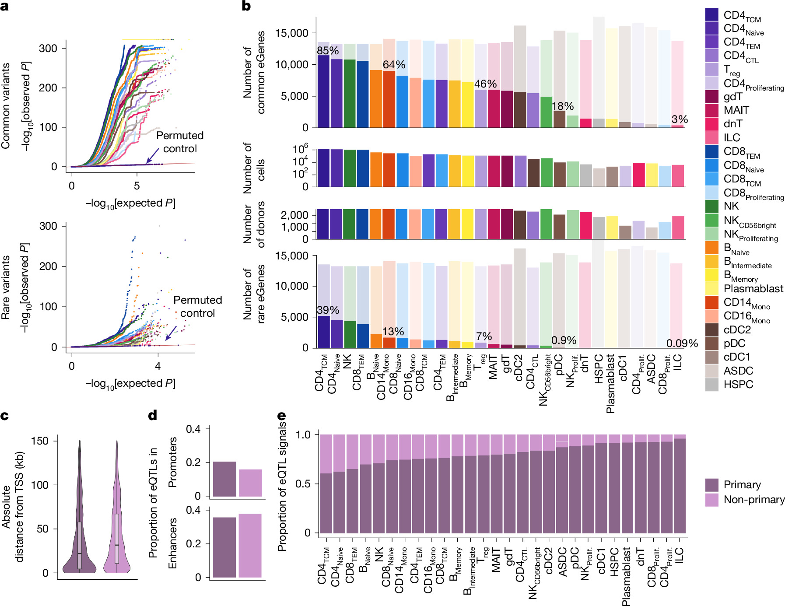

*原文Fig.2，整图原样展示。a的横纵轴分别是零假设下预期与实际观察到的−log10(P)，颜色区分细胞类型；偏离对角线可包含真实关联，也需要结合置换校准判断，而不是越偏离越好。b比较各类细胞中的可检验基因与发现数量，中间同时给出细胞数、供者数，提醒不同类型的检验能力不一致。c展示关联变异与转录起始位点的距离；d、e讨论基因组功能区域及主、非主信号。这里的比例、关联和富集不是逐个变异的实验功能验证。来源：Cuomo等，Nature，2026，Fig.2，CC BY-NC-ND 4.0；未改变数据、颜色、坐标或图例。*

具体读Fig.2b时，深色柱是检出的eGenes，浅色背景是可检验的基因；百分比的分母是该类型进入相应分析的基因，不是全部人类基因，也不是疾病相关基因。中间细胞数采用对数尺度，不能按柱高做线性倍数比较。Fig.2c—e深紫代表主信号、浅紫代表非主信号：c是距转录起始位点的绝对距离，单位kb；d分别给启动子、增强子注释中的比例；e按细胞类型展示两类信号构成。主信号更靠近起始位点的整体趋势，并不意味着远端信号不重要。

### 为什么不直接把细胞平均，再做普通eQTL？

把同一供者、同一细胞类型的表达汇总为pseudobulk，是合理而常用的策略。它让供者这个独立单位更清楚，计算也往往更轻。单细胞混合模型则试图保留细胞层面的计数信息及差异，代价是更复杂的模型假设与计算。

本研究的某些比较使用跨细胞类型汇总的表达方案。因此，观察到单细胞方案发现更多，可能同时反映细胞类型分辨率、统计模型、样本量与检验设计的变化，不能简化成“所有pseudobulk都落后”。尤其不能把跨类型平均与标准的逐细胞类型pseudobulk分析混为一谈。

我们另行核查了SAIGE-QTL可合法获取的预印本相关方法与局限部分；它同样没有支持“单细胞模型对所有基因都更有力”的普遍结论。正式版引用地址在本次核查时返回404，不能把预印本核查写成正式版全文已读。实际选方法时，更好的问题是：在自己的供者规模、稀疏程度和计算预算下，哪一种方法校准稳定、效应估计可解释，并能经受独立验证？

### 罕见变异：改变的不只是频率阈值，也是问题单位

罕见变异的单个携带者太少，逐个检验往往很难获得足够证据。研究因此把基因附近、频率低于1%的变异组成集合，检验整个集合是否与表达有关。它得到34,376个基因—细胞类型关联，涉及10,005个基因。

这里主要有两类统计思路。负担检验把多个变异的贡献合并，适合相当一部分变异以相近方向影响表达的情况。SKAT允许不同变异的作用大小、方向不同，甚至集合中许多变异没有效应。可以把它们理解为两个不同的问题：“这一袋变异是否总体朝一个方向推表达？”以及“这一袋变异是否解释了一部分表达差异？”这只是帮助理解的比喻，不代表实际算法先知道哪些变异有效。

研究发现的集合关联绝大部分由SKAT检出，只有很小比例仅由负担检验检出。这支持“同一基因附近的罕见变异可能存在异质作用”这一统计图景，但并不证明集合中的每个变异都功能异常。把某个基因称为罕见变异eGene，与把集合里每个变异标成致病变异，是两回事。

作者还比较了按功能注释筛选变异、使用不同权重的策略。一些注释过滤能提高发现效率，但不是所有过滤都更好。注释来自哪些组织、是否覆盖真正的调控机制、过滤是否同时损失有效变异，都会影响结果。对自己的分析，应该记录集合如何构成、权重如何设置、最少携带者有多少，而不仅是报告一个显著P值。

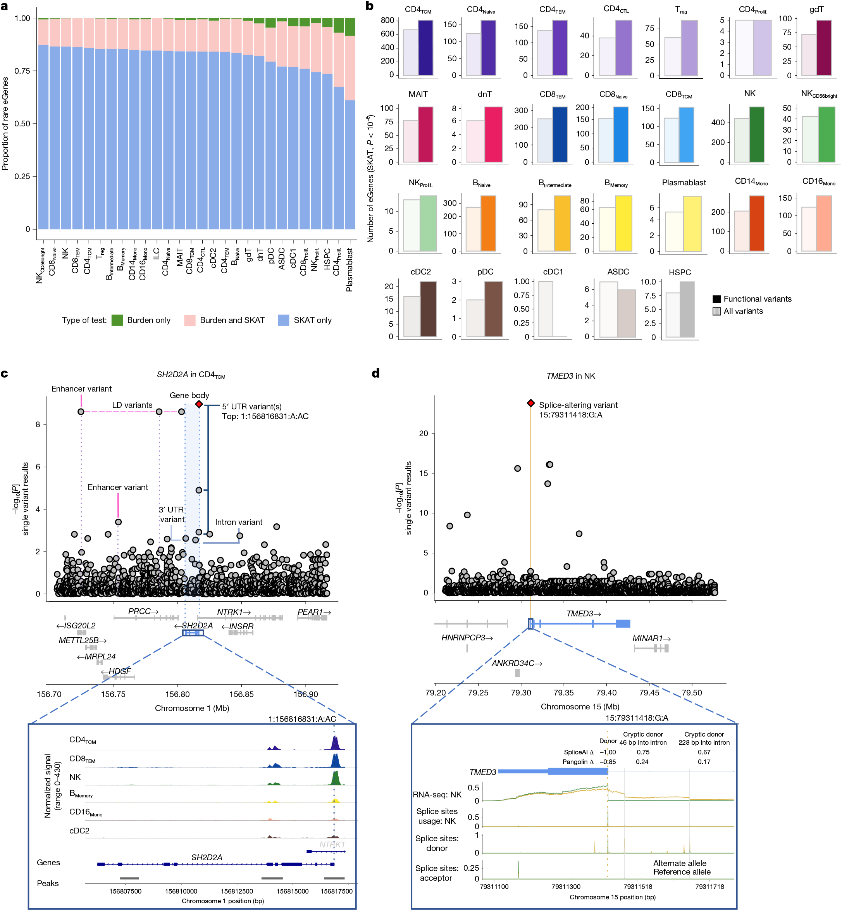

*原文Fig.3，整图原样展示。a比较不同罕见变异集合检验的发现构成；统计单位是基因—细胞类型关联，而非单个已验证变异。b比较功能筛选与全变异集合的结果，图内阈值及各面板坐标应按原图阅读，不与全文主分析的FDR阈值混用。c以SH2D2A附近区域展示关联及开放染色质等证据；相关染色质数据来自另一个较小子集，不是全部1,925名供者的配套测量。d为TMED3剪接供体变异的解释，包含模型预测轨迹；这些轨迹不是直接测得的RNA剪接实验。来源同上，Fig.3，CC BY-NC-ND 4.0，原样保留。*

Fig.3a绿色是仅负担检验检出，粉色是两者都检出，蓝色是仅SKAT检出；每根柱的分母是该类型检出的罕见变异eGenes。b深色为功能注释筛选后的集合，浅色为全部顺式罕见变异，比较采用SKAT的P<10⁻⁶，且各小图纵轴范围不同。不能把深浅柱差直接解释成已验证功能变异增加。

Fig.3c、d上方横轴是染色体位置，纵轴是单个罕见变异检验的−log10(P)，灰点为区域内变异，红菱形突出作者重点讨论的变异；这些单点图辅助解释集合发现，并不是集合检验本身。c下方紫、蓝、绿、黄、粉及棕色轨迹分别对应标注的不同免疫细胞，展示实测开放染色质信号，基因和峰的位置提供定位参照。d下方绿色为参考等位基因、黄色为替代等位基因，显示AlphaGenome预测的覆盖及剪接轨迹；比较对象是两种序列的模型输出，不是两组受试者的实验测量。

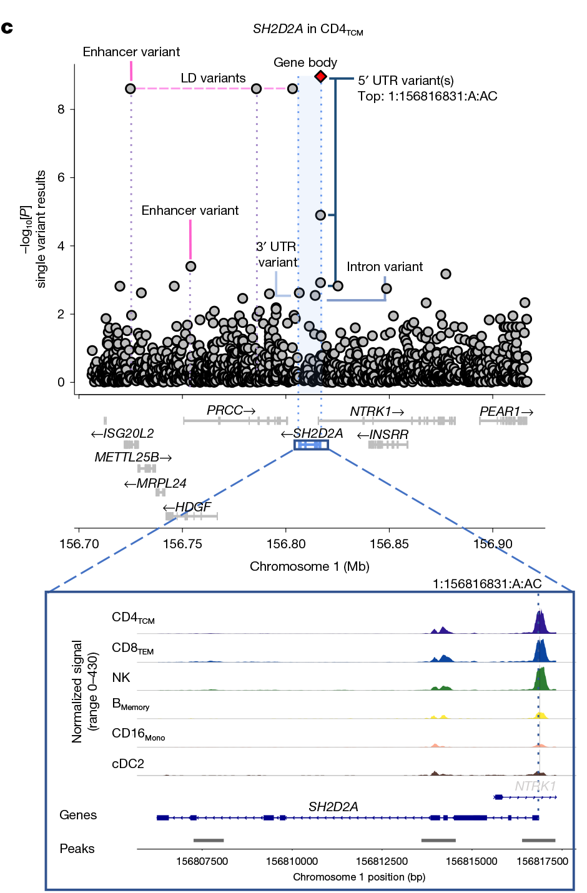

*原文Fig.3c完整局部，原样摘录供放大阅读，保留关联坐标、细胞轨迹标签及基因位置。来源：Cuomo等，Nature，2026，DOI 10.1038/s41586-026-10721-2，CC BY-NC-ND 4.0；仅截取完整面板，无数据改动。*

### 一个漂亮的机制例子，要拆成几层证据

TMED3的例子很适合练习。作者观察到一个罕见剪接供体变异与NK细胞中较低的TMED3表达关联；多种序列模型提示它可能改变剪接，产生异常转录本，进而符合无义介导降解的解释。

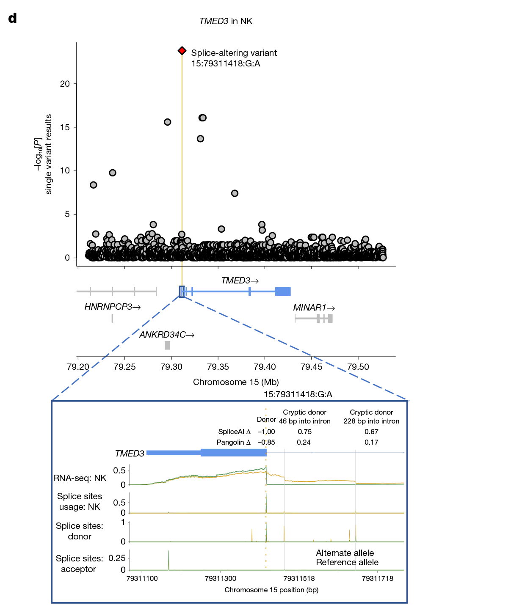

*原文Fig.3d完整局部，原样摘录。底部绿色参考序列、黄色替代序列为模型预测，并非实测剪接。来源与许可同Fig.3c；完整轴、标签、图例保留。*

这条叙述至少包含三层：测到的基因型—表达关联；模型对剪接变化的预测；由异常转录本推及RNA降解机制的解释。它们相互支持，但不是同一种证据。不能把模型预测的轨迹说成已经直接看见患者RNA的异常剪接，更不能据此宣布该变异在疾病中具有确定作用。

同样，精细定位给出的可信集合，是在统计模型和连锁结构下收缩候选范围。本研究使用SuSiE时，也在补充材料讨论了输入统计量与模型假设并不完全一致的问题。95%可信集合不是“里面每一个变异都有95%概率致病”，更不是功能实验的替代品。

### 把论文的方法转成自己的检查表

假设你有一批供者，每人都测到了T细胞和单核细胞，想知道某个常见变异是否调控基因X。开始跑关联之前，至少要生成三张并不花哨的表。第一张是每位供者在每种细胞中的细胞数：少数供者是否贡献了绝大部分细胞？第二张是基因X在各类型中的表达覆盖：没有检出关联，是效应弱，还是几乎没有可用计数？第三张是基因型组与队列、批次、祖源的交叉表：某个等位基因是否恰好集中在一个处理批次？这里是教学假设，不是作者额外做过的实验。

随后再决定汇总层级与模型。若用pseudobulk，明确每个供者、每种细胞怎样汇总，低细胞数样本怎样处理；若用单细胞模型，明确供者相关性放在哪里、测序深度怎样进入模型、什么情况下拟合失败。不能只在最终结果表里加一列“已校正批次”，就认为这些选择无关紧要。

校准也不是只看真实数据的QQ图。真实关联很多时，QQ图向上偏离是可能的；但协变量不足或模型失配也能产生类似形状。本研究在特定设置下用供者标签置换作检查，支持相应检验的校准，却不自动覆盖所有稀有细胞、所有低频变异和所有后续交互分析。复用时，要把检验对象和校准实验一一对应，不能拿普通eQTL的检查为另一种细胞状态模型背书。

对于罕见变异，还要预先写清集合边界。把基因体、启动子、远端调控区域分别纳入，会改变生物学问题，也改变检验负担。假如一个集合的结果主要由一位携带者推动，应进一步检查该人的表达、样本质控和变异质量；这不是自动排除该人，而是判断关联究竟有多少独立支持。论文公开的是资源和分析策略，不是免除这些核验的许可证。

最后，保留效应方向、效应大小或可解释的模型参数，以及不确定性。显著性依赖样本量，不能用P值大小直接衡量生物作用强弱；一个表达差异很小但估计精确的效应，也可能比另一个更大的效应得到更小P值。不同模型输出的系数未必处于同一尺度，比较之前需要核对定义。对希望开展机制实验的人，这些信息往往比排行榜式的显著基因数量更有用。

### 这一篇真正可带走的是什么

如果要复用这项研究，先从三个清单开始：独立供者及各细胞类型的覆盖；单变异或变异集合的检验定义；从关联到机制每一步究竟使用了观察、统计推断还是预测模型。细胞更多、分群更细、显著结果更多，都必须放回这三个清单中解释。

论文的贡献是把常见与罕见遗传变异放到细胞分辨率下联合观察，提供了一个规模可观、方法细节公开的资源。它尚未回答每个变异如何导致疾病，也没有消除祖源、样本处理、模型校准和统计效能的限制。接下来需要进一步拆解最容易被误读的一句话：“这个eQTL具有细胞类型特异性。”

**阅读与使用范围**：本系列已读正式正文、Methods、扩展图说明、报告摘要与可获得的补充说明，并核查部分补充表；未重跑模型，未取得受控个体数据。Fig.1a、c标有BioRender第三方素材，未转载；其流程示意不是本文统计结论的直接证据，本篇保留Fig.2、3的原始结果图，没有用原创示意替代这些证据。原图依文章CC BY-NC-ND 4.0，限本次非商业、原样分享并保留归因；用途变化需重新核查。

**方法补充来源**：[SAIGE-QTL 2024年预印本v1](https://www.medrxiv.org/content/10.1101/2024.05.15.24307317v1.full)，仅核查相关方法与局限，非正式2026版本全文。

**来源**：[原文与完整方法](https://doi.org/10.1038/s41586-026-10721-2)；[分析代码](https://github.com/powellgenomicslab/tenk10k_phase1)；[汇总统计资源](https://doi.org/10.5281/zenodo.18221260)；[CC BY-NC-ND 4.0](https://creativecommons.org/licenses/by-nc-nd/4.0/)。

## 细胞类型特异性究竟意味着什么
一个变异在单核细胞中与基因表达显著关联，在T细胞中却不显著。可以直接写成“单核细胞特异性eQTL”吗？这是单细胞遗传学最诱人的结论之一，也是最容易跳过统计条件的一步。两个P值分居阈值两边，不等于两个生物效应真正不同。

Nature发表的TenK10K研究《Rare and common genetic variants shape single-cell immune gene expression》提供了一套分层框架：先看基因能不能在两类细胞里测到，再看是否存在关联、关联是否来自同一个遗传区域，最后才比较方向。本篇把这套框架拆开，重点不在记住五个类别，而在学会识别“没有证据”“不同信号”与“方向相反”之间的距离。

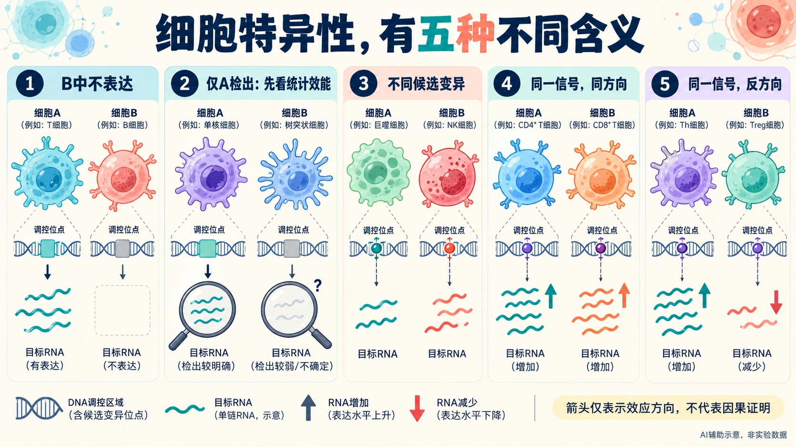

*AI辅助原创示意，非实验数据。五类情形是理解细胞类型差异的框架，不代表显著与不显著可以直接当作效应差异检验。*

### 两个看似相同的“没有”，可能完全不同

假设基因X在细胞A中表达丰富，在细胞B中几乎测不到。即使某个遗传调控机制理论上也存在于B，当前RNA测量也可能没有足够信号来估计它。此时，A有eQTL、B没有，部分来自基因表达本身的细胞选择性。

另一种情况是X在A、B都表达，但只在A达到关联阈值。这里就不能马上归因于生物特异性：B可能细胞少、供者覆盖不均、表达更稀疏，或者效应本来较小。显著性由效应与不确定性共同决定，不能仅凭有无星号判断机制是否存在。

TenK10K的常见变异分析纳入1,925位供者、28种免疫细胞类型，但各类可用细胞数与基因表达覆盖并不相同。论文统计“多少类型中发现某个eQTL”时，背后不是28次完全等价、同等有力的实验。读者应该把检测机会放回分母中，而不是把某个基因只在一种细胞中显著当成天然特异。

研究要求基因在相应细胞类型达到一定表达覆盖后才进入分析。阈值让检验可操作，却也划定了边界：阈值以下的基因不是已被证明“不受调控”，而是没有按相同条件获得充分检验。自己的数据里，这一层筛选尤其应该保留，而不是只输出显著结果表。

### 五种情况，每一类回答不同的问题

作者首先比较一对细胞类型。第一种：基因在A表达并有关联，在B的表达不足以按同一规则检验。第二种：基因在两类都表达，但只有A检出关联。第三种：两类都有关联，不过最强关联变异不同，且两个变异的连锁不平衡较低。第四种：信号相同或高度相关，效应方向一致。第五种：信号相同或高度相关，方向相反。

这个顺序的好处是将几个经常被混写的问题分开：基因的表达范围、统计检出范围、遗传信号身份、效应方向。第一类偏向表达背景，第二类混合了效能与潜在情境差异，第三类强调可能由不同调控元件驱动，第四、五类才讨论相同遗传信号在两种细胞中的作用方式。

不过，分类仍是统计简化。最强关联变异不一定是真正的功能变异；两个lead SNP相关，也不证明它们只代表一个因果信号；两个lead SNP不太相关，也不证明两个完整关联区域毫无共享机制。所谓同或不同，要结合连锁结构、条件分析和精细定位理解。

本文采用主文的定义解读：比较lead SNP的连锁不平衡，以r²约0.5区分第三类与共享信号类。补充材料一张汇总表出现不同阈值，而另一张分类表与主文一致。因此，如果要严格复现分类，应回到对应代码与版本核实阈值；不能把0.5当作生物学定律，也不应把不同阈值下的结果混算。

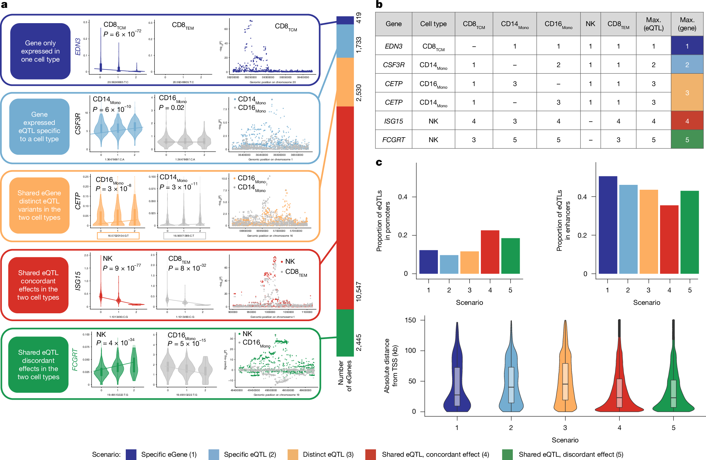

*原文Fig.4，整图原样展示。a用五个案例展示分层情形；区域图的横轴为基因组位置，关联强度通常以−log10(P)表示，方向相关面板需按原图符号阅读。基因型分组的表达分布以供者为单位，不是把数百万细胞当独立重复。各例纵轴尺度不同，不能用峰的视觉高度直接比较效应大小。a右侧汇总五类基因数量；b通过案例表格说明成对分类怎样逐层汇总到eQTL与基因级标签；c展示各类信号与调控区域等注释的关系，按154,932个eQTL而非17,674个基因统计，属于关联模式而非元件扰动验证。来源：Cuomo等，Nature，2026，Fig.4，CC BY-NC-ND 4.0；未改变数据、坐标、标签或图例。*

再看图中的比较对象：深蓝、浅蓝、橙、红、绿分别对应五种情形；每个例子中彩色是细胞A，灰色是细胞B，不是病例与健康对照。小提琴图横轴0、1、2表示效应等位基因数，纵轴是每位供者的平均表达，箱体横线标示四分位数与中位数；可评估供者约1,876—1,925人，随类型而异。第五类的区域图把−log10(P)乘以效应符号，因此负值表示方向，不表示出现负P值。

Fig.4c上方分别比较各类lead信号落在启动子、增强子中的比例，下方展示距转录起始位点的绝对距离，单位kb；颜色与五类定义一致。较高的注释重叠比例只说明关联信号的分布特点，不能说这一比例的调控元件已经被实验验证。原图中的小提琴与箱体用于展示分布，不是从图上读取每一条关联的可信区间。

### 先用案例理解，不急着背类别编号

EDN3的例子说明第一层的重要性：如果基因本身主要在特定细胞中表达，看到局部eQTL不需要立刻诉诸复杂机制。没有足够表达的细胞，不是理想的阴性对照。一个有意义的对照，必须先有机会检测到待比较的现象。

CSF3R则帮助理解“都表达但只检出一边”。这类观察可以产生值得验证的细胞选择性假设，但单凭差异显著性，仍无法排除效能不足。可以进一步比较效应估计和置信区间，增加相应类型的供者或细胞覆盖，或者设计直接的基因型×细胞类型交互检验。

CETP的示例提醒我们，不同细胞可能由不同局部遗传信号调控。基因名相同，并不意味着调控路径相同。若一个区域有多个调控元件，各细胞使用不同元件，就可能出现不同lead SNP。但这仍需要功能或更精细的统计证据，不能仅凭两个峰的位置差异就宣布发现了两个增强子机制。

ISG15对应共享且方向一致的例子；FCGRT则展示同一或相关遗传信号的方向差异。方向反转很有吸引力，因为它比“一边显著一边不显著”提出更明确的生物学问题：同一个序列变化，是否在不同转录因子环境或染色质背景下产生不同结果？但这里提出的是机制方向，不是本文已经完成的机制实验。

读这些图时，先找基因型编码、效应等位基因及表达尺度。若等位基因方向没有统一，所谓反转可能只是编码相反；若表达进行了不同变换，系数大小也未必直接可比。论文中的分类不能代替我们在复用数据时重新核对这些基础定义。

### 一个基因的总标签，不能替代所有细胞之间的关系

研究为了总结28种细胞之间的复杂关系，将两两比较的结果进一步压缩成基因级分类。这个过程使用优先级较高的情形作为汇总。因此，一个基因进入“方向相反”类别，表示至少存在符合相应条件的比较，不是它在全部28类细胞中都呈现整齐的正负对立。

主文报告五类分别涉及419、1,733、2,530、10,547和2,445个基因，总计17,674个。它们回答“怎样为这些eGenes总结最具区分性的跨细胞模式”，不是五套互不相关的实验数量。若要研究某种具体细胞，仍应返回相应的成对结果，而不是只读最终类别。

同样，论文发现很多eGenes只在有限的细胞类型中检出，极少数在全部类型中都达到阈值。这是检测范围的描述，不是每个未检出的细胞都经过充分验证后被排除。把结果压缩为“多数遗传效应高度细胞特异”时，应该同时保留表达覆盖、样本量与模型敏感性这几条脚注。

这种汇总问题在其他组学里也很常见：一个基因只要在某个组织存在强烈差异，就被贴上“组织特异”标签；但标签随后被当作对每个组织的描述。使用分类表时，先问标签如何从原始比较压缩而来，往往比记住标签本身更重要。

### 作者如何尝试减少“没测出来”的误判？

作者结合跨细胞的统计信息，用成对的随机效应meta分析帮助识别可能被单个细胞类型漏掉的信号，并设置经验性判定规则。这是在不完全依赖单独显著阈值的方向上迈了一步，尤其当两个类型的效应估计相容、但其中一类精度较差时，有助于重新理解“仅一类检出”。

然而，这不是把所有效能问题一次解决。meta分析借助共同信息，需要相应假设；经验规则与直接检验两种效应是否不同不是同一件事。它也不能创造数据中不存在的携带者、缺失的表达计数或未测得的状态。将其理解为对分类的统计辅助，比理解成“已证明所有不显著都是无效应”更准确。

还要注意winner's curse：当我们先从A里选最强或显著的信号，再比较B，A中的效应估计可能因选择而偏大。跨细胞比较、下采样敏感性检查和独立供者复制能回答不同问题。它们不能互相替代，尤其不能把同一批供者换一种分析方法当作外部复现。

TenK10K与早期OneK1K存在供者来源重叠。因此与OneK1K的一致性有价值，但不能一概称为完全独立人群的重复验证。这一点不会抹去资源价值，却决定我们应如何表述证据强度。

### 怎样把这套思路用于自己的项目？

可以从一个简洁但信息完整的结果表开始。每一行是基因、遗传信号与细胞类型的组合，除了P值，还保留可用供者数、细胞数、表达覆盖、等位基因频率、效应方向、模型尺度与标准误。未进入检验、进入但未显著、模型失败，应该分别编码；三个空白不能都写成“无eQTL”。

第二步再做比较。对于两种细胞中都可检验的基因，先核对lead SNP是否相同、是否只是连锁相关，必要时做条件分析或比较精细定位结果。只有在信号身份比较清楚后，方向和大小的比较才有生物学意义。否则可能是在拿两个不同调控效应做表面上的正负对照。

第三步，根据问题选择更直接的验证。若关心效应是否随细胞类型改变，需要明确的交互模型及合适的相关性处理；若关心具体变异是否改变某个调控元件，需要对应细胞背景的功能实验；若关心能否推广到另一个人群，需要独立供者与祖源背景下的检验。这些问题不能由同一个分类标签同时回答。

最后，报告阴性结果的可解释范围。假设B中仅少量供者携带目标等位基因，即使没有显著关联，结论也应是“当前数据未提供充分支持”，而不是“B中不存在作用”。这是一个措辞差别，但它直接影响后续实验是否被错误地排除。

### 连锁不平衡，为什么既帮助我们又限制我们？

人群中的邻近遗传变异常常一起遗传，这就是关联分析中难以绕开的连锁不平衡。若真正起作用的是变异甲，而乙经常与甲一起出现，乙也可能得到很强的表达关联。我们可以利用这种相关性发现一个区域，却不能只凭最小P值判定具体功能碱基。

这也解释了第三、第四类的边界为什么不是纯粹生物分类。两个细胞的lead SNP不同，有时是统计波动在同一相关变异簇中选中了不同成员；有时是真正存在不同独立信号。反过来，两个细胞选中同一个lead SNP，也可能在复杂区域中混合多个效应。一个r²阈值提供可重复的分类规则，却不能取代对整个关联区域的分析。

对于罕见变异，这个问题还要换一种问法。主分析的罕见变异结果是基因附近的集合关联，集合内部可能同时有增加与降低表达的成员。它不像一个常见lead SNP那样自然地拥有一个统一方向。因此，不能把常见变异的五类框架机械套到所有罕见变异集合，更不能将两类分析的“共享比例”当作同一统计对象直接比较。

### 两个P值的差别，不是效应差别的P值

做一个不带具体实验数值的假设：A中的效应估计略高于B，但B的区间很宽。A显著、B不显著，可能只是B估计不精确；两者效应仍然相容。另一个假设是A、B都显著，方向相同但大小明显不同；仅用是否显著的名单反而会漏掉真正值得研究的情境变化。

直接比较效应需要考虑估计的不确定性，以及两个估计之间的相关性。本研究各细胞来自同一批供者，不能总把它们当作来自完全独立人群的两个估计。交互模型、联合模型或合适的跨条件框架，都应说明如何处理这种依赖。简单做两份结果表的集合差，回答的是“名单重叠多少”，不是“遗传效应改变多少”。

同时，统计交互本身也不是分子机制。发现基因型与细胞类型存在交互，可以支持效应随背景而变；究竟是转录因子、染色质、RNA稳定性还是细胞亚状态构成导致变化，仍需要额外证据。类型标签可能只是更细状态的代理，不能把标签直接当成起作用的实体。

这也是为什么原图中的供者分布很重要。除了看分组中心是否分开，还要看各组覆盖是否平衡、变异携带者是否很少、差异是否被几个异常值驱动。图能帮助提出这些检查，但没有展示的质控与条件分析，不能靠视觉自行补成“已经排除”。

### 细胞类型特异性，是一组可检验的问题

这篇论文最值得借鉴的地方，是把笼统的“特异性”拆成表达背景、检出能力、信号身份和作用方向。框架并不完美，阈值与汇总规则也需要读者核对，但它比仅比较显著基因名单更接近真正的生物学问题。

保留下来的核心判断是：未检出不等于无效应；同一个基因不等于同一条调控路径；共享关联不等于共享机制；方向相反值得追问，但仍需要因果实验。把这几层分开，我们才知道下一笔实验预算应该投向补足样本、改进统计，还是验证具体调控元件。

**阅读与证据范围**：本篇基于原文正文、Methods、Fig.4及相应补充说明；未重跑分类与模型。阈值不一致处已明确标注，未擅自统一源文件。案例中的机制解释仅作待检验方向。原图用于本次非商业科普原样分享，保留完整标注与许可。

**来源**：[原文](https://doi.org/10.1038/s41586-026-10721-2)；[作者分析代码](https://github.com/powellgenomicslab/tenk10k_phase1)；[公开汇总统计](https://doi.org/10.5281/zenodo.18221260)；[原图许可](https://creativecommons.org/licenses/by-nc-nd/4.0/)。

## 从共定位走向疾病机制的证据边界
GWAS告诉我们，一个基因组区域与炎症性肠病有关；eQTL告诉我们，同一区域与某个基因的表达有关。把两张图放在一起，峰都在附近，就能说“这个基因通过这类细胞导致疾病”吗？不能。我们还需要知道两个关联是否可能由同一个遗传信号驱动；即使答案倾向于“是”，从共享信号到表达介导疾病，仍有一道不能省略的因果门槛。

TenK10K研究《Rare and common genetic variants shape single-cell immune gene expression》把1,925名供者的单细胞表达调控图谱，与疾病及血液性状GWAS结合。本篇用它的OSM案例，讲清共定位到底增加了什么证据、没有增加什么证据，以及如何把一张很有吸引力的疾病机制图读得更稳。

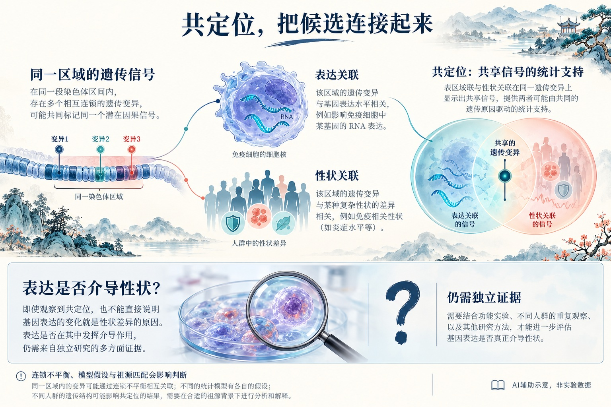

*AI辅助原创示意，非实验数据。表达与疾病共享局部遗传信号，不自动证明“表达变化介导疾病”；示意中的路径是需要区分的解释，不能当作已证实因果链。*

### “同一区域”太宽，“同一个信号”仍不是终点

附近的遗传变异常因连锁不平衡一起出现。如果变异甲改变基因表达、变异乙影响疾病风险，而甲乙又相关，两种分析都可能在同一区域出现显著峰。只看lead SNP位置相近，甚至两者都显著，并不能排除这种情况。

共定位分析试图比较几种解释：这个区域是否只有表达关联、只有疾病关联，是否两者都有关联但来自不同信号，或者是否与共享信号更相容。它利用区域内多变异的关联模式，而不只是看最小P值是不是落在同一个点。

但“共享信号”还有不止一种生物解释。遗传变异可能通过基因表达影响疾病；也可能分别影响表达与另一条真正影响疾病的路径；还可能反映同一调控区域的多个分子变化。共定位缩小候选范围，却没有单独确定哪个分子变化是中介。

因此，论文里出现很高的共定位概率时，最稳妥的翻译是“在该模型与数据条件下，两种关联支持共享局部遗传信号”，而不是“这个基因已经被证明致病”。这不是挑字眼，而是决定后续实验应该验证什么。

### 研究实际比较了哪些东西？

作者将常见变异eQTL与16种疾病、44种血液性状的GWAS进行比较。疾病风险与血细胞计数不是同一种表型：前者帮助定位疾病相关调控，后者还涉及细胞组成与造血过程。不能将60个性状都简称为60种疾病。

eQTL侧先选在相应细胞类型达到错误发现率阈值的基因；GWAS侧要求区域内有达到全基因组显著性标准的信号。共定位不是对所有基因、所有细胞、所有性状做了同样充分的检验，它受前序筛选、窗口、样本量和可用汇总统计影响。

研究使用COLOC的coloc.abf框架，以共享信号假设的后验概率PP H4至少0.8作为主要支持标准。这个数值是模型内的后验概率，依赖先验设定、区域定义、数据质量及模型假设。它不是“有80%的患者会通过这个基因患病”，也不是基因功能验证的成功率。

尤其需要记住，该框架的基本设置对区域中的因果信号数量有假设。复杂区域可能存在多个独立效应；一张强共定位结果表，不会自动解决多信号问题。本研究另有精细定位分析，但“做过精细定位”不等于每一次共定位已自动采用允许多信号的联合模型。复用结果时，应核对具体流程，而不能把方法名称拼成一张无缝的保证书。

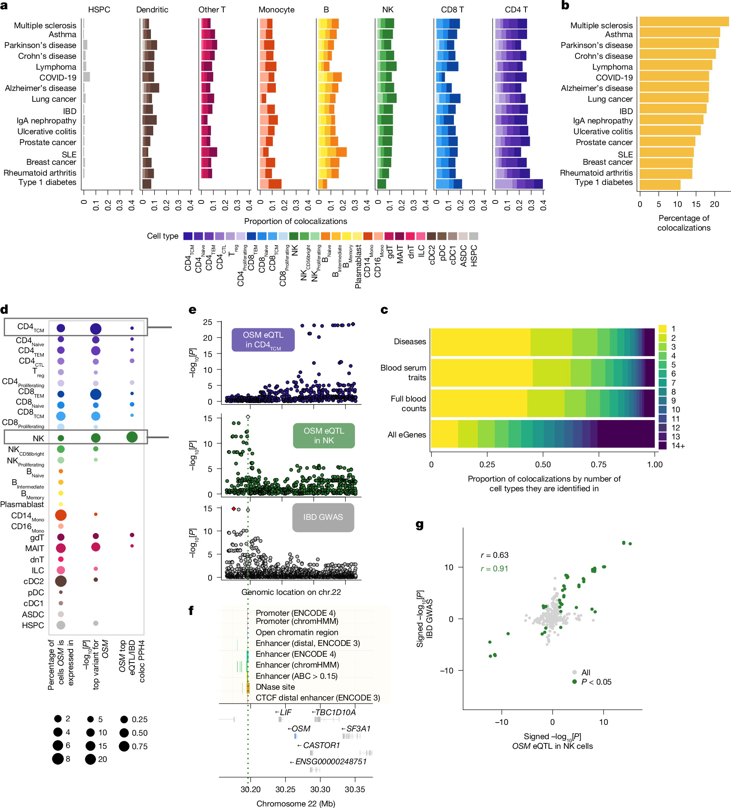

*原文Fig.5，整图原样展示。a、b汇总不同疾病或性状的共定位覆盖；比例要按图中相应eQTL、GWAS位点及筛选范围解释，不是疾病病因被解释的比例。c展示一个共定位事件出现于多少细胞类型。d—f放大OSM与炎症性肠病的例子；g比较NK细胞OSM eQTL与炎症性肠病GWAS的带方向关联模式。完整面板保留原始坐标、图例及标签。来源：Cuomo等，Nature，2026，Fig.5，CC BY-NC-ND 4.0；未改数据或图例。*

具体而言，Fig.5a横轴是每种疾病的共定位事件在各细胞类型中的比例，颜色按细胞类型编码；b的分母是相应疾病关联位点，分子是至少在一种细胞中发现共定位的位点，不是疾病遗传力。c用黄色到紫色区分从一种到多种细胞的共享范围，最下一行所有eGenes是参照，不能与上面各性状类别的共定位事件混为同一分母。

d三列点的大小分别编码表达细胞比例、最强eQTL的−log10(P)和PP H4；同样大的圆在不同列代表不同量。e从上到下为紫色CD4记忆T细胞、绿色NK表达关联、灰色IBD关联，纵轴范围不同；f沿同一染色体22位置展示调控注释。g横轴是NK eQTL、纵轴是IBD的带符号−log10(P)，灰色为全部比较点、绿色为图中P<0.05子集。灰绿相关系数的差别还受筛选影响，不能当作独立预测验证。

### OSM：同一个基因，为什么NK细胞更值得优先追问？

OSM在多种免疫细胞中表达，也在不止一种细胞里有表达关联，但这并不意味着所有细胞中的OSM调控都与炎症性肠病同样相关。作者报告，OSM与炎症性肠病的共定位在NK细胞中获得很强支持，PP H4约0.99；其他被比较细胞类型的相应支持较弱。

这里的关键不是“OSM只在NK细胞表达”。恰恰相反，表达范围、eQTL检出范围与疾病共定位范围不同。仅按基因在何处表达，可能把许多细胞都列为候选；加入遗传关联模式后，才更具体地提出哪种细胞背景下的调控值得优先验证。

Fig.5d将这几层放在一起。表达覆盖比例回答“有多少细胞表达这个基因”；eQTL关联强度回答“基因型与表达是否相关”；共定位概率回答“该表达关联与疾病关联是否支持共享信号”。它们使用不同的统计量与分母。不能把一个颜色较深、一个点较大的视觉组合，直接解释为更强的细胞致病能力。

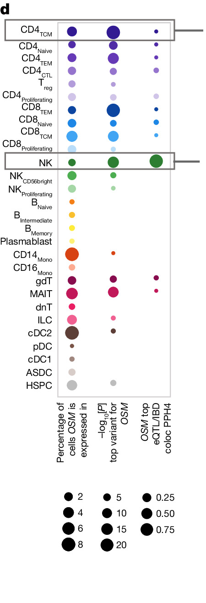

*原文Fig.5d完整局部，原样摘录；三列点大小各用自己的图例，勿横向当同一量纲。来源：Cuomo等，Nature，2026，DOI 10.1038/s41586-026-10721-2，CC BY-NC-ND 4.0。*

Fig.5e进一步展示区域关联图。横轴是相同区域的基因组位置，纵轴是各分析的关联强度；读图时要比较峰形与位置，而不是把不同数据集的峰高当成效应大小。NK中的OSM表达信号与疾病信号相容，而另一个细胞背景中的主要表达信号不同，这使“只看基因名或最近基因”显得不够。

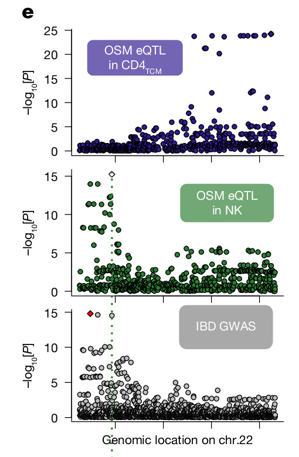

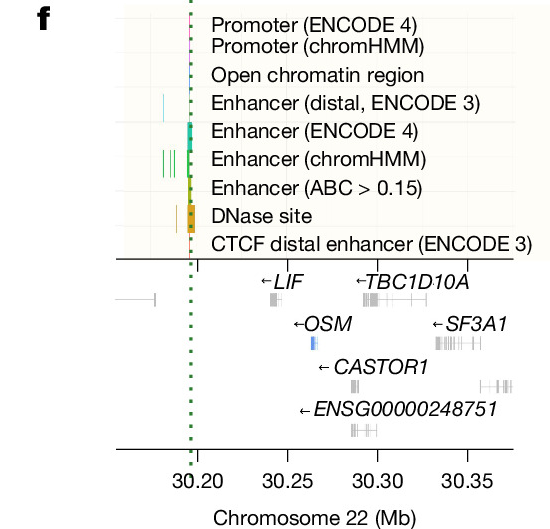

*原文Fig.5e、f分别原样摘录，上下共享染色体22位置参照；f保留数值刻度、基因与全部注释，e保留三组完整关联图。非重绘或合成新数据。来源及CC BY-NC-ND 4.0许可同上。*

作者讨论的NK与CD4细胞lead变异之间连锁不平衡很低，支持它们不只是同一个高相关变异簇里互换了代表点。但这仍是区域层面的统计解释，不能替代对具体调控元件、效应等位基因和细胞背景的实验验证。

### 把图里的“方向”读对

研究观察到，与疾病风险相关的等位基因在相应背景下伴随更高OSM表达。这个方向信息能提出一个比“OSM可能相关”更具体的实验假设：调节该遗传区域或相关表达过程，是否会改变某种与疾病有关的细胞反应？

不过，方向推断要建立在等位基因对齐正确的基础上。GWAS与eQTL可能使用不同参考等位基因、不同基因组版本或不同编码方式。效应符号不经核对就拼接，可能把风险升高与表达降低写反。论文提供的整理结果有助于使用，但独立复用时仍要检查这些基础信息。

Fig.5g展示的是带方向的关联强度之间的关系，而不是单细胞表达散点，也不是临床预测准确率。图中的相关系数说明区域内统计模式的相似程度，不能转换成“某个表达变化能解释多少疾病风险”。关联强度依赖样本量和标准误，不能直接等同效应量。

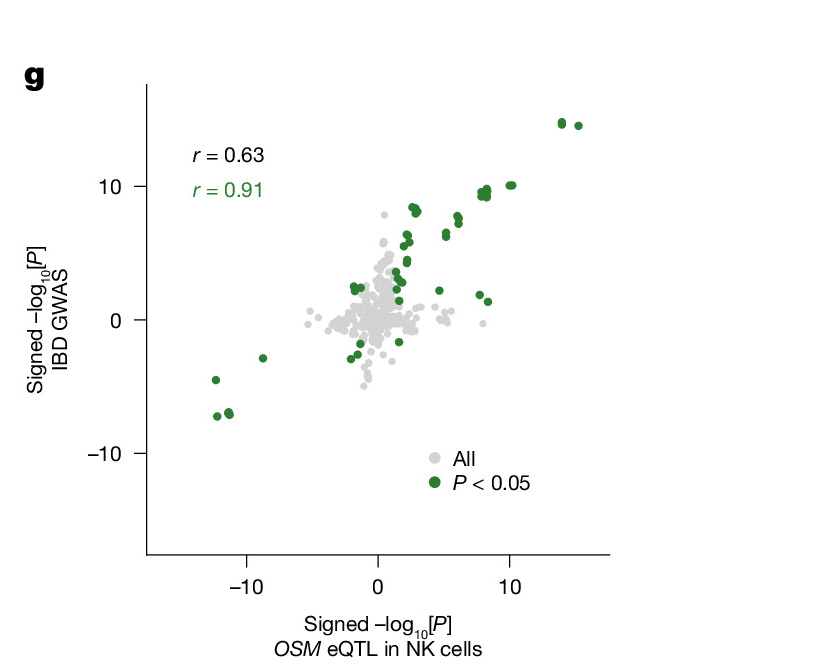

*原文Fig.5g完整局部，原样摘录；带方向的关联强度并非表达效应量，绿色子集不是独立验证集。坐标、图例及相关系数未改。来源及CC BY-NC-ND 4.0许可同上。*

同样，Fig.5f中的功能注释帮助我们判断候选区域是否具有调控可能性。注释与关联信号重叠，是增加优先级的线索，不是已经完成了删除、编辑或报告基因实验。不同图层的证据应当累积，而不是互相冒充。

### 结果很多，先把分母讲清楚

作者给出的补充表中，有60,458个达到相应标准的基因—细胞类型—性状组合，涉及5,287个不同基因。这些是本次实际核对补充表后可以支持的口径。一个基因可以关联多个性状，也可以在多个细胞类型中共定位，所以不能把60,458当作独立疾病机制的数量。

我们还发现，正文和补充表对于另一个合并层级的计数存在细微差异。因此这里不引用那个合并数字，也不自行解释成新发现或错误结论。数据资源的不同汇总单位必须先对齐，不能为了让叙述顺畅，把所有数字都写成同一个意思。

跨细胞类型的发现增益同样需要谨慎。若比较对象把不同细胞先混合，单细胞方案的优势同时包含分辨率差异；如果比较方法、基因筛选和模型不同，倍数就不是一种纯粹的算法性能指标。本篇不使用原文不同段落里口径未完全厘清的增益倍数，避免让一个醒目的数字盖过真正的设计差异。

这些限制不削弱资源的用途。它仍然能帮助研究者从大量GWAS位点中寻找值得进一步研究的基因与细胞背景。只是优先级名单的长度，不等于已经完成机制验证的长度。

### 为什么“最高概率”也需要敏感性分析？

后验概率不是脱离假设的证据刻度。假设一个区域真实存在两个独立表达调控信号，其中一个与疾病共享，另一个不共享；若模型只用一个信号解释整片区域，结果可能受到两个峰相对强弱的影响。这个例子是方法层面的教学假设，不代表OSM区域已经被证明存在该结构。

区域边界也会改变参与比较的变异集合。窗口过窄，可能遗漏帮助区分两种解释的变异；过宽，又可能加入复杂的独立信号。先验则表达分析开始前对不同关联关系的设定。稳健的结论应在合理设置变化下保持主要解释，而不是只在一个有利参数下跨过阈值。

祖源与连锁结构是另一个边界。TenK10K主分析限欧洲遗传祖源供者，外部GWAS的样本来源需要逐项核对。同一区域的相关变异结构在人群间可能不同，频率与统计效能也可能改变。不能仅因为共享一个基因组坐标，就默认两个数据源完全可比；同样不能把一个祖源中的强共定位直接推广成所有人群中的机制事实。

最后要区分“没有共定位”与“证明不共享”。如果其中一项关联很弱，数据可能无法有效区分假设；如果主要支持落在两信号不同的假设上，才是另一种更具体的统计结果。只保留通过阈值的结果，会把这两类未通过混在一起。在自己的分析里，保存完整假设后验和输入质控，比只保留一列是否通过更有解释力。

### 从共定位走向机制，还差哪些实验？

以OSM为例，可以依次提出三个更窄的问题。第一，候选变异是否在目标细胞背景中改变局部调控活性？第二，这种改变是否确实影响OSM，而不只是邻近另一个分子过程？第三，OSM变化是否介导与疾病相关的功能表型？三个问题需要不同对照，不应由一次共定位结果共同作答。

调控元件实验应注意细胞背景。一个序列在常用细胞系里有效，并不保证它在NK细胞的内源染色质环境里以同样方式作用。表达扰动则需要区分生理范围的变化与强行过表达；遗传效应常是长期、较温和的变化，未必等同急性的大幅干预。

若要支持中介关系，还需要考虑替代路径：变异可能同时改变多个基因，细胞状态也可能与表达、疾病相关。遗传工具的存在并不自动满足所有因果推断条件。共定位可以帮助排除部分明显不共享的信号，但不能保证不存在水平多效性或其他混杂解释。

本研究是人群观察与计算整合，不是一个针对OSM的治疗试验。把“风险等位基因对应表达升高”直接翻译成“抑制该基因一定有益”，会跨越组织、剂量、时间和疾病阶段的差异。资源适合产生机制与靶点假设，不适合单独决定临床干预方向。

### 想用这份资源，先做一张证据卡

对于一个感兴趣的GWAS位点，可以记录：基因组版本和窗口；GWAS样本与祖源；eQTL对应的细胞类型、供者数及效应等位基因；共定位方法、先验和后验；是否有多个独立信号；功能注释来自实测还是预测；是否有独立功能验证。这张卡比一个“PP H4>0.8”的筛选列更能防止误读。

然后做敏感性检查：窗口换得合理一点，结论是否稳定？较弱的次级信号是否改变解释？相关细胞类型是否有足够检验能力？如果一个类型没有共定位，是表达调控信号不同，还是eQTL本身太弱？这些是继续研究的任务，而不是本篇替作者声称已经全部排除的可能性。

资源的个体层数据位于受控数据库，需要相应申请；公开的汇总统计可以用于许多初步分析，但不能凭汇总结果恢复或假装核查个人数据。本系列没有申请受控数据，也没有重跑共定位，因此不把作者结果写成我们的独立复现。

### 最值得保留的结论

这项研究告诉我们，疾病相关调控的细胞背景不能只靠基因表达量猜测。将细胞分辨率的eQTL与GWAS共定位，可以把“附近有一个基因”推进到“某种细胞中的某个调控信号值得优先验证”。

推进了一步，不是走完了全程。共享信号、表达中介、疾病机制和治疗靶点是逐层增加的主张，需要逐层增加证据。把OSM案例读成一条清晰的假设生成路径，比把它包装成已经闭环的因果故事，更能帮助下一项研究。

**阅读范围**：已核查正文、Methods、Fig.5、补充说明和Supplementary Table 6的记录口径；未重跑共定位，未取得个体数据。原图与补充表支持的统计观察、作者的机制解释，以及本文提出的后续实验建议分别表述。原图按本次非商业、原样使用范围保留署名与许可。

**来源**：[原论文](https://doi.org/10.1038/s41586-026-10721-2)；[公开汇总统计](https://doi.org/10.5281/zenodo.18221260)；[作者分析代码](https://github.com/powellgenomicslab/tenk10k_phase1)；[图像许可](https://creativecommons.org/licenses/by-nc-nd/4.0/)。

## 连续细胞状态与细胞组成的两种遗传问题
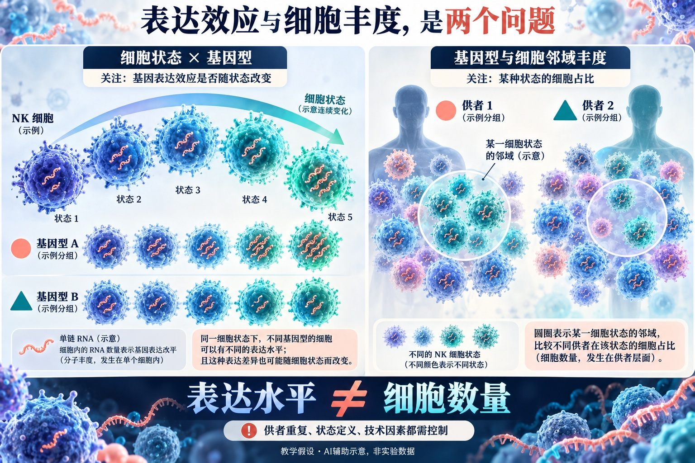

*AI辅助教学示意，非实验数据。*

同一类NK细胞，有的偏向细胞杀伤，有的偏向黏附或炎症信号。把它们统统平均之后，一个遗传变异的作用可能变小；但另一种情况也会造成平均表达不同：携带不同基因型的人，本来就拥有不同比例的细胞状态。

这两件事看起来相似，研究问题却不同。前者问：**在不同状态下，同一个变异对基因表达的影响是否改变？**后者问：**基因型是否与某些细胞状态更常见有关？**TenK10K同时研究了这两条线。本篇把它们拆开，解释怎样读懂连续状态eQTL和细胞状态丰度QTL（csaQTL），也说明为什么不能把一张漂亮的UMAP直接当作机制证明。

研究来自1,925名供者的外周血单个核细胞。大量细胞让状态分辨率更细，但遗传变异来自供者：同一个人的上千个细胞，并没有提供上千份独立基因型。这是理解下面所有统计图的前提。[原文与方法](https://doi.org/10.1038/s41586-026-10721-2)

### 一、状态是一条连续坐标，不只是再多分几个群

如果只把NK细胞分成五个亚型，再分别寻找eQTL，我们仍然把连续变化切成了几个箱子。作者采用的scDeepID先借助外部NK参考数据进行标签迁移，识别更细的NK亚型；随后在TenK10K中另行训练模型，利用Gene Ontology生物过程信息，构建可以赋予功能含义的细胞表征。

这里有两层不能混淆：标签回答“更像哪种NK细胞”，功能分数回答“沿某个转录程序处于什么位置”。前一步使用参考和研究数据共有的560个高变基因；后一步使用2,315个高变基因及功能先验。作者提取基于注意力和归因的功能分数，再标准化。最终研究的五条轴涉及细胞杀伤、白细胞间黏附、髓系白细胞分化、细胞骨架组织调节，以及经典NF-κB信号转导。

功能分数不是实验仪器直接测出的杀伤率或通路磷酸化强度。“NF-κB分数高”，严格地说，是模型从表达数据推断出的、与该功能相关的状态坐标较高。GO名称让坐标容易解释，但不能把预测分数自动升级为已经验证的生理功能。尤其“髓系白细胞分化”这样的注释出现在NK分析中，表示相应基因程序有贡献，并不意味着这些NK细胞已被证明转化为髓系细胞。

这套分析并非对全部变异和全部基因盲目扫描交互。作者先取在任一NK亚群中已经存在普通eQTL证据的16,759个不同变异—基因对，再利用850,833个NK细胞，检验它们与五条连续功能轴的交互。因此，结果覆盖的是一个**预筛选候选集合**；只在特定状态出现、总体主效应很弱的调控关系，可能从入口就没有被纳入。

### 二、交互检验看的是斜率有没有改变

这个模型可以用一句话读出来：表达量同时与基因型、状态、基因型乘以状态的交互项有关，还要调整年龄、性别、队列和总计数，并用供者随机效应处理同一个人多个细胞之间的相关性。

其中最重要的是交互项。假设两种基因型的表达随状态升高都以同样幅度增加，那么它们可能有状态效应，也可能有稳定的基因型差异，却未必有交互。只有基因型差异随状态变化，才是这里要找的信号。不能仅凭某个基因型组显著、另一个组不显著，就断言两组效应不同；需要直接比较对应的交互关系。

可以用一个假设例子来区分两种效应：若低状态时两种基因型的平均表达相差一单位，高状态时仍相差一单位，那么差异稳定；如果高状态时差异明显拉大，才有状态调节基因型效应的可能。这个例子只是教学假设，不是论文数据。实际估计还必须考虑两种基因型是否在相同状态范围都有足够供者和细胞：如果某一组只覆盖低分区，模型把趋势线延伸到高分区，并不等于那里已有充分观测。

这一步使用lme4线性混合模型、Gaussian误差，而不是直接把主分析的SAIGE-QTL Poisson模型搬过来。主分析和交互分析的模型、协变量及候选范围都不完全相同，不能用“统一单细胞模型”一笔带过。供者随机项是必要控制，却也不意味着所有供者结构、表达分布或状态定义问题都已经消失。

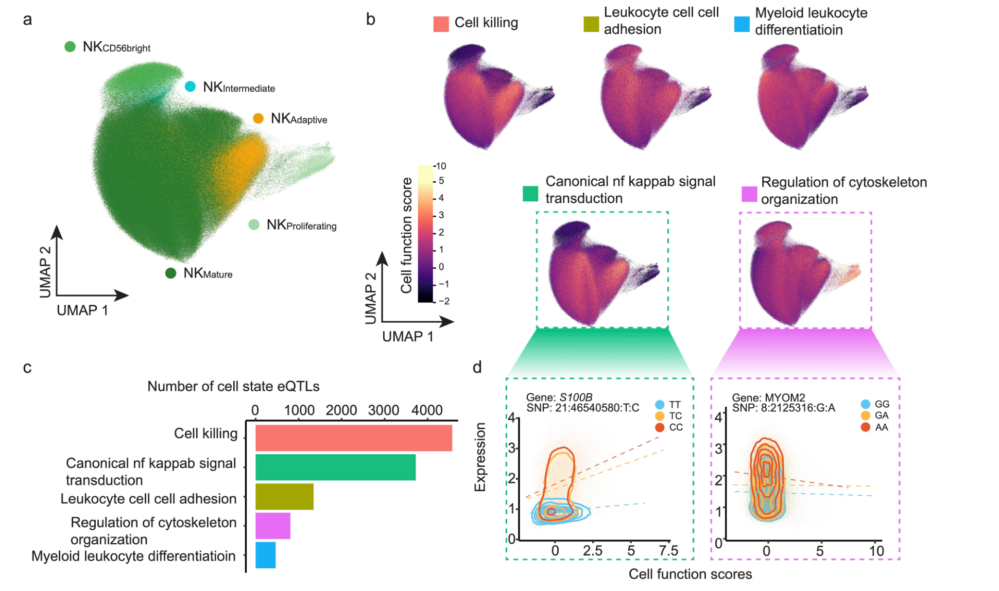

*原文证据图：Extended Data Fig.9，完整保留原图内容、坐标和图例，未更改数据。来源：TenK10K原文，DOI 10.1038/s41586-026-10721-2；[CC BY-NC-ND 4.0](https://creativecommons.org/licenses/by-nc-nd/4.0/)。本稿用于非商业科学解读。*

读这张图时，可以从四个层次进入。a在功能表征的UMAP上用颜色标出五类NK亚型，横纵轴只是低维展示坐标，没有时间单位；不能把两个点之间的远近直接当成真实分化距离。b在同一投影上叠加五种功能分数，深色至亮色表示分数由低到高。它显示状态变化与细胞亚型有关，却不完全被亚型边界切开。c统计不同功能轴上的显著状态eQTL数；同一个变异—基因对可以在多条功能轴出现，不能把各条柱子相加当作互不重复的调控关系数。

d把统计问题落到两个例子。横轴是连续功能分数，纵轴是基因表达；颜色区分供者基因型，图中细胞分布和趋势线用于展示关系。基因型由供者决定，点或密度里包含许多同一供者的细胞，不能把图上所有细胞当作独立遗传重复。这里没有随机分配的处理组，基因型组之间的比较仍是观察性分析。

左侧S100B对应rs9306156，原图蓝色为T/T、橙色为T/C、红色为C/C。随着NF-κB相关功能分数升高，C等位基因携带者的表达增加更明显，T/T组变化较弱。问题并不是“S100B会不会随状态变化”，而是“变化关系是否随基因型不同”。结合这个区域的增强子注释，作者提出一种可能的炎症信号机制；但增强子调控、S100B反馈及细胞功能之间的因果链，不能只靠这些曲线确认。

右侧MYOM2对应rs62478456。A/A组在低细胞骨架功能分数时表达较高，随后随分数增加而下降；G/G组相对低且平稳。因此，把它写成“A等位基因让MYOM2始终升高”会丢掉最关键的信息：效应依赖状态。作者提出它可能与NK细胞准备进行骨架重塑有关，这是解释性假说，还不是已经完成刺激、成像或编辑验证的结论。

正文结果段报告10,923项状态相关关联，涉及6,360个不同变异—基因对，占所测候选对约38%。这个分母不是全基因组所有可能配对。另需说明，原文讨论段的概括数量与结果段不一致，部分功能排名文字也与ED9c图形不一致；本文不据此强调总量或功能排名，只采用明确给出候选集合的结果段口径，不自行把这些差异“修正”为同一统计量。

对显著性校准也应保留具体范围。补充Fig.30展示的是RPS26与随机SNP、细胞杀伤功能轴相关的诊断，不能据此写成所有基因、所有五条状态轴的模型都已全面验证。交互分析比普通主效应分析更依赖状态覆盖、组间平衡和函数形式；拟合一条直线可以是合理起点，但不足以证明真实生物学关系必然线性。

### 三、另一个问题：某种状态在谁的细胞中更多

csaQTL没有把某个基因表达量作为结果变量。它把单细胞图谱转成供者层面的**细胞状态组成**，再问组成与基因型是否相关。

作者在B、CD4 T、CD8 T、其他T、NK、单核细胞、树突状细胞和造血干/祖细胞八大类中分别分析。表达数据经过归一化、技术因素处理、降维和Harmony批次校正，再建立近邻图。CNA根据相似细胞构建邻域，把每名供者在各邻域中的相对贡献整理为邻域丰度矩阵（NAM）。矩阵每一行对应一个供者，列对应细胞状态邻域；它不要求先把每种细微状态命名成独立细胞群。

GeNA再用NAM的主成分概括供者之间的组成变化，检验基因型是否与这些主成分所表示的变化相关。这样，遗传效应可以表现为一片连续状态区域变多或变少，不一定恰好沿着CD14与CD16这样的现成分类边界。

这里的统计单位已从细胞表达观测转到供者层面。TenK10K使用GeNA v1.0.0及CNA v0.1.6，并控制年龄、性别、队列和七个基因型主成分。作者起初纳入频率不低于1%的变异，但置换检查发现较低频率部分校准不理想，最终剔除了MAF低于5%的变异。这一收窄尤其重要：本文的csaQTL结果不能被介绍为罕见变异状态丰度图谱。

GeNA的检验还刻意避免预先指定某一个细胞群就是目标。原始方法把多个NAM主成分上的关联信息合并，并对所比较的主成分数量方案作校正；找到位点后，再构造便于展示的关联表型。因此，先发现关联、后解释表型，是它的重要特点，也是为什么需要回到基因程序、表面标记或实验读数给状态命名。若把分析后才确定的最显著状态当作事先提出的唯一假设，就会高估证据的独立性。

显著性阈值是P<5×10⁻⁸，并按LD和距离聚类确定代表位点。作者报告164个不同的代表位点。一个位点可能在多个大类中出现，因此图6a各类柱子的总和不能直接当作全研究独立位点数；柱子高，也不能单凭它认定那一类细胞更“受遗传控制”，因为可捕获状态、变异频率、供者覆盖和统计效能同时影响发现数。

### 四、LYZ：把关联放回细胞图谱，但不要跳过因果链

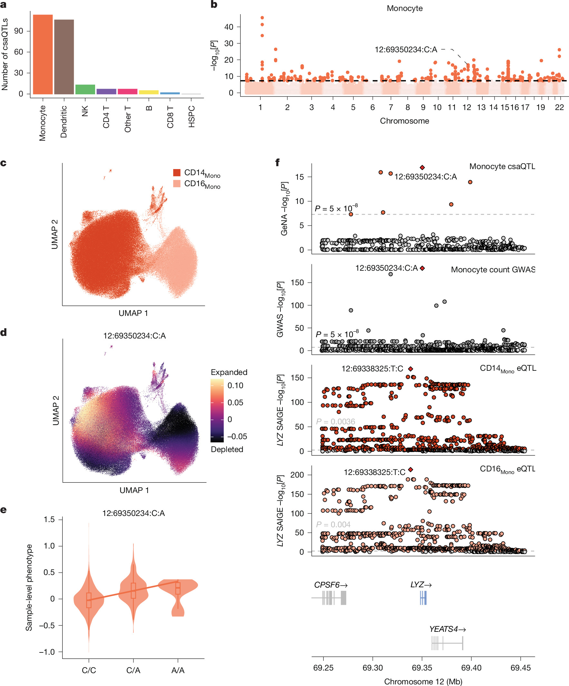

*原文证据图：Figure6，保留全部panel及原始轴、图例和标签，未改动实验或统计内容。来源：TenK10K原文，DOI 10.1038/s41586-026-10721-2；[CC BY-NC-ND 4.0](https://creativecommons.org/licenses/by-nc-nd/4.0/)。*

图6b是一张单核细胞csaQTL曼哈顿图：横轴为基因组位置，纵轴为−log₁₀P，虚线对应全基因组显著性阈值。标注的12:69350234:C:A位于LYZ，产生T88N错义变化，GeNA关联P=1.2×10⁻¹⁷。这说明位点与单核细胞状态组成存在统计关联，不等于已经证明T88N通过哪种分子作用改变组成。

c、d是同一张单核细胞UMAP。c用深浅橙色分别标出CD14和CD16单核细胞，帮助读者定位；d的颜色换成邻域丰度与替代等位基因剂量的相关性，亮色区域对应正向关系、暗色区域对应负向关系。原图颜色范围按第5至第95百分位显示，突出图谱内部的差异。它并不是基因表达热图，也不是在同一个人身上观察到细胞从暗区迁移到了亮区。

e再把关系放到供者层面。横轴C/C、C/A、A/A为基因型，纵轴是根据NAM主成分载荷拟合的样本表型，不是每微升血液中的细胞数。小提琴表示至少检测到一个单核细胞的1,919名供者的分布；内嵌箱线标出四分位数和中位数。它展示基因型与拟合组成表型的趋势，但这个表型是在相同数据中针对该位点构建的，不能把展示图本身再算作一次独立验证。

f沿同一个染色体区域排列四组统计结果：单核细胞csaQTL、外部单核细胞数量GWAS，以及CD14和CD16单核细胞中的LYZ eQTL。横轴都是染色体12的位置，纵轴分别是各项检验的−log₁₀P；数值高度不能当作统一尺度的生物学效应大小。底部基因位置提供区域背景。

作者报告csaQTL与外部单核细胞数量GWAS共定位PPH4>0.99，支持在所用统计模型下共享关联信号。不过，图中表达eQTL标注的代表变异是12:69338325:T:C，并非上述错义变异。附近同时出现表达关联和状态关联，不能自动串成“这个错义变异先改变LYZ表达，再造成炎症细胞增加”的确定链条；共定位也不等同于证明表达中介或具体因果方向。

为了描述关联状态，作者把与邻域表型相关的基因排序并做GSEA。炎症反应与TNF/NF-κB相关基因集富集，支持将其注释为偏炎症的转录状态。富集分析的单位是基因集合，和单细胞比例、供者数量是三种不同分母；显著富集不意味着作者已经给细胞施加TNF刺激，或测量到了更强的炎症反应。它帮助提出值得实验验证的机制，而不替代实验本身。

### 五、迁移到自己的研究，先守住四条边界

**不要把横断面“动态”读成时间过程。**NK功能分数来自一次采样中不同细胞的表达差异。它提供状态依赖关系，却没有直接追踪同一细胞从低分走到高分。若要证明刺激过程中遗传效应如何出现，可以设计多供者、基因型分层的刺激时间序列，并明确检验基因型与时间或状态的交互。这是后续建议，不是本论文已经完成的实验。

**注意状态与表达可能共享输入。**状态分数由表达推断，之后又用于解释基因表达；近邻图也由表达构建。若一个强cis效应显著改变少数基因，它可能移动细胞在图谱中的位置，看起来像状态丰度改变。GeNA原始方法论文明确讨论了这一可能性。可考虑排除目标基因及高度相关特征后重新构图、换用独立蛋白或功能读数、在留出的供者中检验稳定性；这些是敏感性分析方向，不能假称原文已经全部排除。

**组成是相对量，前处理能够改变它。**在检测到的细胞中，某邻域相对变多，可能来自其他邻域减少，不一定来自它自身增殖。冻存、解冻、细胞存活和捕获偏好也会改变图谱。TenK10K补充材料讨论过两队列单核细胞比例及样本处理差异。模型中加入队列协变量有帮助，但不能保证所有相关技术效应都消失。若要解释绝对细胞数量，最好配合独立计数或流式读数，而不只依赖测序组成。

**把复现拆成“哪一个位点、哪些供者、什么表型”。**我们核查了补充Table7：此前五个OneK1K位点中，三个原始代表变异达到此处全基因组阈值；第四个原始变异P=7.13×10⁻⁸，附近另一个变异显著，二者LD r²约0.456；第五个原始位点未达到该阈值。更重要的是，TenK10K部分供者与OneK1K来源重叠。因此不能把作者概括的“四个得到支持”改写成“四个在完全独立人群中精确复现”。

读完这两条分析路线，最值得带走的是问题设计：要解释“同一状态里的表达调控”，就需要状态与基因型的交互证据；要解释“状态组成为何不同”，就需要供者层面的丰度表型及组成控制。两者可以相互启发，但不能互相替代。真正有价值的下一步，是找到能区分这两种解释的独立测量，而不是再多画一张UMAP。

#### 来源与核验范围

- 主论文：[Rare and common genetic variants shape single-cell immune gene expression](https://doi.org/10.1038/s41586-026-10721-2)，Nature，2026年10月28日上线。本篇依据正文、Methods、Extended Data Fig.9/10、Fig.6，相关补充图、补充说明及Table7；原图已经目视核查。未重新运行个体级遗传或单细胞分析，所有发现数量、P值与模型结果均为作者报告。
- GeNA原始研究：[Identifying genetic variants that influence the abundance of cell states in single-cell data](https://doi.org/10.1038/s41588-024-01909-1)，Nature Genetics，2024年9月26日；核查正式文献信息及[合法作者稿](https://pmc.ncbi.nlm.nih.gov/articles/PMC12140807/)中的方法和局限，不将其全部实验描述为本稿独立复验。
- 实现参考：[GeNA v1.0.0](https://github.com/immunogenomics/GeNA/releases/tag/v1.0.0)、[TenK10K scDeepID代码](https://github.com/powellgenomicslab/scDeepID_TenK10K_manuscripts)。版本与方法核查不等于运行测试；本篇没有亲测性能或重算统计量。

## Take-home messages
同一个遗传变异，可以在一种免疫细胞里影响表达，在另一种细胞中作用较弱，甚至方向相反。我们因此需要单细胞遗传图谱，但图谱越精细，也越容易把“统计上更具体”误读为“机制已经更确定”。

这篇独立的take-home messages，围绕Nature于2026年10月28日发表的《Rare and common genetic variants shape single-cell immune gene expression》，整理一套可以直接带进选题、分析和组会讨论的判断方法。这一节独立整理：这项研究提供了什么，哪些结论仍需验证，以及怎样把它变成下一步研究的起点。

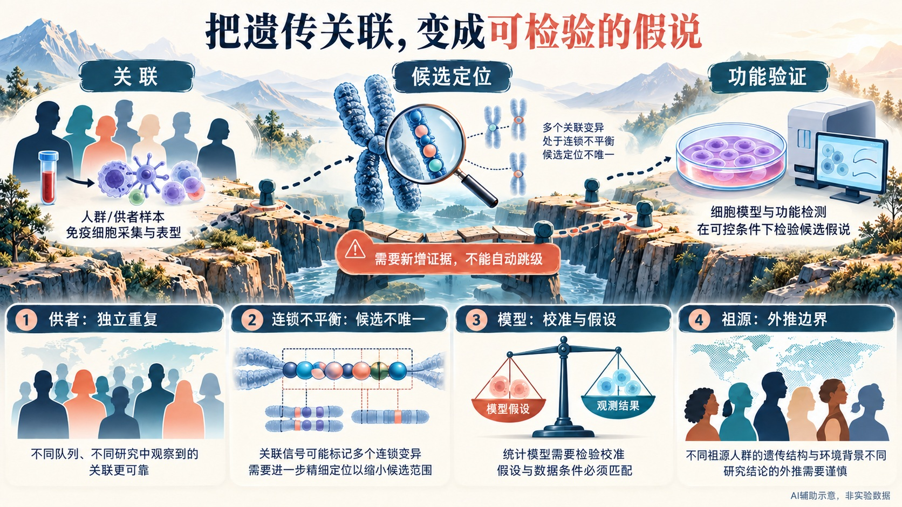

*AI辅助原创示意，非实验数据。从人群关联到候选定位再到功能验证，需要不同证据；示意不是作者已经完成全部因果链的声明。*

### 1. 先问独立样本是谁，再看细胞有多少

TenK10K第一阶段分析了1,925名欧洲遗传祖源供者的5,438,679个外周血单个核细胞，涉及28种免疫细胞类型。更多细胞帮助辨认稀有类型和连续状态；但遗传变异的独立信息主要来自供者，不能把同一人的细胞当成数千位新的参与者。

这条原则可以直接改变实验设计。若目标是更准确地刻画某个供者的细胞状态，多测细胞有帮助；若目标是估计低频遗传变异的效应，增加独立携带者通常是另一种不可替代的信息。两者都重要，却不能仅凭总细胞数互相折算。

报告中至少同时列出供者数、每类细胞的供者覆盖、各供者细胞数分布，以及关键等位基因的携带情况。只给一个百万级细胞数字，会隐藏最影响遗传推断的分母。

### 2. 常见变异和罕见变异，检验单位不同

本研究的常见变异分析主要检验单个变异与附近基因表达的关系；罕见变异则更多借助基因附近的变异集合。后者通过聚合信息，缓解单个罕见变异携带者太少的问题，但显著结果首先属于集合，不是集合里的每个碱基都得到功能确认。

负担检验和SKAT也不是两个可随意互换的按钮。前者适合较一致的方向性贡献，后者容许集合内部效应异质。研究中大量信号由SKAT发现，提示异质作用值得考虑；它不能反过来告诉我们每个变异的方向和机制。

迁移到自己的项目时，优先记录集合边界、功能过滤、频率阈值、权重与携带者数量。一个显著P值无法替代这些定义，也无法说明换一种集合构成后是否仍稳健。

### 3. “细胞特异”至少包含四个问题

基因是否在两类细胞中都可测？两类都有足够检验能力吗？检出的是否是同一个遗传信号？如果是，效应方向是否一致？把这四问分开，能避免最常见的推断跳跃。

一边显著、一边不显著，不等于两边效应显著不同。两个lead SNP不同，也可能只是同一连锁区域中选中了不同代表。方向相反更值得机制研究，但依然需要等位基因对齐、合适的比较模型和后续实验。

因此，跨细胞结果表应保留未检验、未显著与模型失败三种状态，不要统一写成“没有作用”。表达覆盖、标准误和独立供者信息，应当与显著性一起展示。

### 4. 共定位让候选更具体，不让因果自动闭环

研究把细胞分辨率eQTL与疾病及血液性状GWAS联系起来。OSM的例子说明：一个基因广泛表达，并不意味着所有细胞中的调控信号都与疾病同样相关。NK细胞中的局部表达关联与炎症性肠病信号共定位，为细胞背景提供了更具体的优先级。

不过，共享局部遗传信号并不单独证明表达变化介导疾病。不同分子过程可能受到同一个遗传区域影响；模型也依赖先验、窗口和因果信号数量假设。较高PP H4应当推动更有针对性的实验，而不是替代实验。

下一步应分别验证：候选序列是否改变调控活性；它是否影响目标基因；目标基因变化是否介导相关功能表型。这三个问题，不能由一张区域关联图一并回答。

### 5. 连续状态和细胞组成，不是同一种“动态”

状态依赖eQTL问的是：同一个变异的表达效应是否随细胞状态改变。细胞状态丰度QTL问的是：不同基因型的供者是否拥有不同的状态组成。前者的对象是条件表达关系，后者的对象是供者层面的细胞组成。

本研究的NK状态分数由表达和功能先验推断，不是直接测量的杀伤率或炎症强度。横断面中从低分到高分的排列，也不是追踪同一个细胞的时间轨迹。csaQTL中的邻域丰度，则是被捕获细胞的相对组成，不自动等于血液中的绝对细胞数。

想区分这两条路径，可考虑独立的蛋白或功能读数、多供者刺激设计、绝对细胞计数，以及留出供者的稳定性检验。这些是由论文启发的研究建议，并非作者已经全部完成的验证。

### 6. 复杂模型要带着失败记录一起读

TenK10K没有只有一个模型。普通eQTL使用SAIGE-QTL计数混合模型；NK状态交互使用另一个线性混合框架；细胞状态丰度分析使用GeNA。各自的输入、分布假设、频率范围和校准方式不同。

一个分析的校准不能为所有后续分析背书。作者对较低频率csaQTL的校准问题作出限制，最终主要保留频率至少5%的变异；这意味着不能把该结果介绍成罕见变异状态丰度图谱。补充材料中局部的交互诊断，也不能扩写成全部基因、全部状态均已验证。

读方法时，除了问用了什么软件，还要问哪些组合失败、哪些参数被弃用、哪些结果被排除。清楚记录边界，通常比隐藏失败后提供一张整齐结果表更可迁移。

### 7. 资源的适用范围，和它的规模同样重要

这项研究限于外周血免疫细胞和特定祖源背景，两个队列的招募与样本处理也不同。细胞比例可能受到冻融、保存与捕获影响；祖源差异会改变频率、连锁结构和检验能力。协变量能控制部分已测差异，但不能保证所有技术与生物因素都被分离。

与早期OneK1K的比较也需要注意供者来源重叠。数据一致性、方法敏感性和完全独立人群复制，是不同等级的支持。不能把同一批人的另一轮测量或分析，直接当作独立复制。

公开汇总统计适合候选查询与后续整合，个体级数据则有受控访问要求。本系列没有取得个体数据、没有重跑模型，也没有声称独立复现作者的性能或发现数量。

### 把七条判断收进一张研究卡

下次遇到一个吸引人的位点，可以按下面顺序填写。它适用于本研究，也适用于很多单细胞遗传整合项目。

- **现象**：具体是基因表达、状态交互，还是细胞组成？不要把三者混用。
- **单位**：独立供者、细胞、基因—细胞组合、变异集合，分别是哪一个分母？
- **信号身份**：效应等位基因是否统一？lead SNP与真正候选因果变异是否区分？
- **比较对象**：对照是否有足够表达和统计效能？两组是否来自相同或重叠供者？
- **证据来源**：实测RNA、染色质、统计模型、序列预测和功能实验分别贡献了什么？
- **替代解释**：连锁、多个信号、样本处理、组成变化或状态定义是否仍能解释结果？
- **下一步**：什么新增测量最能区分这些解释，而不只是再次得到一个显著P值？

这张卡的作用不是把每个项目都变成无限追加实验，而是让下一步与当前证据缺口匹配。若问题是样本不足，就补独立信息；若问题是信号混合，就改善定位；若问题是机制未定，就设计能区分路径的实验。继续增加图层，不一定比补上关键证据更有效。

### 最后留下三句话

**细胞分辨率让遗传关联更具体，但不自动使它成为因果。**

**同一个显著结果，只有明确了供者、细胞、变异与基因的分母，才知道它真正说明什么。**

**最有价值的资源使用方式，是从候选名单走向可区分机制的实验，而不是把名单本身当作机制。**

这正是TenK10K值得读的原因：它提供大规模、细胞分辨率的调控资源，也把新的统计与解释问题摆到台前。资源不需要被包装成无边界的答案，才能对下一项研究有用。

**核验范围与素材说明**：本系列实际阅读了正式正文、Methods、扩展图说明、报告摘要及合法可得的补充说明，并核查相关补充表和部分原始方法来源。未重新运行分析。正文分篇保留原文Fig.2—6及Extended Data Fig.9作为证据；本篇为独立综合，不新增实验论断。封面、各篇hero为AI辅助原创示意，非实验数据。BioRender署名的原文Fig.1a、c未转载。原文证据图依适用许可原样展示，不由原创示意替代。

**主要来源**：[Rare and common genetic variants shape single-cell immune gene expression](https://doi.org/10.1038/s41586-026-10721-2)，Nature，2026年10月28日；[汇总数据](https://doi.org/10.5281/zenodo.18221260)；[作者分析仓库](https://github.com/powellgenomicslab/tenk10k_phase1)；[GeNA原始研究](https://doi.org/10.1038/s41588-024-01909-1)。
