# 胰腺癌的剪接变化，哪一条才是机制？

::: {.book-source}
论文：[DOI 10.3389/fmmed.2026.2009133](https://doi.org/10.3389/fmmed.2026.2009133)。原有图注和许可说明见正文；未明确许可的图版标记为**授权待确认**。
:::

封面：AI 辅助原创示意，不是实验图或患者数据。

剪接与不同转录本：AI 辅助原创示意，不是实验图或患者数据。

## 同一个基因，分子版本为什么会变？

**本期纵览**：基因总表达 → 剪接事件 → 完整转录本 → 蛋白及定位 → 细胞表型 → 病人结局，是六个不同的观察层级。本文最值得读的地方，不是把几条 RNA 通路记在一起，而是教我们识别谁真的改了剪接、谁改的是剪接因子、谁和剪接只是同时改变。我们用 PKM、GAP17 和 TMC7 三个例子追证据，不为任何治疗提供建议。

### 一、同一个基因的两种读数，可能同时都对

假想同一个基因只有两种转录本。在肿瘤样本甲里，包含某个可变外显子的分子有 80 个、跳过的有 20 个；乙里分别有 20 个和 80 个。两个样本基因总数都是 100，但分子构成反过来了。如果仅看基因计数，得出“这个基因没有上调”有可能是对的；如果再把它解读成“它的 RNA 加工没变”，就错了。这里的 80/20 是教学数字，不是胰腺癌患者数据。真正从读段估计可变外显子纳入比例（PSI）时，分子也并不总能逐个数到。有的读段跨过纳入侧接头，有的跨过跳读接头，还有大量落在共同区段。有效长度、覆盖、文库、比对和注释都会影响可用证据。不要把一个平滑的百分数当成直接观测。

这篇发表在 Frontiers in Molecular Medicine 的正式综述，不是新的临床队列研究。Jiménez-Lozano、Hernández-Munain 和 Suñé 用胰腺导管腺癌（PDAC）讨论：为什么基因型相近的细胞可以表达不同的 RNA 产物，以及哪类分子证据才配被写成实线箭头。PDAC 的背景很适合检验这个问题：同一块组织中，恶性上皮、成纤维细胞、免疫细胞及其他来源的 RNA 比例可大幅变化。即使测到很稳定的组织级 PSI 差异，我们也不能直接说恶性细胞在原地换了剪接方式。

### 二、先标“作用位置”，再标“证据强弱”

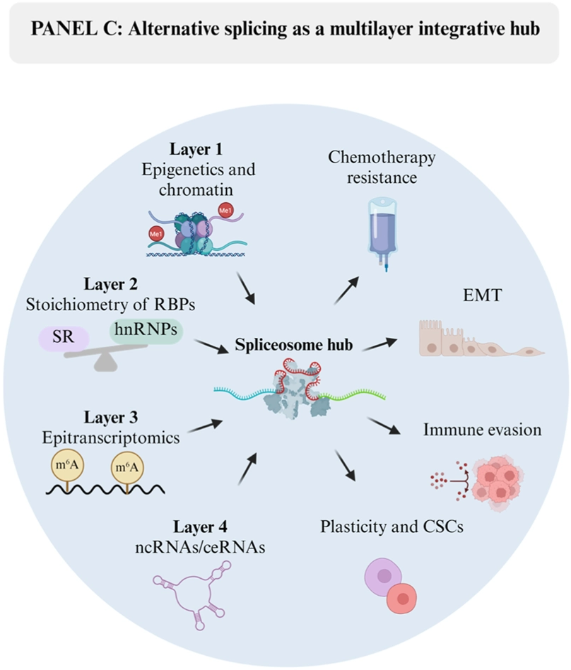

综述图 1C 是四层调控的概念框架，并非一组样本数据：染色质、RNA 结合蛋白比例、RNA 修饰与非编码 RNA 共同指向剪接枢纽，但指向表型的箭头仍需逐条验证。 来源：[Jiménez-Lozano、Hernández-Munain 与 Suñé，Frontiers in Molecular Medicine（2026）](https://doi.org/10.3389/fmmed.2026.2009133)，[CC BY 4.0](https://creativecommons.org/licenses/by/4.0/)。原样裁取标注区域，转为 PNG，未改数据或面板布局。

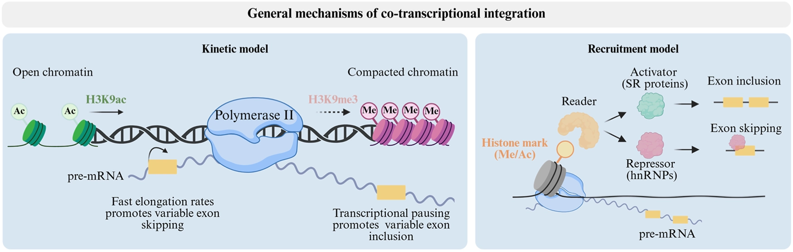

综述图 2 上半：左边是转录速度和剪接选择的动力学模型，右边是标记、读者蛋白与因子的招募模型。是一般机制示意，不代表不同外显子均遵循相同方向。原图下方的 PDAC 例子没有用于这张裁图，尤其不能拿右下示意当 TMC7 上游链已建立。 来源：[Jiménez-Lozano、Hernández-Munain 与 Suñé，Frontiers in Molecular Medicine（2026）](https://doi.org/10.3389/fmmed.2026.2009133)，[CC BY 4.0](https://creativecommons.org/licenses/by/4.0/)。原样裁取标注区域，转为 PNG，未改数据或面板布局。

综述 Fig. 1 和 Table 1 提供一套可用的阅读顺序。第一层描述剪接位点附近发生了什么：这个外显子被纳入还是跳过，或者供体、受体、内含子保留发生改变。RNA 结合蛋白（RBP）识别的序列位置、剪接装配的时机，以及一段新生 RNA 局部能否被接近，都属于这层。第二层往上走一步：一个转录因子、激酶或细胞状态先改变剪接调控者的量、活性或位置，后者才改变某个外显子的选择。第三层是并行 RNA 现象：编辑后的双链 RNA 可以改变先天免疫感知，非编码 RNA 可以影响其他转录本的稳定性。这些机制可能重要，但如果没有指出是哪一个剪接接头变了，就还不该把它们叫作“剪接介导的表型”。

这三层不是给研究打金银铜牌。上游间接调控也可以有很强的功能证据；直接作用在某个序列上的证据也可能只在与胰腺无关的细胞里成立。同一条链可以包含不同层级的箭头。读综述时更实用的笔记法，是每条箭头写两栏：作用发生在哪里；是在哪个体系、用什么读出确认的。不要让 Table 1 一个“直接”标签替代这一核对。例如综述表中把 RBM10 到 NUMB/Notch 行归入直接 PDAC 举例，但正文明确说明 NUMB/Notch 那条轴最初研究于肺癌模型、在 PDAC 中的相对贡献仍未被正式拆开。PDAC 的 RBM10–TERT 分支与跨癌种的 NUMB 分支需分开讲，不能用一个基因在不同论文中都出现，就把全部箭头拼为同一个胰腺癌实验。

### 三、PKM：先区别“哪种 RNA 版本”，再问它是否参与耐药

PKM1 和 PKM2 的区别不是“多测出一条 PKM”。两个产物使用互斥的外显子，较常见的入门标记是 PKM1 对应外显子 9、PKM2 对应外显子 10。综述借 PTBP1 说明剪接因子水平变化如何改变这一选择。原始 Calabretta 等论文（Oncogene，正式卷期 2016）给出了比基因相关热图更具体的对照：两种经研究者建立的耐药 PDAC 细胞模型与各自亲本相比，PKM 版本分布不同；干预剪接后，作者在同一批细胞同时看 RNA 条带、PKM 蛋白和药物相关死亡读出。这里不该只截最后一张柱图，因为它很可能被读成“随便改变 PTBP1 就一定能恢复药物敏感”。

原始 Fig. 4A 和 B 讲的是是否改变分子身份。A 的条带和定量围绕各组 PKM2 比例；B 在蛋白层面作交叉确认。Fig. 4C 则是不同细胞条件下 cleaved caspase-3 阳性的细胞死亡百分比，图例报告三次实验。读这三块时要问：对照寡核苷酸有无影响？未加药条件下死亡是否也上升？分组是两种细胞系及其派生条件，不是四群患者。对照与表型的组合支持“这个剪接变化在这些模型中参与耐药”，但不能把模型中一个变化写成病人层面可选择的治疗，更不等于所有 PDAC 都采用同一代谢方式。原文可在 PMC 阅读；本母稿没有转载该研究的胶图和免疫印迹原图，出版图许可需独立处理。

一个可迁移的观察：如果一篇论文只发现 RBP 水平与某个 isoform 相关，而没有把后者从其他靶点中分离出来，那么 RBP 变化的大量间接效应仍不能排除。反过来，只改变一个事件再看到表型，至少把问题缩小到这类产物，下一步还需分辨是 RNA 被降解、蛋白少了，还是两个蛋白各自具有不同的性质。两种证据解决的问题不一样，连起来才是机制链。

### 四、GAP17：催化作用还在，位置却变了

Escobar-Hoyos 等的 Cancer Cell 原始研究，把突变 p53、hnRNPK 与富含胞嘧啶的 GAP 可变外显子串在一起。综述把某些产物概括为功能受损，对 GAP17 来说如果把它写成“没有催化活性”，就与原始结果冲突。原始 Fig. 2E 是细胞内 KRAS-GTP 和 pERK 等信号读出；2F/2G 是把体系拆开后在体外用纯化组分测 GTP 水解；2L/2M 看细胞里什么比例的蛋白位于膜相关部分。加不加 polyC 外显子所得的两个 GAP17 版本，在体外没有表现出作者所要解释的催化缺失；膜关联则不同。它们不是互相矛盾的数据：一个酶有活性，不等于活细胞中它能遇到适当底物。

这里的反例比总路线图更有教学价值。假如只有“某个分组 pERK 更高”和“剪接变了”，容易画出一个直接催化损伤的箭头；纯化组分的阴性结果让这支箭头不能落笔。细胞分级结果提供了另一种解释，仍要保留原文所研究的等位背景和模型。核对组的 n 在这些图中多为重复，不是患者数。论文还报告模型系统的功能干预与患者来源类器官相关观察，但它们不能提升为全部突变 p53 类型、全部 KRAS 突变或临床疗效的声明。原图采用链接和按 panel 引用，不把作者 PDF 公开可读等同于可复用。

### 五、TMC7：预测链中，哪里突然多出了一条箭头？

综述 Fig. 2 把两个通用模型排在上方：速度模型关注 RNA 聚合酶 II 通过某个位点时读者有多长的识别窗口；招募模型关注蛋白通过染色质或 Pol II 尾部进入加工现场。它们并不互斥，“聚合酶越慢，外显子纳入一定越高”也不是普遍规律。下面列了 PDAC 例子，其中 Fig. 2D 和 Table 3 把缺氧、HIF-1α、局部染色质、MBNL1-018 与 TMC7 外显子 17 相连并引用 Weng 等。回到这个引用，会发现证据最多只到后一段。

Weng 等联合公共数据筛选和外部数据，报告外显子 17 的纳入与 EMT 相关状态，使用细胞及病人来源类器官研究侵袭和迁移；Fig. 6A/B/C 是一个原发灶类器官与两个肝转移灶类器官的读数以及事件干预后的侵袭实验；Fig. 6D/E 是共 67 例患者的截点选择与生存关联（文中 p = 0.037）。同一队列择点又看分组曲线，不能称外部验证。类器官结果说明可在有限模型观察到功能端变化，不足以证明缺氧如何让外显子多纳入。原始论文讨论缺氧文献，但未展示此处所需 HIF-1α—MBNL1-018—TMC7 的直接中介链。别把未验证的上游包装成已知事实，也不要因为上游欠证据，就否定后半段可从原论文读到的结果。这个区分比记住一个候选基因更重要。

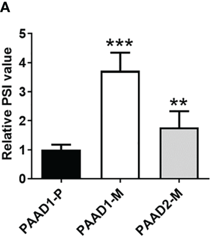

原始研究图 6A：纵轴为相对 PSI（非 0–100% 的绝对纳入率）；PAAD1-P 来自原发癌，PAAD1-M 和 PAAD2-M 为肝转移来源。图中的柱和误差线不能当作三个独立患者队列。 来源：[Weng、Qian、Hong、Zhao、Deng 与 Shen，Frontiers in Immunology（2023）](https://doi.org/10.3389/fimmu.2022.1089008)，[CC BY 4.0](https://creativecommons.org/licenses/by/4.0/)。原样裁取标注区域，转为 PNG，未改数据或面板布局。

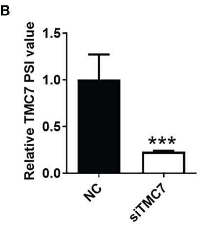

原始研究图 6B：纵轴为相对 TMC7 PSI，横向对比阴性对照 NC 与 siTMC7；它检验的是模型内干预后的剪接读数，不是临床治疗反应。 来源：[Weng、Qian、Hong、Zhao、Deng 与 Shen，Frontiers in Immunology（2023）](https://doi.org/10.3389/fimmu.2022.1089008)，[CC BY 4.0](https://creativecommons.org/licenses/by/4.0/)。原样裁取标注区域，转为 PNG，未改数据或面板布局。

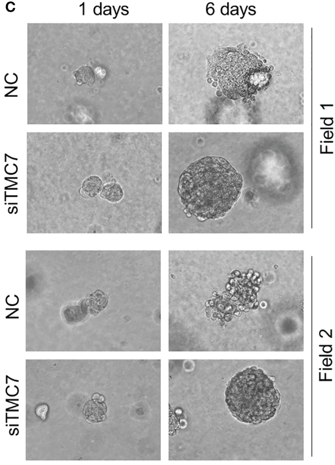

原始研究图 6C：第 1、6 天的三维侵袭显微图；每组内比较 NC 与 siTMC7。Field 1/2 是两个视野，并不是新增独立患者。保留原图方向，不把体外侵袭等同人体转移。 来源：[Weng、Qian、Hong、Zhao、Deng 与 Shen，Frontiers in Immunology（2023）](https://doi.org/10.3389/fimmu.2022.1089008)，[CC BY 4.0](https://creativecommons.org/licenses/by/4.0/)。原样裁取标注区域，转为 PNG，未改数据或面板布局。

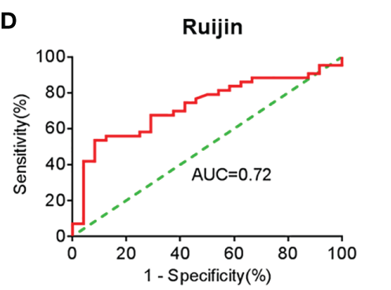

原始研究图 6D：横轴 1−特异度，纵轴灵敏度；ROC 用于同一 67 例队列的切点分析，AUC 0.72 不能作为外部诊断性能。 来源：[Weng、Qian、Hong、Zhao、Deng 与 Shen，Frontiers in Immunology（2023）](https://doi.org/10.3389/fimmu.2022.1089008)，[CC BY 4.0](https://creativecommons.org/licenses/by/4.0/)。原样裁取标注区域，转为 PNG，未改数据或面板布局。

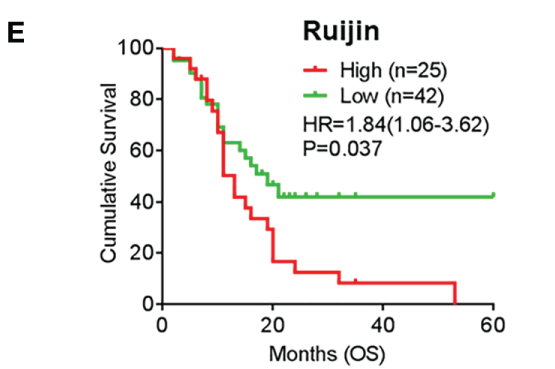

原始研究图 6E：横轴是总生存月数，纵轴累积生存率；高组 25 例、低组 42 例。原图 HR 1.84（1.06–3.62），p=0.037；这是同队列探索性关联，不提供临床验证或风险预测。 来源：[Weng、Qian、Hong、Zhao、Deng 与 Shen，Frontiers in Immunology（2023）](https://doi.org/10.3389/fimmu.2022.1089008)，[CC BY 4.0](https://creativecommons.org/licenses/by/4.0/)。原样裁取标注区域，转为 PNG，未改数据或面板布局。

最后回到病人组织。如果一个肿瘤组有更多基质或间质样细胞，会不会表现出相同的 PSI 结果？很可能。术前用药、取材部位甚至 RNA 完整性也可能和组别一起变化。作为第一轮分析，一张同样标出使用的接头、样本数量和覆盖缺失的图，往往比一张只标三颗星的热图更能帮助复核。接下来一篇继续问：加了 RNA 修饰、有了生存曲线，能不能说剪接已介导表型？答案不是一律“不能”，而是每一步要有缺一不可的证据。

**阅读入口**：[综述全文](https://www.frontiersin.org/journals/molecular-medicine/articles/10.3389/fmmed.2026.2009133/full) · [Calabretta 等，原研究](https://pmc.ncbi.nlm.nih.gov/articles/PMC4650269/) · [Escobar-Hoyos 等，原研究 DOI](https://doi.org/10.1016/j.ccell.2020.05.010) · [Weng 等，原研究](https://www.frontiersin.org/journals/immunology/articles/10.3389/fimmu.2022.1089008/full)

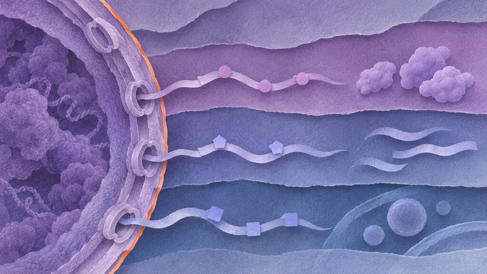

不同层的 RNA 调控：AI 辅助原创示意，不是实验图或患者数据。

## 看到 RNA 修饰，就能说“剪接让肿瘤变了”吗？

**本期纵览**：给候选事件画证据阶梯，比把所有修饰、信号和药物都纳入一个多组学网络更重要。先问局部接头究竟有没有改变；再问变化来自加工还是稳定性；接着问蛋白功能和表型是否由它解释。最后才问跨样本、跨模型和跨患者能否复现。

### 一、同一个修饰，可以改不同的输出

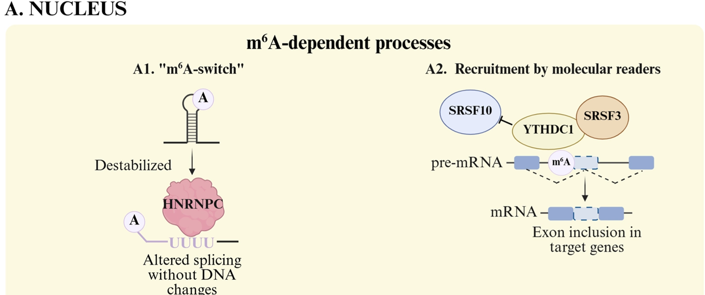

综述图 3A1–A2：核内 RNA 结构改变与读者蛋白/剪接因子招募是不同假说。它们不是在同一胰腺癌模型中测得的数据。由于 A3 图示闭环超出主文可核验范围，本处不并入 A3。 来源：[Jiménez-Lozano、Hernández-Munain 与 Suñé，Frontiers in Molecular Medicine（2026）](https://doi.org/10.3389/fmmed.2026.2009133)，[CC BY 4.0](https://creativecommons.org/licenses/by/4.0/)。原样裁取标注区域，转为 PNG，未改数据或面板布局。

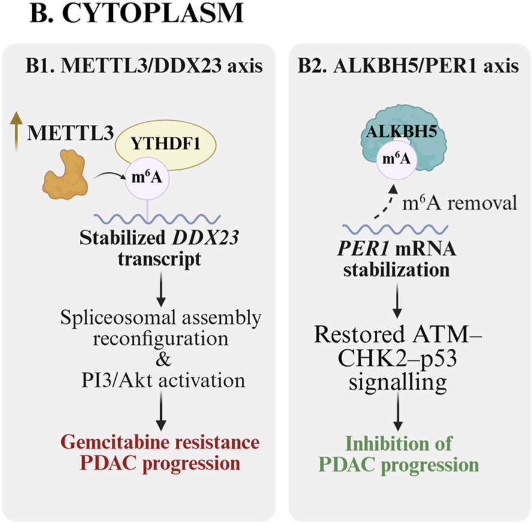

综述图 3B1–B2：左为 DDX23、右为 PER1 的稳定性路径。箭头是文献框架，不是同一检验；稳态 RNA 变化不能直接代替特定接头的证据。 来源：[Jiménez-Lozano、Hernández-Munain 与 Suñé，Frontiers in Molecular Medicine（2026）](https://doi.org/10.3389/fmmed.2026.2009133)，[CC BY 4.0](https://creativecommons.org/licenses/by/4.0/)。原样裁取标注区域，转为 PNG，未改数据或面板布局。

m⁶A 是指 RNA 上腺苷的一种甲基化修饰。在综述列举的通用模型里，它可以改变 RNA 局部结构，暴露或遮住 RBP 能认出的序列；也可以被读者蛋白识别，再影响其他加工因子的结合。两种模型听起来都通向剪接，但实验问题不同：一个要看局部 RNA 可接近性是否真的变化，另一个要区分修饰本身与某个 reader 下游效应。即便在别的细胞系统已观察到一个特定外显子受影响，也不能靠分子名字一致就把方向搬到 PDAC。局部位点、细胞类型和读出是否可比，比“这条通路很有名”更重要。

综述 Fig. 3 有价值的是把细胞核和胞质中可能同时发生的事情画在一起，不是让所有箭头都拥有同一种证据。核内的 m⁶A 开关与 reader 招募主要来自通用研究；在 PDAC 模型中，综述讨论的 METTL3/DDX23 与 ALKBH5/PER1 两例，最明确的测量分别涉及受体 RNA 的稳定性。没有位点或剪接事件到功能的中介证据，不能直接写“因为改了一个剪接事件，所以细胞耐药/不耐药”。如果画给公众看，为 Fig. 3B 两例写“RNA 稳定性有证据；导致表型的特定剪接事件待证”，比临摹一条未经拆分的粗箭头更准确。

### 二、CLK1/SRSF5：剪接因子可以改变“写入机器”，却不说明反向闭环

Chen 等研究的证据顺序值得认真看。作者先找与 CLK1 相关的磷酸化变化，随后在细胞模型中分别检测 CLK1 与 SRSF5 第 250 位丝氨酸的磷酸化、蛋白相互作用、SRSF5 与目标 RNA 的结合及特定剪接事件，再把读数接到细胞表型。在 Fig. 6H/I，要对照横轴的纳入差异、纵轴的 FDR 和组别名称，不能看见论文题目里的 “skipping” 就把所有事件写成同方向。6J/L 是示意图，6K/M 与 6O/P 给 RNA 结合相关数据，6S/T 则是分组对照中的事件读数；组合上强于只有生存相关。那项研究同时讨论 METTL14 和 Cyclin L2，二者变化并非简单平行。主文中关于 METTL14 方向的文字并不完全一致，综述 Fig. 3A3 又把图简化为一个循环。因此本稿只保留“该轴在具体细胞条件下改变 METTL14 外显子 10 和 CCNL2 外显子 6.3 的使用，伴随 m⁶A 读出变化”，不在可发布图中描写统一方向或已闭环的反馈。是否能证明下游甲基化再回头改变同一条 CLK1–SRSF5 链，需要独立的反向干预和时间证据；一个变化跟着另一个变化出现还不够。

### 三、RNA 编辑和非编码 RNA：整理并行通路，不拿它们凑剪接机制数

A-to-I 是把 RNA 中某些腺苷变成肌苷。在分析测序结果时，肌苷往往表现为相对参考序列的 A→G 信号；这个读数也会受基因组变异、比对、重复区域和覆盖的干扰。若要解释剪接，应看到编辑与具体接头在适当的分子或样本层级共现，并区分编辑依赖效应与 ADAR 蛋白结合本身的效果；在胰腺癌某些相关论文里，最直接的则是内源 dsRNA 感知和免疫读出，不应自动归入剪接介导。综述 Table 1 的“尚未在 PDAC 证明”比一个扩写的疾病故事更值得保留。ADAR1 可以影响细胞怎样读一段双链 RNA，不等于它在这些材料中已经改变某个外显子。

circRNA 与 lncRNA 也是如此。circRNA 产生可以涉及反向剪接，但“某个 circRNA 的产生过程有接头”和“它后续通过 miRNA 网络影响另一个基因的线性选择性剪接”是两个问题。宜分别给出环状产物的识别证据、可能的结合或竞争证据、细胞表型变化，再寻找特定线性剪接输出。否则，把同一张中有连线的图读成了一个闭合的调控网络，实际上是把共同变化和直接作用混用。包括 dsRNA 感知与 ceRNA 在内的其他 RNA 层，本文保留为并行解释，不作为临床或免疫治疗建议。

### 四、生信不能把“不同的条形码”当作“不同的病人”

如果研究问题是某个剪接事件在恶性上皮内是否随状态变化，不要让每个细胞成为一个独立病人。较合理的初始单位是 donor；若多个切片来自同一 donor，先保留配对、样本和批次身份。细胞状态组成和状态内部变化要分开呈现。以"深度批次"为例，某个 donor 的某组只覆盖到了一个接头，直接计算一个接近 0 或 1 的 PSI，只是在展示一个低信息比分数。应报告支持纳入和排除的读段、信息充分的 donor 数、以及为何某样本未估计。把低覆盖标为缺失与把它标成生物学 0，后续模型会得出完全不同的故事。

短读长最擅长做的是局部接头检验，验证一段外显子如何接上；不靠另一种估计，就不应宣称两个相距很远的事件一定发生在同一条 RNA 上。长读长有助于将事件连到同一分子上，但全长到达率、读段截断、模板切换、去重和样本规模会影响信心；并不是方法名字带“单细胞”就能给每个细胞所有转录本。常规空间转录组也不默认具有 isoform 分辨率。它首先定位组织或细胞状态；要定位特定接头需要有可分辨该接头的设计和验证。若三个平台来自不同病人、切片或时间点，不能把图层叠在一起就当作同一分子上的联合测量。

一个适合读图会的练习是给每个事件写一行：基因/接头坐标、参考版本、证据是半条还是整条、各组有多少生物学重复、稳定性解释是否排除、蛋白证据是否已有。假设有人递来一张热图，红色一片并说“间质状态的剪接都变了”，可以先从三处查起：差异是否由病人构成或细胞构成带来；共用外显子占多数时程序怎样分配读段；同一条件中能否看到相反方向的接头证据。再要求伪发现控制的假设与效应量分开，而不是只问阈值过了没。不同团队比较结果时，把这些列写清楚比只互换候选列表有效。

### 五、从机制候选到病人标志物，中间至少还有两个判断

第一个判断是“哪个样本里能测，而且这个读数有多稳定？” 若一个标志物候选是 TMC7 外显子 17，发现集上择最佳截点并观察 Kaplan–Meier 曲线，是提出假设，不是交出一条可使用的规则。独立验证时，应在新样本读数足够前先锁定分析规则和纳入标准，检验对已知临床/病理因素是否增加信息，在训练/验证中保持 donor 独立；如果无法在常用标本上复测，强关联也不意味着实用。更不能把体外细胞对某药处理的变化替换为患者获益。

第二个判断是“这个节点对肿瘤是否比对正常组织更可分，而且将它打开或关闭有何后果？” 综述 Table 2 的策略讨论，涉及整个剪接装置、调控激酶、单个剪接事件、RNA 修饰和以剪接产物为目标的蛋白表位。技术路线多并不等于已有哪一项适用于胰腺癌患者。广泛调控 RNA 加工可能同时影响正常细胞；肿瘤组织可达性、全身毒性、模型差别和患者分层都需要实证。一个肿瘤可见的蛋白表位，与可用药适应证也是两条不同的线。本文不引用随时间变化的批准、患者比例或方案，不给治疗建议。读综述若看到“现阶段临床有效”或“人群推荐”，请直接读最新监管资料与原始临床数据，而不是拿示意图做依据。

这就是综述对分析者最实用的提示。不用先决定要做哪个大模型，也不用给每篇文献堆五张概念图。从一条能在多个病人中稳定看到的接头开始，把“相关、局部机制、功能模型、临床可用”沿同一条链逐层打标。卡在中间，往往是很有价值的结论：它告诉你下一张图应拿出什么数据。

**阅读入口**：[综述全文及 Fig. 3、Tables 2–3](https://www.frontiersin.org/journals/molecular-medicine/articles/10.3389/fmmed.2026.2009133/full) · [Chen 等，原研究 Fig. 4/6–7](https://link.springer.com/article/10.1186/s13045-021-01072-8)

## 阅读范围和图件说明

本稿依据[期刊正式版](https://www.frontiersin.org/journals/molecular-medicine/articles/10.3389/fmmed.2026.2009133/full)第 1–7 节、声明、图 1–3 与表 1–3，交叉核对所述四项关键原研究的对应面板；未逐条复核全部参考文献，未取得另附补件，未重做数据分析或实验。归档中的两组 CC BY 原图有分别署名并注明所裁面板。综述图 2 下部未作为 TMC7 上游链的直接证据；图 3 的 A3 不纳入，不能从其中的画法确立 PDAC 中 METTL14 的作用方向。图 1C、图 2 上部及图 3 所摘取区块是综述框架，不是原始患者数据。

[PKM 原图 4](https://pmc.ncbi.nlm.nih.gov/articles/PMC4650269/#F4)、[GAP17 原研究](https://doi.org/10.1016/j.ccell.2020.05.010)和 [CLK1/SRSF5 原研究](https://doi.org/10.1186/s13045-021-01072-8)只保留原文链接，不附未专门确认复用权的原图。Weng 原图 6 的 A–C 是有限模型数据；D/E 来自一个 67 例探索性队列，不能相互替代或直接扩展到临床。此稿不提供临床建议。

## Take-home：剪接图上的一根箭头，靠什么画成实线

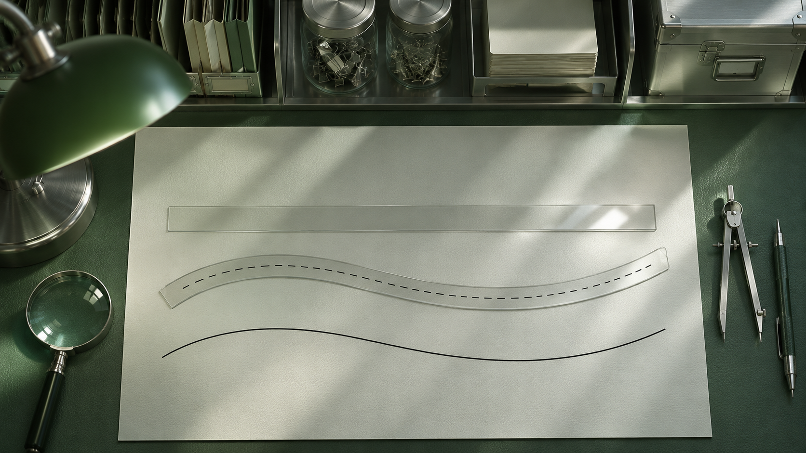

证据强度与待验证链条：AI 辅助原创示意，不是实验图或患者数据。

先记一件事：**发现一个剪接事件、解释它怎么发生、证明它造成表型，是三件事。** 同一张综述图上可以并排画三者，但它们不是同一个实验的结论。

### 1. 一张表达图不能代替接头证据
基因总量没变化，外显子使用可以反转。先看哪些读段真的跨过纳入或跳过的接头，哪些只是落在共同外显子上。覆盖不足的样本不要被填成 0。分子身份仍不清楚时，应据实说“局部剪接事件”，而不是“某全长 isoform 已定量”。

### 2. 一支实线要有自己的条件
PTBP1–PKM 的吸引力，是原论文在耐药细胞中既看版本读出，也看药物相关表型。它回答的是所用模型中的问题。GAP17 的反例更好记：细胞中信号变了，纯化分子催化能力未见作者所假设的缺失，最后真正可支持的解释涉及膜定位。两个实验在不同层级，不矛盾，也不能只留下较好讲的一半。

### 3. 读到“同时发生”时，问是不是同一个变化
RNA 稳定性、RNA 编辑、双链 RNA 感知、非编码 RNA 与亲本 mRNA 比例，都可能改变下游表型。具体剪接事件缺失、或未证实它连接上游和表型时，不要拿这些结果凑剪接因果证据。通用 m⁶A reader 模型不会自动成为 PDAC 的局部机制。

### 4. 小队列的切点与少数类器官不是通用结论
TMC7 的原研究支持外显子 17 是值得追的候选，并给出有限类器官的侵袭结果及 67 例内的生存关联。并未建立综述所画完整缺氧调控链；也没有独立验证的临床规则。把未做的实验留空，能帮读者准确判断下一步。

### 5. 读到多组学，先数清“谁是真正的重复”
病人是重要层级；来自一个病人的几十万个细胞不能当几十万个病人。用空间找位置，用接头或全长证据找 RNA 产物，用蛋白和功能读出再检验机制。同一研究里，要分别写清每一步来自哪个病人、切片、细胞状态和时间点。

下次遇到一个“候选亚型”的故事，不妨用四问快速筛：**哪个接头？哪个模型？有没有能区分替代解释的实验证据？独立样本里能否复现？** 如果只能回答第一问，文章并非没有价值，但标题适合用“发现候选”，不适合用“找到了治疗靶点”。本文用于科研阅读，不是诊疗建议。

来源：[Jiménez-Lozano 等，Front. Mol. Med. 2026，正式综述](https://doi.org/10.3389/fmmed.2026.2009133)；[PKM 原研究](https://pmc.ncbi.nlm.nih.gov/articles/PMC4650269/)；[GAP17 原研究](https://doi.org/10.1016/j.ccell.2020.05.010)；[TMC7 原研究](https://doi.org/10.3389/fimmu.2022.1089008)。
