# TWAS方向可信到哪一步

::: {.book-source}
论文：[DOI 10.1038/s41588-026-02796-4](https://doi.org/10.1038/s41588-026-02796-4)。原有图注和许可说明见正文；未明确许可的图版标记为**授权待确认**。
:::

论文：High false sign rates in transcriptome-wide association studies。Nature Genetics，首次上线 2026-10-22。[DOI](https://doi.org/10.1038/s41588-026-02796-4)

本页按原顺序合并完整解读，保留全部正文、引文、图注、许可说明及阅读边界；仅将分篇标题改为章节标题、下调正文标题层级并调整图片相对路径，最后一章为独立 take-home messages。公众号全部 3 篇草稿已保存，并核验标题、完整正文、图片顺序、共享封面及留言设置；尚未发布，也不表示用户已实质审定。

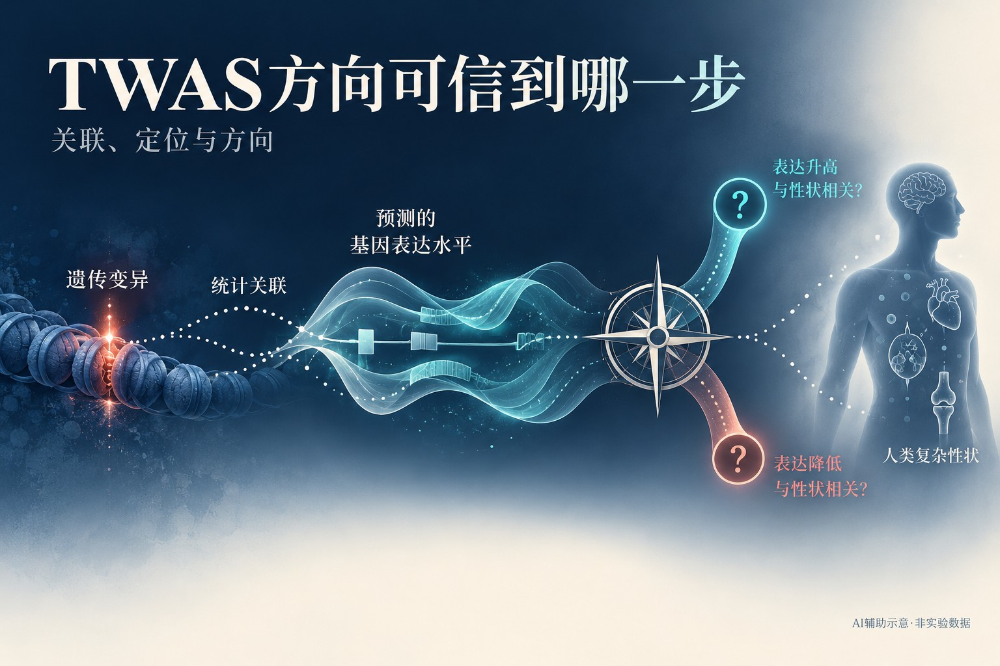

*AI 辅助原创示意，非实验数据。*

## 关联、定位与方向的证据边界

### 显著的正号，能直接变成“应该抑制这个基因”吗？

一张TWAS结果表经常同时承担三种工作：找与性状相关的信号，给候选基因排序，再根据效应正负号决定后续实验该上调还是敲低。前两步即便做得不错，第三步也未必成立。尤其当研究者打算把“预测表达升高与疾病风险升高相关”改写成“抑制该基因可能有益”，一个正号已经跨过了统计关联、作用组织和干预效应三道门。

2026年10月22日，Gerlach等在Nature Genetics发表研究《High false sign rates in transcriptome-wide association studies》。它值得读的地方，不是给TWAS贴上“可靠”或“不可靠”的总标签，而是把通常藏在结果表最后一列的问题单独拿出来评估：已经找到相关基因之后，我们究竟多大程度上知道它往哪个方向起作用？

本文以该研究为案例，建立一套读方向性benchmark的方法。哪些数字是作者的数据结果，哪些是我们对分析实践的建议，会分别说明。我们通读了正式版正文、方法及补充说明，没有重新运行作者代码，也没有独立复算UK Biobank个体数据。以下不是软件“亲测”报告。

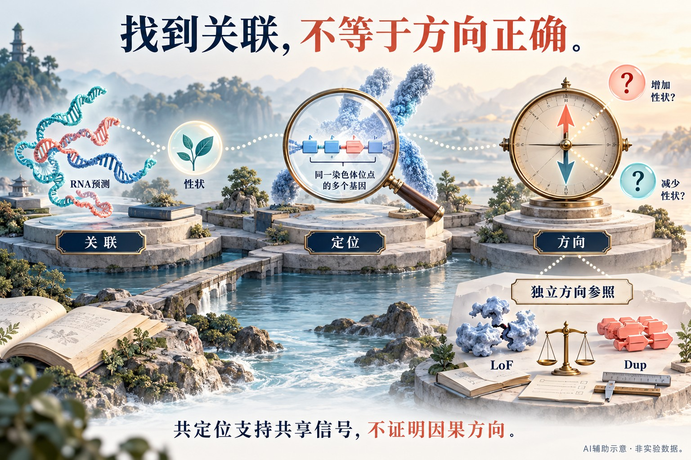

*AI辅助教学示意，非实验数据。图用于区分关联、定位和方向三个问题，不替代下文原文证据图。*

### 一、先把“表达”这个词拆开

TWAS里的表达通常不是GWAS参与者身上实际测量到的RNA，而是用遗传变异预测的表达成分。参考队列提供基因型与RNA表达，用来训练一组顺式变异的权重；再把这些权重与GWAS的性状关联信息结合，估计预测表达与性状的关联。

因此，一个正的TWAS统计量首先意味着：按这个组织、这套权重构建的遗传预测分数，与性状正相关。它不自动意味着某个细胞里真实RNA每增加一倍，性状就会增加相应幅度。后者涉及测量单位、组织状态、作用路径和干预条件，远超一个关联检验的输出。

可以用一个明确标为假设的例子理解：一个遗传单倍型让组织甲中的基因A预测表达升高，也与血液指标升高相关。但该血液指标可能真正受组织乙中的调控过程影响，而同一单倍型在乙中降低A表达。组织甲的TWAS可以统计显著，方向也可以计算正确；错的可能是我们把甲当成乙，继而把预测分数的方向当成干预A的方向。

这不是普通的“相关不等于因果”口号。它指向一个可操作要求：解释正负号之前，先写清楚该符号对应的是哪一种表达、哪个组织和哪一种性状编码。疾病病例记为1还是0、效应等位基因是否统一、预测权重与GWAS是否对齐，都属于必须先排除的基础错误。即使这些步骤完全正确，生物学方向仍然可能不确定。

### 二、怎样给方向找一把独立尺子？

如果用另一种表达关联方法给TWAS打分，两者可能共享同一种偏差。这项研究的设计较有启发性：分别利用同源血浆蛋白及罕见功能缺失变异，建立与预测表达不同来源的方向参照。

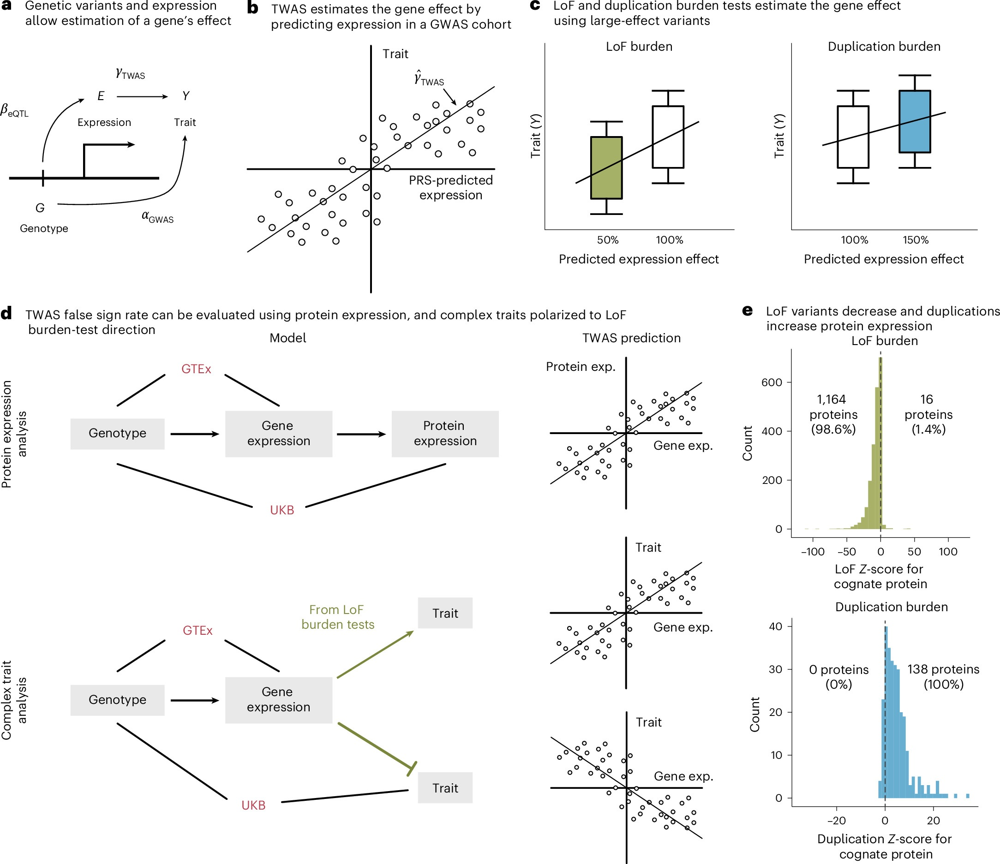

*来源：Gerlach等，Nature Genetics，2026，Fig.1，DOI:10.1038/s41588-026-02796-4，CC BY 4.0。完整原图，仅转换为JPEG，未修改实验内容。图中a–d为作者的设计示意；e为数据统计，不能把两者混称为实验结果。*

图1a、b说明预测表达如何连接到性状；c画出功能缺失、正常和重复拷贝的剂量关系。这些剂量和箱形图是概念示意，不是三个随机干预组的真实测量。图1d把两类参照放到同一评估框架中：对于编码某种蛋白的基因，更多有效表达通常预期带来更多该蛋白；对于复杂性状，则用功能缺失变异的效应方向推断增加基因功能时的预期方向。

图1e才是支持前一假设的实证检查。横轴为基因负荷检验的Z统计量，纵轴为蛋白数量；上、下两幅分别显示功能缺失和重复拷贝检验的分布，虚线为Z=0，区分正负方向；图中数字另行总结达到显著性阈值的检验，并非把零线当成显著性界限。在显著的功能缺失检验中，1,164个蛋白为负向，16个为正向，负向占98.6%；显著的138个重复拷贝检验全部为正向。统计单位是“基因对其编码蛋白的负荷检验”，不是每个受试者，也不是每个变异。

这说明“增加有效剂量通常增加对应蛋白”在这个数据环境中是很强的参照，而不是无一例外的自然定律。功能缺失注释不等于每个等位基因都把所有转录本完全关闭，蛋白检测也可能受测量和生物学过程影响。我们应当承认参照有边界，但不能因为它并非完美，就放弃检验方向。

复杂性状的尺子更需要谨慎。罕见功能缺失可能改变一个人的终生、多组织有效剂量；常见顺式变异往往是较小、组织或状态特异的调节。把二者相反方向作为参照，隐含了局部剂量反应大体单调等条件。作者据此定义的是相对于生物学预期的方向不一致率，不能把每一个不一致位点都描述为已经被实验判定的错误。

### 三、23%的分母是什么？

作者最容易被传播的结果是血浆蛋白分析中的23%方向不一致。若只记住这个百分数，会错过benchmark最重要的一半：哪些对象能进入计算？

研究从UKB-PPP的2,923种蛋白出发，排除一个质量控制未通过的蛋白及15个对应多个编码基因的蛋白后，保留2,907个。并非每一个都存在可用、显著的TWAS结果。最终进入主要方向评估的是1,543个至少有显著组织关联的蛋白。表达权重涉及47个GTEx组织，为避免脑等组织因细分更多而占据更多票数，先合并到27个组织类别。

投票也是分两级：在同一类别内部，只对显著统计量的正负方向投票；随后再在类别之间投票，得到基因层面的概括。这样做减少了组织采样数量不均带来的影响，却不会使27个类别成为独立重复实验。它们共享遗传背景、表达调控和参考数据，不能把“很多组织一致”当成很多次独立因果验证。

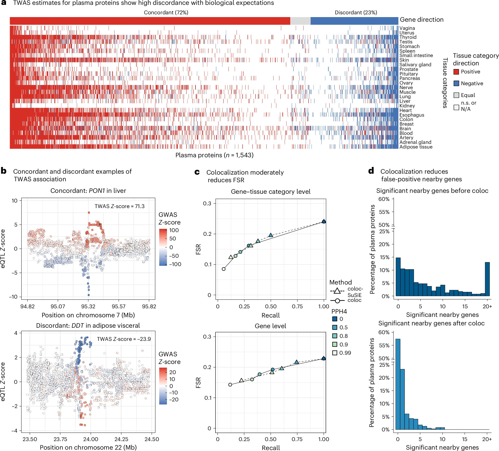

*来源：同上，Fig.2，CC BY 4.0。完整原图，仅作格式转换。阅读下列解释时可放大b、c；原轴、色标和图例均保留。*

图2a的每列是一种蛋白，每行是一个组织类别。红色表示该类别正向显著统计量占多数，蓝色为负向占多数；灰色表示票数相等，白色合并了不显著或没有表达预测模型两种情况。白色不等于“表达为零”，也不等于“这个组织没有作用”。顶部给出基因层面的概括：72%与预期一致，23%不一致，其余为中性或平票。不能用100减23，宣称其余77%已证实正确。

作者报告23%的95%置信区间为20%–25%。这是所选评估集及计算规则下的总体比例不确定性，不是每个基因都有23%的错误概率。若你的性状、祖源、组织参考或筛选标准不同，不能把这个数字直接贴到自己的结果表上。

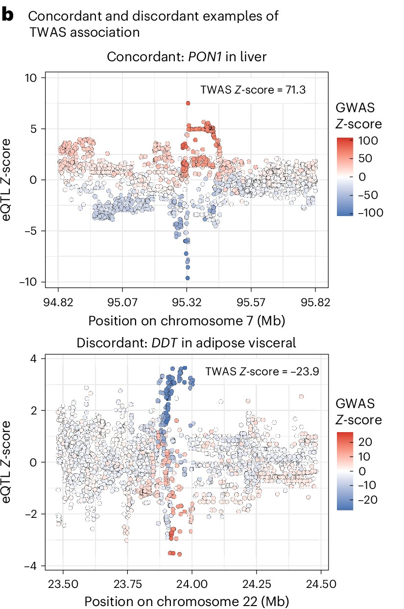

*同文Fig.2b原样局部裁切，仅为手机阅读放大；未改数据，保留坐标、单位及GWAS色条。CC BY 4.0。*

图2b给了两个局部例子。PON1的肝脏结果方向符合预期；DDT在内脏脂肪中的结果方向相反。各点是位点内变异，横轴是染色体位置，纵轴是eQTL Z统计量，点颜色编码蛋白GWAS的Z统计量。这里看的是两套关联在同一区域如何排列，不是在观察RNA对蛋白的直接剂量反应。DDT的反向图案足以提醒我们审查方向，却不足以证明“上调DDT真的会降低它自己的蛋白”。

### 四、共定位的作用，为什么不能浓缩成一个阈值？

TWAS显著可能来自不同因果变异之间的连锁不平衡。共定位试图进一步问：表达关联和性状关联是否与共享遗传信号相容？因此，在TWAS之后加入共定位有明确价值。但“共享信号的证据更强”与“干预方向已确定”仍然是两回事。

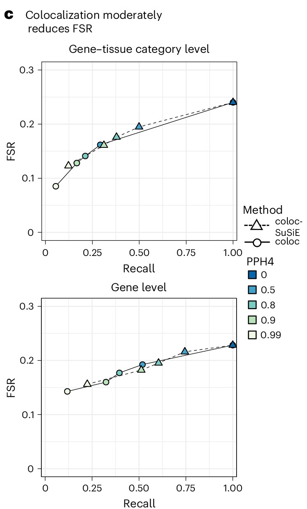

*同文Fig.2c原样局部裁切，保留两级统计单位、坐标、方法图例和PPH4图例。CC BY 4.0。*

图2c把方向不一致率放在纵轴，把保留率放在横轴。圆点与实线代表coloc，三角与虚线代表允许多个信号的coloc-SuSiE；不同颜色对应不同PPH4阈值。上图按基因与组织类别组合计算，下图汇总到基因层面。比较之前先看统计单位，不要把两幅图上的点混成一条排行榜。

这里标作recall的量，主要是过滤后保留的显著关联相对于未过滤显著关联集合的比例，并且限制在有可用共定位概率的集合内。它不是临床诊断的敏感度，也不是已经知道全部真因果基因后计算的真正召回率。论文用这个量表达筛选代价，读者需要保留它的具体定义。

提高阈值通常降低方向不一致，但也丢失候选；即使蛋白分析使用非常高的PPH4阈值，不一致率也没有自动归零。这使一个常见写法失效：“共定位通过，所以正负号可以放心解释。”更合理的写法是：“该组织中两种关联存在共享信号的统计证据，方向还需结合独立生物学信息判断。”

多信号模型也不必在每个指标上都更好。若区域里存在两个GWAS信号，较弱的一个真正与eQTL共享，单信号模型可能盯住更强的另一个而错失共享信号。补充模拟演示了这种情形，说明coloc-SuSiE可以挽回部分关联。但在本研究的实测数据里，保留更多信号并没有稳定转化为更低的方向不一致率。模型更灵活解决的是某一类结构假设，不等于同时解决组织错配、弱eQTL和方向解释。

图2d考察另一种风险：一个编码蛋白的基因周围，出现多少额外的显著基因。横轴是附近显著基因数量，末端“20+”为合并桶；纵轴是蛋白的比例，并使用断轴，不能按柱子的视觉高度直接比较倍数。作者在相应可共定位的蛋白集合中观察到，共定位过滤减少了附近信号，但仍留下不少。这里附近基因可能只是标记，也可能存在真正调控作用，不能把每一个都直接判为假阳性。

### 五、复杂性状为什么更难？

血浆蛋白有“编码基因对应自己的产物”这层相对清楚的关系。身高、血糖、血细胞参数则跨越更多组织和生理路径。对这些性状，作者从85个候选定量性状中，根据外显子功能缺失负荷检验筛得730个显著基因–性状对，涉及73个性状；其中484对至少有一个显著TWAS组织结果。

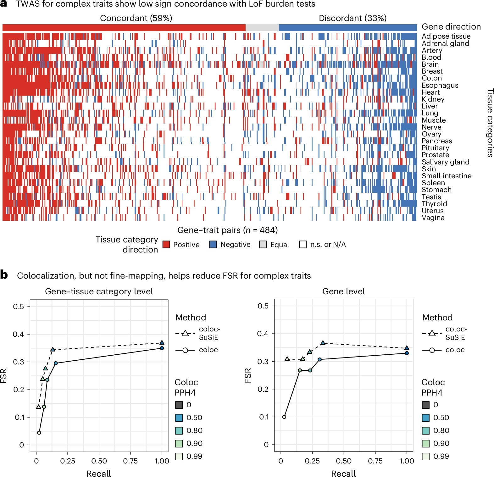

*来源：同上，Fig.3，CC BY 4.0。完整原图，格式转换。正文将顶部一致/不一致分组用于解释，不把不同性状中的颜色直接当成统一的“有害/有益”方向。*

图3a每列现在是一对基因与性状，而非一个蛋白。同一基因对应不同性状，可以出现多列。27个组织类别仍在纵轴，灰色与白色也仍有各自含义。顶部概括约59%一致、33%不一致，其余未形成明确多数方向。作者给出的33%置信区间为29%–38%。这些百分数的分母是进入评估的484对，不是最初85种性状，更不是所有人类基因。

需要特别提醒原图的方向编码：图注写的是正负Z方向，但不同性状的预期方向来自各自的LoF参照。读图时应依照顶部concordant/discordant分类及方法定义判断一致性，而不能简单把红色翻译成“升高性状”、蓝色翻译成“降低性状”，再套到所有列。我们没有独立复算底层矩阵，因此不在单个未标注列上追加方向结论。

作者还指出，部分基因–性状对在绝大多数可用组织里都给出不符合参照的方向。重要启发是：高度一致和高度显著可以同时出现，却仍然建立在同一个不适合该性状的遗传表达代理上。增加投票一致性阈值也不是免费修复。补充说明显示，阈值提高会让更多基因落入“无法判定”；若仍把这些对象放在分母里，错误比例看起来下降，却未必是已给出方向的结果真的改善。

图3b则把复杂性状中的过滤收益与代价展开。横轴为保留率，纵轴为方向不一致率，左侧按基因–性状–组织类别评估，右侧汇总到基因–性状对；圆点实线为coloc，三角虚线为coloc-SuSiE，颜色区分PPH4阈值。图上可见更严格coloc筛选后的不一致率下降伴随明显的候选损失，而多信号分析没有在这组数据中表现出同等的方向改善。曲线末端保留对象很少，不能忽视分母缩小；这里不从图像读取额外精确数值，也不能外推成所有精细定位方法都无效。

因此，一张方向benchmark至少应同时展示不一致比例、未判定比例和保留对象数。只报告前者，允许算法通过越来越少地作出判断赢得比赛。这个原则也适用于细胞类型注释、变异致病性预测和任何允许拒答的分类任务。

### 六、怎样把这篇研究带回自己的分析？

最实际的改变不是立即停用TWAS，而是把输出拆成三个证据栏：关联是否存在，基因或组织定位有多强，方向有没有独立支持。前一栏可以很强，后一栏仍然写“不确定”。这种分开记录，比把所有证据压成一个优先级分数更诚实，也更方便合作者选择验证实验。

方向不确定时，实验可以双向扰动，而不是只沿着统计量提示的一侧做。优先排序时，可以保留显著但方向未定的候选，不必把它们当作完全无价值；只是不能提前赋予“应该激活”或“应该抑制”的含义。选组织时则应记录生物学依据，避免在所有组织中挑最显著的一张图以后，再为它补故事。

这篇研究没有证明每一个TWAS正负号都错，也没有证明共定位无用。它证明了一个更具体、也更值得改变习惯的问题：在这些数据和实现下，关联显著与方向可信之间存在不能忽略的距离。下一步要解释的，正是为什么组织、连锁结构和功效差异会把这个距离拉大，以及我们可以怎样留下可核查的证据链。

### 来源与阅读边界

核心研究：Gerlach PA等，High false sign rates in transcriptome-wide association studies，Nature Genetics，正式版首次上线2026年10月22日。[原文及补充材料](https://www.nature.com/articles/s41588-026-02796-4)。文章及本篇原图使用[CC BY 4.0](https://creativecommons.org/licenses/by/4.0/)；未发现上述图单独列出的第三方排除条款。

已阅读正式正文、Methods、Supplementary Notes 1–8与相关表格，并目视检查本文展示的原图。未独立运行FUSION、coloc或cTWAS，未重新估计任何置信区间。本篇教学例子和分析建议为我们的解释，不是作者新增实验；所有数值结果均归于原作者。

## 组织信息、连锁不平衡与方向判断

### 方向最显著的组织，可能不是最该相信的组织

遇到一个有明确生物学背景的基因，相关组织里的eQTL不显著，另一个组织却给出极强的TWAS和共定位结果，你会选择哪一个解释？一种自然的做法是相信样本量更大、信号更清楚的组织，把它当成难以获得组织的替身。问题是，替身可以帮助定位遗传区域，却不一定保留真实作用方向。

Gerlach等2026年10月22日发表在Nature Genetics的研究，专门评估了TWAS方向与独立生物学参照的一致性。本文聚焦其中的组织问题：为什么高共定位概率仍可能伴随不符合预期的方向；怎样分清真实数据、模拟中的已知机制和我们自己的推断；以及如何把这些限制落实到候选基因筛选与实验设计。

本文可独立阅读：TWAS结合参考队列中的遗传表达预测模型与GWAS信息，检验预测表达和性状的关联；共定位进一步评估两套关联是否支持共享遗传信号。二者都不是对目标组织进行基因扰动。本文全部数值为原作者报告，我们没有重新运行分析或取得个体层面的UK Biobank数据。

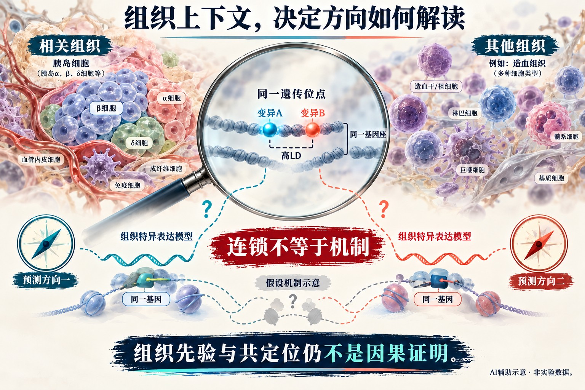

*AI辅助教学示意，非实验数据。图中胰岛与造血组织为假设教学场景，用于解释组织代理与方向之间的区别；造血组织不是论文GCK例子的实测对照。本图不代替下文GCK胰腺、胫神经和甲状腺的原始证据。*

### 一、组织信息能改善判断，但要看改善发生在哪些对象上

如果一个血浆蛋白主要来自某个组织，在那个组织里研究编码基因，理应比把所有组织混在一起更接近问题本身。作者利用Human Proteome Distribution Atlas的组织来源注释，选出228个具有单一组织来源标签的蛋白，观察相应组织中的TWAS方向。

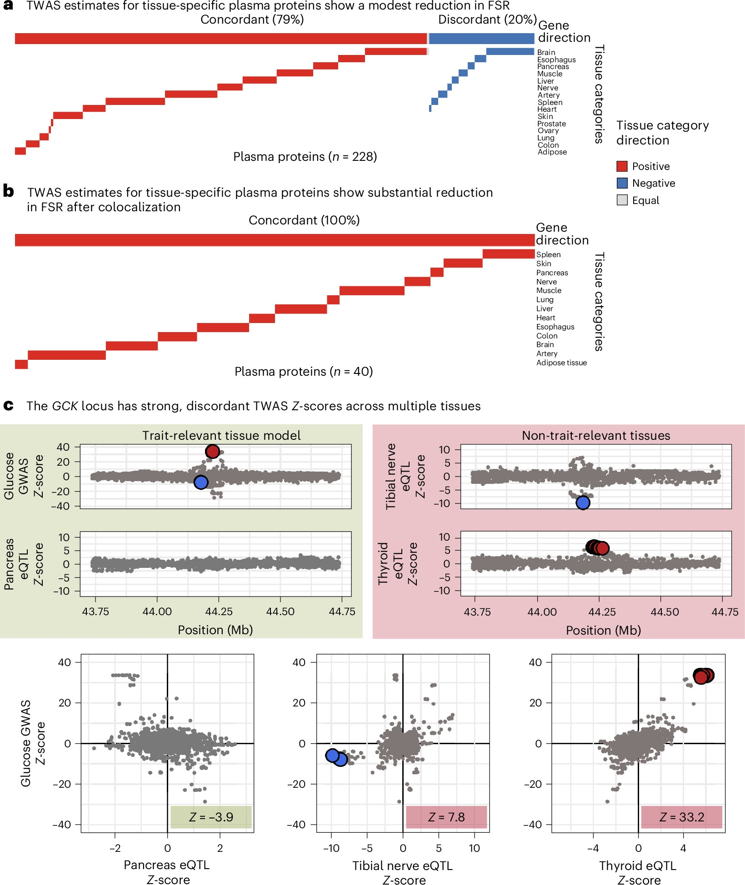

*来源：Gerlach等，Nature Genetics，2026，Fig.4，DOI:10.1038/s41588-026-02796-4，CC BY 4.0。完整原图，仅转换JPEG。a、b是组织限定的蛋白分析；c为GCK具体位点。*

图4a每列是一种蛋白，每行是其来源组织对应的类别。红、蓝分别代表正、负方向，灰色表示平票。行的顺序按组织中的方向不一致率排列，并不是人体器官的重要性排名。这228个蛋白的总体不一致率为20%，95%置信区间15%–26%；移除脑来源蛋白后为14%，区间9%–20%。

这些结果说明组织注释能提供有用线索，但不能简单归纳成“只看相关组织就解决了”。来源标签的覆盖度和精度有限，血浆测量与组织内生成、分泌、转运及清除过程也不是同一层面。尤其不能把脑来源蛋白的表现差直接解释成“脑不重要”或“脑数据不可信”：论文没有完成针对这些可能原因的机制鉴别。

图4b是在来源组织限定并进行共定位筛选后剩下的40个基因，没有观察到方向不一致。这个结果值得注意，也特别容易被过度传播。第一，0/40的95%置信区间仍为0%–9%，并不是零风险保证。第二，40个是经过组织选择与统计过滤后保留下来的子集，不是原228个对象全部改善。第三，这并非随机分配“用组织信息”和“不用组织信息”的对照实验，不能把两个热图百分数之差直接读成因果改善幅度。

作者另用coloc-SuSiE在同样概率阈值下保留58个基因，方向不一致率为7%，区间2%–17%，结果见扩展数据图1。这呈现的首先是候选保留和方向一致之间的权衡。本文没有把40与58当作谁“绝对胜出”的判决；选择哪种结果集，还要看后续实验成本、可容忍风险以及真正需要回答的问题。

### 二、GCK为什么是一个好教学例子？

GCK编码葡萄糖激酶。人类遗传学中，功能受损与血糖升高、激活型变异与高胰岛素状态之间存在已知联系，因此作者有理由预期，在相关胰腺机制中，更高的GCK有效功能应与更低血糖相关。这里说的是有生物学支持的预期，不是把RNA表达、酶活性与药物作用强行当成相同变量。

我们独立核查了论文引用的Christesen等2008年原始研究的PubMed摘要与元数据，确认它研究了激活型GCK变异及其动力学特征；没有取得并精读该原始研究的全部正文，因此不追加临床疗效、发生率或剂量结论。主文关于胰腺机制的综合描述仍归于Gerlach等及其所引文献。

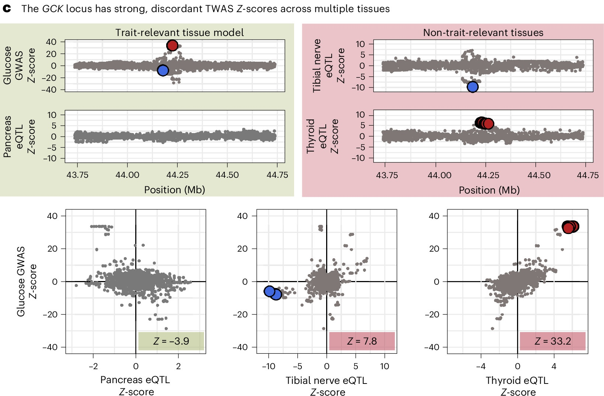

*同文Fig.4c原样局部裁切，保留上方区域关联、下方三组织比较及全部坐标；未移动或改色任何数据点。CC BY 4.0。*

图4c上方的区域图横轴是基因组位置，纵轴分别是不同组织的eQTL Z统计量与血糖GWAS Z统计量。每个点是一枚变异，而非一个患者或一块组织。胰腺的eQTL信号较弱，标准分析没有显著TWAS结果；这不能证明胰腺机制不存在，只能说明这套参考数据和模型没有足够清晰地检出它。

相反，胫神经和甲状腺出现强而正向的TWAS关联，作者报告Z分别为7.8和33.2，与上述预期相反。它们的eQTL信号分别与两个血糖GWAS可信集合存在共定位证据，PPH4为0.51和0.99。图中的红、蓝点表示相关的95%可信集合，不是“保护性”与“危险性”两类变异。

图4c下方把同一变异的eQTL统计量和GWAS统计量放到横纵轴上，看两套信号的相关结构。这样的散点图适合检查共享关联模式，却不是表达变化对血糖的实验曲线。即使点排列得很整齐，纵轴也不是接受某种GCK干预之后的血糖变化。

一个很有价值的阴性细节是：作者改用胰腺最强的单个eQTL构造模型时，得到方向符合预期、但仅属名义显著的结果，Z为−3.9。这与甲状腺极强的统计量形成鲜明对比。但它不等于证明单变异模型优于标准模型，更不能让我们事后挑出符合故事的模型就宣布成功。合理解释是：相关组织的统计功效与方向可信度，可能没有同向变化。

### 三、连锁不平衡怎样把代理组织带进来？

共定位通常根据一片区域内变异的关联模式，比较共享信号与不同信号等假设。如果两枚不同变异高度连锁，数据就可能缺乏把它们分开的信息。此时，某组织的表达关联与性状关联看起来非常相似，但相似不一定来自同一个因果调控事件。

用一个不带真实数值的假设例子说明。变异A影响真正作用组织中的基因调控，进而影响性状；变异B与A几乎总是共同遗传，同时在另一个组织中影响该基因表达。由于A、B高度连锁，代理组织里的表达预测能很好地标记性状关联。若B在代理组织中的表达效应与真正作用组织中的效应相反，强关联也可能给出相反的解释方向。

这个例子包含两件不同的事。第一是不同因果变异被连锁关系混在一起，第二是不同组织的表达效应可能相反。它们可以共同作用，但不必在每个位点同时存在。Gerlach等将这种机制作为对观察结果的重要解释，并用模拟探索可行性；不能把它写成已经逐个位点证实的唯一原因。

其他可能性仍应保留：同一基因在不同组织可能真正具有相反作用；常见调控变异与大幅功能缺失可能位于剂量反应曲线的不同区段；附近基因共调控也可能让信号传递；参考LD与研究人群不匹配可能进一步影响估计。把全部方向差异归咎于“软件算错”，反而会遮住真正需要验证的机制。

### 四、模拟展示了一种失败方式，不等于估计所有真实数据的风险

为检验代理组织的解释，作者模拟了1,000个基因，将血液设定为已知的因果组织，并用该组织的最强eQTL设定GWAS因果变异。随后在非血液组织里运行TWAS，观察方向与血液预测表达相关性的关系。这里的“因果组织已知”来自模拟设定，不是对1,000个真实基因逐一完成实验确认。

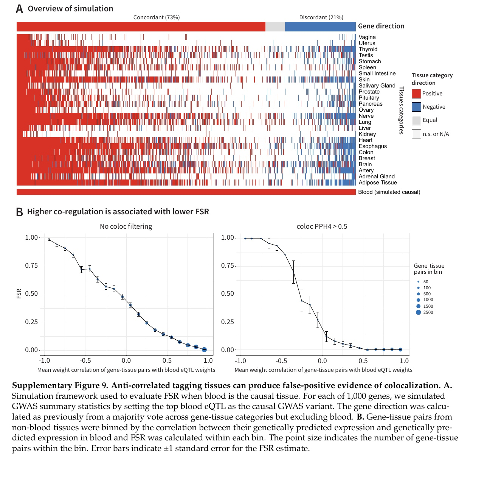

*来源：同文Supplementary Fig.9，补充材料第20页，CC BY 4.0；从正式补充PDF渲染，仅裁去页边空白及页码，保留原始panel、坐标、图例及完整图注。此图是作者计算模拟，不是真实扰动实验，也不是AI生成结果。*

补充图9A仍然是按基因和组织类别排列的热图，最下方单列血液这个模拟中的因果组织。总体方向评估排除血液，避免把已设定的正确答案直接当作非因果组织的成绩。作者报告非血液方向不一致约21%，这个比例属于特定模拟，不应替代实测蛋白或复杂性状中的比例。

图9B横轴是非血液组织与血液遗传预测表达相关性的分箱均值，纵轴是各箱内的方向不一致率。点越大，箱内基因–组织对越多；误差线是正负一个标准误，不是95%置信区间。左图未做共定位筛选，右图保留PPH4大于0.5的结果。负相关越强的分箱中，不一致越高；筛选之后，这种模式仍然存在。

注意横轴涉及遗传预测成分，而非两个器官真实RNA表达的普通相关系数。不能据此推荐研究者只计算bulk RNA表达相关性，再用一个阈值筛掉“坏组织”。预测模型的权重、LD结构和数据质量都参与其中，两个相关系数回答的是不同问题。

这套模拟的价值在于构造反例：即便知道真正因果组织，统计上很强的代理组织也可以误导方向。它的限制同样具体。作者用最强eQTL代表因果变异，设定较强的GWAS信号，并在这一机制下生成数据；真实位点可能存在多因果变异、细胞状态混合和更复杂的非线性。模拟支持“这种事情可以发生，并与观察相容”，不支持“全部真实方向差异都已被解释”。

补充说明还测试了不同连锁程度、效应强度和双信号结构。若较弱的GWAS信号与eQTL共享、较强的另一个不共享，单信号共定位可能漏掉前者，多信号方法可能挽回。这提醒我们：严格过滤既可能清除代理信号，也可能丢失真实关联。看见过滤后比例改善，还应问失去的是哪些对象，以及这种损失是否集中在难以测量、样本量小的相关组织。

### 五、不要把一个benchmark改写成算法淘汰赛

作者也检验了cTWAS及多组织扩展方法。在蛋白分析中，它们没有让方向不一致问题消失。这个结果对使用者有提醒作用，但不能被改写为“更先进的方法都没用”。

补充说明明确指出，为控制近3,000个蛋白分析的计算量，cTWAS在目标基因所在LD区块及两侧局部区块中估计，而不是利用整个基因组估计先验。局部区域约2–4 Mb，先验估计可能不如更广泛数据稳定，从而影响PIP。公平比较既要报告方法名称，也要报告实际实现、训练信息与计算预算。软件论文里的理想设定，与另一个benchmark受资源限制的用法，不应默认为完全相同。

另一个值得保留的边界是解释性回归。正文认为一些基因层面因素组合起来与方向差异有关，但没有单一因素提供令人信服的解释。我们读到补充说明中的公式、变量文字与部分结论存在需要进一步核对的表述，未独立检查运行代码，因此本文不复述具体回归系数，不把它们包装成“哪些基因必然更安全”的筛选规则。承认不能从这一步拿到可靠处方，比给一个看起来精确的经验阈值更有用。

同样，补充材料的GMPR例子中，图注和邻近文字对组织方向的表述不一致。本文未采用该例子作方向论据，也没有自行修改作者图。遇到这种情况，正确的工作方式是保留疑点、限制结论，而不是为了让叙事顺畅替作者选一个版本。

### 六、建立一张能经得起合作者追问的方向证据卡

下面是一套根据论文启发提出的分析建议，并非作者已经验证的新工作流。它不要求先造一个更复杂的综合分数，而是要求每个候选留下可追溯记录。

第一栏写清目标。你是在找相关区域、优先基因，还是准备决定扰动方向？前两种目标允许保留方向未定的候选；第三种目标需要额外证据。如果最终想推断药物效果，还要说明剂量、时间、组织和机制与遗传变化有何不同，不能靠更小P值跨过去。

第二栏记录表达模型的背景，包括参考组织、样本量与可用模型情况、祖源、基因组版本、等位基因对齐及LD来源。缺少模型和检验不显著必须分开。一个组织没有结果，可能只是缺少足够可预测的表达，不能自动作为排除该组织的证据。

第三栏把共定位证据写成完整句子：使用单信号还是多信号模型，分析窗口如何定义，有哪些可信集合，PPH4及其他假设概率是否支持充分信息。高PPH4是一个结论条件，不是孤立的质量标签；低PPH4也要区分支持不同信号和没有足够信息。

第四栏列独立方向锚点，例如可信的人类功能缺失、激活型变异、相关组织中的双向扰动或明确机制。没有就是没有，不用另一种共享eQTL数据的方法凑成“独立验证”。锚点之间也可能冲突，要记录各自改变的剂量尺度与组织范围。

第五栏明确下一步能区分什么。若争议是组织代理，优先获取相关组织或细胞状态的调控证据；若争议是LD，考虑更精细的遗传解析；若争议是剂量非线性，双向、多剂量扰动比一次强敲除更能回答问题。实验设计应针对不确定性的来源，而不是重复证明已经很显著的关联。

### 结束时留下一个更有用的结论

最强的TWAS信号可以告诉我们哪里值得研究，却不总能告诉我们往哪边改。组织相关性、共定位和独立遗传证据各自补充一部分信息，没有任何一项自动拥有替代其他证据的资格。

读完这项研究，值得带走的习惯是：允许“这个候选很重要，但方向尚未确定”成为正式结果。这样既不会因为方向不稳而丢掉有价值的线索，也不会为了给出清晰故事而提前决定实验答案。

### 来源、许可与核验范围

核心研究及全部展示图：[Gerlach等，Nature Genetics，2026年10月22日](https://www.nature.com/articles/s41588-026-02796-4)，[CC BY 4.0](https://creativecommons.org/licenses/by/4.0/)。补充图9来自该正式版附带PDF，未发现该图独立第三方排除条款。原图格式转换、PDF渲染均未修改数据和科学标签。

原始背景引用仅核查摘要和元数据：[Christesen等，2008，DOI:10.1530/EJE-08-0203](https://pubmed.ncbi.nlm.nih.gov/18450771/)。基因剂量反应的相关原始工作[Milind等，2026](https://pmc.ncbi.nlm.nih.gov/articles/PMC13347943/)仅核查了与非单调性及负荷参照有关的正文段落，不声称阅读全文或复算其数据。

已读核心研究正文、Methods、Supplementary Notes 1–8、表1–2及相关图注；目视检查本篇所用原图。未复算原始矩阵、模拟或模型，不对未核验的补充回归系数作定量结论。方向证据卡为教学建议，尚未作为新方法接受benchmark。

## Take-home messages

### Take-home messages：先决定你要相信哪一层结论

如果你准备把一张TWAS结果表交给做实验的合作者，最值得补的一列不是另一个P值，而是“方向证据到哪一步”。一个基因可以是很有价值的候选，同时还不适合据此决定上调还是敲低。把这两句话放在一起，并不矛盾。

本文围绕Gerlach等于2026年10月22日发表于Nature Genetics的《High false sign rates in transcriptome-wide association studies》，独立整理可以带回分析与审稿的要点。TWAS检验的是遗传预测表达与性状的关系，共定位评估的是共享遗传信号证据，它们都不等同于在目标组织内实施干预。下文百分数均为作者报告，没有独立复算；检查清单为我们的教学总结，不是新验证的方法。

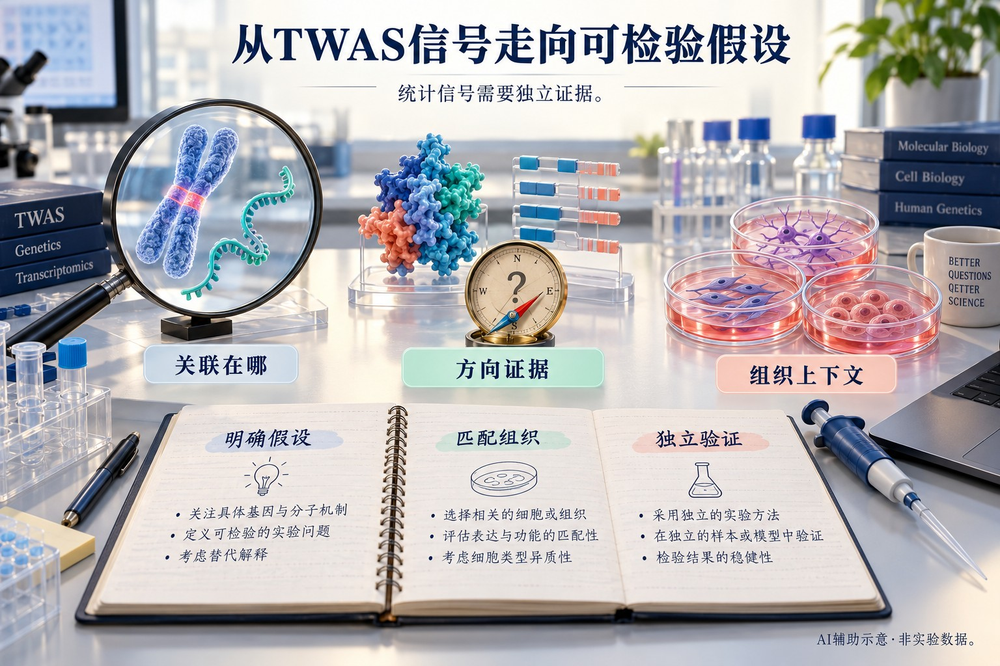

*AI辅助教学示意，非实验数据。展示证据判断层级，不冒充实验输出或原文数据。*

### 1. 显著性、基因定位、作用方向，应分开结论

显著性回答预测分数是否与性状关联；定位需要区分相邻基因、不同调控事件和组织；方向解释还需要确认代理表达能否代表相关情境中的有效剂量变化。三个问题有关联，但前一个的好成绩不能自动传递给后一个。

最容易越界的句子是“表达升高增加风险，因此抑制可能治疗疾病”。在只有TWAS关联时，较稳妥的表述是：“该组织的遗传预测表达与风险正相关，干预方向尚需独立证据。”这不是为所有结论添加空泛免责声明，而是准确说明模型真正测到的对象。

### 2. 方向评估必须有独立参照，也必须承认参照的边界

作者以编码基因对应血浆蛋白的方向，以及功能缺失负荷检验为方向锚点。这比用另一套共享eQTL数据的方法相互证明更有说服力。但罕见功能缺失、常见调控变异和药物干预改变的剂量幅度、时间与组织范围不同，不能视作完全等价。

因此，本文谈的是相对于生物学预期的方向不一致，不是每个位点都完成了因果实验判决。一个好的benchmark应公开参照怎么构建、它适用于什么对象、哪些对象被排除，而不只是公布总分。

### 3. 记住分母，比记住23%与33%更重要

作者在1,543个进入方向评估的血浆蛋白中报告23%方向不一致；复杂性状分析则在484个具有显著TWAS结果的基因–性状对中报告33%。这些集合已经经历模型可用性、显著性和参照筛选，不代表全部人类基因、全部组织或全部TWAS应用。

平票和未判定不能消失。提高一致性要求后，错误率下降可能部分来自更多对象被归入不确定。比较两套流程时，至少一起看不一致比例、作出判断的比例和实际保留数量。拒绝判断可以是负责任的选择，但不能被隐藏成准确率提升。

### 4. 共定位很有用，不能替方向作最终裁决

共享遗传信号是重要证据，但不同因果变异在高度连锁时可能难以区分；即使共享信号成立，组织特异方向和剂量反应仍可能复杂。提高PPH4阈值既可能去掉误导信号，也可能损失真正关联。

这里的保留率不是已知全部真实因果基因后的敏感度。若某种方法留下更少候选、比例更漂亮，应继续问：失去的是信息不足的结果，还是系统性失去样本量小但相关的组织？不能只看曲线的一个端点。

### 5. 最强组织不必是最相关组织

GCK例子中，生物学相关的胰腺参考信号较弱，其他组织却出现强TWAS及共定位证据，同时方向不符合独立生物学预期。它提示我们区分“容易测到”与“真正作用于性状”。

这不意味着任意代理组织都不能用。代理组织可能帮助发现区域或基因，但在解释方向时必须重新检查可迁移性。选择组织的理由最好在查看最强信号之前写下来；若事后调整，应记录理由，而不是只展示最符合叙事的一张图。

### 6. 0/40不是一张零风险通行证

作者在限定来源组织及共定位筛选后的40个基因中没有观察到方向不一致，但95%置信区间上限仍约为9%。这是筛选后小集合的结果，不是原始大集合中每个基因都被修复。

它支持把组织知识与统计过滤结合，不能证明某个固定阈值适合所有疾病。把0换成“未观察到”，把样本量与区间一起写出，是成本很低、收益很大的科学表达习惯。

### 7. 模拟和算法比较都要保留实际设定

作者将血液设为已知因果组织的模拟，展示了非因果组织的反向预测表达如何产生方向误导；它证明一种失败机制可发生，不证明全部真实位点都由它解释。

cTWAS比较还受到局部区域先验估计等实现限制。读benchmark时，要同时核查算法假设、参数、可用训练信息和计算范围。一个方法在某项任务中未解决问题，不等于它在所有任务中失去价值。

### 8. 下一次实验应该减少哪一种不确定性？

如果候选基因很有吸引力但方向未定，可以设计双向扰动，而不是只做一个符合TWAS正负号的方向。如果主要争议来自组织，优先补相关细胞或状态的证据；如果来自剂量曲线，考虑多个扰动强度；如果来自连锁结构，优先提高遗传解析能力。

这些是从研究得到的可迁移设计建议，不是论文已经实施并验证的实验方案。尤其不能从遗传预测表达直接推导具体药物或临床处理建议。良好的下一步，应有机会区分两种仍然合理的解释，而不只是让已有相关性再显著一次。

### 一张最小检查卡

交出方向结论前，可以检查以下问题：

- 性状和效应等位基因编码是否一致？所谓表达是实测RNA、遗传预测值，还是有效功能剂量？
- 组织选择依据是什么？没有信号是缺模型、功效不足，还是存在反对该机制的证据？
- 共定位使用什么假设和窗口？有哪些可信集合，是否可能由高连锁导致难以区分？
- 是否存在真正独立的方向锚点？它与当前问题在剂量和组织范围上有哪些不同？
- 筛选之后剩多少对象？平票、缺失、未判定如何计入分母？
- 若方向仍不确定，后续实验能否同时检验两种解释？

### 最后留下的研究启发

这一研究最值得迁移的不是某个阈值，而是评估目标的重新拆分。方法可能擅长发现相关信号，却不擅长提供干预方向；同一张结果表不应默认获得全部解释资格。

对分析者，保留“重要但方向未定”的候选。对方法开发者，除发现率之外单独评价方向、拒答和不同组织下的表现。对审稿者，追问分母、参照和实现，而不只比较最醒目的百分数。对实验合作者，把不确定性变成设计，而不是在交接时把它省略。

### 来源与核验说明

[Gerlach等，High false sign rates in transcriptome-wide association studies，Nature Genetics，2026年10月22日](https://www.nature.com/articles/s41588-026-02796-4)，DOI:10.1038/s41588-026-02796-4。核心研究正式正文、方法、Supplementary Notes 1–8及相关表格已阅读；原始数据与代码未重新运行。本篇为独立take-home教学分析，不把摘要、模拟或作者benchmark写成我们的实际运行结果。

完整原图及逐panel解释在对应正文中保留。本篇不引入新的数据图，也不通过生成式示意补造实验结果。研究结论的适用范围仍受队列、组织参考、参照构建与模型实现限制。
