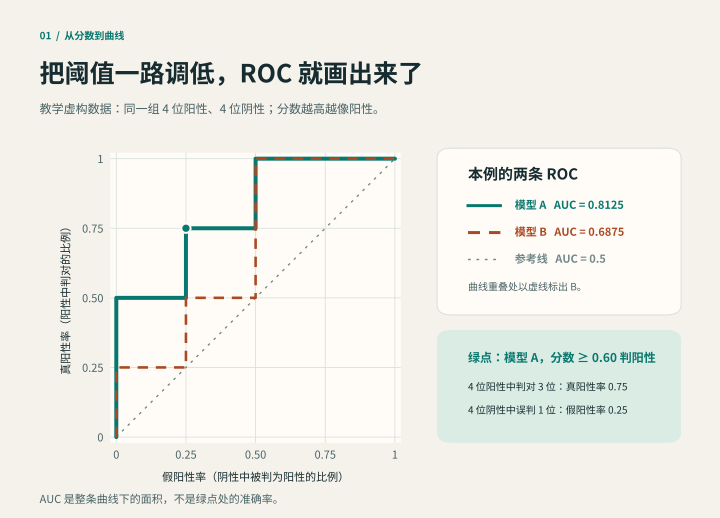
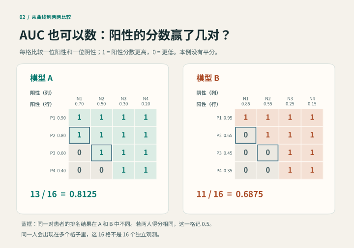
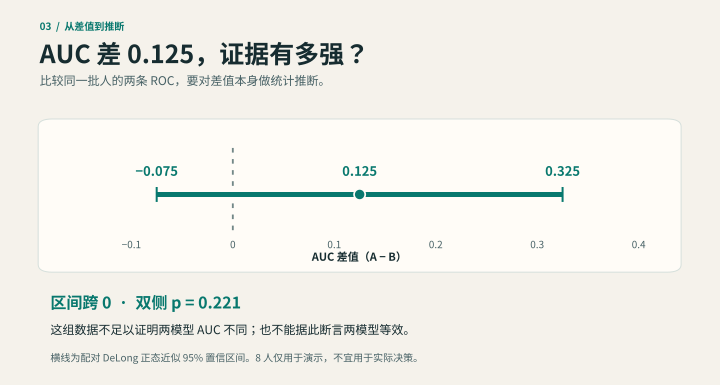

# DeLong 检验：比较相关 ROC 曲线的 AUC

**两条 ROC 曲线的 AUC 不一样，差多少才不只是抽样波动？**

同一组人做了两种检查。模型 A 的 ROC AUC 是 0.813，模型 B 是 0.688。A 的数字更大，但换一批人，差距还在吗？这是 **DeLong 检验**要回答的问题：在给定的验证人群里，两种评分对阳性与阴性的**排序能力**是否不同？

它不是在检验哪个模型更准、更适合临床，也不是在比较两条曲线的每一个点。它只检验**总 AUC 的差**；关键在于，两个分数来自**同一个人**，所以不能按两组独立结果来算误差。

## 1. 先看懂 ROC 和 AUC

假设分数越高，模型越倾向判为阳性。选一个阈值，达到它就标为阳性。阈值降得越低，被标为阳性的人越多：既可能多找到几个真正的阳性，也可能多误报几个阴性。

- **灵敏度**（真正率，TPR）：在所有真正阳性中，有多少被找出来？
- **假正率**（FPR，等于 1 − 特异度）：在所有真正阴性中，有多少被误报？

把阈值从高到低扫一遍，每个阈值在横轴 FPR、纵轴 TPR 上给一个点。连起来得到 ROC；曲线下的面积就是 ROC AUC。比如图中 A 的阈值取 0.60（含 0.60），抓到 3/4 个阳性、误报 1/4 个阴性，所以点是 (0.25, 0.75)。



**还有一个更好记的读法：**随机拿一个阳性和一个阴性，看模型有没有给阳性更高的分数。排对记 1，排反记 0，两人同分记 0.5。AUC 就是这些“对决”的平均分。因此 AUC = 0.80 不是“80% 的人判对了”，也不是“分数 0.80 就有 80% 的患病概率”。它描述的是排序，不是某个阈值下的准确率，也不是概率校准。

## 2. 手算一遍：8 个人，16 次对决

下面全是**虚构数据**。每个人有一个真实标签和两个模型分数，列之间必须按同一人的 ID 对齐。

| 人员 | 真实标签 | 模型 A | 模型 B |
|:---|:---|---:|---:|
| P1 | 阳性 | 0.90 | 0.95 |
| P2 | 阳性 | 0.80 | 0.65 |
| P3 | 阳性 | 0.60 | 0.45 |
| P4 | 阳性 | 0.40 | 0.35 |
| N1 | 阴性 | 0.70 | 0.85 |
| N2 | 阴性 | 0.50 | 0.55 |
| N3 | 阴性 | 0.30 | 0.25 |
| N4 | 阴性 | 0.20 | 0.15 |

P3 在 A 里的分数是 0.60。它输给 N1 的 0.70，赢过 N2、N3、N4，得 3 分。换成 B，P3 的 0.45 只赢 N3、N4，得 2 分。把所有阳性各算一遍：

- A：4 + 4 + 3 + 2 = 13，AUC = 13/16 = **0.8125**。
- B：4 + 3 + 2 + 2 = 11，AUC = 11/16 = **0.6875**。
- A 减 B = **0.125**，相当于 **12.5 个 AUC 百分点**，不是说准确率提高了 12.5%。



## 3. 为什么必须把同一个人的两个分数放在一起？

上面的 16 个格子并不是 16 次独立实验。P3 同时出现在四格里，N1 也同时出现在四格里。有些人确实容易区分，两种模型都会排对；也有些人两种模型一起拿不准。于是，**两个 AUC 的抽样误差可能一起变**。

DeLong 的做法可以理解成给每个人记两张成绩单：

1. 对每个**阳性**，算它胜过阴性的平均分。例：P3 在 A 是 0.75，在 B 是 0.50。
2. 对每个**阴性**，算有多少阳性能胜过它（同分仍给半分）。例：N1 在 A 是 0.50，在 B 是 0.25。
3. 分别在阳性和阴性中，看这些成绩单的起伏，以及 A、B 的成绩单是否一起涨跌。两部分加起来，就是 AUC 的方差和两个 AUC 的协方差的估计。

直观上，要知道**差值**有多稳，不能只问 A 和 B 各自抖得多厉害，还要问它们是不是一起抖。同方向的起伏会抵消一部分。本例里，计入配对后差值的标准误约为 **0.102**；错把两个结果当独立，会得到约 **0.280**。协方差的符号并不固定，不能概括成“配对总会让 P 值更小”。

## 4. P 值和置信区间到底在说什么？

这里的原假设是 **H₀：两种模型在目标人群里的 AUC 相等**。如果原假设成立，并且统计近似适用，观察到至少这么极端的标准化差值（不管 A 大还是 B 大）的概率，就是双侧 P 值。它**不是**“两模型相同的概率”。

这 8 人的演示结果如下。样本太小，只用来讲算法，不作医疗或模型性能判断。

| 量 | 演示值 | 怎么读 |
|:---|---:|:---|
| AUC(A) | 0.8125 | A 的总体排序分数估计 |
| AUC(B) | 0.6875 | B 的总体排序分数估计 |
| 差值 A − B | 0.1250 | 样本里 A 的 AUC 高 12.5 个百分点 |
| 差值标准误 | 0.1021 | 差值的抽样波动尺度 |
| 差值的近似 95% 置信区间 | [−0.075, 0.325] | 宽到同时容得下 B 略高与 A 明显更高 |
| 双侧 P 值 | 0.221 | 没有足够证据排除真实差值为 0 |



**推荐写法：**“在同一验证集上，A 与 B 的 ROC AUC 分别为 0.813 和 0.688。配对 DeLong 检验的 AUC 差值（A − B）为 0.125（95% CI −0.075 至 0.325；双侧 P = 0.221）。”

“未发现显著差异”不等于“两者等效”。如果目标是证明差距小到可接受，应在看结果前规定可接受的界值，并用相应的等效或非劣检验设计。同样，P 很小也不能证明差距有实际价值；先看差了多少，再看不确定性。

## 5. 实际数据怎么做？

**先对齐数据，再算检验。**以受试者 ID 把同一验证集的真实标签、A 分数和 B 分数合为一行，确认受试者不重复，两个模型保留的是同一批完整样本，报告删了谁、为什么删、剩多少阳性与阴性。分数可以是概率或排序分，但方向要一致：这里约定大分更偏阳性。不要传入已经切成 0/1 的预测标签，也不要让软件看过同一验证集后为每个模型各自挑方向。两个模型应在评估人群之外训练和调参。

### R：用 pROC 比较配对全 AUC

先安装 R 包 pROC（首次执行 `install.packages("pROC")`）。以下例子显式指定 0 为阴性、1 为阳性，`direction = "<"` 表示对照组分数低的一侧是阴性（即高分偏阳性）。

```r
library(pROC)

dat <- data.frame(
  id = c("P1", "P2", "P3", "P4", "N1", "N2", "N3", "N4"),
  y  = c(1, 1, 1, 1, 0, 0, 0, 0),
  A  = c(.90, .80, .60, .40, .70, .50, .30, .20),
  B  = c(.95, .65, .45, .35, .85, .55, .25, .15)
)
stopifnot(!anyDuplicated(dat$id), all(complete.cases(dat)),
          all(is.finite(dat$A)), all(is.finite(dat$B)),
          identical(sort(unique(dat$y)), c(0, 1)))

rA <- roc(dat$y, dat$A, levels = c(0, 1), direction = "<", quiet = TRUE)
rB <- roc(dat$y, dat$B, levels = c(0, 1), direction = "<", quiet = TRUE)
fit <- roc.test(rA, rB, paired = TRUE, method = "delong",
                alternative = "two.sided", conf.level = 0.95)
print(fit)
round(c(AUC_A = as.numeric(auc(rA)), AUC_B = as.numeric(auc(rB)),
        delta = as.numeric(auc(rA)) - as.numeric(auc(rB)),
        CI_low = fit$conf.int[1], CI_high = fit$conf.int[2],
        p = fit$p.value), 4)
# 预期: 0.8125, 0.6875, 0.1250, -0.0750, 0.3250, 0.2207
```

如果你看到 R 的图横轴向右是特异度从 1 降到 0，不是结果算反了；那是等价的画法。若要跟本文一样显示从 0 增至 1 的假正率，可用 `plot(rA, legacy.axes = TRUE)`。

### Python：不装第三方包，把上面的算法跑一遍

配套的 [`delong_example.py`](#delong-example-10e4b81a) 直接枚举阳性 × 阴性，处理同分，并用每个人贡献的差值计算标准误。它只有 Python 标准库依赖，方便检查推导；大样本请用成熟的排序实现，而不是枚举全部样本对。常见的 `roc_auc_score` 只算 AUC，不会给你配对 DeLong 的 P 值。

## 6. 哪些场景不要直接套？

| 你的问题或数据 | 应该怎么想 |
|:---|:---|
| **同一独立验证人群**，固定的两个模型，一人一行 | 比较总 ROC AUC，用配对 DeLong。 |
| **两个完全独立的验证队列** | 不是配对问题。可用适合独立样本的比较；先问人群、纳入规则或病例谱是否不同，否则差异未必来自模型。 |
| 想知道**误报最多 5% 时**谁捞到更多阳性 | 直接比较预设假正率对应的灵敏度，或比较限定区间的 partial AUC；不能拿总 AUC 的 P 值回答。pROC 不用 DeLong 比平滑 ROC 或 partial AUC。 |
| AUC 高，但想知道**风险报得准不准**，或临床上值不值得用 | 分别查校准、目标阈值的表现和临床净获益；类别很不平衡时，还可看精确率–召回率曲线。普通 DeLong 不适用于 PR AUC。 |
| 每人多次测量、每人多张切片、每个供体有很多细胞 | 不能把行当成独立样本；先定义比较的是人、样本还是细胞，再用符合设计的聚类/分层方法，如按独立受试者或供体一起重抽样，并保持模型配对。 |
| 训练和评估共用同一数据；或把 K 折交叉验证的预测拼起来就检验 | 同一批数据拟合再检验（尤其是嵌套模型）会导致错误推断。拼接交叉验证预测也不会消除训练集重叠引起的依赖。优先在独立验证集比较；若要比较整个训练流程，需按设计纳入重拟合、不确定性和依赖。 |
| 阳性极少、分数近乎完美或差值方差为零 | 正态近似可能不稳，极端时统计量不可用。不要把零方差或 P = 1 当作等效。检查验证样本、分数方向和重复，采用符合设计的方法并诚实报告不确定性。 |
| 同时比很多模型、终点或亚组 | 预先定义主要比较；需要成组检验时考虑总体检验及多重比较校正，不要只报告最小 P 值。 |
| 有时间结局和删失 | 先定义时间点、时间依赖 AUC 及删失处理；不要把普通二分类 DeLong 原样套进去。 |

还有个常见误解：**两条曲线交叉时，总 AUC 相同也不表示曲线相同。**A 可以在低误报区更灵敏、B 在别处更好，面积相互抵消。如果使用场景只允许很少的误报，就应事先规定关注的区间。

## 附：公式和手算如何接上？

设阳性 $m$ 人、阴性 $n$ 人。对模型 $k$，定义 $H^{(k)}_{ij}$ 为第 $i$ 位阳性和第 $j$ 位阴性的对决得分（胜 1、平 0.5、负 0）。定义每位阳性和阴性的平均贡献：

$$
V^{(k)}_{+,i} = \frac{1}{n}\sum_{j=1}^{n} H^{(k)}_{ij},
\qquad
V^{(k)}_{-,j} = \frac{1}{m}\sum_{i=1}^{m} H^{(k)}_{ij}.
$$

把任意一组贡献求平均就得到同一个 AUC。每个人都有 A、B 两个贡献。阳性组这两列的样本协方差矩阵记为 $S_+$，阴性组记为 $S_-$（样本协方差分母分别为 $m-1$、$n-1$）。两个 AUC 估计值的协方差矩阵是 $\widehat\Sigma=S_+/m+S_-/n$。差值的方差为：

$$
\widehat{\mathrm{Var}}(\widehat\Delta)
= \widehat\Sigma_{AA}+\widehat\Sigma_{BB}-2\widehat\Sigma_{AB}.
$$

也可以先逐人做 A − B，再求方差：阳性四人的差是 (0, 0.25, 0.25, 0)，阴性四人的差是 (0.25, 0.25, 0, 0)。两组的样本方差都是 $1/48$，故差值方差是 $1/48\div4+1/48\div4=1/96$，标准误是 $\sqrt{1/96}\approx0.1021$。于是 $z=0.125/0.1021\approx1.225$，双侧 P 约为 0.221；近似 95% 区间是 $\widehat\Delta\pm1.96\,\mathrm{SE}$。这是大样本近似；非参数并不意味着没有独立性、设计或样本量条件。

## 参考资料

1. [DeLong、DeLong 与 Clarke-Pearson，1988，Biometrics：原始论文](https://pubmed.ncbi.nlm.nih.gov/3203132/)：使用广义 U 统计量估计多个相关 AUC 的协方差。
2. [Sun 与 Xu，2014，IEEE Signal Processing Letters：快速实现](https://doi.org/10.1109/LSP.2014.2337313)：利用秩将两两比较加速。
3. [pROC 官方文档：roc.test](https://search.r-project.org/CRAN/refmans/pROC/html/roc.test.html)；[Robin 等，2011，pROC 论文](https://pmc.ncbi.nlm.nih.gov/articles/PMC3068975/)。
4. [Demler、Pencina 与 D’Agostino，2012，Statistics in Medicine](https://pmc.ncbi.nlm.nih.gov/articles/PMC3684152/)：同一数据拟合并评估嵌套模型时误用 DeLong 的问题。

*本文数值与配图均由同一组虚构数据计算，为原创教学示例。*


## 配套 Python 示例 {#delong-example-10e4b81a}

[查看或下载 `delong_example.py`](https://github.com/loganylchen/bioinfo-book/blob/main/chapters/methods/assets/delong/delong_example.py)

```python
"""教学版：两条相关 ROC 的全 AUC 和配对 DeLong 检验，Python 3.8+。"""
from math import erfc, isfinite, sqrt
from statistics import NormalDist, mean, variance

EXAMPLE = [
    ("P1", 1, .90, .95), ("P2", 1, .80, .65),
    ("P3", 1, .60, .45), ("P4", 1, .40, .35),
    ("N1", 0, .70, .85), ("N2", 0, .50, .55),
    ("N3", 0, .30, .25), ("N4", 0, .20, .15),
]


def paired_delong(rows, conf_level=.95):
    """每行：(唯一受试者 ID, 0/1 真实标签, A 分数, B 分数)。高分偏阳性。"""
    rows = list(rows)
    if not 0 < conf_level < 1:
        raise ValueError("置信水平必须在 0 和 1 之间")
    ids = [i for i, _, _, _ in rows]
    if any(i is None or i == "" for i in ids) or len(set(ids)) != len(ids):
        raise ValueError("ID 不能缺失或重复；先按受试者 ID 对齐两个模型")
    if any(y not in (0, 1) or not isfinite(a) or not isfinite(b)
           for _, y, a, b in rows):
        raise ValueError("标签必须为 0/1，分数必须有限且不能缺失")
    pos = [(a, b) for _, y, a, b in rows if y == 1]
    neg = [(a, b) for _, y, a, b in rows if y == 0]
    m, n = len(pos), len(neg)
    if min(m, n) < 2:
        raise ValueError("至少要有 2 个阳性和 2 个阴性才可估计样本方差；这不是充分样本量")

    def win(x, y):
        return 1.0 if x > y else 0.5 if x == y else 0.0

    auc = [0.0, 0.0]
    positive_diff = [0.0] * m
    negative_diff = [0.0] * n
    for i, (pa, pb) in enumerate(pos):
        for j, (na, nb) in enumerate(neg):
            wa, wb = win(pa, na), win(pb, nb)
            auc[0] += wa
            auc[1] += wb
            positive_diff[i] += wa - wb
            negative_diff[j] += wa - wb

    auc_a, auc_b = (x / (m * n) for x in auc)
    delta = mean(positive_diff) / n
    var = variance(x / n for x in positive_diff) / m + variance(
        x / m for x in negative_diff) / n
    if var <= 0:
        raise ValueError("差值方差为零，常规 DeLong 正态检验不可用；请检查样本与分数")
    se = sqrt(var)
    z = delta / se
    p_two_sided = erfc(abs(z) / sqrt(2))
    q = NormalDist().inv_cdf(1 - (1 - conf_level) / 2)
    return {
        "auc_A": auc_a, "auc_B": auc_b, "delta_A_minus_B": delta,
        "se": se, "z": z, "p_two_sided": p_two_sided,
        "ci_low": delta - q * se, "ci_high": delta + q * se,
    }


if __name__ == "__main__":
    for field, value in paired_delong(EXAMPLE).items():
        print(f"{field:17s} {value:.6f}")
```
