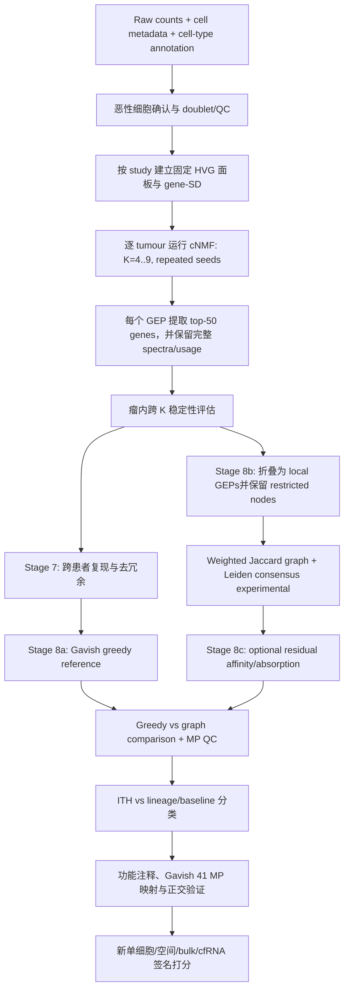

# 肿瘤单细胞 Meta-program 分析总览

> [!warning] 方法成熟度
> 这是一套**待试点验证的混合分析方案**，不是已经发表的标准流程。它组合了 Kotliar et al. 的 cNMF 和 Gavish et al. 的跨秩、跨肿瘤 meta-program 框架，并增加了 study-level 校准、细胞重抽样和 ITH 判定。r2 另加入 experimental weighted-graph community detection；在 head-to-head pilot 通过前，它不能替代 Gavish-style greedy reference。正式分析必须同时报告哪些步骤来自文献、哪些是本 SOP 的适配，不能将整套流程描述为“已验证方法”。

## 目的

从已经完成基本 cell-type annotation 的肿瘤 scRNA-seq 数据中：

1. 在每个肿瘤的恶性细胞内发现连续的 gene expression programs（GEPs）。
2. 去除对随机初值、NMF rank、单一患者或技术因素敏感的程序。
3. 在多个独立肿瘤之间合并反复出现的程序，形成 consensus meta-programs（MPs）。
4. 用 experimental graph landscape 同时描述 pan-cohort、context-restricted 和 unresolved singleton programs，而不在 cross-tumour filter 前静默删除后两者。
5. 区分真正具有瘤内 cell-to-cell 变化的 ITH programs，与 lineage、肿瘤整体偏移和技术程序。
6. 将最终 MP 作为可迁移签名，用于新 scRNA-seq、空间转录组、组织 bulk RNA-seq 或 cfRNA 的状态打分。

## 首先判断分析模式

| 数据条件 | 可以做什么 | 不可以声称什么 |
| --- | --- | --- |
| 只有 1 个 tumour | 发现该瘤的 cNMF GEP；映射到 Gavish 41 MPs 或其他参考签名 | 不能 de novo 定义 recurrent MP；不能估计跨肿瘤复现性 |
| 1 个 study、多个 tumours | 构建 study-level recurrent programs；初步形成 MPs | 不能证明跨研究、跨平台普适性 |
| 多个独立 studies、多个 tumours | 构建并验证 atlas-level MPs | 仍不能仅凭共表达证明调控、因果或细胞互作 |
| 只有 bulk/cfRNA | 对既有 MP 签名打分 | 不能从 bulk/cfRNA 重建单肿瘤细胞层面的 ITH |

> [!important] 术语边界
> 单次 cNMF 分解得到的是 **GEP/program**。只有当相似 programs 在多个独立肿瘤中复现并被聚成共识簇时，才称为 **meta-program**。单个 tumour 的因子即使很稳定，也不应直接命名为 MP。

## 核心架构

## 本 SOP 的主分析方案

- **输入**：未做 integration、未 log-transform 的 raw UMI count matrix，以及完整 cell metadata。
- **预处理原则**：遵循 cNMF，不做 mean centering，不产生负值，也不做 negative-value clipping。
- **study-level 适配**：HVG 面板和每个基因的缩放因子在同一 study 的恶性细胞中估计并冻结，再拆分到各 tumour 运行 cNMF。这是本 SOP 的 proposed adaptation，不是 cNMF 软件默认行为。
- **局部分解**：每个 tumour 分开运行；对每个 `K=4,5,6,7,8,9` 做 repeated NMF 和 consensus。
- **外层 reference**：保留 Gavish 的 top-50、跨 K、跨 tumour 和 greedy MP clustering。
- **experimental graph branch**：用相同 recurrent nodes 建 `recurrent_graph` 公平比较 greedy 与 Leiden；另用 cross-K local GEPs 建 `landscape_graph`，保留在 cross-tumour filter 中会被删除的 restricted candidates。
- **新增判定**：一个 recurrent MP 还必须具有可重复的瘤内 usage variation，才能被称为 ITH program；孤立节点不能仅凭网络位置称为 sample-specific biology。

## 最低输入合同

每个 cell 至少需要以下字段：

| 字段 | 含义 |
| --- | --- |
| `cell_id` | 全局唯一细胞 ID |
| `study_id` | 研究或数据集 ID |
| `patient_id` | 患者 ID；不能用 tumour ID 代替 |
| `tumour_id` | 生物学样本/肿瘤 ID |
| `batch_id` | 建库或测序批次 |
| `platform` | 10x、Smart-seq2、Microwell 等 |
| `cancer_type` | 癌种或组织来源 |
| `cell_type` | 已完成的基本细胞类型注释 |
| `malignant_status` | malignant / non-malignant / unresolved |
| `doublet_status` | singlet / doublet / unresolved |
| `n_counts`, `n_genes`, `pct_mito` | 基础 QC 指标 |

同时必须保存：

- 原始 count assay/layer；不能只保留 Seurat integrated assay 或 Harmony/PCA embedding。
- 基因 ID 到 HGNC symbol 的映射和版本。
- annotation、CNA 推断及 doublet 判断的来源。
- 每个 tumour 的恶性细胞数和纳入/排除理由。
- 数据文件 checksum、软件环境和随机种子。

## 分析阶段与通过门

| 概念分组 | 对应 [2. 分析SOP](meta-workflow.qmd) Stage | 必须通过的门 | 主要输出 |
| --- | --- | --- | --- |
| 输入与冻结 | 0–1 | raw counts、metadata、ID 映射齐全 | input manifest、checksum |
| 恶性细胞与 eligibility | 2–3 | annotation、lineage markers、CNA/基因型证据相互一致；疑似 doublet 移除 | cell/sample QC table |
| study-level 校准 | 4 | 固定 HVGs 和非零 gene-SD；检查大样本是否支配选择 | HVG list、SD vector |
| tumour cNMF 与 program QC | 5–6 | 收敛、consensus 可解释、usage 不被 QC 指标主导 | spectra、usage、run metrics |
| robust program | 7 | 跨 K 复现、跨独立 tumour 复现、瘤内不冗余 | robust-program table |
| MP 聚类 | 8 | 8a greedy reference；8b/8c graph experimental；多患者与技术 QC | MP lists、graph modules、method comparison |
| 统一打分与 ITH 判定 | 9–10 | 多个 tumour 内均有稳定 score/usage dispersion；cell bootstrap 通过 | ITH metrics、class label |
| 注释、验证与迁移 | 11–12 | 富集、参考 MP 映射、平台和正交证据分层 | annotation、validation report |
| release gate | 13 | 输入、参数、失败、敏感性和 claim wording 全部审查 | signed final report |

## 非协商原则

1. 不在 integrated/corrected expression matrix 上直接运行 NMF，除非方法明确证明该矩阵非负且保留可解释的 count scale。
2. 不对 cNMF 输入做 mean centering，也不把负值截为 0。
3. 不以一个 tumour 的稳定因子宣称发现了 recurrent MP。
4. 不只保存 top-50；必须保存完整 spectra、usage 和所有过滤映射。
5. 不把随机种子 consensus 当作生物学复现。还必须做 cell bootstrap 和跨患者复现。
6. 不强制结果等于 Gavish 的 5,547 programs、3,163 clustered programs 或 41 MPs。
7. MP 检出表示同一肿瘤内存在高、低 usage 细胞，不等于该 tumour 的平均表达高。
8. bulk/cfRNA MP score 是平均状态信号，不是 ITH 大小。
9. 不把 network layout、singleton 或低 degree 当作生物学特异性的直接证据；必须检查 sampling power、panel eligibility 和 bootstrap。

## 预期交付物

- `sample_qc.tsv`：每个 tumour 的细胞数、QC 和纳入状态。
- `study_preprocessing.tsv`：每个 study 的 HVGs、gene-SD 和校准参数。
- `cnmf_run_metrics.tsv`：每个 tumour、K、seed/consensus 的收敛和稳定性。
- `programs.tsv`：每个 GEP 的 top genes、来源、technical flags。
- `usages/` 与 `spectra/`：完整连续矩阵。
- `robust_programs.tsv`：跨 K/跨 tumour 过滤结果和去除理由。
- `local_geps.tsv`：landscape graph 的瘤内跨 K 折叠节点、medoid、成员 K 和 single-K 标签。
- `meta_programs.tsv`：MP top genes、成员 programs、患者/研究支持。
- `graph_modules.tsv`、`landscape_singletons.tsv`：Leiden consensus modules、bridge/restricted nodes 和支持范围。
- `graph_vs_greedy_match.tsv`：相同 recurrent node set 上两种分区的对应与稳定性。
- `ith_metrics.tsv`：每个 tumour-MP 的 usage dispersion、prevalence 和 bootstrap 指标。
- `annotations.tsv`：功能富集、Gavish 41 MP 匹配、已知/候选新程序。
- `sensitivity_report.md`：K、HVG、density threshold、cell bootstrap、leave-one-study-out 结果。

## 阅读顺序

1. [1. 原理与设计决策](meta-principles.qmd)：理解哪些环节来自文献，哪些是本 SOP 的设计。
2. [2. 分析SOP](meta-workflow.qmd)：逐步执行分析。
3. [3. 质量控制与解释边界](meta-quality.qmd)：决定结果能否发布、应该怎样表述。
4. [4. 实施资源与伪代码](meta-resources.qmd)：建立项目目录、参数文件和代码模块。
5. [5. 项目运行记录模板](meta-template.qmd)：为每次实际运行保存完整记录。

## 当前状态

- 文献方法和公开代码已经核对。
- 混合流程尚未在 Lee et al. 2020 CRC 或其他数据上完成 head-to-head pilot。
- Stage 8b weighted Leiden 和 Stage 8c residual absorption 比整体 proposed workflow 更早期，状态为 `experimental`。
- 在 pilot 通过之前，本方案保持 `proposed`，graph branch 不作为主分析。
