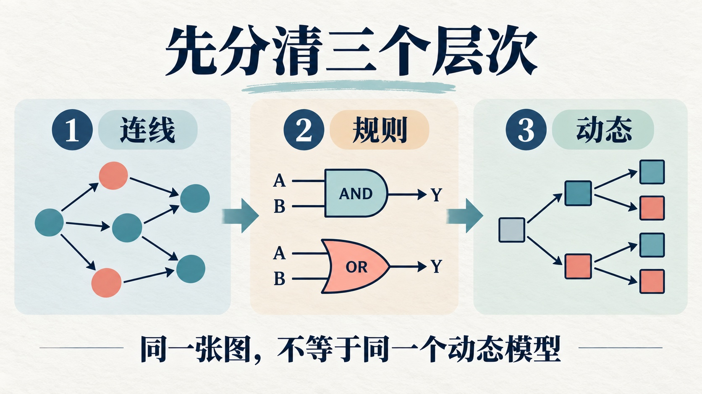
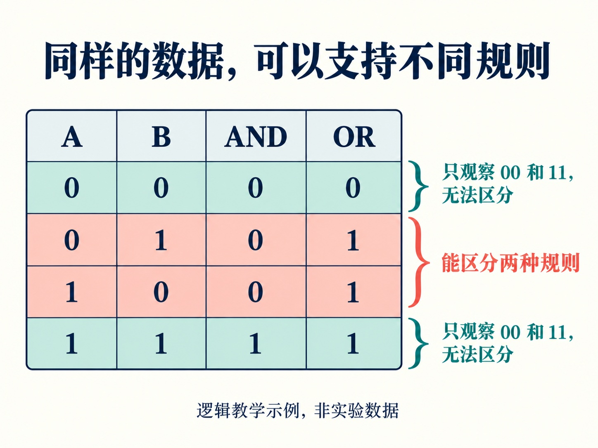
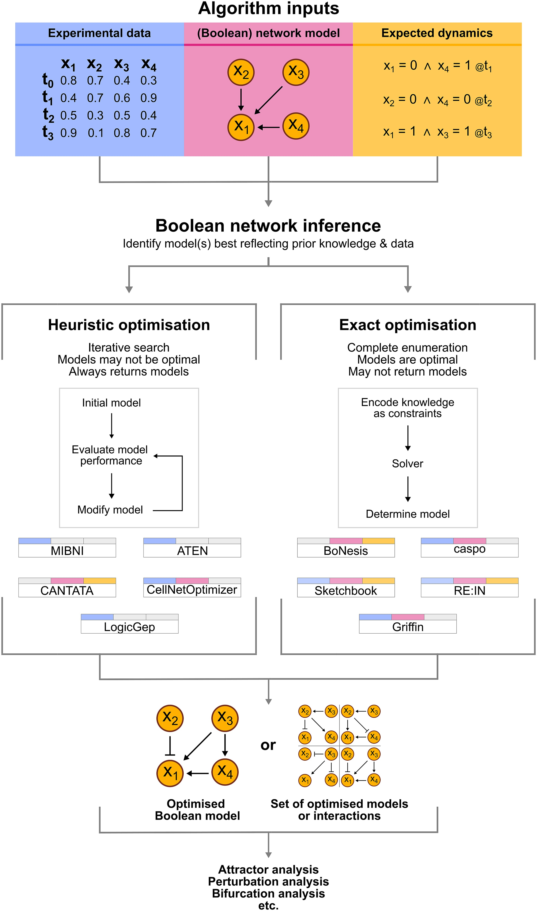
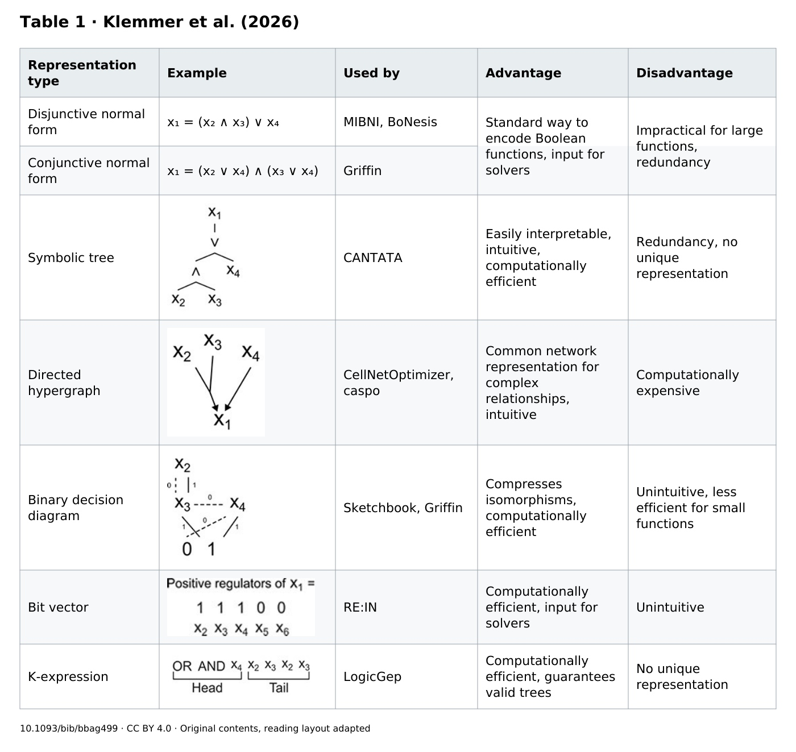
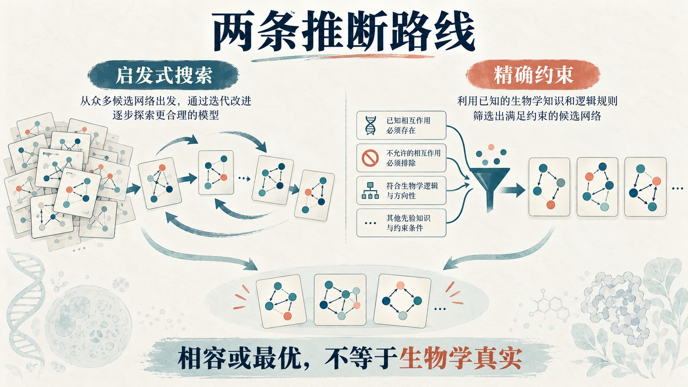
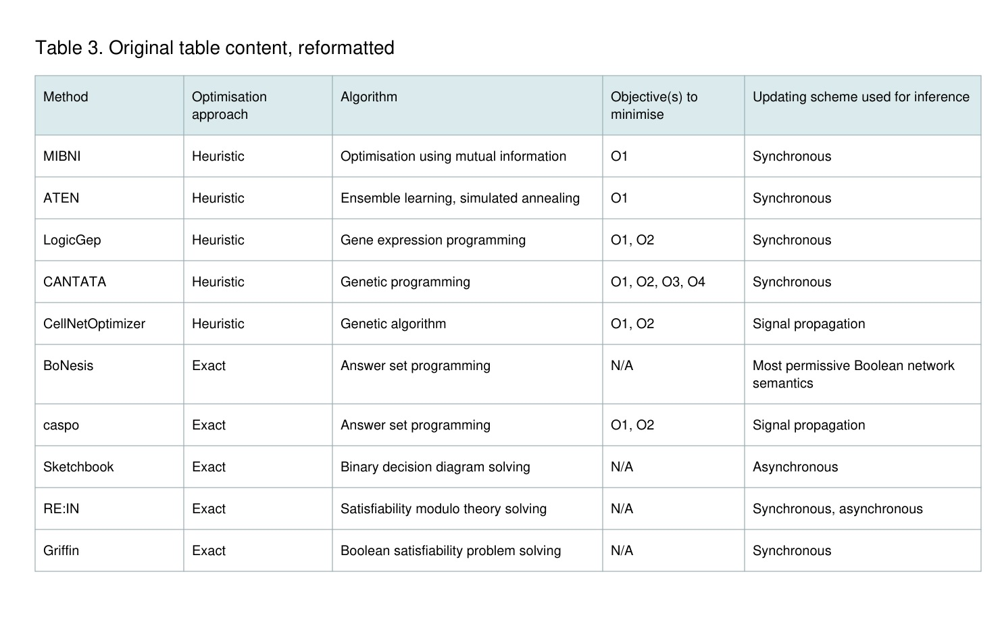
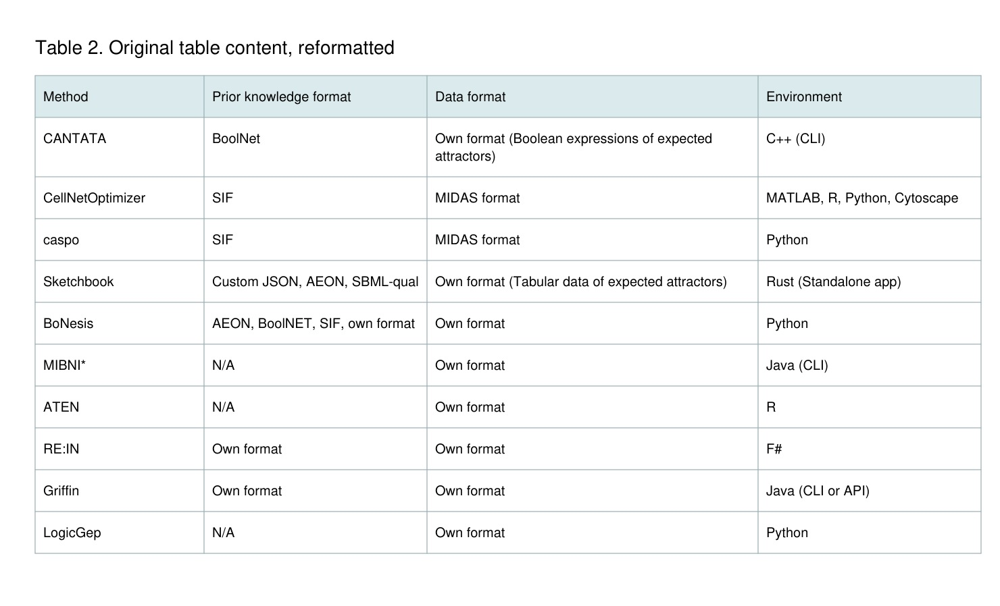

# 布尔网络：从表达数据到动态机制

::: {.book-source}
论文：[DOI 10.1093/bib/bbag499](https://doi.org/10.1093/bib/bbag499)。原有图注和许可说明见正文；未明确许可的图版标记为**授权待确认**。
:::

AI辅助生成的原创概念封面，非实验数据。

## 变量、逻辑规则与动态语义

AI 辅助生成的原创概念图，非实验数据：网络连线、逻辑规则和动态语义是三个不同层次；示意图不代表实测生物学机制。

### 一张调控网络，为什么还不能解释细胞命运

做完 RNA-seq，我们往往能拿到差异基因、富集通路，以及一张有很多箭头的调控网络。下一步却不容易：把某个转录因子关掉，细胞会停在原来的状态，转向另一个状态，还是经历一段暂态变化再恢复？静态连线告诉我们哪些分子可能有关，却没有规定多个上游信号怎样共同决定下游，更没有规定变化按什么顺序发生。

布尔网络想补上的，正是从关系图到可执行假说这一层。它将分子状态粗化为 0 和 1，再用 AND、OR、NOT 组合调控规则。它不承诺恢复细胞全部细节，却能把“如果同时缺少这两个信号，系统还能维持当前状态吗”写成可检验的问题。价值不在于模型看起来精密，而在于原本含糊的假设必须接受同一套规则的约束。

本系列解读 Klemmer 等在 Briefings in Bioinformatics 于 2026 年 9 月 15 日发表的正式综述，DOI：10.1093/bib/bbag499。论文介绍十种布尔网络推断方法，但真正值得学的是：输入证据、状态定义、更新语义和验证目标，如何一起决定结果。本篇先搭建概念地基；第二篇比较推断原理；第三篇讨论证据与选型；第四篇整理独立的研究决策要点。

### 先问 0 和 1 究竟代表什么

布尔网络中的一个节点可以代表基因表达、蛋白活性，甚至一个细胞功能状态。0 和 1 的解释必须逐节点写清：是相对于当前实验的低表达和高表达，是低于和高于某个作用阈值，还是蛋白未激活和激活？这些定义不能随意互换。“表达量低”不意味着完全没有蛋白，“没有检测到转录本”也不自动意味着对应功能被关闭。

这对转录组读者尤其重要。转录因子的 mRNA 丰度、蛋白丰度、入核状态和 DNA 结合能力之间，隔着多个调控层。把 RNA 表达二值化后直接称为“转录因子活性”，已经加入了额外假设。若这个假设在所研究系统中没有支持，模型仍可以解释表达状态转换，但关于蛋白作用机制的结论需要降级。测量对象和模型变量对不上，后面的优化再漂亮也不能弥补。

二值抽象适合回答方向和条件类问题：哪些组合可能维持某个状态，哪些节点可能阻断一条转换路径。它通常不适合直接预测药物浓度、反应速度、到达某状态的真实分钟数。一个模拟步不是自动等于一个采样间隔。若研究目标就是剂量依赖或精确动力学，应考虑有相应数据支持的多值、连续或混合模型，而不是把布尔结果硬翻译成定量预测。

### 两条箭头，至少两种完全不同的机制假说

设 A 和 B 都指向 C。仅凭这两条边，不能判断 C 的规则究竟是“A AND B”，还是“A OR B”。前者要求两个条件同时满足，后者允许任意一路提供充分条件。二者都可以画成 A、B 各有一条箭头指向 C；拓扑相同，组合逻辑却不同，对单基因扰动的预测也会改变。

做一个纯教学演算。若观测只包含 A、B 同时为 0 时 C 为 0，以及 A、B 同时为 1 时 C 为 1，AND 与 OR 都能完全拟合。只有补看 A=1、B=0 或 A=0、B=1 的情况，才能区分这两个简单候选。这里没有算法失败，也不需要更大的神经网络：数据本身还没有提出足以排除另一种解释的问题。

AI 辅助生成的原创教学图，非实验数据：两种规则在 00 和 11 输入上一致，在 01 和 10 上不同。表内数值是逻辑真值，不是实验数据。

再加入抑制因子 D，规则可以写成“（A OR B）AND NOT D”。它表达的是 D 存在时阻断这个输出条件，不等同于在分子层面证明 D 与 C 直接接触。布尔边有时代表有效调控，可能把若干未显式建模的中间步骤压缩在一起。因此，“推断出一条边”与“发现新的直接结合机制”必须分开叙述，后者需要独立实验支持。

### 规则之外，还要规定谁先变化

给定同一组逻辑函数，系统怎样从当前状态走向下一状态，取决于更新语义。同步更新是所有节点同时读取旧状态，再一起写入新状态。它容易计算，也容易形成确定轨迹，但隐含一种理想化的共同节拍。完全异步更新允许每一步只改变一个可更新节点；若多个节点都能改变，就产生不同的可能后继。

不要把“异步”简单理解成“每次随机选一个节点，所以更真实”。异步语义首先定义的是一张可能转移图；随机模拟只是探索这张图的一种办法。对全部可达状态作形式分析，和随机抽几条轨迹，是不同强度的计算证据。后者没有见到某个结局，可能只是采样遗漏，而不是证明该结局不存在。若加入更新概率，还必须说明这些概率从哪里来。

一个两节点例子足以看到差别：A 下一步取 B 的当前值，B 下一步取 A 的当前值。从 01 出发，同步更新会到 10，再返回 01，形成循环；完全异步若先更新 A，则进入 11，若先更新 B，则进入 00，随后不再改变。这是由更新规则产生的数学差别，不能直接宣称细胞真的在振荡。推断前没有写清语义，就连“拟合成功”的含义都不确定。

### 吸引子不是自动获得的细胞类型标签

固定点是所有节点都不再要求改变的状态，也就是每个节点的当前值都满足自身规则。对同一组函数而言，通常的同步和完全异步语义共享这些固定点。但到达固定点的路径、哪些起始状态能够到达它，以及非固定点的长期行为，可能明显不同。所谓“固定点稳健”，不能被扩展成“所有动态预测都不依赖语义”。

同步系统的长期行为可能是一串循环状态；异步系统的复杂吸引子可以是不能逃出的转移集合，不一定是一条按固定顺序运行的简单环。把吸引子解释为某种细胞表型，还需要与实验标志、稳定性和研究条件对应。一个数学上稳定的状态若不符合测量事实，不能因为它叫“吸引子”就取得生物学身份。

综述也介绍最宽松布尔语义。Paulevé 等 2020 年的原始研究允许节点处于上升或下降的过渡状态，从而容纳传统二值瞬时更新可能漏掉的行为。其保证有明确边界：针对遵循同一逻辑、满足论文细化条件的定量模型，不遗漏相应可达行为；它不意味着恢复任意真实系统，更不提供每条路径发生的概率或真实耗时。[1]

这一变化很适合提醒我们区分“可能”和“必然”。更宽松的语义可以避免过早排除一个相容机制，同时也可能保留更多现实中没有发生的候选。若问题是“有没有一条路线能到达目标”，与“所有允许路线最终都能到达目标”，使用的是不同的逻辑量词，不能拿前者替后者作结论。

### 三类输入，构成三种不同约束

原综述 Figure 1，Klemmer 等，2026，DOI：10.1093/bib/bbag499，CC BY 4.0。保留原始文字、颜色和连线，未改动科学内容。蓝色、粉色、黄色分别对应实验数据、网络知识和预期动态。

读这张图，不要先记下面的软件名字，而要先看上面的三种输入。实验数据告诉我们哪些状态被测到；先验网络规定哪些调控可能存在；预期动态则规定模型应满足什么行为，例如从初始状态能够到达某种终点，或在扰动后不能维持某种稳态。它们提供的信息互补，却不能相互冒充。

只有终点表达的实验，未必支持一条具体的状态转移顺序；只有互作数据库，也未必知道作用符号和组合门；只有“这个细胞最终会分化”的知识，又不足以唯一识别内部网络。推断方法实际上是在这些证据共同划出的空间里筛选规则。输入信息越少，剩下多解越正常。输入越强，也越要担心其中错误是否把真实候选提前排除。

原图把两条路线概括为启发式和精确优化，便于入门，但不能逐字理解成工程保证。“精确”指对形式化问题的求解性质，不是生物学准确率；实际任务可能只枚举部分相容模型，也可能超时。类似地，启发式能返回候选并不说明约束已被满足。第二篇会拆开这些容易被图示简化的差别。

### 先验知识的重点，不只是多收几条边

先验通常来自文献、通路库、互作数据库或已有模型。自动文本挖掘能加快实体识别和关系整理，却需要核对物种、细胞背景、实验条件、否定句和推测语气。“在某条件下抑制”若被抽成无条件激活，会改变整套逻辑。人工整理同样会受知识盲区和选择偏好影响，因此更稳妥的做法是保留出处与证据等级，而不是把所有边视作同等可靠。

对于每条边，可以问五件事：方向是否有证据；激活或抑制符号是否明确；作用在哪种细胞与条件；是直接实验还是数据库转引；是否必须存在于当前模型。确定边、候选边与未知边应分开。允许对候选边进行删选的方法，可以利用较宽的候选网络；把边全部锁死的方法，则更依赖输入准确性。没有出处的密集网络并不比小而可追溯的网络更有说服力。

这里还应避免两个偷换。共表达是统计关联，不能直接充当有方向、有符号的因果调控；数据库收录某种关系，也不能证明它在当前细胞和采样窗口内起作用。综述文本挖掘段落还有一处编码器/解码器示例对调，本文不沿用该笔误：BioBERT 属于编码器式模型，基于 LLaMA 的方案属于解码器式模型。这也说明，正式综述仍需要带着原始证据阅读。

### 二值化不是一个可以随手略过的预处理

将表达量压成 0/1，会丢失幅度、细小变化和测量不确定性。对所有基因使用同一阈值尤其危险：不同基因基线、变异程度和检测特性不同。按基因做两个簇的聚类，比统一阈值更有针对性，却仍会把单峰、近乎恒定或纯噪声的序列硬切成两组。得到两个簇，不等于细胞存在两个真正的功能状态。

综述指出 MIBNI 与 LogicGep 使用按基因的 k-means 二值化，并讨论多尺度二值化等替代策略。关键不是找到一个永远正确的阈值，而是知道哪些判断稳定、哪些接近边界。若方法支持未知状态，可以将证据不足的位置留空；若不支持，就应通过阈值敏感性分析，观察结论是否被少数临界测量翻转。未知不应该被默默改成 0。

单细胞数据还多一层挑战：技术零值、细胞混合和拟时序误差会影响逻辑推断。拟时序是对不同细胞排列出的一种状态顺序，通常不是对同一细胞连续追踪得到的真实时间。把它交给算法，并不会自动补齐因果方向和速度信息。应把推断树、分支归属与二值化一起视为模型假设，并检查换一种合理选择后，核心结论是否仍在。

### 同一种逻辑，为什么需要不同的计算表示

原综述 Table 1，展示规则的计算表示及其取舍。Klemmer 等，2026，CC BY 4.0。按原表内容重新排版，保留示例与各项取舍；正文解释用于帮助选读，不是新的性能比较。

人容易读懂“A 与 B 同时满足，或 C 满足”，求解器却可能更擅长另一种编码。析取范式把若干 AND 子句用 OR 连接；合取范式反过来组织；符号树适合局部修改；有向超图可以表达多个调控因子共同作用；二叉决策图能共享重复子结构，减少冗余。表示方式改变的是计算路径，并不自动增加生物学证据。

也要区分公式写法不同与逻辑功能不同。两条外观不同的表达式可能拥有完全相同的真值表；同一张普通网络图却可能对应不同真值表。因此，统计“找到多少个模型”前必须说明，是按公式字符串、拓扑，还是按逻辑行为去重。否则模型数量可能只是编码冗余，而不是实质性的不确定性。

### 在开始推断前，先写一份最小模型说明

如果现在就要把自己的数据送进布尔模型，可以先准备一页说明。第一行写清系统边界：研究哪类细胞、哪种刺激、哪个阶段，哪些环境输入保持不变。第二行列出每个节点对应的实测量和二值解释。第三行区分确定调控、候选调控和没有证据的连接。第四行说明数据是时间序列、扰动终点还是拟时序。最后写出本次只打算回答的一个动态问题。

例如“寻找能解释分化终点的候选网络”，比“重建细胞真实机制”更容易落实。前者允许多个相容解释，也能清楚指出下一步应补什么实验；后者若没有足够干预数据，常常超出信息所能支持的范围。目标写得具体，还能防止研究过程中为了追求漂亮图形，不断扩大节点集合，最后却说不清哪个预测值得检验。

再检查输入与输出节点的处理。若刺激在整个实验中持续存在，可以把它作为被固定的输入；若刺激是短脉冲，不能未经说明就永久固定为 1。若一个节点没有已知调控因子，程序是把它保留自身状态、设为常量，还是允许它自由变化？这些看似细小的默认值，都可能改变系统最终能到达的状态，必须与软件结果一起报告。

最后，给模型留出失败的可能。提前约定哪种观测会让当前规则被否定，而不是看到结果不符后才不断添加边来解释。模型若只能事后容纳一切，就失去了区分假说的能力。可执行模型的优势，恰恰是把这些条件公开写出，让别人能够复算，也让下一次实验有机会推翻它。

### 本篇收束：先让假设可见，再谈自动推断

布尔建模最重要的起步动作，不是下载软件，而是写下变量的含义、证据允许的规则、采用的更新语义，以及准备检验的行为。网络图只是其中一部分。把这些层次拆开后，我们才能区分：结果变化究竟来自新数据、新规则，还是仅仅换了模拟方式。

下一篇将沿着“候选如何产生、依据什么保留、什么情况下可能错”读十种算法。记住本篇最基本的检查：0/1 不等于原始表达，连线不等于组合逻辑，模型步不等于真实时间，能拟合不等于机制唯一。

### 文献与阅读范围

主文：Klemmer P 等，2026，From prior knowledge to data-informed models: a review of Boolean network inference，DOI：10.1093/bib/bbag499。已阅读完整正文、Figure 1、Tables 1–3，以及补充 S1 和 Table S1。S1 报告最后一次文献检索为 2025 年 12 月 16 日；2026 年发表不意味着系统覆盖所有 2026 年工具。

[1] Paulevé L 等，2020，Reconciling qualitative, abstract, and scalable modeling of biological networks，DOI：10.1038/s41467-020-18112-5。重点阅读原始研究的引言及 Results 中动态语义、细化模型和形式保证相关段落；未逐项复核补充材料中的证明。文中的两节点和 AND/OR 例子为本文原创教学演算，不是原论文实验。

## 推断路线与方法选择

AI辅助生成的原创概念图，非实验数据。图中展示根据轨迹评分与根据逻辑约束筛选候选的思路，不是软件实测速度或准确率比较。

### 手里有数据，为什么还不能直接选算法

假设我们有一组转录组时间序列，想知道哪些调控关系推动细胞从状态甲走到状态乙。打开软件列表，会看到互信息、遗传规划、答案集编程、SAT和SMT。名称背后是不同的搜索办法，但决定能否回答问题的，往往是更前面的选择：允许哪些规则，输入包含什么信息，用什么动态语义解释观测，以及怎样判断一个候选值得保留。

Klemmer等2026年的综述整理了十种方法。本篇不把它们排成排行榜，而是沿着同一个问题读：如果已有数据还兼容好几套机制，每种方法怎样处理这些候选？其中算法细节主要依据这篇综述；MIBNI和CANTATA的关键机制另核查了原始研究相应段落，阅读范围列在文末。这里没有新运行的工具比较。

### 先看懂原表里的四种目标

原综述Table 3，Klemmer等，2026，DOI：10.1093/bib/bbag499，CC BY 4.0。按原表内容重新排版；O1是模型轨迹与数据的差异，O2是模型大小，O3是与先验结构的相似程度，O4是对噪声的敏感性。N/A表示原表未列这种数值优化目标，不表示没有约束。表格不是性能排名。

O1最直观：希望预测接近观测。但接近的是每个采样点、稳定终点，还是整段轨迹，要看具体方法。O2希望避免过度复杂，可按规则长度或所用结构计量。O3要求不要毫无理由地偏离已有知识。O4则检查初始条件轻微变化时，模型是否发生过大的变化。这些目标可能冲突，不能看到“多目标”三个字就认为四方面都得到了最佳答案。

两种常见处理方式也不同。加权目标允许用拟合收益交换复杂度代价，权重决定交换比例；字典序目标先比较最高优先级，只有前者相同时才继续比较后者。一个假设例子是：候选甲拟合误差更小却规则更长，候选乙稍差但简单。若拟合排在第一，甲可能获选；若复杂度权重足够高，加权方法可能选乙。这反映不同建模偏好，不是某个求解器突然失灵。

### MIBNI：先找有信息的调控者，再检查规则是否解释轨迹

MIBNI面向时间序列表达数据，先用互信息筛选候选调控者，再调整调控者集合及其正负作用，寻找能够解释状态变化的规则。互信息可以发现不局限于线性关系的依赖，但依赖本身没有证明直接调控。一个共同上游、遗漏变量或状态混合，都可能让两个分子看起来关联紧密。

原始方法使用受限制的逻辑函数家族，把候选调控者及其符号组织成合取或析取形式，并通过MIFS、SWAP等步骤改进选择。这个限制减少搜索成本，却也意味着不能把它理解为遍历了所有复杂嵌套逻辑。真实关系若需要候选空间没有容纳的组合门，算法再认真搜索，也只能在允许的表达方式里找近似。

时间序列还暗含一个需要核对的对应关系：当前时点的输入被用来解释下一时点的目标状态。若不同实验采样间隔差异很大、关键响应发生得比采样更快，或多个过程混在同一时间点，离散一步就未必对应一致的生物学变化。综述描述的同步更新并不会自动修正这种时间分辨率问题。

使用时应同时看结构和动态，而不只问轨迹误差够不够小。不同上游集合可能拟合同样的有限轨迹；提高允许的最大调控者数量，又可能让模型更容易拟合而增加错误边。最大入度是候选空间假设，应报告并做敏感性检查，不能当作无需解释的默认值。

### ATEN：先产生规则集合，再筛出较简洁的解释

ATEN对二值时间序列进行自助抽样，为目标节点构造符号树形式的候选函数集合。综述描述其借助模拟退火，通过加入、交换或删除子句和调控者来改善与数据的一致性，再检验各子句的重要性，形成较小的函数并组合为网络。

这里的自助抽样能展示候选对所用数据的依赖，却不自动解决生物重复不足。若输入只有同一批细胞的一条推断轨迹，反复重采样不会变出独立供体，也不会让拟时序变成真实追踪时间。集合里的分歧可以作为不确定性线索，但不能直接解释成真实细胞使用某条调控边的概率。

子句重要性同样是条件性的。删掉某项后预测变差，说明它对当前候选、当前输入有帮助；不等于该分子在所有条件下都不可替代。若两条通路提供相似信息，软件可能保留其中一条。这样的选择值得设计扰动实验区分，而不宜仅凭模型输出命名为唯一关键通路。

### LogicGep：二值规则的选择，还可以参考连续表达

LogicGep把时间分辨的bulk数据或拟时序排列的单细胞数据用于函数推断。按综述介绍，它先结合随机森林和XGBoost识别候选调控者，再用基因表达式编程产生并选择逻辑函数。候选可经历交叉和突变；在二值解释接近时，还参考基于原始连续数据的预测表现来区分候选。

这条路线的吸引力在于，连续表达中被二值化压掉的部分信息没有完全弃用。但它仍受前端候选选择、拟时序、离散化和函数空间限制。连续预测较好，只能为候选排序增加依据，不能把有效预测关系直接升级成直接分子机制。表达数据中的混杂，也可能同时影响前后两道筛选。

局部与整体的区别在这里很关键。分别为每个节点找到好函数，再拼成一个网络，得到的是一套彼此连接的规则；局部预测好，并不保证网络闭环后仍产生合理的吸引子或长期行为。分析者需要再检查全网，而不能把每个节点的小测试分数相加，当成整体机制已经验证。

关于LogicGep，本次核实了原始论文身份和摘要，详细算法说明主要来自主综述，没有把其原始实现逐行复现。因而本文不提供跨数据集性能保证，也不把方法宣传中的收益写成独立验证结论。

### CANTATA：从已有模型出发，保留知识，也允许规则改变

如果手里已有一个布尔模型，问题可能不是从零生成所有连线，而是让它更符合当前实验。CANTATA以现有模型及预期系统状态为输入，用遗传规划修改函数。可改变运算符、插入节点、删除子树或对子表达式取反，再根据整网的动态表现与其他目标保留候选。

需要区分遗传规划与“必然交叉拼接”。原始CANTATA研究的操作以突变为核心，不应因为名称里有遗传，就推定它采用了与另外两种工具完全相同的交叉过程。编码方式和可用操作决定能探索哪些邻近规则，也影响搜索是否容易陷在某一类解释附近。

先验模型在搜索中持续提供引导，优点是不会轻易丢掉已经整理的知识，代价是错误先验也可能反复影响候选。若一条边来自另一种细胞、一个不同刺激条件，保留它可能让模型更像文献，却更不像当前实验。先验相似度高需要与上下文一致性一起解释。

因此，更合适的使用问题是“在这份有出处的先验周围，哪些修改能解释当前观测”，而不是“软件已经找到了没有偏见的真实网络”。可以分别运行较严格和较宽松的先验设置，查看关键预测是否一致；这是方法学建议，不是本文已经运行过的实验。

### CellNetOptimizer：把扰动实验映射到信号网络

CellNetOptimizer所讨论的经典框架，从信号通路先验和刺激、抑制实验出发，压缩与当前实验关系较弱的结构，再搜索与观测相容的逻辑网络。综述所列版本采用遗传算法，结合交叉、突变、选择及保留优秀个体的策略，用预测误差和网络大小约束模型。

其输入不只是一个普通表达矩阵。MIDAS等格式还编码了实验条件：哪些刺激打开、哪些节点被抑制、测了哪些信号。若把不同处理条件合并成无标签的样本表，模型就失去了区分干预的关键信息。文件里的条件定义，本身就是科学模型的一部分。

这条路线强调短时信号传播。它不应未经说明地被用来解释长期分化、所有反馈振荡或精确的药物剂量效应。一个抑制处理被编码为节点关闭，也是一种抽象；真实药物若只部分抑制或存在其他靶点，模型与实验之间就多了一层偏差，需要通过实际读出检查。

原始研究有建模之后新增条件的实验检验，这是有价值的证据。但支持范围仍是该研究中的细胞系统、输入和测量指标，不能由此推导出每条内部边都被证实，或工具在任何新项目中都能达到同样效果。

### 精确求解：把“必须满足什么”写成机器能检查的条件

启发式方法寻找评分较好的候选，精确方法通常把问题编码为逻辑约束，再寻找满足这些约束的解。所谓精确，是对所定义的形式问题而言。约束写错、遗漏关键变量、二值状态解释错误时，求解器完全正确地执行，也可能得到不适合生物学解释的结果。

“无解”同样不能直接理解为生物机制不存在。它可能说明观测彼此冲突、固定了错误的边、规则家族太窄，或把有噪声的测量当成了硬约束。相反，“有一万个解”也不一定是软件差，可能只是现有证据不足以识别唯一规则。输出数量要结合约束和去重定义解释。

### BoNesis：用先验与动态性质约束相容网络

BoNesis结合答案集编程与最宽松布尔语义，把先验影响图、部分规则和预期可达性质交给求解器。某些动态问题可以符号化地检查，不必为每个候选都显式展开所有轨迹。这个计算优势使较大模型有机会被处理，但不等于所有大模型都能在任意资源限制下完整枚举。

最宽松语义允许过渡状态，用来减少传统二值瞬时更新可能漏掉的相容行为。其保证针对满足相应细化条件的模型，不能泛化成“覆盖真实细胞全部动力学”。更宽松的候选空间也可能包含现实里没有发生的行为，所以“存在一条可达路径”和“细胞一定如此变化”要分开。

实际使用时，最好把输入条件、可达约束、固定状态和求解范围一起保存。只导出一张网络图，读者无法知道某条边究竟由实验要求、先验锁定，还是从多个可行解里选出来。

### caspo：在扰动响应中比较拟合与规则大小

caspo也使用答案集编程，但问题组织与BoNesis不同。它从先验网络及扰动数据学习信号传播模型，按预测误差、函数大小等目标进行字典序优化。相同求解技术并不代表相同动态假设，不能只根据两者都用了ASP就把它们看成可互换的软件。

综述强调这类信号传播模型对反馈与复杂长期行为的限制。若课题核心正是一个持续振荡的反馈回路，就应先确认模型类能否表达目标，而不是跑完之后再把一个稳态结果解释为振荡机制。工具无法表达的行为不应在benchmark中随意记成“错误”，而应先标明任务不适用。

### Sketchbook、RE:IN与Griffin：不同的约束语言

Sketchbook把部分已知网络、可能存在的调控和预期动态组织成“草图”，利用符号表示筛选相容候选。综述以异步语义为主介绍它，并讨论其他语义可能性。这里的重点是：哪些边确定、哪些边可选、需要存在还是不能存在某种转移，都必须被具体表达。

RE:IN把确定与候选结构、状态转换和实验知识编码为SMT问题，使用位向量与Z3推理，可在相应设置下处理同步或异步动态。它可以进一步添加最小网络等要求，但“最小”是当前约束下的偏好，不自动意味着自然系统选择了最少的边。

Griffin使用SAT和符号表示，围绕同步网络的已知、候选结构及野生型或扰动后的吸引子性质进行推断。一个重要输入边界是，综述中的Griffin不直接整合时间序列作为推断数据。拥有时间序列的用户，应先判断能否可靠提取符合工具要求的性质，不能把矩阵换个扩展名就算适配完成。

这三种工具的共同价值，是把先验的不确定性和动态要求显式化；差别则在表达方式、更新语义、可检查的性质和计算实现。选型应从问题语言出发：究竟要约束固定点、路径、某种吸引子，还是多个实验条件下的响应？

### 真正选型时，可以先问三句话

第一，数据提供的是轨迹、扰动终点，还是关于长期行为的定性知识？第二，先验允许被删改到什么程度，哪些关系有足够证据必须保留？第三，我们需要一个候选用于下一步实验，还是需要分析一组相容模型之间的共同点和分歧？这些问题回答之后，工具列表通常会缩短很多。

不要把“更大的网络”“更复杂的求解器”直接当成更好的研究。若实验只有少数终点，增加节点常常只是增加自由度；若问题只需要区分两个候选门，补一个有区分力的扰动，可能比换算法更有效。方法选择应服从信息，而不是让研究问题迁就软件最方便展示的输出。

### 文献与阅读范围

主综述：Klemmer等，2026，From prior knowledge to data-informed models: a review of Boolean network inference，DOI：10.1093/bib/bbag499。完整正文、原图表及补充S1、Table S1已阅读；检索截止为2025年12月16日，不能称为穷尽2026年所有工具的清单。

MIBNI原始研究：10.1371/journal.pone.0171097，核查MIFS、SWAP及结构/动态评价相关内容。CANTATA：10.1093/bioinformatics/btac623，核查方法中的符号树、突变与目标设置。CellNetOptimizer：10.1038/msb.2009.87，核查建模和验证相关段落。LogicGep原文10.1093/bib/bbae286本次仅核查摘要，细节按主综述归因。没有运行软件或重新计算性能指标。

## 证据层级、验证与互操作

AI辅助生成的原创概念图，非实验数据：训练拟合、留出预测和新实验检验属于不同证据层级；候选模型间的差异需要保留并检验。

### 最佳模型出来之后，真正困难的部分才开始

假设软件已经返回一组规则：训练数据拟合很好，吸引子看起来也能对应几种细胞状态。能否就此说，我们找到了控制分化的机制？还不能。模型可能只是在有限观察上选出一个方便的解释；另一套不同规则，也可能产生同样结果。若没有独立证据，漂亮的网络图无法决定哪套解释更接近真实系统。

Klemmer等2026年综述最重要的提醒之一，是缺乏覆盖不同方法的统一、充分标准化基准。论文提出了未来基准设计框架，并未亲自完成十种方法的全面竞赛。因此，“某方法在某个原始案例表现较好”和“该方法普遍优于其他工具”，之间有很长的证据距离。本篇把重点放在如何缩短这段距离。

我们将区分三件事：算法能否恢复一个已知模型，模型能否预测未见条件，以及预测是否经受新的生物学实验。它们都值得做，却回答不同问题。把三者混成一个“准确率”，反而会掩盖模型最关键的适用边界。

### 第一层：技术重建证明了什么

常见重建基准先选择一个参考网络，让它产生模拟数据，再删除或添加一些边，或给数据加入噪声，最后考察推断能否恢复原结构和行为。这种设计的优点是有已知答案，可以控制网络规模、噪声与缺失程度，分析方法在什么情况下退化。

但参考模型本身只是一种数据生成机制。若它的更新语义、规则形式和噪声分布恰好符合被测算法，成绩可能较好；换一个更复杂或更不匹配的生成过程，结论可能改变。技术重建验证的是“在这类构造的问题上能恢复多少”，不能直接证明真实细胞拥有同样的结构，也不能代替真实生物学验证。

结构指标与动态指标也应分开。同一拓扑可以装上不同逻辑门，产生不同动态；不同拓扑又可能在已观察条件下产生相同动态。原始MIBNI论文就讨论过结构未完全恢复而表达轨迹仍能很好拟合的情形。[1]若目标是扰动后表型预测，只看边的准确率不够；若目标是提出直接调控机制，只看轨迹拟合也不够。

甚至“结构准确率”本身也要拆开看。稀疏网络里不存在的边很多，预测大量无边就可能拿到较高总体准确率。应同时看真阳性、假阳性、漏边情况，以及比较对象是否使用相同候选边集合。数字没有独立于任务定义的意义，不能把不同论文中同名的指标当作同一种测试成绩。

### 第二层：留出验证要让模型真正遇见新问题

留出数据的目的，是考察没有直接参与规则选择的条件。对生物数据而言，随手把矩阵中的几个数随机遮住，常常不足以模拟真实使用场景。同一供体、同一重复或同一刺激条件的强相关测量，可能同时出现在训练与测试两边，使所谓“未见数据”其实只是在补附近的格子。

更有意义的划分取决于计划用途。如果希望预测新的干预，就留出完整干预条件；如果希望迁移到新的生物重复，就按重复或样本来源分组；如果想预测后续状态，就明确训练阶段是否看到了后续轨迹的信息。拟时序推断、特征筛选和阈值设定若使用了全部数据，也可能提前泄露测试集结构，需要记录清楚。

留出条件越难，解释也越要具体。对同一细胞系中新组合刺激预测成功，不等于跨细胞类型有效；对同一批数据留出时间点成功，也不等于能预测真实时间间隔。验证设计应该对应将来要作出的声明，而不是先选择容易得到高分的划分，再把结论写成泛化能力很强。

### 第三层：新的实验开始挑战模型外推

综述特别强调，所考察方法的原始论文中，CellNetOptimizer包含建模之后新增实验数据的验证。查看2009年原始研究相关结果，可见作者在HepG2细胞中使用与训练数据区分的刺激和抑制组合，考察模型对信号读出的预测。[2]这里的关键不是给出某个漂亮误差，而是预测有机会被新的观测推翻。

不过，新增实验也不是“验证整个网络每一条边”。这项工作支持的是特定细胞背景、所测信号与实验窗口内的预测能力。若多套结构对这些读出都给出近似结果，它们仍可能无法区分。模型能预测若干外部输入的响应，说明它是有用的有效描述，不自动证明内部每个中间作用都唯一正确。

验证后的表述应保持颗粒度：哪些条件被预测，哪些输出被测量，哪些结果吻合，哪些失败，是否存在替代解释。最容易过度陈述的句子是“模型得到实验验证”；更清楚的写法是“模型对这些新增条件下这些读出的预测获得支持”。多写半句话，就能避免把局部支持扩成整个机制已被证明。

### 一个BoNesis应用，怎样展示多模型的价值

Chevalier等2025年原始研究将转录组数据和转录因子调控先验整合，用BoNesis生成相容布尔网络集合，分别研究单细胞造血分化，以及骨髓基质细胞向脂肪和成骨方向分化的时间序列。[3]它的启发之处，是不把测量解释的不确定性藏掉，而是构建多个定性规格，再比较跨模型的预测。

在第二个案例里，研究者使用两种二值化方法和三个实验重复，形成六组替代输入规格。各组生成候选模型，再进行控制目标分析与模型集合模拟，优先考虑在不同解释下仍较稳健的候选扰动组合。这里的“稳健”是相对于所用先验、二值化和模型样本而言，不能扩展为对所有未知机制都稳健。

这也解释了为什么“多数模型支持”不等于某种干预在真实细胞中有同样概率成功。模型集合的成员不是从真实细胞机制分布中随机抽取的；求解器采样可能偏向某些规则家族，多个模型也可能共享同一错误先验。集合频率有助于比较内部一致性，但除非有额外统计建模依据，不应直接称为生物学概率或置信度。

### 正向结果与验证局限，要放在同一张纸上

这项BoNesis应用也做了初步实验检验。原文报告，三个候选干预组合中，观察到的上调基因与成骨方向相关变化的对应比例分别为0.57、0.51和0.33；同时，所有实验的召回率都低于0.02。[3]这些数字的对象是特定差异表达结果的匹配，不是“57%细胞完成转分化”，更不是临床疗效。

读到方向上有支持时，也必须看到覆盖范围很有限。少量相关基因响应，和整个转录程序完成切换，是不同结果。作者讨论了递送、抑制效果与蛋白调控层等限制，并将验证定位为初步。若只保留“实验验证成功”，会抹去这篇原始研究最重要的谨慎之处。

这个案例提供的方法学经验是：把重复与二值化差异传递到模型集合，寻找对这些差异不敏感的预测，再通过实验检验其范围。它并没有给出一种普适正确的二值化方案，也没有消除先验缺失。原文指出，给定先验缺少关键调控时，可能无解，也可能出现通过间接关系绕道的复杂解释；这些情形仍需要研究者诊断。

### 多解可能是下一次实验的设计图

当多个模型同样符合已有数据，第一反应不该总是再加一个惩罚项，强行挑出唯一赢家。更有价值的问题是：它们在哪些未测条件上预测不同？第一篇的AND/OR教学例子里，只观察00和11无法区分；测试一个上游开启、另一个关闭，才更有信息量。真实系统当然复杂得多，但逻辑原则相同。

可以把候选模型按预测模式分组：一组认为抑制A会改变终点，一组认为必须联合改变A与B，另一组预测短期变化后恢复。如果实验资源有限，优先选择能让这些模型家族产生可测差异的条件，比重复验证大家都同意的观察更可能缩小机制空间。这个建议是本文的方法学推论，不是主综述已经完成的实验结果。

同时，应区分“稳健干预”与“区分性干预”。前者希望在多数候选中都达到同一目标，适合寻找对模型不确定性不敏感的预测；后者故意选择模型意见分歧大的条件，适合学习机制。二者不必是同一个实验。把研究目的说清，才能决定是追求一致成功，还是追求最能排除替代解释的信息。

### 公平比较，需要控制什么

综述提出的未来基准框架包括共同参考系统、重建与交叉验证挑战、实验检验，以及对更新语义、二值化、规模和随机性的控制。这里的“共同”不是让所有工具硬吃同一个文件，而是尽量提供信息等价的输入，再按各自可表达的动态比较。某个工具不支持的任务，应标为不适用，不能简单记成零分。

先验信息量是最大的混杂因素之一。一个方法只看表达数据，另一个看表达、文献图和已知吸引子，后者表现更好不一定源于优化算法更强。可以逐步删减或扰乱先验，观察性能如何变化，区分算法贡献和额外信息的贡献。先验中是否已经包含测试目标，也需要审计，否则验证可能只是把答案重新读出来。

二值化也必须分层处理。为了技术公平，综述建议在某些比较中统一使用工具内部要求的方案；这并不等于认为该方案最符合生物学。公平比较时固定预处理，是控制变量；实际课题中评估替代预处理，是检查稳健性。两种目的不同，不应从一个基准的统一设置，推导出所有数据都应该照用的最佳实践。

随机方法需要多次运行，报告解的分布，而非只展示最漂亮的一次。精确方法同样需要报告求解状态、时间和内存限制、是否完整枚举、是否只取前若干解。没有完成枚举时，不能写“全部相容网络”；只检查了一部分初始状态时，也不能写“所有初始状态均成立”。计算范围决定结论范围。

### 文件格式，是科学假设的一部分

按原综述Table 2内容重新排版，Klemmer等，2026，DOI：10.1093/bib/bbag499，CC BY 4.0。N/A为不适用；原表星号说明MIBNI需向作者索取。表中格式与环境是综述记录，实际使用请核对具体版本。

不同工具使用SIF、BoolNet、AEON、SBML-qual、MIDAS或自有格式。看起来只是文件转换，实际上可能丢掉调控符号、组合逻辑、未知值与动态约束。普通边列表通常无法完整保留“A与B共同作用”和“A或B任一路作用”的差别；只验证文件能打开，不足以证明两个工具在求同一个问题。

转换后应该做一个最小回归测试：选几个已知状态，检查更新输出是否一致；选几个明确的固定点，确认语义没有变；核对恒定输入和扰动节点是否保留。若模型曾压缩掉中间节点，也要记录哪些因果细节被合并。互操作不只是工程整洁，它关系到一篇论文的规则是否能被别人真正复算。

### 给自己的课题搭一个可证伪闭环

一个可执行流程可以从小范围开始：限定生物学场景和输出，整理有出处的先验，明确变量与离散化解释，预留完整条件用于测试，然后分别保留模型拟合、动态约束与外推结果。不要在看到测试集后反复调整规则，又把同一测试集继续称为独立验证。

得到多解后，先检查分歧是否来自编码冗余，再看是否来自真正不同的逻辑和结构。对代表模型做阈值、先验和语义敏感性分析，识别最稳健的结论与最脆弱的结论。下一次实验可以瞄准脆弱但关键的差别；新增数据进入模型后，再明确哪些候选被排除，哪些解释仍然存在。

保留失败记录也很重要。无解可能提示数据矛盾，过多解可能提示信息不足，反复得到高入度网络可能提示过拟合或先验边界不合适，训练好而外推差则要求重新审视模型类与验证设计。它们都是下一步研究的线索，不应只在补充材料里变成一句“部分条件效果不佳”。

### 报告规模时，别只数节点

“能够推断几百个节点”是一项计算能力描述，不等于几百个节点都被实验可靠识别。较稀疏的先验、较少的动态约束或某种高效表示，都可能让大网络变得可求解；然而，结果中哪些规则由数据决定，哪些主要由先验决定，仍需要另外分析。规模大与信息充分是两条轴，不能画成一条进步曲线。

综述讨论人工整理网络通常较小，但也提醒这可能反映人的整理和理解能力，而非生物系统只有那么多关键节点。合理的问题是新增节点是否带来可检验预测，是否有对应测量，以及解释和验证成本是否匹配。若一个核心子网络已能区分主要假说，先把它验证清楚，可能比追求全基因组图更有价值。

同时，应公布节点选择规则。只保留差异显著基因，可能漏掉表达稳定但调控作用关键的因素；只保留文献熟悉的节点，则可能缩窄发现空间。这些取舍不一定错误，但会限定结论：没有被纳入模型的作用，无法因为模型内部没有预测到它就被排除。

### 本篇收束：可信度来自可检验的边界

这篇综述没有提供一个包办所有任务的冠军工具，而是把选择问题拆回输入、表示、动态、推断和验证。它也有范围限制：补充S1的检索截止2025年12月16日，选取的是具有代表性的可获得工具，并非完整穷尽；方法间的比较主要依赖原论文和已有评估，不能替代新的统一基准。

对读者而言，最值得带走的是一个更严格的表达习惯：说明结果在什么假设下成立，经历了哪一级验证，还保留哪些替代解释。只有这样，布尔网络才会成为推动实验的工具，而不只是对已有知识的精致重画。

### 文献与阅读范围

主综述：Klemmer等，2026，DOI：10.1093/bib/bbag499。完整阅读正文及补充S1、Table S1；基准框架属于作者建议，并非本文新运行结果。

[1] Barman S、Kwon YK，2017，DOI：10.1371/journal.pone.0171097。重点阅读MIFS/SWAP、整体流程、结构与动态评估、案例和局限段落。
[2] Saez-Rodriguez J等，2009，DOI：10.1038/msb.2009.87。重点阅读建模流程、HepG2结果与Model validation，未将其结论推广至其他系统。
[3] Chevalier S等，2025，DOI：10.1038/s41540-025-00569-z。重点阅读两项案例结果、初步实验验证及讨论；数值取自原文，未重新分析原始实验数据。

## Take-home messages

AI辅助生成的原创教学示意，非实验数据。图中“明确问题—保留多解—设计扰动—修正模型”表达研究设计循环；网络节点和箭头是抽象示意，不代表已验证的具体调控关系。

### Take-home messages：下一次开题，可以先拿出这张问题清单

读完一篇方法综述，最容易留下的是一串软件名字。真正值得带走的，却是面对自己的数据时，知道哪些问题已经可以回答，哪些还需要实验。Klemmer等这篇综述把布尔网络推断的方法放到共同框架下讨论；它没有给出一个适用于所有课题的冠军工具，也没有证明表达矩阵足以恢复唯一的调控机制。

这篇独立的收尾，关注怎样把这些认识变成研究中的具体决定。下面的建议是我们基于综述和已核查原始研究形成的教学综合，不是作者已经完成的新实验，也不是运行十种工具得到的实践报告。建议可以迁移到许多机制建模任务：先把问题、假设和证据对齐，再决定算法。

### 先写一句能被推翻的研究问题

“构建某种疾病的调控网络”通常太宽。网络建出来以后，什么观察会证明它有问题？如果回答不出来，项目容易停在一张节点很多、颜色漂亮的图上。

可以把问题缩小为：在指定细胞背景和培养条件下，抑制A是否会阻止细胞进入状态B？或者：两个都符合现有数据的规则，对联合扰动有什么不同预测？这里的A、B是教学占位符，不代表本文验证了某个真实靶点。问题一旦具体，所需状态、实验条件和验证终点也更容易确定。

研究终点还决定了评价方式。若目的是预测扰动后的某个表型，行为预测是重点；若声称恢复直接调控关系，就要补充支持直接作用的证据。表达变化可以帮助产生调控假设，但它也可能经过多个中间环节。不能因为网络画出一条边，就把它改写成已经证实的直接结合或酶促作用。

### 建模之前，给每个变量写一句定义

一个节点的“1”到底是什么意思？可以是某个转录本达到阈值、某种蛋白处于活化状态，也可以是一个细胞程序被定义为开启。不同定义对应不同测量和误差。它们不能只因为都写成0或1，就在一张网络里不加说明地互换。

尤其要警惕将RNA低表达直接写成蛋白功能关闭。蛋白稳定性、翻译和修饰会影响两者关系；单细胞未检出也可能与测量有关。若只能观察RNA，就把变量明确写成相应的表达状态，并说明它与功能活动的联系是一项建模假设。

这不是要求所有节点都先做完实验才能开始。可以允许代理变量，但要给代理关系留下标签。将来发现模型不能解释数据时，研究者才能区分：是调控规则有误、阈值不合适，还是所选变量根本没有测到想讨论的过程。

### 数据类型决定我们能约束什么

有时间序列，并不等于已经知道每一步真实调控更新的顺序。采样间隔可能跨过多个事件；不同细胞也可能并不同步。单细胞拟时序更不应自动当成同一细胞的纵向实验。若要转成规则约束，必须交代这种解释需要哪些额外假设。

只有扰动终点时，可以约束特定条件下的响应，却通常不足以唯一确定到达终点的路径。只有少数稳定状态时，也能提出模型问题，但不宜声称已经恢复完整动态。反过来，某些工具围绕吸引子或可达性设计，并不接受任意时间序列矩阵作为直接输入。

因此，第一次选软件时，先列出手中真正有的信息：状态、时间顺序、扰动、候选边、必需边、可能的活动阈值。再逐项检查工具能表达哪一种。文件成功读入只能证明格式通过，不能证明生物学含义也通过。

### 把“模型很多”变成下一步实验的线索

多个模型同时符合数据，经常意味着现有观察不能区分它们。这未必是算法失败。假如两种候选规则在已测条件下都给出同样答案，再增加相同条件的重复，也许能减少测量误差，却未必解决规则之间的可辨识性。

更有价值的思路是找出它们预测分歧最大的条件。例如，教学上的AND和OR规则，在两个输入同时低或同时高时可能无法区分；只改变一个输入，才会暴露差异。真实生物系统需要考虑扰动特异性、补偿和时间过程，但“实验应区分解释”这个原则仍然成立。

这里还要区分两种目标。为了理解机制，可以优先选择能让候选模型作出不同预测的实验；为了寻找较稳健的干预，可以关注多种相容模型都支持的策略。前者重视信息收益，后者重视对模型不确定性的耐受性。它们不必得到相同的首选实验。

### 模型频率不是天然的生物学概率

如果一百个输出模型中八十个包含某条边，这个比例值得记录，但不能直接说真实细胞中这条边存在的概率是80%。候选空间、采样方式、先验和求解器偏好都会影响出现频率。没有明确的概率模型和采样解释，就不要给频率附加它尚未拥有的意义。

同样，“所有返回模型都一致”也需要注明范围。是枚举了整个允许空间，还是只取了满足约束的一部分解？是否改变过候选边、离散化方式和更新语义？一个很窄的模型空间，当然更容易得到一致意见，却不一定覆盖重要的替代机制。

报告时可以把两个层面分开：在当前设定内，哪些预测保持一致；改变哪些合理设定后，结论会动摇。后者往往更能告诉实验人员，这个建议适合直接验证，还是需要先补一项基础测量。

### 看见失败，先判断它属于哪一层

没有找到满足约束的模型，不宜立刻总结为“生物学假说错误”。也可能是不同来源的先验不能同时成立，变量定义冲突，更新语义不合适，或者把不确定观察设成了绝对约束。应先逐组检查条件，定位矛盾，而不是任意删到软件愿意给出答案。

如果模型特别多，优先检查信息是否不足、候选空间是否过大。若训练拟合很好而留出表现差，则要检查过拟合、信息泄漏、条件差异和预处理敏感性。若程序超时或耗尽内存，那是计算状态；它既不证明不存在解，也不证明模型假设成立。

“精确方法”描述的是在明确编码下求解问题的方式，不是现实世界正确性的保证。完成证明、找到部分解、达到时间上限，是不同结果，必须保留原始状态。把它们都压成一个成功或失败，会丢掉判断研究下一步最需要的信息。

### 验证时，让模型遇到真正没有见过的条件

从用于构建模型的数据中随机拆出一部分，并不总能形成强验证。若同一供体、同一实验批次或高度相似条件同时出现在训练和测试中，结果可能主要说明对已有模式的延伸。合适的划分，应取决于研究希望推广到哪里。

想推广到新扰动，就应考察未用于调整规则的扰动条件；想跨供体，就要认真设计供体层面的留出。样本有限时做不到理想验证，也可以如实说明。限制本身不是不能发表的理由，把有限验证包装成广泛机制证明才会误导读者。

此外，验证数据应尽量不再用于反复选择模型。每看一次测试结果就改一次规则，原来的测试集合便逐渐参与了训练。必要时保留一个更独立的最后验证，或明确报告探索过程。对机制实验而言，预先写下方向、终点和不支持假说的观察，也能减少事后解释的空间。

### 一个最小模型档案，胜过只保存网络图片

如果要把工作交给学生或合作者，至少留下变量和状态定义、原始数据及预处理说明、先验来源与证据等级、允许的规则形式，以及更新语义。还应记录哪些观察是硬性要求，哪些只是偏好，为什么使用这些阈值和权重。

计算部分保留软件版本、求解器设置、随机种子或采样策略、资源限制、终止状态和最终规则文件。论文中的网络图用于交流，不能替代可执行规则。导出到另一种格式后，也应检查规则与动态含义有没有被保留；同样的节点和边并不能保证同样的模型。

结果部分则分开列出训练拟合、独立预测、实际实验，以及未验证假设。对于多模型分析，保存筛选前后的范围和代表模型的选择依据。这样别人才能判断某条结论来自数据，还是来自预先限定的模型空间。

### 写结论时，把证据层级写进句子里

“该规则与当前观察相容”“模型预测在指定条件下会发生某种变化”“新实验支持该预测”，是三个不同强度的陈述。每一步都有价值，不需要都写成“揭示了机制”才能显得重要。

即使新实验支持一个预测，也可能存在别的模型给出同样预测。它增强了证据，却未必排除所有替代解释。若进一步声称直接调控、充分性或必要性，就要确认实验设计真的测试了相应问题，以及结论限定于哪些细胞、条件和读出。

前文讨论的BoNesis应用同样提醒我们，基因表达方向的一致性指标不能直接读成细胞转化成功率。读者应该能够顺着句子找到分母、评价单位和实验终点，而不是只看到一个被抽离语境的高数字。

### 这篇综述最值得保留的研究习惯

以后遇到新的网络推断工具，不妨先问：它允许哪些模型存在，利用哪些信息排除候选，凭什么偏好返回的答案，还有什么实验能把这个答案推翻？这四个问题，比记住某一种优化算法的名字更耐用。

对于刚启动的课题，一个小而定义清楚、能够提出可检验预测的模型，通常比无法审查假设的大网络更容易积累可信知识。这是研究设计上的建议，并非综述证明了小模型总是更好。规模是否必要，应由问题和信息量共同决定。

最终要带走的，是一种可以反复修正的工作方式：把数据和先验翻译成明确假设，让模型暴露分歧，再用独立观察和实验减少分歧。模型的价值不止于给出答案，也在于准确指出我们还不知道什么。

### 来源与阅读边界

主综述：Klemmer等，From prior knowledge to data-informed models: a review of Boolean network inference，Briefings in Bioinformatics，2026年9月15日，DOI：https://doi.org/10.1093/bib/bbag499。完整正文、原图表和补充S1、Table S1已阅读。其检索截止为2025年12月16日，发表时间不意味着已经涵盖之后所有软件进展。

本系列另核查了MIBNI（https://doi.org/10.1371/journal.pone.0171097）、CANTATA（https://doi.org/10.1093/bioinformatics/btac623）、CellNetOptimizer（https://doi.org/10.1038/msb.2009.87）、最宽容更新语义（https://doi.org/10.1038/s41467-020-18112-5）及BoNesis应用（https://doi.org/10.1038/s41540-025-00569-z）的相关方法、结果或验证段落；未独立复算原始数据，也未核验所有补充证明。LogicGep原始论文仅核查摘要，方法细节按主综述归因。本篇的方法审阅清单和教学例子属于我们的综合建议，未作为作者的新实验证据。
