# 从单细胞图谱到因果预测：读懂“虚拟细胞”的证据与边界

::: {.book-source}
论文：[DOI 10.1038/s41576-025-00920-4](https://doi.org/10.1038/s41576-025-00920-4)。原有图注和许可说明见正文；未明确许可的图版标记为**授权待确认**。
:::

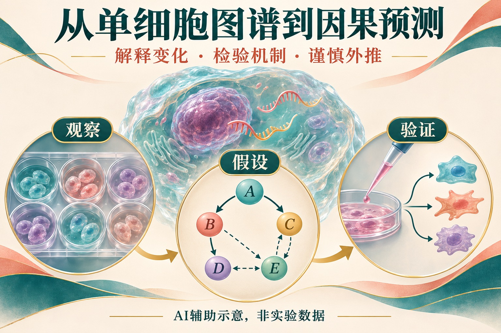

原创AI辅助教学封面，非实验数据。

本文合并五篇完整科学母稿与最后的独立 Take-home messages，不采用平台字数限制下的缩短正文。插图和图注来自对应核验备份；主Review图表为Springer Nature独占权利，公开复用许可仍未确认。本档仅作私人阅读归档。各部分的编号引用对应文末“来源、阅读范围与图像使用边界”中同一部分的来源条目。

## 1. 问题与证据

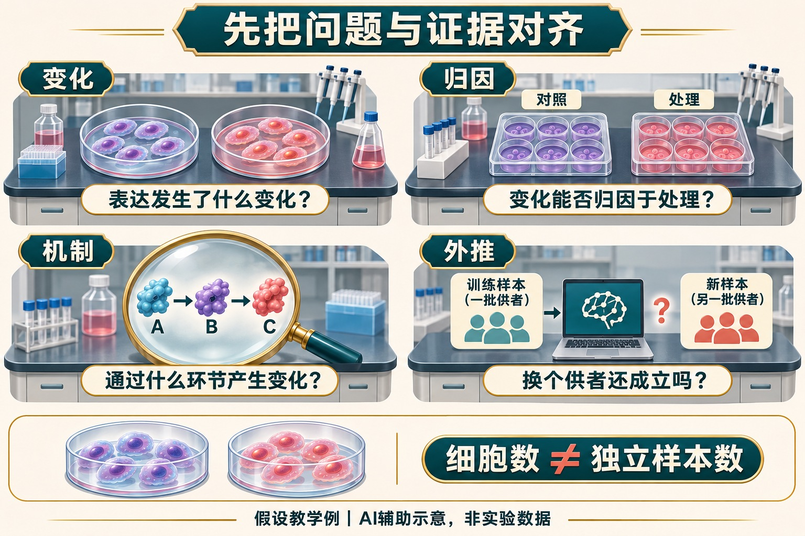

原创hero：假设教学例，AI辅助示意，非实验数据。下列原图仅用于未发布审读，复用许可待用户发布前核查。

你手里有一份单细胞表达矩阵，细胞分群很清楚，疾病组也找到了不少差异基因。接下来想问：如果抑制其中一个基因，细胞会不会回到健康状态？如果把药物换到另一种细胞，反应是否还能预测？

这两句话跨过的距离，比从原始数据做到漂亮UMAP远得多。前面的分析描述已经发生的差异，后面的判断要求我们说清：改变什么会引起什么变化，这种关系换一个条件是否仍然成立。

Dimitrov等人在Nature Reviews Genetics发表的综述《Interpretation, extrapolation and perturbation of single cells》，把大量看似分散的方法放进了同一套问题框架。它在2026年1月2日首次上线，正式卷期为2026年5月。它不是最新一周的软件榜单，而是适合反复对照研究设计的方法地图。本系列按问题重新组织，第一篇先把“我们究竟能从数据知道什么”讲清楚。后面再讨论基因程序、机制网络、反事实预测，以及如何检验模型是否真的学到了有用的东西。

### 把问题写完整，比选择模型更早一步

假设你比较用药组和对照组，发现某群细胞的炎症相关基因升高。这里至少有四个不同的问题。

第一，用药后，这些基因的平均表达是否改变？这是一种变化描述。第二，这种变化是否可以归因于用药，而非实验批次、细胞组成或其他差异？这是效应识别。第三，药物通过哪个分子环节引发变化？这是机制解释。第四，另一位供者、另一种细胞或另一个剂量下，会出现什么结果？这是外推。

四者需要的证据并不相同。显著差异不自动给出分子机制；同一批样本中预测准确，也不足以说明模型能迁移到新的病人。我们可以把研究问题写成一句可检查的话：在什么细胞和环境中，施加什么干预，相对于哪个对照，在多长时间之后，用什么读数衡量什么变化？

比如“预测基因敲低”还不够具体。预测的是某条细胞系中已见过的靶基因，还是训练集完全没有的靶基因？是预测总体均值，还是不同细胞状态的响应分布？测试中的供者是否在训练中出现过？这些区别决定数据划分、对照和评价指标，也决定最终能说多大的话。

### 一张表达矩阵，为什么装不下完整的因果过程

常规单细胞RNA测序在读取转录本时会破坏细胞。我们通常不能在同一个细胞中先读一次完整转录组，给药后再读一次，再把两张矩阵相减。这意味着，“处理前的这个细胞后来变成了哪个细胞”，往往没有直接观测答案。

实际拿到的，是一组对照细胞和另一组处理细胞。它们可能来自相同实验体系，但并非逐一配对的前后照片。因此，当算法为一个细胞生成处理后的状态时，其中有一部分是在依据分布和假设建立联系。图上画出一条平滑轨迹，并不能据此声称实验追踪了该细胞的一生。

还有一个容易忽略的层次：RNA表达只是调控过程的一部分。蛋白是否被激活、是否发生磷酸化、细胞附近有什么信号，以及过去经历过怎样的刺激，都可能影响当前表达。即使测到了很多基因，也不等于测到了所有相关原因。

这会带来很常见的歧义。两个基因一起升高，可能是其中一个调控另一个，也可能由同一个上游因子同时驱动；还可能只是两组样本中细胞类型比例不同。仅凭共表达，很难在这些解释间作出唯一选择。

因此，读到“模型恢复了调控网络”时，需要继续问：网络的箭头依据来自哪里？来自时间先后、干预、已知结合信息，还是模型自己规定的结构？箭头的含义也要具体：是有方向的统计依赖、候选调控关系，还是经过独立实验支持的直接作用？

### 原文图1：让证据沿着三条方向增加

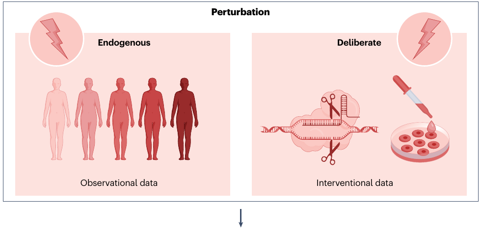

原文图1上部：自然差异与主动干预。颜色区分类别，不表示效应大小。 原样片段；仅裁切版面。Dimitrov等(2026)，©Springer Nature Limited；许可待用户核查。

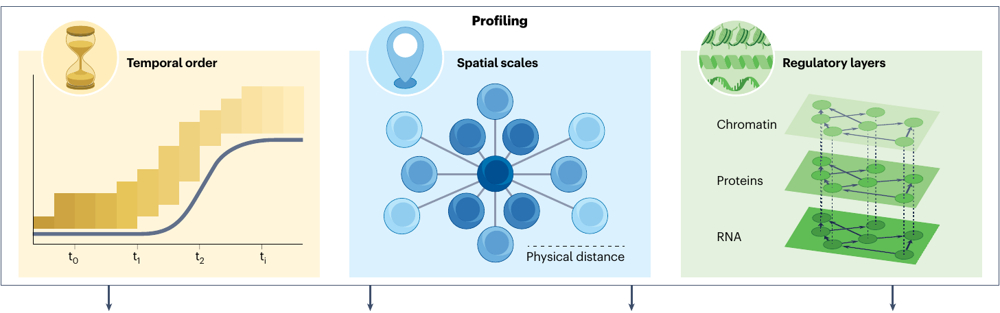

原文图1中部：时间、空间与调控层次。曲线和连线均是框架示意，无实验样本量或实测通信强度。 原样片段；仅裁切版面。Dimitrov等(2026)，©Springer Nature Limited；许可待用户核查。

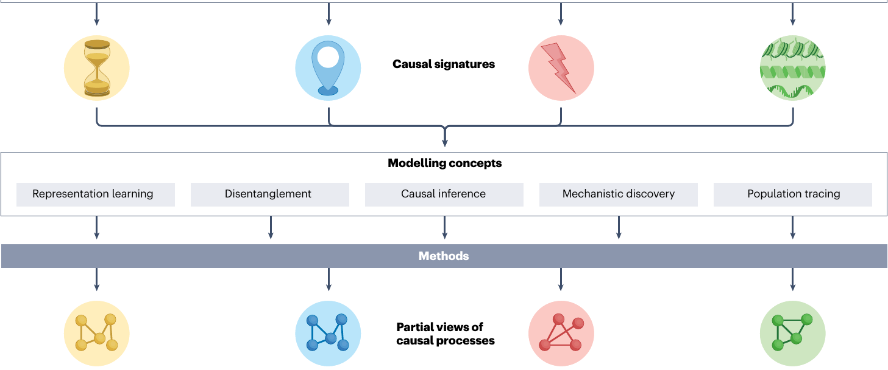

原文图1下部：多种因果线索进入建模，得到因果过程的部分视角；不是完整机制证明。 原样片段；仅裁切版面。Dimitrov等(2026)，©Springer Nature Limited；许可待用户核查。

这幅图的上层区分了两类变化来源。疾病、遗传差异和环境差异，可以在观察数据中形成自然变化；CRISPR或药物处理，则主动改变实验系统。观察数据通常更接近复杂组织背景，但比较组之间也可能同时存在很多差异。干预提供了更清楚的起点，不过实验系统往往更简化，靶向效果也未必完全一致。

中间三部分代表时间、空间和调控层次。时间信息帮助约束哪些变化先发生、哪些后发生；空间信息帮助判断细胞是否处在不同邻域；多组学读数则让我们从RNA之外看见染色质、蛋白等层次。三者都能减少解释的任意性，但都不是因果结论的自动通行证。

图中的时间轴和曲线是概念示意，没有给出一项具体实验的样本量或拟合结果。空间部分的线条也不表示已测得某种细胞通信强度。颜色用于区分证据类别，不是某个效应大小。读这幅图最重要的是末尾那句“部分视角”：每种技术和模型只能照亮因果过程的一部分。

我们可以把这三个方向变成实验设计问题。如果关心药物起效的顺序，只有一个终点可能不够；如果关心邻近细胞带来的影响，打散后的表达矩阵可能丢失关键背景；如果猜测某个转录因子直接调控目标基因，表达变化之外，还需要更贴近调控环节的证据。增加读数的目的，应是排除一种具体的替代解释。

### 干预实验也有需要逐项检查的条件

看到CRISPR标签，容易把“收到某条向导RNA”理解为“目标基因已经在每个细胞里按预期改变”。真实实验中，递送和向导效率可能不同，部分细胞受到的扰动很弱，还可能存在非目标效应。把它们全部视为同等处理，会影响效应估计。

综述因此介绍了估计干预有效性的不同方法。一类方法尝试区分明显响应与逃逸细胞，另一类把干预强弱表示为连续分数。这些处理有用，但新的统计步骤也引入新的选择。如果仅保留反应特别明显的细胞，得到的结果可能更接近“强响应者的效应”，未必代表全部被分配到处理组的细胞。

这不是说应该固定采用哪种筛选，而是分析前先确定你要估计谁的效应，并报告筛选依据。细胞死亡、增殖和状态变化同样需要注意：处理组剩下来的细胞构成，可能已经被干预改变。平均表达下降，有时包含群体组成改变，有时包含同类细胞内表达改变，两者值得分开讨论。

再看对照。合适的非靶向对照、多个有效向导、独立重复、必要的功能读数和恢复实验，回答的问题并不相同。不能把“有一个对照组”概括成所有混杂都已解决。具体需要什么对照，应由假设和实验系统决定。

### 几万个细胞，不等于几万个独立生物学重复

假设处理组和对照组各有数万细胞，但只来自极少数独立样本。同一样本中的细胞共享供者、培养、处理和建库过程，彼此并非完全独立。细胞测得更多，能够更细致地描述样本内部的异质性；它不自动增加独立供者或实验重复的数量。

这就是单细胞分析中“伪重复”问题的一种典型情形。若把每个细胞都当成独立的处理重复，统计结果可能显得过于确定。在报告中，应分别写清细胞数、样本数、供者数以及处理在哪一级分配。若处理是在培养孔一级实施，独立实验单位就不能简单由细胞数量替代。

Pseudobulk是一类常见思路：在样本和细胞类型等合适层级汇总，再进行组间比较。它有助于保留独立样本层面的结构，但并非任何任务都只能这样做。关键是所用统计模型要与真实实验层级相符，不能只因为某个工具输出了很小的P值，就跳过样本设计。

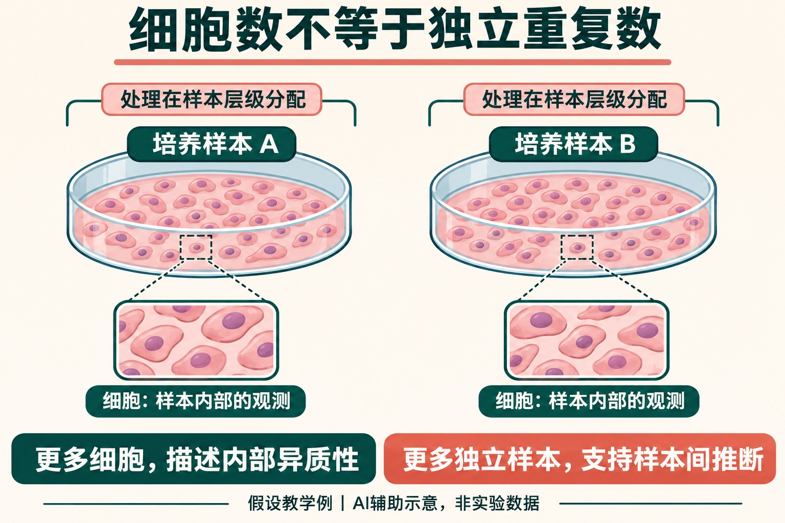

原创教学图：两个容器只用于区分样本与细胞层级，不表示两个样本足以支持可靠推断。AI辅助示意，非实验数据。

### 五种常见概念，分别多走了哪一步

原文Box1把方法背后的共同概念拆开。理解这些词，可以减少“换一个复杂模型就获得更强结论”的误会。

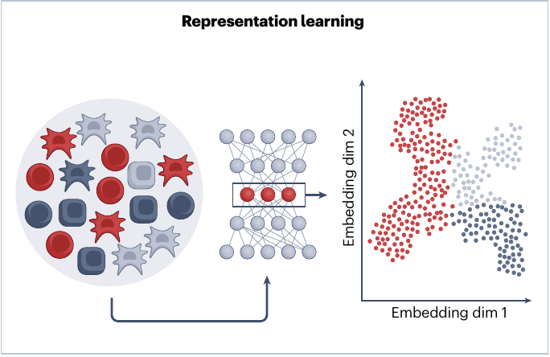

原文Box1：表示学习。嵌入轴不是已验证机制，散点为概念示意。 原样片段；仅裁切版面。Dimitrov等(2026)，©Springer Nature Limited；许可待用户核查。

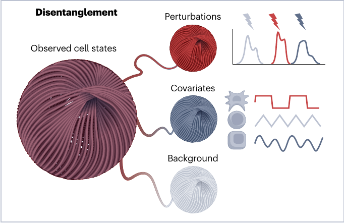

原文Box1：解耦。把扰动、协变量和背景分开仍需识别假设。 原样片段；仅裁切版面。Dimitrov等(2026)，©Springer Nature Limited；许可待用户核查。

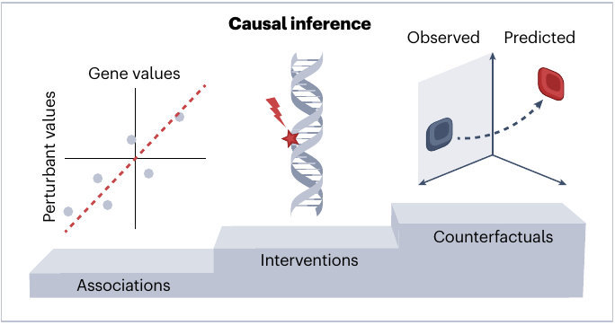

原文Box1：因果推断。关联、干预与反事实的证据要求不同。 原样片段；仅裁切版面。Dimitrov等(2026)，©Springer Nature Limited；许可待用户核查。

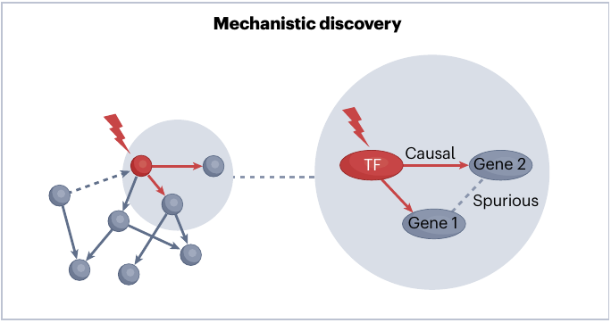

原文Box1：机制发现。TF指向目标的因果作用须与伪相关区分。 原样片段；仅裁切版面。Dimitrov等(2026)，©Springer Nature Limited；许可待用户核查。

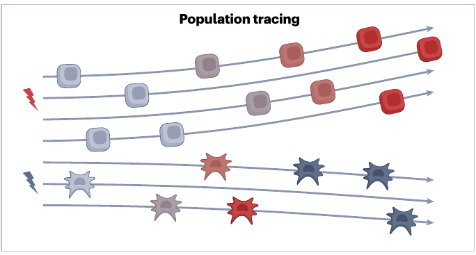

原文Box1：群体追踪。连线表示推断关系，不等于实测同一细胞的前后配对。 原样片段；仅裁切版面。Dimitrov等(2026)，©Springer Nature Limited；许可待用户核查。

**表示学习**，是把高维数据压缩成保留重要结构的表示。可以把它理解为从成千上万个基因中提炼一套坐标。坐标帮助整合、分类或预测，但坐标轴本身不一定对应真实生物过程。一个分群很漂亮的嵌入，也可能保留了批次差异。

**解耦**，希望进一步区分不同来源的变化。例如某部分表示细胞身份，某部分表示处理，另一些表示残余差异。难点在于现实因素往往共同变化：如果某种处理只在某一批样本出现，算法很难仅凭数据分清二者。给潜在维度起了生物学名称，并不等于完成了验证。

**因果推断**，关心主动改变一个因素会产生什么结果。它需要明确处理、对照、目标效应和识别条件。观察研究和干预研究都能在适当设计下提供证据，但假设不同；统计上去掉一个批次标签，也不能保证所有未测混杂已经消失。

**机制发现**，还要把效应落实到有方向的分子联系。例如某个转录因子通过怎样的调控环节影响目标基因。能够预测“敲低后会变”，与知道“通过哪条路径变”是不同目标。机制模型需要接受更贴近机制的验证。

**群体追踪**，尝试连接不同时间点或条件下的细胞分布。最优传输是一种常见数学框架，它依据代价函数和约束寻找合理对应。对应关系可能很好地概括群体变化，但一般仍是推断的连接。平滑变化、距离定义和细胞数量处理方式都会影响结果。

这五种概念经常被同一个模型组合使用，并不存在从左向右自动升级的等级制度。更复杂的组合可能更贴合问题，也可能让假设更难检查。判断方法时，应该把每一步新增的假设和新增的证据一起写出来。

### 原文图2：解释、外推和指导实验，要分别验收

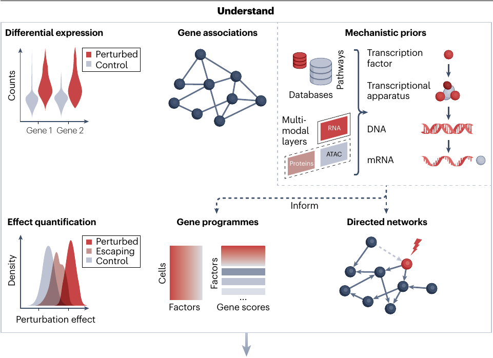

原文图2 Understand：差异、效应、程序与网络。示意图的坐标说明任务，不含可引用的实测效应值。 原样片段；仅裁切版面。Dimitrov等(2026)，©Springer Nature Limited；许可待用户核查。

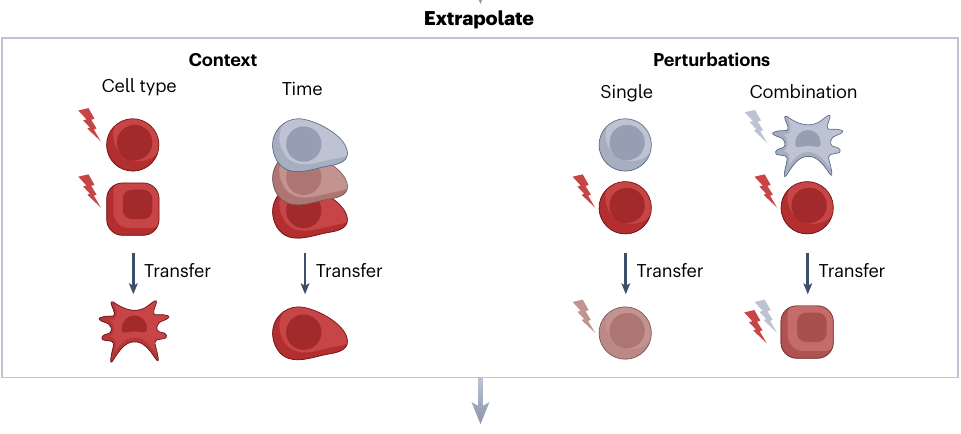

原文图2 Extrapolate：新情境、新干预与组合需要分别评测。 原样片段；仅裁切版面。Dimitrov等(2026)，©Springer Nature Limited；许可待用户核查。

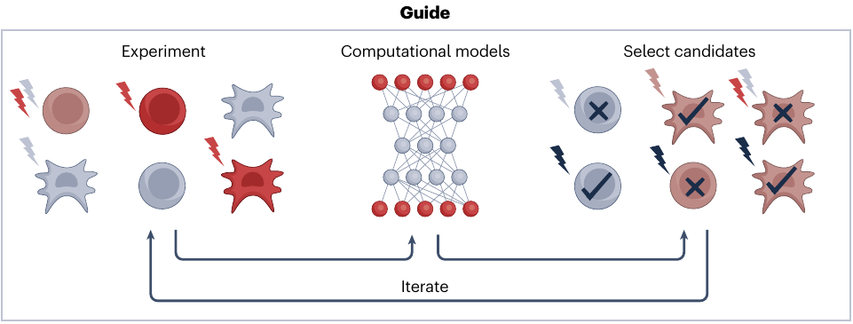

原文图2 Guide：实验、模型和候选选择的迭代，不表示模型替代实验。 原样片段；仅裁切版面。Dimitrov等(2026)，©Springer Nature Limited；许可待用户核查。

上层从表达改变和效应估计，连接到基因程序、先验信息及有方向的网络。这是一条研究目标逐渐深入的路线，不代表只要把几个软件串起来就完成了机制验证。图中的小提琴与密度曲线用于表达任务类别，没有可供引用的实际效应大小。

中层把外推拆成不同情境。已见过的干预换到新细胞类型，与完全没见过的新干预，是两种难度；单独见过A和B之后预测A+B，又涉及相互作用。如果评测时把这些任务混成一个“预测准确率”，结果很难指导实际选择。

下层画出实验与模型反复更新的循环。模型提出候选，实验带回新证据，再修正模型。这个闭环的价值在于减少无效搜索，而不是取消实验。一个能帮助筛掉不值得优先验证的方案的模型，即使没有复原全部机制，也可能有实际价值；但必须用与这个用途相符的标准评估它。

### 在打开新工具之前，先填完这张研究问题单

把自己的项目写成下面六句话，通常比先比较模型参数数量更有帮助。

一，我想估计的变化是何种读数在何种条件下的变化。二，真正独立的实验单位是什么，有多少重复。三，哪些因素同时随条件变化，哪些可能没有被测量。四，我需要的是平均效应、细胞异质性、候选机制还是未见条件预测。五，测试集究竟隔离了细胞、样本、供者、干预还是实验批次。六，什么观察会推翻我当前的解释。

这里不需要一次解决全部问题。相反，明确只回答一个边界清楚的问题，通常更容易得到可信结果。若数据只支持某个细胞系中的终点响应，就先把这个范围讲清；若还没有跨供者验证，就将其列作下一步，而不是把“可迁移”写进结论。

本篇的核心是把数据、问题和证据对齐。表达矩阵让我们观察变化，干预和额外读数帮助约束解释，模型则把这些信息组织成可检查的假设。它们之间仍有需要逐步验证的距离。下一篇将进入基因程序：为什么把差异基因压缩成几个潜在因子有用，又为什么“一个因子对应一条通路”需要格外谨慎。

## 2. 基因程序与解耦

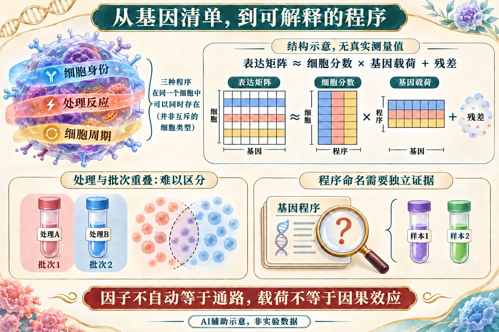

原创hero同时展示程序叠加与因子分解。图中只有结构示意，无真实测量值；程序并非互斥细胞类型，载荷不是基因间因果边。原图用于未发布审读，许可待用户发布前核查。

拿到一份单细胞扰动数据，最容易出现的困惑，往往不是没有结果，而是结果太多。每个靶基因对应一长串差异基因，每个细胞群又富集出一批相似通路。免疫反应、细胞周期、应激、代谢交织在一起：哪些是一组协调变化的过程？哪些只是细胞身份不同？怎样知道某个程序与处理有关，而不是样本本来就不同？

这一篇讨论把“基因清单”变成“基因程序”的思路。我们沿着Dimitrov等人的单细胞因果建模综述，拆开三个容易混用的目标：用少数变量概括表达变化，为这些变量赋予生物学含义，以及把处理引起的变化与背景分开。理解它们的差别，才能判断一个看起来很整齐的结果究竟说明了什么。[1]

### 一个细胞，通常同时执行不止一种程序

想象一组免疫细胞：有的处于增殖状态，有的接受了炎症信号，有的正经历培养应激。细胞类型仍然相同，却可能同时沿着几个方向变化。若坚持给每个细胞贴一个互斥标签，就容易把连续、叠加的过程切成许多小簇。

“基因程序”提供了另一种描述：一组在当前数据中协调变化、可能反映共同功能或状态的基因。一个细胞可以同时拥有几个程序，只是强弱不同。这种表示适合回答“哪些变化经常一起发生”，也方便比较处理对不同过程的影响。

不过，程序不是唯一标准化的生物实体。它可能对应一条已知通路，也可能由几条通路的部分基因混合构成；可能包含真实调控反应，也可能捕捉线粒体比例、测序深度或解离应激。给它命名为“炎症程序”，是一项需要证据支持的解释，不能由模型输出的编号直接推出。

还要区分“程序”和“机制”。如果许多干扰素响应基因一起升高，程序分析能够提炼出这个协调模式。要证明某个转录因子通过特定调控路径导致这些变化，则需要进一步的方向性证据。前者可以帮助选择下一步实验，后者不能仅靠富集结果完成。

### 因子分解，究竟把矩阵拆成了什么

可以先把因子模型理解成一种表达账本。原始账本的一行是一个细胞，一列是一个基因。模型尝试用更少的“程序”解释其中的主要变化。

拆分后，一张表记录每个细胞在各个程序上的分数，另一张表记录每个基因对各个程序的贡献，剩下的部分由噪声或未解释变化承担。前者常叫细胞分数或因子得分，后者常叫载荷。一个程序的高载荷基因，帮助我们解释它；一个细胞的高分，则表示它在模型定义的这个方向上更突出。

这里有两个阅读细节。第一，载荷并不自动等于调控强度，更不是某个基因对另一个基因的因果作用。第二，分数是模型坐标，尺度和符号取决于具体模型。不能看到一张不同方法生成的热图，就把它们的数值当成相同单位进行比较。

“稀疏”约束常被用来让程序更容易解释：希望每个程序由相对有限的基因描述，或每次扰动影响有限的程序。但这种约束是建模选择。若真实变化非常广泛，过强的稀疏性可能漏掉广泛反应；若约束过弱，几乎所有基因都贡献一点，程序又可能难以命名。

程序数量同样没有一个适用于所有数据的答案。太少，细胞周期和处理反应可能挤在同一个因子里；太多，一个过程可能被拆成几个高度相似的小因子。选择时除了重构误差，还应检查结果对不同随机初始化、样本子集、程序数量是否稳定，以及这种稳定是否真的出现在独立样本中。

### 扰动标签应该什么时候进入模型

一种直观做法是先发现程序，再检查它们是否与处理有关。另一种做法从建模开始就引入扰动标签，使程序的学习同时参考实验设计。两种路线解决的问题相近，但并不等价。

GSFA是后一路线的代表。其方法把表达数据分解为稀疏因子与基因载荷，并用扰动矩阵解释因子变化；最终可以汇总“扰动到因子”和“因子到基因”的关系，估计基因层面的总效应。它把弱但协调的信号结合起来，而不是只逐个基因独立检验。这里的概述已核对原论文公开方法段；本文没有重新运行作者分析，也没有据此声明它在所有数据中优于其他方法。[2]

这种方法值得学习的，是让问题进入模型，而非只在结果出来后贴标签。不过，已知扰动标签本身也有误差：向导存在不代表每个细胞都同等受到干预。综述讨论的Mixscape和Mixscale尝试辨别逃逸细胞或估计连续效力，但程序分析仍需说明如何处理这些信息。[1]

如果按响应强度给细胞加权，弱响应者的影响可能减小。这样得到的程序可能更清楚，同时也更偏向强响应细胞。读者需要知道目标是描述所有分配到处理组的细胞，还是特定响应子群。两者都可能有研究价值，却不能互相替代。

另一类问题跨越多个细胞类型：同一供者的T细胞、髓系细胞和其他群体是否协同变化？综述介绍了先在样本与细胞类型层面聚合表达，再分析多细胞程序的路线。这样的单位变化很重要：讨论的是样本之间的协调，而不只是单个细胞之间的距离。聚合减少某些噪声，也可能掩盖稀少状态，应根据问题取舍。[1]

### 更灵活的表示，为什么可能更难解释

线性模型的吸引力，是每个程序对基因的贡献较容易追溯。它的局限也清楚：饱和、阈值和复杂交互未必适合用简单叠加表达。

非线性生成模型，例如变分自编码器，允许表达模式通过更灵活的映射被压缩和重构。它们有机会捕捉复杂关系，却不保证每个潜在维度都有单一生物学意义。两个模型即使重构得同样好，也可能把同一种变化安排在不同维度中。

因此，“模型能解释表达”与“人能解释潜在变量”应分别检查。常见办法包括检查维度变化时哪些基因随之变化、使用事后归因，或限制解码器为更易解释的结构。它们各有代价：归因取决于模型和比较基准；结构限制可能牺牲灵活性；注意力权重也不能直接当作调控网络的实验测量。[1]

一个实用习惯是，给每个程序先写描述性名称，再写证据等级。例如“富集于细胞周期相关基因的程序”，比直接命名“增殖驱动机制”更贴近当前证据。只有随后获得独立功能实验或更直接的调控支持，才逐步提高表述强度。

### 把已有知识放进模型，会得到什么，也会失去什么

普通富集分析是在模型之后查注释。知识引导方法则把已有通路或基因关系放进学习过程：有些通过掩码限制哪些基因可连接到某个因子，有些通过惩罚项鼓励符合先验的结构，同时允许数据作出调整。[1]

Spectra说明了这种思路。它利用基因集关系和细胞类型信息引导程序学习，同时保留发现未被输入知识解释的模式的空间。它输出细胞分数与基因程序，并区分全局及细胞类型相关结构。该设计和输入输出已核对原论文公开结果及方法段；本文没有独立核查其所有实验和补充分析，因此不转述具体性能优势。[3]

先验的收益在于减少解释的任意性，尤其当某个生物过程已有相当知识时。但已知知识也有覆盖不均的问题：研究充分的免疫通路通常注释更丰富，罕见细胞状态或陌生物种可能没有同等完整的资源。若模型只允许已知通路出现，最后得到的“全部结果都能解释”也许只是搜索空间被提前限制了。

还有一个循环验证陷阱：训练时已经用某个基因集引导因子，之后再用同一基因集的富集结果证明因子正确，证据并未完全独立。更有信息量的检查，是看模型在留出的样本、未用于先验的基因或独立读数上是否仍合理；也可以比较撤掉部分先验后，关键发现是否变化。

这些检查是我们据此提出的分析建议，不是对所有方法已经完成的测试。先验帮助提出有方向的假设，仍需要数据与实验去挑战它。

### 解耦，想把哪些变化分开

假设处理组和对照组都包含处于不同细胞周期阶段的细胞，而处理只额外激活某种应激反应。普通低维表示可能优先展示周期，因为它解释了更大的总体变异。研究者关心的处理反应就被淹没在背景里。

对比式解耦尝试分出两部分：两组共同存在的变化，以及目标组额外呈现的变化。contrastiveVI用共享潜在变量和目标组特异的潜在变量实现这种设计。官方教程明确将对照组的特异变量固定为零，并使用共享解码器重构数据。这个零是模型约束，不是说对照细胞没有生物学活动。教程中的展示是官方案例，本篇未执行代码或生成运行结果。[4,5]

这个设计适合寻找“相对于所选背景，目标数据还多了什么”。注意其中最关键的限定是“所选背景”。如果对照组缺少目标组中的某类细胞，模型看到的目标特异信号可能包含细胞组成差异。如果目标组全部来自某批实验，特异变量也可能吸收批次变化。

因此，解耦的输出不能自动命名为“纯处理效应”。处理、供者和批次若在实验设计中完全重合，仅靠表示约束无法凭空产生缺失的对照。加入批次标签有时有帮助，但它无法替代交叉、平衡或其他能够区分因素的设计。

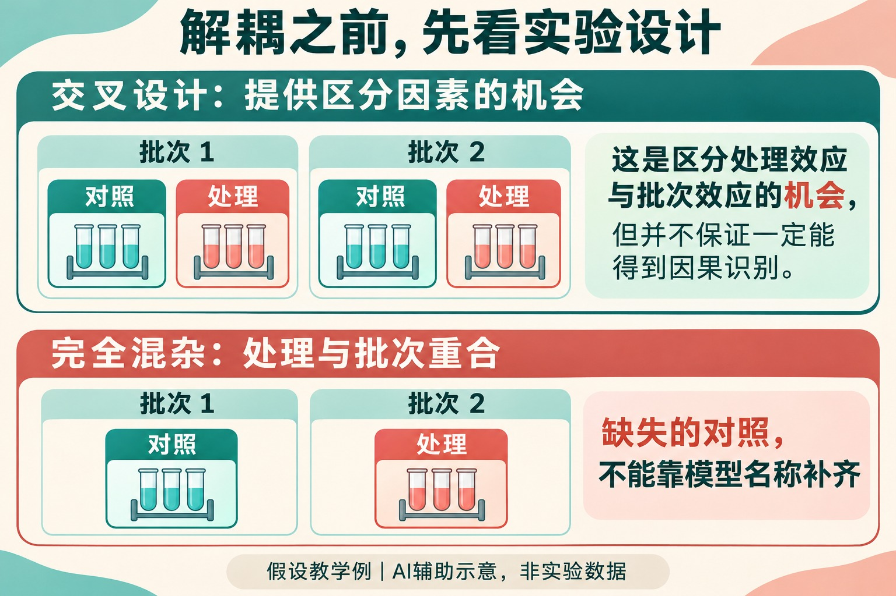

原创假设教学图，AI辅助示意，非实验数据。交叉设计提供区分因素的机会，不保证自动获得因果识别。

### 背景因素，也可能恰好是你要研究的结果

把细胞周期当成背景去掉，是常见做法。但若药物本来就通过影响周期发挥作用，处理造成的周期变化就是研究对象的一部分。若无条件删除它，可能把真实作用也一起消除。

这里应先确定估计目标。你想知道药物引起的全部变化，还是在周期状态相近时，是否还存在其他变化？前者关心总效应，后者是更有条件的比较，两者需要不同解释。模型中的“背景”只是分析角色，不是永久有效的生物学分类。

类似地，细胞组成变化既可能干扰某些细胞内表达分析，也可能本身就是重要结果。某群细胞减少，不能只作为技术麻烦消除；它可能反映增殖、死亡、迁移或采样差异，需要结合设计判断。

所以，漂亮的“去背景后”嵌入图应该连同“去掉了什么、为何去掉、可能丢失什么”一起展示。若只能看见处理组被分得更整齐，却没有这些说明，解释仍然是不完整的。

### 从两组扩展到多条件，标签越多不代表答案越确定

真实数据往往同时包含多个扰动、剂量、供者和细胞类型。简单的“目标/背景”分组不一定足以表达。综述介绍了scDisInFact、MultiGroupVI、Biolord、CPA等路线，分别安排共享、条件相关或未解释变化的表示，有些还显式考虑因素之间的交互。[1]

可把它理解成整理一本多维实验账：哪些变化与细胞身份有关，哪些与处理有关，哪些仍无法解释。为未知来源保留残余空间，比强迫所有变化都套进已知标签更审慎。但残余空间也不是一只自动装走所有混杂的箱子。已知与未知部分之间如何分配信息，仍受训练目标和数据覆盖影响。

CPA的一个重要设计，是鼓励基础表示不携带可由专门表示负责的处理和协变量信息，从而为重新组合条件提供基础。这是一种建模约束；解耦是否成功、组合是否可靠，需要另外检验。我们把具体外推能力留到第4篇讨论，避免在本篇把“结构上允许预测”写成“已验证能预测任意条件”。[1]

### 原文方法图怎么读，才不会变成工具点名册

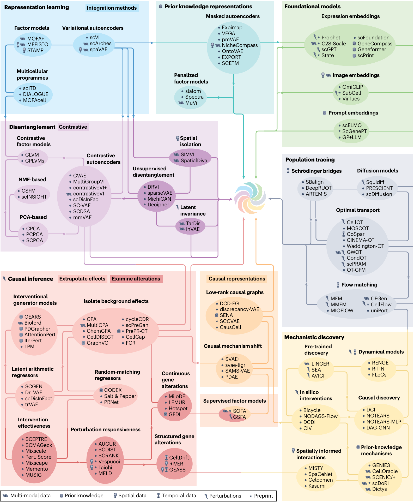

原文Fig3完整地图，保留跨区连线供定位，可点开放大。方法按概念归类，不是性能排名。 来源：[1]，©Springer Nature Limited2026。仅裁切/拼接原样片段，内容未改；许可待用户核查。

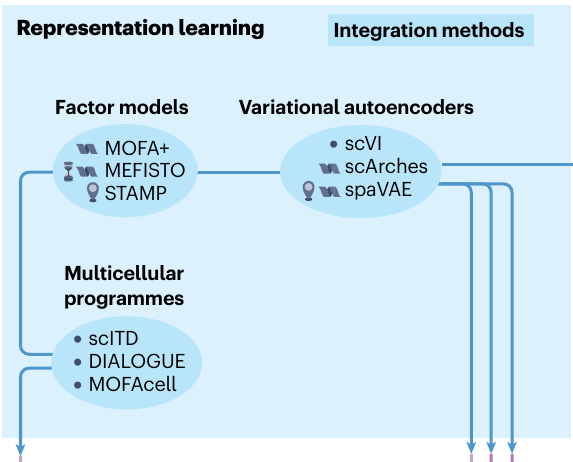

Fig3原样片段：表示学习。因子模型、变分自编码器与多细胞程序属于不同建模选择。 来源：[1]，©Springer Nature Limited2026。仅裁切/拼接原样片段，内容未改；许可待用户核查。

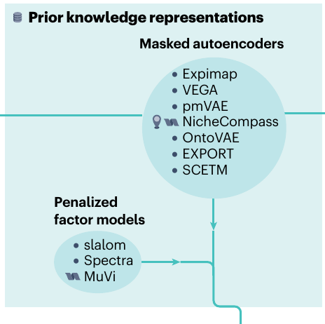

Fig3原样片段：先验知识表示。掩码和惩罚约束是两种引入先验的方式。 来源：[1]，©Springer Nature Limited2026。仅裁切/拼接原样片段，内容未改；许可待用户核查。

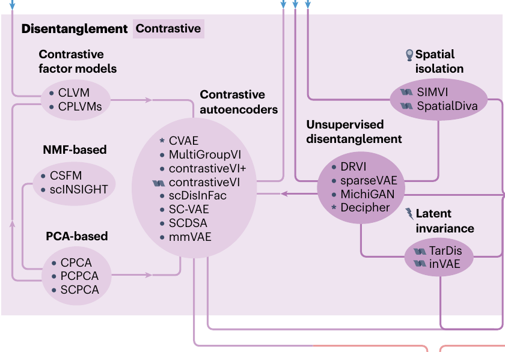

Fig3原样片段：解耦。对比、自监督/无监督及空间隔离并不等价；被截断的跨区线请结合完整图阅读。 来源：[1]，©Springer Nature Limited2026。仅裁切/拼接原样片段，内容未改；许可待用户核查。

原图完整符号图例。多组学、先验、空间、时间、扰动符号说明所用信息；星号是综述当时的预印本标记，不代表当前状态。 来源：[1]，©Springer Nature Limited2026。仅裁切/拼接原样片段，内容未改；许可待用户核查。

这张方法地图的颜色划分建模概念，圆点列举方法，特殊符号说明多组学、先验、空间、时间或扰动信息。连线展示概念和方法之间的联系，不表示“沿着箭头走就更准确”，也不代表实验验证的因果方向。

本篇关心的是三类位置：用于压缩表达的表示学习，向程序加入知识的先验表示，以及尝试隔离不同变化来源的解耦。它们相互连接，说明同一个方法可以同时使用多种思想。原文对方法的归类是为了建立框架，不应被当成唯一分类标准或性能排名。

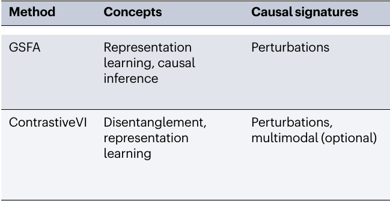

原文Table3选行左半，依次为GSFA与ContrastiveVI：方法、概念与因果线索。 来源：[1]，©Springer Nature Limited2026。仅裁切/拼接原样片段，内容未改；许可待用户核查。

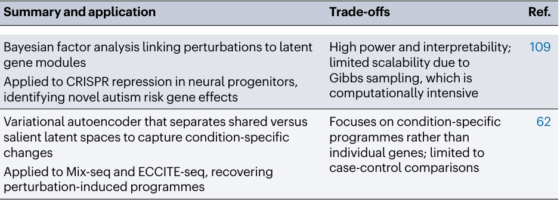

同两行右半：摘要/应用、权衡与参考文献号。上行GSFA，下行ContrastiveVI；保留完整限制列。GSFA的Gibbs采样可限制计算扩展；ContrastiveVI关注条件特异程序，并限于case-control比较。 来源：[1]，©Springer Nature Limited2026。仅裁切/拼接原样片段，内容未改；许可待用户核查。

原文Table3还列出了代表方法的取舍。例如线性结构有助于解释，但可能受模型形式限制；对比式潜在空间有助于研究特异变化，却需要合适的背景与比较设计。表中应用来自作者对既有研究的归纳，不能把它们写成我们已经全部复现的结果。[1]

### 让一个“程序发现”经得起追问

当你准备在论文里给某个程序命名，可以依次检查六件事。

它由哪些基因支撑？仅由少数高表达基因主导，还是有协调的成员？它出现在什么样本和细胞中？是否只对应某个批次或供者？改变程序数量和随机种子后，结论是否仍存在？用于解释的知识，是否已经参与了训练？去掉某种背景后，是否同时失去了真实作用？有没有独立证据支持这个解释？

最后一个问题不必一开始就回答到机制层面。独立数据中重现相似程序，支持稳定性；匹配的功能读数，支持生物学相关性；针对性的干预与恢复实验，则能进一步测试机制。每一步增加的证据不同，结论也应随之逐步升级。

本篇最值得带走的，是把程序视为一种有用、可检验的表达方式。因子分解减少信息负担，先验帮助定位解释，解耦帮助提出更具体的比较。它们的价值取决于研究问题、数据设计和验证，而不是潜在空间看起来有多整齐。下一篇将把问题进一步推进：什么时候可以给基因之间画一支有方向的箭头？

## 3. 机制网络与因果图

假设教学例，AI辅助示意，非实验数据。原文图片仅存未发布草稿，复用许可待用户发布前核查。

### 一张带箭头的网络，到底多告诉了我们什么？

假设你在某类细胞中看到：转录因子A表达越高，基因B也越高。软件随后画出A→B，旁边还给出了一个很漂亮的权重。下一步能不能直接把A列为调控B的实验靶点？可以把它列入候选，但“值得验证”与“机制已经成立”之间，还隔着几道问题：是谁决定了箭头方向？这条边是直接作用，还是一整条通路的缩影？有没有一个没有测到的因素，同时推动了A和B？

这篇围绕一个实际需求展开：拿到单细胞调控网络后，怎样判断它够不够支持你要讲的生物学故事。讨论依据是Dimitrov等发表于Nature Reviews Genetics的Review《Interpretation, extrapolation and perturbation of single cells》，重点是其机制发现与因果图部分。下面A、B、C等字母案例均为原创假设教学例，不对应实验结果。

### 先给每一条边写上“身份证”

网络中最容易混淆的，是把不同含义的边放进同一张图。

共表达边表示两个量一起变化。例如A、B都在增殖细胞中上升，即使没有直接调控关系，也能呈现很强的相关性。预测边表示知道A后能更好预测B，方向可能来自模型输入与输出的安排。候选调控边增加了生物学约束，比如A是转录因子，B附近的开放染色质含有与A相关的结合基序。因果边则提出更强的主张：在规定的条件与假设下，主动改变A会改变B的生成过程。

最后一种仍不自动等于直接生化接触。如果我们只测了A和B，没有测中间蛋白C，A→C→B可能在简化网络中表现为A→B。此时边的含义取决于网络包含哪些变量、观测发生在哪个时间尺度。“直接”应理解为相对于所建模变量集合的直接关系，不能省略这个限定。

这也是为什么图很稀疏、边有正负号、节点贴着通路名称，都不足以独立证明机制。读网络图时，最好先问三件事：节点代表RNA、蛋白活性还是推断出来的潜在状态？边权代表回归系数、模型重要性还是干预效应？方向来自数据、先验还是算法约束？如果这三件事讲不清，后面的生物学阐释很容易越界。

### 多组学让候选更具体，但不会把候选自动变成事实

从RNA走向机制，一个直观办法是加入染色质信息。转录因子需要能够接近相应区域，调控元件需要与目标基因建立联系，因此“TF—候选增强子—目标基因”比单纯的基因共表达更接近可实验检验的命题。

SCENIC+正是综述中的代表。其官方论文可核查的方法说明，把工作拆成候选增强子识别、基序富集、TF与区域及目标基因的关联推断。它输出的是增强子驱动的调控模块，而不是仅由RNA相关性连出的图。[SCENIC+原始论文](https://doi.org/10.1038/s41592-023-01938-4)

但每加一层证据，也增加一层需要说明的假设。开放区域意味着在所测条件下具有可及性，不等于此刻一定被指定TF占据。基序相似的TF可能难以仅靠序列区分。区域与目标基因共同变化，也可能来自共同的细胞状态，而不是该区域对该基因的直接作用。若用表达相关性的正负号标注激活或抑制，颜色反映的是推断符号，不能读成独立完成了激活/抑制实验。

因此，多组学网络最实用的价值是缩小实验搜索空间。例如把一个宽泛的问题“A可能重要”，收窄成“在这种细胞状态下，A是否通过这个候选区域影响B”。后者可以进一步设计区域扰动、TF扰动、结合证据与目标表达读出，检验各环节是否吻合。

综述还介绍了scDoRI把这类关系放进带耦合线性解码器的自动编码框架，以连续程序描述不同细胞状态中的调控结构。这里采用的是综述对方法概念的介绍，不将其胶质母细胞瘤案例写成我们独立验证过的机制发现，也不把综述参考文献当时的预印本标记当成当前出版状态。

原Review Fig3完整地图，可点开放大定位跨区连线；不是基因网络或性能排名。 原样片段，Dimitrov等，Nature Reviews Genetics(2026)，DOI10.1038/s41576-025-00920-4，©Springer Nature Limited。仅裁切/原样重排；许可待用户核查。

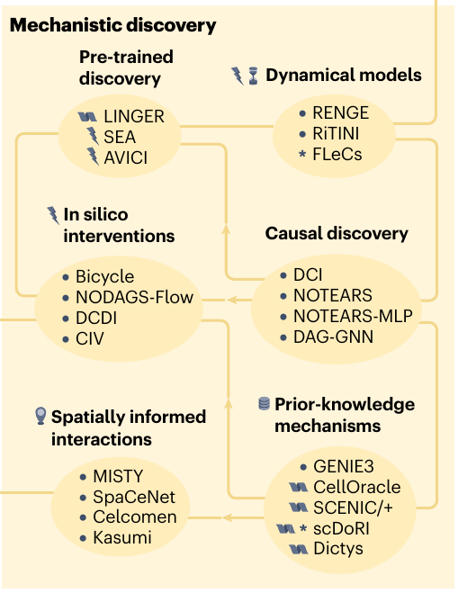

Fig3机制发现区域。预训练、动力学、计算干预、因果发现、时空与先验机制，是不同的信息和建模选择。图中的线条不是被实验验证的基因因果边。 原样片段，Dimitrov等，Nature Reviews Genetics(2026)，DOI10.1038/s41576-025-00920-4，©Springer Nature Limited。仅裁切/原样重排；许可待用户核查。

Fig3完整符号图例：多组学、先验、空间、时间、扰动；星号为综述当时的预印本标记。 原样片段，Dimitrov等，Nature Reviews Genetics(2026)，DOI10.1038/s41576-025-00920-4，©Springer Nature Limited。仅裁切/原样重排；许可待用户核查。

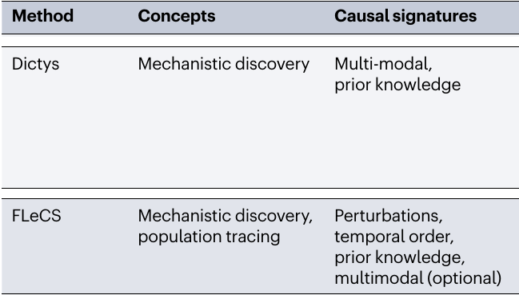

Table3两行左半，依次为Dictys和FLeCS：方法、概念和因果线索。 原样片段，Dimitrov等，Nature Reviews Genetics(2026)，DOI10.1038/s41576-025-00920-4，©Springer Nature Limited。仅裁切/原样重排；许可待用户核查。

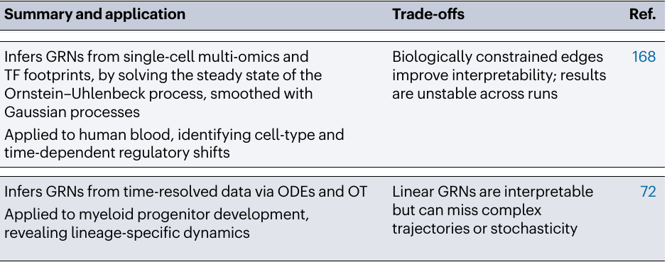

同两行右半保留应用、限制与参考号。上行Dictys：生物约束改善解释，但不同运行间可能不稳定。下行FLeCS：线性GRN可解释，但可能遗漏复杂轨迹或随机性。这是综述的取舍汇总，不是统一基准或本次复现。 原样片段，Dimitrov等，Nature Reviews Genetics(2026)，DOI10.1038/s41576-025-00920-4，©Springer Nature Limited。仅裁切/原样重排；许可待用户核查。

### 条件独立：为什么“控制了C以后还相关吗”很重要？

考虑一个假设：C是细胞周期状态，同时推动A和B。如果我们把不同周期阶段的细胞混在一起，A与B可能明显相关；当比较范围缩小到相近的C以后，这种关系可能大幅减弱。条件独立检验问的是：已知C后，A还能否提供关于B的额外信息？

这为约束型因果发现提供了线索。算法不只是搜寻强相关，而是用一系列条件独立关系排除某些图结构。问题在于，真实单细胞数据里“没有检出关系”和“关系确实不存在”并不等价。基因表达低、计数噪声大、条件变量太多、不同细胞状态混合，都会让检验变得困难。对大量变量反复检验，还会放大统计不确定性。

更重要的是，不能以为把所有能测到的变量都放进去就最安全。假设A和B共同影响C，即A→C←B。在整体样本中A、B原本可以互不相关，但如果只选择C达到某个水平的细胞，就可能人为制造A、B之间的关联。这叫对“碰撞点”条件化。它提醒我们，过滤细胞、限定某种存活状态或按结果筛选样本，都可能改变数据中可见的关系。

调整什么变量，必须根据问题与因果结构决定。某个处理后的细胞状态可能是中介：处理先改变状态，再影响目标基因。如果把这个状态当作普通混杂因素去掉，估计的问题就从处理的总体效应变成了另一个问题。技术校正、状态匹配、机制推断虽然都在“控制变量”，目的并不相同。

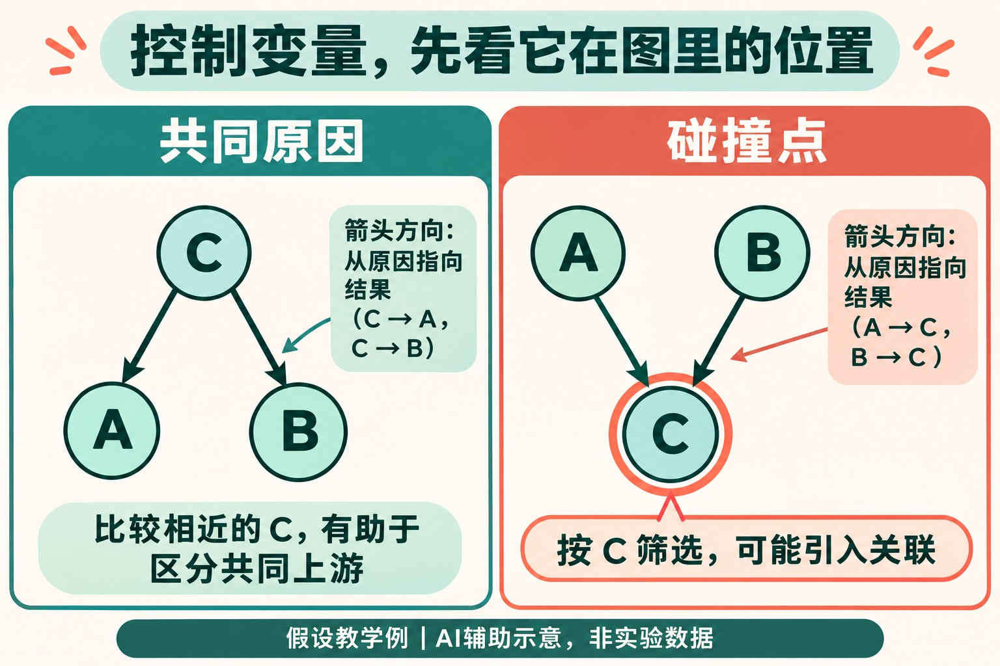

原创假设教学图，AI辅助示意，非实验数据。左图共同原因，右图碰撞点；图形方向与调整目的必须一起考虑。

### 不可识别：不是算法没训练好，而是证据没有区分答案

有时数据已经测得很精确，答案依然不唯一。三节点链A→B→C与A←B→C，在常见的无环图条件下可以具有相同的条件独立结构：A与C在给定B后独立。仅凭这一类观察信息，不能保证判定哪张图才对。这类无法区分的图可属于同一个Markov等价类。

可识别性讨论的是：在明确的模型假设下，即使有足够多的数据，目标结构或参数能否被唯一确定。它与有限样本精度是两层问题。数据量增加能减轻估计噪声，却不一定消除多个结构都能解释同一分布的根本歧义。

这不表示观察数据毫无价值。它可以排除一批结构、定位不确定边、支持部分方向；额外的时间顺序、干预信息、噪声分布或函数形式假设，也可能进一步减少歧义。关键是把“在这些假设下可确定”与“单靠表达矩阵就确定”区分开。

评分型方法换了一种搜索方式：给候选图计算拟合与复杂度的分数，寻找合适的结构。NOTEARS等方法把无环性写进连续优化约束，使搜索更易处理。但优化器成功收敛，只说明找到了该目标函数下的一个解，不能替代识别假设，也不保证唯一的生物解释。

实际报告可以保留不确定性：用未定向边或候选图集合展示数据支持的范围，说明哪些方向来自已知TF身份，哪些来自干预。比起输出一张每条边都很确定的网络，这样的结果往往更能指导下一轮实验。

### 干预提供方向，但“敲掉一个基因”不是简单删节点

观察A高表达的细胞，与主动把A设定到某个状态，是两种不同问题。前者仍可能受到共同上游因素影响；后者希望改变A的生成机制，并观察系统如何响应。因果图中常用do操作表达后一种理想干预。

这里有个容易画错的细节：在标准硬干预语义中，将A设为指定值，是切断A原先接受上游影响的入边，替换A的生成规则；不是把A指向下游的出边全部删除。下游节点仍按各自机制对新的A状态作出响应。若把所有出边直接删去，会把我们本来想研究的效应传播也删掉。

真实CRISPR实验与这个理想操作之间仍有距离。基因表达未必完全消失，蛋白活性可能延迟变化，扰动效率可能不同，还可能出现脱靶或适应性补偿。软干预允许改变目标的生成机制或参数，同时保留部分上游依赖，更接近某些抑制场景，但不能因此假定任何CRISPRi数据都已经满足特定软干预模型。

另一个关键区分是“效应存在”与“存在直接边”。若A经过C影响B，干预A后B改变可以支持A对B具有总效应，却不能单靠这个终点证明A直接调控B。相反，B没有明显改变也不能立即排除关系：另一条通路可能补偿，两个方向相反的效应可能抵消，或测量时点错过了短暂响应。

研究者因此需要说清楚干预目标、实际效率、观测时点与估计对象。网络越想解释到分子机制层面，这些实验信息就越不能简化成一个处理标签。

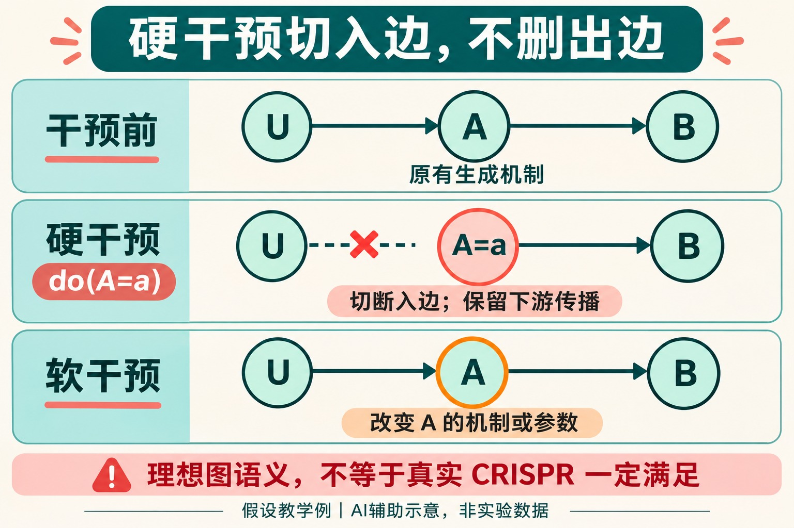

原创假设教学图，AI辅助示意，非实验数据。硬干预删除入边，保留出边；软干预一行只是保留上游依赖的一种示例。

### 生物系统会绕回来：反馈为何让无环图吃力？

假设A促进B，而B又限制A。这是负反馈，可以在扰动后帮助系统回稳。若A、B相互促进，则可能形成维持某种状态的正反馈。具体系统是否振荡、是否产生多个稳定状态，还取决于参数、延迟与非线性，不能只凭一个环就下结论。

无环图禁止沿箭头走一圈回到起点，因此不能直接表示同一时间尺度上的这些反馈关系。可以把时间展开，把早一时刻的A连向晚一时刻的B，再连接更晚的A。但这需要时间分辨率与动力学假设，不能把一次测序获得的不同细胞当成同一个细胞的连续录像。

另一条路线是建立允许循环的动力系统，解释为什么一群细胞最后呈现某种状态分布。这里“稳态”指分布处于相对稳定状态，不等于每个分子都停止变化；合成、降解与随机波动可以持续发生。若实际数据来自快速分化或急性应激过程，稳态近似是否适用就需要单独论证。

Bicycle是综述用来说明这条路线的代表。原始会议论文把潜在表达状态建模为随机动力系统的稳态分布，用扰动信息约束哪些机制发生改变，并允许调控网络含环。值得特别保留的是其实验实现边界：已知且完美的干预、无潜在混杂是所用假设；不完全与未知干预被列为未来扩展。真实数据中没有完整的因果网络真值，预测留出扰动的表现不能替代逐边机制验证。[Bicycle原始论文](https://proceedings.mlr.press/v236/rohbeck24a.html)

因此，“模型允许反馈”是表示能力的进步，但不等于某个反馈环已被实验确认。对重要的环，仍应考虑时间序列、分步干预和恢复实验能否排除替代解释，而不是只展示网络闭环的形状。

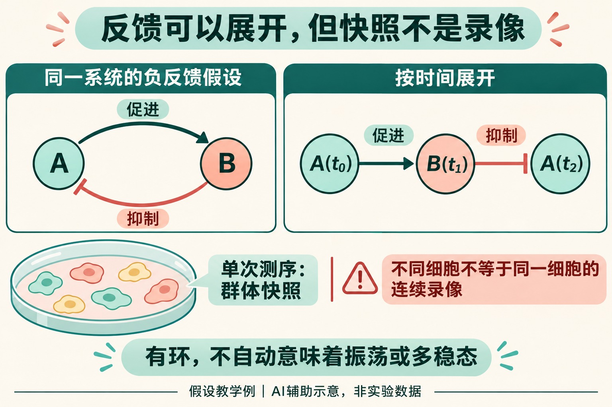

原创假设教学图，AI辅助示意，非实验数据。促进为箭头，抑制为T形端；时间展开需要独立的时间与动力学假设。

### 时间、空间与预训练，究竟补了哪块证据？

真实时间信息可以排除“后发生的事件直接造成更早事件”等解释，但先发生也不自动等于原因。两件事可能受同一个更早信号驱动。伪时间则是从数据推断出的排列，适合提出发展顺序假设，不能当作独立测得的时间证据再给模型自我背书。

空间信息帮助区分细胞自身的调控与邻近细胞提供的信号。例如目标基因B升高，可能来自本细胞A的变化，也可能来自邻居释放的信号。可是距离近、表达相关，只能提示通信候选；配体是否存在于蛋白层面、受体是否有功能、下游是否响应，仍是不同证据环节。综述介绍的时间与空间方法，正是在利用这类额外约束，而不是宣称单一数据维度已经解决机制发现。

预训练则把一批结构倾向提前带给模型。真实大图谱提供跨样本的关联信息，模拟数据可以提供已知的网络标签。模拟预训练特别适合练习“从数据恢复图”的任务，但它学会的是模拟世界允许的机制与噪声模式。若模拟世界没有某类反馈、混杂或测量偏差，真实应用中的自信输出可能只是把陌生问题塞进熟悉模板。

先验也有类似两面性。用已知通路减少搜索空间很有帮助，但数据库更熟悉的机制可能更容易被模型找回。比较方法时，应区分收益来自生物知识本身，还是来自限制边数后的普通正则化。用同一套数据库既指导建模又当验证答案，也需要说明这种重叠。

### 下一步实验，应该用来区分哪两个解释？

机制网络最有价值的输出，不一定是节点最多的全景图，而是一个能被证伪的局部问题。比如目前无法区分A→B与C同时驱动A、B，就应思考在保持相关背景可比较的条件下，改变A能否使B按预测响应。若争议是直接与间接作用，单个终点表达读数通常不够，可以进一步考虑时间先后、中间节点或候选调控区域的检验。

这不是要求每个项目都做齐所有实验，而是让结论强度与现有证据对应。只有共表达时写“相关模块”；有多组学与先验时写“候选调控关系”；有干预效应时说明总效应、条件与时点；要声称直接机制，则把支持直接性的证据单独列出来。

读完一张网络图，值得带走的不是“箭头越多越接近虚拟细胞”，而是三句话：方向从哪里来，哪些解释尚未排除，什么实验能真正改变我们的判断。只要这三点清楚，模型即使留下不确定边，也已经能为研究节省重要的试错成本。

## 4. 外推与群体映射

### 没做过的实验，模型究竟能预测到哪一步？

假设你已经完成一批单基因扰动实验，现在想知道：同时扰动两个基因会发生什么？换一种细胞，效果还在不在？处理后六小时观察到的变化，能不能延伸到两天以后？这些问题都叫“预测”，需要填补的信息却很不一样。一个模型能补出没测过的基因组合，未必能跨患者预测；能生成处理后的表达矩阵，也未必恢复了某个细胞真正经历的变化过程。

Dimitrov等人的综述把“外推到未见条件”列为单细胞因果建模的重要目标，并串起了扰动表征、知识先验、基础模型和群体追踪等路线。本篇围绕一个实际选择展开：当研究者希望减少下一轮实验规模时，各类方法究竟借用了什么信息，又在哪一步开始依赖尚未验证的假设？这是一份基于综述的教学分析，不是对模型的实测报告。

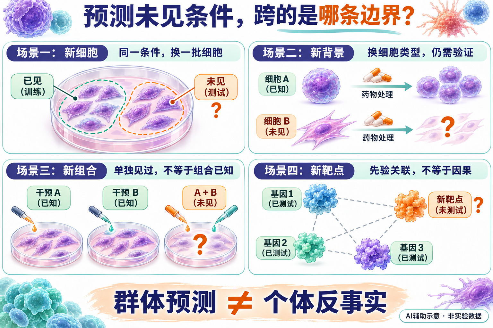

图示为此前已生成的原创hero，AI辅助示意、非实验数据。四种边界不是准确度排名；新背景中的“未见”指目标处理反应未见，不要求该背景的对照数据也不存在。

### 1．先写清楚，没见过的到底是什么

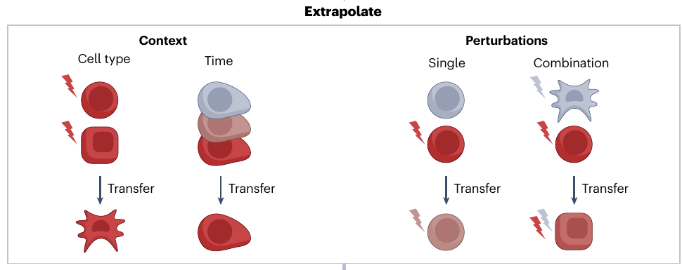

原Review Fig.2中间“Extrapolate”部分，原样裁切。左侧Context区分细胞类型与时间，右侧Perturbations区分单扰动与组合，Transfer箭头表示任务迁移，并非已验证的因果路径；细胞颜色和闪电是概念符号，没有数值轴、样本量或性能排名。图源Dimitrov等[1]，出版方权利说明保留；本稿仅供未发布审读，公开复用由用户另行核查。

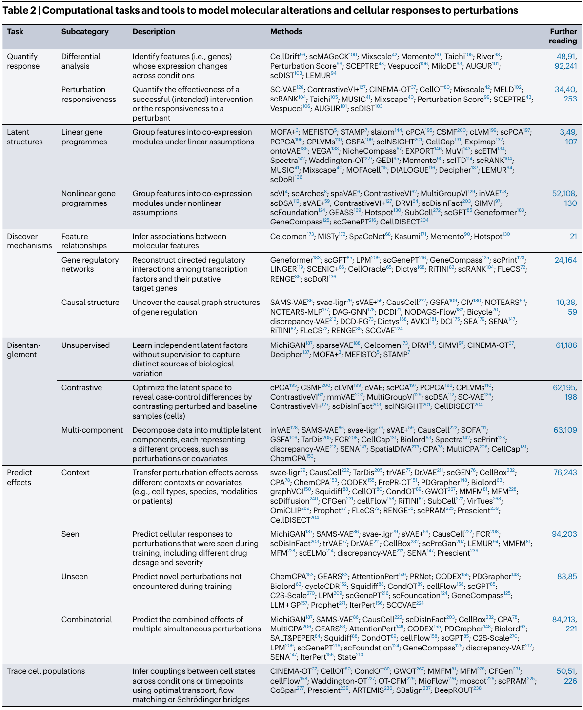

原Review Table2完整表格原样截取。列依次为任务、子类、描述、方法及延伸阅读；本篇关注Predict effects中的Context、Seen、Unseen、Combinatorial，以及Trace cell populations。它是一张任务分类表，不是同一数据集上的benchmark，方法出现次数也不代表优劣。保留原编号与排版，细字可放大查看。来源及审读边界同上。[1]

“未见条件”至少有四种含义。第一，处理条件已经见过，但测试集换了一批细胞；第二，某种处理在其他细胞类型中出现过，现在换到新背景；第三，两个单独扰动见过，但组合没有见过；第四，一个目标基因从未作为干预对象出现过。还可以继续加上新供者、新药物剂量或新时间点。每多跨越一种维度，模型需要维持不变的生物规律就更多。

一个假设例子可以帮助区分：训练集里有A细胞的药物反应，也有B细胞的未处理状态。预测B细胞的同一种药物反应，是背景迁移；如果训练集中连药物都没有出现，便同时跨越了药物和细胞背景。把两者写成同一个“泛化能力”，容易高估证据。这个例子只用于说明实验设计，不代表任何模型的实测成绩。

还要区分预测对象。给定一种干预，估计一群细胞的平均表达，是群体均值预测；估计处理后各类状态的比例和分散程度，是分布预测；断言“这个具体细胞如果接受另一种处理，就会变成那个状态”，则涉及个体反事实。常规单细胞测序通常需要破坏细胞，因此无法同时观察同一个细胞在两种处理下的结果。模型提供的配对往往来自假设或优化，并非实验记录中的真实前后对应。

这意味着，即使预测群体与真实群体在图上十分接近，仍需另外检查个体对应是否可识别。两种完全不同的细胞配对方案，可能产生相同的总体表达分布。我们建议把报告中的“预测成功”写成具体对象，例如“重现该条件下的群体均值”或“在留出供者中拟合表达分布”，而不要一律写成“还原了细胞命运”。

### 2．从已知扰动借信息：潜在空间里的变化如何迁移

综述介绍了一条直观路线：把高维表达压缩到潜在空间，再表示处理带来的改变。以scGEN为例，处理组和对照组的潜在表示之差，可以作为一个扰动方向。将这一方向加到目标细胞的表示上，再解码回基因表达空间，便得到一个候选的处理后状态。[1]

这看起来像在地图上沿着同一方向移动，却不意味着每个基因都增加相同数值。潜在空间中的移动经过非线性解码，不同起点可以出现不同的表达响应。但它仍需要一个关键前提：训练背景中总结出的扰动方向，在目标背景下保留足够的信息。如果两类细胞使用不同受体、存在不同反馈回路，或者某个通路在其中一类已经失活，同一方向便可能不再适用。

CPA进一步把基础状态、扰动以及细胞背景等因素分开表示，借助专门的表示和训练约束，尝试重新组合这些条件。综述把它视为从解释走向外推的重要桥梁：如果每种因素的信息足够分离，未出现过的条件组合便有机会通过已有因素重建。[1]

然而，“给不同因素各留一个向量”只是模型结构，真正分离还取决于数据。假如所有处理细胞都来自同一批实验，所有对照细胞来自另一批，那么处理效应和批次效应在观察上纠缠。模型可能将批次当作药物作用。训练中没有足够交叉组合，便很难仅靠表示名称判断它学到了什么。

对研究者而言，实用的检查不是只看网络结构，而是列出一张条件覆盖表：哪些细胞背景有处理和对照，哪些只见过对照，哪些剂量覆盖充分，哪些组合完全空白。这张表可以直接指出哪些结果更接近插值，哪些属于真正需要额外验证的外推。

### 3．GEARS为什么能预测未做过的基因扰动

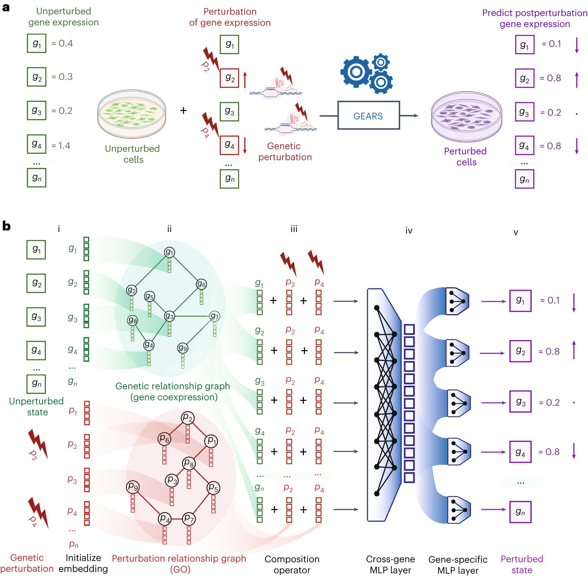

补充原始研究GEARS Fig.1a/b，完整原图。a从绿色未处理表达和红色干预输入预测紫色输出，数值为模型流程示例，不是本稿测量。b的i为初始化表示，ii为共表达图与GO扰动关系图，iii为组合运算，iv/v为跨基因与基因特异MLP。无统计轴或误差线。关系图边表示先验来源，不能改读为已验证调控箭头；图支持信息进入模型的方式，不证明任意组合预测有效。来源Roohani等[2]，CC BY4.0，图像未改数据。

对于从未被扰动过的基因，模型不能直接查找它的实验响应。综述介绍的GEARS用基因关系补充信息：一部分关系来自共表达，另一部分来自基因本体注释的相似性，使未测试目标可以借用相关基因的信息。[1,2] 原始论文的Methods进一步说明，组合扰动的表示经过汇总及非线性变换，再用于预测表达改变。[2]

这里有两个容易混淆的层次。共同参与某类过程的基因，可能提供有用的预测邻域；这类邻域却不自动说明谁直接调控谁。共表达边、功能相似边和因果调控边承担不同含义。读者看到模型图中有连线时，应先询问连线的来源，而不是直接将图解释成已经证实的调控网络。

模型能够接受多个目标，也不等于任意多基因组合都已经得到验证。综述讨论的代表性应用包括单基因和成对扰动，其中组合中的一个或两个目标可以在训练扰动中未出现。[1] 从双基因扩展到大量同时干预，可能遇到细胞存活、补偿和饱和等新规律；输入形式允许扩展，与证据支持扩展，是两件需要分别核验的事。

原始论文Discussion给出了两条直接影响选用的限制：可靠预测要求在相同细胞类型或实验条件的数据上训练；要准确预测多基因组合，还需要组合扰动训练数据。[2] 因此，“组合中的目标没有被单独扰动过”不能改写成“完全没有组合实验也能准确预测所有组合”，更不能据此宣称可直接跨细胞类型使用。

我们建议把GEARS类模型首先用于缩小候选空间。例如，在实验可承担的范围内，从预测差异明显、先验覆盖不同的候选中挑选一些做验证，同时保留预测弱效应的对照。这个方案是本文提出的实验设计建议，不是作者已经完成的验证。只选模型最有把握的几个漂亮案例，无法估计整张预测地图中有多少区域不可靠。

也要保留“为什么这个目标没有邻居”的问题。研究充分的基因通常拥有更丰富的数据库注释，冷门基因的预测支撑则可能较弱。知识先验减少了从零学习的压力，同时带入了知识积累的不均衡。因而，模型给出结果时，最好同时报告训练扰动覆盖和先验支持，而不只输出一个表达向量。

### 4．基础模型增加了什么，又没有自动解决什么

基础模型先在大规模数据中学习通用的基因或细胞表示，再用于具体任务。它提供的是一种可迁移的信息压缩：哪些基因常在怎样的细胞状态中共同变化，哪些表达模式在不同数据中反复出现。综述指出，这些表示可以和CPA、GEARS等专门模型结合，也可以通过扰动数据进一步训练。[1]

scGPT的正式论文摘要报告其预训练数据超过三千万细胞，并明确包含面向下游任务的迁移学习；本次对该原始论文只核到公开摘要、数据与代码说明，未获得付费墙后的完整正文。[3] 因此，下面关于不同方法路线的解释以已阅读全文的综述为依据，不把scGPT的特定实验成绩写成我们独立核实的结论。

大规模观察数据能让模型熟悉很多细胞状态，但观察到“某两个变量经常一起出现”与知道“人为改变其中一个后会发生什么”之间，仍有距离。预训练规模并不能替代干预设计。用同一个基础模型，直接读取表示、只训练一个小预测头、或用目标扰动数据调整整个模型，属于不同使用方式，不能把后两种成绩都称作无需目标实验的零样本能力。

另一类思路是在输入里改变某个基因的位置、表达值或存在状态，再观察模型输出。这可以提出机制假设，但输入编辑是否对应真实敲除，需要另作论证。真实干预可能存在残余表达、蛋白降解延迟、反馈代偿和细胞死亡。若模型输入中的“置零”没有这些生物过程的对应定义，输出变化更适合作为模型敏感性分析，而不是已完成的虚拟敲除实验。

还有一个实际问题：预训练数据从哪里来？如果评测样本、近似重复样本或同一实验的相关条件已在预训练中出现，所谓外部预测会变得难以解释。我们建议记录模型权重版本、预训练来源、微调样本和测试条件，而不只在Methods中写一个模型名称。更大模型是否值得使用，最终需要在目标任务上相对于简单方法证明新增价值。

### 5．最优传输解决配对问题，但配对仍然来自假设

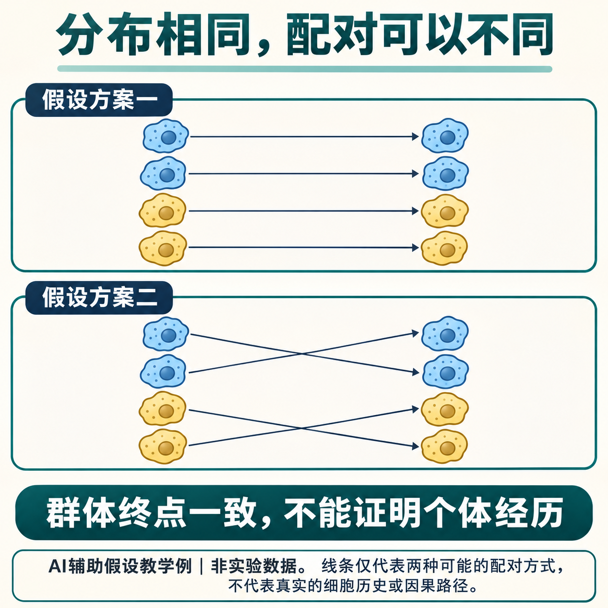

AI辅助假设教学例、非实验数据。两套配对共享相同起点与终点集合，说明分布一致不能确定个体对应；线不代表真实细胞历史。

另一条路线不急着寻找统一的扰动方向，而是比较处理前后两群细胞。最优传输可以理解为：在满足两端群体分布约束的前提下，寻找总体代价较小的对应关系。这里的“代价”通常由表达或表示空间中的距离定义，因此距离如何计算，直接影响哪些细胞会被认为可以连接。[1]

可以设想两张不同时间的车站照片。照片告诉我们各处有多少人，却没有每个人的身份记录。按照较短移动距离连接两张照片，可以得到一种合理流动方案；但如果有人离开、有人进入，或者人群绕行，最短路线就未必是真实经历。这是帮助理解最优传输假设的类比，不是细胞实验数据。

CellOT将这种映射参数化，使已学习的变化可以应用到新的未处理样本。原始论文明确指出，跨背景预测需要训练集中有足够相似的基础状态和反应；独特响应以及过强、过远的变化会构成困难。[4] 因此，OT模型带来的重要进步是把分布和异质性纳入建模，而不是消除了反事实推断中的不可识别性。

#### 原图怎么读：CellOT Fig.2的六个panel

下图来自CellOT原始研究，是对综述方法讨论的补充证据。a–c展示4i蛋白成像，d–f展示RNA-seq；不要把两种测量混为同一表达尺度。[4]

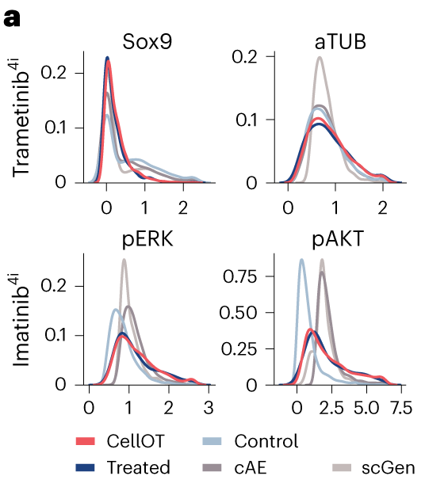

**a：看蛋白特征的分布。** 上排为trametinib处理后的Sox9、aTUB，下排为imatinib处理后的pERK、pAKT。横轴是经作者预处理的特征值：先除以对照细胞该特征的第75百分位数，再做log1p变换，因此不是原始荧光强度或蛋白分子数；纵轴是分布密度，不是细胞数量或百分比。浅蓝是对照，深蓝是实测处理后，红色是CellOT预测，灰色是cAE/scGen。应比较红线与深蓝线的峰位置、宽度和尾部，而不只看均值。

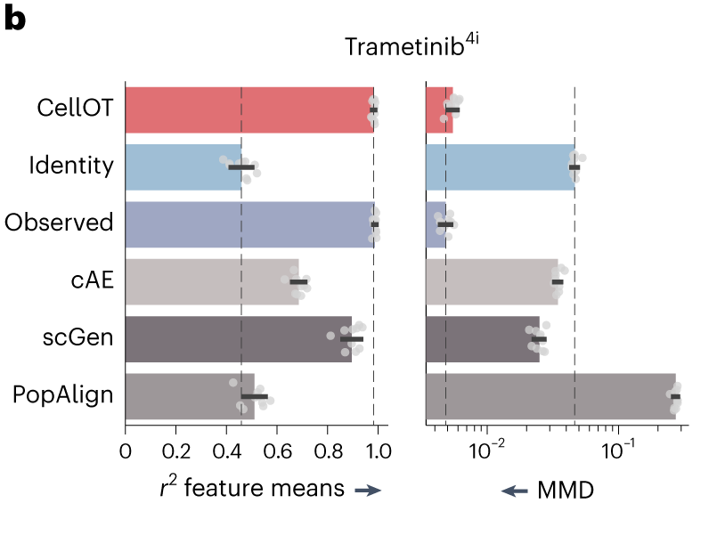

**b：把分布图转成两个不同问题。** 这里比较的是trametinib的4i数据，纵向列出方法；左侧横轴是特征均值之间的相关指标r²，向右较好，右侧横轴是MMD分布差异，采用对数刻度，向左较好，两者均没有物理单位。Identity直接使用未处理细胞；Observed用另一组实测处理细胞作参照，不是可部署的预测模型。误差线来自测试集十次bootstrap的标准差，虚线表示这两个参照的中位表现，不能当作十次独立生物学重复。

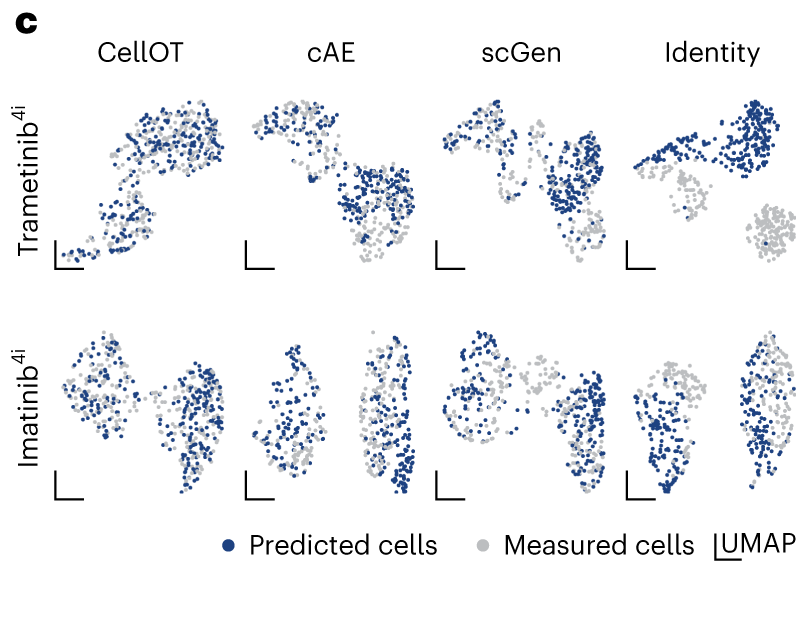

**c：看蛋白特征联合空间的覆盖。** 两排分别为trametinib和imatinib，列为CellOT、cAE、scGen及Identity。每点代表一个细胞，蓝点预测、灰点实测，二者下采样到相同数量后联合绘制UMAP。两轴是没有物理单位的嵌入坐标。蓝灰混合说明低维投影中覆盖更接近，却不能证明单个预测细胞与真实细胞一一对应。

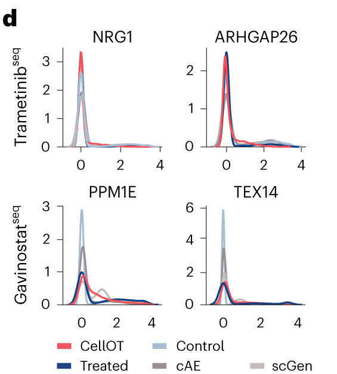

**d：换到RNA表达分布。** 上排展示trametinib下的NRG1、ARHGAP26，下排展示图中标为Gavinostat的处理下PPM1E、TEX14；保留原图药名拼写。横轴是文库大小归一化并log1p变换后的表达值，不是原始UMI数；纵轴仍为密度，峰高可超过1，因此不能直接读作概率或百分比。颜色沿用a，红线能否追上深蓝线的宽尾，是比“均值相近”更具体的问题。

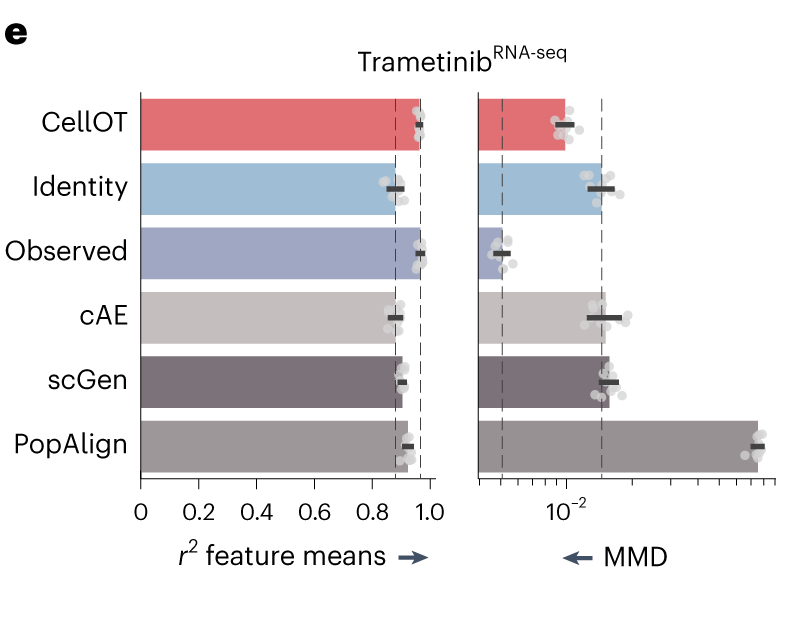

**e：RNA数据中的数值比较。** 仅展示trametinib；方法行、左右指标和优劣方向与b相同。该RNA分布比较使用前50个marker基因计算MMD，因此结论依赖这组特征和距离定义，不能直接扩展成全转录组所有结构均被准确恢复。r²较高而MMD仍有差距的情况，提醒我们均值与分布是不同评估目标。

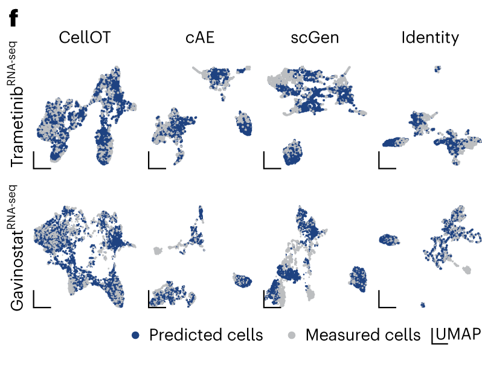

**f：RNA联合UMAP。** 两排为trametinib和Gavinostat，蓝色预测、灰色实测，每点一个细胞，列与c一致；两轴同样是无物理单位的UMAP坐标。应检查是否有真实群体未被预测覆盖，不能将嵌入中的空隙解释为细胞死亡量。整张图支持作者所展示条件下的分布拟合比较，不证明临床疗效、真实个体反事实，或跨任意新患者的可靠性。

图源：Bunne等，Nature Methods（2023），Fig.2，https://doi.org/10.1038/s41592-023-01969-x ，CC BY 4.0（https://creativecommons.org/licenses/by/4.0/）。原图六个panel原样裁切分开展示，全部保留，未更改数据，原panel、轴和图例均保留。以上为本次对官方原始图、图注及相关Methods的核对，没有重新分析作者原始数据。

这里需要分别评价三个目标。第一，终点群体的均值是否正确；第二，分布中的少数状态、宽度及多峰结构是否得到保留；第三，起点与终点之间的对应是否合理。前两个可以用终点观测检验，第三个通常还需要谱系追踪、更密的时间采样或其他独立信息。只画一张混合良好的UMAP，无法同时回答三个问题。

人口数量的变化同样重要。普通平衡传输要求两端的概率质量匹配，而细胞实验可能出现增殖、死亡及采样比例变化。将两组数据都归一化为概率分布后，组成变化仍可描述，但绝对细胞数的增减并不会自动保留下来。选择模型时，应核查它如何处理质量不守恒，而不是把所有细胞数量变化都解释为状态迁移。

### 6．画出连续轨迹，是否就知道细胞中途发生了什么

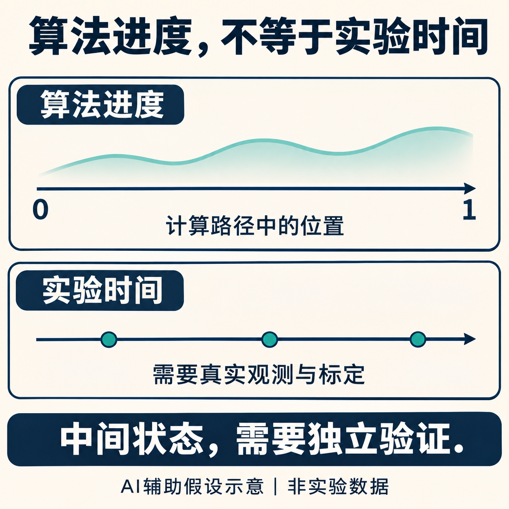

AI辅助假设示意、非实验数据。两条轴不建立刻度对应；实验时间需要观测标定，算法步数不自动代表发育时间。

Flow matching进一步学习一个随状态和时间变化的速度场，从起点分布生成终点分布。综述讨论了利用OT配对进行训练、引入条件信息，以及用神经微分方程构建连续变化的路线。[1] 相比只输出一个终点，它能够提供可查询的中间状态；但中间状态是否有生物学意义，取决于训练约束覆盖了什么。

最需要警惕的是“模型时间”和真实实验时间的混用。若训练只有对照和处理后一个终点，中间从零到一的插值参数可能只是计算路径上的进度。除非明确使用了真实时间数据并进行了校验，不能把路径中点直接说成“处理十二小时后的细胞”。同样，平滑曲线也不等于真实过程平滑；突变、分叉和暂态反应可能没有被终点数据约束。

综述提到，时间数据稀疏时，这类方法常采用线性路径等先验；RNA velocity或伪时间能增加方向信息，但这些本身也是推断量。[1] 把一项推断结果作为另一项模型的约束，可以帮助学习，却不会自动变成新的独立实验验证。若两者共享同一表达数据及相似假设，二者一致仍可能是共同偏差。

确定性轨迹还涉及另一个限制：相似起点的细胞可能因随机性走向不同终点。综述同时介绍Schrödinger bridge和扩散相关路线，用概率方式处理群体演化或生成细胞状态。[1] 需要注意，用去噪过程生成数据的“扩散模型”，其算法步数通常不等于细胞发育时间；而将生物状态变化本身写成带随机项的动力学模型，才直接对生物过程作出动力学假设。两个术语相近，解释时却不能混用。

本篇对CellFlow等方法仅作综述层面的原理介绍。所读综述将CellFlow引用为2025年预印本，本次尚未独立核实其后续正式版及完整原始论文，因此不报道最新版本的性能、数值或适用范围。它所代表的问题依然清楚：模型能否在不同扰动条件下生成合理的状态变化，需要用未参与训练的时间点和条件分别检验，而不能只检查训练终点。

### 7．真正可用的预测，应当能帮助下一轮实验更有信息量

选择这些路线时，可以先按现有证据分流。已有同类扰动及覆盖较好的细胞背景，可从条件表示与迁移模型入手；目标是未测过的基因，需检查是否存在可用且相关的先验；关心群体异质性及状态转移，需评价分布映射；希望解释中间过程，则需要更强的时间与谱系约束。这是本文的实践整理，不是综述给出的统一排行榜。

一个可落地的结果包应包括：预测的具体条件、哪些信息在训练时可见、输出针对均值还是分布、最接近的已验证条件，以及最可能失效的地方。实验验证则应同时覆盖预测有效、预测无效和模型之间明显分歧的候选。后一类尤其有助于区分假设，而不仅是再次展示模型已有把握的模式。

预测的价值可以来自减少无效筛选、提出有区分力的实验，或指出数据覆盖的空白。它不需要先获得“虚拟细胞”的宏大称号。对当前研究更有帮助的判断是：在清楚定义的背景和干预范围内，这项预测是否提供了可检验的新信息，并且值得投入下一轮实验。

## 5. 评测与实验设计

一个模型能给没做过的实验生成表达矩阵，接下来最实际的问题是：我能不能据此少做一些实验？如果它对每个扰动都给出近似相同的答案，整体误差仍然很小，这算成功吗？如果换一批供者就失灵，原来漂亮的测试成绩又代表什么？

读“虚拟细胞”论文，真正需要学会的，是把预测结果变成一份可验收的证据。本篇以《Interpretation, extrapolation and perturbation of single cells》的评估问题为起点，结合三篇已核查正文与Methods的原始研究，讨论怎样拆测试集、怎样选基线、怎样避免被高分误导，以及怎样把模型送回实验台。文中的实验结果均为原作者报告，我们没有重新训练模型或复算原始数据。

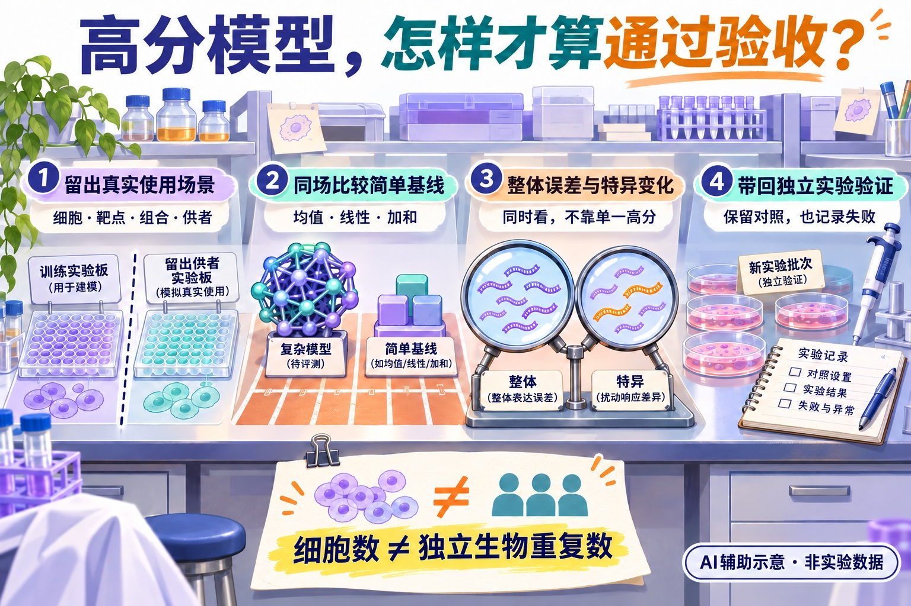

图示：分别验收测试任务、简单基线、特异变化和独立复验。培养板、RNA及供者图标均为假设教学符号；没有画出谁已获胜。供者只是生物重复来源的一种例子。AI辅助示意，非实验数据。

### 把“未见过”说具体，才能判断模型到底跨了多远

训练集和测试集随机分开，并不自动等于验证了外推。假如同一供者、同一批实验、同一个扰动的细胞同时出现在两边，测试主要回答：模型能否预测这一已知条件下的其他细胞。它没有回答新靶点、新供者或新组织中的表现。

做benchmark前，先把准备交给模型的下一次任务写成一句话。例如：“在这个细胞系里，预测一个从未测过的基因敲低”；或者：“已测A、B单独扰动，预测A+B”；再或者：“把健康供者中学到的效应迁移到另一个供者”。这些任务需要不同的拆分方法。

对新靶点，属于该扰动的细胞应整体留出；对新组合，要另外注明两个组成基因是否各自出现过。A、B的单独效应都已知，与A、B从未被扰动过，信息条件完全不同。对新供者、新细胞类型或新实验批次，则要沿相应层级整体留出，并检查测试条件是否通过预训练或数据整合间接进入了模型。

这里的OOD，即分布外测试，不是一张统一的“困难证书”。它描述训练与应用条件在哪个方向发生变化。多留出一个方向，往往也减少了可借用的信息，成绩不能与较容易的随机细胞拆分直接横比。

GEARS原始论文就提供了一个适合阅读的例子：双扰动按两个组成基因中有几个未被单独实验扰动，区分为零个、一个、两个未见。作者同时在讨论中明确，可靠预测要求相同的细胞类型或实验条件，多基因预测也需要组合扰动训练数据。因此，留靶点成功不等于跨组织成功。它借助共表达和GO关系传递信息，这种图先验也不等于已经确认的细胞内因果网络。[1]

### 细胞很多，独立证据可能很少

单细胞数据有一个容易误判的优势：矩阵看起来特别大。某组有几千个细胞，不意味着重复做了几千次独立实验。同一培养批次的细胞共享处理、环境与技术偏差；同一供者的细胞也共享遗传和生活史背景。

因此，图中的一个点究竟代表细胞、扰动、供者，还是一次随机拆分，决定了误差条可以解释到什么范围。把一批细胞随机分成两半，能检查抽样稳定性；换一位供者重复实验，才能增加跨个体结论的依据。对扰动级均值做评估，也不能顺便宣称细胞异质性和稀有状态被正确重建。

一个可操作的做法，是同时登记三个数量：细胞数、独立扰动条件数、独立生物重复数。若研究目标是跨供者推广，统计比较和不确定性评估应尊重供者层级；若当前实验只有一个细胞系，就把结论限定在该环境，而非用更多细胞“补出”人群代表性。

测试集还有另一类泄漏：模型权重虽然没有直接见过答案，特征筛选、批次校正或超参数选择却已经利用了它。根据全体数据挑基因、反复查看测试分数后换模型，都可能让留出集失去独立性。实践中应把数据拆分、训练集内预处理、验证集选参数、一次性测试连成明确流程。用于测试评分的真实差异基因集合可以是评价定义的一部分，但必须与训练特征和调参依据分开，不能让模型先偷看答案再参赛。

### 为什么一定要让简单模型坐在同一张桌上

基线是你在不付出复杂建模成本时已经能做到的程度。最简单的“不变”基线，直接返回未处理细胞均值；均值基线则对不同扰动给出共同的平均响应；线性模型用较少参数学习表达与扰动表征的关系。它们分别检验模型是否学到了变化、是否区分扰动、是否超越简单规律。

组合预测还需要加和基线。设对照、A单扰动、B单扰动的平均表达分别是C、A、B，加和预测可以写成“A+B−C”。减去一次C是避免把共同背景算两遍。这一计算必须放在定义清楚的数据尺度上，例如论文采用的归一化、对数转换表达尺度；不能将不同尺度的结果混加，再把偏离量统称为生物协同。

如果实验目标是发现非加和相互作用，平均表达误差很低仍不够。需要检查偏离加和预期的方向、幅度和候选排序。一个永远输出加和答案的模型可能很适合多数弱相互作用的条件，却无法发现真正的协同；一个大胆预测大量协同的模型，也可能把实验预算浪费在假阳性上。

2025年的线性基线研究把这种检查做得很直接。在Norman数据中，作者用100个单扰动和62个双扰动训练，另外62个组合测试，重复五次随机拆分。加和基线没有使用双扰动训练信息，却在所测预测误差中表现更好。单扰动评测还比较了均值、线性模型和预训练表征。结论针对这些数据、版本和评测设置，不能扩大成“复杂模型在生物学中没有价值”。[2]

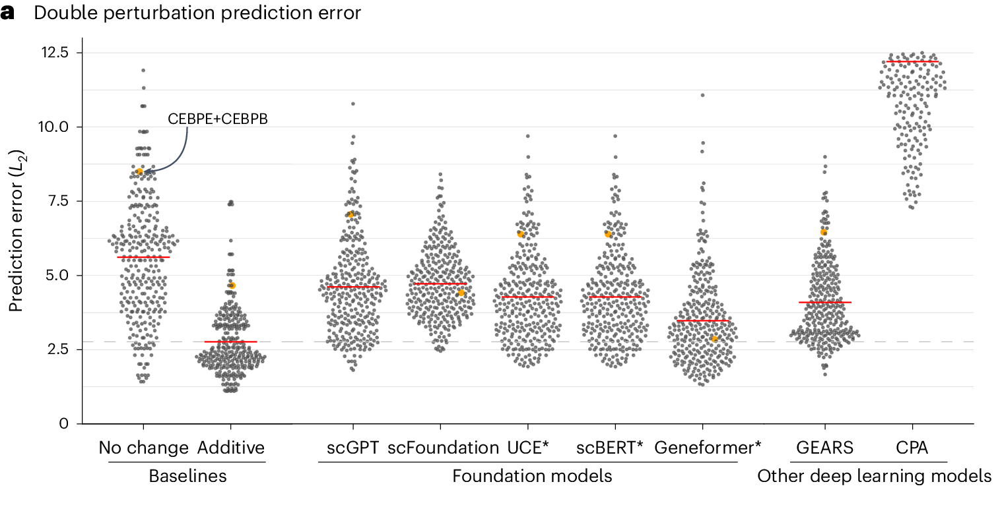

原研究图1a：[2]。横轴为模型/基线，纵轴L2预测误差，越低越好；红线标均值。点来自组合扰动在重复拆分中的评分，不能当作独立生物重复。星号方法涉及任务适配，须连同原文方法解释。原样裁切，未改数据；密集标签请点击放大。

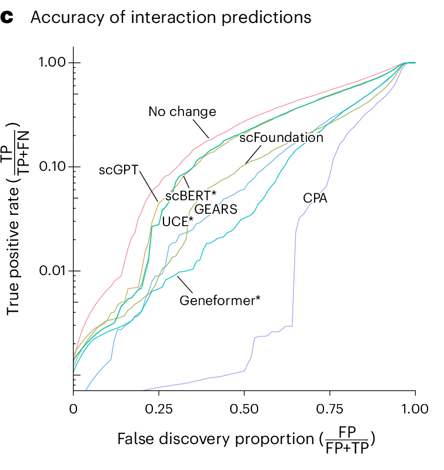

原研究图1c：[2]。横轴FDP为错误发现占比，纵轴TPR为真阳性率且采用对数刻度；曲线显示找回相互作用与误报的权衡。加和基线本身不预测非加和作用，未参加此子比较。保留原轴、标签及方法名，未改数据。

这篇论文另一个容易被传播错的数字，是5,035/124,000。分母是124个组合乘以1,000个读出基因，统计单位是“组合×读出基因”，不是124,000个不同基因组合。它说明按作者判定程序检出的非加和读出占比，不能翻译成“96%的基因组合没有相互作用”。相互作用是否存在，也取决于读出、尺度、效应强弱和检出能力。

读基线论文时还要看适用性。原本不是为某种外推任务设计的方法，经过额外解码器改装后参赛，测到的是这个具体改装流程；不能把结果等同于模型所有潜在用途。2025研究明确披露了一些方法的这种处理，也说明数据仅覆盖四个细胞系相关数据集、未进一步排除可能未成功的扰动。批判模型时同样需要批判测试题。[2]

### 高分可能来自“没变的部分”

考虑一个假设例子：在一万个读出基因中，某扰动只明显影响其中几十个。如果评分对所有基因一视同仁，一个认真复制公共背景、漏掉关键变化的预测，也可能拿到不错的整体误差。这里的问题是任务信号被大量未变基因稀释了。

相关系数也有自己的盲区。两个预测的变化方向相同，但一个幅度缩小许多，相关仍可能很高。所有扰动共有的应激或处理偏差，还可能让模型看似预测了每个靶点，却没有分辨靶点之间的区别。反过来，只在最显著差异基因上评分，也会忽略背景失真和非差异区域的错误。

所以验收至少需要几种互补视角：整体表达误差有没有明显失控；变化方向和幅度是否正确；不同扰动能否被区分；如果用于实验筛选，最靠前的候选实际命中多少。评价细胞分布的任务，还应另检验亚群比例、状态范围和异质性，不能拿扰动均值分数代替。

这些原则是我们结合综述提出的评估建议。原综述本身也已经提醒，简单基线强势可能部分涉及评估指标，不应把这场讨论讲成一篇新文章突然发现了所有人忽视的问题。

### 我们的后续补充：先检查尺子能不能分辨好坏

2026年10月1日发表的Miller等研究晚于这篇综述上线，是本文独立补充核查的证据，不属于综述原文结论。它提出一个实用问题：如果把明显具有同一扰动信号的参照，与对所有扰动给出平均答案的参照放在一起，评分尺能否把它们区分开？[3]

作者将同一扰动的细胞随机分为两部分，用其中一部分估计另一部分，构造technical duplicate正参照。但在弱信号情况下，少量细胞的估计噪声可能较大，于是又按基因差异证据在该参照与平均基线之间插值。这样的正参照使用了测试扰动的实验细胞，作用是检查指标，不是可拿去预测未来未知扰动的部署模型。

DRF描述正、负参照之间实现的评分差距，占负参照到理想完美预测差距的多少。它衡量这里的指标敏感性，不是“模型给出80%置信度就有80%正确率”那种概率校准。DRF低提示这把尺子在当前参照和数据中难以分开有用信号；DRF较高也不保证它适合所有科学目标。

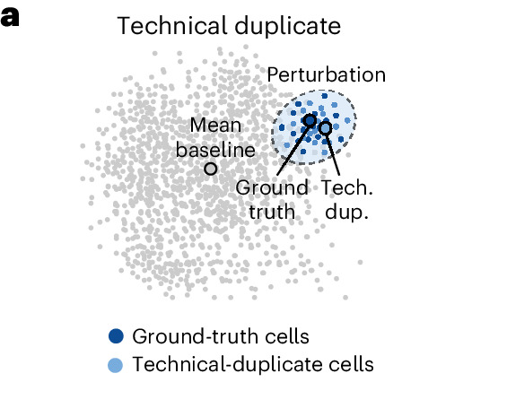

原研究图1a：[3]。同一扰动的细胞随机二分，一半预测另一半，构成technical duplicate。它用了测试扰动的实验细胞，是检查指标的正参照，不是可部署到未来未知扰动的预测模型；分细胞不会产生独立生物重复。

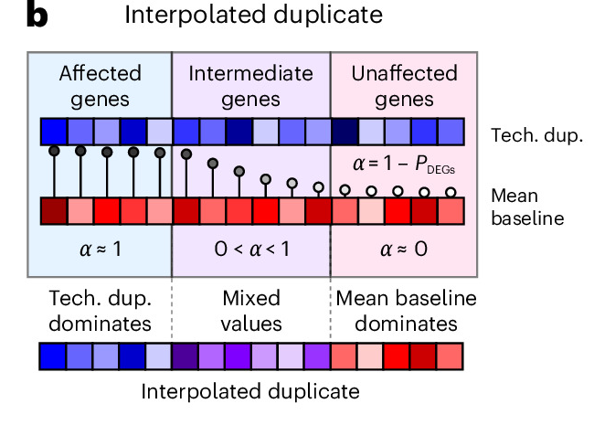

原研究图1b：[3]。按逐基因的差异证据，在技术二分参照和均值基线之间插值，以减轻弱信号时的估计噪声。图中颜色与箭头是作者的构造示意，不是本账号生成的数据。

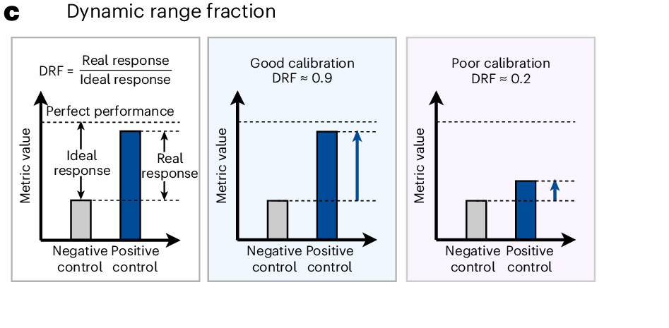

原研究图1c：[3]。DRF表示正负参照实现的评分差距，占负参照到理想完美预测差距的多少。柱图是概念示意。它衡量此处的指标敏感性，不是“80%置信度对应80%正确率”的概率校准；高DRF也不保证适合所有科学目标。

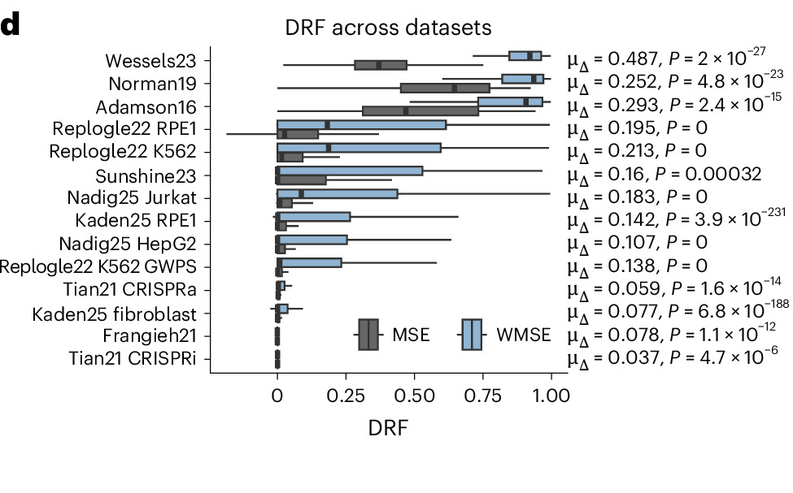

原研究图1d：[3]。横轴为DRF，纵轴为数据集；灰色MSE、蓝色WMSE，按扰动级分布汇总。加权指标在多个数据集中更能区分正负参照，但各数据集信号强度不同，不能读成所有模型的排名。

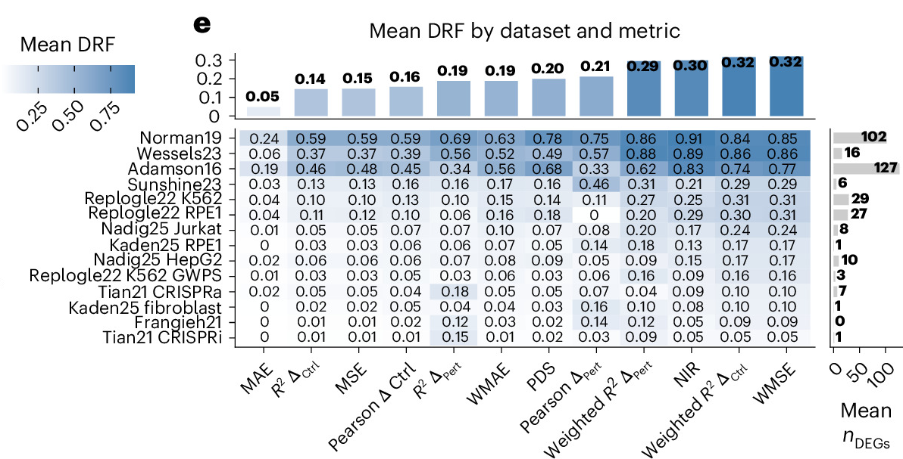

原研究图1e：[3]。横轴12种展示指标，纵轴数据集；色阶为DRF，顶部为各指标平均值，右侧为平均差异基因数。完整研究校准了18种指标，不能把图中的12列与全文范围混为一谈。密集数值需放大；整体比较不能替代特定用途的检验。

作者对14个数据集和18种指标作校准评估，并在选定的未见单扰动、未见组合任务中比较模型。较重视扰动特异变化的一些指标显示，若干深度模型能够超越简单参照；但不同模型在不同指标上的优势并不相同。因此，“14个数据集检查指标”不能被写成“所有模型在14个数据集全部胜过基线”。[3]

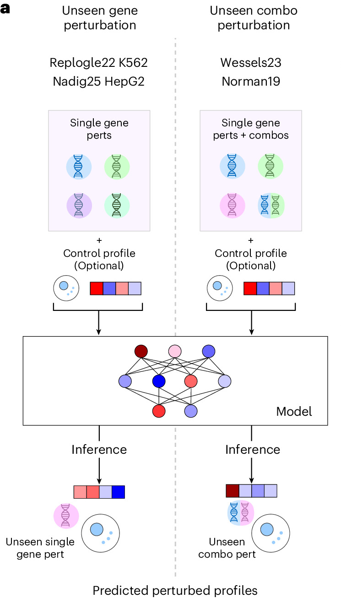

原研究图2a：[3]。左为未见单基因扰动，右为未见组合；训练条件和数据集不同，控制表达输入对部分模型是可选的，不能假设所有方法获得完全相同的信息。

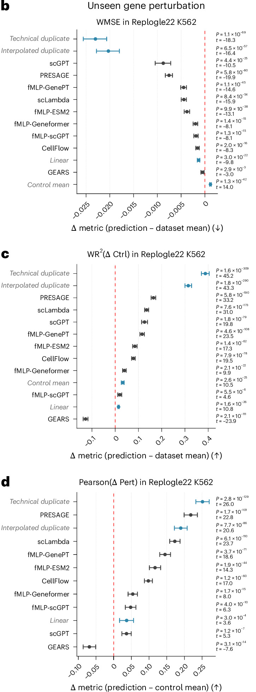

原研究图2b–d：[3]，K562示例。各行是扰动评分差值的平均值及95% bootstrap置信区间，不是单个扰动或重复训练的结果。b为WMSE，越低越好；c为加权R²，越高越好，二者参照均为dataset mean。d为Pearson(Δpert)，越高越好，参照改为control mean。红虚线为零差值。模型名、所有比较项和坐标完整保留；细字请放大。

原研究图2e–g：[3]，Wessels组合示例。e、f分别为WMSE和加权R²，相对dataset mean；g为Pearson(Δpert)，相对control mean。不能跨不同方向、单位或参照直接比较点的位置。K562的n=2,045、Wessels的n=187是扰动级评分条目，不是供者数；后者涉及157个unique pairs，不能写成187个彼此独立的新组合。

这里还有三条边界不能省略。所有指标是在扰动级pseudobulk，即细胞聚合的表达概况上计算；随机二分细胞并没有产生独立的生物重复；研究也明确未覆盖新供者、新细胞类型或新环境。模型在这些评分中进步，不等于整个“虚拟细胞”的异质性与跨环境预测问题已经解决。

2026研究还发现，Norman的加和基线仍很强，而另一组合覆盖更充分的数据集上，一些模型更有优势。2025和2026的模型集合、组合训练比例与指标均有不同。合理的综合是：简单基线揭示了真实短板，校准评估进一步辨认了被平均误差掩盖的信号。下一步应统一任务与拆分后比较，不能只凭两篇标题宣布谁推翻了谁。

### 公平比较，还要公开模型拿到了什么

两条柱子高低不同，原因可能不仅是网络架构。一个方法使用预训练扰动数据，另一个只能使用当前训练集；一个经过充分调参，另一个使用默认参数；一个多次尝试后报告最佳结果，另一个只运行一次。这些比较仍可回答实际工具选择问题，但不能直接证明某种建模原理更优。

建议把评测分为两层：一层比较各方法按推荐方式使用的整体表现，回答“现在选哪个工具”；另一层尽量对齐输入信息、训练预算和调参流程，回答“性能增益来自哪里”。不能运行的模型要写清原因，包括基因集不匹配、内存限制或软件错误，不要把缺失结果记成零分。

不确定性也要落到实际用途上。模型内部给出的方差，可能只反映训练目标下的估计，并未覆盖新实验批次或新供者的偏移。可按预测不确定性分组，检查真实误差是否随之增加；也可检验宣布的预测区间是否达到相应覆盖率。再将这些检查分别放在已知环境和目标外推环境中。没有这种核查，“模型很自信”只是一个输出值。

评测代码应锁定数据版本、拆分清单、软件版本、基因过滤与评分方向。平均分之外最好展示逐扰动结果和失败类别。若优势只出现在少数强效应靶点，或者模型普遍漏掉同一类通路，读者需要看到这些结构性差异，才能判断结果是否适合自己的实验。以上是我们建议的验收流程，不是声称本文已完成的复现实验。

### 把下一笔实验经费花在最缺的证据上

主综述图2：Dimitrov等，DOI:10.1038/s41576-025-00920-4。Understand、Extrapolate、Guide连接理解、外推和实验选择；底部循环是概念性研究流程，不是模型已获实验验证的结果。原图完整保留，未重画数据；密集标签请放大。原图公开复用由账号负责人发布前审查。

更深的测序、更多细胞、更多靶点、更多供者，增加的是不同信息。若瓶颈是少数关键转录本检测不稳定，提高深度可能有帮助；若目标是稀有亚群，细胞数量更相关；若目标是跨环境预测，补充独立供者或条件可能比继续测同一批细胞更重要。具体预算分配需要先做小规模预实验，不能给所有课题一个固定配方。

扰动质量也应成为设计的一部分。CRISPR标签表明细胞接收了某个构建，并不自动证明靶点被充分、特异地改变。应登记导向序列、靶点响应、脱靶与存活选择等可能因素。仅保留“变化明显”的细胞会改变研究对象，应说明是在估计全部被分配处理的细胞，还是响应者中的效应。

如果使用GO或通路先验，建议比较无先验、真实先验与保持一定结构特征的随机先验。这样可以区分“生物知识确实有帮助”和“稀疏连接减少参数就有帮助”。随机化必须说明保留了什么，例如节点度数，否则变化的不只是知识内容。还应按已有注释丰富程度分层报告，避免平均成绩只反映熟悉的通路。

最终的实验闭环不宜只挑模型最自信的赢家。可以预先锁定一批高收益候选、一批高不确定性候选，并保留随机或简单基线推荐的对照组；在新的实验批次验证，按事先约定的读出和命中标准比较。候选数量、失败结果和退出条件也要记录，不能只发表成功案例。

如果只是为了找到少量有价值的组合，评估应直接回答：同样实验预算下，多找到多少可复验结果？如果目标是机制解释，则还需要能区分竞争假说的额外实验。表达预测准确可以指导筛选，却不会自动给出唯一的调控机制。

### 带着这六个问题再看一次模型成绩

一、所谓“未见”，留出的究竟是细胞、靶点、组合还是环境？二、图中的n是什么，重复拆分是否被误当独立样本？三、均值、线性、加和等适配任务的基线是否齐全？四、指标是否既看到特异变化，也约束整体失真？五、预训练、预处理和选参有没有触及测试答案？六、模型推荐是否在新的实验中，比同预算的简单策略更有效？

能逐项回答这些问题，才有理由决定把模型放进哪一步研究流程。暂时只能在一个细胞系、一个读出和一种拆分上可靠，也可以很有用。关键是把可用范围说准，让预测承担它已经获得证据支持的工作。

## 来源、阅读范围与图像使用边界

### 原第1篇：来源与阅读范围

主文：Dimitrov D, Schrod S, Rohbeck M, Stegle O. Interpretation, extrapolation and perturbation of single cells. Nature Reviews Genetics 27,349–370(2026). https://doi.org/10.1038/s41576-025-00920-4

本篇基于用户提供的22页正式完整正文、图注、表格、Box1及参考文献。补充扩展表尚未取得，未据其作结论。本文中的实验问题单和假设案例属于我们的教学整理，不是原作者的新实验结果。未运行文中软件。本篇不引用任何未经核实的具体性能数字。

图像审读提示：本稿仅保存为未发布草稿。原文图与原样片段来自 Dimitrov 等，Nature Reviews Genetics (2026)，© Springer Nature Limited 2026；原图复用许可待用户发布前核查，本文不声称已取得授权。裁切仅调整版面，未改变原图数据或关系。

### 原第2篇：来源与阅读范围

[1] Dimitrov D, Schrod S, Rohbeck M, Stegle O. Interpretation, extrapolation and perturbation of single cells. Nature Reviews Genetics27,349–370(2026). https://doi.org/10.1038/s41576-025-00920-4 。用户提供正式完整PDF已通读，本篇重新核对相关正文、Box1、Fig3及Table3；补充扩展表未取得。

[2] Zhou Y等. A new Bayesian factor analysis method improves detection of genes and biological processes affected by perturbations in single-cell CRISPR screening. Nature Methods(2023). https://doi.org/10.1038/s41592-023-02017-4 。本轮核对公开原论文的模型概述与方法片段，未完整重读全部正文和补充材料，不报告其性能比较数字。

[3] Supervised discovery of interpretable gene programs from single-cell data. Nature Biotechnology42,1084–1095(2024)，2023年首次上线。https://doi.org/10.1038/s41587-023-01940-3 。本轮核对公开原论文的输入输出及模型设计段落，未完整核验全部应用与补充材料。

[4] Weinberger E, Lin C, Lee SI. Isolating salient variations of interest in single-cell data with contrastiveVI. Nature Methods20,1336–1345(2023). https://doi.org/10.1038/s41592-023-01955-3 。身份与综述引用关系已核对；本轮原文网页访问出现身份重定向技术错误，不能称已阅读全文。

[5] scvi-tools官方contrastiveVI教程：https://docs.scvi-tools.org/en/latest/tutorials/notebooks/scrna/contrastiveVI_tutorial.html 。已核对模型设置、共享/特异变量说明及教程的输入层设置，未执行。教程显示的版本属于官方教程运行环境，不是我们的测试版本。

本文中的假设例子、研究检查问题和分析建议为原创教学整理；没有把生成图当作真实数据，也没有把作者案例写成亲测。本稿仅保存为未发布草稿；原图复用许可待用户发布前核查，不声称已取得公开复用授权。

### 原第3篇：阅读范围与来源

- 主Review为用户提供的完整正式版PDF，本文依据其机制发现、Box1、Fig.3、Table3及评价局限部分进行原创教学综合。首次上线为2026年1月2日，不称最新综述。[原文](https://doi.org/10.1038/s41576-025-00920-4)
- Bicycle已查阅公开原论文的方法、实验、讨论与对应图注；未运行其代码，不作软件效果实测承诺。未逐项复核全部附录推导。
- SCENIC+核查了官方论文方法页面的可检索正文与元数据；PMC访问出现验证码，Nature直接打开出现身份重定向失败，故不声称独立通读原始研究全文。此处仅用来解释方法步骤，不报告自证的实验结论。
- scDoRI、时间与空间方法、预训练方法采用主Review层面的比较，不将综述转述包装成已经逐篇复现或核实的结果。所有字母案例为教学假设。

### 原第4篇：来源与阅读范围

[1] Dimitrov D等，Interpretation, extrapolation and perturbation of single cells，Nature Reviews Genetics，2026。DOI：https://doi.org/10.1038/s41576-025-00920-4 。本篇依据用户指定的完整正文，重点核对第362–364页及表2、表3；没有声称阅读其全部原始参考文献或补充文件。

[2] Roohani Y等，GEARS，Nature Biotechnology，首次上线2023-08-17，卷期2024。https://doi.org/10.1038/s41587-023-01905-6 。本次独立核对公开正文相关结果与Methods中图、组合及解码定义，未复跑代码、未独立检查全部补充数据。

[3] Cui H等，scGPT，Nature Methods，2024-02-26。https://doi.org/10.1038/s41592-024-02201-0 。本次仅公开摘要、数据和代码说明；完整正文受订阅访问限制。

[4] Bunne C等，CellOT，Nature Methods，2023-09-28。https://doi.org/10.1038/s41592-023-01969-x 。本次核对公开正文中模型、外推限制及Methods相关定义，未复跑代码或独立核查补充数据。

版本核验：CellOT于2023-10-30发表作者更正（https://doi.org/10.1038/s41592-023-02073-w），说明初版遗漏的online Methods已补回HTML和PDF；本次读取的是包含Methods的现行网页，更正没有宣告Fig.2数据修改。

### 原第5篇：阅读与来源

- 主Review：[Dimitrov等，Interpretation, extrapolation and perturbation of single cells](https://doi.org/10.1038/s41576-025-00920-4)，首次上线2026-01-02。本文围绕评估与实验设计作原创教学综合，不逐段翻译。
- [1] [Roohani等，GEARS](https://doi.org/10.1038/s41587-023-01905-6)，首次上线2023-08-17，卷期2024。核查正式正文、Methods和主图图注，未复算原始数据。
- [2] [Ahlmann-Eltze等，简单线性基线评测](https://doi.org/10.1038/s41592-025-02772-6)，2025-08-04。核查完整正文、Methods和主图图注；补充源数据未逐表复算。
- [3] [Miller等，指标校准评测](https://doi.org/10.1038/s41587-026-03307-w)，2026-10-01。我们的后续补充；核查完整正文、Methods和主图图注，未运行代码、未独立复算补充表。原文Methods的通路集合描述存在前后不一致，本稿不据此展开具体实现细节。

### 原第6篇：阅读范围与来源

本文依据Dimitrov D、Schrod S、Rohbeck M、Stegle O的正式Review《Interpretation, extrapolation and perturbation of single cells》，Nature Reviews Genetics 27，349–370；2026年1月2日首次上线。已阅读用户提供的完整正文、主图图注、Box1、Tables1–3及结论；没有取得扩展补充表。本篇未独立通读和复现综述所列全部原始研究，具体方法的能力与局限按综述归因，不报告新的性能数值，不把当前文字稿称为软件实测。

原文：https://doi.org/10.1038/s41576-025-00920-4
作者方法资源：https://interp-extrap-perturb.readthedocs.io

本文为独立教学综合和批判性阅读，不是对原文逐段翻译。配图为原创AI辅助示意，非实验数据；本篇不复制原综述图表。

### 补充研究图像署名与完整原图

[2][3]原图按CC BY 4.0署名，原样裁切panel或分组展示，未改数据。许可链接：https://creativecommons.org/licenses/by/4.0/。两篇补充研究的原图与主综述图分别署名，不能互相转授许可。已核查正文、方法和主图图注，补充表未逐表复算；[3]方法中的通路集合和个别统计措辞有不一致，本文不据此提供具体复现步骤。没有运行模型或软件。

[CellOT Fig.2完整原图](assets/paper-1a4a1ad74809d2c3/p04-cellot_fig2_original.png)

[2025线性基线研究Fig.1完整原图](assets/paper-1a4a1ad74809d2c3/p05-linear-fig1.png)

[2026指标校准研究Fig.1完整原图](assets/paper-1a4a1ad74809d2c3/p05-calibration-fig1.png)

[2026指标校准研究Fig.2完整原图](assets/paper-1a4a1ad74809d2c3/p05-calibration-fig2.png)

### 私人归档的使用边界与既有核验修订

主Review的Fig.1–3、Box1和表格为© Springer Nature Limited 2026独占权利内容，非CC；持有全文或保存私人草稿不等于已取得公开复用许可。本文保留已有原图、原样裁切、来源及限制，不以归档完成声称许可通过。补充原始研究的许可仅适用于各自明确署名的图，不转授主Review图表权利。本次没有取得新的许可证明、没有重试受阻的来源访问，没有上传受限全文PDF，也没有运行模型或复算原始数据。

恢复完整母稿时沿用两条已核验的文字修订：第一部分将Fig.2形状写为“小提琴与密度曲线”；第五部分将2025研究范围写为“四个细胞系相关数据集”，不把所有细胞系都称作癌细胞系。第四部分的图像展示说明沿用现有六panel原样裁切图注，科学讨论仍为完整母稿。原稿hash、逐项修订前后文和来源hash见配套科学来源记录。密集原图宜打开原分辨率文件放大阅读。

科学来源与修订记录（内部核验记录，不随书附送）

## 6. Take-home messages

### Take-home messages：把方法地图变成下一次研究的判断清单

拿到一套单细胞数据，最容易开始的工作是找一个新模型，跑出降维图、基因程序或者扰动预测。真正困难的决定往往发生在这之前：我们想解释已经观察到的差异，预测一个尚未做过的实验，还是据此决定下一轮应该干预什么？这三个目标需要的证据并不相同。

Dimitrov等人在Nature Reviews Genetics发表的综述，把大量单细胞方法放在同一张概念地图上。这里不再逐个介绍工具，而是把其中对研究最有用的判断整理成一份可以带进组会、开题报告和方法评审的清单。即使没有读过前面的文章，也可以从这里开始：先说明你要做什么，再决定数据和模型是否足以支持这件事。

本文讨论的是2026年1月2日上线的正式综述。方法例子和领域判断以该综述为依据；下面的研究设计案例和决策清单是我们的教学综合，不是作者已经做过的新实验，也没有声称我们运行或复现了这些模型。

同一份单细胞数据可以服务于描述变化、预测新条件和选择下一轮实验，但三种决定要分别验收。图中细胞、条件X/Y/Z及假设A/B均为教学示例，不表示真实观测；两种假设仅示意竞争解释，不能当作已确认机制。三条分支表示研究用途，不是一条自动升级到因果确定性的阶梯。显微镜为观察的视觉比喻，不表示转录组测量依赖显微镜。AI辅助示意，非实验数据。

### 1. 把研究问题写成一句能够被否定的话

“建立虚拟细胞”“找到关键调控网络”“挖掘疾病机制”都可以表达愿景，却不足以决定如何分析。可以先把问题改写成：在什么细胞、什么条件、什么时间范围内，预测哪个干预会改变什么读数，怎样的结果会让我们承认预测失败？

例如，“预测未见过的双基因干预对某细胞系转录组的影响”仍需补充：两个基因的单独干预是否见过？其他双干预是否用来训练？目标是群体平均表达、某条通路的变化，还是少数细胞进入新状态的比例？这些差异会改变训练集、基线和成功标准。

在动手前写出一个最小任务说明，通常比先比较模型名称更有帮助：

- 研究对象：细胞类型、供者或模型系统，以及采样时间。
- 输入信息：观察数据、真实干预、多组学、空间位置、时间点中实际拥有哪些。
- 输出对象：差异表达、基因程序、调控边、群体分布或实验候选清单。
- 未来使用场景：重复当前条件，还是转向新靶点、新组合、新供者或新组织。
- 失败标准：在哪个预先指定的测试上，若不优于合适基线，就不支持计划中的用途。

这并不要求研究开始时知道答案，而是要求所有人对“回答了什么问题”有共同认识。

### 2. 先分清证据的用途，再谈证据有多强

差异基因、潜在程序、调控网络、反事实预测和前瞻实验，经常被写成同一条越来越高级的路线。实际使用时，它们回答的不是同一个问题。

差异表达帮助描述某个比较中的变化。潜在程序把共同变化的基因组织成较少的维度，便于解释异质性。带方向的网络提出调控关系。留出条件上的预测检验模型能否把某种规律带到新情境。前瞻实验进一步检验模型提出的干预是否真的产生预定结果。

这些证据可以互相支持，却不会自动互相替代。一项预测在指定测试集上准确，并不保证模型内部每条边都是正确机制；一个局部调控关系有实验依据，也不保证整张网络能够预测换一个组织后的反应。机制解释和实际预测价值，需要分别验收。

写结果时，可以直接标明四种范围：

- **直接观察**：本次数据中测到了什么变化。
- **模型解释**：在给定假设和先验下，哪些程序或关系可以解释变化。
- **范围内预测**：模型在哪一种留出条件上经过测试。
- **新增实验验证**：哪些预测后来由独立实验支持，哪些还只是候选。

这不是给所有研究打一个统一等级，而是避免把不同来源的证据混成一句“已揭示机制”。综述引用的原始研究也要按同样原则处理：读过综述，不等于亲自检查了每篇原论文的数据、补充材料和代码。

### 3. 数据缺少哪种约束，模型就要承担哪种假设

观察性单细胞图谱能展示丰富差异，但细胞来源、处理状态和测序批次可能同时变化。模型分出了一个“处理维度”，并不能单凭维度命名证明它与这些背景因素分开了。增加细胞数量有助于描绘分布，却不能替代独立供者或独立实验重复。

真实干预提供了更直接的因果线索，但干预标签仍然需要核对。携带某条guide RNA的细胞，可能出现不同程度的抑制、脱靶或补偿反应。剔除“响应不足”的细胞以后，问题也随之变化：我们估计的可能是有效响应细胞的效应，而不再是整个处理群体的平均效果。应说明筛选规则，并检查结论是否依赖这一规则。

时间、空间和多组学各自补充不同约束。时间点帮助判断事件顺序，空间位置帮助考虑邻近细胞的影响，染色质或蛋白读数帮助缩小可能的调控路径。它们都很有价值，但没有任何一种额外模态可以保证所有混杂因素已经被测量。

一个实用做法是列出“假设账本”：哪些因素被观测并调整，哪些通过实验设计控制，哪些完全依赖模型设定。尤其要把无法从当前数据检验的假设写出来，例如关键混杂是否遗漏、干预是否足够特异、潜在因子是否有唯一解释。写清假设不是削弱研究，而是告诉读者结论在哪些条件下可以迁移。

### 4. 选择足以回答问题的方法，不追求把五类概念都装进去

综述梳理了表示学习、解耦、因果推断、机制发现和群体追踪五类概念。它们是理解方法的坐标，不是每个课题都必须完成的五道关卡。

如果主要问题是“哪些细胞状态发生变化”，优先把比较设计、样本重复、效应大小和异质性描述做扎实。直接开始重建全基因调控网络，可能引入很多暂时无法验证的假设。

如果问题是“哪些基因共同响应”，因子模型或其他表示学习方法可以提供紧凑的程序。给一个因子加上通路名称，意味着它与既有知识相联系；这个名称本身不证明所有成员都被同一个上游机制直接控制。非线性模型能表达更复杂的关系，但解释各个维度时，往往需要额外约束或核查。

如果问题是“哪个调控因素驱动变化”，就要对方向、共同原因和反馈格外谨慎。先验网络能缩小搜索范围，也可能把结果引向研究较多的通路。观察性数据有时允许多张不同方向的网络同样解释现象；换随机种子或样本后网络不稳定，是需要调查的信号，而不能仅靠挑一张最漂亮的网络解决。

如果问题是“处理前后细胞状态如何衔接”，最优传输等方法能够推断群体之间的对应关系。多数单细胞测序会消耗被测细胞，因此这里通常没有同一个细胞的真实前后配对。计算得到的连接和轨迹应作为模型推断来读，尤其不能把推断轨迹中的某个中间状态写成已经被实验观察到。

方法选择的终点应当是一项明确收益：它比更简单的分析多解决了哪个问题，又为此增加了哪些假设、计算成本和验证责任？

### 5. “泛化”后面必须跟一个具体对象

“能预测未见条件”很有吸引力，但未见条件可以指完全不同的困难：新细胞、新供者、新基因干预、新组合、新剂量或新组织。把同一个实验中的细胞随机分开，和把整个供者留出，不是在测试同一种能力。

因此，评测应反过来从未来用途设计。若目标是新供者，测试阶段就要让模型面对完整留出的供者；若目标是新组合，就要明确单独扰动及其他组合在训练阶段是否出现；若目标是新靶点，还要交代模型通过先验数据库或预训练见过什么有关信息。

普通随机拆分依然有用途，例如检查同分布下的拟合效果，但它支持的结论必须保持在相应范围。更严格的拆分失败，也不必马上宣布模型毫无价值：它可能说明当前模型适合较窄的用途，或者训练资料尚未覆盖真正重要的变化来源。

报告泛化时，最好同时写出“已经测试的变化”和“还没有测试的变化”。一句“在同一细胞系的留出靶点上进行了评估，跨供者迁移尚未验证”，比没有边界的“具有良好泛化能力”更有信息量。

### 6. 与谁比较、用什么指标，决定“更好”意味着什么

全转录组中有大量共同背景。一个模型即使没有捕捉到干预特异的变化，也可能在整体表达相似度上取得不错结果。相反，某些指标也可能对与研究问题有关的细胞异质性不够敏感。高分需要解释，低分也需要检查具体错在哪里。

至少考虑三件事。第一，安排与任务相匹配的简单参照，例如不预测变化的对照、均值或线性模型；组合问题还应考虑加和预测，但要明确是在什么表达尺度上定义加和，以及需要哪些已知单独干预。第二，同时查看整体误差和真正关心的效应：变化方向、效应大小、受影响程序，以及必要时的群体比例或分布。第三，按扰动、供者或细胞类型检查失败案例，避免一个平均分掩盖少数重要条件上的失效。

综述讨论了简单基线有时能匹敌甚至超过复杂模型，也明确指出评估指标本身可能影响比较。可以由此得出的结论是：新模型需要在明确任务和合理评价下证明增益。不能由某个基准延伸出“所有深度学习都无用”，也不能因为换了指标名次上升，就断言机制已经正确。

对研究者最有用的成绩单，应当同时告诉我们哪些预测有效、哪些预测不可靠，以及使用者什么时候应当停止依赖它。

### 7. 下一轮实验，要区分“最可能成功”和“最能消除分歧”

下面是一个假设案例。某干预后，一个应激相关基因程序升高。模型提出两种解释：可能是特定调控因素直接改变了该程序，也可能是细胞状态或细胞群比例发生变化，带来了相似的整体信号。

继续测更多同一条件的细胞，可以改善对现有分布的描述，却未必区分这两种解释。更有针对性的下一步可能是加入较早时间点、核对干预效果、在相应细胞状态内比较，或测量与候选机制有关的另一层读数。若预算允许，再考虑独立干预手段和能够区分竞争解释的验证设计。具体选择仍取决于机制、实验可行性和风险，不能把这套示例当成通用固定流程。

这里的关键是：实验候选有两种不同价值。某个条件可能最容易得到预期结果；另一个条件可能让两个模型给出明显不同的预测，从而更有助于判断哪种解释站得住。若所有下一轮实验只选择模型最有把握的已知通路，闭环可能不断强化原来的偏好。

这项建议是我们从综述“实验—预测”闭环出发做的研究设计延伸，并不是作者已经证明的统一最优策略。执行前仍应预先写下读数、对照和否定条件，记录未命中的预测，避免只展示成功案例。

### 8. 仍然没有解决的问题，恰好是选题的入口

这篇综述留下的开放问题可以归成四类。

**识别问题：**在有限的观测和干预下，哪些机制真的能被区分？缺失变量、反馈和干预不完全时，网络方向还能有多大把握？

**迁移问题：**从细胞系学到的规律，哪些依赖特定环境，哪些能保留到供者、组织或空间邻域变化之后？需要怎样的数据，才能识别这种边界？

**观测问题：**一个细胞通常只能测一次，如何利用谱系追踪、时间信息和非破坏性读数改善推断？增加信息的价值在哪里，新增噪声和假设又在哪里？

**验收问题：**什么指标与未来实验决策真正一致？一个模型缩小了多少候选范围，是否改善了独立验证的效率，遇到资料范围之外的输入能否暴露不可靠性？这些需要具体任务中的证据，不能仅用排行榜代替。

这些方向不要求每个课题建造一个包罗万象的模型。一个边界清楚、能被重复检验的局部进步，同样可以形成有价值的方法或应用研究。

### 带走这五句话

1. 先规定研究要支持哪一种决定，再选择模型。
2. 把直接观察、模型解释、范围内预测和新增实验验证分开写。
3. 数据缺少的关键约束不会因为模型复杂就自动补齐。
4. 泛化要说明对象，性能要说明基线、指标和失败条件。
5. 最值得保留的模型，既能给出可检验预测，也能帮助设计下一次真正减少不确定性的实验。

“虚拟细胞”是否有用，最终体现在它帮助我们更准确地界定问题、缩小可检验的解释范围，并把计算结果带回真实实验。对当下的研究而言，清楚知道一个模型在哪些条件下成立，是把它用好的起点。
