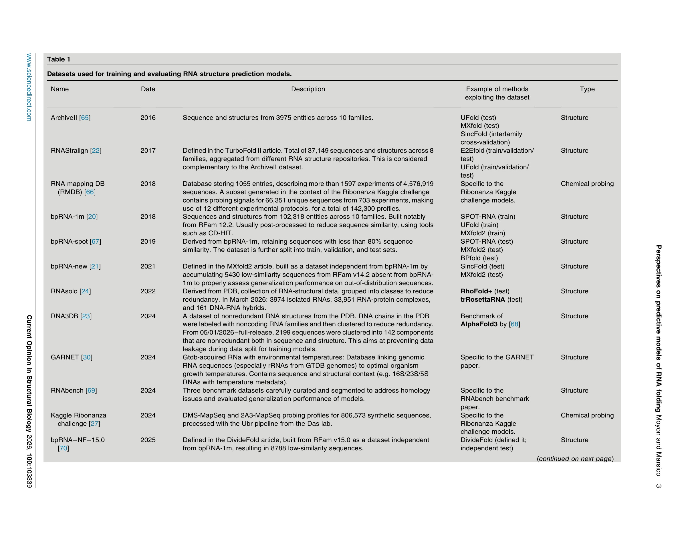
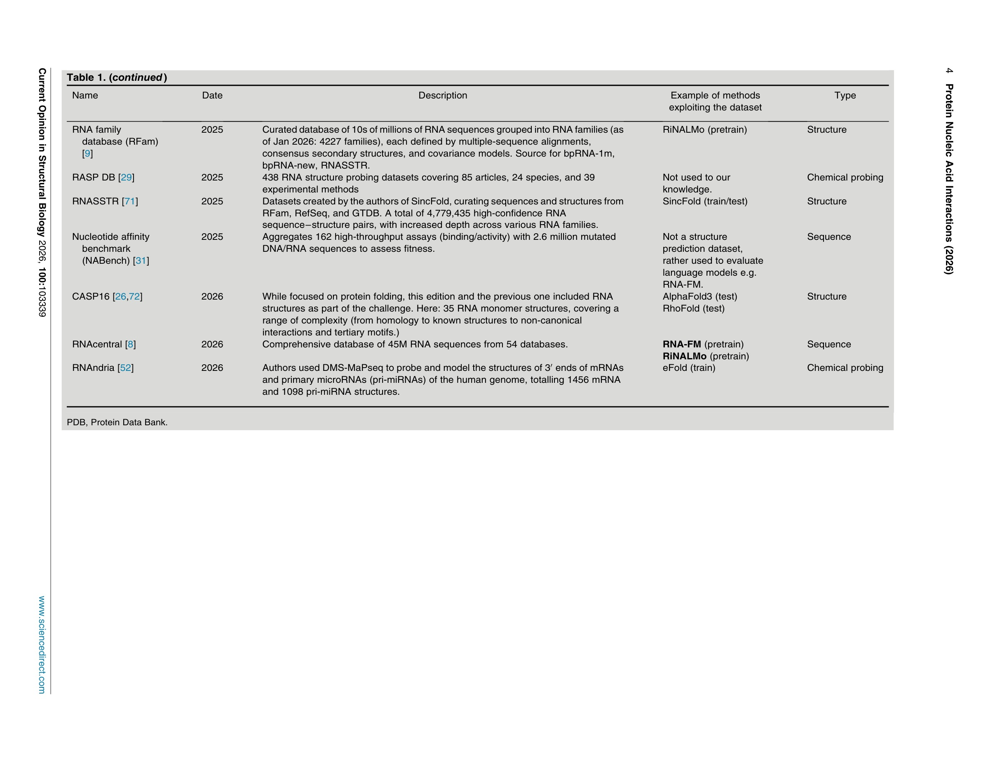
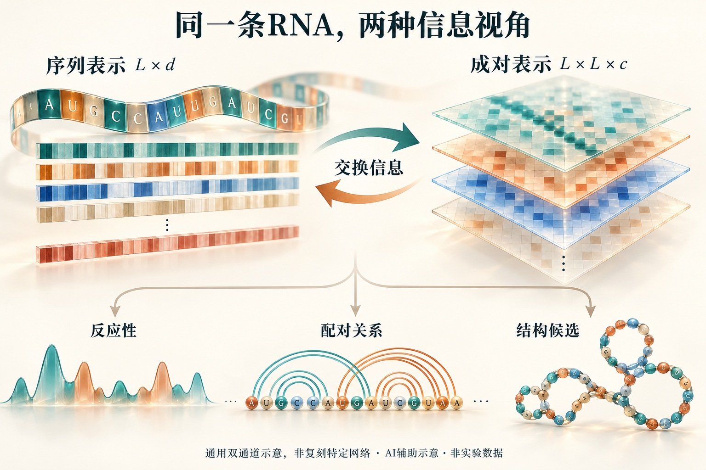
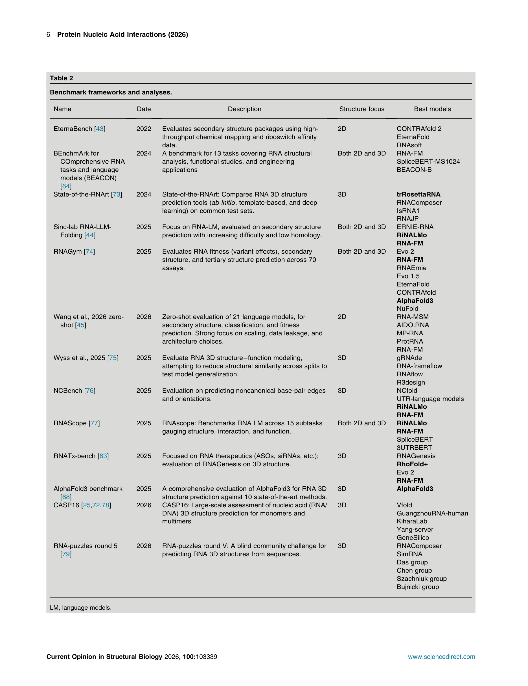
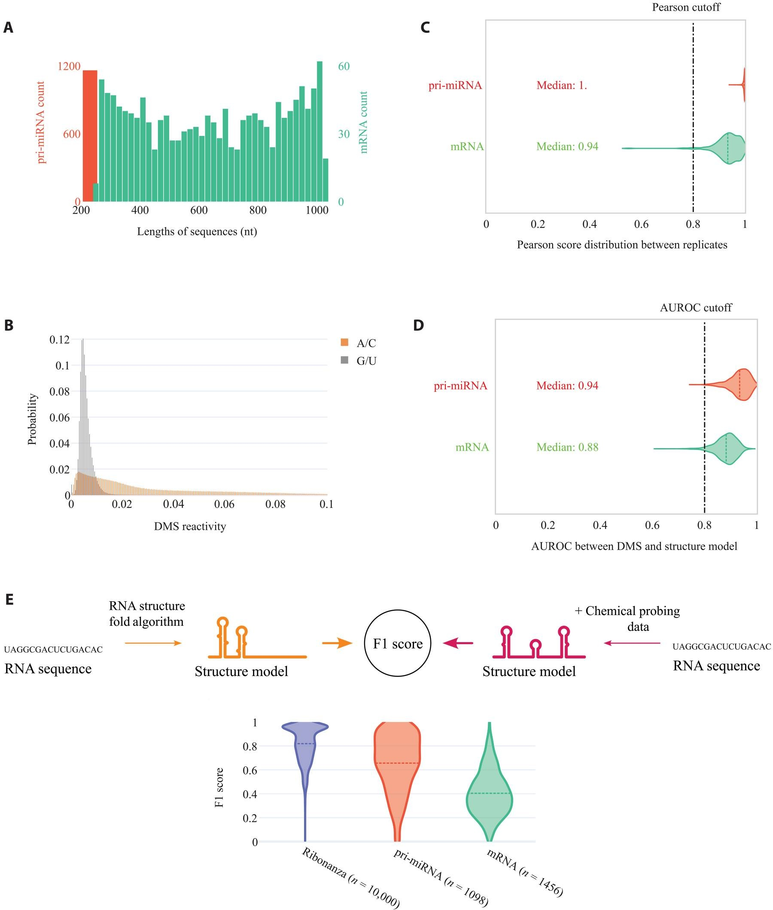
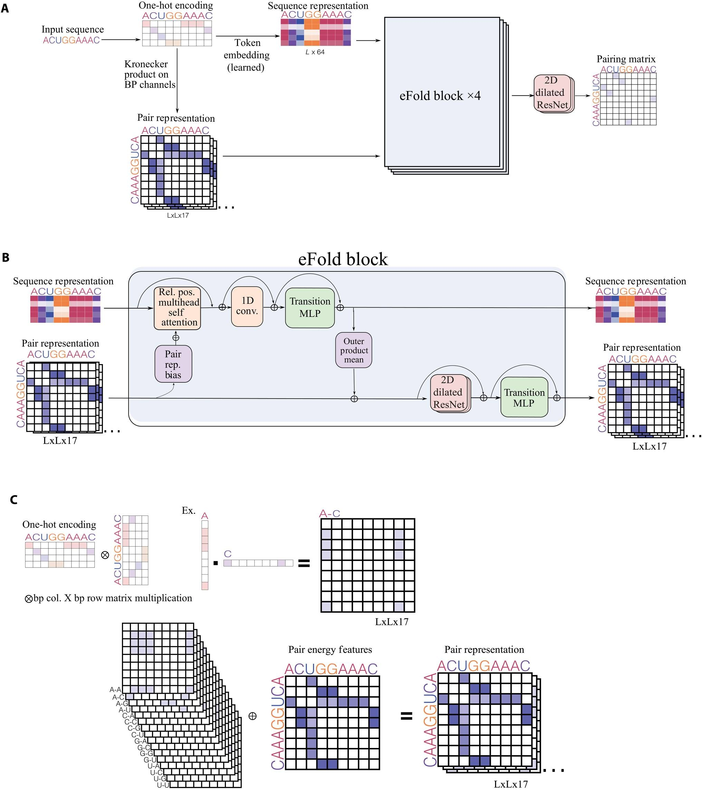

# AI会折RNA，但它学会泛化了吗

::: {.book-source}
论文：[DOI 10.1016/j.sbi.2026.103339](https://doi.org/10.1016/j.sbi.2026.103339)。原有图注和许可说明见正文；未明确许可的图版标记为**授权待确认**。
:::

Machine learning and language models for RNA structure prediction: Progress and perspectives。Current Opinion in Structural Biology；首次上线 2026-07-20。[DOI](https://doi.org/10.1016/j.sbi.2026.103339)

本笔记合并已完成并回读核验的公众号正文，末节为独立take-home messages。原图来源、许可与证据范围保留；归档不代表已经发布或经用户实质审定。

*AI辅助示意，非实验数据。*

## 先问模型见过什么

*AI辅助示意，非实验数据。*
导读图｜数据集与训练测试边界。AI辅助制作的概念插画，非实验数据或真实分子结构。

### 先问模型见过什么

把一条RNA序列输入模型，几秒后得到漂亮的茎环图或三维结构，很容易让人觉得RNA折叠已经进入“输入序列、输出答案”的阶段。真正棘手的问题随即出现：换成一个训练时没见过的RNA家族，或者一段更长的mRNA，它还能可靠吗？如果不能，原来的高分究竟证明了什么？

Lambert Moyon与Annalisa Marsico在Current Opinion in Structural Biology发表的这篇正式综述，把数据集、模型、评测和细胞环境放进同一条论证链。论文2026年7月20日首发，DOI为10.1016/j.sbi.2026.103339。本组解读共四篇：先审训练与测试数据，再看模型和基准，接着回查化学探针与生成模型的证据，最后单列可带走的检查清单。

这是一篇方法地图型综述，没有提出新的折叠算法，也没有在统一计算条件下重跑所有工具。它的价值在于提醒读者：模型结构图只解释了一部分性能，另一部分藏在输入、标签和划分方式里。正文两张核心表分别整理数据集与benchmark。读懂它们，比记住一串模型缩写更实用。[1]

### 二级结构和三维结构分别在问什么

RNA的一级结构是A、C、G、U组成的序列。二级结构通常描述哪些位置配对，可以表示为茎环图、点括号字符串或配对矩阵；三维结构则要给出原子在空间里的位置。一个配对关系正确的茎，仍可能以错误角度连接到另一个茎，因此二级结构表现好，不能直接替代三维折叠证据。

对生物学问题来说，还要继续追问目标是什么。想判断一段UTR是否可能形成稳定局部茎环，和想解析小分子结合口袋，需要的分辨率、非经典配对信息和实验支持不同。原子级功能位点可能只占整个RNA很小一部分，全局形状接近也可能掩盖局部错误。这是读所有结构预测论文之前应先写清的任务边界。

本综述更进一步：RNA不总是一个序列对应一个固定形状。相同序列能在不同构象之间转换，蛋白结合、化学修饰、离子环境与转录过程都会影响其结构分布。所以这里的“正确”，通常隐含了一个实验条件、一个观测尺度，以及一种被当作参照的结构表示。把这些条件拿掉，单看模型分数就容易误读。

### 读Table 1先看五列

Table 1位于原PDF第3至4页。第一列是资源名，第二列是综述列出的年份，第三列解释数据内容，第四列举使用这些数据训练或测试的方法，最后一列区分结构、序列与化学探针等数据类型。灰色底纹用于排版，粗体工具名没有统一性能含义；这张表没有横纵坐标，也不存在“越靠右越好”的排序。

*原文Table 1，第1页：RNA结构预测数据资源。来源：Moyon & Marsico, 2026, DOI:10.1016/j.sbi.2026.103339；CC BY 4.0（https://creativecommons.org/licenses/by/4.0/）。原PDF第3页原样渲染，全部关键列与文字保持不变；点击放大阅读。*

读表的建议顺序是：先确定最后一列的测量对象，再查第三列的规模和来源，最后回看方法如何使用它。RNAcentral的海量序列、PDB来源的三维结构、DMS化学反应性曲线，提供的信息并不等价。一个数字很大的数据集，可能没有直接的结构标签；一个数量较小的数据集，可能在你关心的结构类型上更有价值。

表中RNAcentral在2026年的条目为约4500万条序列、汇集54个数据库；Rfam条目强调家族、序列比对与协方差模型。这类资源为预训练提供广泛的序列背景，但“序列被收录”不等于“每条序列都有独立实验解析的结构”。当论文用预训练规模作为优势时，应把样本量和结构监督量分开记。

### 数据大不大和数据多不多样是两件事

传统二级结构集合中，ArchiveII列出3975条序列与结构、覆盖10类家族，bpRNA-1m列出102318个条目。这样的资源推动了深度学习发展，但这些数量首先是特定版本的条目数。重复程度、家族构成、长度分布、标签生成方式仍需查看，不能把十万条样本理解成十万种独立的折叠机制。

尤其需要留意长RNA。综述指出，很多面向结构的数据集以rRNA、tRNA、核酶、核糖开关等较稳定结构的非编码RNA为主；长序列又常由rRNA占据。数据里有很多长rRNA，不自动意味着模型已经熟悉长lncRNA或mRNA。长度相近只满足一个维度，序列背景、结构复杂性和结合环境仍可能差异很大。

可以设想一个仅用于理解的例子：训练集有一万条来自几个常见家族的RNA，另一个集合只有一千条，却补进了过去缺席的长RNA类型。前者提供重复模式的密集采样，后者可能更能暴露泛化缺口。实际效果必须实验比较，例子本身不证明小数据一定更好；它说明应报告有效多样性，而不能只比较行数。

### 同源信息如何悄悄进入测试集

最容易识别的泄漏是同一条序列同时进入训练集和测试集。更隐蔽的情况是，两边没有完全相同的序列，却来自高度相近的家族，保留了类似的配对模式。此时模型可能成功识别熟悉的结构模板，但面对新家族时就明显退步。测试结果仍有意义，只是它回答的是家族内泛化，而非未知结构空间的泛化。

这种问题不能仅靠随机抽样解决。把数据库打乱后按比例分成训练、验证和测试集，可能把同一家族的近亲分散到三个集合。降低序列一致性阈值有帮助，但结构相似的RNA可能已经在序列上产生较大变化。要评估跨家族能力，还需要家族分组、结构相似性检查，以及适合研究问题的独立外部集合。

*教学图A｜随机按序列拆分与按家族／同源组件分组。假设教学示意；序列、结构和曲线只用于说明概念，不是实验数据或具体模型架构。按组拆分仍需检查预训练语料、检测阈值与数据版本。*

Table 1中的bpRNA-new与bpRNA-NF-15.0可以理解为把评测向未见数据推进的尝试。综述分别列出5430条与8788条低相似性序列；它们相对特定旧集合构建，用来减少以往训练资源的重叠。使用时应保留版本号和原始筛选定义。“new”是相对于某个数据版本而言，过一段时间后，它也可能被新的模型纳入训练。

RNAsolo和RNA3DB则面向PDB来源的结构资源。前者对结构条目清理并组织冗余关系，后者通过与家族或结构同源性相关的连通分组来组织划分。综述列出的RNA3DB某次更新有2199条序列、142个component。这个例子说明，训练测试分离的单位可以是关联的一组RNA，而非单条序列。

这里需要把综述中的强表述收紧：这样的设计有助于减少被检测到的序列与结构同源重叠，并不构成对一切信息泄漏的绝对保证。结果仍依赖数据库版本、检测工具、阈值与注释覆盖率；基础模型的预训练语料也可能包含相关序列。对于拿来即用的模型，最好明确“已核查的重叠范围”和“无法完整核查的部分”。

### 把验证集和测试集的职责分开

验证集用于选择超参数、决策阈值、模型层或checkpoint；测试集用于最后评估。在测试集上反复挑选最好结果，会让测试集逐渐承担验证集功能。即便从未把测试标签用于梯度训练，只要不断按测试成绩修改方法，最后的成绩也可能偏乐观。这种选择偏差同样属于评测设计要处理的问题。

真实应用需要的划分方式也不同。准备在同一类RNA上提高预测精度，可以关注家族内测试；准备发现陌生家族的折叠规律，就需要更严格的家族外测试；准备处理长转录本，还应分长度报告结果。把这几种设置并列呈现，能让读者看到模型在哪些边界内可靠，而不是只拿一项最好的平均分代替全部能力。

在后续精读的Wang等人2026年benchmark中，作者使用40个PDB结构组成验证集、70个组成测试集，再得到15个结构的严格家族分离测试子集。这个例子很适合说明验证强度与规模的权衡：更严格的测试能回答更难的问题，但样本也更少，结论应受到不确定性和覆盖范围约束。我们会在下一篇展开。[2]

### 化学探针数据让标签问题更具体

Table 1后半部分加入RMDB、RASP、Ribonanza和RNAndria。这些数据把视线从“已给定的折叠图”拉回实验测量。化学探针通常提供核苷酸可及性或柔性的线索，研究者再用这些信号约束结构模型。原始反应性、由反应性推得的配对图、最终三维坐标，应被作为不同层级的信息记录。

*原文Table 1，第2页续表。来源：Moyon & Marsico, 2026, DOI:10.1016/j.sbi.2026.103339；CC BY 4.0（https://creativecommons.org/licenses/by/4.0/）。原PDF第4页原样渲染，全部关键列与文字保持不变；条目对应资源版本，不是统一结构真值；点击放大阅读。*

以Ribonanza为例，综述表中列出806573条用于相关挑战的合成序列及其DMS和2A3探针数据，而对应研究更大的整体采集项目涉及约两百万条序列。这两个数字指向不同的数据范围，不能在解读中互相替换。准确的提问方式是：哪一个子集、哪一种测量、哪一版划分，被用于哪一个模型的训练或测试？[1,3]

RNAndria条目则列出1456个人类mRNA区域和1098个pri-miRNA结构，补充传统资源中相对不足的类型。“人类来源”描述序列来源，“体内测量”描述实验条件，两者必须分开。回查被综述引用的原始研究后可以看到，这批主体库经过体外转录与探针测量；具体核查以及为何重要，第三篇会结合原图说明。[4]

### 再分清结构任务与功能任务

Table 1同时收录GARNET与NABench，正好说明“RNA数据集”并非都是折叠答案库。前者把RNA相关信息与生物环境温度联系起来，后者整理大量突变或活性测定。它们能帮助研究序列、结构与功能之间的联系，但不能因为出现在结构综述里，就把其中所有标签都称为三维结构真值。

平均成绩还会受到样本权重影响。假如某个常见家族占了大部分测试条目，它的表现就可能主导总体均值。按序列平均、按家族先平均再汇总、按核苷酸或配对数量汇总，会给长短RNA与大大小小的家族不同权重。比较时需要看分数怎样汇总，必要时同时报告家族分层和长度分层的分布。

另一个细节是标签本身也可能随版本更新。数据库修订结构、修改注释或改变去冗余方法后，名称相同的集合未必完全相同。能复现的记录应保留版本、原始条目身份和处理规则。只给一个数据库首页链接，往往不足以让后来者恢复当时的训练测试边界，更不足以解释新旧成绩的变化。

对生信入门读者，一个实用做法是给数据流画上不同名称：原始序列、实验读数、结构标签、预测结果。每次加工都记录用了什么规则。如果标签本来由某个折叠算法推得，新模型接近这些标签，首先证明它能拟合这个参照体系；是否更接近生物实际，还要通过相对独立的测量检验。这不否定推断标签的价值，而是把其证据位置写准确。

### 数据集清单应该怎样变成研究设计

若你准备测试一个新模型，建议给每个数据源补充四类记录：版本与下载时间；序列、结构和家族去冗余方式；标签是实验直接解析、比较推断还是探针约束模型；RNA类型、长度和测量条件。这些信息共同决定了分数可解释到哪里，远比只在方法部分写“使用公开benchmark”有价值。

再把每条性能结论写成一句完整的话，例如“在某版本、某划分、某长度范围、某参照标签和指标下，方法A优于指定基线”。这种写法看起来不够简洁，却能阻止很多误会。只有当数据、任务和比较条件足够接近时，不同论文的数字才具有直接比较价值；否则它们更适合作为各自证据链的一部分。

读完Table 1，真正需要记住的不是所有数据库名字，而是一种顺序：先问模型见过什么，再问测试到底新在哪里，最后才看分数。下一篇沿着这条顺序，进入热力学方法、RNA语言模型、二级与三级结构预测，以及Table 2里那些不能直接合并的“最好模型”。

### 本节来源与核查依据

- [1] Moyon L, Marsico A. Machine learning and language models for RNA structure prediction: Progress and perspectives. Current Opinion in Structural Biology. 2026;100:103339. https://doi.org/10.1016/j.sbi.2026.103339。11页出版PDF全文已读：https://push-zb.helmholtz-munich.de/deliver.php?id=45961
- [2] Wang H, et al. Zero-shot benchmarking of RNA language models in structural, functional, and evolutionary learning. Briefings in Bioinformatics. 2026;27:bbag098. https://doi.org/10.1093/bib/bbag098。正式全文已回查；未重跑代码或核完全部补充材料。
- [3] He S, et al. Ribonanza: deep learning of RNA structure through dual crowdsourcing. bioRxiv. https://doi.org/10.1101/2024.02.24.581671。本文回查综述所引预印本的公开全文版本：https://pmc.ncbi.nlm.nih.gov/articles/PMC10925082/；不将预印本冒称正式同行评审结果。
- [4] de Lajarte AA, et al. Diverse database and machine learning model to narrow the generalization gap in RNA structure prediction. Science Advances. 2026. https://doi.org/10.1126/sciadv.adz4967。正式主文、Methods、主图及其图注已回查：https://pmc.ncbi.nlm.nih.gov/articles/PMC12935039/；未重跑代码或核完补充材料。

## 模型路线不同，比较条件也要跟着变

*AI辅助示意，非实验数据。*
导读图｜模型路线与评测条件。AI辅助制作的概念插画，非实验数据或真实分子结构。

### 模型路线不同，比较条件也要跟着变

上一篇用Table 1回答“模型见过什么”。这一篇继续追问：它学的究竟是什么，预测时额外拿到了什么信息，最后又靠什么标准被认为更好？同样写着RNA结构预测，输入可能只有单条序列，也可能包含多序列比对、化学探针、已有结构模板或人工筛选。这些差异不能被一个共同的任务名称抹平。

Moyon与Marsico这篇综述把方法演进串成一条线：热力学和比较方法积累了明确的生物物理约束；监督学习从结构或探针标签中学习；RNA语言模型扩大了序列表示学习的规模；几何网络与生成模型再把表示接入不同结构任务。实际方法常混合这些思路，因此“传统”和“AI”并非互斥的两个箱子。[1]

### 热力学方法提供了什么

热力学折叠通常以一套能量参数评价候选配对与局部结构，再通过算法搜索合适的结构。它的优势是把物理先验直接写入计算，不必从有限标签中重新学习所有规则。但它所能处理的相互作用、参数来源、对假结的支持，以及对细胞条件的近似，都会影响结果。找到给定模型下的低能结构，也不等于证明细胞里只存在这一种形状。

比较方法则利用进化信息。若序列发生变化，仍保留互补配对关系，协变模式可能提供结构约束。多序列比对越可靠、同源样本越有信息量，模型越可能从中受益；但稀有家族、人工设计序列或难以找到同源序列的RNA，可能无法获得同等质量的信息。因此，“使用MSA”和“MSA-free”方法的比较，同时也是输入信息条件的比较。

早期机器学习把特征与参数从人工规定逐步推向数据学习。综述列举CONTRAfold、ContextFold、CROSS等发展节点，其中CROSS把实验探针和解析结构用于学习局部结构倾向。关键变化在于模型开始直接学习经验数据里的规律，但对训练家族过拟合、面对新家族泛化不佳，以及训练标签偏倚和不同实验条件混合的问题也随之进入评测视野。

### 语言模型先学表示，再接结构任务

RNA语言模型可以把序列拆成token，通过预测被遮盖的核苷酸等任务进行预训练。模型不断利用上下文恢复局部信息，最终得到每个位置的向量表示。若训练语料中的序列演化受到配对和功能约束，这些表示可能包含有助于结构预测的统计规律。这是一种合理且可检验的机制解释，不能仅因模型叫“语言模型”就预设它已经理解折叠物理。

这里有三个容易混淆的输出。embedding是位置或整条序列的向量表示；attention是模型计算上下文信息时使用的权重；logits是对不同token的未归一化评分。它们可以分别支持相似性比较、候选配对分析、突变似然评分，但用途必须通过评测确定。注意力较强既不天然等于碱基配对，也不天然等于生物因果关系。[2]

综述以RNA-FM说明海量非编码序列预训练，以RNA-MSM说明引入多序列比对，以RhoFold+说明把语言表示接入几何结构建模，以RiNALMo说明单序列表示的潜力。读这些例子时，最重要的是分清表示模型与完整预测管线。一个通用预训练表示需要怎样的预测头、几何模块或训练标签，才能输出最终结构，决定了它的实际能力边界。

同理，预训练数据多，并不意味着所有类型任务同时提高。能区分tRNA与另一类RNA的向量，不一定精确到足以判断某两个碱基是否配对；能预测配对，也不一定准确描述某个突变对催化活性的影响。把结构、分类、功能统称为“懂RNA”，会把本来可以分析的差异藏起来。

### 双通道为什么适合这类问题

教学示意图把一种常见设计抽象为两条通道。第一条用L×d的表示保留每个位置的上下文，L是序列长度，d是特征维度；第二条用L×L×c表示位置两两之间的关系，c是特征通道数。前者方便追踪“这个位置处在怎样的序列背景”，后者方便表达“位置i和位置j之间可能是什么关系”。

*教学图B｜一维序列表示与二维成对表示。L为序列长度，d和c为特征维度；网格和色块无实验单位。假设教学示意；序列、结构和曲线只用于说明概念，不是实验数据或具体模型架构。*

两条通道交换信息后，可以服务于反应性、配对或其他结构相关输出。图中网格的两个方向都对应RNA序列位置，色块只表示示意特征，没有实测单位，也不是某个具体核苷酸的真实配对概率。它是理解RibonanzaNet、eFold等双表示思路的入口，具体网络的输入、模块和输出仍要回到各自原始论文核对。

这种设计的代价同样值得看。序列长度增长时，两两表示的元素数量随L的平方增长，长RNA会给显存、训练批量和推理成本带来压力。能够把长序列送进程序，与在长序列上经过可靠验证，是两个需要分别报告的事实。截断、滑窗或分块可能缓解计算负担，也可能丢失跨片段联系。

### Table 2是一张路标，不能直接当总榜

原文Table 2位于PDF第6页，五列依次列出benchmark名称、年份、任务说明、结构层级与选列的“Best models”。这张表横跨二级结构、三维结构、突变效应和治疗相关任务，研究使用的样本、训练策略和指标各不相同。最右侧的名单应理解为各自评测背景下的表现线索，不能合成一个跨任务冠军排名。

*原文Table 2：benchmark框架与代表方法。来源：Moyon & Marsico, 2026, DOI:10.1016/j.sbi.2026.103339；CC BY 4.0（https://creativecommons.org/licenses/by/4.0/）。原PDF第6页原样渲染，内容未改。Best models对应各自任务与条件，不能当成统一榜单；点击放大阅读。*

第一类路标偏向二级结构和实验读数，例如EternaBench。第二类把多个RNA任务集合起来，例如BEACON和RNAScope。第三类专门检验结构、序列或家族之外的泛化，例如RNA-LLM-Folding及更严格的结构划分。第四类关注突变或功能，如RNAGym。它们覆盖的生物问题交叉，却不完全一致，名称相似也不代表题目相同。

另外一些benchmark专门把三维结构、非经典配对或盲测放在中心。Table 2列出NCBench、CASP16与RNA-Puzzles等，提醒读者别只看容易被常规二级结构指标奖励的部分。RNA活性位点与复杂折叠常涉及非经典相互作用；如果指标主要计算经典碱基对，即使拿到高分，也可能没有充分检验这些重要区域。

### 先把指标读成具体错误

在配对预测中，precision回答“预测出的配对有多少被参照支持”，recall回答“参照中的配对找回了多少”，F1兼顾两者。普通二分类的accuracy可能被大量“没有配对”的位置组合拉高，因此必须看任务的正负样本构成。MCC把混淆矩阵四种结果合在一起，但同样不能脱离参照标签、阈值和汇总方法解释。

三维结构比较又有另一套问题。RMSD衡量对齐后的空间偏差，受分子长度和对齐方式影响；TM-score类指标用于反映整体相似性，局部接触或特定非经典配对还需另外评价。同一模型可以整体接近而局部错误，也可以某个功能片段合理但全局折叠失败。因此不能用一个全局数字代替全部生物结构判断。

对化学探针反应性的预测，常关注连续值误差或相关性；对突变效应，可能关注预测分数与实验功能读数的相关。即便两项研究都报告0到1之间的数值，物理与统计含义仍可能完全不同。F1为0.8不等于AUROC为0.8，更不能写成统一的“80%准确率”。指标的名字应随结论一起保留。

### 回查Wang等人的zero-shot到底怎么做

综述特别提到Wang等人2026年的21个RNA语言模型评测。我们回查了其正式发表全文。作者分别从attention读取二级结构线索，从embedding相似性评价家族或类型区分，从token logits计算突变相关分数。三条评估路径对应不同输出，能够检验“模型有某种表示”与“这种表示适合哪项任务”的关系。[2]

这里的zero-shot有明确边界：不做下游任务的梯度微调，但二级结构任务仍在验证集上选择attention的head、layer组合和决策阈值，再固定用于测试集。原始方法还进行对称化、平均乘积校正与评分转换。把这个流程写成“完全不调任何参数、直接拿原始attention当结构”，会遗漏关键步骤。

其二级结构验证集包含40个PDB结构，测试集包含70个；进一步排除与验证集的家族重叠后，严格子集TS-Hard剩15个。作者同时设置序列与结构相似性限制。这增强了对特定重叠风险的控制，但不能据此声称测试集与全部基础模型预训练语料绝无交集，也不能把15个结构的结果无限外推到所有RNA类型。

在这个特定的attention-based结构任务中，RNA-MSM表现突出，提示多序列比对携带的进化信息有价值。解释时需要保留这个输入差异：它与仅输入单序列的方法获得的信息不同，所以结果不能简单归因于“网络架构更先进”。MSA质量、同源覆盖、语料构成与模型目标都可能共同影响成绩。

更有启发的是任务之间出现分化。原始研究报告，结构表现、embedding分类表现与突变效应预测并不总一致；扩大模型也未在所有任务中带来单调收益。其选择的突变测定集合上，零样本功能预测的绝对效果仍有限。这里不能把家族分类成功写成药物设计成功，也不能把某一任务落后泛化成整个模型没有价值。

一个阅读细节也应记住：DMS在这些文献里有两种常见含义。结构探针语境通常指化学试剂dimethyl sulfate；突变效应benchmark里也可能指deep mutational scanning，即深度突变扫描。前者测化学反应相关信号，后者通过大量变体测功能后果。仅凭缩写相同，不能把两类实验和其标签混为一谈。

### 怎样读“超越AlphaFold3”之类的句子

任何“超过某著名模型”的表述，都应该紧接测试集、任务、输入和指标。是在已知模板丰富的结构上比较，还是盲测新结构？输入是否相同？是否做过专门微调？比较的是局部配对、全局三维形状，还是功能位点？缺少这些信息时，跨论文的强弱判断容易把问题难度差异误读为技术进步。

综述结合CASP16讨论的困难包括非经典相互作用、假结与稳定三维折叠所需的长程联系。相关原始评估的摘要与公开结论也强调复杂新目标仍具挑战、模板可得性仍有明显影响。本文没有复核CASP16全部原始预测和补充表，因此只把它作为综述结论的限定支持，不据此宣布某一方法全面胜出。[1,5]

### 更公平的实验可以怎样安排

若你要开展方法比较，建议先规定一组输入信息一致的基线，再把增加MSA、加入探针或引入模板作为单独条件。每种条件下固定训练测试划分、使用相同参照标签，分RNA类型和长度报告结果，并给出失败案例。这样能看清提升来自额外信息、架构变化，还是两者结合，而不是只得到一个最终最好的数字。

最后，把模型评价和实际使用连接起来：你关心的是局部茎环、完整三维折叠、细胞内状态还是变体功能？你的序列是否超出已测长度和家族？预测失败会造成怎样的实验误导？下一篇将从这些问题进入化学探针与eFold的原始证据，并说明为什么一张可靠的“实验约束结构图”，依然需要保留推断过程和环境边界。

### 本节来源与核查依据

- [1] Moyon L, Marsico A. Machine learning and language models for RNA structure prediction: Progress and perspectives. Current Opinion in Structural Biology. 2026;100:103339. https://doi.org/10.1016/j.sbi.2026.103339。11页出版PDF全文已读：https://push-zb.helmholtz-munich.de/deliver.php?id=45961
- [2] Wang H, et al. Zero-shot benchmarking of RNA language models in structural, functional, and evolutionary learning. Briefings in Bioinformatics. 2026;27:bbag098. https://doi.org/10.1093/bib/bbag098。正式全文已回查；未重跑代码或核完全部补充材料。
- [5] Kretsch RC, et al. Assessment of Nucleic Acid Structure Prediction in CASP16. Proteins. 2026;94:192–217. https://doi.org/10.1002/prot.70072。本文仅回查摘要及公开结论段，未完整复核全部图表与原始模型。

## 从折出一张图走向理解实验条件

*AI辅助示意，非实验数据。*
导读图｜化学探针与条件化结构。AI辅助制作的概念插画，非实验数据或真实分子结构。

### 从折出一张图走向理解实验条件

前两篇讨论数据来源、泛化和公平比较。本篇进入综述后半部分：化学探针能给模型增加什么信息，细胞环境为何重要，生成模型输出多个结构又该怎样解释。这里最值得慢读的地方，是实验信号经过哪些步骤才变成模型标签，以及这些步骤会留下什么不确定性。[1]

为避免把综述里的简短概括直接当成原始事实，我们进一步回查了其引用的eFold／RNAndria正式研究全文，以及Ribonanza所引预印本版本。下面两张eFold原图均来自被综述引用的研究，具有独立的论文出处；它们不是综述新增的实验，也不能据此把所有模型的结论混在一起。[3,4]

### 化学探针测到的是什么

DMS和SHAPE都能提供结构相关信息，但作用位点和化学机制不同。典型DMS-MaPseq利用可反应碱基上的化学修饰，在逆转录和测序中形成可统计的信号；SHAPE主要反映核糖骨架相关的局部柔性。反应性高低可以帮助判断可及性与约束状态，但依赖试剂、实验条件、覆盖度和数据处理。

因此，“高反应性倾向于支持未配对或较开放状态”适合作为入门理解，却不能当成任何条件下的硬规则。低反应性也可能与蛋白保护、局部环境或测量不足有关。把某个位点涂成低值，并不直接告诉你它究竟和哪一个远处碱基配对；从一维反应性到二维配对关系，仍需要结构模型和其他约束。

这也是为什么RNAstructure或ViennaRNA等工具会把探针信息作为附加约束或伪能量项。它们将实验读数与已有能量模型结合，寻找更符合数据的结构。最终的茎环图是实验支持下的推断结果，既继承测量信息，也继承算法先验。训练一个新模型去拟合这样的标签，需要同时理解这两层来源。

### 先纠正RNAndria实验条件的概括

综述第7页将RNAndria概括为“in vivo chemical probing data”。回查原始研究Methods后，需要做一个重要限定：其主体人类mRNA和pri-miRNA库明确经过体外转录、体外折叠和DMS处理；文中另有挑选96个人类mRNA片段用于HEK293T细胞验证的设计。因此，不能把整个主体数据库写成直接在细胞内测得的结构集合。

这个区别会实质改变结论。人源序列带来生物来源上的相关性，体外测量提供规定条件下的折叠信息；若要声称预测了细胞内构象，还需要面对蛋白结合、分子拥挤、主动重塑与共转录折叠等因素。本文据原始Methods采用更窄的表述：RNAndria扩展了重要RNA类型的探针约束结构数据，但不代表所有细胞环境已经被覆盖。[4]

### 逐面板读eFold原始Figure 2

原始Figure 2A展示序列长度分布，横轴单位为核苷酸nt。红色对应pri-miRNA，青绿色对应mRNA；两组使用不同纵轴刻度，分别从左、右读取计数。相同柱高不能被直接解释为两组样本数相同。该图首先支持“数据覆盖了不同长度的人类RNA区域”，并未直接给出结构预测性能。

*被综述引用的原始研究Figure 2：RNAndria数据质量与复杂性。来源：de Lajarte et al., Science Advances, 2026, DOI:10.1126/sciadv.adz4967；CC BY 4.0（https://creativecommons.org/licenses/by/4.0/）。原图完整复用，仅技术性JPEG编码，未更改内容。A为长度与计数，B为DMS反应性，C为重复相关，D为信号—模型AUROC，E比较有无探针约束所得模型；不将其统称准确率。*

2B比较未归一化DMS反应性分布：横轴是反应性，纵轴是概率分布，橙色为A/C，灰色为G/U。图中较低的G/U信号可帮助理解该实验条件下的化学选择性与背景。这里的反应性不是Å或能量单位，也不是已经校准好的配对概率；从读数到结构约束还要经过覆盖过滤和归一化等处理。

2C展示重复实验之间的Pearson相关系数分布，横轴越靠近1，重复间线性一致性越强；虚线0.8是筛选界限。它检验的是信号重复性，不是预测结构与真实结构的一致性。图上红色pri-miRNA中位数接近1、绿色mRNA中位数约0.94，正文另报告均值；均值和中位数不应混写成同一个数字。

2D的横轴换成DMS信号与结构模型之间的AUROC，虚线同样位于0.8。作者用它筛除与测量不协调的结构模型。这里比较的是可及性信号和模型里的配对状态，而非将模型与独立原子解析结构逐一比对。即使AUROC很高，也可能有多种不同配对方案与同一组反应性相容。

2E尤其容易被误读。上半部显示同一序列两条路线：左侧仅由序列折叠，右侧加入化学探针约束，再比较两张结构模型的F1。下半部蓝、红、绿依次为Ribonanza、pri-miRNA与mRNA集合。图中Ribonanza的n=10000仅指该面板的比较子集，不能与挑战的806573条或整体约两百万条混用。较低F1说明加入探针前后配对关系差异更大；它不能被直接写成“模型只达到了某百分比真实准确率”。

这一组面板共同构成数据质量论证：长度分布说明覆盖范围，碱基反应性说明测量特征，重复相关说明可复现性，AUROC说明数据与结构模型的一致程度，最后的F1说明实验约束能多大程度改变纯序列推断。没有哪一个面板能单独把推断标签升级为唯一的真实构象，也没有这里直接完成治疗效果验证。

### 数据筛选带来了什么，又舍弃了什么

原始研究保留了1456个mRNA区域和1098个pri-miRNA结构。覆盖深度、重复性与信号—模型一致性过滤，有助于提高训练标签的可靠程度；但严格筛选也偏向能被单一主要构象较好描述的样本。原始Discussion明确说明，作者当时没有把替代构象、非经典配对和假结作为主要优化目标。

因此，数据集的质量和代表性需要同时看。排掉不稳定或多构象样本，可能让监督学习更容易，却也减少了模型直接学习动态变化的机会。这个取舍本身并非错误，关键是把它写清楚：一个为较清晰结构标签优化的模型，能否应对复杂构象集合，需要另做实验，而不能从整洁的训练标签推导出来。

### 逐面板读eFold原始Figure 4

4A从左到右展示输入序列、两种表示、四个eFold block，以及最终配对矩阵。序列先变成one-hot编码，再得到L×64的位置表示；另一支构造L×L×17的两两特征。L是序列长度，64和17是特征维度，均不是生物测量单位。最终输出服务于二级结构配对，不是直接输出一套RNA原子三维坐标。

*被综述引用的原始研究Figure 4：eFold具体网络。来源：de Lajarte et al., Science Advances, 2026, DOI:10.1126/sciadv.adz4967；CC BY 4.0（https://creativecommons.org/licenses/by/4.0/）。原图完整复用，仅技术性JPEG编码，未更改内容。L×64与L×L×17是特征维度，输出为二级结构配对矩阵；箭头和颜色表示计算流程，不是分子因果实测。*

4B展开一个block：上方处理序列表示，包含相对位置多头自注意力、卷积和变换模块；下方处理成对表示，包含二维膨胀ResNet等模块。连接两条通道的箭头表示信息交换，成对表示会向序列注意力提供偏置，序列特征也会回传成对信息。图中加号用于计算组合，不表示实验中的分子结合或因果调控。

4C解释17个成对通道的来源：四种碱基两两组合产生16类编码，再加入一个配对能量相关特征通道。网格的两个方向都对应序列位置，颜色用于表现不同编码与特征，不应照图把深色方格读成“实验已证实配对”。只有经过网络与后处理，输出才被用于形成最终的配对预测。

Methods还写到，模型使用配对矩阵作为监督目标，并对输出施加如单个核苷酸只能与另一个核苷酸配对、避免不合理过短环等约束。这说明“端到端”不意味着不需要任何生物结构规则。图形看起来与AlphaFold有亲缘关系，也不等于获得了AlphaFold在另一个分子问题上的全部能力。

原始研究的消融比较保留同样数据与训练流程，移除自注意力或移除成对卷积／信息交换后，表现下降，支持两类模块在该设置下都有贡献。但移除模块也改变参数量，不能把结果解释为已把容量因素彻底排除。对于架构创新，消融能提供局部因果线索，仍需留意它是否真正只改变了一个因素。

### Ribonanza提示的是另一种数据建设路径

综述引用的Ribonanza工作把大规模RNA设计与实验测量，以及Kaggle模型竞赛结合起来。其公开版本描述部分私人测试序列在竞赛开始后才合成与测量，并故意改变长度分布，使模型面对更贴近前瞻性的检验。这样的设计能降低直接按公开测试标签优化的风险，但仍需审查同源关系、结构分布和外部训练数据。[3]

RibonanzaNet将一维序列信息与二维两两关系共同建模，说明探针预测本身可以成为学习结构相关表示的任务。但这批大规模测量主要来自体外体系和多样设计序列，不能仅凭测试表现就声称掌握细胞内结构变化。把实验规模做大、把数据分布做新、把条件变得生理相关，是可以相互促进、却不能互相替代的三种进步。

### 多模态输入必须回答条件是否匹配

综述提出，修饰、RNA结合蛋白、解旋酶与外源小分子可能改变结构集合，未来模型应纳入这些信号。可操作的问题是：信号来自同一细胞类型、同一条件和相近时间吗？缺失修饰标签究竟表示“没有修饰”，还是“没有测到”？如果把不匹配的数据拼接起来，模型可能学习数据来源差异，而不是RNA结构变化。

这里也应保留证据强度。多模态输入提高预测准确度，支持它携带与任务有关的信息；要证明某个蛋白或修饰导致了特定折叠变化，通常还需干预、适当对照和独立结构验证。预测任务、机制推断和治疗设计互相连接，但需要不同层次的证据，不能用一个多模态模型分数完成全部论证。

### 生成多个结构以后，仍然有两种解释

生成模型能够输出多个候选结构，形式上比单一答案更接近RNA的构象多样性。然而输出的差异至少可能来自两类来源：真实生物体系存在多个状态，或模型因知识不足而拿不准。还有采样噪声与约束不足产生的候选。只有输出多个“看起来合理”的结构，尚不足以区分这些来源。

*教学图C｜同一序列的候选结构可以来自真实构象异质性或模型不确定性，需独立实验区分。假设教学示意；序列、结构和曲线只用于说明概念，不是实验数据或具体模型架构。图中动态平衡是简化例子，细胞内过程也可能处于非平衡条件。*

因此，生成候选的频率也不能未经校准就当成真实构象占比，更不能从图片数量推断转换速率或自由能。需要用独立探针、单分子测量或其他实验，对候选的可达性、条件依赖和相对支持度做验证。综述把不确定性感知与环境条件化列为未来方向，这些属于值得检验的研究机会，不能写成已经解决的结果。

本篇的中心是保留每一步的来路：序列来自哪里，实验在哪个条件做，标签怎样推断，网络输出什么，最后如何验证。下一篇把这些问题压缩成独立的Take-home messages。阅读一篇RNA结构AI论文时，带着这套顺序，比单纯问“它比上一代强了多少”更接近一个可以复核的科学判断。

### 本节来源与核查依据

- [1] Moyon L, Marsico A. Machine learning and language models for RNA structure prediction: Progress and perspectives. Current Opinion in Structural Biology. 2026;100:103339. https://doi.org/10.1016/j.sbi.2026.103339。11页出版PDF全文已读：https://push-zb.helmholtz-munich.de/deliver.php?id=45961
- [3] He S, et al. Ribonanza: deep learning of RNA structure through dual crowdsourcing. bioRxiv. https://doi.org/10.1101/2024.02.24.581671。本文回查综述所引预印本的公开全文版本：https://pmc.ncbi.nlm.nih.gov/articles/PMC10925082/；不将预印本冒称正式同行评审结果。
- [4] de Lajarte AA, et al. Diverse database and machine learning model to narrow the generalization gap in RNA structure prediction. Science Advances. 2026. https://doi.org/10.1126/sciadv.adz4967。正式主文、Methods、主图及其图注已回查：https://pmc.ncbi.nlm.nih.gov/articles/PMC12935039/；未重跑代码或核完补充材料。

## Take-home messages

*AI辅助示意，非实验数据。*
导读图｜从数据到验证的检查顺序。AI辅助制作的概念插画，非实验数据或真实分子结构。

### Take-home messages

RNA结构AI的进步确实值得关注，但读论文时最有用的问题是：这个模型在什么条件下，凭什么信息，预测了哪个层级的结构，又被怎样验证？Moyon与Marsico的综述提供了数据、模型和未来方向的地图；回查代表性原始研究，则让地图上的关键边界变得更清楚。[1]

### 1 先把任务写完整

二级配对、三维坐标、探针反应性、家族分类和突变功能是不同任务。选择模型前，先确定你的目标对应哪种输出、哪种尺度。如果关心活性位点或药物结合口袋，整体形状或经典配对的高分往往还不够，需要局部几何和独立功能证据。

### 2 条目数之外，更要看家族和长度

海量序列并不等于海量独立实验结构。rRNA、tRNA等家族丰富的资源，可以帮助学习稳定折叠模式，却未必充分覆盖长lncRNA、mRNA和人工设计序列。报告数据量时，同步保留版本、家族构成、长度分布和标签来源，才能解释模型见过的世界。

### 3 新测试集也有自己的边界

随机拆分、去除完全重复、降低序列相似性、按家族或结构component分组，是强度不同的措施。它们控制的风险不同，不能合并成“已经保证无泄漏”。基础模型还要检查预训练语料。私有测试集降低直接按标签优化的机会，仍需要审查同源性、外部数据与反复选择的影响。

### 4 把额外输入算进比较条件

MSA、模板、探针、已知修饰和人工筛选都可能提高表现。比较方法时应记录它们是否使用了相同信息。RNA-MSM在某些结构测试中的优势，不能脱离MSA带来的进化信息解释；单序列方法的便利性，也不能自动替代在目标RNA类型上的验证。

### 5 zero-shot要读具体操作

Wang等人的评测不进行下游梯度微调，但仍在验证集上挑选attention的head、layer和阈值，并使用特定后处理。它揭示了预训练表示里可被读取的信息，不能被简化成“完全不做任何选择”。严格家族分离子集只有15个结构，解读时也应保留样本量与覆盖范围。[2]

### 6 Table 2的Best models不是总冠军榜

不同benchmark使用不同数据、任务和指标。F1、MCC、AUROC、三维相似性与功能相关系数，回答的问题各不相同。正文两张表适合帮助你找到需要进一步核查的研究，而不适合把所有工具排成一条从弱到强的队伍。

### 7 探针支持结构，但仍保留推断步骤

化学探针反应性、由探针约束得到的二级结构、直接解析的三维坐标，是不同层级的证据。重复性高支持信号可靠；与结构模型的AUROC高支持两者协调；两者都不保证结构唯一。图中0到1的数值应保留指标名称，不能统一翻译成“准确率”。

### 8 人源序列不等于细胞内测量

回查eFold／RNAndria原始Methods可见，主体人类mRNA和pri-miRNA库采用体外转录与DMS测量；另有细胞验证设计。因此本组解读对综述“in vivo数据”的概括作了限定。序列来源、测量条件与未来使用环境，应该在记录里分成三个字段。[4]

### 9 多个生成结构还不能直接当构象占比

候选差异可能反映真实结构异质性，也可能反映模型不确定性或采样误差。生成频率未经校准，不能直接解释为细胞内占比、自由能或转换速率。真正推进机制理解的下一步，是通过条件变化与独立实验判别哪些候选被支持。

### 10 预测与机制之间留一道验证关

结构预测可以帮助排优先级、提出候选配对和设计验证方向。若要声称某个修饰、蛋白或突变导致结构与功能改变，应继续核查干预、对照、结构读数和功能读数。模型能提出有价值的问题，但每个更强结论都需要相应证据。

### 可以直接带走的论文检查顺序

第一步，记录输入和目标输出。第二步，核查训练、验证、测试的版本和划分单位。第三步，看是否比较了相同输入、相同指标与合适基线。第四步，分家族、长度和条件检查失败案例。第五步，确认标签生成过程与实验环境。最后，写清哪些结论由原始结果支持，哪些仍是解释或未来方向。

如果你正准备开展自己的分析，可以先做一个小规模、问题明确的试验：选择目标类型的公开RNA，固定两种或几种合适基线，保留全部参数和输出，再审查与实验约束不一致的位置。不要在看过测试结果后不断改变选择标准。这样的记录有助于把一次“模型跑通了”，转化成可复查的评估。

### 本组解读的阅读与复用范围

核心综述已读取11页出版PDF及Table 1、Table 2。正文提及但PDF未包含的graphical abstract未取得，因此未用于分析。进一步回查了Wang等人正式研究全文、eFold正式研究全文，以及综述所引Ribonanza预印本全文；没有运行其代码，也没有重新分析原始数据或完整补充材料。[1–4]

综述Table 1、Table 2及eFold原始Figure 2、Figure 4均按已核实的CC BY 4.0许可署名使用。教学插图与封面只用于解释概念，不是实验数据。对其他工具和CASP16等评估，本文保留综述转述或摘要／公开结论核查的范围，不把它们冒充已完成的原始研究复现。

这篇综述最值得留下的一句话是：理解RNA结构AI，要把模型、数据和实验条件放在同一张桌上讨论。一个清楚说明边界、能解释失败的结果，往往比一个脱离条件的高分，更能帮助下一步科学判断。

### 本节来源与核查依据

- [1] Moyon L, Marsico A. Machine learning and language models for RNA structure prediction: Progress and perspectives. Current Opinion in Structural Biology. 2026;100:103339. https://doi.org/10.1016/j.sbi.2026.103339。11页出版PDF全文已读：https://push-zb.helmholtz-munich.de/deliver.php?id=45961
- [2] Wang H, et al. Zero-shot benchmarking of RNA language models in structural, functional, and evolutionary learning. Briefings in Bioinformatics. 2026;27:bbag098. https://doi.org/10.1093/bib/bbag098。正式全文已回查；未重跑代码或核完全部补充材料。
- [3] He S, et al. Ribonanza: deep learning of RNA structure through dual crowdsourcing. bioRxiv. https://doi.org/10.1101/2024.02.24.581671。本文回查综述所引预印本的公开全文版本：https://pmc.ncbi.nlm.nih.gov/articles/PMC10925082/；不将预印本冒称正式同行评审结果。
- [4] de Lajarte AA, et al. Diverse database and machine learning model to narrow the generalization gap in RNA structure prediction. Science Advances. 2026. https://doi.org/10.1126/sciadv.adz4967。正式主文、Methods、主图及其图注已回查：https://pmc.ncbi.nlm.nih.gov/articles/PMC12935039/；未重跑代码或核完补充材料。
- [5] Kretsch RC, et al. Assessment of Nucleic Acid Structure Prediction in CASP16. Proteins. 2026;94:192–217. https://doi.org/10.1002/prot.70072。本文仅回查摘要及公开结论段，未完整复核全部图表与原始模型。
