# 卡塔尔人群RNA调控：证据与边界

::: {.book-source}
论文：[DOI 10.1038/s41588-026-02785-7](https://doi.org/10.1038/s41588-026-02785-7)。原有图注和许可说明见正文；未明确许可的图版标记为**授权待确认**。
:::

AI辅助原创示意，非实验数据。

## 一、研究设计与多层RNA调控

同一个遗传变异，在常用数据库里找不到表达关联，能不能说它“不影响基因”？如果一个人携带两份相同的变异，能不能把在普通人群里测到的平均效应直接翻倍？这提醒我们：参考数据来自谁，决定了哪些现象容易被看见，也决定了哪些结论不能直接搬到另一个人身上。

2026年11月2日，Nature Genetics发表了一项卡塔尔生物样本库研究，把全基因组测序、全血RNA测序和临床相关性状放到同一研究框架中。它把人群代表性、长段纯合区域和多层RNA调控连起来考察。对做RNA组学的人，这提供了一个具体问题：当数据库里的“没有证据”可能只是“没有合适样本”，我们该怎样设计分析，又该怎样写结论？

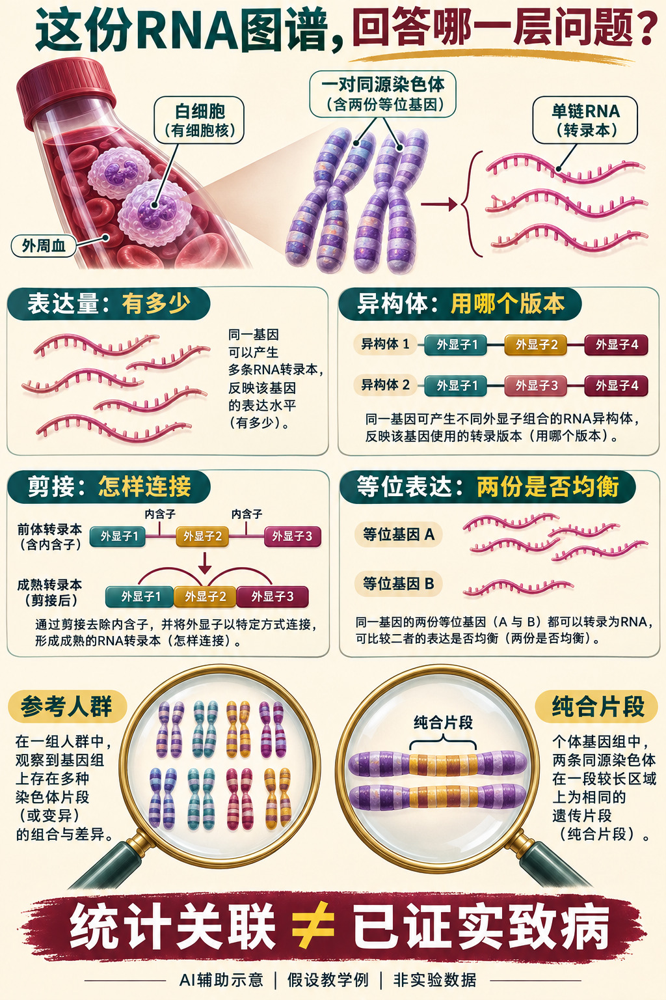

**图示说明：**AI辅助原创教学示意，非实验数据。画中的RNA数量和外显子组合是假设例子，不能读成该研究的测量结果。下方配对染色体用来帮助理解连续纯合区域；图形相似并不单独证明片段来自同一祖先，实际识别需要基因型和统计模型。

### 1. 为什么换一个参考人群，会改变我们看见的关联？

先把QTL翻译成一个日常研究问题：在一组人中，某个遗传位置的不同基因型，是否对应某项可测量性状的系统差异？性状可以是血液中的某个基因表达量，也可以是一个剪接连接的使用比例。这里的“系统差异”是统计关联，不自动包含“已经知道分子机制”的意思。

发现关联至少需要三件事同时发生：变异在样本中出现；有足够的携带者可供比较；相关RNA性状被可靠测到。假设某个等位基因在参考队列中非常少见，即使它确实影响表达，也可能没有足够信息把效应与噪声区分开。换到频率较高的人群后发现关联，不一定表示生物学规则突然改变，也可能只是原来没有足够统计功效。

另一个因素是连锁不平衡，通常写作LD。邻近变异可能因为共同遗传而经常同时出现。关联分析最先看到的“显著位置”，有时只是跟着真正作用位置一起被遗传的标记。不同人群的历史可能改变这些共同出现的组合，因此同一套关联信号在不同参考数据里，未必具有完全相同的定位分辨率。

人群划分不是固定的生物学盒子。研究使用的祖源标签是帮助描述样本遗传结构的分析工具；同一标签内部仍有差异，人群之间也有连续变化和混合。我们关心的是抽样和模型是否适合问题，不是把群体平均值套到某一个人身上。

### 2. 这1,882份RNA来自什么样的研究？

研究使用Qatar Biobank与Qatar Genome Program的数据。较大的基因组与性状研究框架包含6,218人；其中最终保留1,882份高质量全血RNA样本。参与者主要是成年、相对健康的卡塔尔本地居民，不是某种疾病的病例队列。临床相关性状的GWAS也来自这套较大队列，并且包含RNA参与者。因此，后续RNA与性状信号的整合不能被描述成两个完全独立人群的重复验证。

“全血”同样是重要限定。它容易采集，适合大规模研究，对血液和免疫相关过程尤其有信息；但血中测不到某个组织特有的调控，不代表其他器官没有作用。全血还是多种细胞的混合物。如果细胞比例不同，某个基因总RNA的变化可能既包含细胞内调控，也包含细胞组成改变。协变量可以减少混杂，却不能把bulk RNA自动变成单细胞实验。

研究做了多个层面的质量控制。RNA样本先检查完整性，并进行globin转录本去除，以减少高丰度血红蛋白相关RNA占用测序信息。测序读段经过接头、核糖体RNA和其他异常序列筛查。作者还用RNA中的遗传信息与WGS基因型匹配，排查错配和污染；这一步比只看每个样本的测序量更直接地触及“这两份数据是否真的来自同一个人”。

但不要把最终样本数当作每项分析的统一分母。基因需要达到表达阈值；等位表达需要相应位置杂合且有足够读段；表达异常分析还使用自己的过滤条件。1,882是主要RNA队列规模，不意味着每个变异、每项RNA性状都在1,882个人中同样可测。

这一设计还有几个容易被方法名遮住的取舍。基因组变异经过缺失率、次要等位基因频率和Hardy–Weinberg平衡等筛选，其中次要等位基因频率要求高于1%。因此它主要服务于人群中有足够观测的调控研究；不能因某个罕见变异不在目录，就说它没有作用。筛选条件既提高可靠性，也划定发现范围。

RNA表达分析还用到PEER因子。可以把它理解为从大量表达数据中提取共同变化，用来吸收尚未逐项测量的影响。作者先在抽取的基因上比较不同因子数对应的发现量，再选择45个PEER因子，并考察年龄、血细胞、批次和遗传主成分等变量之间的相关性。这个步骤说明发现数量与协变量设定相互关联：控制太少可能残留混杂，控制太多也可能把有兴趣的共同生物学变化一并去掉。因子数不是换一个项目仍可直接照抄的“最佳参数”。

对于有家系相关性的人群，另一个需要核验的环节是样本间并非完全独立。祖源主成分主要描述群体结构，和显式建模亲缘关系不是同一件事。我们在公开方法中没有找到足够清晰的说明，能确认每一个QTL检验如何处理亲缘协方差，所以这里不声称此问题已经被彻底解决，也不武断断言作者完全没有处理。若要把这一流程迁移到自己的家系或高亲缘队列，应把亲缘矩阵、有效样本量和敏感性分析列为实施前的检查项。

还需注意“新发现”的比较条件。对照资源可能使用不同参考基因组、注释、组织处理方式和筛选阈值。一个基因只在这份资源里有显著关联，可以成为值得随访的线索，却不能仅凭交集图便确认它拥有只属于某个群体的调控机制。更有说服力的追问是：其他队列中能否测到该变异和性状，效应方向是否一致，差异是否仍存在于统一处理和可比样本量之下？

### 3. 一份RNA测序，为什么拆成四类问题？

表达量最直观：这个基因产生的RNA总量有没有变化？eQTL把这种量的差异与附近遗传变异联系起来。但一个基因总量相同，内部仍可能发生很重要的变化。

isoQTL关注转录本版本的使用。假设同一基因有两个转录本，总RNA都是100个单位，第一组使用80∶20，第二组变成20∶80。总量分析可能看不出变化，版本比例却已经发生明显偏移。这里的数字只是解释原理，研究并没有测量这个假设例子。

sQTL关注剪接。研究用剪接连接相关读段来量化内含子切除比例，不需要把所有变化都归入一条完整转录本。它与isoform分析可能指向相近现象，但测量单位、注释依赖和统计检验并不相同，不能把两者简单加总成两份独立证据。

ASE是等位基因特异表达。一个人在某个位点的两份遗传拷贝不同，可以借读段上的等位信息区分两边的表达，观察是否失衡。它利用同一个体内部的对照，具有特殊价值，也有自己的技术陷阱：参考序列可能更容易吸引某一类读段比对，读段深度和相位信息也会影响结果。作者采用WASP相关过滤与phASER流程来处理其中一些问题。

本文又把ASE按变异层面和基因层面表述，所以图里出现五个统计类别，并不是突然多出第五种完全独立的生物学机制。两种ASE统计都围绕两份拷贝的表达不均衡，只是汇总层级不同。还要注意，本研究使用偏离均衡程度的量化：失衡变大不等于总表达一定升高，也不等于你已经知道是哪份拷贝上调。

### 4. 读主图1：先认清点、柱子与分母

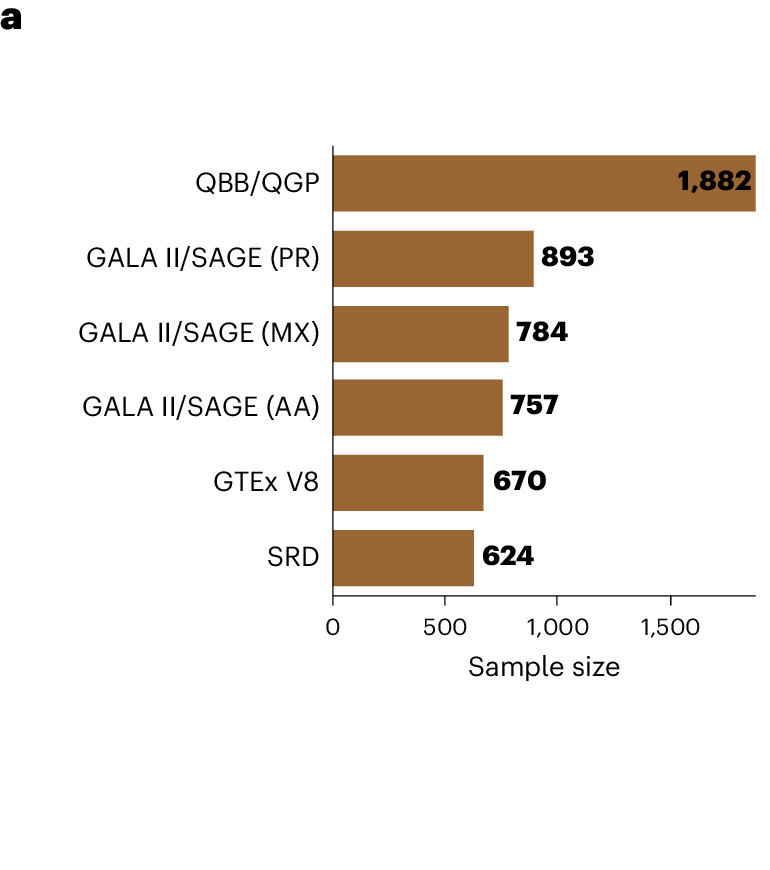

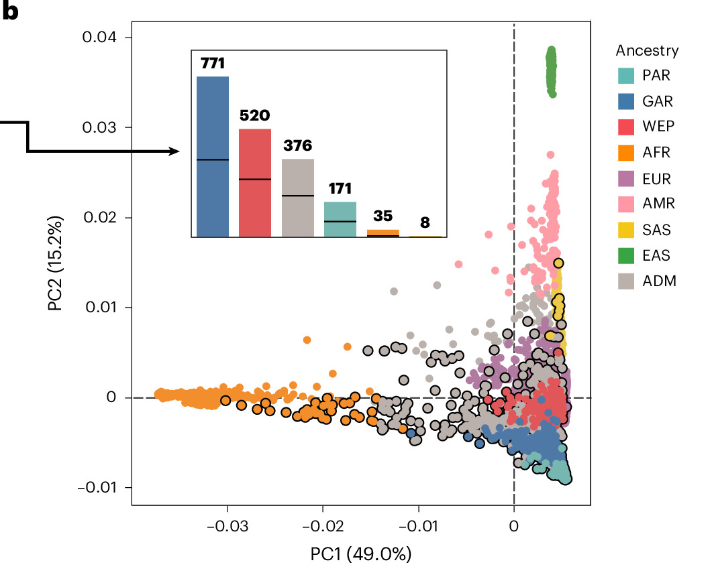

**原文图1。**来源：Naeem等，Nature Genetics，2026，DOI：10.1038/s41588-026-02785-7，Fig.1。按[CC BY 4.0](https://creativecommons.org/licenses/by/4.0/)使用。为手机阅读，原图按a、b、c–d、e四个区域原样裁切、依次展示；保留各区域数据、坐标、标签与图例，未改写数值。展示尺寸可能随设备缩放，可放大查看。原图标题中的“causal”是作者的统计精细定位用语，本解读使用“高后验支持的候选调控变异”，不把它等同于实验确认因果。

**a看样本规模，b看样本结构。**a把本研究与若干既有全血QTL资源并列，横轴是样本数。它说明规模背景，但不是公平的性能排行榜：不同研究的样本、测量深度、过滤和表型定义不同，柱子更长不直接证明方法更准确。

b是遗传主成分分析。横纵轴不是表达量，而是描述基因型差异的两个主成分；每个点是样本，图中共8,720个点，包含QBB及1000 Genomes（1KG）参考样本；黑边高亮点为本研究QBB/QGP RNA样本，其余点提供遗传背景对照。颜色按原图祖源图例区分分组。旁边的小柱图展示RNA队列的组成与性别信息。这个panel的作用是提醒读者：研究不是从一个没有内部结构的均质人群里抽样。它不能预测某个点对应的人是否患病，也不能据点与点距离直接判断具体亲缘关系。

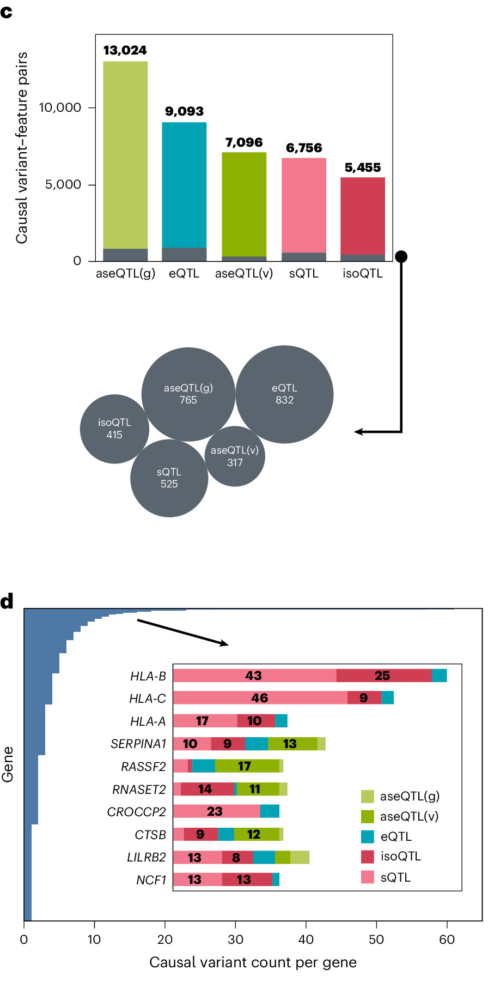

**图1c–d原样片段。**来源、许可同上；仅裁切重排，数值未修改。

**c数的是关联配对，d换成以基因为单位。**c的柱状图以QTL类别排列，纵轴标注候选变异—特征配对数；底部灰色气泡表示其中在单变量分析中没有达到显著阈值的配对。一个变异可能对应多个RNA特征，一个基因也可能有多个特征，所以“配对数”“独立变异数”“基因数”不能互换。

d把问题翻过来：一个基因能对应多少个候选调控变异？横轴是候选变异数量，纵向排列基因，插图进一步展示变异较多的基因及各类别构成。它提示调控可能具有多信号结构，而不是每个基因只有一个调控开关。不同类别之间可能共享变异，颜色分块本身也不证明机制彼此独立。

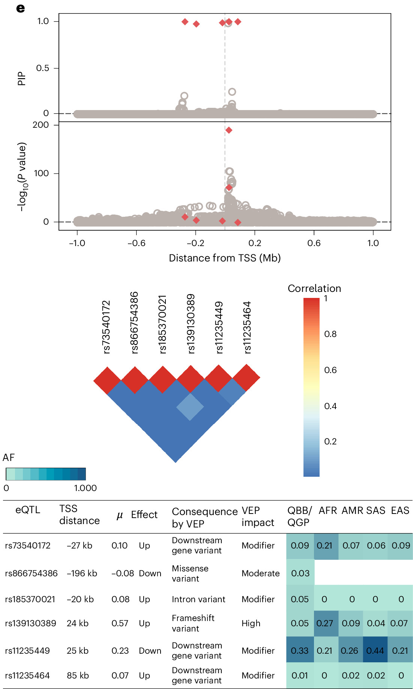

**图1e原样片段。**来源、许可同上；保留坐标、LD图例和属性表，仅裁切。表格细节请点击图片放大查看。

**e把一个基因展开，显示“定位”为什么不只是选最小P值。**例子是FOLR3。上方横轴是到转录起始位置的距离，范围为上下游各1 Mb，对照PIP和负对数P值；六个红色菱形标出PIP>0.95的候选。P值描述数据与无关联假设的相容程度，PIP描述模型给某个变异的纳入支持，两者回答不同问题。

中间热图展示候选位点之间的LD，原图图注将相关程度定义为R²，蓝色接近0、红色接近1；它是基因型相关结构，不是基因表达热图。下方表格并列位置距离、效应、功能注释和不同参考人群中的频率，AF色标从浅色0到深青色1，颜色越深表示相应等位基因在该参考群体中越常见，不表示效应更大。这个组合展示的不是一次功能实验，而是把关联强度、定位不确定性、遗传相关性和人群频率放在一起审视。即使某个位点同时具有高PIP和看似合理的注释，也还需要功能验证才能回答它通过什么过程改变RNA。

### 5. 这张图的数字，我们核到了哪里？

这里必须保留一条具体的阅读限制。我们取得了出版社提供的Fig.1源数据文件，其c表头明确写的是“变异—特征配对数”，数值与原图一致；补充图13顶部则标为“Causal QTLs”，部分数值更小。独立变异与配对统计可能解释部分差异，不能只见数字不同就宣布原文错误。

但目前仍有一处没有闭环：主图1c五类柱子的总和为41,424，正文相应段落报告40,735个高置信配对；正文同时要求PIP和LBF阈值，源数据c表头只标PIP阈值。公开材料中，我们尚未找到足够清楚的口径说明来把两者完全对应起来。不能自行认定是某个额外过滤造成，也不能选择一个数字后悄悄改图。

所以本篇不把该配对总数作为核心论据，不据此计算“比其他研究提升多少”。我们保留原图，并明确指出未对齐的定义与筛选条件。可以可靠学习的是它如何区分调控层次、如何展示多信号结构，以及如何把人群组成放在分析之前；需要继续核验的是特定汇总数字背后的数据版本与过滤口径。

### 6. 为什么“95%”不能直接译成“95%确定致病”？

精细定位试图在彼此相关的候选变异中分配支持。本研究采用SuSiE，允许一个区域包含多个效应信号，并生成95%可信集合。这个集合并不是效应量上下限，更不是“集合中的每个变异都有95%概率致病”。概率陈述依赖数据、先验和模型设定，也取决于实际被纳入检验的候选变异。

如果关键变异没有被可靠测到，模型只能在看得见的变异中分配支持。如果残留混杂、群体结构或技术偏差影响了RNA性状，极高的统计支持也不能自动修复这些问题。作者使用个体级基因型而不是完全依赖外部LD参考，有助于减少某些参考不匹配，但并不取消模型假设。

也不要混淆两个层次：一个位置确实参与RNA调控，和它导致某种疾病，是两道不同的问题。RNA变化可能很小、被其他机制补偿，或者只在特定细胞和状态下重要。本文的研究对象主要健康，更不能把其所有候选变异统称“致病突变”。这一边界在后续讨论纯合缺失和临床性状共定位时尤其重要。

### 7. 纯合片段为什么值得另开一扇观察窗口？

人的两套常染色体分别来自双亲。当一段区域内连续多个位点均呈纯合（每个位点两条同源染色体的等位基因相同），可以用ROH，即runs of homozygosity，来描述。较长片段有时帮助研究较近共同祖先带来的遗传结构，但ROH长度分类依赖研究的人群与检测方法，不宜脱离定义，把某条通用长度线直接变成家庭关系判断。

这与隐性效应的联系在于：如果某种作用需要两份特定等位基因同时存在，普通样本里纯合携带者很少，就很难观察。富含长段纯合区域的人群数据提供不同的统计机会。不过，出现更多纯合携带者，不等于每一个纯合位置都有害；某种基因型比预期少，也不只有选择这一种解释。参考频率、抽样、群体结构和基因型质量都影响预期。

因此，这篇论文的价值更适合表述为：它让原来很难研究的一类问题变得可检验。需要判断检验基线是否合理、复制是否独立、RNA异常与临床表现之间还有多少缺口，而不是从“纯合”两个字直接跳到疾病判断。

### 带回自己的项目：先问三个具体问题

查数据库没有命中时，先问“变异在参考人群中有没有足够携带者、该组织和RNA层次有没有被测量”，再决定是否写成没有效应。看到大量关联时，先写清独立变异、配对、基因和样本分别是什么单位。看到高PIP时，把它当成功能随访的排序依据，而不是跳过验证的许可证。

本篇实际阅读范围为完整公开正文、方法、全部主图图注及补充图注，并检查原图1与其源数据表；没有复算个体数据，也没有把作者结果写成我们的实验。全文开放不等于个体数据开放：汇总统计有公开资源，个体级数据仍需QPHI的访问审查。任何群体结论都不应用来识别参与者或替代个人医学判断。

**原文与方法来源**

- Naeem等，A catalog of transcriptome genetic regulation in a consanguineous Middle Eastern biobank，Nature Genetics，2026-11-02。https://doi.org/10.1038/s41588-026-02785-7
- SuSiE原方法：Wang等，2020，https://doi.org/10.1111/rssb.12388。本篇核查可信集合的定义，未声称阅读全文或复现。
- 原Qatar性状GWAS：Thareja等，2021，https://doi.org/10.1038/s41467-021-21381-3。本篇核查研究身份与队列范围，未声称独立复算。
- 论文列出的汇总统计资源：https://doi.org/10.5281/zenodo.20144650；个体数据申请入口：https://www.qphi.org.qa/research/how-to-apply 。

## 二、人群频率与结构变异

一个候选变异，在常用QTL数据库里查不到关联，到底意味着什么？也许它对RNA确实没有影响，也可能只是参考研究中携带者太少；还有一种情况：真正相关的是一段缺失、重复或倒位，常规的单碱基变异并没有把它可靠地标记出来。把这几种情况混在一起，会让“没有查到”被误读为“没有作用”。

卡塔尔生物样本库这项研究提供了一个具体检验场景：把1,882名成人的全基因组与全血RNA数据放在一起，研究人群频率和变异类型怎样影响我们能发现的调控信号。本篇围绕两张核心证据图展开：图2讨论不同参考人群之间的频率，图3讨论结构变异提供的增量信息。它们也展示了一个常被忽略的阅读步骤：图、图注、正文和源数据能否对上。

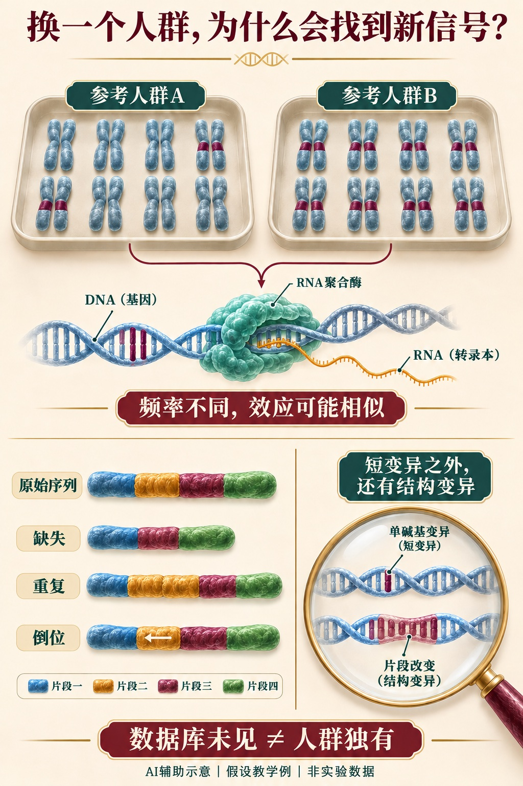

图示说明：AI辅助示意，假设教学例，非实验数据。两个样本盘只表达同一等位变异可有不同频率，不对应真实人群比例。下方缺失、重复和倒位是简化序列示意；实际结构变异的断点与调控后果需要独立检测。生成工具的底层型号未公开确认。

### 1．人群差异，先拆成两个不同问题

第一问是频率：某个等位变异在研究人群中有多常见？第二问是效应：携带它之后，某项RNA表型平均改变多少？频率不同，不自动意味着生物作用不同。一个在A人群较常见、在B人群很少见的变异，即使每份拷贝的作用相近，也可能只在A研究中达到检出门槛。

作者比较了QBB/QGP与GTEx V8共享的高置信精细定位变异—基因对。补充图19a画的是两项研究的单变量效应斜率β，正文报告相关系数r=0.9。这支持“被两边共同识别的调控效应总体一致”。限定语不能省：它不是对所有变异的检验，也没有证明两个队列任何组织、任何频率层次的效应都一样。共享并且高置信的筛选，本身已经排除了许多更难比较的信号。

研究另用1000 Genomes项目（1KG）的五个大类人群作频率参考：AFR、EAS、SAS、AMR、EUR分别代表非洲、东亚、南亚、美洲及欧洲参考分组。这些是具体数据集的分组标签，不是完整覆盖所有现实人群的“全球标准答案”；卡塔尔样本也不能代表整个中东。

### 2．图2a的蓝点，不能直接译成“这个人群独有”

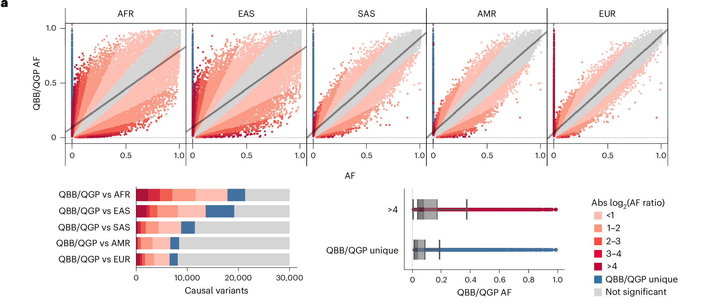

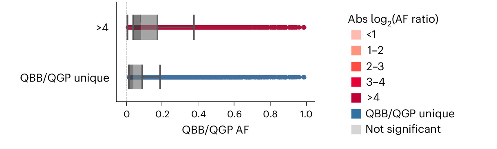

图2a｜原文图2的a面板原样裁切，未修改数据、坐标或图例。来源：Haroon Naeem等，Nature Genetics，DOI:10.1038/s41588-026-02785-7，CC BY 4.0。上部每点是一个变异，横轴是对应1KG分组的等位频率，纵轴是QBB/QGP频率；下部保留分组计数与频率箱线图，另附下排箱线图及色标原样局部放大以便读图。手机可点击上方五组比较图查看细节。

读上排散点，先看横纵坐标，而不是先找“显著”。一个点靠近纵轴，表示它在该1KG分组里很少见或未观察到，但在QBB/QGP中仍可能有相当频率。红色表示频率比较显著，深浅对应频率比绝对对数的分层；灰色未达到所用显著性阈值。检验针对个体0、1、2份等位剂量，使用准泊松广义线性模型和Bonferroni多重检验校正。它检验的是频率差异，不是两个研究的效应差异。

蓝色标为“QBB/QGP unique”，尤其容易造成误读。我们检查了官方图2源表：同一个变异可以在某个1KG分组被标蓝，在另一个分组却有非零频率。所以这一颜色首先是**该次人群比较中的未观察到**，不能一概改写为“在所有其他人群不存在”。有限参考样本未观察到，也不等于真实频率严格为零。

源表共包含29,953个变异的五组比较，即149,765条记录。在至少一组比较中显著的变异并集是26,907个，与正文一致。但接下来的两个数字需要特别谨慎：源表中，至少一次被标为蓝色的变异有6,316个；五组都标蓝的只有1,110个。正文把6,316泛称为“absent from 1KG”，范围比源表逐组标签所能直接支持的更宽。我们据此保留“至少一个参考分组未观察到”的表述，不把它升级成人群独有结论。

另一个容易混淆的数字是9,021。源表中“绝对log₂频率比>4”类别的独立变异有4,907个，至少一次标蓝的有6,316个，两组交集2,202个；合并去重才得到9,021。这里的>4意味着有限、非零频率之间相差超过16倍，不能把参考频率为零的情况硬算成普通倍数。正文对9,021的概括和源表集合存在口径差异，不能当作“9,021个都测得超过16倍差异”。这些是对公开源表的计数复核，不是重新运行作者的关联检验。

右下箱线图的两组中位频率约为0.081和0.040；源表对应的样本量分别是4,907和6,316个变异。箱体表示四分位范围，中心线为中位数，须线到1.5倍四分位距范围，并非置信区间。统计单位是变异，不是参与者，也不是患者人数。这里能得出的实用结论是：一些在参考数据不易看到的变异，在目标队列可能并不极罕见。

### 3．频率差异怎样接到生物问题？别跨过证据台阶

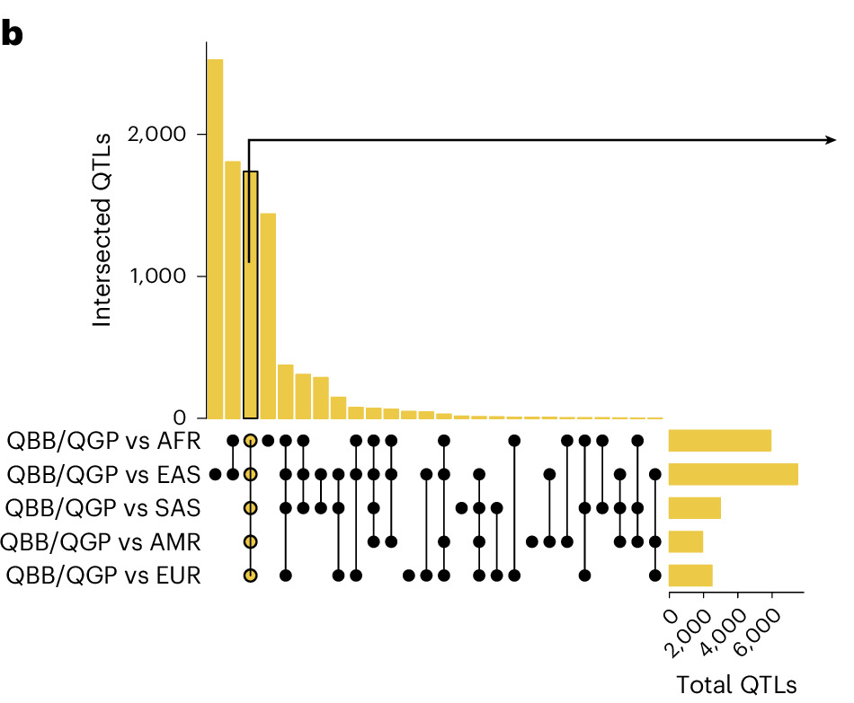

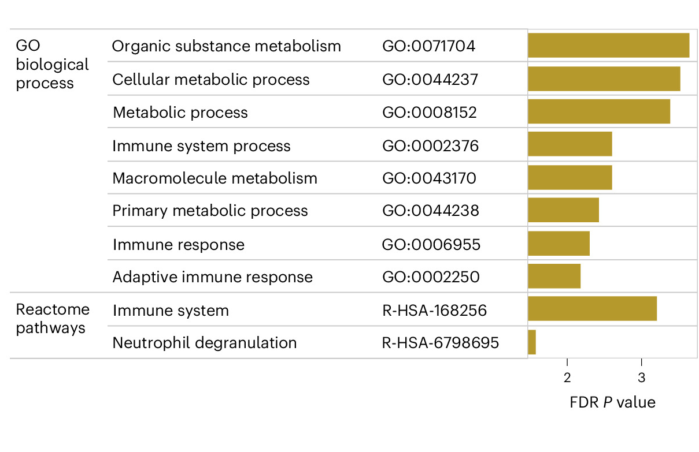

图2b｜左右两部分别原样裁切，按先左后右展示，来源及许可同图2a。左侧UpSet图用连接黑点指定比较集合，上方柱高表示相应交集内的变异数量；右侧是这些候选关联基因的通路富集。原图横轴写作“FDR P value”，官方源表明确列名为−log10(FDR)，本文按源表解释，未改动原图标签。

图2b把“在多个比较中频率差异很大或未观察到”的集合放在一起。五项比较均满足图中筛选标记的有1,739个变异；其中作者聚焦267个单核苷酸变异，涉及297个基因。这里不要把集合图的柱子与人数混淆，也不要把一个变异影响多个基因算成发现了多个独立变异。

右侧富集包括代谢和免疫相关条目。源表给出的是校正后显著性的负十进制对数，数值越大表示FDR越小；它不是效应大小。多个GO条目具有父子或重叠关系，不能把相邻的几条柱子当成几次相互独立的实验证实。全血本来就富含免疫相关信息；“富集到免疫通路”仍然不等于这些人群免疫力更强、某类疾病更多，更不能直接归因为饮食、病原体或自然选择。要支持后一层解释，需要额外的选择检验、环境与功能证据。

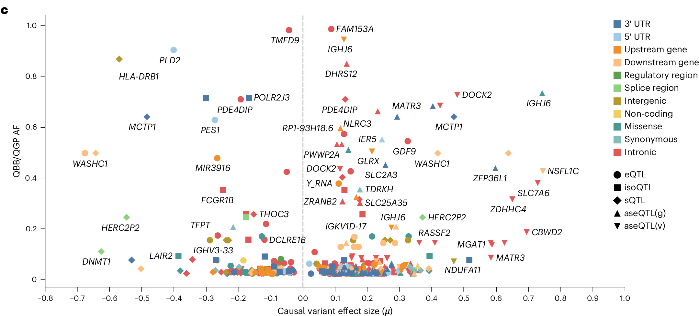

图2c｜原样裁切，来源及许可同图2a。横轴为精细定位模型效应μ，纵轴为QBB/QGP等位频率；点形区分QTL类型，颜色区分VEP功能注释。手机可点击放大查看注释与点形。官方源表有440条绘图记录，对应267个不同变异和297个基因，因此不能把440个点当成440个独立变异。

图2c的价值在于把两个维度分开看：常见不必然效应大，效应大也不必然常见。同一变异还可能对应不同RNA特征。点的“missense”“intronic”等颜色是注释，不是验证实验；标为错义也不保证这里的RNA关联完全由蛋白序列变化解释。

尤其不能把μ=0.5译成“表达增加50%”。作者在模型前对表型做了秩逆正态变换；图中还混合表达、异构体、剪接及等位表达不平衡等不同表型。对等位表达QTL来说，方向涉及所定义的不平衡表型，不能一律改写为“这个基因总表达升高”。本图适合挑选值得追踪的信号，不适合给不同基因或不同QTL类型排临床危险程度。

### 4．从一个碱基，转向一整段序列

如果一个片段被删除、复制，或者在原位翻转方向，它可能改变基因拷贝数、截断转录本，或重新安排调控元件和基因的相对位置。研究只看SNV和短插入缺失时，能够间接抓住其中一部分，但前提是附近短变异与结构变异足够相关。相关性弱时，短变异不能充当可靠替身。

本研究测试了6,598个缺失、619个重复和548个倒位的顺式调控关联。三类候选数目本来就很不均衡，因此“缺失发现最多”不能证明缺失在生物学上天然最重要。结构变异来自短读长全基因组数据与十种调用工具的共识流程，经过缺失率、频率和Hardy–Weinberg平衡等过滤；它不是所有结构变异类型的完整清单，更不等于长读长或实验测定已验证全部断点。

单变量分析报告3,078个显著SV QTL。进一步分析最值得借鉴的地方，不是又用了一个更严格阈值，而是作者问：**扣除已识别短变异的解释以后，结构变异还剩多少信息？**

他们按同一QTL类型、同一转录组特征，纳入先前精细定位的SNV/indel剂量和常规协变量；不仅对RNA表型去除这些因素，也对SV剂量作相同残差化，然后再用SuSiE分析两边的残差。这避免把一个与短变异共变的SV信号直接当成独立发现。它仍有条件：模型只控制纳入的变异和协变量，漏掉、误分型或高度相关的因素都可能影响结论；条件化不等于完成分子机制验证。

### 5．图3告诉我们什么，又有哪些地方不能直接照抄？

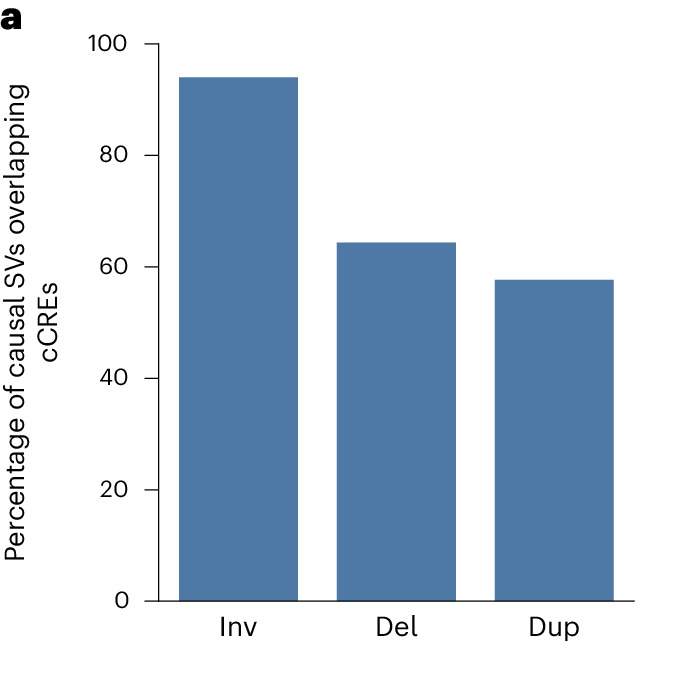

图3a｜原样裁切，来源：Haroon Naeem等，同一论文图3，CC BY 4.0。纵轴是与候选顺式调控元件重叠的精细定位SV百分比。重要核验提示：原图与正文把约94%对应倒位、约64%对应缺失，官方源表却把这两个数的Inv/Del标签对调。本文保留原图，不擅自改标签，也不据此判定哪类SV重叠率最高。

这处差异不能靠“看起来合理”解决。倒位较长，似乎更容易跨到调控元素，但这样的解释无法证明源表哪个标签正确。即使类别完全无误，重叠率也受长度、位置、候选集合和注释覆盖影响；94%的重叠不等于94%都已被实验证明发挥调控作用。我们可以保留“结构变异可能涉及调控区域”这一层问题，却暂不拿这张图支持三类SV的精确排序。

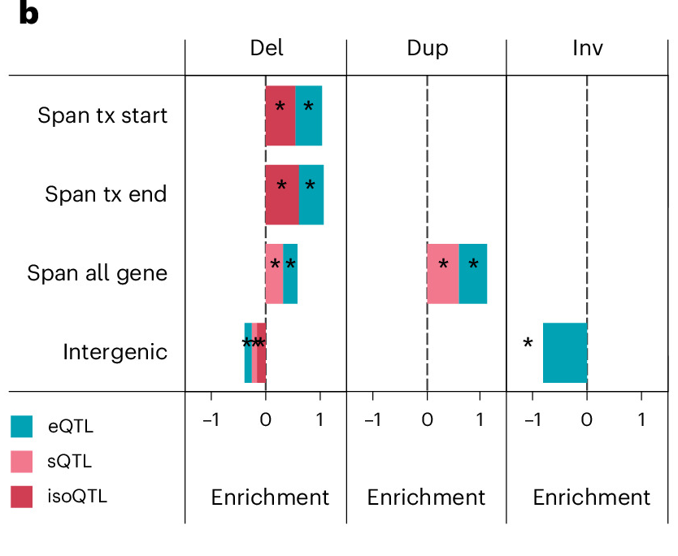

图3b｜原样裁切，保留图例、横轴和星号，来源及许可同图3a。横轴为相对基线的富集对数比，不是表达变化；行表示跨转录起始、转录终止、整个基因或基因间区，颜色区分eQTL、sQTL、isoQTL，星号表示Bonferroni校正后显著。不同颜色不可相加解释为总生物效应。

图3b讨论的是位置分布相对基线偏多还是偏少。例如缺失信号在部分转录边界和全基因跨度类别富集，基因间类别则有耗竭。比较基线来自测试的QTL集合，而非随意选出的全基因组任意位置。它能帮助形成“应关注哪些结构位置”的假设，但不能据此判断某个具体缺失究竟改变启动、终止、剪接还是RNA稳定性；这些需要更细的转录证据与功能实验。

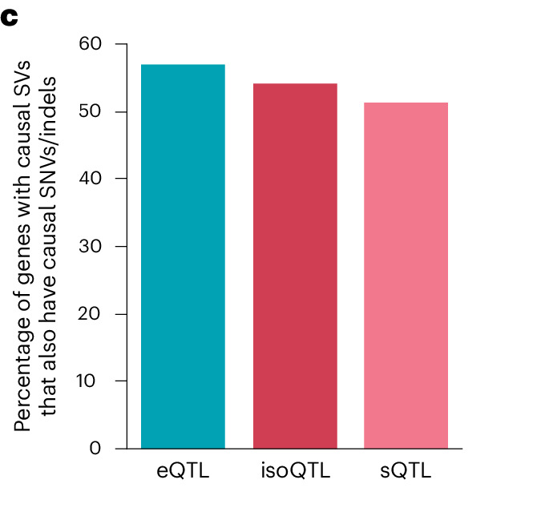

图3c｜原样裁切，来源及许可同图3a。每根柱的分母，是该QTL类型中具有精细定位SV的基因；分子是其中也有精细定位SNV/indel的基因。源表分别约为eQTL 57.0%、isoQTL 54.2%、sQTL 51.3%，不是全部基因的百分比。

同一基因被短变异和结构变异共同关联，并不说明两者在统计上是同一个信号。正文还概括为“58%，n=623”，但不同QTL类型会共享基因，不能用这三个柱高简单平均，更不能用623除以文中870直接替代图中分母。本文只报告源表明确支持的分类型比例，不自行补造总体计算口径。

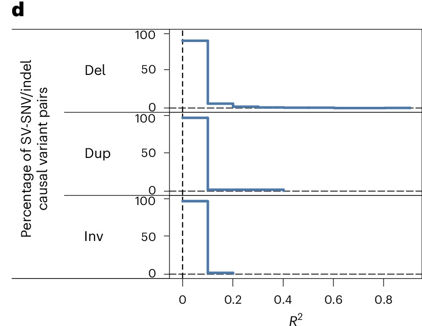

图3d｜原样裁切，来源及许可同图3a。横轴为同基因、同QTL类型的SV与SNV/indel之间LD的R²；纵轴为变异对所占百分比，按缺失、重复、倒位分面。统计单位是变异对，不是独立基因，更不是携带者。

图3d补上了关键的一半证据：大多数变异对处于很低的LD区间。源表第一个R²分箱分别占缺失约89.3%、重复约97.3%、倒位97.0%；正文概括为89%—97%的变异对R²≤0.1。源表以分箱起点记值，未逐条提供边界归属，因此这里按“第一低LD分箱”报告，不额外制造边界精度。

结合前面的条件分析，这支持“短变异之外，SV仍带来增量调控信息”。但低LD是基因型共变的度量，不是两个分子机制互不影响的证明，更不是临床独立风险已经验证。数据又是条件化筛选后的集合，低LD结果与筛选过程有关，不能完全作为与分析流程无关的第二次独立验证。

还有一个总数需要保留：正文写948个精细定位SV，但按SV类别列出的853、50、43相加为946；按QTL类别列出的443、266、239则相加为948。我们没有足够材料确认这里是否存在去重、类别或排版差异，故不把任何一个总数包装成已经独立核对无误的结果。计数不一致不抹去全部分析价值，但会限制精确规模和比例的转述。

### 6．把这篇论文变成自己的分析检查单

查一个本地队列的候选信号时，可以沿着三个问题走。参考库里是否真的测试了它，还是频率、质控和注释让它根本没进入检验？所谓“本地新发现”，指新变异、新关联、新基因，还是只是某个参考分组未观察到？如果附近有结构变异，它是否被直接分型，能否解释短变异标签遗漏的信息？

若准备做跨人群比较，还要尽量对齐组织、表型定义、等位方向、参考基因组和功效。不能一边用数万人的显著结果，一边用不足两千人的不显著结果，就断言作用只在前者存在。比较效应需要效应估计与不确定性，比较频率则需要对应分母；这两类证据最好分别呈现。

本篇可以带走的结论很具体：数据库未命中不等于无作用，人群频率差异不等于调控机制不同，短变异不能保证覆盖结构变异的信息。与此同时，好的解读也应把源表与图文之间尚未解决的矛盾留在读者看得见的地方。下一篇再讨论纯合片段与临床性状的关联；本系列最后另设独立take-home messages。

#### 来源与核验范围

原文：Haroon Naeem等，A catalog of transcriptome genetic regulation in a consanguineous Middle Eastern biobank，Nature Genetics，2026-11-02，DOI：[10.1038/s41588-026-02785-7](https://www.nature.com/articles/s41588-026-02785-7)。本文核查相关完整正文与方法、补充图19及22—23图注、原文图2—3和两份官方Source Data；源表计数复核不等于重跑原始样本分析。未获取个体基因型，未独立验证结构变异断点，未开展功能实验。

原图许可：[CC BY 4.0](https://creativecommons.org/licenses/by/4.0/)。图片均为原图面板裁切，保留坐标、图例和原标签，未重绘数据、未修正原图；本篇逐处披露图文/源表不一致。原创hero为AI辅助教学示意，不是论文数据。全部内容仅供科研阅读与研究设计参考，不用于个体诊断或人群优劣判断。

## 三、纯合片段与临床相关性状

携带两份调控变异，会不会把表达推到异常范围？如果同一位置又与血小板、血脂等指标关联，能否解释疾病？卡塔尔生物样本库的研究提供了三层线索：纯合片段、表达异常和临床指标共定位。把它们连起来之前，需要先确认每一步测到了什么。

本篇围绕图4、图5、方法及公开补表展开：研究在1,882人中建立全血RNA调控图谱，结合纯合片段和同一生物样本库的性状数据筛选候选。这里的“临床相关”主要指体征和化验指标，不等于诊断；模型支持的变异，也不自动成为致病变异。

*AI辅助原创示意，非实验数据。左侧突出同源染色体在连续位置上分别具有相同等位基因；中间表达调控和右侧共享信号均为概念示意，未表示疾病因果关系。*

### 1．长片段为什么能让隐性效应更容易被看见

ROH（runs of homozygosity）是连续纯合片段：连续位置上分别有两份相同等位基因，而非整段都是同一种碱基。长度与共同祖先和重组历史有关；长片段通常更能反映较近期的共同祖先来源，但群体统计图不能判断具体家庭关系。

作者用bcftools识别常染色体ROH，按队列长度混合分布分为短于182 kb、182—864 kb、长于864 kb三类。这是数据驱动的分类，不通用于所有队列。复用时须报告识别条件、变异质量和分组规则，不能只搬阈值。

隐性效应意味着携带两份相关等位基因，可能不同于只携带一份。近缘祖源片段增加某些等位基因纯合的机会，利于研究这类现象。但纯合不等于有害，更不能据此笼统判断一个群体的健康。

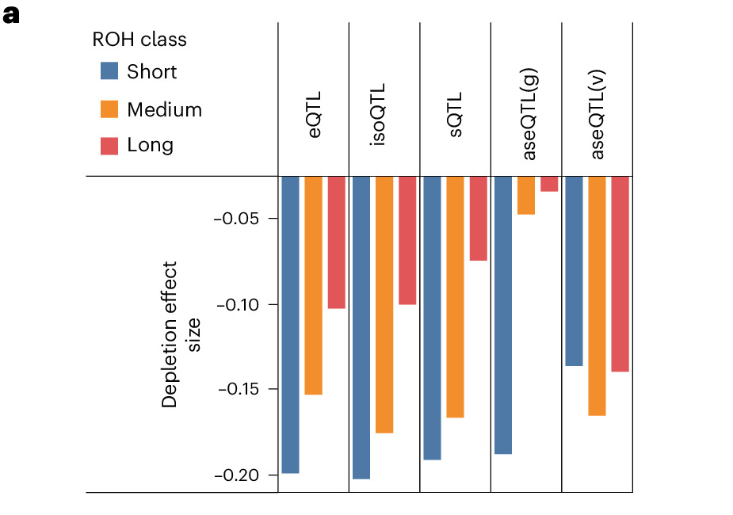

*原文图4a，原样panel裁切。横向为不同QTL类型；蓝、橙、红分别表示短、中、长ROH。纵轴为归一化内外比值的log10尺度效应，不是患病概率。来源与许可见文末。*

图4a比较每人ROH内外的精细定位QTL数量，两边均按对应区域其他受测变异数归一化，避免可检测变异本来就少造成“缺失”错觉。归一化比值取log10后，用仅含截距的线性模型检验均值是否偏离零，再作BH校正。

各类柱子向下，表示相对于这一比较基线，ROH内精细定位QTL较少。短、中片段往往表现出更强缺失，作者将其解释为较老片段经历更长时间的净化选择。这是与选择假说相容的观察，而不是直接看见选择过程。区域变异组成、定位能力和检出条件也应进入解释；柱子不能读成“短片段造成更严重疾病”。

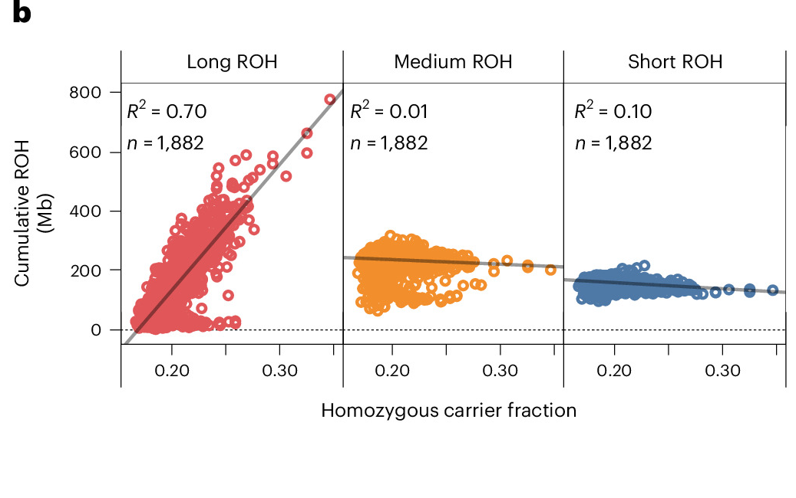

*原文图4b，原样panel裁切。每点是一名参与者，各分面n=1,882；横轴H₂是较少等位基因纯合位点数÷（这类纯合位点数＋杂合位点数）；纵轴为对应类别ROH总长度，单位Mb。灰线为拟合线。*

H₂仅在携带较少等位基因的位点中计算纯合比例，分母不是全部调控位点，更不是“多少基因有问题”。长ROH总长度与H₂的关系较强，R²=0.70；中、短片段关系弱，分别约0.01和0.10。后两者即便得到很小P值，也不意味着解释能力大。

把图4a与4b并排看就不矛盾了：一种比较区域里调控位点的相对密度，另一种比较个人携带位点的纯合程度。长ROH可以增加纯合暴露，同时整个ROH集合仍呈现相对缺失。研究从不同统计单位观察同一问题，不能把两张图的纵轴混用。

### 2．“纯合的人比预期少”，离隐性致病还有几步

另一个策略是反过来寻找：某个等位基因并不少见，但携带两份的人比预期少。作者以Hardy–Weinberg平衡为基线，根据等位基因频率估算纯合概率，并作单侧精确二项检验。若所记录的替代等位基因频率超过0.5，检验的是参考等位基因纯合，而不是固定盯住1/1。

假设较少等位基因频率为0.2，平衡基线下纯合概率为0.04；这是教学例子，非真实位点。少于预期可能提示选择，也可能受群体结构、亲缘关系、招募、分型和模型影响。在近缘祖源队列中，更需审视平衡基线。

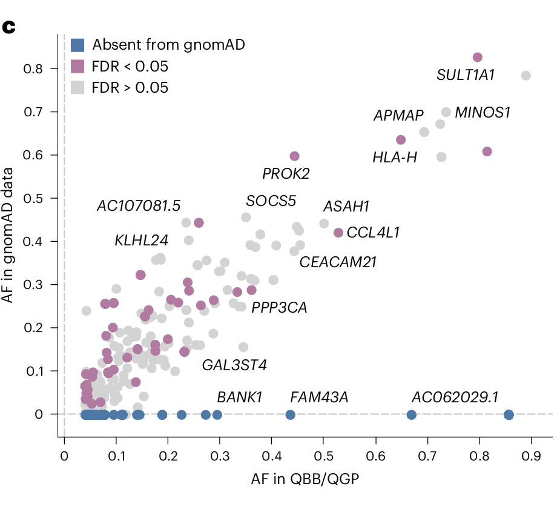

*原文图4c，原样panel裁切。横轴为QBB/QGP频率，纵轴为gnomAD频率；紫色表示gnomAD复制检验FDR<0.05，灰色未通过，蓝色未见于该gnomAD数据。一个点代表图中变异—基因记录，不能把点数直接当作独立变异数。图展示候选集合，未展示全部受试者。*

正文报告177个SNV/indel位点在QBB中达到名义P<0.05，但没有任何一个通过这批检验的多重校正。公开补表4支持这一点。33个在gnomAD中达到FDR<0.05，是另一队列中的支持，不应倒过来改写成“卡塔尔队列已经显著发现177个有害位点”。也不能把未见于gnomAD的蓝点当作复制成功：没有观测到不等于证实缺失原因。

结构变异要单独讲。正文给出48个名义候选，其中12个在gnomAD中复制。我们按补表5的变异ID去重核查，48个中有17个在QBB自身FDR<0.05。因此，“QBB候选全部未通过校正”只适用于上述SNV/indel集合，不能一并套到结构变异。测试规模与误差不同，不能据此比较哪类更危险。

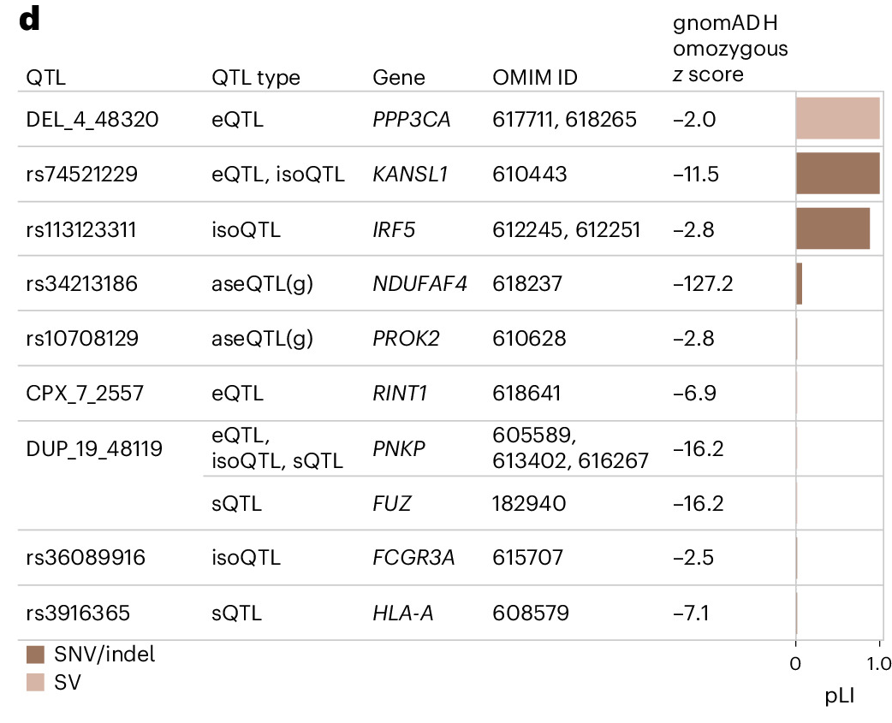

*原文图4d，原样panel裁切；表中文字较密，手机阅读请点击放大。每行显示QTL、基因、OMIM表型ID和gnomAD纯合缺失z分数；右侧条形为基因层面的pLI，颜色区分小变异与SV。负z分数表示比平衡基线预期少，不是疾病严重程度；pLI也不是当前变异的致病概率。*

表中的OMIM注释告诉我们，某个基因已与某些孟德尔遗传病有联系。但基因层面的知识不能直接下放到它附近的每一个调控变异。需要继续确认变异影响哪种转录本、在哪些细胞中生效、改变程度够不够、是否与患者表型和遗传模式吻合。成人生物样本库的入组条件也可能限制对严重早发疾病的观察。

这里必须保留一项核验提醒：NDUFAF4例子的正文写rs77028896，而图4d及其源表写rs34213186；补表4使用坐标6:97339275:C:CA。当前资料不能让我们可靠闭合两种rsID的对应关系。NDUFAF4的pLI在补表4与图4d源表也不一致，故本文不据其具体值作强判断。图和补表的PNKP在正文被写作PMKP；我们沿用图表及公共基因资料中的PNKP，并将正文视为疑似排字问题，而非声称已有作者更正。

### 3．表达异常更接近功能，但还不是患者诊断

纯合缺失是间接线索。作者接着问一个更贴近分子功能的问题：较少等位基因纯合的人，是否更容易成为相应基因的表达离群者？他们用OUTRIDER在RNA计数中建模，调整测序深度及潜在技术、生物变化，再检测基因—样本组合是否显著偏离模型。

这部分实际分析1,652名参与者，报告2,965个出现表达离群的基因。其中1,445个具有精细定位eQTL，涉及1,419名参与者。这里不能把1,882、1,652和1,419混成一个样本量：它们分别对应总体RNA图谱、离群分析和带有相关eQTL的进一步子集。

之后的Fisher检验把每个变异—基因组合分成“是否较少等位基因纯合”和“是否表达离群”的2×2列联表。分析要求该基因至少在3人中离群、位点至少有3个受测纯合者，再作BH校正。这样的阈值避免完全由单人观测主导，但仍不能把关联方向当作干预效应；同一数据中先定位eQTL再挑离群关联，也不是独立样本复现。

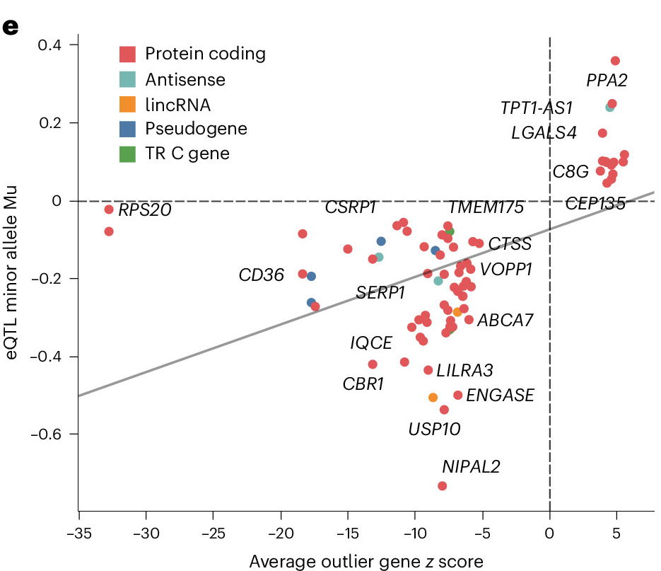

*原文图4e，原样panel裁切。横轴为对应离群样本的平均OUTRIDER z分数，纵轴为统一到较少等位基因方向的SuSiE效应μ；颜色为基因类别。点对应图中eQTL—基因记录，均来自关联检验通过FDR的筛选集合，灰线不能解释为所有基因的普遍规律。*

多数点在左下区域：携带相关纯合基因型的离群表现偏向低表达，方向也常与eQTL效应一致。它把“某位置影响表达”和“部分样本表达很异常”连接起来，是值得进一步实验验证的证据。不能据此说已发现这些人的疾病原因，也不能把z分数当作表达下降倍数。z分数衡量相对模型预期的偏离，μ来自另一个统计模型，两轴没有可直接相除的共同单位。

计数也要交代清楚。正文称83个关联，涉及76个eQTL和66个基因。我们读取补表6，得到83条数据行；按变异—基因去重为76对，图4e公开源表也为76点、66个基因。注释展开会造成同一组合重复占行，因此本文不把83行宣称为83个独立发现。正文的“约80%表现为低表达”在引用时也应保留作者口径，不能在未统一分母前另算精确百分比。

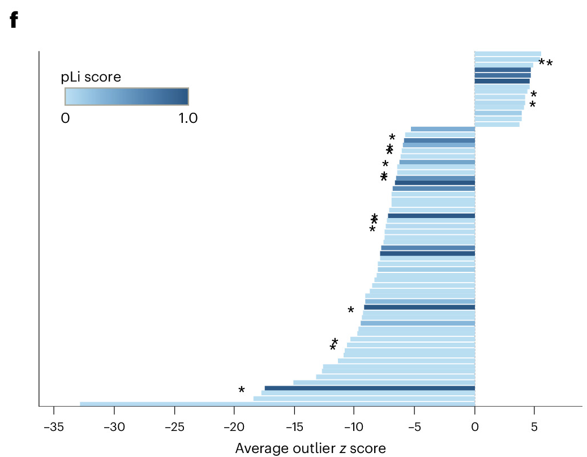

*原文图4f，原样panel裁切。每条对应一个基因，长度为平均离群z分数、颜色为pLI、星号为OMIM疾病注释。该图没有把完整基因名称逐条标出，不能仅凭某根条形推断特定基因身份。*

深色或星号不是“危险名单”。pLI来自蛋白功能丧失变异的群体约束，它不能直接量化所有调控扰动、所有组织中的剂量敏感性。进一步工作可以在适当细胞中验证表达或剪接改变、寻找家系共分离证据，并检验恢复正常表达能否挽救功能。这是后续建议，非作者已做实验。

### 4．共定位究竟共享什么

研究最后把QTL与45项临床相关指标的GWAS相连。GWAS来自6,218名QBB/QGP参与者，包含本次RNA队列。因此这是同一生物样本库中的整合分析，不能称为独立人群复现。作者检查等位基因方向，并用该队列LD结构作GWAS精细定位，再运行支持多个信号的coloc–SuSiE。

共定位在问：同一区域两个关联信号，是否更符合由同一个遗传信号解释？它要区分“两个性状都有关联但分别由不同变异驱动”和“两个性状共享信号”。结果中的PPH4是共享信号假说的后验支持；另一个SNP PIP在这里带有“假设H4成立”的条件。它不是无条件的致病概率，更不是基因表达作为中介的概率。

作者进行14,255次区域比较，筛选PPH4≥0.5且相关SNP PIP≥0.5的记录。这个标准适合提出优先候选，但并不等同于每条证据都很强：刚过0.5与接近1不能同等对待，还应检查先验、LD、可信集合覆盖和多信号情况。即使共享位点可靠，也可能分别影响两个过程；仅靠共定位无法确定“变异→表达→疾病”的完整方向。

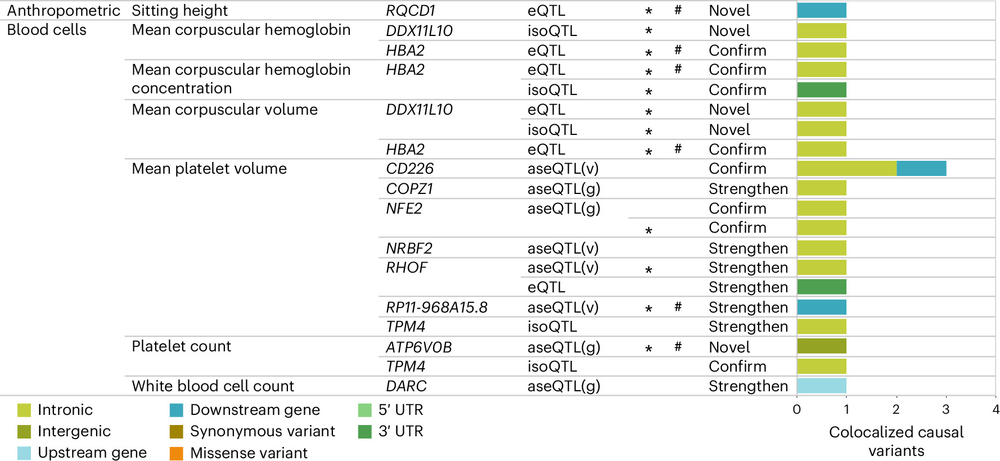

*原文图5上部，按分组截取并重复原横轴、图例，无数据改写；手机请点击放大。横向条长是该行共定位记录中的变异数量，颜色是VEP位置/后果分类，不是效应大小、显著性或风险。星号表示目标基因并非最近基因，井号表示该调控关系仅在本文比较范围内报告。*

正文报告58条共定位，涉及30个基因、20项指标。但我们核查公开图5源表，其53行的Variant Count总和为54；补表9按文中两个阈值筛选，同样得到54条记录、40个不同变异ID。54条的QTL构成为18个eQTL、7个isoQTL、8个aseQTL(v)、21个aseQTL(g)，与正文58条的分类数字未完全对齐。这4条差额尚未闭合，本文保留作者报告并明确公开表可复核范围，不擅自改原图，也不把58读成58个独立位点。

### 5．用两个例子练习“不多走一步”

RQCD1与坐高的eQTL共定位，是一个可以提出新问题的例子。补表9给出的PPH4约0.976、PIP约0.836；而同一位点的另一种RNA性状，即aseQTL(g)，PPH4仅约0.012，未通过阈值。可见同一个基因附近有多层RNA信号，不代表每层都得到相同支持。

本文能稳妥说的是，某一RQCD1表达调控信号与坐高GWAS信号共享位点的统计证据较强。不能因为其他文献报告坐高与代谢疾病有关，就把这条链直接延伸成“调低RQCD1可以预防糖尿病”。相关性不具传递性，组织、发育阶段、混杂和多效性都可能让这种推断失败。

ATP6V0B则与血小板计数出现aseQTL(g)共定位，PPH4约0.769、PIP约0.899。这里测的是等位基因表达不平衡，不应改写为“总表达上调”。本文未提供对该变异的细胞扰动、血小板生成机制实验或疾病风险的直接检验。血小板计数更高也不自动等于更健康：正常生理范围内的变化、反应性增多和特定疾病状态需要区分。

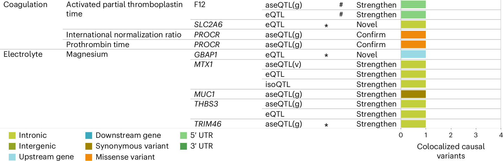

*原文图5中部，处理同上；手机请点击放大。Confirm、Strengthen、Novel是作者根据既有文献为关系作的分类，不是独立实验验证等级；不同分类不能用来替代后验概率、实验或临床证据。*

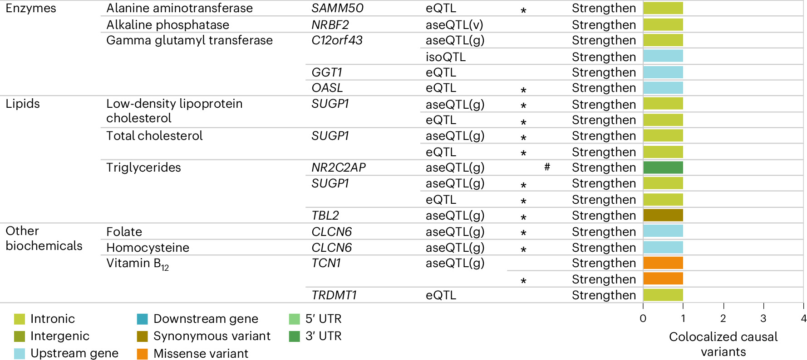

*原文图5下部，处理同上，手机阅读请点击放大。读条形时需同时看性状、基因与QTL类型；同一个基因在多个性状或RNA层次出现，可形成多条记录，不应重复计成多个独立基因。*

另外，作者依据化验指标方向讨论贫血、血栓或代谢疾病的可能联系。这类讨论有启发，但本文不把它们升格为已核实临床效应。例如HBA2是编码α珠蛋白的基因名称，与血液检验中的HbA2血红蛋白组分不是同一概念；查阅表中功能注释时也要防止名字相似导致概念混用。某变异对一个连续化验值的关联，不足以直接得出疾病发生率改变，更不足以制定个人处置方案。

### 6．真正可迁移的是证据顺序

研究把三个问题接在调控图谱之后：纯合基因型是否按预期出现，纯合者是否更易表达离群，共享遗传信号是否联系可测量性状。它们相互补充，但不会自动合成疾病因果。

类似研究可按“变异—基因—RNA性状—生物样本库指标”记录，同时保存检验范围、校正结果、样本重叠和注释来源。正文、图与源表不一致时，应记录差异、限定结论，而非挑最适合讲故事的数字。

越接近临床，越要说明已经跨过、尚未跨过的证据步骤。本文形成了功能验证候选地图；隐性致病、组织机制、疾病风险和临床应用，仍需各自的证据。

#### 阅读范围、来源与图片许可

Haroon Naeem等，*A catalog of transcriptome genetic regulation in a consanguineous Middle Eastern biobank*，Nature Genetics，2026年11月2日：[论文与源数据](https://doi.org/10.1038/s41588-026-02785-7)。本篇核查正文、方法、图4—5、相关补充图注、补表4—7及9—10、图4—5统计源表。未分析个体级受控数据或复现流程；未全文核验疾病机制原始研究，不将疾病延伸讨论当作实验证实。

PNKP名称与HBA2基因功能另核查MedlinePlus Genetics：[PNKP](https://medlineplus.gov/genetics/gene/pnkp/)、[HBA2](https://medlineplus.gov/genetics/gene/hba2/)。纯合、共定位和表达离群的解释基于本文方法；后续实验建议为教学分析，不属于作者已完成结果。

图4—5署名归于上述作者，按[CC BY 4.0](https://creativecommons.org/licenses/by/4.0/)使用，所用主图未见第三方排除标识。图4按panel裁切，图5分段并重复原轴/图例；标签、数值不变。Hero实际由内置图像工具生成，型号未确认。本文为未发布审读稿，请重点复核未闭合的计数与注释差异。

## 归档来源与核验边界

四篇完整母稿按原顺序合并，未使用微信精简版，正文与图注不缩写。原始母稿、既有核验记录、生成工具回执和原图备份保存在同一归档备份；此处只调整标题层级、相对图片路径及THM来源说明的位置。主图1—5及所用原样片段保留，扩展图1的第三方NIAID BIOART示意未复用。无新增补充原始研究图。原图未改动数据；教学图均标非实验数据。既有源表计数核验不等于本轮复跑；本轮检查完整四篇文本、图文关系、文件校验值与图像可读性，未访问受控个体数据。

### THM来源、阅读范围与许可

Haroon Naeem等，A catalog of transcriptome genetic regulation in a consanguineous Middle Eastern biobank，Nature Genetics，2026年11月2日，原创研究。论文、方法、补充材料及源数据入口：https://doi.org/10.1038/s41588-026-02785-7 。公开QTL汇总统计入口（本文未重新下载或运行全量分析）：https://doi.org/10.5281/zenodo.20144650 。个体级申请条件见论文Data availability。

本篇综合系列已核验正文、方法、主图及相关公开补表/源表；计数差异来自表格复核，不是重新运行个体级关联分析。未获取受控个体数据，未运行作者全流程，未把论文疾病推测当作功能实验证实。图4c依CC BY 4.0使用，来源归于上述作者，原样裁切，无第三方排除标识；许可：https://creativecommons.org/licenses/by/4.0/ 。Hero为内置图像工具生成的原创示意，底层型号未确认。本文为未发布审读稿。

## Take-home messages

拿到一个与RNA相关的候选变异，下一步应该查数据库、补分析，还是直接做功能实验？卡塔尔生物样本库的这项研究，最值得带走的不是一串“新位点”数字，而是判断候选值得投入到哪一步的方法：先确认看见它的条件，再判断证据有多强，最后把没有解决的问题变成可检验的问题。

这是一篇独立的take-home messages。研究以1,882名主要健康成人的全血RNA为基础，连接全基因组变异和生物样本库性状。它扩大了长期代表不足人群的参考信息，也提醒我们：补齐参考人群，不等于已经完成临床解释。下面把论文转成六个可以用于自己项目的判断问题。

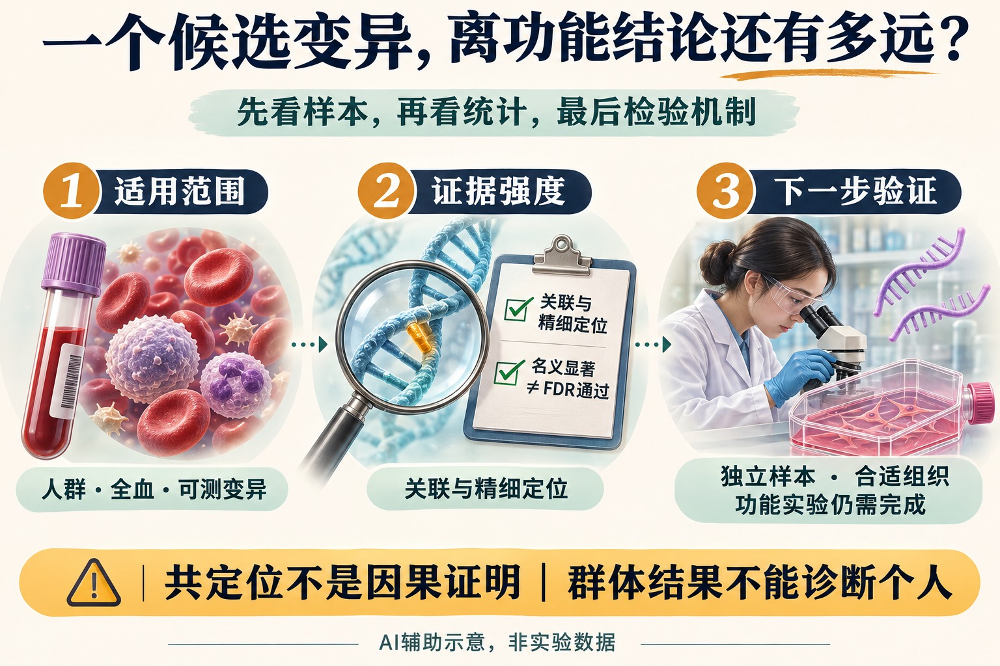

图示说明：AI辅助原创教学示意，非实验数据。三个区域表示研究检查顺序；虚线箭头不是已证实的因果路径。细胞、DNA与研究人员均为示意，不能当作本文真实实验照片。

### 1．“没查到”，究竟是哪一种没查到？

数据库没有收录一个关联，至少有三种可能：没有检测这个变异或RNA性状；检测了，但携带者或测量信息不足；在可比且功效足够的条件下，仍不支持所关心的效应。它们需要的下一步完全不同。把三者都写成“无功能”，会过早丢掉候选；都写成“人群特异”，又会把检出差异包装成生物机制差异。

本研究的频率比较给出了很具体的例子。官方图2源表中的6,316个变异，是至少在一个1KG参考分组比较中被标为QBB/QGP独有的并集；不能说它们在全部1KG人群均缺失。参考样本未观察到，也不能证明现实人群频率严格等于零。论文文字的概括比源表逐组标签更宽，我们选择保留更窄、能复核的表述。

因此，候选记录最好带上参考基因组版本、等位基因方向、组织、祖源构成、可检测范围和频率。某研究显著、另一个不显著，并不等于两个效应显著不同；若要比较效应，需要可比估计与不确定性，而不是只比较两个P值有没有过线。

### 2．这个资源回答的问题，和我的问题一样吗？

1,882是RNA样本规模，不是每个分析的统一分母。等位表达需要杂合位点和足够读段，表达离群需要满足自己的过滤条件。研究主要筛选次要等位基因频率高于1%的变异，不能拿目录里没有某个罕见变异，作为排除其作用的依据。

全血适合大规模采集，却不是全身各组织的替身。总表达变化还可能混合细胞内调控与血细胞比例变化。若你的问题指向脑、肝或某个发育阶段，血液信号可以是线索，不能自动成为目标组织机制。祖源主成分也不等于显式建模亲缘关系；公开方法尚不足以让我们确认每项QTL检验的亲缘协方差处理，迁移流程前应查清，而不是假定已经解决或断言作者完全没做。

真正可复用的做法，是先写一张“适用范围卡”：研究对象是谁、组织是什么、测量了哪一层RNA、过滤掉什么、每项比较有多少有效样本。范围不匹配时，先补数据或降低结论强度，通常比继续提高模型复杂度更有用。

### 3．PIP很高，还缺什么？

精细定位利用相邻变异的共同遗传结构，帮助区分哪些位置更可能解释关联。PIP是模型条件下的后验纳入概率，不是“这个变异有95%概率致病”，可信集合也不是实验确认清单。它依赖纳入的变异、基因型质量、表型、协变量和模型设定。

这里尤其值得保留结构变异。短变异没有可靠标记一段缺失、重复或倒位时，只查SNV可能漏掉信息。作者对同一RNA特征的短变异和协变量作条件化后，再分析SV残余信号，这是合理的拆分问题方式；它仍不等于已证明SV通过某个独立分子机制起作用。断点、分型和遗漏变异都可能影响判断。

我们的后续建议是分两步：先核对等位基因与坐标、LD参考、RNA表型定义和候选分型质量；再考虑独立样本、适当细胞或组织中的验证。实验选择应围绕究竟要区分表达量、剪接还是异构体使用，而不是给所有候选套同一个实验。这些是研究规划建议，不是作者已经完成的功能结果。

### 4．“有信号”与“通过校正”，为什么必须分开写？

图4c｜Naeem等原文图4c，原样panel裁切，CC BY 4.0，未改变数值、坐标与图例。横轴为QBB/QGP等位频率，纵轴为gnomAD频率；紫色表示gnomAD检验FDR<0.05，灰色未通过，蓝色为该gnomAD数据未观察到。点是绘制的变异—基因记录，不能把点数直接当作独立变异数。它是候选集合的比较，不是全部受测变异或参与者的分布。

这张图最容易诱发的误读，是把紫色当作“本队列和外部队列都证明致病”。实际上，正文报告177个SNV/indel在QBB纯合缺失检验中达到名义P<0.05，但没有一个通过QBB这批检验的FDR校正；33个在gnomAD达到FDR<0.05，是另一数据集中的统计支持。蓝点没有完成这种复制，不能因为未观察到就算成功。

结构变异必须另列：48个名义SV候选中，公开补表支持17个在QBB自身FDR<0.05，12个在gnomAD复制。不能把“全部未通过校正”套到两类变异。名义P值反映零假设成立时单项检验出现同样或更极端结果的概率；FDR校正面对的是一批检验，在相应假设下控制发现集合中错误发现比例的期望；它不是这一批实际错误比例的硬上限，也不是每个候选各自的致病概率。

纯合者比平衡模型预期少，可以引出选择或隐性作用假说，但也要检查群体结构、亲缘、招募与分型。连续纯合片段增加某些等位基因纯合暴露的机会，不代表片段本身或拥有片段的人必然患病。统计筛选、外部支持、表达异常、功能验证和临床解释，是不同证据层次。

### 5．共定位之后，能不能直接谈疾病机制？

共定位支持两个性状可能共享遗传信号，却不能单独区分“RNA变化介导性状”与“同一变异分别影响两者”。本研究的GWAS来自6,218名QBB/QGP参与者，包含RNA研究样本，因此不能称为独立队列复现。血小板计数、血脂等连续指标的关联，也不能直接换算成疾病发生率或个体治疗建议。

这一步还暴露了计数单位的重要性：正文报告58条共定位；公开图5源表的Variant Count合计54，相关补表按PPH4≥0.5和条件于H4成立的SNP PIP≥0.5筛选，也能复核54条记录。H4指两个性状共享信号的假说；这里的SNP PIP是在该假说成立条件下分配给变异的支持，不是无条件致病概率。差额尚未闭合，不能擅自把正文改成54，也不能把58条都叫作58个独立位点。候选表应保留“变异—基因—RNA性状—生物样本库指标”组合，另算不同变异、基因与性状的数量。

同样，图3a的Inv/Del对应比例在原图与源表之间冲突，目前不能据此排出哪种SV与调控元件重叠最高。核验不是看到矛盾就否定整篇，而是知道哪一项结论必须暂停。对于复现和选题，这比把不一致悄悄抹平更有价值。

### 6．怎样把候选变成下一步，而不是一份“危险名单”？

一个实用的项目交付物，可以让每个候选占一行，分别记适用范围、变异身份、RNA层次、条件分析结果、外部支持、尚缺的验证和下一步决策。不要把多个来源拼成一个没有解释的总分：证据来自同一批人、同一组基因型或同一个LD结构时，并非几次相互独立的确认。

公开资源也有边界。论文提供汇总统计入口；个体级数据需按QPHI流程申请、审核。公开论文或图表不意味着可以重新识别参与者、传播基因型与个人信息，或把用户自己的样本上传到未经授权的服务。使用人口标签时应描述抽样与参考覆盖，避免把“代表不足”写成一个群体的天然缺陷，也不从群体平均值推断某个家庭的健康或关系。

**最后记住五件事：**没查到不等于没作用；频率差异不等于效应差异；高PIP不等于功能或致病验证；共定位不等于RNA介导疾病；数字对不上时，缩小结论而不是补齐故事。卡塔尔这份资源最有价值的用途，是帮助我们提出更公平、更具体、也更能被验证的调控问题。
