# 单细胞找到耐药状态之后，怎样把线索推进到实验？

::: {.book-source}
论文：[DOI 10.1038/s41420-026-03433-z](https://doi.org/10.1038/s41420-026-03433-z)。原有图注和许可说明见正文；未明确许可的图版标记为**授权待确认**。
:::

原创教学示意，内置image_gen.imagegen生成；AI辅助示意，非实验数据。

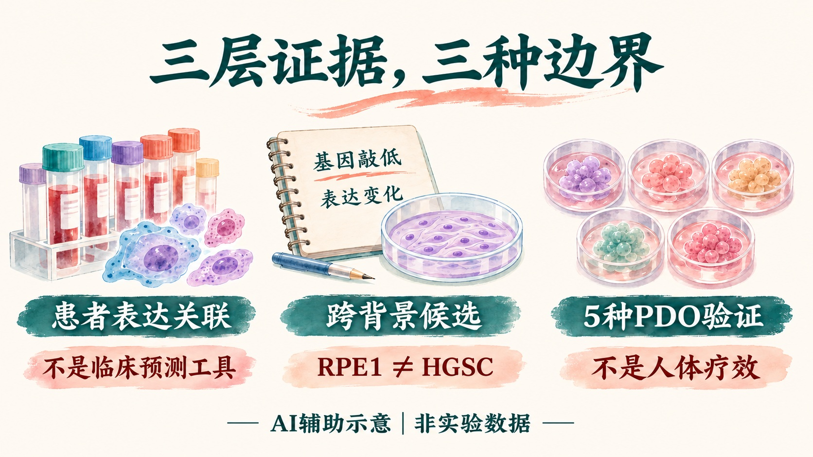

原创教学示意，内置image_gen.imagegen生成；AI辅助示意，非实验数据。

内容身份：原创研究，DOI 10.1038/s41420-026-03433-z。原文题目：NF-κB–mediated chemoresistance emerges from distorted fallopian tube cell-state trajectory in ovarian cancer。期刊 Cell Death Discovery，2026年10月30日上线。本次阅读的是出版社开放提供的28页 Article in Press，即已接收并经过同行评议、尚待最终编辑的早期版本，不是预印本，也不能称最终排版版。

建议公众号系列：一篇完整正文（约5900中文字）＋独立take-home messages，共2篇；原有教学深度全部保留，不为贴近字数拆成过短正文。以下是原创教学母稿，平台排版前需要完成图证据嵌入及手机可读性检查。所有药物讨论限研究证据，不构成患者用药建议。未运行原始代码或重算患者数据。

## 正文上半：先把“耐药细胞”这个问题问清楚

做完一个肿瘤单细胞项目，最常见的下一步，是给每个细胞群找标记基因、做通路富集，再问哪个群可能耐药。结果往往很漂亮：一个群表达炎症相关基因，一个群富集代谢通路，还有一个群看起来更像干细胞。但这些标签距离真正的问题还有一段路：它们是患者之间的差别，还是同一个患者肿瘤内部的状态差别？一个细胞一定只能属于一种状态吗？差异究竟是癌变后新出现的，还是正常组织原本就有、进入肿瘤后改变了用途？

这篇研究的可借鉴之处，是先改变描述细胞状态的方式，再把临床关联、计算推断和类器官干预串起来。研究对象是高级别浆液性卵巢癌，简称HGSC，以及被认为是其主要来源的输卵管上皮，简称FTE。作者没有先定义若干互斥的“耐药亚群”，而是寻找可以同时在一个细胞中表达的基因模块，再考察这些模块如何关联预后和药物反应。读完后，读者可以学会一种研究设计：从正常来源组织出发区分肿瘤新增、丢失和保留的程序；把统计单位从细胞拉回患者；最后用干预实验判断哪些线索值得继续追。

### 从细胞群标签换成模块活动

细胞类型和细胞状态并不完全相同。分泌上皮细胞、免疫细胞和成纤维细胞是较稳定的身份；应激、代谢、增殖等程序更像同一身份之上的活动组合。一个肿瘤细胞可以同时增强应激反应并改变能量代谢，因此把它硬分到唯一状态里，会丢掉组合信息。研究采用的模块思路，就是把经常共同变化的基因放在一起，为每个细胞计算多个模块的活动分数。

这不是说聚类没有用。聚类适合浏览结构和检查群体，模块适合表达连续变化。两者解决的问题不同。如果一上来把聚类编号当作生物学实体，后面的“群7耐药”很容易依赖分辨率和整合方式。相反，模块让我们问：同一套表达程序是否跨患者重现，它在不同细胞中有多强，与哪个功能读出相联系？

研究纳入50名未经治疗的HGSC患者，共52份肿瘤样本，来自不同解剖部位；本队列还有7份绝经后非癌输卵管或伞端组织，另引入7名绝经后供者的公开分泌上皮单细胞数据，用于增加正常参照。这里的“14份正常来源”不能理解为研究者新采集了14份样本。肿瘤样本数也不能和患者数互换。一个正常参照来自具有TP53胚系变异的Li-Fraumeni综合征个体，作者单独检查了它的模块特征。这个设计细节值得记住：参照组并非一个天然无差异的标准答案。

<!-- 原母稿图位1对应以下原样面板及原创教学图。 -->

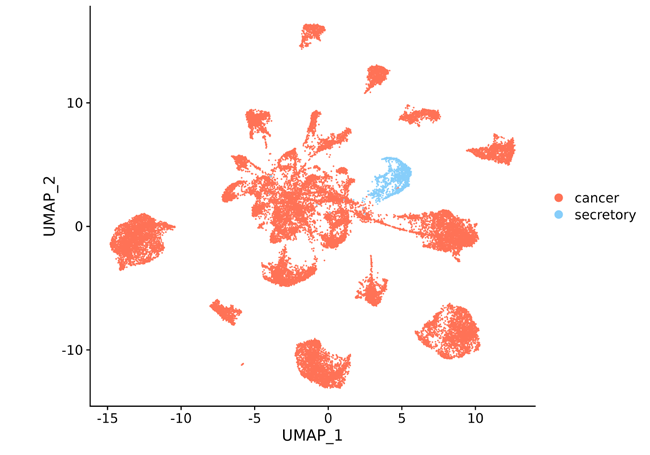

原文数据面板原样裁切，未修改实验数据；原轴、图例和标记保留。Pirttikoski et al., Cell Death Discovery (2026), Article in Press, [DOI:10.1038/s41420-026-03433-z](https://doi.org/10.1038/s41420-026-03433-z)，[CC BY 4.0](https://creativecommons.org/licenses/by/4.0/)。

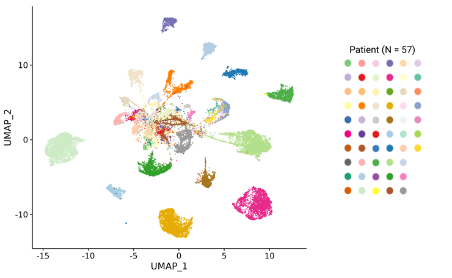

原文数据面板原样裁切，未修改实验数据；原轴、图例和标记保留。Pirttikoski et al., Cell Death Discovery (2026), Article in Press, [DOI:10.1038/s41420-026-03433-z](https://doi.org/10.1038/s41420-026-03433-z)，[CC BY 4.0](https://creativecommons.org/licenses/by/4.0/)。

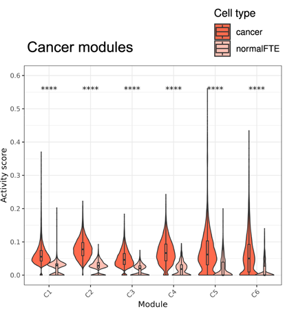

原文数据面板原样裁切，未修改实验数据；原轴、图例和标记保留。Pirttikoski et al., Cell Death Discovery (2026), Article in Press, [DOI:10.1038/s41420-026-03433-z](https://doi.org/10.1038/s41420-026-03433-z)，[CC BY 4.0](https://creativecommons.org/licenses/by/4.0/)。

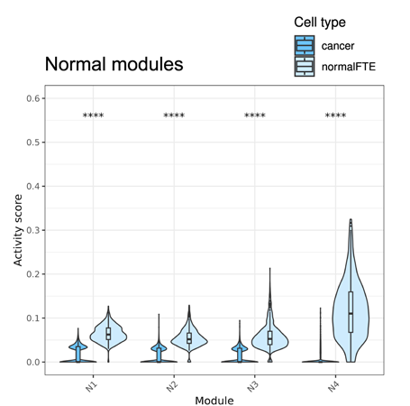

原文数据面板原样裁切，未修改实验数据；原轴、图例和标记保留。Pirttikoski et al., Cell Death Discovery (2026), Article in Press, [DOI:10.1038/s41420-026-03433-z](https://doi.org/10.1038/s41420-026-03433-z)，[CC BY 4.0](https://creativecommons.org/licenses/by/4.0/)。

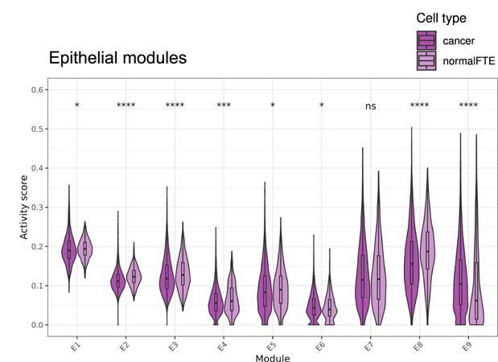

原文数据面板原样裁切，未修改实验数据；原轴、图例和标记保留。Pirttikoski et al., Cell Death Discovery (2026), Article in Press, [DOI:10.1038/s41420-026-03433-z](https://doi.org/10.1038/s41420-026-03433-z)，[CC BY 4.0](https://creativecommons.org/licenses/by/4.0/)。

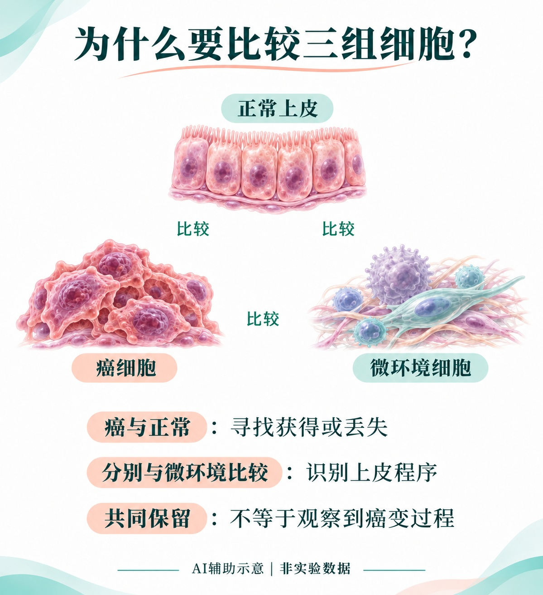

原创教学示意，内置image_gen.imagegen生成；AI辅助示意，非实验数据。

Fig.1B先展示未经患者整合的上皮细胞UMAP。每个点是一个细胞，横纵轴是低维投影坐标，没有组织距离或疾病时间的含义。左图区分癌细胞和分泌上皮，右图按患者着色。癌细胞往往按患者分开，这提醒我们：直接把混合数据中的群体差别解释成通用细胞状态，可能把患者效应当成生物学状态。图中细胞很多，不代表有同样多的独立患者。

### 为什么需要三种比较，而不只比较癌和正常

作者先用pseudobulk，即把同一样本、同一细胞类别的计数汇总，再进行差异表达分析。它的目的之一，是避免把成千上万个细胞当成成千上万个独立患者。具体筛选只纳入该细胞类别超过50个细胞的样本，因此部分肿瘤和正常样本不进入这一步。样本进入某个分析的条件需要单独报告，不能把总体50名患者写成所有分析的分母。

如果只比较癌细胞和正常上皮，容易找到癌症上调或下调基因，却遗漏两者共同保留的组织程序。作者于是加入肿瘤微环境细胞作为参照，分别比较癌上皮与正常上皮、癌上皮与微环境、正常上皮与微环境。这样可以组织出三类基因：癌细胞特异、正常上皮特异，以及两种上皮都高于微环境的共享上皮基因。

后续以CS-CORE估计共表达，再通过WGCNA式网络构建与层次聚类分出模块。CS-CORE针对单细胞数据的测序深度差异和测量噪声建模；这并不意味着加入它以后所有患者效应和技术偏差都自动消失。作者在局限部分也明确承认，不同患者捕获到的癌细胞数差异很大，仍可能影响共表达模式。共享上皮基因的相关性先在癌和正常上皮中分别估计，再平均，以缓解两类细胞数量不平衡。

最终得到6个癌特异模块C1—C6、4个正常特异模块N1—N4和9个共享上皮模块E1—E9。它们是当前数据与筛选规则下得到的研究对象，不是跨癌种固定存在的19种细胞类型。Fig.1C的小提琴图横轴是模块、纵轴是UCell活动分数，颜色区分癌和正常上皮，展示分数分布。UCell是基于基因排序的打分方法；分数高表示该组基因在表达排序中更靠前，不等于测到了蛋白活性，更不等于直接测到了代谢通量。

### 哪两个模块值得继续追

作者把模块分数和PROGENy推断的通路活动、Hallmark基因集联系起来。E7与氧化磷酸化、核苷酸代谢和DNA修复相关；E9与MAPK、NF-κB及炎症应激相关。这里有三个层次要分开：测到的是RNA，通路活动是依据基因表达足迹推断，真正的信号蛋白磷酸化要到后面的实验才出现。不能把前两步就写成已经证明某条通路被激活。

<!-- 原母稿图位2对应以下原样面板及原创教学图。 -->

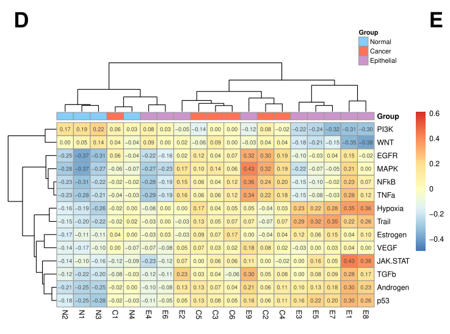

原文数据面板原样裁切，未修改实验数据；原轴、图例和标记保留。Pirttikoski et al., Cell Death Discovery (2026), Article in Press, [DOI:10.1038/s41420-026-03433-z](https://doi.org/10.1038/s41420-026-03433-z)，[CC BY 4.0](https://creativecommons.org/licenses/by/4.0/)。

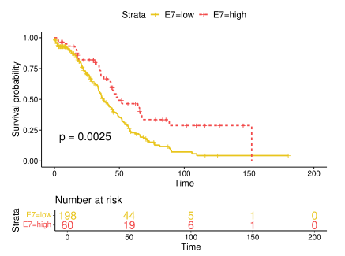

原文数据面板原样裁切，未修改实验数据；原轴、图例和标记保留。Pirttikoski et al., Cell Death Discovery (2026), Article in Press, [DOI:10.1038/s41420-026-03433-z](https://doi.org/10.1038/s41420-026-03433-z)，[CC BY 4.0](https://creativecommons.org/licenses/by/4.0/)。

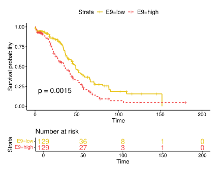

原文数据面板原样裁切，未修改实验数据；原轴、图例和标记保留。Pirttikoski et al., Cell Death Discovery (2026), Article in Press, [DOI:10.1038/s41420-026-03433-z](https://doi.org/10.1038/s41420-026-03433-z)，[CC BY 4.0](https://creativecommons.org/licenses/by/4.0/)。

Fig.1D中每格反映一个模块与一条通路分数的相关性。行列聚在一起，说明表达层面的模式相似，不能证明模块中的某个基因直接控制该通路。Fig.1E把视角换到患者：作者使用258名TCGA患者的去卷积bulk RNA-seq和生存信息，发现E7高分组总生存较好，E9高分组较差。曲线横轴是生存随访时间，纵轴是估计生存概率，刻痕表示删失，下面的风险人数表表示各时点仍处于观察风险集的人数。原图横轴只标Time，未直接写时间单位；平台图注应保留原标注并避免自行补成天或月，除非另从分析代码独立确认。

这组结果有吸引力，但不能只看两个很小的P值。高低组的阈值通过maxstat在这套数据中优化得到，并非预先规定后在独立队列中盲测。挑选阈值会增加结果显得更好的机会，需要预注册或外部验证来评估其稳健性。19个模块中筛出关联显著的两个，也应考虑整个选择流程的多重比较。原稿不能把它包装成已经可供临床使用的预后检测试剂。

作者又检查HRD，即同源重组修复缺陷。E7在HRD肿瘤中更活跃；在包含HRD状态和年龄的Cox模型中，E7、E9仍与总生存关联。这个结果比简单分组曲线前进了一步，但只控制了模型中纳入的因素，并不代表所有临床混杂都被排除。补充Fig.S8提示Cox分析使用231名患者，HRD/HRP比较为138对111，均不同于生存总样本258。把不同分母写清楚，比笼统写“大队列验证”更有用。

### 整合后看见共同状态，究竟说明什么

<!-- 原母稿图位3对应以下原样面板及原创教学图。 -->

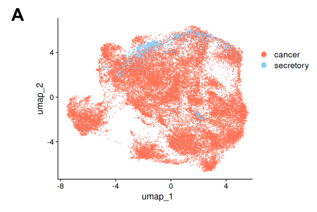

原文数据面板原样裁切，未修改实验数据；原轴、图例和标记保留。Pirttikoski et al., Cell Death Discovery (2026), Article in Press, [DOI:10.1038/s41420-026-03433-z](https://doi.org/10.1038/s41420-026-03433-z)，[CC BY 4.0](https://creativecommons.org/licenses/by/4.0/)。

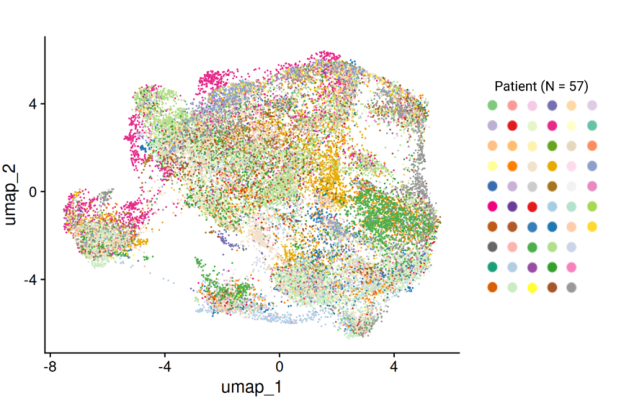

原文数据面板原样裁切，未修改实验数据；原轴、图例和标记保留。Pirttikoski et al., Cell Death Discovery (2026), Article in Press, [DOI:10.1038/s41420-026-03433-z](https://doi.org/10.1038/s41420-026-03433-z)，[CC BY 4.0](https://creativecommons.org/licenses/by/4.0/)。

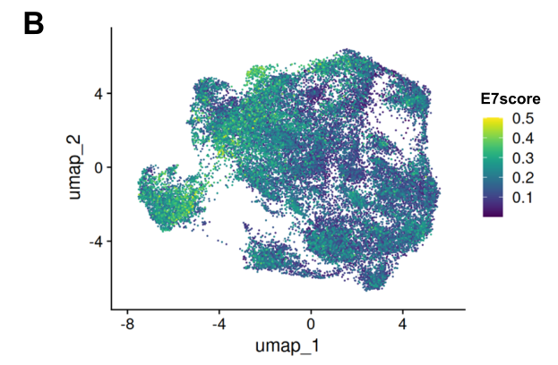

原文数据面板原样裁切，未修改实验数据；原轴、图例和标记保留。Pirttikoski et al., Cell Death Discovery (2026), Article in Press, [DOI:10.1038/s41420-026-03433-z](https://doi.org/10.1038/s41420-026-03433-z)，[CC BY 4.0](https://creativecommons.org/licenses/by/4.0/)。

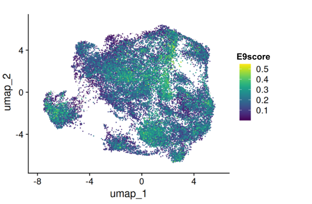

原文数据面板原样裁切，未修改实验数据；原轴、图例和标记保留。Pirttikoski et al., Cell Death Discovery (2026), Article in Press, [DOI:10.1038/s41420-026-03433-z](https://doi.org/10.1038/s41420-026-03433-z)，[CC BY 4.0](https://creativecommons.org/licenses/by/4.0/)。

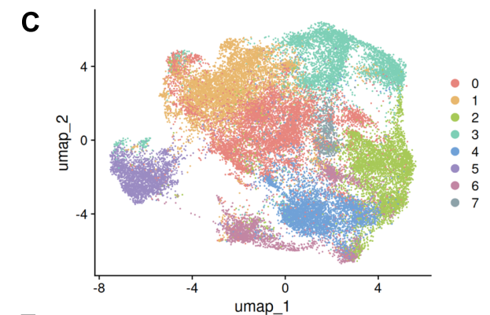

原文数据面板原样裁切，未修改实验数据；原轴、图例和标记保留。Pirttikoski et al., Cell Death Discovery (2026), Article in Press, [DOI:10.1038/s41420-026-03433-z](https://doi.org/10.1038/s41420-026-03433-z)，[CC BY 4.0](https://creativecommons.org/licenses/by/4.0/)。

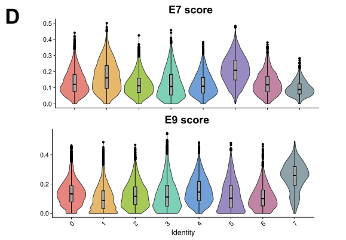

原文数据面板原样裁切，未修改实验数据；原轴、图例和标记保留。Pirttikoski et al., Cell Death Discovery (2026), Article in Press, [DOI:10.1038/s41420-026-03433-z](https://doi.org/10.1038/s41420-026-03433-z)，[CC BY 4.0](https://creativecommons.org/licenses/by/4.0/)。

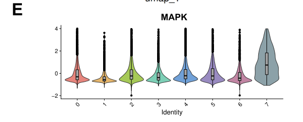

原文数据面板原样裁切，未修改实验数据；原轴、图例和标记保留。Pirttikoski et al., Cell Death Discovery (2026), Article in Press, [DOI:10.1038/s41420-026-03433-z](https://doi.org/10.1038/s41420-026-03433-z)，[CC BY 4.0](https://creativecommons.org/licenses/by/4.0/)。

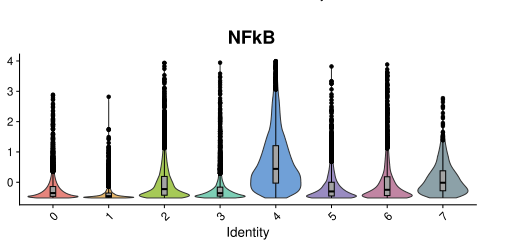

原文数据面板原样裁切，未修改实验数据；原轴、图例和标记保留。Pirttikoski et al., Cell Death Discovery (2026), Article in Press, [DOI:10.1038/s41420-026-03433-z](https://doi.org/10.1038/s41420-026-03433-z)，[CC BY 4.0](https://creativecommons.org/licenses/by/4.0/)。

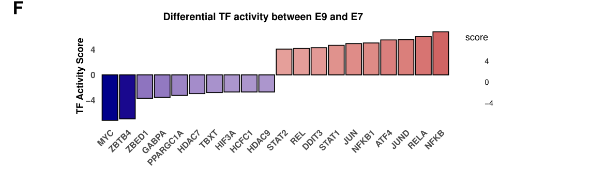

原文数据面板原样裁切，未修改实验数据；原轴、图例和标记保留。Pirttikoski et al., Cell Death Discovery (2026), Article in Press, [DOI:10.1038/s41420-026-03433-z](https://doi.org/10.1038/s41420-026-03433-z)，[CC BY 4.0](https://creativecommons.org/licenses/by/4.0/)。

研究使用Harmony整合患者差异后，检查模块是否对应跨患者的细胞分布。重要的是：Harmony只用于整合、聚类和可视化，模块推断与分数来自未整合的RNA表达。这样避免了先把数据“调成相似”，再把相似性当作模块存在的主要证据。

Fig.2B以连续颜色显示每个细胞的E7、E9分数，Fig.2D则比较聚类中的分布。E7与E9富集于不同区域，但二者没有成为绝对互斥的开关。文章报告的单细胞相关性是温和的负相关；巨大的细胞数可以让很小的效应获得很小的P值。阅读时应先看效应大小和患者间一致性，再看显著性。

Fig.2E展示的是PROGENy推断的MAPK与NF-κB活动。它与模块分布相符，但仍处于转录组推断层。作者还在另外41名未经治疗的HGSC患者的公开单细胞数据里复核模块—通路关联，方向得到部分支持，关联强度并不大。外部数据支持“该程序不只存在于当前队列”，却没有直接验证药物组合对其他患者一定有效。

### 轨迹上的“早晚”，不是患者癌变的录像

<!-- 原母稿图位4对应以下原样面板及原创教学图。 -->

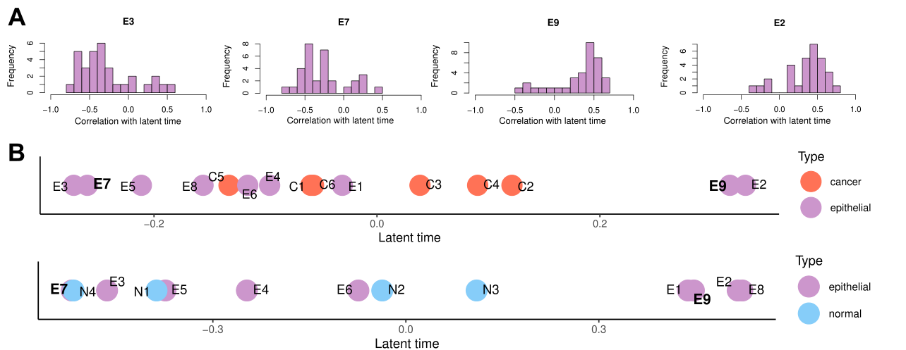

原文数据面板原样裁切，未修改实验数据；原轴、图例和标记保留。Pirttikoski et al., Cell Death Discovery (2026), Article in Press, [DOI:10.1038/s41420-026-03433-z](https://doi.org/10.1038/s41420-026-03433-z)，[CC BY 4.0](https://creativecommons.org/licenses/by/4.0/)。

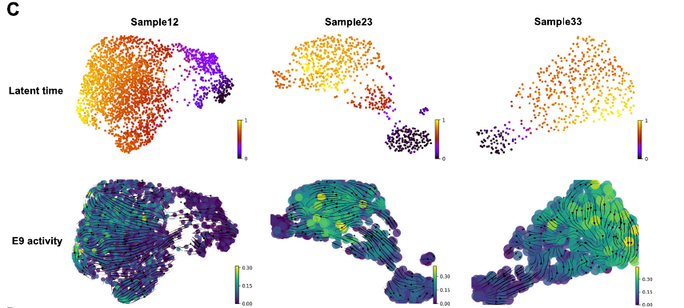

原文数据面板原样裁切，未修改实验数据；原轴、图例和标记保留。Pirttikoski et al., Cell Death Discovery (2026), Article in Press, [DOI:10.1038/s41420-026-03433-z](https://doi.org/10.1038/s41420-026-03433-z)，[CC BY 4.0](https://creativecommons.org/licenses/by/4.0/)。

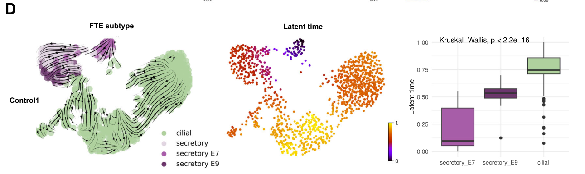

原文数据面板原样裁切，未修改实验数据；原轴、图例和标记保留。Pirttikoski et al., Cell Death Discovery (2026), Article in Press, [DOI:10.1038/s41420-026-03433-z](https://doi.org/10.1038/s41420-026-03433-z)，[CC BY 4.0](https://creativecommons.org/licenses/by/4.0/)。

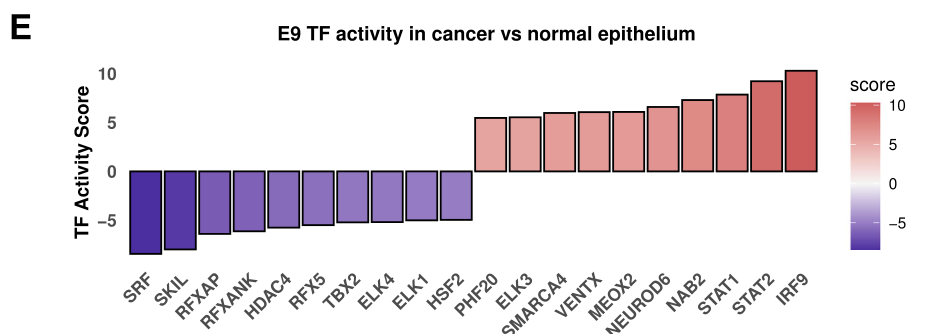

原文数据面板原样裁切，未修改实验数据；原轴、图例和标记保留。Pirttikoski et al., Cell Death Discovery (2026), Article in Press, [DOI:10.1038/s41420-026-03433-z](https://doi.org/10.1038/s41420-026-03433-z)，[CC BY 4.0](https://creativecommons.org/licenses/by/4.0/)。

作者用剪接与未剪接RNA估计RNA velocity，并用CellRank建立latent time，发现E7偏向轨迹较早端，E9偏向较晚端。Fig.3C的每个点仍是细胞，上面的颜色是0—1的推断时间，下面是E9分数与速度方向。两种颜色呈现一致的空间趋势，为状态连续性提供线索。但UMAP上的箭头没有记录同一个细胞真实从哪走到哪，更没有直接观察正常输卵管细胞变成癌细胞。

这点尤其重要，因为文章标题容易让人以为已经重建并验证了癌变过程。实际上，正常和肿瘤来自不同个体、横断面采样，速度模型建立在RNA动力学假设之上。作者在正常组织中加入分泌细胞向纤毛细胞分化的已知方向进行检查，得到多数样本方向一致的结果；这有助于判断模型是否合理，但不能替代癌变过程的谱系追踪。

另一个统计细节是：跨样本平均轨迹相关性时，作者只保留达到显著性阈值的相关系数。这样的平均值描述的是通过筛选的关联，不能当作所有样本的无偏平均效应。Fig.3B虽然图轴写了latent time，正文和图注说明显示的是模块与latent time的平均相关性，不能把负数读成“负的发育时间”。

在正常上皮中，E9相关的晚期状态保留了MHC-II抗原呈递调控信号；在肿瘤中，相应调控信号下降，并伴随应激与炎症特征。这里的证据主要来自转录因子活动推断，不是直接测量肿瘤细胞给免疫细胞呈递抗原的能力。因此“免疫逃逸”应当作为解释假说，不能写成这一套数据独立完成了免疫功能验证。

这一篇的结论可以收在一个清楚的边界上：研究找到了跨正常来源组织与肿瘤保留的连续表达程序，其中两种程序与患者结局、修复状态及推断动态相联系。下一步不是继续给这些程序加更多名称，而是问：能否用可控干预推动状态，并改变药物反应？

## 正文下半：从预测靶点到类器官，哪些证据真的向因果迈了一步

单细胞分析最容易产生的是相关性最强的一串基因，最难产生的是可以被实验推翻的假说。上一阶段的E7、E9模块并没有告诉我们“敲掉哪个基因就能逆转耐药”。模块中的基因可能只是状态的读出，未必是开关。甚至同一组RNA变化，可能由不同患者中不同的遗传和微环境因素驱动。研究第二部分最值得学的，是用独立扰动数据提出干预方向，再让患者来源类器官承担检验，而不是把网络中心节点直接命名为治疗靶点。

### 遗传背景给模块偏好，不等于找到唯一驱动基因

<!-- 原母稿图位5对应以下原样面板及原创教学图。 -->

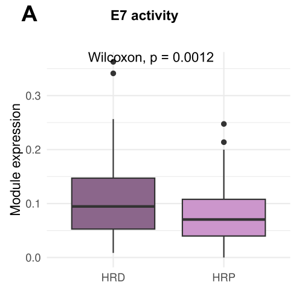

原文数据面板原样裁切，未修改实验数据；原轴、图例和标记保留。Pirttikoski et al., Cell Death Discovery (2026), Article in Press, [DOI:10.1038/s41420-026-03433-z](https://doi.org/10.1038/s41420-026-03433-z)，[CC BY 4.0](https://creativecommons.org/licenses/by/4.0/)。

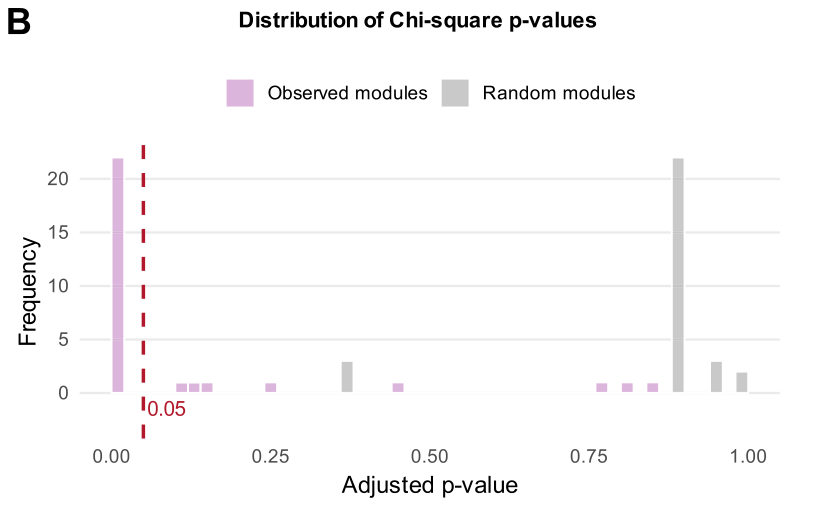

原文数据面板原样裁切，未修改实验数据；原轴、图例和标记保留。Pirttikoski et al., Cell Death Discovery (2026), Article in Press, [DOI:10.1038/s41420-026-03433-z](https://doi.org/10.1038/s41420-026-03433-z)，[CC BY 4.0](https://creativecommons.org/licenses/by/4.0/)。

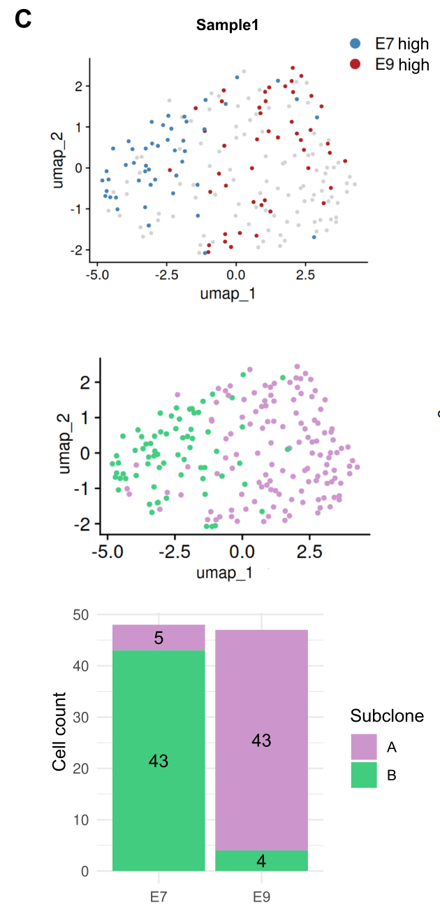

原文数据面板原样裁切，未修改实验数据；原轴、图例和标记保留。Pirttikoski et al., Cell Death Discovery (2026), Article in Press, [DOI:10.1038/s41420-026-03433-z](https://doi.org/10.1038/s41420-026-03433-z)，[CC BY 4.0](https://creativecommons.org/licenses/by/4.0/)。

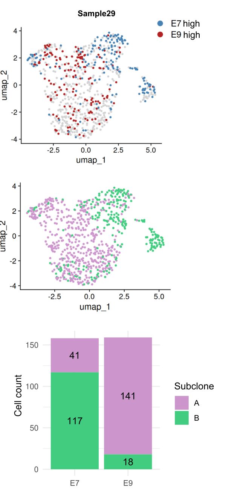

原文数据面板原样裁切，未修改实验数据；原轴、图例和标记保留。Pirttikoski et al., Cell Death Discovery (2026), Article in Press, [DOI:10.1038/s41420-026-03433-z](https://doi.org/10.1038/s41420-026-03433-z)，[CC BY 4.0](https://creativecommons.org/licenses/by/4.0/)。

Fig.4A按患者比较HRD与HRP，即修复缺陷与修复相对完整的肿瘤。纵轴是E7活动，箱线表示患者分布。E7在HRD中更高，提示某些遗传背景可能偏向某些表达状态。作者还把BRCA1突变与恢复野生型的同源背景细胞表达签名，与模块做富集比较。这是机制支持的一环，但不能据此把所有E7高细胞诊断为HRD。

随后作者用单细胞RNA推断拷贝数变化及亚克隆，在满足细胞数量等条件的30名患者中，22名的亚克隆与E7/E9高状态分布存在统计关联。Fig.4C里上下两组UMAP分别标状态和推断亚克隆，下面的堆积柱图直接展示各状态里的亚克隆细胞数。它支持“遗传亚群具有状态偏好”，同时保留了同一克隆内可以有多种状态的现实。

需要注意，两类信息都部分来自RNA数据。inferCNV反映的是染色体片段表达模式推断，不能当作每个细胞都做过DNA测序后的已验证谱系。显著性也不等于找到了直接驱动基因：文章检查了常见扩增驱动基因，个别未经校正的差异在多重校正后不再显著。补充Table S4中CCND3对应E9的校正后P约0.183，AKT2对应E7约0.304，均不支持明确关联。母稿应把这些结果放在“未得到确证”里，而不是把未校正P值挑出来讲故事。

### 为什么用另一种细胞的Perturb-seq

作者借用了Replogle等的公开Perturb-seq数据，在基因受到CRISPR干扰后观察整个转录组怎样变化。如果敲低一个基因后，表达变化与E9高状态相反、与E7高状态相似，这个基因就成为值得测试的候选。这里比较的是一整套变化方向，而不是看到某基因在耐药细胞里高表达就直接选择它。

原始Perturb-seq研究包含K562和RPE1等实验，本文实际采用RPE1视网膜色素上皮细胞数据，涉及2394个敲低基因。这些细胞既不是输卵管上皮，也不是HGSC。基因调控受细胞背景影响，所以得到的是候选排序，不是卵巢癌中的真实因果网络。作者明确承认这一点，这是整条证据链中必须保留的限定。

<!-- 原母稿图位6对应以下原样面板及原创教学图。 -->

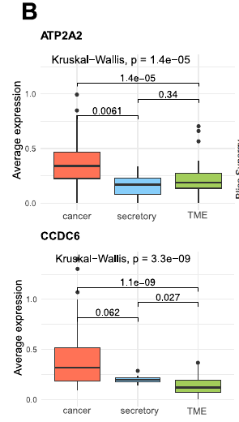

原文数据面板原样裁切，未修改实验数据；原轴、图例和标记保留。Pirttikoski et al., Cell Death Discovery (2026), Article in Press, [DOI:10.1038/s41420-026-03433-z](https://doi.org/10.1038/s41420-026-03433-z)，[CC BY 4.0](https://creativecommons.org/licenses/by/4.0/)。

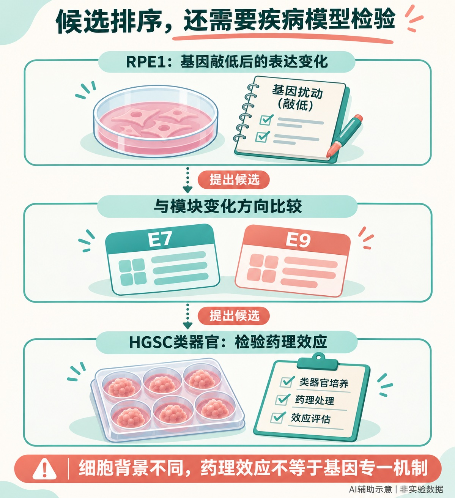

原创教学示意，内置image_gen.imagegen生成；AI辅助示意，非实验数据。

候选包括CCDC6和编码SERCA2的ATP2A2。SERCA2参与内质网钙离子调节，因此可能通过内质网应激影响细胞状态。CCDC6与DNA损伤应答相关。作者还要求候选在肿瘤或目标状态中有表达支持，以提高干预的组织相关性。

但“表达更高”和“安全、选择性治疗”之间有很大距离。Fig.5B的单位是样本平均表达，不是把每个细胞作为独立样本。图中ATP2A2的癌与正常分泌上皮比较达到显著性，CCDC6这一对比较标注P=0.062，不能笼统说两个基因在癌对正常的所有比较都显著。即使表达较高，也不能证明干预不会损害正常组织；研究没有在这里建立人体治疗窗。

### 必须区分要干预的基因和真正加进孔里的药

本文使用XL177A间接影响CCDC6相关轴。XL177A是USP7抑制剂，USP7可以参与稳定CCDC6等底物；这和“XL177A是CCDC6专一抑制剂”不是一回事。原始XL177A研究将其描述为选择性USP7抑制剂，并在多种癌细胞体系中发现与p53状态有关的效应。因此，当本文观察到XL177A与卡铂的相互作用时，不能把所有效应都归因于CCDC6下降。

怎样才能更接近这条具体机制？需要在相关模型中确认CCDC6蛋白与功能变化，使用遗传敲低或敲除，进行救援实验，并检查USP7其他底物及p53背景的影响。这里是我们提出的后续验证建议，本文没有完成这一整套实验。文章提供的是一个有方向性的药理学验证，不是已经把每个中间箭头都闭合的分子机制。

另一种干预是N106，作者把它作为SERCA2激活剂，预期可能增强E9相关状态、减弱卡铂效果。对照方向的意义很大：如果一种干预朝着敏感方向移动，另一种朝着相反方向移动，比只挑出一款让细胞少活一点的药更有解释力。但这仍要求区分药物本身的毒性、与卡铂的相互作用，以及状态变化是否真正介导了最终效应。

### 看懂Bliss分数，比记住“协同”更重要

<!-- 原母稿图位7对应以下原样面板及原创教学图。 -->

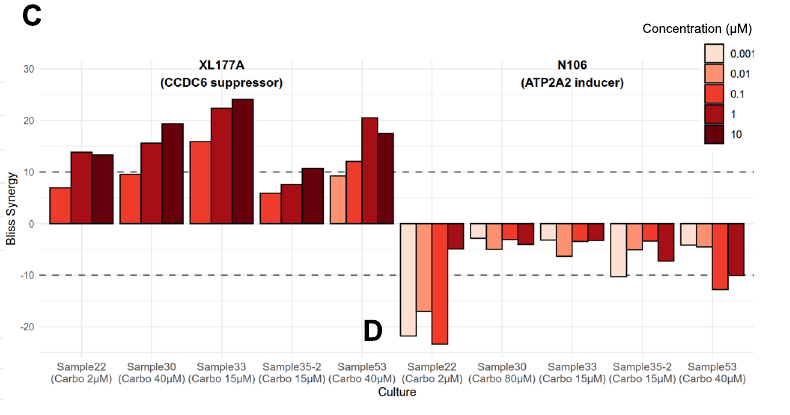

原文数据面板原样裁切，未修改实验数据；原轴、图例和标记保留。Pirttikoski et al., Cell Death Discovery (2026), Article in Press, [DOI:10.1038/s41420-026-03433-z](https://doi.org/10.1038/s41420-026-03433-z)，[CC BY 4.0](https://creativecommons.org/licenses/by/4.0/)。

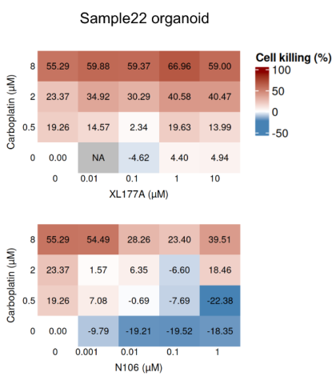

原文数据面板原样裁切，未修改实验数据；原轴、图例和标记保留。Pirttikoski et al., Cell Death Discovery (2026), Article in Press, [DOI:10.1038/s41420-026-03433-z](https://doi.org/10.1038/s41420-026-03433-z)，[CC BY 4.0](https://creativecommons.org/licenses/by/4.0/)。

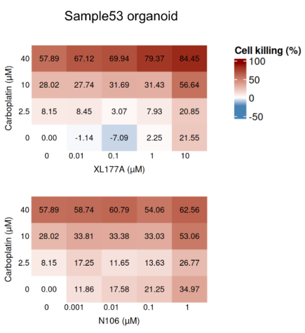

原文数据面板原样裁切，未修改实验数据；原轴、图例和标记保留。Pirttikoski et al., Cell Death Discovery (2026), Article in Press, [DOI:10.1038/s41420-026-03433-z](https://doi.org/10.1038/s41420-026-03433-z)，[CC BY 4.0](https://creativecommons.org/licenses/by/4.0/)。

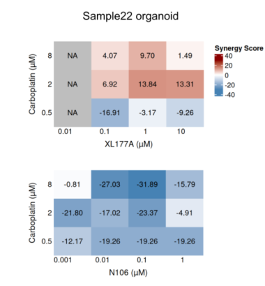

原文数据面板原样裁切，未修改实验数据；原轴、图例和标记保留。Pirttikoski et al., Cell Death Discovery (2026), Article in Press, [DOI:10.1038/s41420-026-03433-z](https://doi.org/10.1038/s41420-026-03433-z)，[CC BY 4.0](https://creativecommons.org/licenses/by/4.0/)。

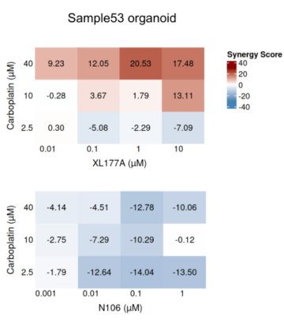

原文数据面板原样裁切，未修改实验数据；原轴、图例和标记保留。Pirttikoski et al., Cell Death Discovery (2026), Article in Press, [DOI:10.1038/s41420-026-03433-z](https://doi.org/10.1038/s41420-026-03433-z)，[CC BY 4.0](https://creativecommons.org/licenses/by/4.0/)。

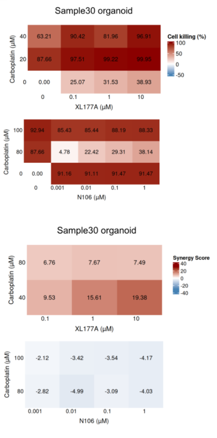

原文数据面板原样裁切，未修改实验数据；原轴、图例和标记保留。Pirttikoski et al., Cell Death Discovery (2026), Article in Press, [DOI:10.1038/s41420-026-03433-z](https://doi.org/10.1038/s41420-026-03433-z)，[CC BY 4.0](https://creativecommons.org/licenses/by/4.0/)。

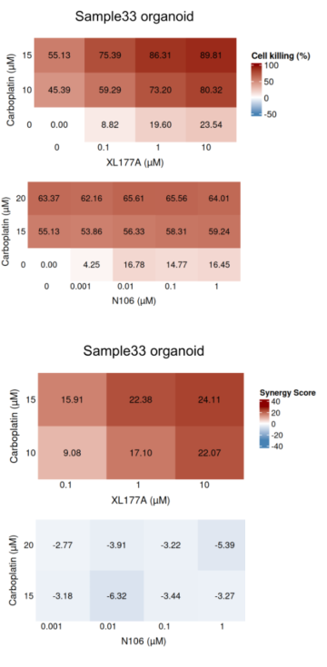

原文数据面板原样裁切，未修改实验数据；原轴、图例和标记保留。Pirttikoski et al., Cell Death Discovery (2026), Article in Press, [DOI:10.1038/s41420-026-03433-z](https://doi.org/10.1038/s41420-026-03433-z)，[CC BY 4.0](https://creativecommons.org/licenses/by/4.0/)。

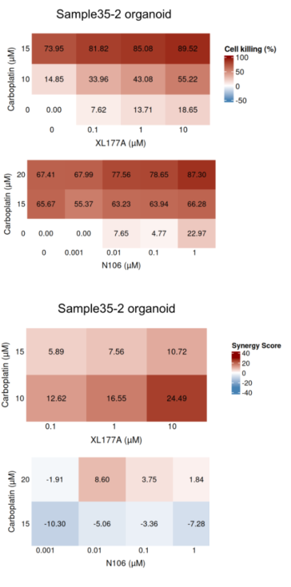

原文数据面板原样裁切，未修改实验数据；原轴、图例和标记保留。Pirttikoski et al., Cell Death Discovery (2026), Article in Press, [DOI:10.1038/s41420-026-03433-z](https://doi.org/10.1038/s41420-026-03433-z)，[CC BY 4.0](https://creativecommons.org/licenses/by/4.0/)。

作者先在两种患者来源类器官中筛选，再扩展到另外三种，共五种PDO模型。类器官保留部分患者肿瘤特征，适合测试患者间差异，但不是完整人体肿瘤，缺少原位微环境、药代动力学与免疫系统。五种模型的“患者来源”也不应被写成五十名患者完成了药物试验。

Fig.5C横轴是不同PDO及其使用的卡铂条件，纵轴是Bliss协同分数，不是百分比生存率。不同深浅颜色表示联合药的不同浓度。作者以大于10定义协同、低于−10定义拮抗，中间接近相加。Bliss模型用两种单药的效应构造独立作用的期望，再比较联合处理偏离这个期望的程度。因此“联合组比对照死得多”本身不等于协同；若两种单药已经各自很强，联合结果也可能只符合独立相加的预期。

图中XL177A与卡铂在多个模型、部分浓度上呈现协同趋势；N106更多表现为中性到拮抗，强度随模型和浓度改变。不能写成所有浓度、每个模型都发生同样强的逆转。尤其不能把一个数值较高的柱子直接当作临床有效率。

读方法还会发现一项不应省略的异质性：最初两种PDO与后续三种PDO的处理时程和生存读出并不完全相同。前者持续暴露卡铂，采用成像细胞毒性指标；后者有先处理再加入卡铂的安排，采用CellTiter-Glo 3D发光读出，卡铂暴露时间也有差别。它们可以提供跨模型方向性支持，但不适合把所有分数合成一个不分条件的统一“平均疗效”。如果复现，应逐行列清模型、浓度、时间、读出和生物学重复。

补充图注与主文对个别剂量范围及阈值测试的描述还有细节差异，例如模块高分比例敏感性分析的主文写10%，补充图注写12.5%；筛选药物浓度范围也不是所有文字完全一致。下游平台不应给出可直接执行的实验配方，更不应替作者自行选一个数填平。对本文主题来说，可以保留“比较多个阈值和多个浓度”的稳健性设计，明确具体复现实验仍需核对原代码、剂量矩阵与作者资料。

### 转录组、蛋白和表型，是三种不同证据

<!-- 原母稿图位8对应以下原样面板及原创教学图。 -->

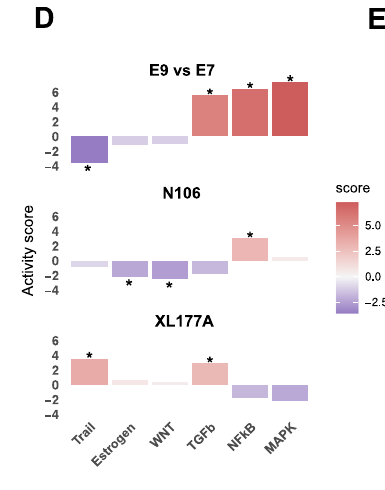

原文数据面板原样裁切，未修改实验数据；原轴、图例和标记保留。Pirttikoski et al., Cell Death Discovery (2026), Article in Press, [DOI:10.1038/s41420-026-03433-z](https://doi.org/10.1038/s41420-026-03433-z)，[CC BY 4.0](https://creativecommons.org/licenses/by/4.0/)。

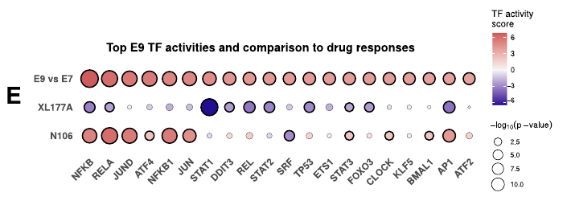

原文数据面板原样裁切，未修改实验数据；原轴、图例和标记保留。Pirttikoski et al., Cell Death Discovery (2026), Article in Press, [DOI:10.1038/s41420-026-03433-z](https://doi.org/10.1038/s41420-026-03433-z)，[CC BY 4.0](https://creativecommons.org/licenses/by/4.0/)。

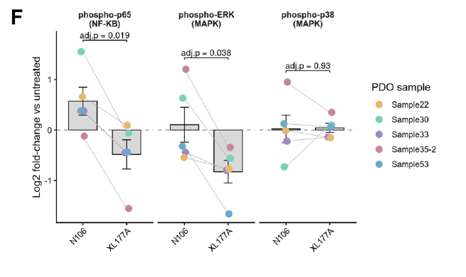

原文数据面板原样裁切，未修改实验数据；原轴、图例和标记保留。Pirttikoski et al., Cell Death Discovery (2026), Article in Press, [DOI:10.1038/s41420-026-03433-z](https://doi.org/10.1038/s41420-026-03433-z)，[CC BY 4.0](https://creativecommons.org/licenses/by/4.0/)。

药物加入后，作者在最初两种PDO中进行了一个时间点的bulk RNA-seq，每个条件有技术双重复；技术重复不能当作额外独立患者。分析把PDO身份放进差异分析模型，以控制患者来源差异。结果显示XL177A与N106对NF-κB相关表达足迹有不同方向的影响。Fig.5D是PROGENy通路活动柱状图，纵轴为活动分数，星号标出校正后显著的项目。Fig.5E才是转录因子活动气泡图：点颜色表示推断的TF活动分数，点大小表示−log10(P值)，反映统计显著性。这些是转录组上的功能解释，并非蛋白开关的直接测量。

随后在五种PDO中检测p65、ERK1/2和p38的磷酸化。Fig.5F的每个点代表一种PDO，灰线连接同一PDO的两种药物处理，纵轴是相对于未处理对照的log2倍数变化，并按对应总蛋白归一。p65和ERK的结果在XL177A与N106之间有统计差异，p38没有一致变化；图中校正后P分别约0.019、0.038和0.93。这里比较的是两种处理之间的配对差异，不能把同一个P值说成每种药相对未处理都显著。统计使用配对t检验，但只有5种PDO，作者也承认无法稳健评估正态性，因此显著性应结合个体配对方向和小样本不确定性阅读。

它的意义是：预测的表达状态变化有了蛋白信号读出支撑，同时药物组合的细胞反应也朝预期方向变化。它仍没有证明“状态变化完全中介药物协同”，因为状态、信号和死亡之间可能存在并行路径。不同实验的处理时长与N106用量也不完全一样，所以不能把三种读出拼成同一时刻同一细胞的连续录像。

### 这篇工作能支持到哪里

比较扎实的一层，是在正常来源组织与癌细胞之间组织可共享的表达程序，并用独立单细胞数据、TCGA关联和患者来源模型构成多层证据。真正可以迁移的方法，是把“发现状态”和“寻找扰动”分开，用外部扰动资源形成候选，再在疾病相关模型中验证。

证据更弱、需要继续检验的一层，是把RNA速度解释为正常到肿瘤的发育过程，把E9当作单一固定耐药命运，以及把XL177A的作用完全归因于CCDC6。患者来源模型规模有限、bulk RNA只在两种PDO一个时间点测量、TCGA阈值优化及潜在临床混杂，都限制了泛化范围。研究没有提供临床给药结论。

如果把这个设计用于自己的肿瘤项目，最优先补的不是更多富集图，而是四件事：预先规定患者级验证标准；明确正常参照与肿瘤的批次和组织差异；在独立样本中检查模块而非只检查UMAP；把遗传扰动、救援实验及时间序列加入候选机制验证。做到这些，单细胞图谱才更可能从描述性地图，变成可以被实验检验的研究路径。

## 来源与阅读范围

- 主论文：https://www.nature.com/articles/s41420-026-03433-z ，DOI https://doi.org/10.1038/s41420-026-03433-z 。实际通读28页官方Article in Press正文、方法、全部5幅主图图注与参考文献，目视核查主图1—5。原文公开下载为_reference.pdf，普通.pdf在本次环境返回HTML，未把HTML误当全文。
- 补充：官方Supplementary material PDF已下载，实际读取S1—S15图注及相关表S3、S4、S5；未逐一重算补充数据，未把补充图注阅读冒称全部原始数据独立核验。未使用任何受控数据访问凭据。
- CS-CORE原始论文：Su等，10.1038/s41467-023-40503-7；核查PubMed摘要及作者官方文档 https://changsubiostats.github.io/CS-CORE/ ，未全文重读。用于限定模型解决的测序深度和测量误差问题。
- Replogle等Perturb-seq原研究：10.1016/j.cell.2022.05.013，https://pmc.ncbi.nlm.nih.gov/articles/PMC9380471/ 。核查摘要及公开方法片段中的K562/RPE1与CRISPRi实验范围，未将其全篇标为已读。
- XL177A原始研究：10.1038/s41598-020-62076-x，https://pubmed.ncbi.nlm.nih.gov/32210275/ 。核查摘要与官方结果片段，确认USP7靶点和p53依赖效应背景；未将该研究全文标为已读。
- 正文中其他机制与既往工作归为“本文作者引用和解释”，未全部独立阅读全文。以上对证据局限、复现建议及需要救援实验的讨论是本解读的分析，不是原文额外完成的实验。

## 归档版图像与许可说明

本归档以完整内容母稿为基础，保留全部正文和八项THM，不使用为微信容量而缩短的正文。原母稿见已保存的完整母稿备份（Library libfile_8cf99b4c363c8191b46ff12966d61188 v0）；仅将八处图位占位符替换为实际资产引用，新增封面、hero、归档说明。文中原始平台计划语句保留作来源记录，不代表本归档仍欠缺图证据。

全部37张数据面板为主论文原样片段及其补充S11—S13矩阵，不是额外独立研究图。5张原创图为封面、两个hero及两张教学图。Fig1A与Fig5A非数据插画因第三方素材来源未确认而不收录；其文字事实仍保留，核心数据图未被替代。图注与阅读范围沿用原完整母稿；不把患者级表、访问凭据或原PDF加入仓库。公开归档不依赖“用户以后查许可”的放行，使用上游已核验CC BY4.0的数据面板与原创图。

密集矩阵及风险人数可打开原图放大核查；不承诺每个数字在手机缩略图无需放大可读。主文/补充剂量和阈值描述差异未擅自补平，勿直接据此执行实验或临床用药。

## Take-home messages：把每一种证据放回它能回答的问题

原创教学示意，内置image_gen.imagegen生成；AI辅助示意，非实验数据。

这篇研究最有价值的结论，不是一种药已经可以逆转卵巢癌耐药，而是一种从单细胞观察走向实验检验的工作方式。

1. **细胞状态可以是组合，不一定是互斥的群。** 代谢、应激和增殖程序可以同时存在，用模块分数表达连续变化，往往比给聚类编号取生物学名字更贴近问题。模块仍依赖基因筛选、细胞数量和共表达模型，需要跨患者复核。

2. **正常来源组织是发现问题的参照。** 癌与正常的差异找“获得或丢失”，加入微环境参照则能找“共同保留”的上皮程序。本研究的E7、E9属于后者，提示恶性状态可能利用已有组织程序，但不证明已观察到正常细胞癌变全过程。

3. **每张图都要问统计单位。** UMAP点是细胞，TCGA生存曲线的单位是患者，药物验证的生物学单位是PDO来源。技术重复和大细胞数不能替代独立患者数。本文不同分析的分母不同，应分别标注。

4. **通路推断不等于直接功能测量。** UCell、PROGENy和转录因子评分都从RNA出发，支持状态与功能关联。p65与ERK磷酸化提供另一个层级的证据，但仍需结合处理条件和独立重复解释。

5. **RNA velocity的“早晚”不是日历时间。** 它依赖RNA动力学和图模型假设。本文跨正常与癌的轨迹关系应视为待实验检验的框架，不能替代谱系追踪，也不适合宣称推翻了所有癌症干细胞理论。

6. **外部Perturb-seq适合找候选，不自动解决细胞背景迁移。** RPE1中的敲低结果可以启发HGSC实验，但两者调控背景不同。候选在PDO中出现方向性效应是重要一步，距离广泛有效的治疗还远。

7. **药物名称必须对应真实靶点。** XL177A直接抑制USP7，本文用它间接检验CCDC6相关轴。未做充分遗传验证和救援前，不能把药物的所有效应写成CCDC6的专一因果作用。

8. **协同分数不是临床疗效。** Bliss比较联合效应与独立作用期望。结果依赖浓度、时程和模型。这里五种PDO提供有限范围的支持，不应合并成面向患者的治疗承诺。

如果只带走一个分析习惯：把每个结论后面接上“它来自什么数据、统计单位是什么、有哪些替代解释、下一项什么实验能推翻它”。这能让一篇单细胞文章从术语堆砌变成真正可迁移的研究设计。
