# 百万中性粒细胞，读出什么？

::: {.book-source}
论文：[DOI 10.1038/s41590-026-02671-8](https://doi.org/10.1038/s41590-026-02671-8)。原有图注和许可说明见正文；未明确许可的图版标记为**授权待确认**。
:::

原文：[A single-cell atlas of human neutrophils reveals neutrophil heterogeneity across health and disease](https://doi.org/10.1038/s41590-026-02671-8)。Nature Immunology，2026-10-21。

阅读范围：Complete publisher main text and Methods read; Main1-6 plusExtended9 visually inspected; Supplementary Figures1–2 PDF read including rendered figures and legends; reporting summary3 pages visually read; XLSX S1–7 extracted, S1–3 structure and selected entries checked, S4–7 full displayed rows read; not raw-data verification.; SAVE-MORE posthoc original full main text read.

未独立核验与边界：No raw matrix/code rerun or clinical validation. Cited SCAHN GitHub unavailable (404). FHS residual cutoff median vs zero discrepancy and propensity-regression vs table title ambiguity retained.

图像许可：Main Fig.1–6 and Extended Data Fig.9: CC BY-NC-ND 4.0, unmodified full original figures with technical encoding only, noncommercial educational reuse. Five generated cover/hero illustrations are not experimental data.

## 1. 从采样、质控、共识聚类到状态签名，检查百万细胞图谱的可解释性。

把几十个单细胞数据集合在一起，细胞数轻易就能到百万。但对一个低RNA含量、对取样处理敏感的细胞群，百万个点未必比一份设计清楚的小数据更可靠。中性粒细胞正好把这个问题放大了：PBMC里能看到的、全血里能留下的、肿瘤组织里能解离出来的，很可能不是同一批状态。先决定哪些细胞进入矩阵，后面的“亚群发现”才有意义。

2026年10月21日，Zheng等在Nature Immunology发表开放获取的原创资源研究，建立人中性粒细胞图谱SCAHN。这不是新采集的一百万个细胞，也不是一种新测序技术，而是对40项研究的43个数据集、781份样本中约一百万个中性粒细胞的重新整理。本文先拆开它的图谱构建逻辑，读者可以带走一套检查自己整合分析的顺序：先看取样范围，再看质控与整合，最后才问状态是否成立。

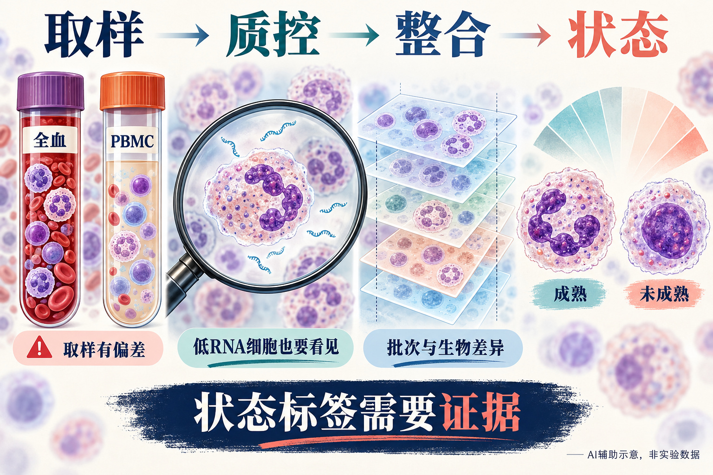

### 先看图谱的入口，不急着看UMAP

原文图1a呈现资料搜集、细胞提取、整合和聚类的路线。公开数据来自多个库，覆盖7种测序平台、9个国家以及二十多种组织与疾病情境。这样的广度有价值：同一个状态若在不同研究中反复出现，就比只在单个实验中出现更值得追踪。但广度不等于均衡。图1b的两幅UMAP分别按组织、疾病条件着色，图1c的流向图把来源和条件连接起来。读这些图时，要问哪些条件集中在某种组织，而不是只赞叹颜色都混在一起了。

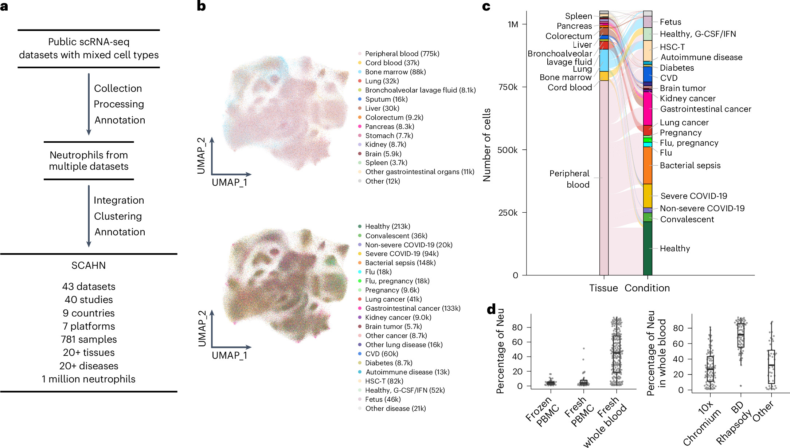
图1：原文完整图，Zheng等，Nature Immunology，2026，DOI:10.1038/s41590-026-02671-8。CC BY-NC-ND 4.0；非商业教学原样展示，不改变数据、标签或布局。请点开放大查看。

UMAP每一个点代表细胞，两个坐标是降维坐标，没有临床或时间单位。点间邻近说明所选表达特征下的相似性，不直接代表发育先后；不同颜色混合，也不能单独证明批次完全消除了。某种疾病与某个组织高度绑定时，算法很难知道应该保留的是组织生物学，还是应该去掉的技术差异。781份样本也不能自动改写成781名互相独立的供者；同一研究可能包含重复取样，具体独立性需回到样本清单核对。图1c因此不是装饰：它帮助我们辨认研究设计本身有没有给区分这两者留下空间。

图1d更接近一个容易被忽略的现实。横向分类是样本处理方式，纵轴是样本中中性粒细胞的比例；每个箱线图汇总的是样本，不是把全部细胞当独立重复。箱体中线为中位数，箱体为四分位间距，须线为1.5倍四分位间距。作者报告，全血样本的中性粒细胞比例中位数为45%，PBMC为4%；全血中，10x Chromium与BD Rhapsody的相应中位数又分别是27%和72%。这些差异提醒我们：观察到的比例首先是“被这个流程捕获的比例”。

这里不能顺势宣称某个平台一定更好。图中的平台不是同一批供者随机分配的平行实验，疾病、处理与平台可能同时变化。作者也明确承认，无法完全拆开平台和处理流程对质量与组成的影响。因此，最稳妥的结论是取样和技术条件与图谱组成强烈关联，不能把这个跨研究比较当成严格的平台性能排名。对自己的项目，真正可迁移的做法是把这些字段保留进样本表，而不是等到最后才补一个“batch”列。

### 低RNA细胞为什么不能照搬常用阈值

SCAHN的基本筛选排除了检测到基因少于50、mRNA计数少于200或线粒体比例超过20%的细胞，并仅保留至少有30个中性粒细胞的样本。这个基因数门槛远低于很多常见教程。它不是告诉所有项目今后都该用50，而是在提示一个原则：对低RNA含量的目标细胞，沿用针对其他细胞群的高门槛，可能先把真实目标删除，再得出“样本里很少”的结论。

原文将第二个门槛表述为mRNA reads。我们没有运行作者流程，不能进一步把它改写成所有平台通用的UMI阈值。对复现者而言，需核对每个输入矩阵的计数定义、平台和原始处理方式。相同的数字在read-count与UMI-count矩阵上不是相同的过滤强度，RNA测序的输入定义应当跟随数据，而不是跟随一个复制粘贴的代码片段。

目标细胞识别同时参考经典标记、颗粒相关基因和原研究注释。成熟相关基因包括FCGR3B、CXCR1/CXCR2和MME，未成熟相关基因包括AZU1、MPO与CEACAM8。为减少嗜酸性、嗜碱性粒细胞混入，作者排除了可检测到SIGLEC8、EPX或GATA2的细胞。作者仍承认，表达不典型的少数细胞可能残留。这是一条应保留在结果旁边的限定：标记筛选能降低混杂，不能把细胞身份变成没有误差的真值。

这套流程也有选择性。至少30个目标细胞的样本要求有助于让比例估计不至于极不稳定，但目标细胞极少的样本更容易被排除。图谱因而回答的是“达到入选条件的公开样本中，能分辨哪些状态”，而不是所有人群、所有组织的完整普查。若用它判断一种稀有组织是否完全没有某种状态，首先要看该组织是否被充分采到。

### 整合消除的是哪个差异

作者对各数据集分别进行SCTransform归一化，选择整合特征，合并后做PCA，再用Harmony校正低维表示；批次变量设为样本。后续最近邻图和图聚类建立在校正后的主成分上。重要的是，Harmony校正的是用于构图的表示，不能笼统理解成“把所有基因表达都变成可直接比较的数值”。原文后续疾病比较另以每份样本汇总表达或比例，再做跨队列分析，这与在整合UMAP上直接比较颜色是两件事。

以样本作为批次变量有实用理由，不同样本的处理差异会影响邻域。但样本同时也承载疾病与供者的生物差异。因此，整合越强未必越好。若某一状态只存在于某种疾病或某一个队列，强行混合可能把它抹掉；整合不足又可能把平台差异包装成新亚群。原文用多参数聚类和已知标记对应关系增加稳健性，但这些检验仍不能替代一个完整的过校正评估。

SCAHN没有只展示一次Louvain运行。作者改变高变基因数、邻域图所用主成分数和聚类算法，并在多个分辨率下比较结果，再通过共同聚类关系构建共识。高变基因使用了1000、2000或3000，主成分比较25和30，算法包括原始Louvain、带多层优化的Louvain及Leiden。一个细胞群若只有在某一组任意参数下才出现，可信度自然不同于在多种设定下都能找到相近成员的群。

不过，原文在各配置中选择了群数较可比的分辨率，之后还合并标记相近的簇。因此，共识不是算法替研究者自动揭示一个唯一正确的“天然群数”。命名包含人工生物学判断；没有清晰标记的簇还会按低测序深度等质量特征标记。对读者而言，应该同时保留“稳定”和“解释得通”两条证据，而不是把共识聚类当成免检章。

### 图2怎样把成熟状态与功能程序拆开

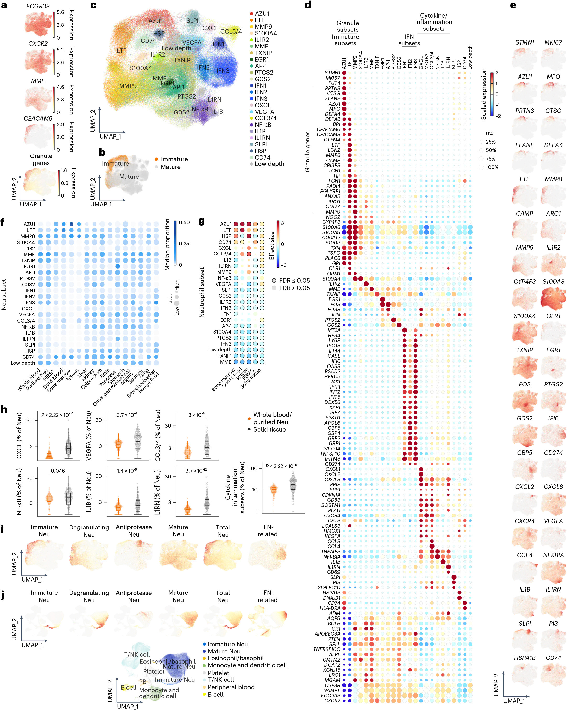
图2：原文完整图，来源、许可及原样展示方式同图1。图中UMAP、表达热图、比例热图与效应量各自使用不同统计对象，不宜只按颜色深浅作同一种解释。

图2a先在UMAP上显示成熟标记与颗粒基因，图2b给出成熟和未成熟的总体区分，图2c才呈现更细的状态标签。这样的阅读顺序比直接背簇名更有用：先判断这个细胞处于哪一类成熟背景，再判断它正在表现哪种转录程序。作者将未成熟细胞分为以初级颗粒基因为特征的AZU1群，以及以次级颗粒基因为特征的LTF群；MMP9群则同时有成熟标记和三级颗粒基因，因此不能看到“颗粒群”就一律叫未成熟。

图2d实际是点图：行是基因，列是状态；颜色是经缩放的几何平均表达，点大小表示该状态中检测到该基因的细胞百分比，图例由0%到100%。它适合比较同一个基因在哪些状态相对较高，不能从一行的深色推出它的绝对分子数超过另一行。图2e再用代表性基因的单细胞空间分布帮助检查命名。AZU1群表达MKI67和STMN1等增殖相关基因，支持它与较早前体状态相符，但“有增殖转录程序”仍不同于我们直接测量了这些细胞当时的分裂速度。

成熟细胞中还可见干扰素相关、细胞因子/炎症相关以及其他标记定义的状态。IFN1、IFN2、IFN3的名字来自不同干扰素相关转录程序；CXCL、CCL3/4、NF-κB、IL1B、IL1RN和VEGFA被合称细胞因子/炎症状态。这些标签方便交流，却不是互不相容的永久细胞身份。一个细胞可能随刺激改变表达程序，聚类只是将连续且交叠的表达空间切成可操作的分组。

尤其需要谨慎的是CEACAM8。它编码的CD66b常用于中性粒细胞蛋白标记，而本研究中CEACAM8转录本主要见于未成熟群。正确启发是不要把RNA检测模式直接等同于蛋白标记性能；错误结论则是“CD66b不能标中性粒细胞”。作者主要分析转录组，并没有系统测量蛋白丰度、周转或表面定位。RNA与蛋白之间的对应关系恰恰被列为未来需要补上的工作。

### 先问分母，再解释一个亚群“增多”

图2f的颜色汇总不同组织中各状态比例的样本中位数，点大小对应样本间标准差，图2g则以全血/纯化中性粒细胞为参照，显示组织间比例差异的Hedges’ g效应量。红色表示高于参照，蓝色表示低于参照，带黑边的点表示FDR≤0.05，不能把颜色深浅当P值。这里比例的分母是该样本里的中性粒细胞，不是组织全部细胞。某群从中性粒细胞内部的5%升到10%，并不自动代表每毫升血中该群的绝对数量翻倍，因为总中性粒细胞数量也可能变化。

作者报告未成熟AZU1与LTF群在PBMC中的比例中位数高于全血，约15%对4%。一个合理解释是低密度细胞更容易随PBMC分离保留下来；这是与流程一致的解释，不是本文通过随机分离实验单独证实的因果效应。骨髓、脾和脐血也有较多未成熟群，但组织之间的差异既可能反映生物学，也包含取样与处理的选择。

图2h比较实质组织与全血/纯化细胞中的炎症相关状态比例，统计单位仍是样本。图2g,h使用秩和检验，热图相关多重比较按FDR校正。研究者读这类图，至少要同时确认比较对象、样本量、效应方向以及多重比较范围，不能只截下一颗星号。FDR控制的是一组检验的预期错误发现比例，不是说每个显著状态有某个固定概率是真的。

### 从一张状态图到可迁移参考

图2i,j转向另一个关键问题：一个在中性粒细胞内部好用的状态标记，放回整份血样后还是否特异？作者把中性粒细胞与其他外周免疫细胞比较，构建未成熟、成熟、脱颗粒、抗蛋白酶和总中性粒细胞五类特异签名，同时另列IFN签名。原文筛选同时考虑目标群表达比例、相对其他免疫细胞的差异幅度，以及其他细胞中的低表达比例。

这一关决定了后续bulk分析的解释空间。若某个IFN基因在多类免疫细胞都上调，全血里它升高不能直接定位到中性粒细胞；同样，ARG1等基因在某状态中高表达，也不等于每个带该标签的细胞都已经具有相同的功能。特异签名是在本文所检验的外周免疫背景中建立的，不是对所有疾病、所有组织和所有肿瘤细胞的普适排他证明。

这篇文章的第一层价值因此不是“找到了更多簇”，而是把取样、成熟背景、转录程序、组织分布和可转移标记放在同一个参考框架里。我们真正能借走的是这条核查链：目标有没有被流程漏掉，状态是否受参数驱动，比例分母是什么，标记离开原来的比较背景后是否仍有意义。下一篇再用跨物种与疾病分析检验：这个参考框架在新的数据里究竟能走多远。

阅读范围：已通读官方完整正文与Methods；本文解释主图1、2并核对补充说明。没有重跑原始矩阵、Harmony或聚类。正文中的“建议检查”是我们的分析建议，不是作者已经完成的额外实验。

原文：https://www.nature.com/articles/s41590-026-02671-8
许可：https://creativecommons.org/licenses/by-nc-nd/4.0/

## 2. 跨物种映射、感染与肿瘤关联能支持什么，不能支持什么。

小鼠中的一个中性粒细胞亚群在人类图谱里找到了近邻，能否认为它的功能也保守？患者中某个状态与死亡相关，能否把它命名为“致病细胞”？这两个跨越都很诱人，也都需要额外证据。SCAHN的疾病分析值得细读，恰恰因为它把参考映射、单细胞关联、独立bulk队列和临床结局接在了一起。我们可以沿这条链检查，每增加一层数据，到底新增了什么，又还缺什么。

SCAHN是Zheng等2026年10月21日发表于Nature Immunology的原创资源研究，整合约一百万个人中性粒细胞，涉及43个数据集和781份样本。本篇不需要先读上一稿：记住它提供的是成熟背景和转录状态参考，而不是直接测定每个细胞功能的实验，就足以进入下面的比较。

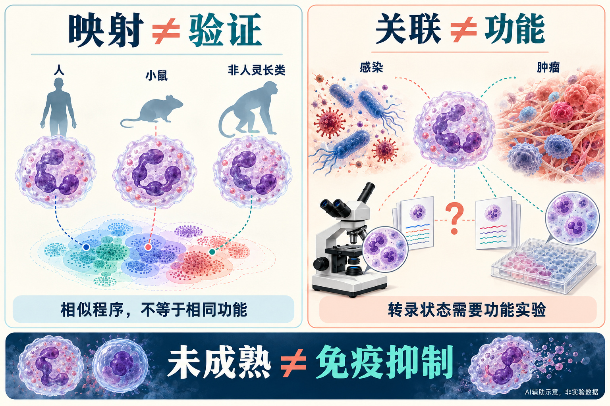

### 跨物种映射回答的是“最像谁”

作者将小鼠NeuMap数据和非人灵长类骨髓数据映射到人SCAHN。具体实现是用Symphony建立参考与投影，再在参考空间内寻找近邻，以k=10的近邻多数标签给查询细胞赋予状态。这样做的优势，是不用先强求三个物种各自聚出完全相同的簇数，便能用共同参照讨论哪些程序相似。

但一个分类器总能给出最接近的类别，并不意味着这个类别已经完整解释了输入。假如查询细胞存在参考库未收录的物种特异程序，最近邻仍可能把它分到“最不不像”的已有状态。于是，跨物种标签应与同源基因对应、标记表达、组织背景以及未能很好映射的细胞一起检查。投影坐标相邻不是独立功能验证；映射准确率若没有独立真值，也不能只用漂亮的重叠图代替。

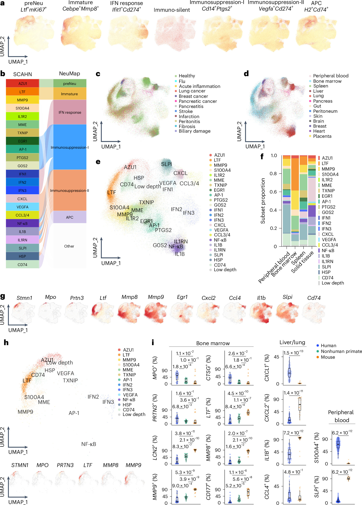
图3：Zheng等，Nature Immunology，2026，DOI:10.1038/s41590-026-02671-8，CC BY-NC-ND 4.0。完整原图仅作技术格式转换，无裁切、重排或数据修改；请点开放大。

图3a先在人SCAHN中显示小鼠NeuMap各hub顶部标记的人同源基因表达，图3b连接SCAHN状态与NeuMap hub。图3c—e才展示小鼠细胞经过Symphony映射后的空间，分别按疾病、组织和映射状态着色；不能把a当成已经投影的小鼠细胞。读流向时要注意它展示的是分配结果，不是小鼠细胞真的变成人细胞的过程。小鼠preNeu对应人AZU1，表达Cebpe、Mmp8的群接近LTF，Ifit1/Cd274相关群与IFN状态对应，H2/Cd74相关群与CD74状态对应。这些对应为状态的跨物种可解释性提供支持，但不是说名称相似的细胞在每种疾病里都做同一件事。

图3e显示映射后的小鼠状态标签，f按组织汇总比例；g的基因表达面板为映射提供第二条线索：同类程序是否由相近的基因支持。图3h将非人灵长类骨髓也纳入同一参照。灵长类映射成功拓宽了参考的覆盖范围，仍不能弥补某些组织或疾病状态缺乏对应样本的空白。这个区别很实际：如果研究者用小鼠肿瘤做机制实验，最好先在相同组织情境下找可比状态，而非用健康骨髓的对应来保证肿瘤内功能一致。

图3i进一步显示，即使在可比状态框架里，物种之间也有表达差异。每一个点是样本，纵轴为检测到某基因的细胞百分比，不是平均转录本数，更不是蛋白浓度。骨髓中小鼠更常检测到部分次级、三级颗粒基因，而人类的MPO、CTSG等初级颗粒基因具有不同分布；肺/肝和血液比较也显示物种差异。这个比例同时受测序深度和检测灵敏度影响，因此不能把“检测阳性比例较高”不加限定地改写成“该物种蛋白功能更强”。

一项实用的迁移检查是：先固定组织和样本处理方式，再看多个同类标记是否一致，而不是只看一个明星基因。这是我们的建议，本文没有完成对所有物种、平台和组织的完全平衡比较。研究的贡献是提出可以检验的对应关系；后续蛋白检测、功能扰动和更匹配的数据才决定对应关系能承担多强的机制解释。

### 疾病比较为什么要回到每份样本

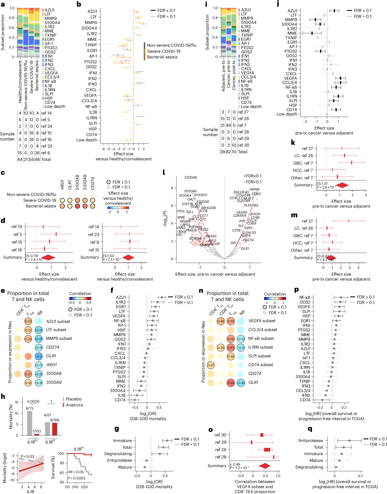
图4：来源与许可同图3，完整原样展示。各面板的样本范围、统计量和显著性阈值不同，详见正文；本图没有把所有分析共用一个总样本量。

图4a概括感染数据：7个全血数据集共167份样本，包括44份健康或康复样本、21份非重症COVID-19/流感、56份重症COVID-19和46份细菌性脓毒症。作者先按样本计算各状态在中性粒细胞中的比例，再在各队列内估计Hedges’ g，最后用随机效应模型汇总。这样避免直接把一百万个细胞当成一百万名患者，也允许研究之间有异质性。

图4b横轴是效应量，正负方向回答患者组相对参照组哪类状态较多；紫、黄、橙区分非重症病毒感染、重症COVID-19和细菌性脓毒症，横线为95%置信区间，淡化显示超过FDR 0.1的结果。这个阈值与前篇图2的0.05不同，不能把全篇所有边框解释成同一种证据强度。随机效应汇总也不会自动消除研究间的采样差别：它估计不同研究效应的总体趋势，并容纳差异，但不能替没有收集的关键协变量补数。

结果显示，颗粒相关群在重症病毒感染和细菌性脓毒症中增加，而在较轻病毒感染中并非同样增加。IFN相关群呈现另一种模式，提示“中性粒细胞激活”不是一个方向单一的总开关。IFN3在非重症病毒感染中比重症更明显，也不意味着人为增强它必然保护患者：取样时间、病程阶段以及治疗背景均可能同时影响状态和结局。

图4c用颜色显示免疫调节相关基因的效应量，黑边表示FDR≤0.1；d的森林图专门汇总CD274在重症COVID-19和细菌性脓毒症中的表达差异。图4e再把其他免疫细胞组成接进来。ARG1、CD274、OLR1等的表达以及颗粒相关状态，与部分T细胞/NK细胞组成变化存在关联。相关图中颜色代表合并相关系数，不是调控强度；不同细胞组成的分母还须分别理解，例如图4e,n的T/NK亚群比例以总T加NK细胞为分母。一个组成增加会挤压另一个组成的相对占比，即使绝对数量没有相应改变，也能产生关联。

所以，本图支持状态与免疫环境一起变化，尚不能单凭转录和比例证明“这个中性粒细胞抑制了那个T细胞”。要检验功能，至少需要更直接的共培养、阻断或其他能区分共同病程驱动的设计。疾病机制分析中，把“免疫抑制相关标记”写完整，比直接给整个簇盖上“免疫抑制细胞”的标签更准确。

### 独立bulk队列增加了什么证据

单细胞发现若能在另一类测量和不同队列中与结局关联，比只在发现集里反复换图更有价值。作者使用感染bulk队列中的签名分数，检验状态与严重度、死亡的关系。这里必须拆开收集量与分析量：公开与合作队列共收集到3381名患者的数据，但有死亡结局及相应完整信息、进入死亡分析的是10个队列的2833人；严重度分析是8个队列的1992人。不能把最大的总数贴到每张森林图上。

图4f,g显示年龄、性别调整后的感染结局关联。横轴使用log2优势比，零线对应OR=1；点为估计值，横线为置信区间。作者在队列内部标准化签名，再做模型与汇总，因此结果更接近“在本队列分布中，分数较高者的结局关联”，不是跨平台通用的绝对表达阈值。AZU1、LTF、IL1R2、EGR1、VEGFA等状态签名与较差结局相关，CD74呈相反方向；未成熟、脱颗粒与总中性粒细胞签名也表现出不利关联。

这不等于已经有可用的临床预测器。显著OR告诉我们在特定模型下有关联，不能替代区分度、校准度和临床净收益，更没有证明在常规风险模型之外增加了多少可操作的信息。读者如果想把签名用于自己的临床队列，应该先定义预测时点与结局时间窗，防止把疾病已经变重后采到的信号当成早期预测。这也是本文结果之外的研究设计建议。

### 随机试验数据里的事后亚组仍要谨慎

图4h来自SAVE-MORE数据的再分析。作者按基线IL1B表达指标的中位数分层，再比较anakinra与安慰剂的结局。低分层中观察到治疗组较好的生存关联，高分层中没有同样清晰的结果。模型考虑治疗、IL1B及其交互，并调整年龄、性别与SOFA。关键问题并不是“数据来自随机试验，所以一切亚组结论都已随机验证”，而是这个表达指标切分是否预先设定，是否在另一试验中独立重复。

我们核查了所引2024年Critical Care原始研究。它本身就是SAVE-MORE的事后免疫内型分析，入选者具有特定COVID-19肺炎与suPAR条件；它的393人分析范围与SCAHN该图列出的451人基线表达子集不是同一分母。原始论文研究的是既有33基因免疫内型及其转变，不能拿来冒充已经前瞻验证了SCAHN的IL1B分层。这一IL1B分层仍需独立的治疗效应异质性验证，不宜据此给患者选药。

图4h上方柱图的纵轴是死亡比例，低IL1B层中安慰剂组8/73人死亡、anakinra组1/153人死亡；下方右侧曲线横轴为随访天数，纵轴为生存百分比。作者报告该层HR为0.06，95%置信区间0.01—0.45；下方左侧还展示IL1B与治疗的交互，P=0.03。这些是原文报告、未经我们重算的数值。低层合计只有9个死亡事件，既应看到差异，也应注意估计对少数事件敏感，不能把HR直接换算成每个患者的绝对获益。

另一个常见误区是“一个亚组显著、另一个不显著，所以两个亚组的疗效一定不同”。正确比较依赖交互项与其不确定性，而不是两次P值的视觉对比；还应考虑多次亚组探索和小事件数造成的乐观估计。本文提供的是可进一步检验的分层假设，不是治疗建议。我们没有重新运行试验数据，也没有核查个体级事件，因此不把图上的效果量转写成确定的获益比例。

### 肿瘤中的状态不是感染结论的复制

图4i纳入6个肿瘤数据集，共131份样本：39份邻近正常组织、82份治疗前肿瘤、10份治疗后肿瘤。但图4j用于相应比较的治疗前样本数是68，而不是总览的82。随着分析条件变化，分母会变；方法与图注比摘要中的总样本量更接近你真正要复现的比较。

与血液感染场景不同，肿瘤内更突出VEGFA、CCL3/4、NF-κB和IL1RN等炎症/细胞因子程序，部分未成熟或其他状态也增加。图4k单独汇总CCL3/4状态的比例差异，l以横轴效应量、纵轴−log10(P)展示基因差异，m汇总CD274差异；n的颜色表示状态或标记与T/NK组成的相关，o聚焦VEGFA状态与CD8耗竭T细胞比例的跨队列相关。它们提出了状态与局部免疫环境耦合的线索，但邻近正常组织也并非无条件等于健康人同组织，治疗前后样本也不自动构成同一患者的配对因果实验。组织位置、肿瘤类型与治疗选择均需留在解释里。

图4p,q再把签名放到8205份TCGA肿瘤样本中，使用Cox模型调整年龄、性别、分期和分级。此处横轴是log2(HR)，参照线为0，不要和前面OR混用。更重要的是，作者对大多数肿瘤使用总生存，但对9类低死亡率肿瘤改用无进展间期。因此，汇总值混合了不同终点，不能简称成“所有癌症总生存风险”。

若干炎症相关状态和总中性粒细胞签名与不良结局相关，CD74具有不同方向；但从肿瘤bulk中计算的分数仍可能混合细胞数量与细胞内表达。肿瘤细胞或其他免疫细胞是否也表达这些基因，取决于组织背景，不能仅凭血液特异性检验就完全排除。感染与肿瘤中签名关联的差别，反而说明同一个名字不保证跨情境拥有同一种功能。

这一篇最值得记住的证据顺序是：映射说明相似，样本级比较说明分布差异，独立队列说明关联可迁移，治疗交互提出分层假设。它们逐级增加信息，却没有哪一级自动等同于细胞功能或因果干预。使用图谱最好的方式，是让它帮助缩小下一步实验的问题，而不是把它当成机制实验已经做完的证明。

阅读范围：SCAHN主文、Methods及图3、4；核查SAVE-MORE所引原研究的完整正文，未重跑单细胞、bulk或试验模型，也未复核患者级原始数据。跨物种原研究仅核查身份与本文所使用的数据说明，未声称全部重新精读。

原文：https://www.nature.com/articles/s41590-026-02671-8
SAVE-MORE原研究：https://doi.org/10.1186/s13054-024-04852-z
许可：https://creativecommons.org/licenses/by-nc-nd/4.0/

## 3. 从bulk签名到人群风险：混合表达、协变量与预测边界。

一个从单细胞图谱提取的签名，在全血里与未来死亡相关，离“预测个体风险”还有几步？SCAHN的后半篇给了一个很好的拆解案例：作者把中性粒细胞状态连接到性别、年龄、BMI、代谢指标和长期结局，又用两套电子病历检验正常范围内的细胞计数。这条证据链很长，但每一步的测量对象都在变化。读清它，比记住某个显著P值更有用。

本篇讨论Zheng等2026年10月21日发表于Nature Immunology的原创研究。它的SCAHN图谱来自约一百万个人中性粒细胞，随后定义五类中性粒细胞特异签名与一个IFN签名。我们重点解释分数怎样从细胞层面走到人群层面，以及什么情况下需要停下来，不再把关联向诊断或干预外推。

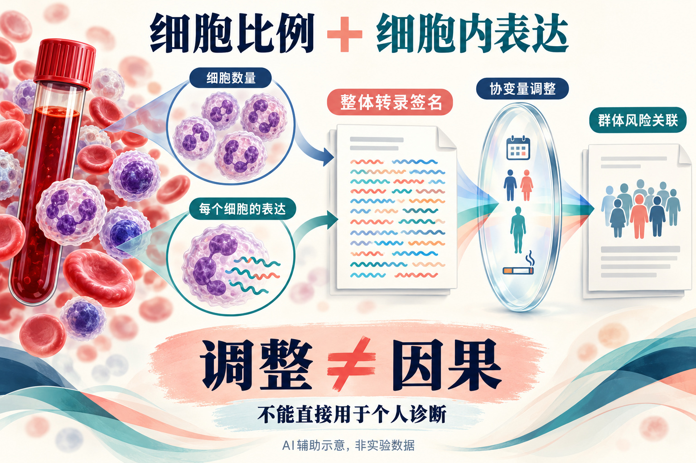

### bulk分数混合了数量与状态

作者用签名基因表达的几何平均构建分数，包括未成熟、成熟、脱颗粒、抗蛋白酶和总中性粒细胞签名；IFN相关分数另列，因为它不具有同等的中性粒细胞特异性。对分析者来说，最重要的问题不是分数名字好不好听，而是每一份全血或PBMC样本里，这些转录本究竟由谁贡献。

设想一个纯教学例子：两份全血样本里，每个中性粒细胞的某组基因表达相同，但第二份样本包含更多中性粒细胞，bulk信号就可能升高。反过来，细胞数量相近而细胞内程序增强，也会让分数上升。真实样本还叠加RNA含量、其他细胞表达和技术归一化差异。这个例子没有虚构实验数据；它只是说明为何“签名更高”不应自动翻译为“这种状态的细胞更多”。

同理，“总中性粒细胞签名”不是血常规计数的直接替代品。若要校准到绝对数量，需要同批样本的计数与适用的测量模型。作者后面用电子病历的绝对计数做独立检验，提供的是另一个测量层面的关联支持，而不是证明每份转录组分数都能精确换算成每微升的细胞数。

### 性别比较需要先对齐测量背景

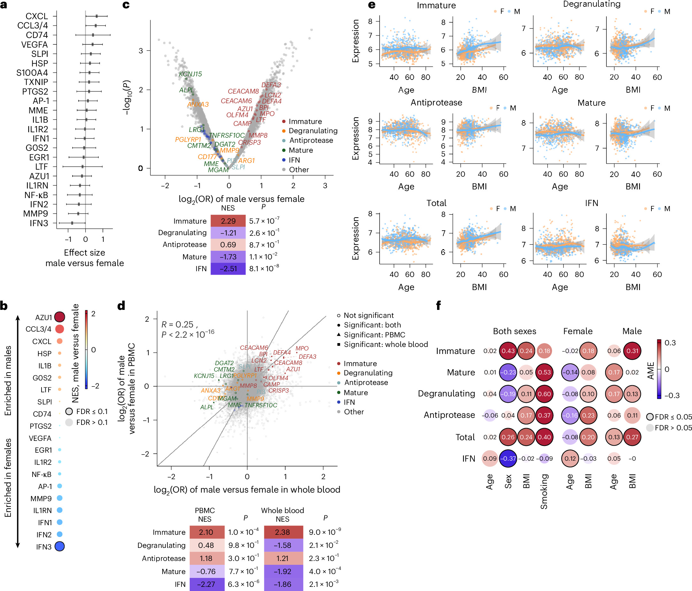
图5：Zheng等，Nature Immunology，2026，DOI:10.1038/s41590-026-02671-8。CC BY-NC-ND 4.0，完整原样展示；点开放大可查看各面板不同的纵轴与模型。

图5a的状态比例与b的基因集富集从33份健康单细胞样本出发，17份女性、16份男性。状态比例比较显示女性IFN3较高，男性部分炎症相关状态较高。但两组年龄中位数并不相同，样本量也有限，不能单凭这一步给所有年龄和人群贴标签。作者接着分析独立的纯化中性粒细胞表达数据，58名女性、20名男性，以年龄调整的模型检查性别相关基因，再进一步跨多个bulk队列比较。

图5c上方的基因火山图与下方的签名基因集富集，提供了纯化细胞的独立证据。基因层面的模型将男性编码为1，OR描述表达与性别分类之间的关联，不能当成男性相对女性的表达倍数。基因富集也不是测到了通路活性或代谢流，只说明按照该统计排序，某些注释基因集更集中地出现在一端。图中比较支持特定样本条件下的表达模式，而不是直接解释性别差异的全部生理机制。

图5d把观察扩展到18个数据集的977名18—40岁参与者，其中女性541、男性436，并区分全血与PBMC。作者分别检查签名和代表基因，按队列调整年龄并汇总。图5d上方横轴为全血、纵轴为PBMC中的log2(OR)，每点一个基因；点形区分在哪种样本类型达到显著，不能把横纵坐标当表达量。下方才是分别针对两种样本类型的富集结果。这样的年龄限制减少了某些年龄阶段差异，但同时缩小了结论的适用范围；它不能替儿童、老年人或特殊生理状态完成验证。

全血和PBMC之间的差异还提醒我们，分离方式会改变签名的含义。PBMC保留下来的低密度或未成熟中性粒细胞，与全血群体的组成并不相同。因此，一份全血中建立的参考范围，不宜直接迁移到PBMC。更合理的再分析，是先在同类样本中比较，再检查跨样本类型的方向是否一致，并保留不一致本身，而不是为了一个漂亮的总体故事强行合并。

### 交互项怎样改变“年龄效应”的解释

作者又在Framingham Heart Study的健康子集中分析年龄、性别、BMI和吸烟。图5相关模型纳入822人，女性433、男性389。图5e的散点纵轴是签名分数、横轴分别是年龄和BMI，橙色与蓝色区分女性和男性，平滑线表示局部趋势；f显示广义线性模型的平均边际效应，颜色对应方向与幅度，黑边为FDR≤0.05。不同模型需要的完整协变量不同，不能把这个822与后面图6健康对照的823机械视为同一个分析集合。

包含年龄与性别交互项后，“年龄的主效应不显著”不等于所有人都没有年龄趋势。它可能掩盖不同组方向或幅度不同的变化。平均边际效应的作用，是在模型设定下将这种关联转换成更容易解释的局部变化，而不是凭空消除了混杂。看图时应问效应在哪个组、以哪些变量固定或平均、对应哪个分数，而不是只找一个全人群P值。

作者观察到BMI与多个中性粒细胞签名相关，吸烟也与除未成熟签名之外的多类分数有关。这里的调整降低了部分已测因素的混杂，却不构成随机分配BMI或吸烟的实验。疾病用药、生活方式、隐匿炎症或未测社会因素仍可能参与。我们应把结果写成“协变量调整后的关联”，而不是让“独立相关”在文字里悄悄变成“独立导致”。

这对自己的差异分析很有启发：协变量不只是为了让P值更小或更大。若细胞状态本来随年龄、性别、样本类型变化，一个病例对照设计没有平衡这些变量，就可能把背景差异归给疾病。更好的做法是先画样本层面的分布、检查重叠，再决定哪些调整有数据支持；如果病例与对照年龄完全不重叠，一个回归项也难以代替真实可比样本。

### 代谢关联：同向变化不等于预测成功

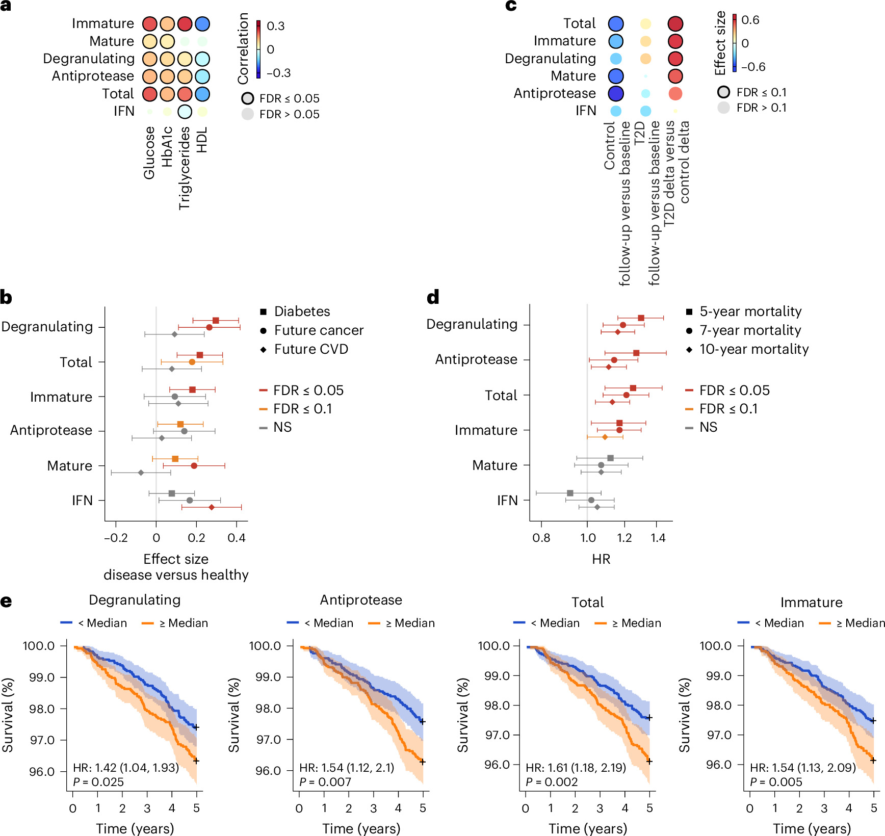
图6：来源与许可同图5，完整原样展示。a是相关系数，b,c是组间效应量，d是HR，e是分组生存曲线，不能把不同面板的颜色当成同一种统计量。

图6a分析5321名FHS参与者的签名与代谢指标，颜色表示Spearman相关系数，黑边表示FDR≤0.05。多数签名与血糖、HbA1c及甘油三酯正相关，与HDL负相关；成熟签名的模式有所不同。作者也在无糖尿病的子集中做了检查，以避免结论仅由现有糖尿病人群驱动。这个敏感性分析增强了关联的可解释性，但没有确定中性粒细胞变化发生在代谢变化之前。

图6b比较健康对照、糖尿病以及随后发生癌症或心血管病的群体。这里健康823、糖尿病475、未来癌症205、未来心血管病226的分组，是按论文纳入条件筛出的比较集合，不是所有一般人群的随机样本。糖尿病组与未来癌症/CVD组的时间定义也不同，不能统一写成“预测三种疾病”。图中先调整年龄、性别、BMI和吸烟，再比较残差；横轴是Hedges’ g，红色与橙色区分FDR≤0.05和≤0.1。

相关结果提出了值得跟进的信号，但分组差异本身不是一个已经验证的预测模型。若目标是预测未来癌症，应明确起始时点、排除基线未诊断疾病的策略、竞争风险、随访长度，以及模型在未参与开发人群中的校准情况。本文没有因为画出未来病例与对照的差异，就完成这些问题。

图6c加入58人的纵向资料，其中33名对照、25名以后发生2型糖尿病者，平均间隔约25个月。作者比较同一人两次测量的变化，再比较两组变化差异。配对设计能减少稳定个体差异的干扰，比单次横断面多了一层时间信息，但疾病前期过程、治疗或生活方式变化仍可能影响分数。这里依然不是干预中性粒细胞以后观察糖尿病是否减少的实验。

图上给出各组配对变化和组间变化差异的不同效应量，参照与统计单位要分清。配对的Cohen’s dz使用个体内差值的变异来标准化，组间Hedges’ g则比较两组变化分布，不能把两者数值大小当作完全等价的效应强弱。图6c黑色结果采用FDR≤0.1，阈值与a不同。

### 生存模型中的阈值有一处需要保留疑问

图6d在FHS的5321人中，以5年、7年和10年时间窗做调整后的Cox分析，考虑年龄、性别、BMI、基线疾病和吸烟。未成熟、脱颗粒、抗蛋白酶及总中性粒细胞签名与死亡风险具有不同程度的关联，而成熟与IFN相关分数没有同样的表现。横轴是HR，参照值为1；图中点和置信区间描述模型估计，不是个体死亡概率。

图6e为便于展示而把调整后的分数分为两组，画出Kaplan–Meier曲线。这里有一个应透明保留的原文报告差异：Results及图注写按调整后残差的中位数分组，Methods则写按零分组。两种阈值一般不保证相同。我们没有重跑原始数据，目前也未能访问作者指向的代码仓库，因此不能声称已经独立确认实际用的阈值。

这处差异主要影响二分可视化的精确复现，不能据此直接否定前面连续分数的Cox关联；反过来，也不能因为总体故事顺畅而把它略掉。若要在自己的队列重现，应先锁定评分、调整方式、阈值和时间窗，再查看结果。不要在结果出来后选择最漂亮的一刀，否则分组曲线会比未来数据中的表现更乐观。

### 正常范围内的计数为何还能有关联

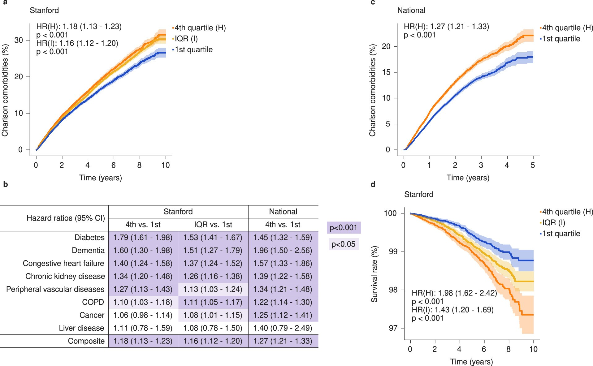
扩展数据图9：来源与许可同图5，完整原样展示，保留全部坐标、图例和置信区间。它测量血细胞计数，不是RNA签名。

作者使用Stanford与Arcadia两套电子病历，分别有205817和224771名符合纳入要求的参与者。基线限定正常范围中性粒细胞计数，排除已记录Charlson合并症，使用初次门诊计数，并按年龄、性别、种族/族裔以及相关病历信息，用倾向评分回归控制上述因素。这里的“没有合并症”是数据库记录与纳入规则下的定义，不能等同于经过全面体检后确认不存在任何病理变化。

扩展图9的分析对象不是把两套数据库所有人直接画在同一组曲线上。扩展图9图注明确写每个四分位组在Stanford为36999人、Arcadia为45435人；中间范围包括第25—75百分位，不能擅自把四分位组的数字当作它的分母。低计数组为≤3.1千/微升，高计数组为≥5.19千/微升，均处于本研究规定的正常区间内；这些分组阈值服务于本项人群分析，不是新临床异常界值。

作者报告较高正常范围计数与后续Charlson疾病记录，以及Stanford队列的长期死亡风险相关。扩展图9a,c的纵轴为出现Charlson合并症的比例，橙色为最高四分位，蓝色为最低四分位；a还用黄色表示中间范围。b列出不同疾病的HR及95%置信区间，d则是Stanford的生存百分比。作者报告，最高对最低组的合并症HR分别为1.18（1.13—1.23）和1.27（1.21—1.33），Stanford生存分析相应HR为1.98（1.62—2.42）。这些是作者报告值，未由我们重算。图中HR大于1表示在指定模型与比较条件下，事件发生速率较高；不是说每个高正常值个体都会患病。曲线的横轴是随访时间，阴影表达不确定性，风险集随时间减少也会影响后段估计稳定性。尤其d的纵轴截在约97%—100%，视觉距离被放大，不能把曲线间隔直接想象成巨大的绝对死亡风险差。

两个数据库提供了独立环境中的重复观察，这是优点。剩余问题也很具体：谁会接受血常规、就医频率怎样、未记录疾病如何影响分组、吸烟或体重等因素是否充分测量，都会影响风险解释。随访中“疾病被记录”既与疾病本身有关，也与医疗接触有关。这样的结果适合提出机制与风险建模问题，不适合据此恐吓正常血常规人群，更没有证明降低正常范围的中性粒细胞计数会延长寿命。

### 复现计划应与证据边界一起交付

SCAHN从单细胞状态走到人群结局，最大的贡献是建立了一组可检验的联系。它仍是公开数据与既有临床资料的再分析，没有在本研究中新做功能干预。部分临床资料受访问限制；代码链接存在也不意味着数据全公开。我们实际访问作者列出的Khatri-Lab/SCAHN仓库时得到404，故不能声称代码已可用、已安装或已经复现，原因也不能仅凭404确定。

对准备使用这套签名的研究者，一个合理的起点是先在自己的样本类型中检查表达覆盖、细胞组成与批次，再固定研究问题和模型。疾病分类、风险预测、机制推断是不同目标，所需对照也不同。把这些界限写进分析计划，往往比多加几张显著热图更能减少错误解释。

阅读范围：完整主文及Methods，主图5、6和扩展图9；补充材料已合法获取，未重跑矩阵、FHS或电子病历个体级模型。原文的阈值报告差异与代码访问障碍如上，不将未复核细节写成已验证结果。

原文：https://www.nature.com/articles/s41590-026-02671-8
作者列出的代码：https://github.com/Khatri-Lab/SCAHN
许可：https://creativecommons.org/licenses/by-nc-nd/4.0/

## 4. Take-home messages

### Take-home messages：使用一个大图谱前，先过六道关

SCAHN把约一百万个人中性粒细胞的状态与跨物种、感染、肿瘤和长期人群结局连接起来。它最有启发的地方，是提供一个能把不同研究放在同一框架里提问的参考；最容易被过度解读的地方，也正是这条很长的证据链。状态名字越像功能，临床样本量越大，就越容易让我们忘记其中仍有测量和推断的距离。

这篇独立总结给准备使用单细胞图谱或bulk签名的研究者一张核查清单，不要求先读系列其他文章。原研究为Zheng等2026年10月21日发表的Nature Immunology原创资源论文。以下“建议怎么检查”是我们的研究设计建议，不是作者已经完成的额外实验。

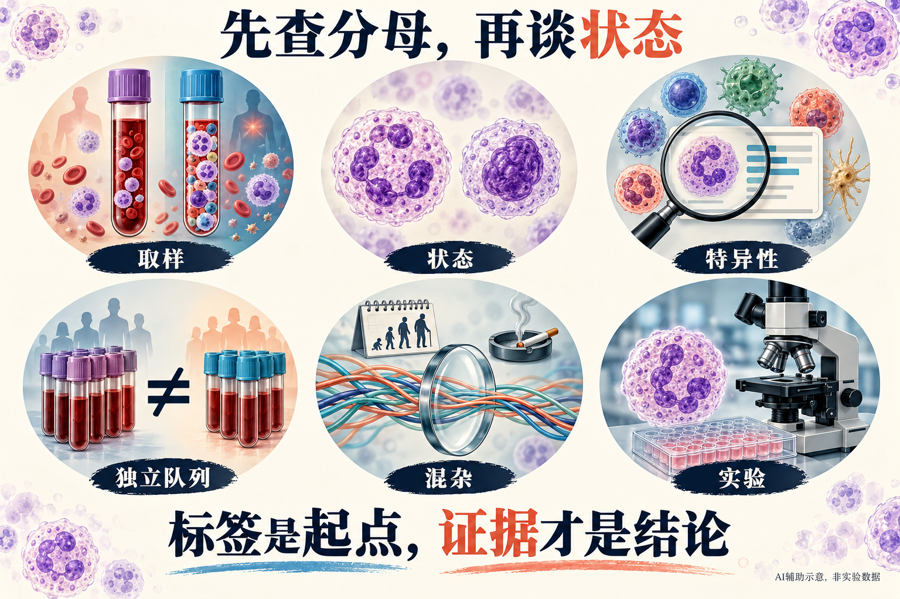
图中两组独立队列之间的“≠”表示数据来源不同，不表示结果一定不同。细胞、转录卡与实验装置均为教学示意，没有模拟真实实验输出。

### 第一关：参考里的细胞，怎样进入矩阵

43个数据集、781份样本和约一百万个细胞是三个不同层级，不可互换；样本数也不自动等于独立供者数。SCAHN中全血与PBMC捕获的中性粒细胞比例明显不同，平台之间亦有差异。它说明流程会参与塑造图谱，不是平台的随机对照排名。

准备借用参考时，先核对目标组织、处理方式、疾病与平台是否被覆盖。低RNA细胞的基因数过滤不能照搬其他细胞类型，门槛过高可能先删掉目标，再让后续结果显得很干净。记录被排除样本的条件，与记录被保留细胞一样重要。参考里没有一个状态，可能是没有采到，不必立即解释成生物学不存在。

### 第二关：稳定的簇还需要生物学解释

SCAHN改变特征数、主成分与聚类算法，使用共同聚类关系形成共识，并结合标记命名。参数稳定性比单次运行更令人信服，但还不是细胞身份的最终真值。尤其在以样本为Harmony批次变量时，技术效应和供者生物差异可能同时被影响。

可迁移的检查是把“参数敏感性”“跨样本出现”“标记一致性”分开记录，再决定是否给一个群赋予强功能名称。AZU1、LTF和MMP9帮助区分颗粒相关程序与成熟背景；IFN、炎症和应激程序则可能随环境改变。转录状态不是永久身份，RNA标记也不直接等同于蛋白丰度或功能。若想写“抑制T细胞”，证据不能止于ARG1、CD274或一个相关系数。

### 第三关：签名离开原来的比较背景，还是否特异

作者用其他外周免疫细胞检查标记，建立未成熟、成熟、脱颗粒、抗蛋白酶与总中性粒细胞签名，并把IFN签名另外处理。这一步解决的是特定比较背景下的来源问题，没有证明任何组织中都只有中性粒细胞表达这些基因。

在自己的bulk数据里，先检查签名基因有没有被可靠测到，再问信号来自细胞数量、每细胞状态，还是其他细胞表达。全血与PBMC需要分别考虑，肿瘤组织还增加了新的背景。签名分数不是绝对细胞计数，也不是可以跨平台直接套用的临床界值。先定义分数的用途，才能决定需要哪种验证。

### 第四关：独立队列检验了哪一层问题

跨物种参考映射支持表达程序相似，并不直接证明功能保守；单细胞样本级差异支持状态分布改变；独立bulk队列说明关联可以在另一种测量中出现。这些结果彼此补强，但不可以在叙述中合并成“已经证明了致病机制”。

结局分析尤其要追踪分母与终点。SCAHN收集的感染bulk数据总数与真正进入死亡模型的人数不同，TCGA也混合了总生存和部分肿瘤的无进展间期。若复现时只抄最大样本量或统一写成总生存，会改变读者理解的证据。我们建议把每个结果对应的纳入条件、分析样本数、结局定义与模型写在同一处，而不是让读者到补充材料里猜。

### 第五关：调整过，不等于混杂已消失

年龄、性别、BMI、吸烟、组织来源以及病程时间都会影响状态。交互项还意味着一个总体平均效应可能掩盖不同组的相反趋势。调整有助于回答更具体的问题，但无法修补严重缺乏重叠的病例对照设计，也无法处理没有测量的重要因素。

SCAHN的FHS生存二分展示还存在一处具体报告差异：Results及图注写残差中位数，Methods写零阈值。我们未重跑，不能替作者选一个说法。这不自动否定连续Cox关联，却限制了精确分组复现。把这种差异留在审读清单中，比为叙事顺畅而省略更有用。

### 第六关：什么时候需要实验或前瞻验证

SAVE-MORE中的基线IL1B分层，是利用既有试验数据提出治疗效应异质性的线索，不是SCAHN签名已经完成前瞻选药验证。正常范围内的中性粒细胞计数与后续疾病、死亡相关，也没有证明主动降低计数能改善结局。图中HR、OR与P值描述的是模型中的比较，不能直接成为给个体的诊断或用药建议。

若研究目标是机制，应设计能区分细胞状态与共同病程驱动的功能检验；若目标是预测，应固定时点、结局与评分规则，再看外部队列的区分度、校准和增量价值。两种目标都值得做，但需要不同的下一步。一个好图谱的作用，是让下一项实验更有针对性，不是让实验变得多余。

### 最后留给自己的三个判断

可以带走的是一个跨数据集讨论中性粒细胞异质性的参考框架，以及一组值得在匹配情境中继续验证的状态签名。

不能带走的是“百万细胞等于百万独立重复”“同名跨物种状态等于同功能”“表达关联等于机制”“正常范围较高等于应该治疗”等跳跃结论。

真正有研究价值的下一步，是明确自己的问题属于取样、状态鉴定、关联复现还是因果验证，再选对应证据。把分母、测量背景和未核验部分写清楚，不会削弱一篇研究，反而让它更容易被可靠地使用。

阅读与复现边界：已通读SCAHN完整正文和Methods，逐张核查使用的主图1—6及扩展图9；合法取得补充材料并核查相关说明。没有重跑原始矩阵或患者级模型。所引SAVE-MORE原始研究全文已核查，其余相关工作的阅读范围另有记录，不声称全部重做。作者列出的代码仓库本次访问返回404，不能报告已复现。

原文：https://www.nature.com/articles/s41590-026-02671-8
SAVE-MORE原始研究：https://doi.org/10.1186/s13054-024-04852-z
作者代码链接：https://github.com/Khatri-Lab/SCAHN
图像许可：https://creativecommons.org/licenses/by-nc-nd/4.0/
