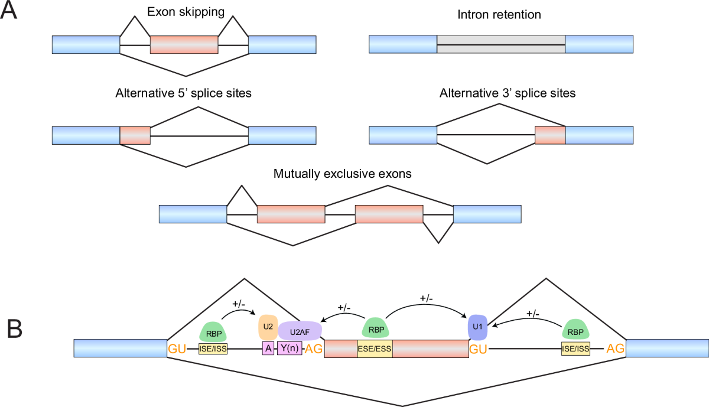
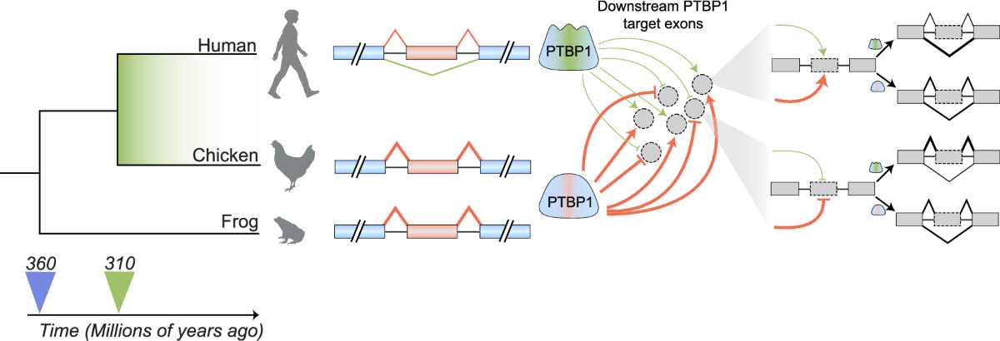
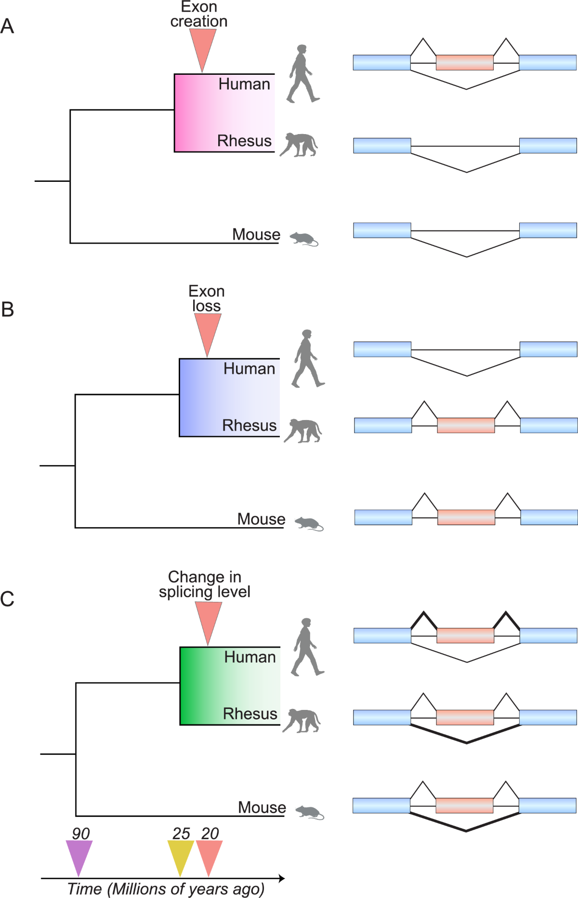
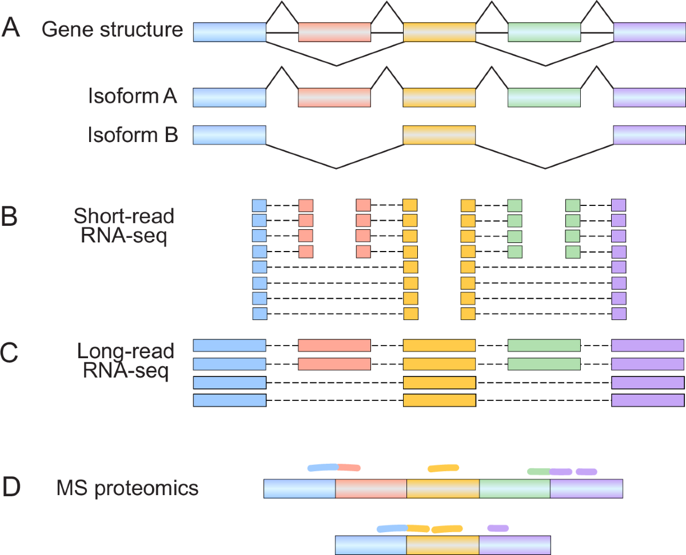
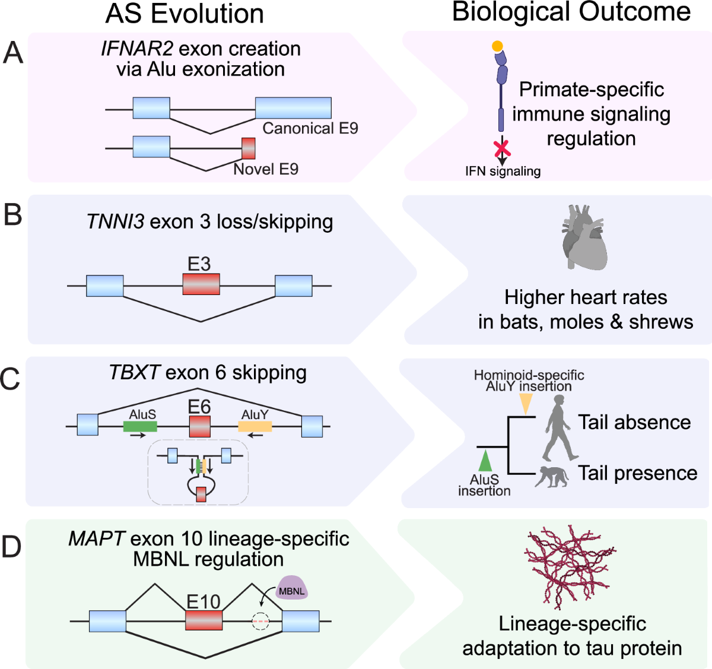

# 不换基因，也能改变性状：可变剪接如何参与演化

::: {.book-source}
论文：[DOI 10.1038/s44318-025-00666-z](https://doi.org/10.1038/s44318-025-00666-z)。原有图注和许可说明见正文；未明确许可的图版标记为**授权待确认**。
:::

母稿身份：Review／香港批次20261109／v1。解读 Hunter CE、Xing Y，The splice of life: how alternative splicing shapes regulatory and phenotypic evolution，The EMBO Journal，DOI：10.1038/s44318-025-00666-z。正式上线2026年1月16日，卷期日期3月16日。本轮近期候选存在访问或质量问题，因此按允许范围扩至近12个月；本文不是“昨日新论文”。

阅读边界：已通读开放获取官网完整正文、5幅图的图注、参考文献表、许可与文章日期。原始研究不是全部重新精读，关键例证的单独核查范围见末尾。下文以综述建立框架，以原研究摘要核查帮助限定结论，不声称复现了任何实验。

## 正文：变化的不是基因名单，而是使用方式

### 1．为什么表达量相同，也可能是不同的生物学？

假设两种动物某个基因的总RNA量相同。通常的差异表达分析可能把它列为“没有变化”。但如果其中一种主要产生完整受体，另一种多产生缺少细胞内信号域的短受体，总量不变并不等于功能不变。这里比较的是同一基因产物的结构与比例，而不只是多与少。这个例子是教学设想，不是本文新测量的数据。

可变剪接使同一个前体RNA以不同方式保留或连接外显子，形成不同转录本。一个外显子可以被跳过，供体或受体位点可以改变，内含子可以保留，某些外显子也可以相互替代。结果可能改变蛋白结构，也可能改变非翻译区、RNA稳定性或定位；不是每个转录本都编码稳定蛋白，更不是每个新转录本都带来适应性收益。

这篇综述的价值，在于把三类常被混在一起的问题拆开：物种之间有没有剪接差异，差异由什么分子机制造成，以及这种差异是否影响性状。第一类可以借助比较转录组发现，第二类需要区分顺式序列与反式因子，第三类往往还要功能干预。不能因为在物种A看见一个新外显子，就直接写成“它让A变得更高级”。

原图1，Hunter、Xing（2026），The EMBO Journal；来源：https://doi.org/10.1038/s44318-025-00666-z 。文章 CC BY 4.0；原样保留，未裁切、未重排、未改实验数据。

【原图1A解读】蓝色方块是组成型外显子，红色方块标出可变部分；弧线表示可能的连接方式，而不是实验测得的分子运动轨迹。读图时先固定同一个基因，再逐一比较输出转录本，避免把图中的不同模式误解为同一次剪接必然同时发生。图是综述机制示意，没有样本量、误差线或统计显著性，不能用来证明某类剪接最常见。

### 2．顺式和反式，不是两种互相排斥的答案

顺式元件位于被处理的RNA及其对应基因序列中，包括剪接位点、分支点、多嘧啶区以及增强或抑制剪接的序列。反式因子则是识别或参与处理这些元件的分子，例如剪接体组成部分和RNA结合蛋白。可以把前者理解为局部识别信息，把后者理解为读取这些信息的环境，但这个比喻不能替代真实的结合、空间构象和转录过程。

【原图1B解读】图中U1与5′剪接位点、U2与分支点、U2AF与多嘧啶区及3′侧识别相联系；ESE/ESS、ISE/ISS分别指外显子或内含子中的增强/抑制元件。正负号提醒读者，同一类结合蛋白在不同位置与背景下可能产生不同影响，不能把“结合”简单等同于“促进包含”。GU/AG是常见剪接信号，不应把简图当成所有剪接反应的无例外规则。

综述介绍的Tc1模型提供了一个有用的辨别思路：把人类染色体21放在小鼠细胞环境中，比较其中人类外显子的剪接更接近人还是鼠。如果相同的人类序列在鼠的环境里仍保留较多人的模式，就支持局部顺式序列的重要性。这不是把所有潜在变量都清零的实验，也不是对所有基因、组织、物种距离的总判决。本文对这个实例依据综述转述，未将原始论文全部实验重新核验，因此不据此给出“多少百分比的剪接演化来自顺式”的数字。

反式因素同样能够演化。一种调控蛋白的表达组织或发育时间改变，会使原有的识别能力进入新环境；蛋白新增结构域，则可能改变它能协调的反应。综述以NOVA、ESRP及SRRM3/4等说明这些层次。SRRM3/4的eMIC结构域与微外显子调控是一个重要例子：微外显子虽短，不能因为长度小就假设功能也小。本文沿用综述中不超过30个核苷酸的定义，不把这一阈值当作所有文献统一的标准。

更有意思的是，调控因子自身也能被可变剪接调节。PTBP1的某个外显子跳过，可以产生调控活性不同的异构体，再影响一批下游外显子。于是一个局部改变可能通过调控网络放大。需要注意，“活性减弱”不等于所有靶外显子都更少被包含：如果原来抑制包含，抑制减弱反而可能增加包含；如果某一背景中促进包含，减弱则可能降低包含。

原图4，Hunter、Xing（2026），The EMBO Journal；来源：https://doi.org/10.1038/s44318-025-00666-z 。文章 CC BY 4.0；原样保留，未裁切、未重排、未改实验数据。 图中有 BioRender 元素，图级使用条件尚未独立核实；本私有归档保留该待核状态，不据此声明公开转载权。

【原图4解读，第三方动物图标待权利核查】原图以不同线条粗细表达调控作用与剪接比例差异，右侧分别展示包含与跳过的变化。它不是剂量反应曲线，不能从线粗读出倍数。人、鸟、蛙仅服务于所示谱系关系，不是每个物种都完成了图中所有实验的意思。下游若保留原图，须保留原作者图注与BioRender归因，不能在权利未明时删除图标后把整幅图称为完全已核验。

### 3．新外显子、外显子丢失、比例变化必须分开

在比较基因组里，一个物种没有观察到某段外显子，可能有多种解释：对应DNA已丢失；DNA仍在但剪接信号改变；取样组织不表达；表达太低未被测到；或者注释和比对遗漏。只凭RNA里“未检测到”不能判定基因组删除。

外显子化是原本位于内含子中的序列被纳入成熟RNA。转座元件可以提供这样的原材料，灵长类Alu是综述讨论的重要来源，但非转座元件的内含子序列同样可能成为外显子。反过来，原来稳定存在的外显子也可能因基因组缺失或识别减弱而退出转录本。第三种情况更温和：外显子依然存在，只是包含概率改变。

原图2，Hunter、Xing（2026），The EMBO Journal；来源：https://doi.org/10.1038/s44318-025-00666-z 。文章 CC BY 4.0；原样保留，未裁切、未重排、未改实验数据。 图中有 BioRender 元素，图级使用条件尚未独立核实；本私有归档保留该待核状态，不据此声明公开转载权。

【原图2A–C解读，动物图标待权利核查】三组树分别表示外显子产生、丢失与比例改变。蓝框为组成型外显子、红框为目标外显子；连接线粗细表示相对包含或跳过，不是测序深度。时间箭头属于演化示意，不能从这幅图提取物种分化的精确置信区间。要判断祖先状态，需要合理的外群与同源对应，仅比较人和鼠很难独立区分“人新增”还是“鼠丢失”。

这里引出一个实用的量：某个外显子的包含比例，常用PSI表示。它关心能区分包含与跳过的相关分子或读段中，包含形式占多大份额。PSI不是基因总表达，也不是组织里某细胞类型的比例。估计方法、覆盖门槛、比对可判别性都会影响PSI；两个样本PSI差异很大，但支持读段极少时，仍应谨慎。

跨物种时还多一道难题：比较对象真的是同源外显子吗？长度、边界、重复序列和注释质量都可能不同。将所有“无读段”记为零，会把技术缺失误装成演化事件。合理分析需要先确认可比较性，再讨论剪接差异，最后才解释它的历史含义。

### 4．为什么长读长有帮助，却不是终审法官

短读长能较高效地观察局部剪接连接，但两个相距较远的可变外显子是否出现在同一条完整RNA上，常不能仅凭局部计数判断。假设外显子甲和乙各自都出现一半，实际可能是两者共同存在的转录本占一半，也可能是一半只含甲、另一半只含乙。局部比例相同，完整结构却不同。

原图3，Hunter、Xing（2026），The EMBO Journal；来源：https://doi.org/10.1038/s44318-025-00666-z 。文章 CC BY 4.0；原样保留，未裁切、未重排、未改实验数据。

【原图3A–C解读】原图用五个彩色外显子示范这一点：两段可变外显子在同一异构体上共同出现。短读段提供局部证据，长读段连接远距离信息。图没有展示真实测序错误率，也没有证明每条长读段都完整覆盖转录本；它是方法可辨识性的比较，不是平台排名。

长读长改善结构判定，但还要考虑RNA完整性、反转录或扩增产物、读段精度、深度与定量偏差。单细胞长读长进一步帮助分开细胞类型与异构体，但读数有限时容易漏掉低丰度形式。靶向捕获可以提高特定目标覆盖，却改变可被观察的范围；提高一个问题的效率，不等于得到无偏的全转录组。

bulk样本中的物种差异还可能来自细胞组成。两个脑样本即便解剖名称相同，其中细胞类型比例或成熟程度也不一定匹配。单细胞分辨率是改善这个问题的工具，而不是自动消除批次、取样和同源细胞映射问题的保证。比较设计应尽量匹配组织、年龄或发育阶段，并说明这些“匹配”在不同物种之间究竟意味着什么。

【原图3D解读】蛋白质组学加入了另一层证据：某个异构体特异的肽段，可以支持它被翻译。但共享肽段不能独立区分所有转录本，检测不到肽段也不自动证明没有蛋白。综述讨论深度蛋白质组研究时，强调保留阅读框的剪接事件可产生蛋白证据。本文不把这一结果外推成“所有可变剪接都是功能蛋白”，也不把翻译证据等同于适应性证据。

## 从不同转录本，走到演化解释

### 5．大规模图谱告诉了我们什么，又没告诉什么

综述回顾的跨脊椎动物比较发现，按基因表达聚类与按剪接模式聚类，可能得到不同结构。前者更明显保留组织相似性，后者可突出物种差异。这里的正确读法是：基因总量与转录本使用记录了不同层次的调控历史。错误读法则是把聚类树直接当成自然选择的证明，或把一项研究的数据结构说成所有组织都遵循的定律。

发育比较又补充了一个维度。某些随发育阶段改变的剪接事件更保守，且更常保留阅读框；新近出现的外显子与古老外显子，在不同组织中的使用倾向也不一样。综述提出，转录较宽容的睾丸环境可能使新外显子先得到表达机会，随后部分被其他组织采用。这是由比较数据支持的演化框架，而不是研究者追踪一个外显子从睾丸“搬家”到脑的实时录像。不能把组织相关性改写成每个外显子的必经道路。

同样需要防止“看到更多，所以更高级”的直觉。剪接复杂度受测序深度、组织取样广度、注释和有效群体大小等因素影响。更复杂的异构体目录，既可能包含功能创新，也可能包含低频误剪接及受较弱纯化选择保留的变化。不同物种有多少细胞类型的估计，本身也并非无误差量尺。

### 6．适应性创新与中性漂变，为什么必须放在同一页

一个新剪接事件被检测到，只能说明它在所测样本里存在。即使它被翻译、能改变细胞功能，也还没有证明它提高了历史上的适合度。我们需要区分至少四层：分子存在、功能影响、个体表型、自然选择。它们相互关联，却不是一条自动升级的传送带。

综述并没有回避中性解释。低丰度新转录本可能对原有功能干扰较小，因此能在群体中持续存在；其中一部分后来获得功能，另一些可能长期接近噪声。较小有效群体中的随机漂变与较弱纯化选择，也可能影响可观察到的剪接复杂度。这里不是说“所有变化都没有意义”，而是提醒读者：功能性与适应性需要逐项验证，不能从少数漂亮故事反推整个转录组都为某一目的设计。

从研究设计看，几个问题很有用：差异能在独立样本重现吗？控制发育和细胞组成后还存在吗？改变局部序列能重现它吗？恢复祖先形式能否反向改变功能？功能差异是否在生理相关背景成立？即使这些问题得到肯定回答，对选择历史的判断仍需结合谱系与群体证据，而不是只靠一次体外实验。

### 7．几个案例，分别走到了证据链的哪一层

**受体异构体：改变结构，也改变信号分工。** 综述介绍IFNAR2的新终末外显子来自Alu外显子化，生成缺少胞内信号域的形式，能影响经典信号输出；另一个IL13RA1案例也涉及转座元件产生的截短受体。理解这类研究的关键不是记住“短的抑制长的”，而是先问短形式保留了什么、丢失了什么，以及在什么细胞与表达比例下测得效应。本文对这两个原研究仅据综述转述，未独立读完其全文；不提供未经核实的剂量、效应大小或临床推论。也不能从某种免疫信号受到调节，直接推出更强的抗病能力。

**心脏蛋白：基因组删除与RNA跳过可以通向相似结果。** TNNI3的例子涉及调节性外显子在不同高心率哺乳动物中出现丢失、失活或部分跳过。按综述对原研究的转述，外显子3编码含两个可磷酸化丝氨酸的调节区域；这一区域的磷酸化会降低肌丝钙敏感性、促进舒张，而缺失该区可以部分模拟这种调节状态。这里仍是综述层面的机制解释，不声称本轮重新核验了原始心肌实验。这里值得学习的是“趋同结果不要求完全相同的分子路径”：DNA层面的缺失，与DNA仍在但RNA跳过，应分开记录。综述中的最高心率描述不是该图统一实验条件下的组间统计，不能画成我们验证过的物种柱状图。也不应把整只动物的心率归因于单个外显子而排除其他生理机制。

**TBXT与尾部：模型里的因果性，不等于完整重演历史。** Xia等2024年原研究摘要已单独核查。它支持这样的证据链：TBXT内含子中的Alu插入被转录进入前体RNA后，可与邻近反向Alu序列配对，影响外显子6的剪接；表达完整与跳过形式的小鼠模型出现短尾或无尾，具体表型与异构体相对丰度相关。摘要还报告了神经管缺陷。这提醒我们，表型变化可能伴随代价，不能只讲失尾的“好处”。

但原研究使用的是支持“可能参与人猿失尾”的措辞。小鼠中足以产生某种表型，不能排除祖先谱系中其他变化的作用，也没有直接证明失尾如何促进双足行走。本文没有重新核查该研究全部鼠系、每组数量和统计检验，所以不把综述示意配成实验数据图，更不填入记忆中的样本量。

**MAPT：最值得强调的是比例，而不是开关。** Recinos等2024年的原研究摘要已单独核查。其模型把外显子包含当作数量性状，报告1,170个、约占所分析集合3%的谱系特异变化外显子；这个分母是研究所分析的外显子集合，不是“人类所有基因”。MAPT的外显子2与10呈现分步的演化比例变化，外显子10的调节与远端内含子MBNL结合位点有关。

外显子10被包含时形成4R、跳过时形成3R tau；R指微管结合重复，分别为四个或三个。但这不意味着一个比例就能概括所有脑区、年龄或疾病。综述也明确指出，这种比例变化是否导致人猿特定表型仍有待确定。原研究摘要提出的治疗潜力同样不能写成已有治疗结论。对读者而言，最重要的是：演化常常改变一个既有功能组合的配比，而不是把整条路径完全打开或关闭。

原图5，Hunter、Xing（2026），The EMBO Journal；来源：https://doi.org/10.1038/s44318-025-00666-z 。文章 CC BY 4.0；原样保留，未裁切、未重排、未改实验数据。 图中有 BioRender 元素，图级使用条件尚未独立核实；本私有归档保留该待核状态，不据此声明公开转载权。

【原图5A–D解读，右侧BioRender示意待核查】每一行左边展示剪接改变，右边展示作者总结的生物学结果。四行不是同一种实验、没有共同纵轴、没有可直接比较的效应大小。将它们排在一起是为了比较机制类型，不是给证据强度排名。图中没有独立实验对照和统计单位；这些必须回到所引原研究核查。本文保留四类案例，但严格标出独立读取范围，不用综述图代替原研究数据。

### 8．把这篇综述转化为自己的分析习惯

如果你做的是跨物种转录组，第一步不是立刻跑差异剪接，而是写清楚比较单位：同源基因、同源外显子、同源细胞类型，还是整个组织。单位不一致，后面的精细统计也可能回答错问题。

接着区分三个层次的输出：事件层面的包含比例，完整转录本的结构与丰度，蛋白产物及功能。短读长适合许多局部事件问题，长读长帮助远距离组合判定，蛋白质组提供翻译证据，干预实验帮助因果识别。把这些方法当作互补的证据层，而不是简单的技术升级排行榜，更容易设计出可解释的研究。

最后，把“未检测到”“尚无功能证据”“已知改变功能”“支持选择作用”设为不同标签。新转录本不必马上成为新故事。保留不确定性，反而让真正有机制支持的例子更有说服力。

这篇综述发表于2026年1月，讨论的是截至其写作阶段可获得的领域进展。本文没有把之后所有相关研究纳入系统更新，也不自称一份穷尽式文献调查。它更适合作为阅读比较剪接论文的框架：先看比较对象，再看分子机制，接着看功能验证，最后才讨论演化解释。

## 图像来源、许可与阅读边界

本文原图 1–5 均来自主综述，未增加补充原始研究图。文章采用 [CC BY 4.0](https://creativecommons.org/licenses/by/4.0/)，原样保留并归因。图 2、4、5 的动物元素或右侧示意注明 BioRender；文章许可提供正面依据，但未见唯一图许可链接，相关图级使用条件尚未独立核实，留待人工核验。此状态不等于已确认禁止，也不代表公开转载权限全部核实。归档仅用于私人阅读。

封面、正文 hero 和 take-home messages hero 为内置 image_gen.imagegen 生成的原创 AI 辅助教学示意，不是实验数据；复用已备份最终图，没有声称底层型号。封面比例圆仅是假设示意，不是跨物种测量值。原文图不被这些示意图替代。图像原件、生成提示词及修订记录保留在对应源备份中。

## 来源与独立核查范围

1. 主Review，完整正文、5图图注、参考文献及许可已读：https://doi.org/10.1038/s44318-025-00666-z 。作者Hunter、Xing；CC BY4.0。Fig2、4、5注明BioRender元素，平台复用需单独审读。
2. Xia等，2024，On the genetic basis of tail-loss evolution in humans and apes：https://doi.org/10.1038/s41586-024-07095-8 ；本轮单独读取PubMed PMID38418917摘要与元数据，不声称全文或所有统计已核查。
3. Recinos等，2024，Lineage-specific splicing regulation of MAPT gene in the primate brain：https://doi.org/10.1016/j.xgen.2024.100563 ；本轮单独读取PubMed PMID38772368摘要与Fig1图注，PMC全文请求返回CAPTCHA。未把图1以外原图审读算完成。
4. Barbosa-Morais等，2012，The evolutionary landscape of alternative splicing in vertebrate species：https://doi.org/10.1126/science.1230612 ；元数据与BioProject记录核查，Tc1实验解释仍标综述转述。
5. PTBP1、SRRM3/4、IFNAR2、IL13RA1、TNNI3以及其他跨物种大规模研究：本轮核对主综述对应参考条目，未分别通读全部原研究。因此不增加未独立核实的实验参数、统计结果或具体临床结论。

## take-home messages

可变剪接让基因的“使用方式”发生变化。总表达量不变，转录本结构和比例仍可能改变，但新RNA并不自动等于新功能。

顺式序列与反式因子要放在同一个系统里理解。前者改变可被识别的信息，后者改变识别环境；调控因子自身的剪接还可能影响下游网络。顺式机制的重要性有具体研究支持，但不意味着反式变化无关。

比较演化时，务必区分外显子产生、真正的基因组丢失、剪接识别改变以及比例变化。“没有读到”不是“已经删除”。同源对应、组织组成和发育匹配，都是统计之前的问题。

短读长、长读长、单细胞与蛋白质组回答不同层次的问题。长读段有助于连接远距离外显子，异构体特异肽段支持翻译，但这些都不能独立证明某种剪接带来适应性优势。

TBXT和MAPT两个例子特别适合提醒我们保持边界：小鼠中出现尾部表型，是功能证据；它不是祖先演化的完整重演。MAPT的剪接比例受到谱系和发育调控，也不等于已经证明某种人猿特有认知性状。

看见复杂度增加时，同时考虑功能创新、技术检测差异、漂变和纯化选择。成熟的演化解释不是挑一个最漂亮的故事，而是逐层说明哪些已被证据支持，哪些仍是待检验假说。
