# 转录因子结合之后，基因为何不表达

::: {.book-source}
论文：[DOI 10.1038/s44319-026-00893-3](https://doi.org/10.1038/s44319-026-00893-3)。原有图注和许可说明见正文；未明确许可的图版标记为**授权待确认**。
:::

论文：A transcription factor by any other name - function beyond DNA binding and transactivation。EMBO Reports，首次上线 2026-09-10。[DOI](https://doi.org/10.1038/s44319-026-00893-3)

本页按原顺序合并完整解读，保留全部正文、引文、图注、许可说明及阅读边界；仅将分篇标题改为章节标题、下调正文标题层级并调整图片相对路径，最后一章为独立 take-home messages。公众号全部 4 篇草稿已保存，并核验标题、完整正文、图片顺序、共享封面及留言设置；尚未发布，也不表示用户已实质审定。

*AI 辅助原创示意，非实验数据。*

## DNA 识别、无序区与细胞内占位

一份 ChIP-seq 或 CUT&RUN 数据里，候选转录因子的峰很漂亮；对应区域有它熟悉的 motif，染色质也开放。可是做完 RNA-seq，附近基因没有明显变化。这个结果究竟说明实验失败、峰没有功能，还是我们把“结合”与“调控”之间的距离想得太短了？

对做调控组学的人，这不是小概率的例外。motif 描述序列识别偏好，占位数据描述特定条件下的富集，RNA 测量描述某个时间尺度上的转录或积累结果。三者并不是同一种证据。若把它们连成一条无需验证的直线，很容易把候选调控关系写成已经成立的机制。

Schuh 与 Brickman 于 2026 年 9 月 10 日在 EMBO Reports 发表的 Review《A transcription factor by any other name - function beyond DNA binding and transactivation》，讨论的正是这条直线为什么经常失效。本系列在近一年综述范围内选入此文，不把它称为昨天的新进展。它的价值在于把转录因子的序列识别、无序区相互作用、细胞状态准备和信号响应放回同一张图，同时保留证据的边界。

这一篇先解决一个具体问题：当某个蛋白具有同样的 DNA 识别结构域，它在细胞里就一定寻找相同位置、产生相同输出吗？答案需要从测量对象说起。

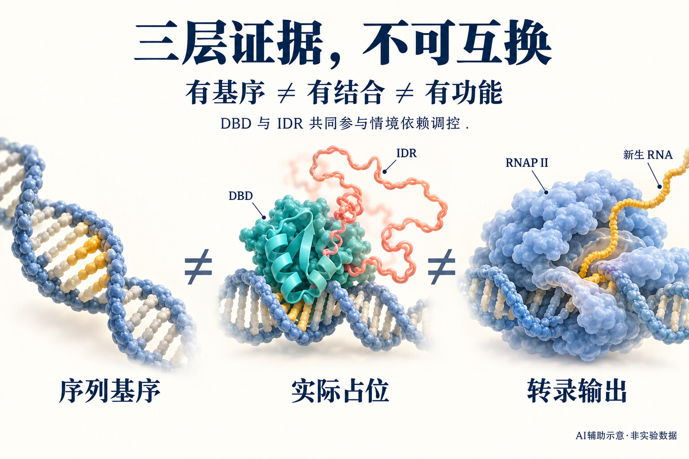

### 我们说“这个转录因子结合了”，究竟测到了什么

经典的模块化图景很清楚：DNA-binding domain，简称 DBD，负责识别 DNA；激活或抑制相关的效应区域负责接触其他调控蛋白。早期异源结构域融合实验表明，将一个能识别特定序列的模块和一个能激活转录的模块组合，可以构建有功能的调节器。这个思路至今仍是理解蛋白设计的有用起点。

但“可以分开构建”不等于“在活细胞里完全独立工作”。体外测试常常用裸露 DNA、纯化蛋白和受控反应条件。它回答的是：在这些条件下，蛋白更偏好什么序列，或与某个序列结合得多紧。细胞中的 DNA 则被核小体、其他蛋白、RNA 与动态结构包围。一个理论上很好的 motif，可能暂时没有机会被接近；一个不完美的序列，也可能因邻近相互作用而积累较多蛋白。

ChIP-seq、CUT&RUN 与 ChEC-seq 又各有自己的测量过程。它们能定位蛋白相关的基因组信号，但峰高会受到抗体、交联或切割条件、背景、归一化以及样本异质性的影响。一个峰也不能自动区分蛋白直接读取 DNA 碱基，还是通过其他蛋白被带到附近。没有检测到峰，同样不等于绝无短暂或低占有率的接触。

进一步把峰配给“最近的基因”，又加入了一层推断。远端调控元件不必只作用于最近启动子，某个时点的占位也不必立刻改变稳态 RNA。要建立功能联系，仍需要对相关元件或蛋白做扰动，并匹配合适的读出与时间。对于本来就有较长半衰期的 RNA，短时转录变化可能尚未反映为明显的总量差异。

因此，一个务实的表述层级是：发现序列偏好，提出可能结合；观察占位，提出可能参与调控；观察扰动后的输出变化，再进一步考虑直接性、时间关系和替代解释。这不是贬低任何组学方法，而是让每种方法回答自己真正测量的问题。

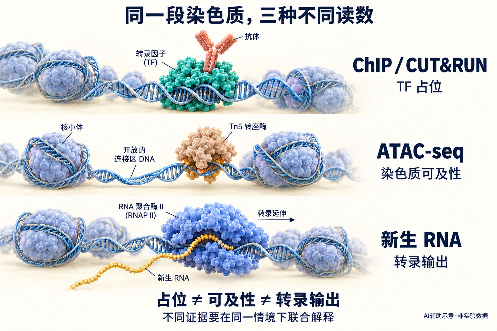

原创教学图，AI 辅助示意，非实验数据。ChIP/CUT&RUN、ATAC 与新生 RNA 分别提供不同层面的证据；图中不提供虚构实验曲线，也不替代下文 HIF 原始研究数据。

### 无序区不是没有作用的连接线

很多转录因子含有较长的 intrinsically disordered regions，简称 IDR。所谓“无序”，指这些区域在相应条件下没有一个稳定、唯一的折叠结构，不意味着没有序列特征，更不意味着只能充当连接器。

这些区域可以富集特定带电、极性或疏水残基，并通过多个较弱的接触与其他分子发生作用。若 DBD 有助于识别局部 DNA 信息，IDR 就可能影响蛋白在核内怎样移动、容易停留在什么微环境、能否接触辅助因子。这里的“可能”需要实验，不应仅凭一段序列被预测为无序，就给它指定一个功能。

综述还提醒我们，效应结构域和 IDR 不是同义词。有些无序区参与激活，有些参与抑制或定位；某些短线性基序可以招募特定共抑制因子。一个蛋白在不同背景下也可能呈现不同方向的调节，但不能据此假定所有转录因子都能随意切换身份。伙伴、浓度、修饰和 DNA 环境都需要具体说明。

理解这一点最好的方式，不是再画一张“IDR 招募伙伴”的泛化示意，而是看一项实际交换结构域的实验：如果 DNA 识别部分相近，换掉另一半蛋白之后，核内行为会不会跟着变？

### 一个可以拆解的例子：HIF 的“另一半”改变了什么

Chen 等人在 2022 年 eLife 发表的原始研究，选择缺氧诱导因子 HIF 作为模型。HIF-1α 与 HIF-2α 的结构化区域包括 DNA 结合和二聚化相关结构域，C 端则含有较长的无序区域。它们与共同的 β 亚基结合，能够识别相似的缺氧反应元件，但在细胞中的调节结果并不完全相同。

我们实际通读了这篇研究的正文、方法与文中附带的补图说明。它使用的是 786-O 肾透明细胞癌细胞背景：VHL 功能缺失使 HIF-2α 稳定，而这株细胞缺少有功能的 HIF-1α。这个选择有利于拆分亚型行为，却也限定了结果不能直接推广为所有组织在真实低氧中的普遍规律。

作者先对内源蛋白进行 Halo 标记，用免疫印迹、基因组占位与表达分析检查标记后的系统。他们再结合活细胞快速单分子追踪、结构域交换、DNA 结合突变、二聚化突变和相关扰动，观察蛋白在核内移动与停留的变化。后续还使用 CUT&RUN 和 RNA-seq，检查动力学差异是否对应某些位点的占位和基因输出。

这个设计的优点是没有把所有问题都交给一张占位图。单分子追踪看运动，结构域交换测试哪一部分贡献差异，结合位点测量看位置，RNA-seq 看输出。不同实验相互约束，比单独看到“峰变高了”更有解释力。

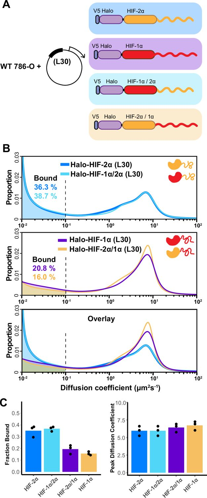

图源：Chen et al., eLife 11:e75064，2022，图 4，CC BY 4.0，完整原图。此图来自本系列另外核查的原始研究，不是 EMBO Reports 综述自身的实验。

图 4A 画的是交换方案：把 HIF-1α 与 HIF-2α 的结构化区域和 IDR 交叉组合。图 4B 的横轴是扩散系数，纵轴是模型估计的分子比例；不同颜色对应野生型与交换体。图 4C 汇总结合组分比例和主要移动组分的峰值扩散系数，黑点代表三个不同日期的独立测量，而不是把每条分子轨迹都当成一个生物重复。

结果中，带有同一种 IDR 的构建体显示较相近的动态特征；不同 IDR 之间则有区别。这支持 IDR 对该系统中 HIF 的运动与停留行为有贡献。它不支持“DNA 结合结构域从此不重要”，也不能仅凭曲线把具体相互作用伙伴确定下来。

具体看颜色，深蓝是 HIF-2α，浅蓝是带 HIF-2α IDR 的交换体；紫色是 HIF-1α，浅黄是带 HIF-1α IDR 的另一交换体。图 4B 标出的汇总结合比例分别为 36.3%、38.7%、20.8% 和 16.0%。这些数值来自所示模型与数据汇总，不能当成跨细胞类型固定不变的常数，也不是某个基因表达提高的百分比。虚线左侧的面积对应被划为低扩散的组分，右侧的峰反映移动群体；两个量可以变化得不同，不能只看曲线最高点来判断结合强弱。

还有一个容易忽略的细节：作者用低于 0.1 平方微米每秒的扩散系数作为不动、推定结合组分的界线。这是基于实验与分析模型的操作定义，不能把每个低于阈值的分子都说成已在某个特定 motif 上被直接观察。追踪模型还需要处理定位误差和离焦，单个细胞的轨迹数量有限。作者因此汇集多个细胞、多个独立测量进行推断，而不是把每个细胞曲线的差别都解释为新的生物状态。

### 比例、数量和位置，是三个不同答案

单分子图还有一个常见陷阱：某种蛋白的结合比例更低，不等于结合分子的绝对数更少。如果它在细胞里总量更高，较小比例也可能对应较多分子。研究中 β 亚基与 α 亚基的丰度并不相等，改变亚基比例就会改变观察到的运动与结合组分。

这也是为什么过表达控制很重要。蛋白过多时，原本稀少的伙伴可能变成限制因素，非生理的相互作用也可能出现。作者采用较弱表达体系，并在成像时比较相近表达水平；这些控制降低了某些混杂，但不能让所有交换体实验自动等价于未扰动的天然系统。

更关键的是“在哪儿”。运动变慢、停留比例增加，可能说明与核内环境发生更多接触，却不直接告诉我们它到了哪些基因上。因此，作者继续做了基因组层面的测量。

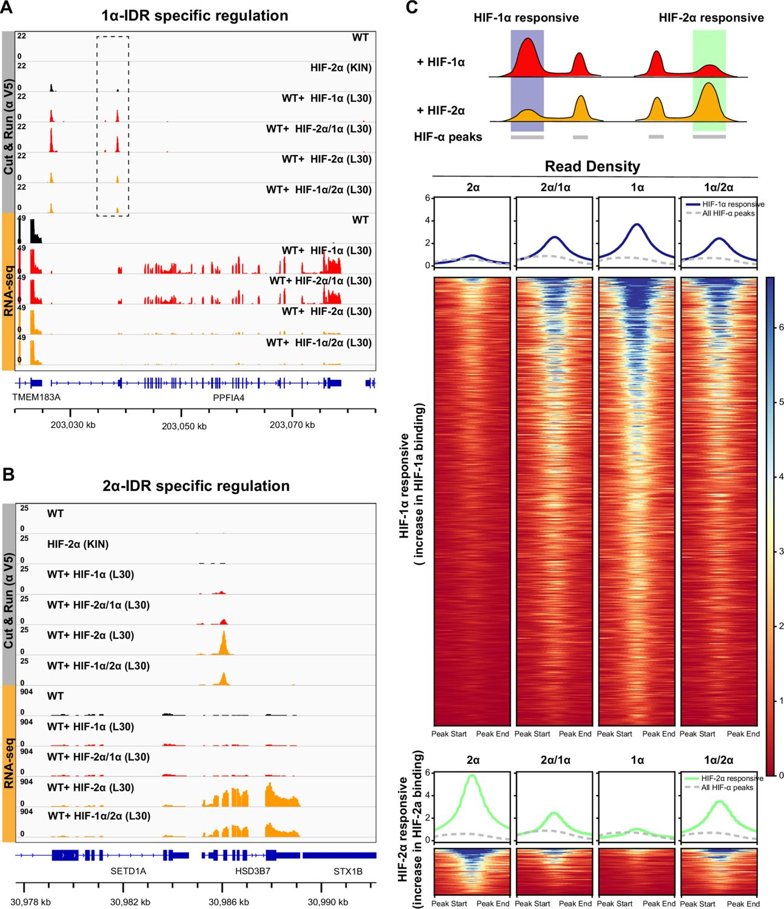

图源同上，图 6，CC BY 4.0，完整原图。该图将实际占位信号与 RNA 读出放在一起，不能用原创概念图代替。

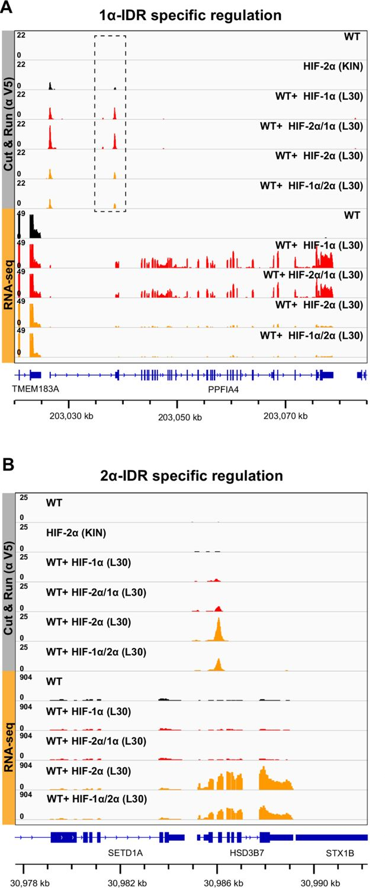

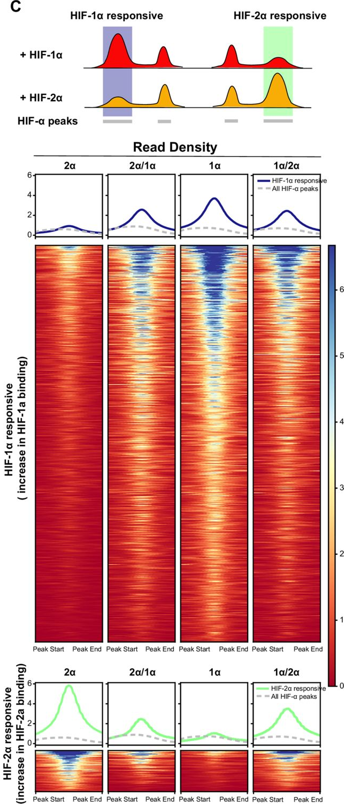

为便于手机阅读，上述两图仅将原图左右分栏裁切放大，未改变数据、颜色、标签或坐标；完整图保留在上方。

图 6A、B 的基因组浏览器轨道横轴是所示基因座的位置，纵向信号为相应 CUT&RUN 或 RNA-seq 轨道；A 中的虚线框标出讨论的调控区域。读图时必须对照构建体标签，分别看结合变化和基因表达，不能把两类轨道的高度当成同一单位。图 6C 的热图行是基因组区域，列围绕被比较的区域展开，颜色代表结合信号；上下的汇总曲线展示两组响应区域的总体趋势。

这些区域并非随机抽取：作者先找出对两种 α 亚基表现出不同响应的位点，再询问交换体更像哪一方。因此，它能用于检验“在差异位点中，IDR 有没有贡献”，不能用来推断所有基因组位置都由 IDR 决定。

图 6 的颜色方向也值得专门确认：热图不是常见的“红色越强”，这里红色接近低信号、蓝色对应较高信号，应以右侧色条为准。上半部分汇总 HIF-1α 响应区域，下半部分汇总 HIF-2α 响应区域；灰色虚线则是全部 HIF 峰的参考趋势。A 中展示的 PPFIA4 与 B 中的 HSD3B7 是具体基因座示例，不能用两个浏览器截图替代全体位点的统计。CUT&RUN 与 RNA-seq 使用三个生物重复；用于内源标记初步核对的 ChIP-seq 则是每条件一个重复，不能把不同实验的重复数混写。

事实上，文章明确报告，多数总体占位模式相近，很多位点在不同构建体之间重叠。显著的 IDR 相关偏好出现在一部分位点，而不是两个亚型占据完全互斥的基因组。RNA-seq 则显示带相同 IDR 的构建体具有较相近的表达变化。把这两点放在一起，较稳妥的结论是：IDR 会影响某些位点的结合偏好及转录调节，DNA 识别和核内相互作用共同参与，而不是用一套全新的“无序区地址码”完全替换 motif。

### 一个反向对照，比漂亮的交换结果更重要

如果只展示结构域交换，读者很容易产生一个过强印象：既然换 IDR 就改变行为，是否只要 IDR 就够了？原研究专门做了反向检验。

破坏 DNA 结合能力，结合组分会减少；破坏与 β 亚基的二聚化，同样不能维持原来的结合。仅保留结构化区域而缺少 IDR，也不能重现完整蛋白的行为。也就是说，在这一 HIF 系统里，IDR 有重要贡献，但并非独自充分。DBD、二聚化和 IDR 的作用不能简化为谁取代谁。

我们还不能从这些实验确定 IDR 作用的先后顺序。一种可能是 IDR 先帮助蛋白接近某个局部环境，再由 DBD 识别 DNA；另一种可能是 DBD 先结合，随后 IDR 与周围分子的接触延长停留时间。两种情况都可能增加最终占位，但对应不同的动力学机制。作者把这些解释作为模型提出，而不是声称已直接拍到完整过程。

对生信分析，这个区别非常实用。同一个 motif 评分，在不同蛋白浓度、伙伴组成或细胞状态下，对应的真实占位可能不同；相似占位，也不一定意味着相同输出。模型若只输入序列，却被要求预测所有细胞背景中的转录响应，就需要承认它遗漏了哪些信息，而不能把误差全部归因于网络规模不够大。

### 不把酵母证据直接升级成所有真核细胞的定律

EMBO Reports 综述还讨论了酵母中删除 DBD 或 IDR 的研究。它特别指出，一些分析聚焦高信号启动子，而且 ChEC-seq 可能存在较高非特异背景。这样的限定很重要：在某些条件下保留部分定位，不等于所有 DBD 都不必要；在一组启动子上的结果，也不等于整个基因组采用同样机制。

我们没有把这些酵母论文的全部实验逐一复现，本篇不对其具体效应量作独立验证声明。它们在这里的用途是说明一种研究方向，并提醒跨物种、跨方法推广时必须保留范围。相比之下，上述 HIF 研究是本篇实际全文核查的原始证据，说明类似问题可以在一个人源细胞模型中被拆解，但依然不能代表所有转录因子。

也不要把 IDR 与液液相分离自动画等号。弱、多价相互作用、局部富集和形成具有特定物理性质的相分离体系，是不同层次的主张。看到斑点、看到缓慢扩散，或看到某种处理后信号改变，都不足以单独证明细胞内相关结构是液滴，更不能证明它导致了转录。综述对这一点保留了明确争议，本系列会沿用这个边界。

### 回到那张没有表达变化的占位图

现在可以为最初的结果提出更具体的问题：这个峰是否依赖 DBD？是否通过伙伴间接招募？蛋白浓度或二聚化比例是否变化？相同位置是否已经具备辅助因子？现有 RNA 测量能否看到早期转录变化？“附近基因”是否真的是被调控对象？

这些问题不能靠同一份数据全部回答，但它们能帮助我们选择下一步，而不是简单删掉没有差异表达的峰，也不是把每个峰都强行配上一条机制。好的调控模型应该能说明它在哪一层有证据，在哪一层仍有缺口。

本篇的结论可以压缩为一句话：DNA 识别解释了转录因子功能的一部分，细胞中的定位与输出还取决于蛋白其余区域和周围环境。结合发生了，问题才刚开始。

### 来源与核查范围

主线 Review：[Schuh 与 Brickman，EMBO Reports，2026](https://doi.org/10.1038/s44319-026-00893-3)，完整正文与图注已读。另行全文核查：[Chen 等，eLife，2022](https://doi.org/10.7554/eLife.75064)，阅读主体、方法与内嵌补图说明，没有重新分析原始测序或成像数据，也没有把图中作者的模型当作直接观察。图 4、6 为原始研究图，使用 [CC BY 4.0](https://creativecommons.org/licenses/by/4.0/) 许可并保留原始标签。本文为独立教学分析，非原文逐段翻译。

## 增强子、准备状态与响应潜能

比较两个细胞状态时，我们经常把“开放区域增加、motif 富集、转录因子表达升高”连成一个故事：这个因子打开了染色质，于是启动了新程序。这个故事可能成立，但数据本身未必已经走完这条因果链。尤其当一个区域在刺激前就被占据，或刺激撤除后仍然开放时，转录因子还可能承担另一种任务：保留未来响应的能力，而不是让基因此刻就大量表达。

本篇继续解读 Schuh 与 Brickman 于 2026 年 9 月 10 日发表的 EMBO Reports Review，重点看增强子、协同、先锋作用和细胞可塑性怎样连接。我们把原综述的框架图放在对应位置，逐步解释它支持什么思考、又不能替代哪些实验。即使没有读前一篇，也可以把本篇理解为一个独立问题：细胞“已经准备好”与“已经开始表达”，如何区分？

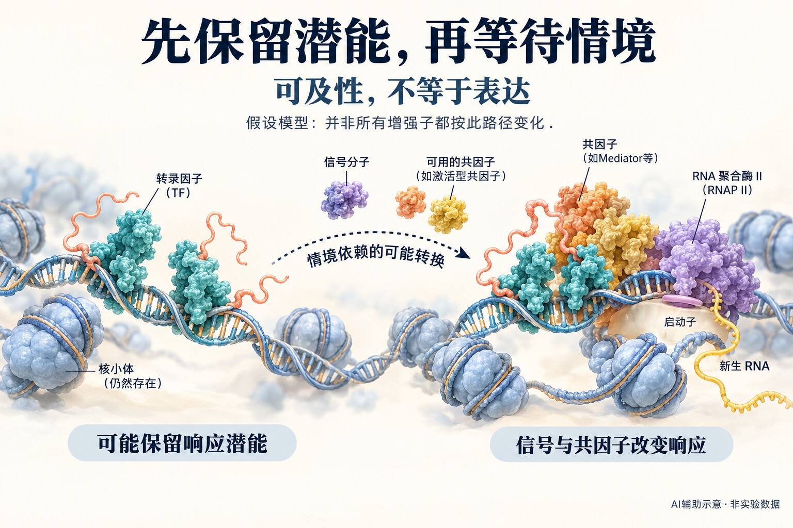

### 增强子的功能，不是把几个 motif 排在一起

增强子是可以影响启动子转录活动的调控元件。它的位置可能离受调节的基因很远，也可能处于基因内部。识别一个具有增强子相关特征的区域，与确定它调控哪个基因、在什么状态下发挥作用，是相互联系但不同的问题。

很多增强子含有多个转录因子的识别位点。不同因子可能直接相互作用，也可能共同影响一个辅助因子，或者分别作用于激活过程中的不同步骤。于是，即使单个因子与某个位点的作用不强，组合后的响应也可能明显改变。

这里至少要区分三件事。第一是共占位：两种蛋白在相近区域都有信号。第二是结合协同：一种蛋白的存在使另一种更容易结合。第三是功能上的协同：共同存在时的转录输出超过某个明确的独立作用模型。它们不是同一现象。两个峰重叠，不足以证明直接蛋白相互作用；两个因子同时敲低后表达下降更多，也需要合适的基线，才能判断是不是超出独立效应。

“增强子语法”描述的就是这些位点的数量、亲和性、相对方向与间距怎样影响功能。但语法不总是像一道只能有唯一答案的拼装题。一些调控元件对排列有严格要求，另一些允许一定变化。综述把经典 enhanceosome 与更宽松的组合模式放在一起讨论，而不是宣布所有增强子采用同一套规则。

对序列模型来说，这意味着识别 motif 的存在只是起点。要解释组合规律，还需要在明确背景下改变位点、测量蛋白占位与转录输出，并检查改变是否影响了其他因子或核小体环境。模型学到一个间距偏好，并不能自动证明两个蛋白在那个距离直接接触。

### 图 1B：从 DNA 接近性到转录装配，但不是一条强制流水线

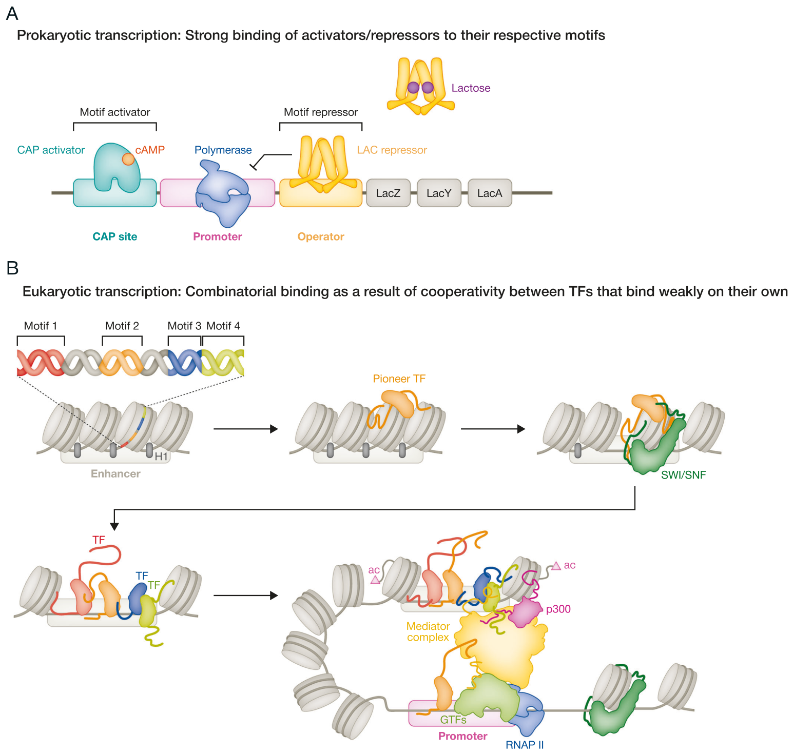

图源：Schuh 与 Brickman，EMBO Reports，2026，图 1，CC BY 4.0，从官方 PDF 第 3 页提取完整图区，保留所有分子与标签；网页 PNG 边缘标签过紧，故不用该版本。它是概念图，没有实验坐标、样本量或统计检验；不同颜色区分分子类型，不能把图中数量理解为真实化学计量。

先说明图 1A 的一个原文错误。原图注把高、低葡萄糖与 cAMP–CAP 激活的关系写反了。经典关系应是：在低葡萄糖条件下，cAMP 通常升高，有利于 CAP–cAMP 促进转录激活；高葡萄糖时该作用减弱。乳糖操纵子的生理诱导分子也应精确理解为异乳糖，而不是把图中乳糖标记当成完整化学机制。这一纠正已对照 [OpenStax Biology 2e 第 16.2 节](https://openstax.org/books/biology-2e/pages/16-2-prokaryotic-gene-regulation)的 CAP 与乳糖操纵子说明核查，只据其核实上述基本关系，不转载教材图文。原图本体没有高低糖标签，我们未擅自修改原图，而在这里明确纠正图注。原核与真核的对比只是教学概括，不表示所有原核因子都独立作用，或所有真核因子单独结合都很弱。

本篇主要看图 1B。上方从核小体包裹的 DNA 开始，橙色先锋因子接触相关区域，再与绿色染色质重塑复合物发生作用；后面的图示出现更多转录因子、p300、Mediator 和 RNAP II。这里重要的是把“接近 DNA”“改变局部染色质”“招募辅助因子”“形成可转录复合物”分成不同步骤。

然而，图中的箭头不是一组活细胞实验拍到的固定时间顺序。实际过程可能相互促进、反复装配，某些位点也可能已有部分组分。不能看到这张图，就断言自己的 TF 一定先招募 SWI/SNF，再招募 p300，然后再招募 Mediator。每个顺序关系都需要时间分辨或扰动证据。

同样，ATAC-seq 信号增加只能说明该实验读出的接近性改变，不能单独告诉我们是谁首先打开了区域。转录因子可以参与开放，也可以因为区域已经开放而更容易被检测。两种机制在一个终点的图谱上，可能长得很像。

### 先锋因子是一种功能能力，不是一张永久通行证

先锋因子常被描述为能在较封闭、核小体化的 DNA 上识别目标，并帮助建立后续的调控环境。这个概念很有价值，但不应被当作一个脱离条件的蛋白标签。

同一种因子在不同细胞状态、不同浓度、不同 motif 环境或伙伴组成下，可能表现不同。体外能够结合核小体 DNA，说明它具备某种能力；在细胞里是否真的改变某个区域的接近性，还取决于更多条件。反过来，一个因子在 ATAC 开放之前已经占位，也只是支持时间先后，仍需排除其他共同驱动过程。

综述指出，部分先锋活动依赖 DBD 以外的区域。这与前一篇讨论的 IDR 思路相接：序列识别只是过程的一部分，稳定局部接触、接近核小体、招募重塑因子，都可能需要额外相互作用。但不能因为一个蛋白带 IDR，就把它归为先锋因子；也不能把核小体结合、驱逐核小体和启动转录视作同一个实验读出。

如果研究目标是证明先锋作用，一个更具体的证据链应包含：因子能够在目标区域仍较封闭时接近它；改变该因子会影响后续接近性；相关变化不只是细胞死亡或全局状态崩溃的次级结果；在可行时，用结构域或位点层面的救援把作用定位得更清楚。这是基于综述整理的实验判断建议，不是说每篇已有研究都完成了全部步骤。

### 占位但未表达，可能是一种准备状态

综述使用 competence 和 plasticity 来讨论这类状态。competence 更接近“具有响应条件”：某些因子已经处于相关元件上，但尚未形成当前所需的完整转录输出。plasticity 则强调细胞在信号变化时保留转向、返回或选择其他状态的可能性。

这与简单的“开/关”二分法不同。一个尚未大量表达的基因，可能完全没有响应准备，也可能已有部分调控装配，只差一个信号。两个状态的稳态 RNA 都低，但未来对同一刺激的反应可能不同。

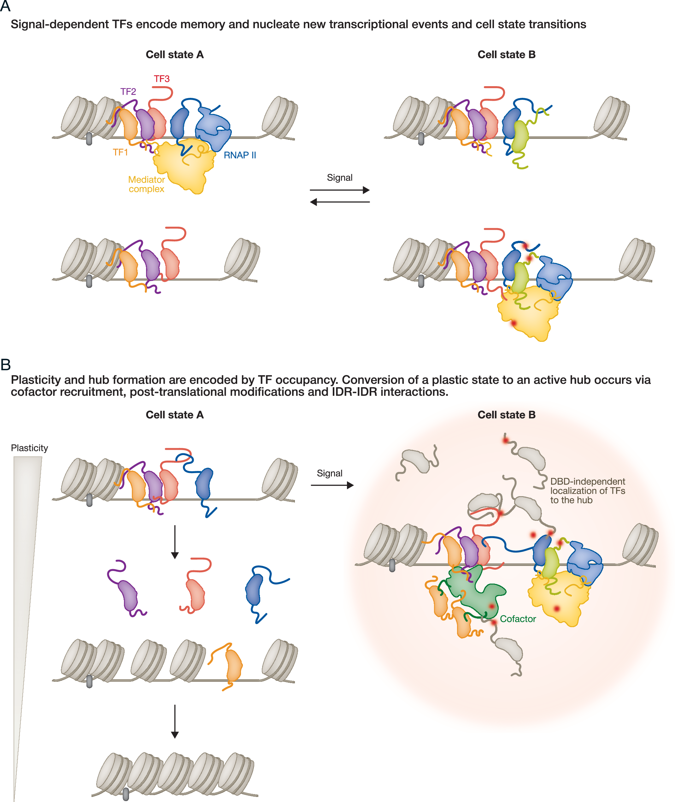

图源同上，图 2，CC BY 4.0，完整原图。A、B 都是作者整合文献后提出的概念框架，不是某次实验的显微图，也不是每个增强子必须经历的路线。

图 2A 左列是状态 A，右列是状态 B。两行代表两组不同的调控环境，不能把上下两个图当成同一个增强子在同一时点的两张照片。左上有辅助因子与 RNAP II，左下则保留 TF 但缺少完整的活跃转录装配。收到信号后，右下出现新的装配，而右上原有的活跃组分减少。图中央双向箭头强调这种转换可以具有可逆性，而非所有细胞都必然在固定时间内返回。

最值得注意的不是“哪个颜色变多”，而是有些 TF 可以在输出下降后仍然保留。若它们继续维持可响应环境，那么其生物学作用未必体现在当前表达量上，而可能体现在下一次刺激的速度、阈值或可恢复性上。

图 2B 左侧用逐步减少的占位与更致密的核小体示意可塑性可能降低；右侧描绘信号诱导辅助因子、翻译后修饰与局部蛋白富集。红点表示修饰，灰色因子表示可能通过非经典序列识别路径进入局部环境的分子。这里不是一张修饰组定量图，不能推断红点数量或蛋白浓度的实际变化。

这张图支持一种可检验的问题：保留下来的 TF 对未来响应是否有功能？它本身并不证明记忆已经建立，更不能确定灰色因子一定通过 IDR、且完全不接触 DNA。作者在结尾把相关两模式明确作为模型，仍保留非特异 DNA 接触等可能解释。

### 怎样把“记忆”从修辞变成实验问题

若只看到刺激撤除后还有一个 ChIP 峰，就称之为细胞记忆，证据通常不够。保留信号可能来自蛋白解离较慢、细胞群混合，或样本中仍有部分细胞处于原状态。更有说服力的设计，需要明确第一次刺激、撤除、再次刺激，以及从未经历刺激的对照。

以下是教学性的假设设计，不是本文实际做过的实验。选择一个在第一次刺激后发生转录变化的位点，在撤除信号后确认当前输出是否回落，再比较二次刺激的反应。若有响应差异，继续在撤除后的窗口选择性降低候选 TF，再看二次响应是否改变。如果去除 TF 只影响细胞整体生存，不能据此把它指定为该位点的记忆载体。

读出也应分层。占位告诉我们蛋白是否仍在；接近性告诉我们局部染色质状态；新生 RNA 更接近当前转录；稳态 RNA 反映生成与降解的合成结果；细胞命运则是更后面的系统输出。不同层面的变化不必同步，实验时间点应围绕机制而设，而不是只取方便的两个终点。

单细胞数据可以减少群体平均掩盖异质性的风险，但也不是自动的解决方案。占位、接近性与 RNA 常常来自不同细胞或不同样本，即使经过计算整合，也不能假装观测到了同一个分子的连续轨迹。若要讨论同一细胞的历史，还需要合适的追踪、标记或时间设计。

综述引用的 Hamilton 等 2019 年研究，将 ERK 信号、增强子辅助因子与可逆的谱系准备联系起来。我们核查了正式论文身份与可访问的摘要、部分结果及图注，但没有成功取得该文完整作者接受稿：机构库下载返回 403，另一路全文接口失败。因此，本篇只把它作为综述中有明确出处的代表性案例，不声称逐项核实了全部原始实验，也不从未读取的补充文件提取数字。

这种阅读范围不会妨碍讨论综述提出的问题，却会限制我们把某个具体分子步骤写成已经独立验证的结论。若后续获得完整材料，可以再把这部分证据展开，而不是现在用摘要补出细节。

### 增强子与启动子靠近，就一定启动了吗

远端调控还引出一个空间问题：增强子怎样影响启动子？DNA 环化、沿染色质的相互作用、局部富集环境等模型提供了不同角度，但不能把一张三维接触图直接当作转录活动图。

综述讨论了成像研究中空间接近与转录并不总是同步的情况。这提醒我们，测量分辨率、时间尺度以及接触定义，会影响观察。一次短暂接触可能先于后续输出；一个局部富集环境也未必要求两个 DNA 位点在所有时点都紧贴。反过来，频繁接近也不保证具备启动需要的全部组分。

因此，给增强子匹配靶基因时，距离、接触频率、共同变化和扰动结果是互补证据。它们不能互相替代。若研究的主要结论是某个增强子调控一个特定基因，最好把这个联系作为需要直接支持的部分，而不是在选定“最近基因”后悄悄跳过去。

局部蛋白富集也要区分现象与物理机制。图 2B 的“hub”可以作为描述许多相互作用在局部汇集的工作模型，却不等于已经证明液液相分离。观察亮点、测 FRAP 恢复或在体外形成液滴，分别提供不同线索；生理浓度、可逆性、组成和对转录的功能作用，还需要独立测试。

### 给调控组学分析增加三个检查问题

第一，当前数据是在描述状态，还是在解释状态转移？如果只测到一个终点，不宜把“已经开放”写成“刚被这个因子打开”。若关注的是未来响应能力，应设计挑战条件，而不是仅在基线表达里寻找答案。

第二，所谓协同采用什么独立基线？两个因子共表达、两个 motif 共现、两个占位峰重叠，是筛选候选关系的线索。要讨论功能协同，还需要说明单独扰动与联合扰动的预期关系，并控制表达量或细胞组成变化带来的混杂。

第三，哪个变量是真正的功能读出？ATAC 可见、H3K27ac 丰富、TF 占位增强，都可以帮助描述调控环境，但不能单独取代转录输出。反过来，RNA 没变也不能立刻否认该因子有用，它可能影响的是响应潜力、其他阶段，或尚未被当前时间窗捕捉的过程。

这些检查并不要求每个项目都加做全部组学。它们的目的恰恰是减少不必要的测量：先找出机制链条里哪一步最不确定，再选择能区分竞争解释的实验。例如，若两种模型唯一的差别在于 TF 是否在信号前已经有功能，单纯再增加一个信号后的占位终点，可能仍不能区分它们。

本篇希望留下的核心判断是：细胞的调控状态不仅包含当前正在表达的程序，还包含它保留了哪些响应可能。转录因子可以参与这种准备，但是否构成可塑性或记忆，需要通过时间、扰动和再次响应来检验。

### 来源与核查范围

主线 Review：[Schuh 与 Brickman，2026](https://doi.org/10.1038/s44319-026-00893-3)，完整正文、图 1—3 与 Box 1 已读。代表性案例：[Hamilton 等，Nature，2019](https://doi.org/10.1038/s41586-019-1732-z)，本篇仅核查身份、摘要及可访问的局部结果与图注，未称全文复核。本文的实验建议为基于文献的教学推演，不是实际运行或实验结果。原综述图 1、2 依据 [CC BY 4.0](https://creativecommons.org/licenses/by/4.0/) 使用；图注错误已在正文显著澄清，未擅改原图。

## 结合之后的转录步骤与因果检验

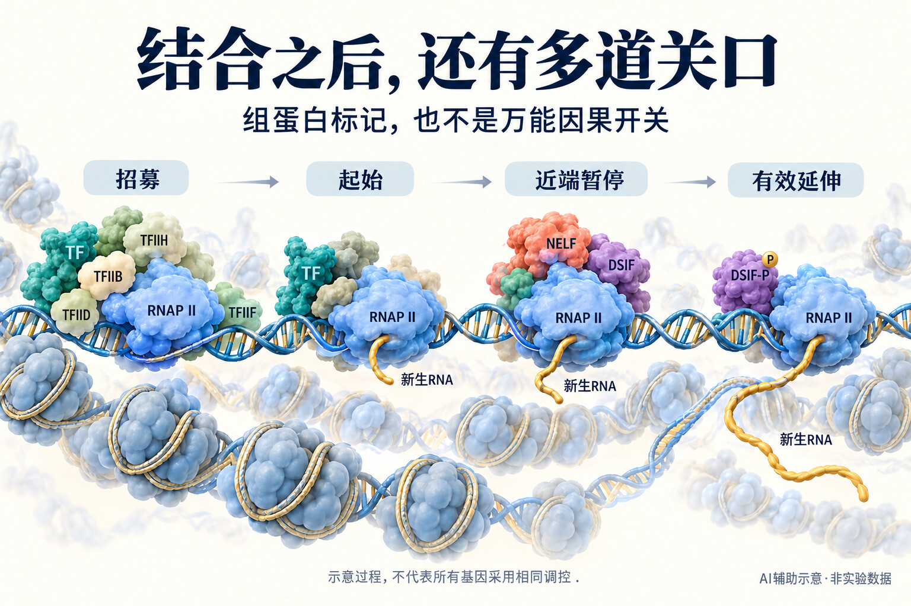

同一个增强子上，转录因子的结合峰还在，染色质也保持开放，目标基因的 RNA 却没有增加。遇到这种结果，我们常会继续寻找“缺少的那个因子”。但还有另一种可能：参与者已经到场，调控发生在更靠后的步骤。

Schuh 与 Brickman 这篇综述值得细读的地方，就在于它把“结合以后发生什么”拆开了。转录因子可以帮助准备 DNA 模板，也可以促进机器组装、影响聚合酶启动，或者调节已经开始工作的聚合酶。一次 RNA-seq 得到的终点变化，把这些不同过程叠在了一起。

这一篇顺着 RNA 聚合酶 II（RNAP II）的工作过程，讨论怎样找到真正发生变化的环节，再回到原文 Figure 3：作者提出的“两种作用模式”，究竟提供了什么解释，又留下了哪些待验证的预测。

### 先把转录拆成几个可测量的步骤

对于蛋白编码基因，至少需要区分以下过程：启动子区域变得可接近；通用转录因子与 RNAP II 形成预起始复合体（PIC）；DNA 局部解链，聚合酶开始合成 RNA 并离开启动子；聚合酶经历启动子近端暂停；随后进入持续延伸，生成更长的转录本。

这是一张便于分析的路线图，不代表活细胞中的复合体总按整齐的顺序逐个组装。综述特别提醒，经典 PIC 装配顺序很大程度来自体外重构，细胞内各组分是否作为完全独立的单元依次加入，不能直接照搬。

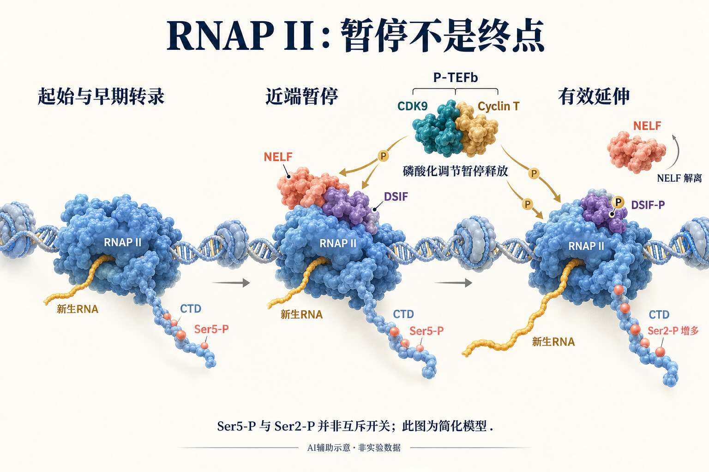

图解：这是依据综述组织的教学示意，不是实验结果。图中展示 NELF、DSIF 与 P-TEFb 参与的暂停调节，省略了许多复合体与旁路。若据此选择测量，ATAC-seq 主要反映可及性，启动子附近的 RNAP II 富集反映占位，新生 RNA 的位置与生成量帮助定位输出变化；这些实验并未画成图内数据，也不能互相替代。

例如，ATAC 信号升高并不保证 PIC 已组装。总 RNAP II 的 ChIP 峰变强，也可能是聚合酶在入口附近滞留。即使检测到很短的新生 RNA，仍需判断有多少聚合酶真正进入基因体，而不是提前终止。

因此，“启动子上有没有聚合酶”和“单位时间产生多少有效转录本”必须分别测量。前者偏向存量，后者更接近通量。这个区别看似简单，却会直接改变实验解释：入口堆积的机器可能更多，最终产出反而更少。

### 招募与暂停释放是两个不同的控制点

转录起始阶段，TFIID、TFIIB 等组分参与定位和稳定 PIC；TFIIH 中的 XPB 通过 DNA 转位帮助形成转录泡，CDK7 则参与 RNAP II 羧基末端结构域（CTD）的磷酸化。转录因子与这些组分的相互作用，为调节“能否启动”提供了机会。

但在很多受信号调控的基因上，聚合酶早已完成起始，停留在启动子下游不远处。NELF 与 DSIF 参与建立或稳定这一暂停状态。P-TEFb 是由 CDK9 与 Cyclin T 组成的复合体，其磷酸化作用有助于解除暂停，使 RNAP II 进入生产性延伸。这里的“b”是 P-TEFb 名称的一部分，不应把它写成一个“β因子”。

CTD 的 Ser5 磷酸化常与起始及早期转录相关，Ser2 磷酸化则在延伸过程中更突出。不过，两者不是互斥的开关，单个磷酸化标记也不是某一转录阶段的完整身份证。把这些信号与聚合酶分布、新生 RNA 一起看，才更有解释力。

这也解释了为什么细胞能在某些刺激下很快提高转录。它不必总从开放染色质和招募聚合酶开始，而可以调节已经准备好的暂停复合体。反过来，快速响应也不等于一定由暂停释放驱动；起始频率本身同样能够受到迅速调节。[综述原文](https://link.springer.com/article/10.1038/s44319-026-00893-3)

### Mediator 把信号输入接到不同环节

把 Mediator 只画成一根连接增强子和启动子的线，会漏掉它在这篇综述中的重要位置。它包含多个模块，既与转录因子相互作用，也与 RNAP II 及其他转录组分联系；含 CDK8 的激酶模块还可以可逆地与核心复合体结合。

因此，一个信号不必通过“增加 TF 数量”才能改变输出。它可能改变 TF 或共因子的翻译后修饰，影响相互作用、局部募集和复合体组成，再作用于招募、起始或暂停释放。综述以 ERK 相关调控为例，把增强子侧的共因子变化与聚合酶侧的调节联系起来。

这里要留意证据的层级。在某套实验中看到 Mediator 招募，支持它参与响应；检测到某一亚基与某种信号相关，并不能自动证明所有 Mediator 复合体都按同一路径工作。类似地，局部富集可以先描述为动态转录聚集区，不必先宣布它是液液相分离。显微镜中的斑点、FRAP 恢复或对 1,6-己二醇的敏感性，单独都不足以完成后者的物理机制判断。

### p300 很重要，不等于 H3K27ac 独自决定输出

p300/CBP 与 H3K27ac 经常一起出现，因此很容易把三句话连成一条必然链：p300 到场，H3K27ac 增加，增强子被激活。问题在于，这三项分别涉及蛋白定位、酶促产物与功能输出，需要不同的实验来连接。

Narita 等人的研究提出，p300/CBP 的乙酰转移酶活性影响 TFIID 与 RNAP II 招募，并与促进暂停释放的过程耦合。在其研究系统中，抑制酶活性并不等同于把 p300 或 TF 从 DNA 上移走。这个结果很适合回答本系列的问题：占位可以保留，转录机器的后续工作却发生变化。这里的概述依据该研究摘要、可检索正文与本篇综述，不把尚未完整取得的原始论文细节作为已核验数据展开。[Narita 等，2021](https://doi.org/10.1016/j.molcel.2021.03.008)

另一项研究则更直接检验标记本身。Zhang 等在小鼠胚胎干细胞中，把组蛋白变体 H3.3 的第 27 位赖氨酸替换为精氨酸。增强子上的 H3K27ac 大幅减少，但整体转录组、染色质可及性及多种其他乙酰化标记仍大体维持。它说明，至少在这套细胞与遗传扰动条件下，增强子活性的维持并不只依赖这个单一修饰。[Zhang 等，2020](https://doi.org/10.1186/s13059-020-01957-w)

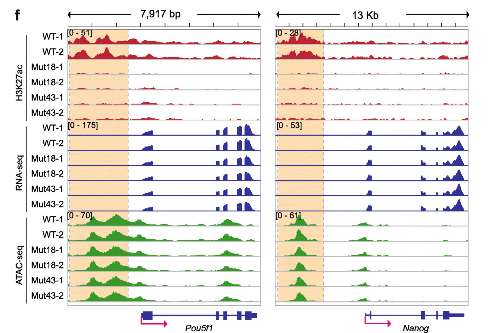

先用原始研究 Figure 1f 检查具体位点。左边是 Pou5f1，右边是 Nanog；横向分别覆盖 7,917 bp 和 13 kb。红、蓝、绿轨道依次为 H3K27ac、RNA-seq 与 ATAC-seq，黄色虚线框标出超增强子区域。WT、Mut18、Mut43 各显示两个生物学重复。应在同一种测定内部比较：突变株的红色增强子信号明显降低，蓝色 RNA 与绿色可及性没有同步消失。不同颜色轨道有各自的纵向显示范围，不能直接拿峰高比较跨实验的分子数量。补充方法说明，ChIP-seq 与 ATAC-seq 的基因组轨道按一千万 read pairs 归一化；它们是标准化覆盖信号，不是单细胞中的绝对分子计数。

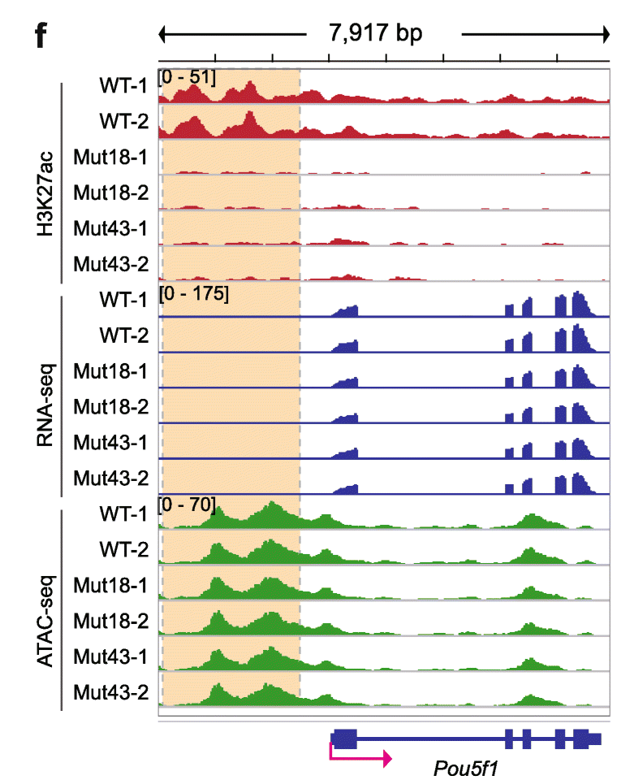

上图是同一原始面板的 Pou5f1 完整左列放大，方便核对 WT 与两个突变克隆；未改变任何轨道或标签。

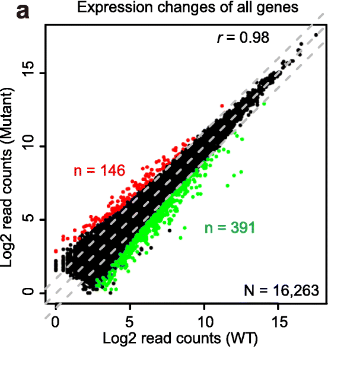

Figure 2a 再检查整体是否只靠两个示例支撑。横轴是 WT，纵轴是突变组的 log2 read counts，每个点代表一个基因；16,263 个基因多数靠近对角线。红色 146 个、绿色 391 个分别是在作者两倍变化且 FDR＜0.05 标准下上调、下调的基因。因此“总体维持”有数据基础，却不等于“一个基因也没变”；高相关系数也不能替代逐基因的效应检验。该研究还为 mRNA-seq 加入果蝇 RNA 外源标准，依据其 reads 估计归一化因子，并将两个突变克隆的重复合并比较。这些设计细节比只报一个相关系数更值得核对。

两图来源：[Zhang 等，2020，Figure 1f 与 Figure 2a](https://doi.org/10.1186/s13059-020-01957-w)，[CC BY 4.0](https://creativecommons.org/licenses/by/4.0/)。仅从原始完整图中裁出完整面板，未重绘、未改变数据、标签或颜色。

边界同样重要。这里改的是 H3.3，不是把所有组蛋白变体上的 K27 修饰瞬间清零；实验使用稳定突变细胞，也不能排除细胞适应与其他乙酰化事件的补偿。K27R 还会改变该残基本身及其接受其他修饰的可能性。因此，这项研究不能被缩写成“H3K27ac 在任何细胞里都没有功能”。

把两项工作并排读，真正有用的问题是：p300/CBP 发挥作用时，关键底物到底有哪些？除了组蛋白，它还可乙酰化多种转录相关蛋白。抑制整台酶、删除整个蛋白，以及改变一个组蛋白残基，干预范围完全不同。若这些操作产生不同表型，应该利用差异继续定位机制，而不是选其中一个结果宣布另一种观察无效。

### H3K4me3 的例子提醒我们别按位置猜功能

H3K4me3 富集在活跃基因的转录起始位点附近，因而常被称为活性启动子标记。它也能够与参与起始的蛋白发生联系。这些证据让“促进起始”成为合理假说，但还不能回答：当它被快速移除时，最先出问题的是哪一步？

Wang 等人在小鼠胚胎干细胞中，分别建立了急性降解 DPY30 和 RBBP5 的系统。这两个蛋白是 SET1/COMPASS 复合体的共享组分。降解后，H3K4me3 比 H3K4me1 和 H3K4me2 更快下降，提供了一个相对有利于研究早期影响的时间窗口。

他们把新生 RNA 检测、聚合酶分布和动态实验结合起来：输出下降，并没有伴随可检测的 PIC 组装缺陷；相反，启动子近端的聚合酶积累，暂停驻留时间延长，延伸也受到影响。通过 KDM5A/B 缺失延缓 H3K4me3 消退，转录与暂停表型的出现也相应推迟。这类对照加强了修饰变化与表型之间的联系，而不仅是比较两个终点样本。[Wang 等，2023](https://doi.org/10.1038/s41586-023-05780-8)

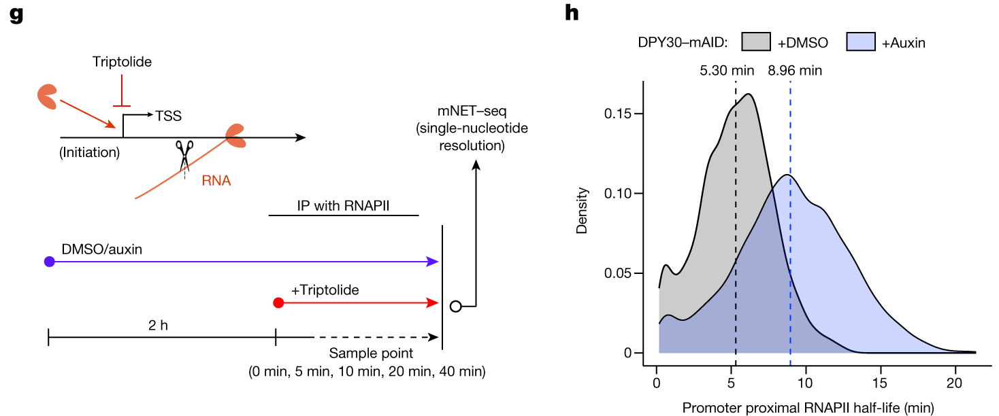

读 Figure 3g–h 时，先看实验的时间方向。g 中 DPY30-mAID 细胞先接受 DMSO 对照或 auxin 处理 2 小时，随后加入 triptolide 抑制新的转录起始，在 0、5、10、20、40 分钟取样，用 mNET-seq 跟踪近端聚合酶相关 RNA。h 的横轴是估算的启动子近端 RNAP II 半衰期，单位为分钟；纵轴是这些估计值的概率密度，不是 RNA 总量或细胞百分比。灰色为对照，淡蓝色为 auxin 组，虚线标示平均值 5.30 与 8.96 分钟。

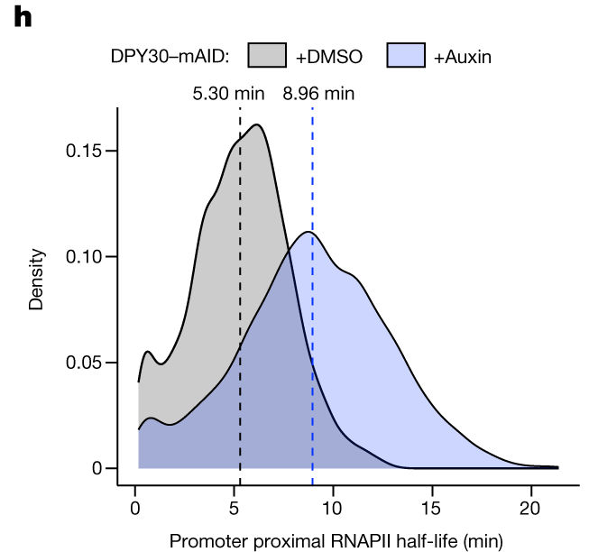

上图为同一原始 h 面板的放大展示，保留全部坐标、图例及平均值。该图展示 4,007 个基因、两个生物学重复，基因数量不能当成重复数。方法中用 TSS 下游 300 bp 窗口估计近端 RNAP II 密度，因此这里的半衰期也受所选窗口和拟合基因集影响。处理后分布右移，支持近端聚合酶消退变慢；该推断依赖起始抑制与指数衰减模型，也不能仅凭它区分所有可能的离开方式。作者结合基因体新生转录及独立延伸实验，才把解释推进到暂停与延伸调节。

原图来源：[Wang 等，2023，Figure 3g–h](https://doi.org/10.1038/s41586-023-05780-8)，[CC BY 4.0](https://creativecommons.org/licenses/by/4.0/)。从当前已包含更正的官方版本裁出完整 g、h 面板，未重绘或更改标签。该文已发布更正涉及 Figure 2e 时间标签和 Extended Data Figure 8d 照片，并非此处展示面板。

还有一个值得学的方法细节：作者没有只用“启动子信号除以基因体信号”的暂停指数作结论。他们在抑制新起始后追踪近端 RNAP II 信号的衰减，并用不同的新生转录方法分析延伸。因为一个比值升高，既可能是分子增加，也可能是分母下降；只凭比值，无法唯一推断暂停释放速率。

研究进一步把 H3K4me3 的作用联系到 Integrator 亚基 INTS11 的募集。但这里仍不能画出一条在所有细胞中固定成立的“INTS11 促进转录”箭头。Integrator 还参与近端提前终止，不同细胞、转录单位及扰动方式下的净效应可以不同；原始论文讨论中也明确承认了相关研究间的差异。

这项实验也不是只改了一个甲基标签而对其他事情毫无影响。它首先干预的是甲基转移复合体组分，较晚时间点还会影响其他 H3K4 甲基化状态。因此，更准确的结论是：多套相互补充的实验支持 H3K4me3 在这套系统中参与暂停与延伸调节，不能仅由它在启动子附近富集，就把其功能固定为“帮助起始”。

### 原文 Figure 3 提出的是两个可检验的作用模式

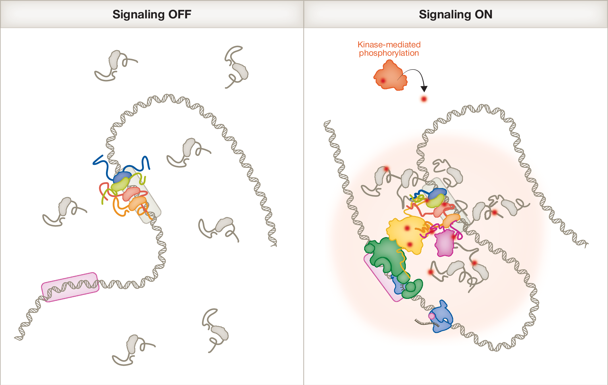

原图出处：Schuh 与 Brickman，EMBO Reports（2026），Figure 3，DOI：10.1038/s44319-026-00893-3。原图完整转载，未改变图中内容，中文解说另行撰写；采用 [CC BY 4.0](https://creativecommons.org/licenses/by/4.0/) 许可。

先看左侧 Signaling OFF。若干彩色 TF 结合在增强子区域，图中的灰色框标示该局部。作者用它表示一种准备状态：特定调控元件已经具备未来响应的条件，但当前没有画出强烈转录输出。外围灰色 TF 尚未集中到这个区域。

再看右侧 Signaling ON。信号引入修饰与共因子变化，局部变得更拥挤。外围灰色 TF 被招募进入活跃区域；原图故意没有把这些灰色 TF 全部画成直接结合 DNA，表达其募集可能不依赖特定 DNA 序列。作者同时保留了非特异性 DNA 结合参与的可能，因而不能读成“这些 TF 绝不接触 DNA”。

红点表示包括磷酸化在内的翻译后修饰，可以发生在 TF、共因子及 IDR 等部位。彩色形状用于区分参与组分，不是定量颜色标尺；不同颜色也不能在没有对应说明时被擅自指定为某个具体 TF。淡红背景表达局部环境，不是经过测量得到的浓度边界。

最关键的是图注的语气：这是作者设想的两类作用，不是同一位点的一组实测时间序列，也不是所有 TF 必须轮流经过的两个固定状态。第一类强调通过序列相关结合维持响应潜能；第二类强调活跃转录环境中的附加募集与输出强化。二者可以并存，也可能因位点、细胞状态和刺激而改变权重。

它带来的一个新预测是：转录状态不仅可能受 TF 定位影响，还可能反过来改变 TF 分布。要验证这个反馈，需要区分“TF 先到场推动转录”与“转录环境形成后又留住更多 TF”，不能把刺激前后两张 ChIP 热图直接排列成因果顺序。综述支持这一构想的文献中包括 Monteiro 等 2026 年预印本，不能把它当成另一篇已经正式发表的独立证实。

### 把 Box 1 变成一个能区分解释的实验

原文 Box 1 提出的方向，是从群体平均占位走向位点分辨与动态测量。它关心 IDR 是否存在可预测的组成规律、信号依赖修饰如何改变伙伴选择，以及这些过程如何参与细胞状态转换。下面是一种据此组织的实验思路，不是原文已经完成的实验。

首先选定一个真实响应的内源位点，在同一种细胞状态下进行刺激时间序列。应同时测 TF 的占位或停留、关键共因子的募集，以及目标基因的新生 RNA。若只在不同细胞群之间比较平均值，很容易把细胞比例变化误认为单个位点内部的转换。

接着对内源 TF 做可控的急性扰动，再分别用野生型、DBD 功能受损版本和 IDR 改变版本进行回补。各版本要核对表达量、稳定性、核定位和主要结构完整性。整段删除 IDR 导致的表型，可能来自蛋白不稳定或伙伴全面丢失；有针对性的序列置换、组成匹配对照，通常更有助于追问究竟改变了哪种相互作用。

如果 DBD 改变首先损害刺激前的位点占位，而某类 IDR 改变保留基础占位、却削弱刺激后的募集与新生 RNA 输出，这会支持两个环节可被部分分离。它仍不是两模式模型的终局证明，因为不同突变的副作用和局部共因子变化都需要进一步排查。

单粒子追踪配合可在活细胞中定位的基因座标签，可以测停留与到访；DNA-FISH 更适合固定样本中的位置核对，不能被当作连续实时追踪。邻近标记蛋白质组可补充局部组成，却不能独自证明直接接触。把这些方法放在一起，是为了让各自的盲点互相受到约束。

最后，实验要同时保留短时与较晚时间点。短时窗口有利于减少细胞身份重塑造成的间接效应；较晚读出则用于判断早期变化是否形成稳定转录程序。两者解决不同问题，不能拿较晚的分化终点反推每一步最初都由该 TF 直接造成。

回到开头，结合峰还在、RNA 没变，并不是一种统一的“失败”。它可能对应准备状态、招募未完成、暂停释放不足，也可能只是观测时机或目标配对不合适。真正推进研究的下一步，是找到哪一个可测环节发生了变化，再用足够窄的扰动去检验它。

### 本篇核读与参考

- 核心综述已完整阅读正文、三幅图注及 Box 1：[Schuh 与 Brickman，2026](https://doi.org/10.1038/s44319-026-00893-3)。本文按问题重新组织，示意图模型与实验结果分别标明。
- H3K27ac 的遗传扰动边界核对了原始研究正文、Methods 与补充方法文件：[Zhang 等，Genome Biology，2020](https://doi.org/10.1186/s13059-020-01957-w)。未把所有补充图逐张复核作为完成项。
- H3K4me3 的证据链核对了原始研究完整主文、主要图注及相关动态测量方法：[Wang 等，Nature，2023](https://doi.org/10.1038/s41586-023-05780-8)。当前版本已包含[时间轴标签更正](https://doi.org/10.1038/s41586-023-05958-0)及[扩展数据重复照片更正](https://doi.org/10.1038/s41586-023-06778-y)。未重新分析原始测序数据。
- p300/CBP 研究仅就摘要与已取得的可检索正文支持的主结论引用：[Narita 等，Molecular Cell，2021](https://doi.org/10.1016/j.molcel.2021.03.008)。不声称已阅读全文及补充材料。

## Take-home messages

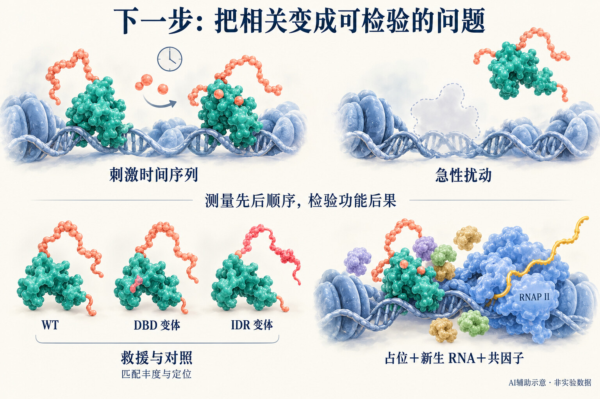

### Take-home messages

如果实验里已经有 TF 的 ChIP-seq 峰、开放的 ATAC-seq 区域和漂亮的 motif，却还不能解释 RNA 为什么没有变化，下一步不一定是再加一张组学热图。更有效的做法，是先决定要区分哪两种解释，再选择能把它们分开的读出。

Schuh 与 Brickman 的综述讨论了 DNA 结合、IDR、共因子与信号之间的多层联系。下面把这些讨论整理成一份可直接用于分析与实验设计的检查清单。它独立于前三篇展开，也不把作者提出的两模式框架写成所有转录因子的既定规律。

### 1 先把候选靶基因表拆成三张

第一张记录 TF 在哪些区域被检测到；第二张记录哪些调控元件与目标基因存在连接证据；第三张记录扰动 TF 后，哪些基因的新生转录发生变化。

不要把“峰附近最近的基因”直接填入第三张表。最近距离、染色质接触、活性相关性及预测模型提供的是不同强度的配对线索，彼此不能自动等价。重要候选最好补上内源位点扰动；做 CRISPRi 时，也要考虑局部抑制作用的范围及对邻近元件的影响。

交集可以用于优先排序，但不能因为某个基因同时出现于三张表，就跳过时间顺序和间接效应。把结论写成“候选直接调控对象”，通常比提前宣布完整机制更准确。

### 2 让每条轨道只回答它能回答的问题

TF 的 ChIP-seq 或 CUT&RUN 用于描述富集与定位，ATAC-seq 用于描述可及性，H3K27ac 等用于描述局部修饰状态。它们都不能单独给出单位时间的 RNA 生成量。

如果问题是“是否正在产生更多 RNA”，优先加入与问题匹配的新生转录读出。PRO-seq 等 run-on 方法有助于描绘具有延伸能力的聚合酶分布；代谢标记方法可测新合成 RNA。两类方法的标记窗口、捕获对象和偏差不同，不宜混成同一种“转录活性”。

稳态 RNA-seq 则同时受到合成与降解影响。看到成熟 RNA 不变时，要问是否存在合成变化被稳定性抵消，或者响应尚未积累到能被终点采样捕捉的程度。反过来，RNA 增加也不能独自证明启动子起始增强。

### 3 分开计算聚合酶的存量与输出

分析 RNAP II 时，至少保留启动子近端和基因体的独立信号，再计算暂停指数。记录转录起始位点版本、窗口定义、相邻转录单位及低计数过滤，避免换一个注释或窗口就得到相反结论。

暂停指数升高可能来自近端信号增加，也可能来自基因体信号减少。若要把结论推进到“暂停释放变慢”，需要动态信息或其他相互独立的证据，而不是只展示一个比值。短时抑制新起始后的衰减测量、可逆扰动后的转录波推进，都可帮助缩小解释范围，但各自也有药物与模型假设。

如果预计存在全局转录变化，还要预先安排适用的外源标准或其他定量策略。只把所有样本缩放到相同总量，可能掩盖整体下降，把剩下的相对富集误认为绝对上升。

### 4 测“未来响应能力”要真的安排一次刺激

一个 TF 占据开放的增强子、当前 RNA 却很低，这只是准备状态的候选证据。要研究 competence 或 plasticity，应比较有无该 TF 时，同一套细胞对后续刺激的响应能力。

至少明确四个观察阶段：刺激前、早期响应、较晚输出，以及有需要时的撤除刺激后。具体间隔应由信号动力学和标记窗口决定，不要套用一组万能时间点。同步检查细胞存活、细胞周期与状态组成，防止把群体改变当作位点机制。

撤除刺激后 TF 仍在，并不足以证明“记忆”。如果进一步声称它保留了再响应潜能，就应在合适的间隔重新刺激，并比较第二次响应的速度、幅度或参与细胞比例。把功能定义写进实验，才能避免用一个静态峰替代未来能力。

### 5 区分 DBD 与 IDR 时别只比较两个缺失蛋白

较有信息量的设计是：急性扰动内源 TF，再以可比水平回补野生型、DBD 功能改变版本和有针对性的 IDR 改变版本。除功能读出外，要验证蛋白丰度、半衰期、核定位及必要的伙伴相互作用。

如果 IDR 改变后占位降低，先排查它是否只是导致蛋白不稳定；如果占位保留而输出降低，则进一步测共因子募集和转录阶段。不同结果有不同下一步，不宜把所有现象都归入“IDR 负责凝聚”。

针对 IDR 的序列组成问题，可以设计长度或整体组成匹配、但排列不同的对照。若研究磷酸化，酸性残基替换并不等于真正的磷酸基团；应结合位点检测、信号依赖性及酶活扰动，避免把“磷酸化模拟体”当作充分证明。

### 6 把标记与酶分开干预也分开表述

H3K27ac 下降后表达维持，可以提示补偿或该标记并非独立必需；它不证明 p300/CBP 无关。抑制 p300/CBP 的催化活性、移除整个蛋白、改变 H3.3 的某个残基，影响的底物和结构功能不同。

H3K4me3 的例子同样提醒我们：一个标记靠近启动子，不代表它只参与起始。急性扰动后，应同时检查起始相关组装、近端暂停和基因体转录，把“活性标记”进一步拆成具体环节上的作用。

写结果时带上实验边界，诸如细胞类型、急性或长期处理、改变的残基或复合体组分。比起“某修饰决定转录”，一条指出操作对象、最先变化的读出及未受影响环节的结论，更便于下一项实验接着验证。

### 7 留一组能让两模式模型失败的结果

综述 Figure 3 的一个重要设想是：TF 既可能通过序列相关结合维持准备状态，也可能通过 IDR 等相互作用被招募到已经活跃的区域。要让它成为有用的模型，就应提出能支持也能削弱它的预测。

例如，某种 IDR 改变若保留刺激前的基本占位，却选择性损害刺激后的共因子募集和新生 RNA 增强，会支持功能环节可被分离。若所有表型都随蛋白总量变化而消失，或者受控实验发现附加募集完全由新的特异性 DNA 结合解释，则应调整模型，而非继续给图中的“局部环境”补上无法检验的解释。

做活细胞成像时，位点标记、蛋白标签与过表达本身都应有对照。邻近标记提示空间邻近，不能直接等同于分子接触；FRAP 恢复、液滴外观或 1,6-己二醇处理也不能单独证明液液相分离。先把真正测到的现象讲清楚，再讨论哪种物理机制解释得最好。

### 回到自己的数据从最小问题开始

可以先选少量可信位点：一类是刺激后 TF 富集增加且新生 RNA 增加，另一类是占位保留但输出不变。尽量匹配基础表达、可及性与技术覆盖，再比较它们最早发生分歧的环节。

如果只有群体测序数据，先排除测序深度、可比性和细胞组成差异。若加入单细胞数据，也不要把一次未检出当作真正关闭，更不能仅凭稀疏信号的共现就推断同一条分子通路。优先形成一个明确问题，例如“刺激后的输出差异是否出现在 RNAP II 招募之后”，再为这个问题追加数据。

本系列最终想留下的，是一个可操作的顺序：先明确位点和靶基因，再定位变化发生的转录阶段，最后用匹配时间尺度的扰动分离可能机制。这样，即便最后没有发现新的 TF，也能知道现有 TF 在什么条件下、通过什么步骤改变了表达。

### 来源与使用边界

核心来源为 [Schuh 与 Brickman，EMBO Reports，2026](https://doi.org/10.1038/s44319-026-00893-3)，尤其是 Figure 3 与 Box 1。上文清单是据其问题框架整理的分析建议，不是该综述已经验证的统一实验流程。

标记与功能的两个原始例证分别为 [Zhang 等，2020，H3.3K27R 小鼠胚胎干细胞](https://doi.org/10.1186/s13059-020-01957-w) 和 [Wang 等，2023，急性 H3K4me3 相关扰动](https://doi.org/10.1038/s41586-023-05780-8)。两项研究的结论均应保留其具体模型与操作边界。
