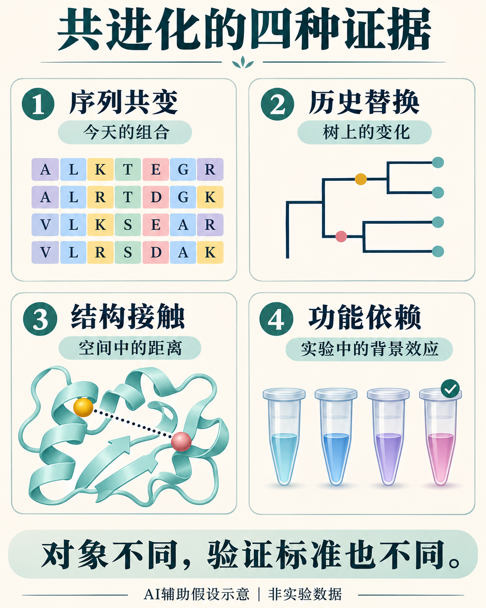
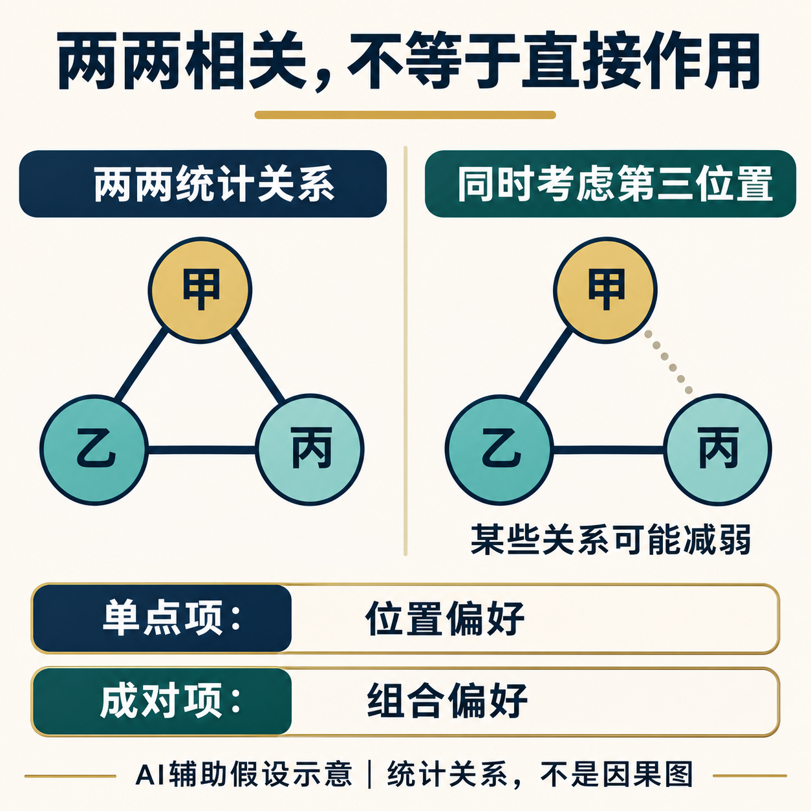
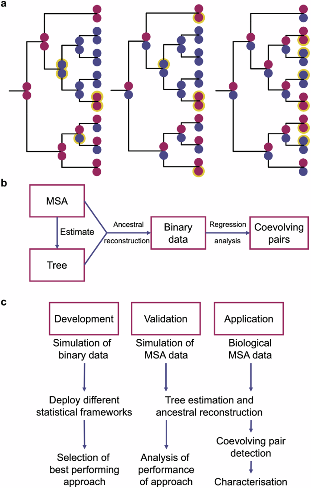
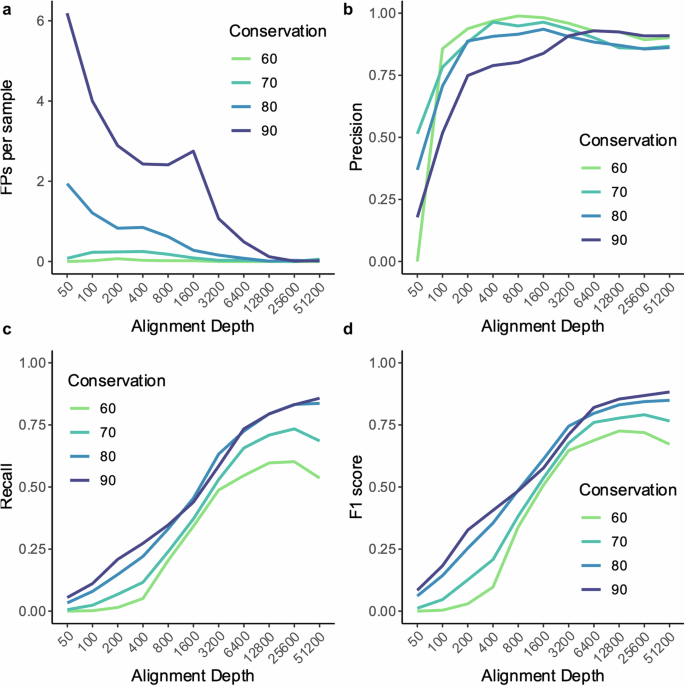
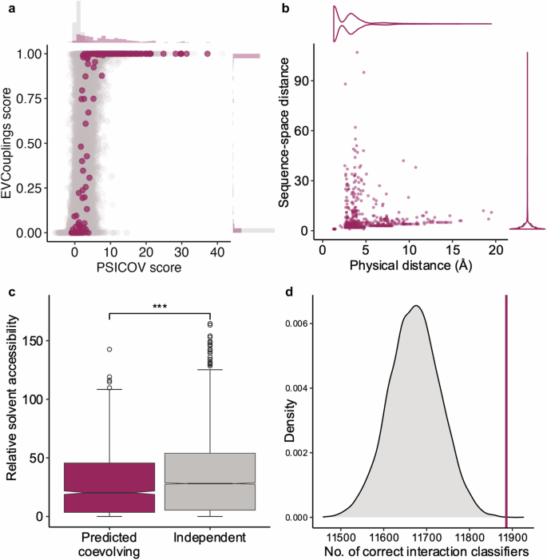
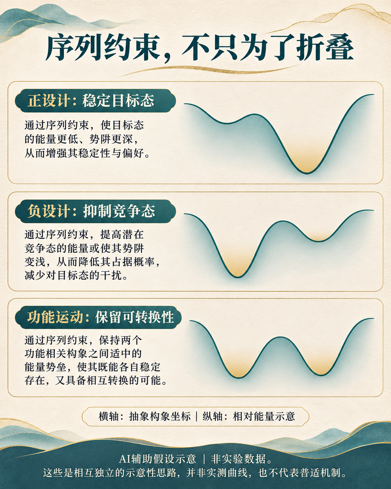
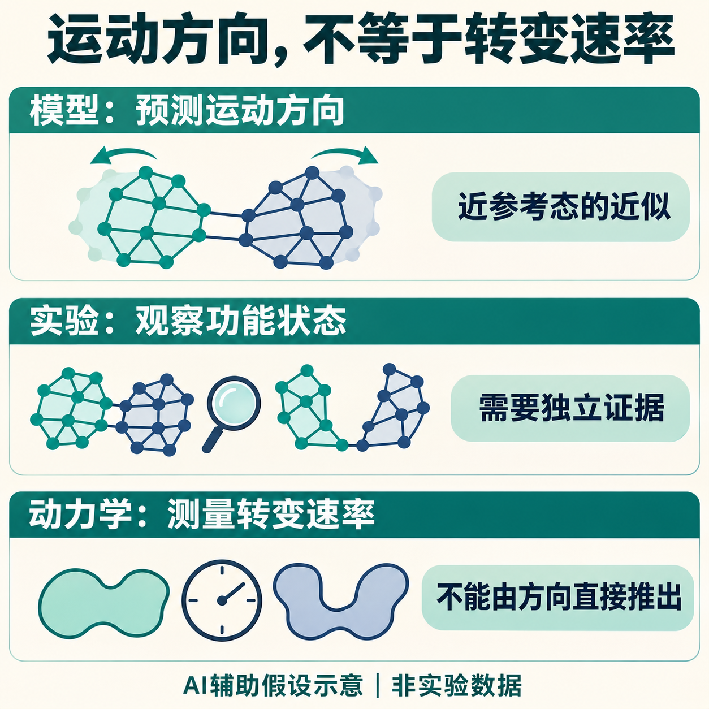

# AlphaFold之后，序列里的“共进化”还值得研究什么？

::: {.book-source}
论文：[DOI 10.1007/s00239-026-10354-z](https://doi.org/10.1007/s00239-026-10354-z)。原有图注和许可说明见正文；未明确许可的图版标记为**授权待确认**。
:::

来源：Bastolla U, Aurell E, Cocco S, et al. Evolutionary Intelligence: How Coevolution Opened the Way to the AlphaFold Revolution. Journal of Molecular Evolution，2026年11月4日，正式Review，DOI：10.1007/s00239-026-10354-z。本文是一份独立教学分析母稿，按问题重新组织，不是逐段翻译。主综述完整正文、公式与参考文献表已读；对关键原始研究的核查范围见末尾证据记录。

## 一张漂亮的接触图，究竟告诉了我们什么

把几千条同一家族的蛋白质序列对齐，再从不同位置的变化中预测哪些氨基酸彼此靠近，这件事曾经像魔术。现在结构预测已经很常见，反而容易忽略它背后的问题：这些变化为什么会同时出现？是两个位置必须配合，还是它们只是继承了共同祖先的特征？一个分数能够预测接触，就等于它找到了进化机制吗？

这篇新综述值得读的地方，正在于把问题从“预测得准不准”往前推进了一步。它沿着互信息、直接耦合分析和深度学习的发展脉络，讨论序列统计能够揭示什么，又有哪些解释还停留在假设层面。对已经使用AlphaFold的人，这是一堂关于证据边界的课；对做变异解释、比较基因组或蛋白功能研究的人，它提供了一套避免把相关性直接写成机制的思路。

### 先分清四种容易混在一起的关系

多序列比对，简称MSA，可以想象为一张表：每一行是一条序列，每一列对应被认为具有同源关系的位置。两列里氨基酸的组合偏离随机独立的预期，就叫统计共变。这里观察到的是今天能够采集到的序列，不是历史录像。

“相关替换”则是一个历史陈述。它问的是：沿着进化树的一条分支，位置甲改变时，位置乙是否比预期更容易也改变？回答这个问题需要树和祖先状态推断，仅看末端序列组合不够。

“物理接触”属于结构层面。两颗原子或两个残基是否靠近，取决于结构、接触定义和构象。例如以最近重原子距离定义接触，与以两个Cα原子的距离定义接触，阈值不能直接混用。

“功能耦合”又是一层。如果甲位点的突变效果依赖乙位点是什么，这涉及背景依赖或上位性。但这种依赖可以来自稳定性、结合、表达、降解或细胞环境，不一定对应两者在某一张静态结构中紧挨着。

这些关系可以重叠，却不是同一个对象。文章中“共进化”一词使用得很广，因此阅读时最好自己补上一个小问题：作者在这里说的是序列共变、历史替换、结构接触，还是功能依赖？把对象说清楚，比追求一个统一而漂亮的标签更重要。

### 三种来源不同的共变，不要只认同步替换

主综述进一步把产生进化相关性的机制分成三类。第一类是相关替换：一个位点改变后，改变了另一个位点受到的选择压力，因此两次替换比随机预期更容易在较短进化间隔内出现，同一树分支上的共同变化是其中一种可检测表现。

第二类是位点特异的选择偏好。即使替换事件彼此独立、不发生在同一分支，某些特定位置上的氨基酸组合仍可能更有利于天然结构或功能状态，也可能更不利于错误折叠状态。这些组合在留下来的序列中更常见，同样能够形成与真实结构或功能约束有关的相关性。不能因为祖先重建没有发现同步替换，就否定这种选择来源。

第三类是分支特异、但不针对特定位置的全局偏好。例如不同谱系的突变偏好、资源压力或环境不同，使整条蛋白的氨基酸组成发生变化，多个位置就可能一起呈现相关模式。这种全局信号可能遮住位点特异的约束。三类机制可混合存在；祖先同步变化检测主要针对第一类，不能作为定义全部共进化的唯一门槛。

原创教学图A：四类证据对应不同观察对象与验证标准。AI辅助假设示意，非实验数据。

### 互信息为什么有用，又为什么不够

互信息衡量两列的联合分布偏离独立分布的程度。直觉上，知道甲列的状态之后，如果乙列的可能性变得更容易预测，两者就有信息联系。例如，假设在一个家族里，甲位点经常是较大的疏水残基，乙位点就更倾向于较小的残基；另一组序列中则反过来。它可能提示局部空间需要互相补偿，但这个解释尚未得到验证。

互信息并不要求关系是直线，因此比简单线性相关更适合氨基酸这样的类别变量。不过，它有几类来源无法自行区分。

第一类是间接关系。甲与乙相关，乙与丙相关，甲和丙就可能表现为相关，即使两者不直接接触。第二类是共同历史。两个大分支各自继承了不同的序列组合，末端样本越多，这个差别看起来可能越整齐。第三类是位置本身的特点。有些位置几乎不能改变，有些位置容易变化；不同信息量和采样深度会影响比较。第四类是整个蛋白或谱系共同承受的压力，例如氨基酸组成偏好，而不一定是某两个位置之间的专门约束。

常见的APC，即平均乘积校正，会扣除由每一行、每一列平均水平带来的背景。它有助于减少广泛出现的统计偏差，但不能把所有系统发育历史、错误比对和未观测变量都清除。这里的“校正”是一个统计步骤，不是一张“已排除所有混杂”的证明书。

### DCA把两列问题变成整张表的问题

直接耦合分析DCA的核心变化，是一起考虑整个蛋白家族。常用的Potts模型为每个位置设置单点偏好，为每对位置设置组合偏好，给完整序列一个相对概率。单点项描述某个位点偏爱什么氨基酸；成对项描述两个位置搭配时还需要增加或减少多少偏好。

在满足观测单点与成对频率的约束下，最大熵原则选择额外假设尽可能少的一类分布。这个模型并没有声称真实蛋白只存在成对作用，它是对高维序列分布的一种可操作近似。真实生物系统可以有高阶依赖，而模型可能用成对参数吸收其中的一部分。

DCA中的“直接”，主要指在选定统计模型内，尝试区分成对耦合与通过其他变量传递的相关。它不是“直接测到了分子之间的作用力”。换一个比对、重新定义家族、改变正则化或采样权重，参数都可能变化。将一个耦合值直接当作物理结合能，或者看见大分数就宣布因果关系，会跨过证据允许的距离。

这里还有一个不常被科普讲清的技术细节：同一概率分布可以由多组参数表示，这叫规范自由度。比较参数前，要采用一致的规范条件；比较不同家族时，还要考虑序列长度、样本多样性、正则化与拟合质量。综述强调了模型的可解释性，但“可解释”不意味着所有数值可以脱离这些条件直接横向排名。

### 为什么算法还需要近似和正则化

给全部可能的序列计算一个归一化常数，规模随蛋白长度指数增长。哪怕每个位点只考虑20种氨基酸，几十上百个位点组合起来都远超可以穷举的范围。因此早期方法使用消息传递、均场等近似，后来伪似然成为重要路线。

伪似然可以理解为轮流遮住一个位置，问在其余位置已知时，这个位置应该是什么，然后把各位置、各序列的条件概率组合成优化目标。它绕开了直接求完整配分函数的困难，但并没有把有限数据变成无限数据。模型参数很多，而MSA中的独立信息量往往远少于行数。

正则化通过约束参数来降低过拟合。L2惩罚倾向于压小参数；稀疏逆协方差路线中的L1惩罚则可让部分参数变为零。不同方法的取舍涉及计算、统计效率和假设，不能只把“更复杂”当作“更真实”。

PSICOV是另一个有启发性的例子。普通协方差包含间接关系，在高斯模型下，逆协方差与条件关系有关。但蛋白位点是类别变量，实际估计又常遇到样本不足和矩阵奇异，因此需要稀疏估计等处理。这类方法能够在接触预测上有价值，并不要求把蛋白质真的当成一个连续高斯物体。模型有效性要由具体任务检验。

原创教学图B：两两统计关系与条件统计模型不同。单点项和成对项是模型参数，不等于物理作用力；示例不是因果图。

### AlphaFold继承了什么，又增加了什么

共变方法的重要贡献，是证明进化序列记录包含了可用于结构推断的信息。AlphaFold2进一步结合序列、MSA、结构学习和几何表示，在训练中学习如何把这些线索转为三维结构。它不是把Potts模型换个名字，也不能简单说成“注意力最大的地方就是直接物理接触”。

需要特别区分“没有可用的同源结构模板”和“没有同源序列”。前者曾是结构预测的重要难题，后者会影响MSA信息量。综述引言把“absence of homologous proteins”作为概括，读者不宜据此认为AlphaFold2不依赖同源序列信息。这两种困难在设计评估时应分开报告。

蛋白语言模型提供了另一条路线。推断一个目标时可以只输入单条序列，但训练时已经看过大量蛋白序列，因此“单序列推断”不等于“没有利用进化数据”。它只是把部分统计规律压缩进了训练得到的参数，而不是每次都显式构建目标MSA。

本文还核查了一个容易混淆的版本细节：ESM-2系列有15B参数型号，而官方ESMFold v1模型表列出的是3B语言模型加690M折叠模块。综述的简写容易把两者混在一起。这里采用官方模型表，不把ESM-2最大型号当成默认ESMFold配置，也不据此讨论谁在所有目标上更好。

对使用者，最有价值的结论是把输出放回它实际回答的问题中：结构预测提供三维假设，DCA提供家族统计约束，系统发育分析提供历史解释线索，功能实验检验特定条件下的作用。可以组合它们，但不能让一个工具替其他证据签字。

本篇来源：https://doi.org/10.1007/s00239-026-10354-z；ESM官方模型表：https://github.com/facebookresearch/esm#pre-trained-models。未运行这些软件，未生成任何结构预测结果。

### 同样的序列共变，可能来自完全不同的进化历史

假设两个位置在今天的序列里总是一起呈现红色或蓝色。一个自然解释是：甲改变了，乙不得不跟着改变，才能维持蛋白功能。另一个解释是：某个祖先碰巧具有这套组合，它的许多后代把组合保留至今。两种历史可以给出相似的末端比对，却对“两个位点如何相互影响”提供完全不同的答案。

这也是共进化分析最容易被误用的地方：把今天的共现，当成过去发生过补偿突变的直接证据。新综述把相关替换、位点特异的选择约束，以及谱系整体的组成偏差分开讨论。为了把这一点落到实证上，我们额外通读了综述引用的Nelson与Talavera发表于2025年Communications Biology的原始研究。

### 图1：末端相同，历史不同

图1a用三棵示意树说明同一个问题。每一对圆点表示两个位置，红色和蓝色代表不同状态，黄色外圈标出发生替换的位置。它不是一个真实蛋白的实验热图，而是作者设计的历史示例。三幅图的末端可以呈现相同组合，但沿树枝发生的共同或单独变化不同。左边和中间存在共同变化，右边的历史则不同。图里没有时间标尺，因此不能从枝长读出实际多少年，也不能把颜色解释为某一种指定氨基酸。

图1b展示作者的分析链：从MSA估计系统发育树，重建祖先状态，把“哪条分支上哪个位置变化了”变成二元数据，再用回归寻找候选位置对。图1c区分方法开发、模拟验证和生物数据应用。这一划分很重要，因为在模拟数据中作者知道设定的共进化关系，在真实序列中通常没有这样的真值。

这张图支持的是“相同的末端组合不足以唯一确定进化历史”。它没有证明任何一种树重建方法可以无误恢复祖先，也没有证明所有相关替换都来自直接接触。

图源：Nelson MG, Talavera D. Identification of coevolving positions by ancestral reconstruction. Communications Biology 8,329 (2025)，Fig1，DOI10.1038/s42003-025-07676-x，CC BY4.0。当前保存完整原图，无改动；与本篇主综述不是同一篇文章。

### 从“同时改变很多”到“比合适的背景更多”

作者使用最大简约法推断祖先状态及替换所在分支。它寻找能够解释末端序列而需要改变次数较少的历史，计算相对高效，但可能有多个同样简约的答案。研究因此区分branch-level和node-level两种处理，并在后续分析中考察两者共同给出的候选。

对于一对位置，可以计数它们在分支上分别变化了多少次、共同变化了多少次。单看共同变化次数仍然不够：长分支本来就容易积累更多改变；某些位点特别保守，只在少量长分支变化，可能因此看起来“总与别人一起变”。

作者对每个位点建立背景关系：它与其他所有位点分别变化的次数，怎样随共同变化次数改变。然后寻找单独变化次数低于这个背景预期的位置对，并要求从两个位置各自出发都满足条件。可以把它理解为“在这个位点自己的变化习惯下，这对搭档是否异常同步”。这比给全体位置套一个统一阈值更具体。

研究比较了若干回归框架，最终使用Box-Cox变换结合稳健线性回归。Box-Cox的作用是改善被建模变量的分布和拟合，而不是赋予进化机制。最大简约法、树估计、异常值判断、缺口过滤都会影响结果。应用到新家族时，仍要检查比对质量、序列多样性与树的不确定性。

### 图2：为什么不能只引用“近乎完美”

图2的横轴都是比对深度，也就是模拟MSA包含的序列数量，取值从50增加到51200。不同颜色代表模拟设定的保守程度60%、70%、80%、90%，不是不同实验处理或不同疾病。每个panel回答的问题不同：a是平均每份模拟MSA的假阳性数，b是precision，c是recall，d是F1。曲线汇总重复模拟的均值，预测使用branches与nodes两种祖先重建方式的交集，而非任一单法或一份MSA的成绩；图未显示误差带，因此不能从曲线间距推断显著差异。

Precision的分母是方法报出的阳性对，问“报出的候选有多少是真阳性”；recall的分母是模拟中真正设定的阳性对，问“所有应当找出的关系找到了多少”。高precision并不排除漏掉很多真关系。F1把两者合并，仍不能替代查看各自表现。

图中浅MSA下的表现并不理想，尤其高度保守且信息不足时，少量变化可能制造不稳定推断。随着深度提高，很多条件下precision较高，recall也逐步上升，但不是所有颜色都汇合到1。作者在模拟MSA部分报告平均precision为0.883、recall为0.346。更简单的二元数据模拟表现更好，但不能拿那个结果替代完整模拟MSA流程，更不能把它作为真实蛋白世界的通用准确率。

这里的统计单位是模拟的MSA及其位置对，不是病人、细胞或独立生物学重复。图展示的是作者设定场景内的方法性能。我们没有重新运行模拟，也没有独立核算补充数据，所以数值应表述为“作者报告”，而非“我们验证达到”。

图源：Nelson与Talavera，2025，Fig2，CC BY4.0，完整原图无改动。图的直接结论是方法对样本深度和保守程度敏感，不能据此制定适用于所有蛋白家族的最低序列数。

### 真实数据能告诉我们什么

作者分析了此前PSICOV研究使用的150个蛋白家族，序列长度约50至266个残基，每个MSA含约1031至75322条序列。不同祖先重建处理给出的结果并不完全相同；两种处理共同预测出1930对候选，分布在119个家族。

这些数字说明的是分析范围和交集，不能推导“其余31个家族没有共进化”。方法可能因为变化太少、覆盖不够或设定保守而漏检。作者也明确说明，与PSICOV及EVcouplings比较的目的，是看预测集合的重叠，而不是在真实数据上排一个准确率名次，因为这些真实位点是否真的共同进化并没有完整真值。

图3a横轴为PSICOV分数，纵轴为EVcouplings分数，红色标出该研究预测的共进化位置对，其余点作背景。这里限制在序列间隔超过4个氨基酸的位置对，不能将图中比例外推到全部位置对。旁边的边缘分布帮助看分数范围。红点并不只集中在两个分数最高的位置，提示不同方法抓住的对象并不完全相同。

图3b横轴是结构中的物理距离，单位Å，纵轴是序列间隔。原文的方法用两残基非氢原子之间的最近距离定义物理距离。作者报告大多数候选在结构上较近，但靠近本身不能证明一种特定的补偿机制。图3c比较候选位点与背景的相对溶剂可及性；箱线分布有整体差异，但这不是每个家族都显著不同，主文报告15/119个家族达到作者的Mann–Whitney检验p<0.05差异标准，并未据此说明多重比较校正后仍显著。图3d横轴是氨基酸组合与既有结构相互作用偏好的分类一致次数，红线为观察值；灰色是10000份随机一致/不一致模拟所得的密度参照，不是1930个位点对的实验分布。

这组图的分母和对象在panel之间发生变化：a是筛选后的位点对，b是预测位点对的距离，c比较位点的溶剂可及性，d比较组合分类一致数。不能把所有panel都口头称为“1930个独立样本”。同一蛋白内多个位点对共享残基或共同历史，也不具有天然的独立性。

图源：Nelson与Talavera，2025，Fig3，CC BY4.0，完整原图无改动。它提供方法之间互补的证据，不能证明新方法取代DCA，也不能把EVcouplings高分而未入选的点全部认定为假阳性。

### 有些“干扰”换一个任务反而有帮助

新综述还讨论一个有启发性的现象：系统发育信号对接触预测可能造成混杂，但在判断蛋白互作伙伴时，谱系共同变化有时反而提供信息。因此，“去掉系统发育信号越彻底越好”不是跨任务通用的准则。

如果目标是声称两个残基直接接触，应该认真处理共同历史。如果目标是从多个旁系同源蛋白中配对真实伙伴，相关历史可能属于任务信息的一部分。关键在于事先定义要预测的对象，而不是在得到高分后才选择一种听起来最强的生物学解释。

实际分析中，可以围绕这个原则做几个检查：同一家族更换合理的比对或序列子集，信号是否稳定；高分是否被一个大分支支配；剔除低信息缺口列后是否仍在；换用结构接触、替换同步、功能实验这些不同终点，结论是否发生变化。这些是我们据证据提出的分析建议，不是本文已运行的结果。

本篇来源：主综述DOI10.1007/s00239-026-10354-z；补充原研究完整正文与方法：https://www.nature.com/articles/s42003-025-07676-x。未取得和独立核算其补充数据；图中数值、参数范围均为作者报告。

## 这些耦合保存的，可能是功能与运动，而不只是折叠

知道哪些残基靠近，是理解蛋白质的一步。蛋白还要结合伙伴、释放产物、在不同构象之间转换，有时需要在不稳定与可运动之间维持平衡。一个适合生物功能的序列，未必是实验试管里最稳定的序列。这也是共进化分析在AlphaFold之后仍有价值的原因：它可能记录了结构模型没有直接告诉我们的选择约束。

不过，越接近“功能”这类复杂解释，越需要清楚区分数学模型、已有实验和尚未验证的研究设想。主综述在动力学部分明确指出，将选择对蛋白运动的作用与进化耦合直接联系起来，仍是一项工作假设。这个限制应当与精彩的机制一起保留下来。

### 稳定性如何进入序列模型

一个简单模型把蛋白的适合度与正确折叠的比例联系起来。如果正确折叠状态相对其他状态更有利，蛋白更可能维持功能；在一组特定进化假设下，不同序列长期出现的概率又与适合度有关。这样，物理上的能量差和进化上的序列频率建立了数学联系。

但从“可以建立联系”到“任一DCA参数就是某个物理能量”，中间还有许多条件。有效群体大小、突变偏好、选择强度、是否达到稳态，都影响推导。综述采用统计物理类比来说明较小群体更容易固定某些较低适合度变化，那个“进化温度”不是培养箱温度，也不能直接用摄氏度理解。

格点蛋白模型是研究这种联系的受控工具。它把构象简化到有限格点，让研究者有机会计算许多可能状态，在知道设定机制的条件下生成序列，再测试DCA找回了什么。它的优点是因果结构相对清楚，缺点是离真实蛋白的溶剂、柔性和复杂能量景观还有距离。模拟中能够重建某类关系，证明的是方法在该模型中的能力，不是所有天然家族都由同一机制支配。

### 正设计与负设计是两件事

让正确构象更有利，可以称为正设计；让容易竞争的错误构象不那么有利，则是负设计。想象一个蛋白有多个可能折叠方式，只提高目标状态的吸引力是一条路线，减少另一种错误折叠的吸引力也是一条路线。这只是帮助理解的假设例子，不对应本文任何实验结构。

在真实序列中，大量成对参数未必都是某张天然结构上的接触。长度为L的蛋白只有有限的空间邻近关系，而模型可以包含数量随L平方增长的位点对。部分参数可能与其他构象、组成压力或估计噪声有关。这个数量关系提醒我们不要把全部耦合都画成一张真实接触网络，但它本身不能告诉我们每一条边属于哪一类。

综述讨论了负设计如何解释一些非天然接触相关的统计约束。这是有理论与模拟支持的一条解释路径；如果要把它落实到某个蛋白、某对残基，仍需额外的结构或实验验证。尤其不能看到某对不在当前结构上接触，就立即宣布发现了负设计。首先还应检查比对、寡聚状态、其他构象、家族划分和估计稳定性。

原创教学图C：正设计、负设计与功能转换是不同约束。三幅定性曲线相互独立，不作数值比较，也不表示普适机制。

### 加入成对信息，为什么不一定得到更稳定的蛋白

综述引用Sternke等人的工作，讨论单点偏好与成对耦合对稳定性、功能的不同贡献。这里有一个版本更新需要独立指出：综述参考文献仍列2025年预印本，但相同题目的研究已经于2026年7月10日在Nature Chemical Biology正式发表，DOI为10.1038/s41589-026-02270-6。

我们核对了正式版的身份与PubMed摘要。作者报告，通过设计不同程度单点偏好与成对关联的序列，发现排除成对关联的序列比最大化成对关联的序列更稳定；同时，在三类酶家族中，最大化成对关联提高了活性。由于本轮未取得可通读的正式版完整正文，这里只引用摘要能够支持的概括，不给出具体稳定性数值、每组样本量或构建实验细节，也不使用其数据图。

这项结果最有价值的启发，是稳定性与适合度不能互换。蛋白需要保持一定柔性、完成催化或结合转换，某些功能约束可能不会让它在所有稳定性指标上最大化。反过来，也不能将这几类家族的结果写成“成对耦合普遍让蛋白不稳定”，或“DCA对稳定性预测没有价值”。设计目标、测试家族与具体测量共同决定结论边界。

本文将这一正式版信息标为我们的独立补充，不把它混成主综述已经完成的文献更新。主综述未清楚给出统一检索截止日，因此也不能仅凭上线日期就假设它涵盖了此前每一项进展。

### 一个远距离耦合，可能对应另一个构象

蛋白结构往往以一组坐标呈现，容易给人静止的印象。实际上，同一蛋白在不同状态、不同伙伴和不同环境下可以有不同构象。一对残基在当前单体结构里距离较远，可能在另一构象中靠近，也可能在同源多聚体的链间界面接触。

综述引用既有研究讨论这些情况，但本轮没有通读这些原研究的全部实验材料。因此我们保留机制层面的解释，不复述具体比例作为独立验证结论。可迁移的方法是：解释“与结构不一致”的耦合前，先问比较的是哪一个结构状态，生物学组装是否正确，是否存在其他可靠构象证据。

这个思路不会让所有高分都自动获得解释。如果任意不符合当前结构的关系都被归入“尚未发现的构象”，模型就失去了被反驳的可能。严谨的做法应提前定义能够支持该假设的独立观察，例如另一个结构状态、针对性的生物物理读出，或不依赖同一序列统计的实验结果。

### 弹性网络为什么能帮助，又不能代替动力学实验

弹性网络模型ENM把结构简化为由连接约束组成的网络，在参考构象附近采用近似弹性描述。低频模式对应较容易发生的大尺度集体形变，例如两个结构域相对开合。它通常不需要对每个原子细节进行完整模拟，因此适合寻找运动方向的粗粒度线索。

这类模型的价值，在于蛋白整体形状和连接方式就能约束一些集体运动。但它描述的是某个参考状态附近的近似，不会自动提供真实转换速率、完整自由能面或细胞中的所有功能状态。模型能够指出“比较容易朝哪个方向变形”，不等于证明“细胞里就沿这条路径完成了某个反应”。

综述提出，若一组蛋白在漫长进化中保留类似运动方向，这可能反映对功能动态的选择。但同样的结果也可能部分来自结构几何的稳健性：某些低频模式本来就不容易被轻微变化破坏。要把选择与物理必然性区分开，需要合适的零模型，而不能只展示两套箭头很像。

这是一个很适合迁移到其他组学问题的提醒。观察到“保守”，不等于已经证明“被选择来实现某个功能”。一个好的研究设计应比较：单靠结构约束、随机变化或背景进化，能否产生类似程度的一致性？观察结果是否超出了这个背景？

原创教学图D：模型运动方向、独立观察的状态与实测转变速率是不同证据对象。AI辅助假设示意，非实验数据。

### SCA、DCA与功能网络：看见的是不同统计尺度

统计耦合分析SCA常用于识别共同变化的残基集合，有时被称作功能扇区；DCA更关注在整体模型中估计成对耦合。综述讨论，它们可能分别更容易捕捉某些集体关系或较强的成对关系，有限样本尤其会影响对大量弱耦合的识别。

不要把这简化成“SCA负责功能、DCA负责结构”的硬分工。两者的结果依赖输入、算法设定与验证终点，而一个统计集合是否对应真实的变构通路，必须另行检验。蛋白里空间连通的一组残基，既可能与功能相关，也可能只是由结构约束和采样模式形成。

综述还讨论用图方法把残基划分为进化域，并与动力学域比较。这样的对应关系可以产生研究假设，却不应把“同一区域聚在一起”直接等同为“能量沿这些边传递”。结构、序列与功能使用不同单位描述对象，整合时最容易出现的错误，就是让名称相似掩盖测量对象的差异。

### 怎样把统计模型变成可检验的突变问题

共进化模型不只用于画接触图。综述的突变适合度部分介绍，用同一个拟合好的Potts模型，比较野生型、两个单突变和相应双突变的序列统计得分。如果用对数概率作为得分，可以先分别计算每种突变相对野生型的变化，再看双突变的得分变化是否偏离两个单突变变化之和。若使用负对数概率形式的“统计能量”，方向约定会反过来，必须保持一致。

这种偏离加和可以提出上位性候选：一个突变的模型预测效应依赖另一个位置的状态。它并不是已经测出的热力学ΔΔG，也不自动等于实验生长率、酶活或临床致病性。得分来自家族序列分布，实验终点还有表达量、测量范围和环境等影响；从得分映射到适合度时，非线性本身也可能改变加和关系。

实际设计中，可以据此挑选若干强偏离组合，再配上低偏离组合、两个单突变和野生型，一起进入深度突变扫描或较小规模的定点实验。深度突变扫描是在统一实验体系中并行测量大量变体的效应，不是把模型分数批量打印出来。候选排序能节省实验，但发现机制仍需要匹配对照及重复。这里是依据综述整理的方法建议，没有运行模型或独立通读这些被引实验的全部正文。

综述展望还讨论局部能量受挫：蛋白中某些相互作用未达到局部最优，可能反映结构稳定与功能运动之间的折衷。这为寻找功能区域提供假设，却不能把受挫位置直接标成功能位点；本轮未独立阅读全文核验相关原始证据，因此只保留为综述综合与待检验方向。

### 疾病例子需要比漂亮机制更谨慎

综述借EGFR的不同肿瘤相关变化讨论构象与功能选择，也提出进化耦合可能帮助解释体细胞突变。它同时明确，一些关于共进化网络与癌症突变重叠的观察来自尚未发表的初步数据。

因此，本母稿不把这部分写成已建立的变异致病性预测工具，也不据此给任何人的突变作医学判断。已经公开的结构和药理背景，与未发表的网络分析是两种证据状态。不能用前者的可信度，为后者补上尚未完成的验证。

对研究者，这里可以保留一个可检验的问题：家族进化约束是否为某类体细胞突变提供额外信息？要回答它，需要独立的评价数据、合理对照、明确的预测目标，还要避免把已知热点或结构信息在不同模块间重复计入。提出这个问题有价值，声称它已经被普遍解决则没有依据。

### 蛋白语言模型提供的是另一种假设来源

语言模型可以在没有显式目标MSA的情况下提供序列表征，对难以比对或信息稀疏的蛋白可能有帮助。但它学到的表征是否对应某种物理约束、是否受到数据库偏差影响、在远离训练分布时是否可靠，都需要具体评估。

“模型能够生成一条序列”与“这条序列具有所需结构、功能和安全性”之间还有验证链；“预测一个结构”与“恢复了进化历史”也是不同问题。模型不需要被神化，也不需要因为不能提供完整机制就被否定。它可以帮助提出候选和组织信息，实验与不同来源的证据再逐步筛选解释。

这篇综述最终留下的研究方向，比“把结构预测做得更准”更宽：哪些耦合来自折叠，哪些来自功能；哪些源于共同历史，哪些超出了历史背景；哪些运动是物理形状的自然结果，哪些受到功能约束。把这些问题分开，才能把预测结果转化成可以检验的机制。

本篇来源：主综述https://doi.org/10.1007/s00239-026-10354-z；Sternke正式版元数据与摘要https://pubmed.ncbi.nlm.nih.gov/42432345/。后者仅摘要/身份核查，没有声称完整读过其正式正文或重新测定稳定性。

## 阅读范围与证据限制

本稿完整阅读了主Review的官方HTML正文、所有公式及22页正式PDF提取文本，涵盖引言、统计推断、系统发育影响、选择目标、动力学、展望、结论和引用表。PDF与HTML均未发现原文图或表，不能伪造“原文核心图”。

对Nelson与Talavera 2025原研究，实际读了完整HTML正文、Results and Discussion、Methods、数据与代码说明，逐张看了Fig1–3；未逐项核算原始数据、未跑代码、未获取并通读补充PDF，也未声称完整读过该文所有引用。正文中涉及补充材料的数值只在主文有明确记载时引用，并标作者报告。

Sternke等正式版只核对PubMed索引元数据与摘要，未阅读全文，不引用其数据图。主Review引用2025预印本，正式版身份更新是本文独立补充。

ESM官方README模型表已实际查阅，ESM-2 15B与ESMFold v1 3B+690M予以区分。其他主Review引用的原研究，多数仅在Review正文与引用表中核对题名和作者，不声称独立阅读全文；相应机制归因于综述综合，移除了无法独立核验的强数量结论与医学外推。

质量修正：主Review对“无homologous proteins”的概括需要区分无结构模板与同源序列不足；正文不复刻该歧义。涉及原参数跨家族比较，增加规范、正则化与输入可比性前提。涉及SCA/DCA与变构，仅作统计尺度与证据边界说明，不作未经核查的性能优劣排序。

## 图像来源与许可

主Review没有原文图或表。本文补充的原研究图1–3来自Nelson MG、Talavera D（2025），Identification of coevolving positions by ancestral reconstruction，Communications Biology 8, 329，DOI：https://doi.org/10.1038/s42003-025-07676-x 。图像按出版商HTML提供的完整原图保存，不裁切、不重排、不改实验数据。该文注明CC BY 4.0；已核对保存的官方全文及三图图注，未发现这些图另列第三方权利排除。许可：https://creativecommons.org/licenses/by/4.0/ 。

封面、教学图A–D和总结图为内置图像生成工具辅助制作的原创示意，不是实验数据、真实蛋白结构或原论文配图；不能据此推断定量能量、速率或因果关系。

## Take-home messages｜拿到共进化结果后，先问这七件事

AI辅助示意，非实验数据。七个核验问题见下文。

共进化分析最值得带走的，不是“相关性可以预测结构”这一句，而是把不同证据放在正确位置的习惯。下面是一份研究讨论时可以逐项使用的清单。

### 1. 我究竟在预测什么

是残基接触、蛋白互作伙伴、历史上的相关替换、变异功能影响，还是构象转换？这些目标可以共享信息，但验证标准不同。用接触预测做得好来证明历史机制，或者用序列统计高分来宣布致病，都跨过了必要的验证步骤。

写论文时，可以把“共进化位点”改成更准确的表述：例如“DCA高分位点对”“祖先重建推断的相关替换候选”“实验中表现出背景依赖的突变组合”。这不是降低结果价值，而是让别人知道你实际测量了什么。

### 2. 比对中的行数，有多少是独立信息

成千上万条序列可能集中在少数谱系。样本数大不代表进化覆盖充分。还要查看序列多样性、冗余、家族边界、缺口和位置对应是否可信。综述中的统计推断依赖这些前提，换一种合理的数据整理方式后结论是否稳定，是值得检查的问题。

### 3. “直接”是模型术语，还是实验事实

DCA的直接耦合是在模型条件下对统计关系的表示。它不自动等于直接接触、相互作用能或因果关系。高分可以帮助排序和提出假设，但应结合结构状态、系统发育、功能测量和适当对照解释。

### 4. 好看的准确率来自哪一层测试

在完全知道设定关系的模拟中，可以计算真阳性与假阳性；真实生物数据往往没有完整真值。我们阅读全文的祖先重建研究，在模拟MSA中报告平均precision0.883、recall0.346，而不是普遍无误的检测。与PSICOV和EVcouplings在真实家族上的结果对比，是集合重叠分析，不能据此直接排出真实准确率。

这里没有一个数字可以单独代表方法是否适合你的任务。先认清统计单位、分母、测试条件和未被覆盖的情况，再决定怎样使用。

### 5. 一个“解释不了的接触”有没有其他可能

同一残基对可能在其他构象或多聚体界面接近，也可能受整体组成、选择背景或估计误差影响。先检查这些可能，再讨论负设计或变构。不能把所有偏离预测的结果都包装成“尚未发现的新机制”，否则模型永远不会错，也就失去了科学检验的意义。

### 6. 稳定、活跃、适合生存，不是一件事

综述讨论的单点偏好与成对约束，可能对应不同选择目标。我们额外确认Sternke等相关工作已有2026年正式版；摘要支持稳定性与活性并不必然同步提高。此处只核对了正式版摘要与身份，没有完整核验其数据，不将它推广为所有蛋白家族的统一规律。

### 7. 哪些是已发表结果，哪些是研究设想

主综述关于动力学选择与共进化耦合的关系，保留了工作假设的限定；涉及癌症网络重叠的部分观察尚未发表。本母稿没有把它们改写成已完成验证。以后阅读其他Review，也可以沿用同样的问题：观点背后的原研究是什么？到底测了什么？作者是在报告结果，还是在提出下一步方向？

### 一次可以实际开展的研究讨论

拿一组已有的候选耦合，不急着全画在结构上宣布功能网络。先写出目标、数据来源和接触定义；再检查比对与谱系结构；比较合理的数据子集；区分高分、历史替换与实验功能三个证据层。若现有结构解释不了，再提出一个能被独立数据支持或否定的具体假设。

这是我们的分析建议，没有在本轮运行任何软件或实验。它的收益是减少不必要的强结论，让后续实验更明确，而不是承诺一定提高预测分数。

AlphaFold让三维假设更容易获得，共进化研究则继续追问这些约束为何存在。真正有用的整合，是让预测、历史和机制相互检查，而不是让一个漂亮结果替代整条证据链。

参考来源：
- 主综述：https://doi.org/10.1007/s00239-026-10354-z
- 已全文核查的原研究：https://doi.org/10.1038/s42003-025-07676-x
- 仅正式版身份及摘要核查的稳定性研究：https://pubmed.ncbi.nlm.nih.gov/42432345/
- ESM官方模型表：https://github.com/facebookresearch/esm#pre-trained-models
