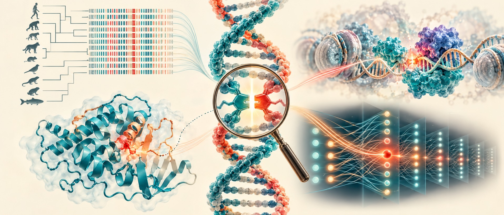
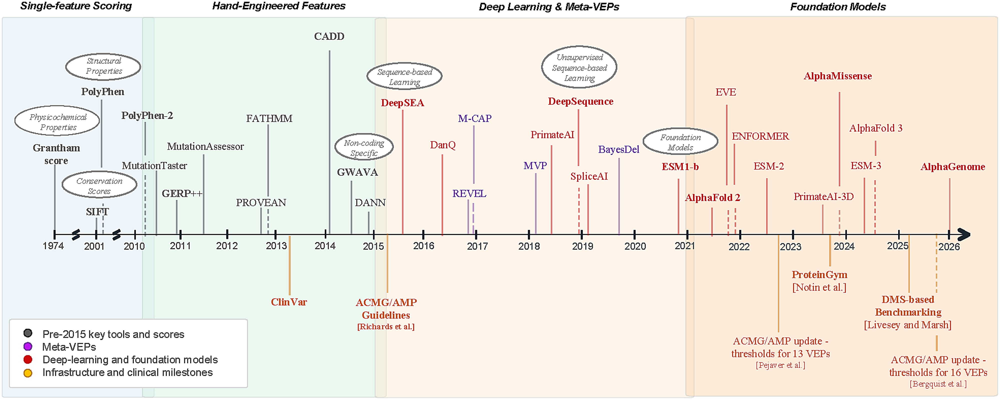
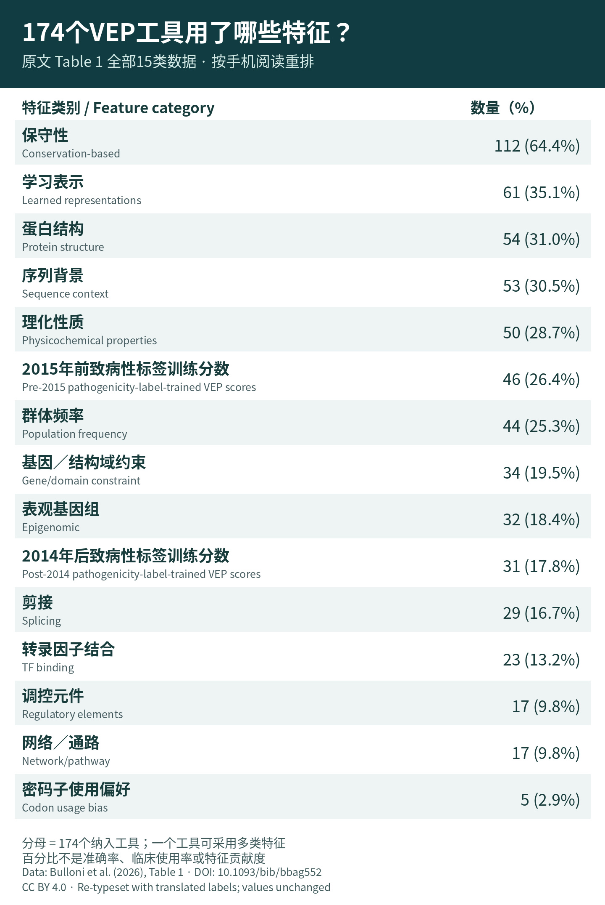
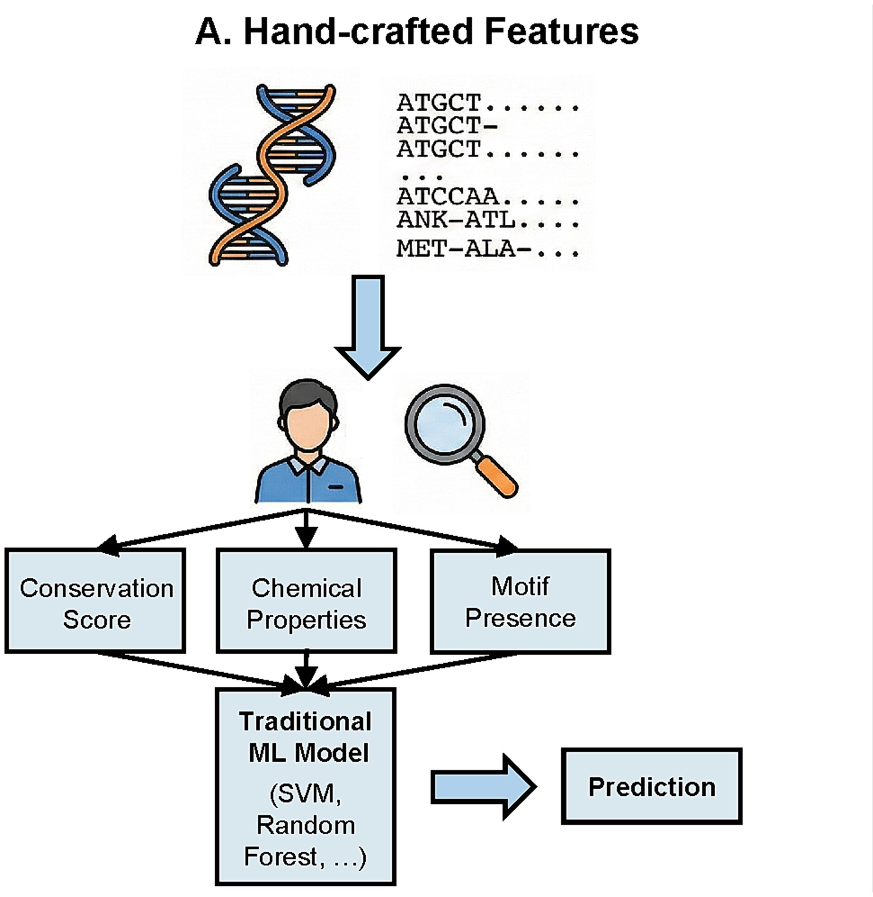
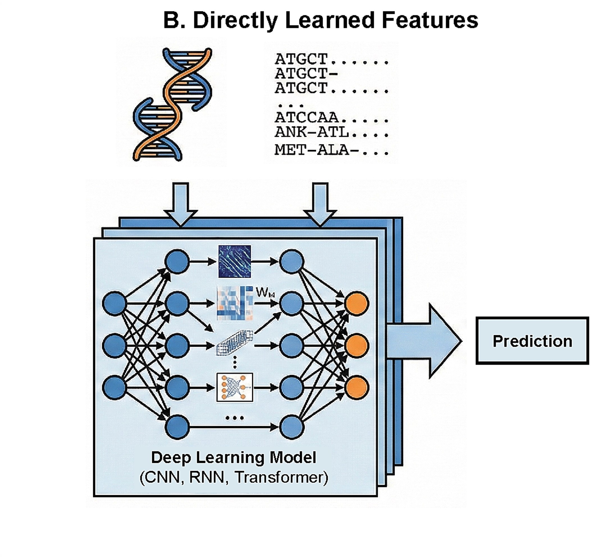
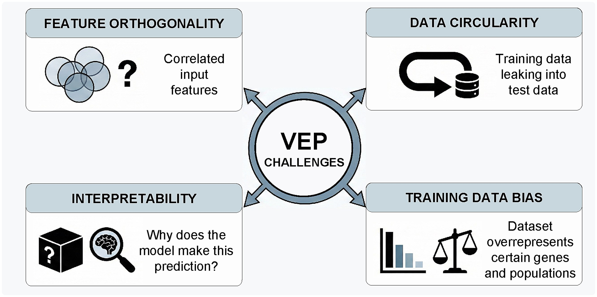
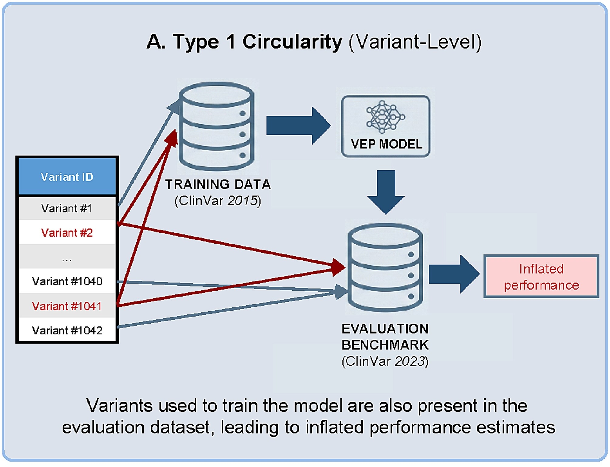
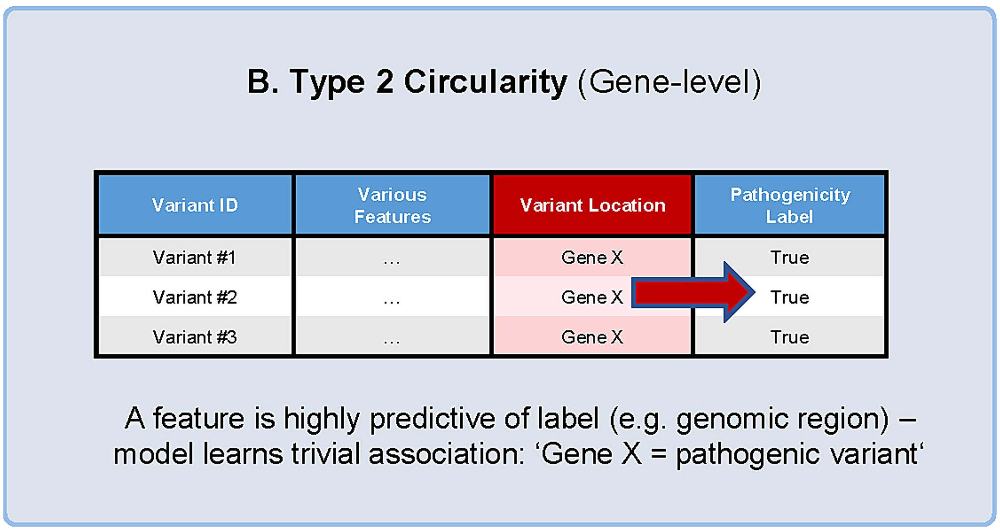

# AI判变异，究竟凭什么

::: {.book-source}
论文：[DOI 10.1093/bib/bbag552](https://doi.org/10.1093/bib/bbag552)。原有图注和许可说明见正文；未明确许可的图版标记为**授权待确认**。
:::

From conservation scores to language models: a feature engineering perspective on machine learning for genetic variant interpretation。Briefings in Bioinformatics，首次上线 2026-10-11。[DOI](https://doi.org/10.1093/bib/bbag552)

本笔记合并完整解读，保留正文、证据边界、图注和引用；不代表公众号已发布或用户已实质审读通过。

AI辅助原创示意，非实验数据。

## 一个高分变异，为什么还不能写进结论

AI辅助示意，非实验数据。 导读图｜特征与变异类型地图。AI辅助制作的概念插画，不是实验数据或真实模型结构。

### 一个高分变异，为什么还不能写进结论

拿到一份测序结果，最诱人的做法是把变异交给几个预测工具，再按分数排序。假设某个错义变异得到三个“有害”判断，我们很容易觉得三票总比一票可靠。可这三个工具可能都读过同一批进化比对、用了同一个上游分数，甚至间接接触过同一份临床标签。票数增加了，独立证据却未必增加。

2026年10月11日，Bulloni等在Briefings in Bioinformatics正式发表综述《From conservation scores to language models: a feature engineering perspective on machine learning for genetic variant interpretation》。文章用“特征工程”重新组织变异效应预测：模型看见什么、从哪里学到规则、又在哪些条件下失效，比工具名称更值得追问。[1]

本系列以该综述为主线，并核查关键原始研究。第一篇建立特征与变异类型地图；第二篇拆开序列模型、AlphaMissense和CPT-1的学习过程；第三篇讨论评测、循环性与证据使用；第四篇独立汇总Take-home messages。下文的教学案例与实践建议是我们的分析，不是综述新增的实验结果，也不构成个体临床判断。

先区分三个问题：变异会不会改变某种分子功能，这种改变是否与疾病机制有关，以及它能否解释某位受检者的表型。模型常直接回答第一问，部分工具借助临床标签接近第二问；第三问还需要遗传方式、表型、家系与其他证据。把三问压成一个“致病分数”，会丢掉最重要的推理环节。

### 图1：方法史不是性能排行榜

原文Figure 1把1974—2026年的发展放在同一条时间轴上。阅读时先看年代，再看颜色和形状：灰色标出较早的关键工具或分数，紫色代表meta-VEP，红色代表深度学习与基础模型，底部橙色标出领域事件，椭圆标记概念创新。它总结方法怎样累积，不是用纵坐标比较预测性能。

这张图的早期区间存在断轴，年份间距也不能当作均匀计量尺度。密集区域建议点开放大。由单项分数、人工特征整合、元预测器走到学习表示，并不意味着新方法在每一种变异、每一个基因和每一类疾病上必然胜出；不同年代的训练资料、任务定义和评测范围都变了。

原文Figure 1｜1974—2026年方法时间轴，完整保留。建议点开放大查看。灰、紫、红区分工具类型，橙色为领域事件，椭圆为概念创新；早期有断轴，年份位置不是性能排名。 来源：Bulloni、Vescio、De Mori Bajolin、Pattini（2026），https://doi.org/10.1093/bib/bbag552 。CC BY 4.0：https://creativecommons.org/licenses/by/4.0/ 。

Grantham分数把氨基酸替换的理化差异编码成数值；SIFT等方法把跨物种序列中的容忍模式带入判断；后来的集成模型学习多种特征之间的非线性关系。meta-VEP进一步把已有工具的输出当作输入。能力逐层叠加的同时，上游数据和偏差也可能逐层传递，不能只审查最外层算法。

ClinVar等资源推动了临床标签训练，但标签不是天然无误的物理读数。提交证据、审查状态、收录时间和疾病背景都会影响其含义。完全依赖序列的自监督模型与直接学习临床标签的分类器，暴露于这些偏差的路径不同。第二篇会进一步说明，不能仅凭“零样本”三个字认定整个流程从未接触临床信息。

### 表1：174个工具使用了什么信息

原文Table 1统计174个VEP工具所采用的特征类别。我们保留全部15行、计数和百分比，重排成便于手机查看的表格，未改变数据。这里的分母是纳入综述的工具数，不是全部软件，也不是临床使用次数。一个工具可以落入多个类别，因此百分比相加超过100%完全正常。

保守性特征出现于112个工具，占64.4%；学习表示61个，占35.1%；蛋白结构54个，占31.0%；序列背景53个，占30.5%；理化性质50个，占28.7%。这些比例描述采用情况，不能用来断言保守性贡献了64.4%的准确率，也不能把学习表示的增长直接解释成独立信息的增长。

其余类别包括2015年前致病性标签训练分数46个、群体频率44个、基因或结构域约束34个、表观基因组32个、2014年后此类分数31个、剪接29个、转录因子结合23个、调控元件17个、网络或通路17个、密码子使用偏好5个。表里的时间分组针对输入分数，不是给今天的软件贴上统一年代标签。

原文Table 1数据重排｜全部15类、数量与百分比原样保留，添加中文标签并重排版式。分母174个工具，类别重叠；这是重排表（re-typeset），不是原样截图或性能贡献图。 来源：Bulloni、Vescio、De Mori Bajolin、Pattini（2026），https://doi.org/10.1093/bib/bbag552 。CC BY 4.0：https://creativecommons.org/licenses/by/4.0/ 。

这张表最有价值的读法是检查“信息家族”。两个名称不同的输入，可能共同反映选择压力；一个深度模型也可能同时编码序列背景、保守性与结构线索。类别不同不保证统计独立，类别相同也不意味着完全重复。是否互补，需要在匹配任务和严格划分的数据上做消融或增量价值检验。

### 保守性：长期留下来的序列提供了什么先验

保守性方法的核心直觉是：如果某个位点在漫长演化中很少接受改变，破坏它更可能影响适应度。但不同工具估计的对象并不一样。phyloP关注位点相对中性演化的偏离，phastCons借助隐马尔可夫模型识别保守片段，GERP类方法关注相对于预期的替换缺失。它们不是同一分数换了名字。

因此，两个保守性分数可以概念相近，却只有中等经验相关性。比对物种、系统发育模型、位点与片段尺度都会改变结果。反过来，在一个测试集上相关性很低，也不能立刻宣布两者提供了完全独立的生物学证据：测量噪声、缺失模式和取值范围都可能降低相关系数。

保守性也有生物学边界。自然选择更直接作用于生存与繁殖相关适应度，不等同于现代人的全部疾病风险。晚发病、人类近期特有功能、物种间环境差异，都可能削弱这个先验。一个位点不够保守，不能据此排除其与人类疾病有关；高度保守，也不能跳过具体遗传机制。

### 理化与结构：替换发生在怎样的局部环境

同样是把一个氨基酸换成另一个，电荷、体积、疏水性差异会给出不同的先验；同样的替换，放在蛋白内部、溶剂暴露表面或结合界面，又可能产生不同后果。理化特征回答“换了什么”，结构特征补充“在哪里换、周围是什么”。二者组合比孤立的替换类型更接近机制。

结构信息可以涉及溶剂可及性、接触网络、二级结构、稳定性变化或到功能位点的距离。需要分清实验结构、预测结构和由结构再计算的分数；它们的误差来源不同。预测模型对某一区域的高置信度，支持的是对构象的把握，并不自动证明某个替换的功能后果，更不等同于致病概率。

尤其不能把“结构不稳定”和“蛋白功能异常”划等号。某些变异主要影响结合、调控、定位或短线性基序，而不是让整体蛋白折叠崩溃；另一些可能改变功能方向而非简单丧失功能。只擅长发现折叠破坏的模型，面对这些机制时可能系统性失灵，不能靠提高分数阈值来弥补。

无序区让这个问题更加突出。天然无序片段可以通过动态相互作用和调控基序执行重要功能，并非“没有结构所以不重要”。2025年Fawzy和Marsh的研究专门比较了无序区与有序区中的预测表现。[2] 第三篇会解释它的区域定义和分母，避免把结构置信度低的全部残基直接当成无序区。

### 群体频率与基因约束：强先验也需要条件

在群体数据库中非常常见的变异，通常很难解释一种高外显率、严重且罕见的孟德尔病；但这里每个限定都重要。疾病患病率、遗传方式、外显率、起病年龄和等位基因异质性都会改变可接受频率。群体频率是一项需要疾病语境的证据，不是一条适用于所有表型的统一界线。

“数据库没见过”也不等于“很罕见所以有害”。测序覆盖、变异质量、祖源代表性和数据库规模都会影响是否被观察到。来自代表不足人群的正常变异更容易显得新奇。如果模型反复把缺失记录当成强异常信号，技术与抽样不足就可能被伪装成生物学风险。

基因约束从另一个尺度发问：相对于可预期的突变机会，这个基因在群体中是否缺少某类变异？RVIS、pLI、LOEUF等指标反映的统计对象和构建方式不同。它们能帮助识别对某类功能改变较不耐受的基因，但不能单独确认某个疾病的遗传机制，更不能把所有罕见错义变异一起判为有害。

结构域或区域约束进一步提供局部信息。同一基因的不同区域，对替换的容忍程度可能差别很大。对研究者来说，基因层面的先验和变异层面的证据应分开记录：一个基因“值得关注”，与这个具体位置、替换方向和转录本“足以解释疾病”，中间仍需要功能和遗传学桥梁。

### 非编码变异：从一个字母走到某个基因的表达

非编码变异不改变蛋白序列，却可能改变转录因子结合、染色质状态、增强子活性或RNA加工。此时，错义变异的氨基酸替换分数往往不是合适输入。应先明确所问的是调控活性、组织特异表达、剪接、RNA稳定性还是其他过程，再选择相匹配的模型与实验证据。

调控元件注释告诉我们一个位置可能属于启动子或增强子，转录因子基序提示某种序列偏好，表观基因组数据则提供特定细胞条件下的可及性和修饰状态。它们相互补充，却各有边界：基序存在不保证真实结合，活性标记存在也不保证该元件在目标组织里驱动我们关心的那个基因。

距离最近的基因不是默认靶基因。增强子可能跨越较远距离，且作用依赖细胞状态；eQTL关联也可能受到连锁不平衡影响。将一个非编码位点解释为致病候选，至少需要继续追问它是否真的改变调控、作用于哪个基因，以及该基因改变能否连接到表型。模型命中只是链条中的一环。

剪接模型关注外显子与内含子边界、局部或更长范围的序列规则，以及潜在位点的创建或破坏。高剪接影响分数通常表示模型预期加工方式会变，并不直接告诉我们最后哪个转录本占主导、变化量多大、是否触发无义介导降解，以及相关组织是否表达该转录本。RNA证据能帮助补上这些环节。

同义变异也不能只因氨基酸没变就略过。它可能影响剪接调控、密码子使用、翻译过程或RNA层面的调控；但“存在这些机制”不是“每个同义变异都有重要影响”。证据应落到特定位点与可检验过程，避免把可能性清单误当成致病性证据清单。

UTR中的变异还可能影响RNA结合蛋白、微RNA作用位点、上游开放阅读框或多聚腺苷酸化相关信号。这些规则强烈依赖转录本与细胞背景。软件给出的注释如果对应另一种转录本，即使技术上没有报错，也可能回答了一个与研究问题不同的问题。

### 小插入缺失与结构变异：不能把错义模型外推到底

小插入缺失可能改变阅读框，也可能保留阅读框却改变局部长度、剪接或关键基序。不能因为某个模型能对单氨基酸替换排序，就默认它能处理这些改变。输入表示、训练样本与验证任务都需要重新检查；“支持输入”只说明程序能计算，不说明结果已经具有可靠解释性能。

结构变异的影响还取决于断点、长度、拷贝数、方向及是否重排调控关系。同一段缺失可能同时碰到多个基因和调控元件，单个位点分数难以完整概括。剂量敏感性、单倍剂量不足或三倍剂量敏感性、表型匹配等特征因此变得重要，但断点质量与变异本身是否真实仍需先解决。

综述列举DeepSVP、StrVCTVRE等把基因剂量和其他注释整合的工具。这里值得学习的是任务重构：从“一个残基是否容忍替换”转成“这一结构改变通过哪些路径影响功能”。工具名称不应掩盖输入单位已经发生变化，也不能把一种SV类别上的评测自动推广到所有重排。

### 把特征地图变成一次可追溯的分析

回到开头的虚构错义变异。我们会先核对参考基因组、坐标、参考与替代等位基因、转录本和蛋白编号；再记录质量、群体频率、基因机制和家系信息；最后才比较模型分数。这样的顺序能减少把注释错配误当成模型分歧，也避免先看到一个醒目的高分，再倒推一套解释。

下一步，把每项结果放回其信息家族：保守性、结构、群体、功能实验或临床标签。三个高度共享来源的分数可以作为一致的计算信号，却不能直接算作三项独立证据。若结构模型提示折叠损伤，而RNA实验显示主要问题是剪接，二者可能并存，也可能暴露出需要进一步检验的机制分歧。

再问一次适用范围：该工具是否验证过这种变异类型、该区域、相近的基因机制和目标人群？缺失分数来自软件不支持、结构覆盖不足，还是过滤规则？缺失并不是良性标签。对于超出验证域的对象，最诚实的输出通常是说明不确定性与下一步实验，而不是填入一个看起来完整的综合分值。

最后保留软件版本、数据版本、取值方向、阈值来源和失败项。一条没有方向说明的分数，甚至可能被反着排序；一次没有版本记录的更新，也可能让同一变异得到不同分类而无法追溯。本篇的落点不是让表格更长，而是让每一列都能回答“它测到了什么、遗漏了什么”。下一篇继续拆解：当特征由神经网络自动学习，这些问题是否就消失了？

本节来源：

[1] Bulloni M, Vescio M, De Mori Bajolin F, Pattini L. From conservation scores to language models: a feature engineering perspective on machine learning for genetic variant interpretation. Brief Bioinform. 2026;27(5):bbag552. https://doi.org/10.1093/bib/bbag552 （正式Review；完整正文与图表）

[2] Fawzy M, Marsh JA. Assessing variant effect predictors and disease mechanisms in intrinsically disordered proteins. PLoS Comput Biol. 2025;21(8):e1013400. https://doi.org/10.1371/journal.pcbi.1013400 （原研究正文与方法）

## 从“人工选特征”到“模型学表示”

AI辅助示意，非实验数据。 导读图｜序列模型如何形成判断。AI辅助制作的概念插画，不是实验数据或真实模型结构。 图中的蛋白折叠造型只表示蛋白相关证据，不表示所有蛋白语言模型都预测三维结构；这是概念假设示意。

### 从“人工选特征”到“模型学表示”

第一篇讨论了保守性、结构、群体频率等输入各自提供什么信息。这一篇沿着Bulloni等综述的Figure 3继续往下问：当模型直接读序列，人类设计的特征是不是就消失了？答案要拆成两层：人不必逐列规定所有中间表示，但训练任务、数据分布和输出解释仍然由人决定。[1]

设想两个系统都收到同一个错义变异。第一个先计算保守性、理化变化和局部结构，再输入分类器；第二个直接读取野生型与变异序列，比较模型对它们的评价。两者可能利用相似的演化信息，却经过不同的编码路径。“自动学习”描述计算过程，不是对证据独立性或临床可靠性的保证。

原文Figure 3A由上向下阅读：DNA与序列示意先经过专家判断和特征提取，分成Conservation Score、Chemical Properties、Motif Presence三路，再汇入传统机器学习模型，图中列出SVM、Random Forest等例子，最后得到Prediction。箭头表示信息流，没有效应大小、样本量或准确率坐标。

原文Figure 3A｜人工构建特征：序列经专家提取保守性、理化与基序信息，汇入传统机器学习。仅按panel裁切，保留全部标签和箭头，未改动内容；无性能轴。 来源：Bulloni、Vescio、De Mori Bajolin、Pattini（2026），https://doi.org/10.1093/bib/bbag552 。CC BY 4.0：https://creativecommons.org/licenses/by/4.0/ 。

这幅图强调的是特征由谁构建，而不是所有传统模型只能接受三类输入。保守性、理化性质和基序只是示例；实际模型可以同时整合更多注释。它们的优点是每个输入通常较容易命名和检查，缺点是人事先没有编码的关系可能难以被利用。解释输入容易，也不等于完整解释组合后的决策容易。

原文Figure 3B把原始序列送入深度学习框架，中间画出学习表示，再输出Prediction；框下列出CNN、RNN和Transformer。黑色箭头与蓝、橙节点只是流程示意，没有给出真实网络层数、权重或训练数据规模。两幅panel并不是严格对照实验，因此不能凭图中网络更复杂就推断它一定更准确。

原文Figure 3B｜直接学习表示：序列经深度网络输出预测。黑色连线与蓝、橙节点是流程示意，不代表真实层数或权重。仅按panel裁切，保留全部标签和箭头，未改动内容。 来源：Bulloni、Vescio、De Mori Bajolin、Pattini（2026），https://doi.org/10.1093/bib/bbag552 。CC BY 4.0：https://creativecommons.org/licenses/by/4.0/ 。 原样裁片仅作JPEG技术格式转换，数据、文字和布局未改动。

这里的“原始”也需要打引号：序列仍须选定窗口、编码方式、链方向和参考版本，蛋白输入还要匹配转录本。模型看不到窗口以外的上下文，或把不同实验条件混入同一标签，都会影响学到的表示。端到端训练减少的是部分手工特征设计，并没有取消问题定义与质量控制。

### 先问它学的是哪一道题

监督学习用给定标签指导参数更新，但标签可以是临床致病性、功能实验读数，也可以是染色质可及性。自监督学习则从序列本身构造任务，例如遮住一些残基，让模型猜回来。它不需要为每条序列附上疾病标签，却仍依赖训练序列的来源、筛选、去冗余与覆盖范围。

“弱监督”常把可获得的代理信息当作不完美标签，例如用群体中观察到的变异与未观察到的变异构造训练信号。代理标签能提供大量样本，却不能当作真实致病状态。未观察到的变异中也会有良性者。模型如何处理噪声，以及如何选择最佳版本，应当和网络结构一起进入审查清单。

另一个容易混淆的词是“零样本”。在变异预测语境中，它常表示不使用目标蛋白的功能测量或目标任务标签进行额外拟合，直接从预训练模型得到分数。它不表示模型没有训练，也不必然表示上游训练从未见过同源蛋白，更不能替整个下游校准、阈值选择和评测流程免除审计。

训练集、验证集和测试集各自承担不同职责。训练集更新参数；验证集可能影响超参数、早停或模型挑选；测试集应在决策固定之后用于最终评价。即使临床标签没有进入主要梯度更新，它若参与了选模，就已经影响最终系统。把“未直接训练”写成“完全未使用”，会抹去这层重要区别。

### 基因组序列模型：从调控轨迹到变异效应

DeepSEA是理解这条路线的经典例子。Zhou和Troyanskaya的2015年原始研究使用卷积神经网络，把约1000 bp序列映射到919种染色质相关特征。[3] 模型先学序列怎样对应实验观测的调控状态，再通过参考与替代序列的预测差异，为非编码变异提供功能线索。

需要对原研究作一个精确限定：核心序列到染色质的CNN，并不是直接用临床致病标签训练；但论文后续的功能变异判别还构建了整合保守性和预测输出的提升式逻辑回归，使用HGMD、eQTL和GWAS相关标签。不能把前一个模块的训练方式，扩展成整个DeepSEA流程从未使用功能或疾病关联标签。

这个案例提示了一种通用阅读方法：沿着输入、预训练目标、下游分类器和阈值一路追踪。一个工具页面上的总名称，可能覆盖多个训练阶段。若综述把复杂流程压成“无监督”或“序列模型”，读者仍应回到原研究，确认自己真正调用的是哪个模块、哪种输出，以及相应验证范围。

AlphaGenome把上下文推进到1 Mb，并在多种分子模态上联合预测。其2026年Nature原研究覆盖人类5930条和小鼠1128条输出轨迹，涉及11类输出。[4] 这些数字描述输出组织方式，不意味着所有轨迹具有相同空间分辨率，也不意味着每一个细胞类型、组织和实验条件都已充分覆盖。

研究报告在26项变异效应基准中的25项达到或超过比较方法。这是所设基准上的比较结果，不是“准确率达到25/26”，更不是任意非编码变异都有96%的正确解释概率。不同基准可能测表达、剪接或其他读出，标签来源与评价指标并不相同，不能把它们粗暴相加成统一临床能力。

长窗口提供了容纳远距离调控线索的机会，却没有自动解决远端因果推断。原文也讨论了超过100 kb的远距离作用、细胞特异性与个体化基因组预测等困难。对于一个候选增强子变异，模型可以帮助形成“影响某轨迹”的假设；靶基因连接和疾病机制仍需另行建立，不能由输入长度代替证据。

从实践角度看，比较参考与替代序列预测值时，还要记录汇总窗口、所选轨迹和差值方向。把多个组织中的最大差异挑出来，与事先锁定相关组织后评价，是不同的分析策略。后者更容易避免事后挑选最醒目结果；前者若用于探索，就应明确探索性质并安排独立验证。

### 蛋白语言模型：低概率并不直接等于致病

蛋白语言模型通过大规模序列学习氨基酸在上下文中的分布。对于一个位置，可以比较替代残基与参考残基的条件概率，并取对数概率之差作为变异分数。某种替换在模型眼中很不符合已有序列规律，提示它可能违反演化或功能约束，但这个值本身不是受检者患病的概率。

也有流程先提取embedding，再让另一个分类器学习与特定标签的关系。embedding是高维表示，不是天然带有生物学名称的一组独立变量。零样本对数似然差、预训练表示加监督头、以及整网微调，所利用的标签和可能产生的偏差不同，不能在比较时统称为“用了同一个语言模型”。

自然序列同时承载折叠、功能、系统发育与采样历史。模型可能学到对预测有用的规律，却很难凭一个分数区分它到底反映哪一类约束。与显式结构特征相关，不证明每个PLM都在生成三维结构；一个注意力图看起来像接触图，也不等于已证实某个变异通过该接触改变功能。

跨物种信息还有任务迁移的边界。广泛物种上的共同约束有助于泛化，但人类特异功能和疾病机制可能更依赖近缘物种或特定家族信息。反过来，只看少数近缘序列又可能缺少足够变异。模型并不是越大、物种越多就必然越适合每一个问题，而是在不同信息尺度之间作取舍。

### AlphaMissense：必须把主要监督与选模分开说

AlphaMissense建立在AlphaFold相关架构与演化表示基础上，但它输出的是错义变异的致病性评分，并不预测每个突变蛋白的结构改变。[5] 这一区别很关键：不能拿一个高分声称模型已经“看到”了突变后的折叠破坏，也不能把它描述成先精确比较两张三维结构再完成诊断。

核对Science原研究后，主要微调信号应准确表述为人类和灵长类群体频率构造的弱标签，而不是直接以人工整理的临床致病性标签作为主要训练监督。观察到的较常见变异提供偏良性信号，未观察到的变异提供含噪的另一类信号；原文也明确承认后者中可能包含良性变异。

但“未直接用临床标签训练”不能改写成“从未碰过ClinVar”。研究用2526个ClinVar变异组成的验证集参与模型选择、超参数或早停相关决策，并在分类校准中使用临床信息。主要训练、模型选择与最终测试是不同环节；避免一种标签偏差，并不使其他数据接触路径自动消失。

原研究公开了约7100万种可能的人类错义变异预测，将其中89%归入可能良性或可能致病类别。89%说的是在设定阈值下能够给出这些分类的覆盖比例，不是89%的变异已被实验确认，更不是诊断准确率。余下未明确分类的区域同样重要，因为保留不确定性比强行二分更诚实。

本系列对AlphaMissense的原研究核查范围是作者机构摘要、可检索的Science正文方法相关段落与图1说明；未声称逐页读完全部补充材料，也不复制其受独立版权约束的原图。我们的目的，是纠正综述中容易被压缩过度的训练叙述，而不是以一处更精确的措辞否定模型整体价值。

### CPT-1：不同来源的信息怎样真正互补

Jagota、Ye、Albors等提出的CPT-1，把序列模型、近缘物种保守性和结构信息汇合，再利用深度突变扫描数据学习组合方式。[6] 引文作者必须以原研究为准，不能沿用综述参考文献中错列的作者。这里的关键问题不是又增加了多少特征，而是新信息是否在已有强模型之外仍有增量价值。

CPT-1的输入包括ESM-1v对数概率差分数、EVE分数、局部演化尺度的保守性，以及AlphaFold2和ProteinMPNN相关结构特征。ESM-1v在这里不是未经说明的一大块embedding。原研究通过DMS交叉验证作特征选择，最终保留九项特征；因此描述输入表示时应准确到所用分数，而不只写模型品牌。

它用五种蛋白的DMS实验训练跨蛋白迁移模型。“五种蛋白”并不是五个训练点：每种蛋白包含许多变异测量，且上游模型已经学习过大规模序列或结构资料。少数蛋白能训练出有用组合器，说明高质量实验与先验表征能够协同，并不证明任何五个随意选择的样本都足够。

原研究区分临床分类与功能预测版本：前者使用逻辑回归集成，后者使用线性回归来预测功能读数。它们的目标和标签不同。DMS提供实验层面的监督，有助于减少对临床分类标签的依赖；但实验本身也受测量系统、读出类型和动态范围限制，不能被当成适用于所有疾病机制的完美真值。

有意思的是，浅一些的脊椎动物比对仍能补充大规模序列模型。近缘直系同源序列可能保留更接近人类的功能信息，而大规模数据库的去冗余策略会改变这些信息的权重。这个结果提醒我们：规模和互补性是两回事。显式、可解释的特征不一定因为基础模型出现就失去价值。

结构特征也可带来增益，但原研究中它们的增益小于加入脊椎动物比对的增益。单个特征独立预测较弱，不妨碍它在组合中补充缺失信号；反过来，单独很强的特征，也可能与现有输入高度重复。需要看消融后的变化及其评测条件，而不是只按单变量相关系数选特征。

这里不能再向前多走一步：CPT-1验证的是错义变异相关任务，不能顺手扩展成已经证明适用于短插入缺失、剪接或结构变异。它的跨蛋白迁移能力也依赖测试蛋白与实验任务的构成。关于它在后续独立DMS基准中“92.8%”的结果，下一篇会专门拆解分母和显著性。

### 解释模型：从漂亮热图回到可检验假设

特征重要性、注意力权重和归因图可以提示模型依赖哪里，却未必识别了真正的因果机制。相关输入之间可以分摊贡献；输入被替换或遮蔽后产生的序列也可能偏离自然分布。若不同解释方法给出不同答案，应先考察方法假设和稳定性，而不是挑最符合直觉的一幅图。

一个更有价值的解释，是把模型信号变成可检验预测。比如模型认为特定残基影响结合，那么针对结合的实验能否改变读数？若认为是剪接，RNA层面的异常是否出现，且方向与幅度是否相符？实验支持的机制越具体，分数越容易转化为后续研究；仅说“AI认为有害”则很难推进验证。

对于日常分析，我们建议给每个预测器记录四件事：输入单位是什么，主要训练目标是什么，临床或功能标签在哪些阶段参与过，以及最终分数经过怎样的校准。这个简短档案比“传统模型/深度模型”二分更实用，也能暴露不同工具是否共享数据，从而帮助判断组合结果究竟有多少独立信息。

本篇的结论是，自动学习没有消灭特征工程，而是把一部分设计转移到训练目标、表示和数据组织上。对读者而言，最值得保留的习惯仍然是追问证据来源。下一篇将把镜头移到测试集：当一个模型在排行榜上领先，我们到底看到了对新变异的理解，还是对熟悉数据与偏差的再识别？

本节来源：

[1] Bulloni M, Vescio M, De Mori Bajolin F, Pattini L. From conservation scores to language models: a feature engineering perspective on machine learning for genetic variant interpretation. Brief Bioinform. 2026;27(5):bbag552. https://doi.org/10.1093/bib/bbag552 （正式Review；完整正文与图表）

[3] Zhou J, Troyanskaya OG. Predicting effects of noncoding variants with deep learning-based sequence model. Nat Methods. 2015;12:931–934. https://doi.org/10.1038/nmeth.3547 （DeepSEA；PMC作者稿正文与Online Methods）

[4] Avsec Ž, Latysheva N, Cheng J, et al. Advancing regulatory variant effect prediction with AlphaGenome. Nature. 2026;649:1206–1218. https://doi.org/10.1038/s41586-025-10014-0 （正式版；相关正文、图注与讨论）

[5] Cheng J, Novati G, Pan J, et al. Accurate proteome-wide missense variant effect prediction with AlphaMissense. Science. 2023;381:eadg7492. https://doi.org/10.1126/science.adg7492 （原文摘要及可检索训练、选模、校准段落；未完整审读补充材料）

[6] Jagota M, Ye C, Albors C, et al. Cross-protein transfer learning substantially improves disease variant prediction. Genome Biol. 2023;24:182. https://doi.org/10.1186/s13059-023-03024-6 （CPT-1；原研究正文与方法，作者已按原文纠正）

## 排行榜越漂亮，越要先看测试对象

AI辅助示意，非实验数据。 导读图｜评测边界与证据独立性。AI辅助制作的概念插画，不是实验数据或真实模型结构。

### 排行榜越漂亮，越要先看测试对象

前两篇分别梳理模型输入与学习过程。本篇回到一个看似朴素的问题：模型表现很好，究竟是在什么数据上、对什么任务、按什么指标很好？Bulloni等综述把特征相关、数据循环、训练偏差和可解释性放在同一张挑战地图中。[1] 这不是对AI的否定，而是让预测结果具备可审查的证据边界。

原文Figure 2没有实验坐标轴。左上重叠圆圈表示输入可能共享信号，右上回环和数据库表示训练信息进入测试，右下柱形与天平表示数据代表性不均，左下黑箱与放大镜表示解释困难。中央箭头把四项主题连到VEP，不表示它们之间已测得因果关系；图形面积、颜色深浅都不是效应量。

原文Figure 2｜四项方法挑战：特征相关、数据循环、训练偏差与可解释性。完整保留；图标和箭头为概念关系，没有统计坐标、样本量或效应大小。 来源：Bulloni、Vescio、De Mori Bajolin、Pattini（2026），https://doi.org/10.1093/bib/bbag552 。CC BY 4.0：https://creativecommons.org/licenses/by/4.0/ 。

一项研究即使把所有变异随机分成训练集和测试集，仍可能留下与真实应用不一致的捷径。实际问题可能是预测同一基因中的新变异，也可能是迁移到从未研究的基因或另一祖源人群。这些是不同泛化任务。评价是否严格，必须先写清部署时会遇到怎样的新对象，而不是机械追求某一种划分。

### 图4A：变异换了数据库版本，不等于换了身份

原文Figure 4A描绘第一类循环性，即变异层面的重复。左侧列出示意变异编号，红色Variant #2和Variant #1041通过红线同时连接训练数据与评价数据。上方训练库标作ClinVar 2015，下方测试库标作ClinVar 2023；右侧粉色框提示性能可能被抬高。编号和年份用于解释机制，不是某个工具的实测泄漏清单。

原文Figure 4A｜变异层面循环：红色示意变异同时进入训练与测试。ClinVar 2015/2023为教学场景，并非实测泄漏统计。仅按panel裁切，保留全部标签和箭头，未改动内容。 来源：Bulloni、Vescio、De Mori Bajolin、Pattini（2026），https://doi.org/10.1093/bib/bbag552 。CC BY 4.0：https://creativecommons.org/licenses/by/4.0/ 。

最直接的问题是，后来的数据库版本仍保留早年的记录。如果只按下载日期区分训练与测试，模型可能在考试中再次遇到学习过的变异。严格的时间外测试应追踪记录何时首次出现、标签何时改变，并排除模型已经接触的对象，而不只是把文件夹命名为“旧版”和“新版”。

去重也不能只比字符串。相同变异可能采用不同参考版本、左对齐方式、转录本编号或蛋白表达，多个不同DNA变异还可能对应同一个氨基酸替换。需要结合任务定义做规范化，并记录匹配单位。若一个测试集只删除完全相同的文本行，仍可能留下生物学上相同的对象。

meta-VEP还要追查上游分数。如果外层分类器没有见过某变异，但它输入的某个子模型已经训练过该变异，泄漏路径仍然存在。完整训练集未公开时，不能因此证明绝对独立；应报告可排除的范围、尚不清楚的来源，并利用其他基准或较保守的划分检查结论是否稳定。

另有更隐蔽的标签循环：数据库中的临床分类本身可能参考过早期计算预测，后续模型再拿这些分类训练或验证。即使样本编号没有重叠，模型与评价标准之间也可能共享推断来源。解决这类问题需要看证据构成与审查状态，独立功能实验有帮助，但它回答的生物学层次又未必与临床标签相同。

### 图4B：记住“哪一个基因”，未必理解“哪一个变异”

Figure 4B展示第二类循环性。表中四列依次为Variant ID、Various Features、Variant Location和Pathogenicity Label。三行示意变异都位于Gene X，标签都是True；红色位置列和指向标签的箭头强调一种捷径：只要知道属于Gene X，就能猜中这张表里的标签，却未必识别各个替换的真实后果。

原文Figure 4B｜基因层面捷径：Gene X位置与True标签在示意表中共同出现。并非所有同基因测试都无效，须结合泛化目标判断。仅按panel裁切，保留全部标签和箭头，未改动内容。 来源：Bulloni、Vescio、De Mori Bajolin、Pattini（2026），https://doi.org/10.1093/bib/bbag552 。CC BY 4.0：https://creativecommons.org/licenses/by/4.0/ 。

这不是说基因层面的信息没有价值。基因约束、疾病机制和剂量敏感性本来就是合理先验。问题在于，若测试集的正负类别被不同基因组成所支配，整体高分可能主要来自基因间差异，而非基因内变异辨别。这样的模型拿到一个已知疾病基因里的新候选变异时，未必同样有用。

因此，同一基因同时出现在训练和测试中，也不应一律判作无效。如果目标是同基因内未见变异预测，这种设计可以回答相应问题；若声称可以迁移到全新基因，就需要基因留出，必要时进一步留出同源家族。划分粒度应该对应宣称的泛化范围，而不是用统一口号替代研究问题。

一个实用的评测组合可以同时报告整体表现、每基因表现与跨基因留出表现，再按结构区域、变异类型和标签质量分层。若整体很强而基因内明显下降，就值得检查模型是否主要利用基因级先验。若新基因上下降，也不必否定同基因任务中的价值，但应用说明必须把边界写清楚。

### 一个百分数，可能代表完全不同的分母

准确率统计所有预测中有多少正确；敏感度关注真实阳性找回多少；特异度关注真实阴性排除多少；阳性预测值关注被判阳性的对象里有多少真阳性。它们不是同义词。一个模型在类别非常不平衡的数据中，可以有很高准确率，同时让大量阳性判断不够可靠。

做一个纯教学计算，数字不是任何原论文实验：1000个候选变异中只有20个真阳性，模型敏感度80%、特异度95%。它会找回16个真阳性，并把980个阴性中的49个误报为阳性；另有931个真阴性。总体准确率是94.7%，但65个阳性判断中只有16个为真，阳性预测值约24.6%。

这个例子不说明模型毫无价值，它仍可能显著缩小实验筛选范围。它说明“94.7%准确”不能直接翻译成“看到一个阳性结果，有94.7%的把握为真”。从筛选到分类再到诊断，阳性基率和错误代价都发生变化，必须使用适合该环节的指标解释同一个分数。

AUROC衡量排序区分能力，不要求先固定阈值；在阳性稀少时，精确率—召回率曲线往往更贴近候选筛选的负担。即便AUROC相同，两个模型在高敏感度或高特异度区间的表现也可能不同。论文若只给一个总面积，读者还需要追问实际阈值附近会漏掉多少、误报多少。

排序和校准也不同。模型把高风险对象排在前面，不保证0.8分的对象在新场景中真的有80%阳性。校准应在目标任务相近、标签可信且独立的数据上检验，还要考虑基因与疾病构成的变化。把分数线性换算成百分数，不能替代校准，更不能自动得到个体风险。

### CPT-1的92.8%：胜率不是准确率

2025年Livesey和Marsh对97个预测器与36组DMS数据进行了系统比较。[7] 不同工具覆盖的变异和蛋白不同，直接平均各自能算出的相关性会混入覆盖差异。研究因此采用成对比较：在某个DMS数据集中，只比较两工具与实验共同覆盖的变异，再判断谁的相关表现更好。

具体而言，研究比较预测与功能读数的绝对Spearman相关性，在各蛋白上汇总一对工具的胜率，再对其他工具取平均得到总排名。CPT-1的92.8%是这一规则下的总体平均胜率，不是92.8%的变异被正确分类；其训练所用五组DMS数据在相应基准中被排除，不能把它们混回“独立测试”。

它对其余前五名方法的平均胜率为66.2%，而与AlphaMissense的排名差异在该bootstrap检验中没有达到显著，p=0.169。不能把“点估计排名第一”改成“显著胜过所有方法”。研究还指出，AlphaMissense与CPT-1的直接成对结果和最终综合名次并不完全一致，说明排名规则本身会影响结论。

这类设计提高了比较公平性，却没有把覆盖问题彻底消除。若某工具主要覆盖容易预测的区域，成对交集仍可能具有选择性；每个工具参与的蛋白数也不同。阅读原研究图表时应同时看覆盖列、排除项、重采样单位与误差条，不能把少量数据上的漂亮分数和广泛覆盖下的表现直接等同。

这里的重采样以蛋白数据集为单位，有助于体现跨蛋白不稳定性，而不是假设同一蛋白里的上千变异都完全独立。一般而言，误差条取决于重采样单位与设计；变异级、基因级或研究级重采样可能得到不同不确定性。看见误差条，不等于已经解决样本相关性和训练污染。

### 功能实验是一条独立路线，但不是万能真值

DMS通过系统制造大量变异并测量特定功能读出，可以提供不依赖临床分类的验证路径。但实验可能测蛋白丰度、细胞生长、结合或其他代理功能；相同变异在不同体系中的后果不一定相同。模型与某个读数高度相关，首先支持它能预测那个实验任务，而非所有疾病机制。

对功能实验也应追问：覆盖了哪些位点，读数是否饱和，生物学重复如何，野生型与已知对照能否分开，以及系统是否包含相关相互作用伙伴。一个在异源细胞中看似正常的变异，可能仍影响特定组织功能；一个实验中损伤明显的变异，也需要继续评估其在人类疾病语境中的意义。

### 无序区：总体漂亮可能遮住困难子集

Fawzy和Marsh在2025年PLOS Computational Biology研究中比较了33个预测器，关注天然无序区的表现。[2] 它不是简单把pLDDT低于70的所有残基都算作无序。方法要求该残基pLDDT低于50，且处于至少30个残基、平均pLDDT低于70的连续片段；其余低置信情况还可能归为中间类。

原研究报告约3.6%的ClinVar致病或可能致病错义变异落在定义的无序区；约39.8%的ClinVar良性或可能良性变异落在该区。两个百分比的分母分别是两类变异总数，不能倒转成“无序区内3.6%致病、39.8%良性”。对分母的这一步核对，比记住一个醒目的比例更重要。

若一个模型主要学会“无序区通常更容忍变化”，它可能把大量容易的良性变异排对，从而提高整体区分度，却漏掉无序区中真正关键的致病位点。区域分层评价能够暴露这种问题，也提醒我们评估敏感度，而不只看总体AUROC。结构类别是帮助检查模型的分层，不是替代具体机制的结论。

研究探索了按区域选择Youden统计量最优阈值，但这类分析阈值不等同于已校准的临床证据阈值，不能直接搬进诊断流程。无序区还包含调控基序、修饰位点和动态相互作用等多种机制。区域标签之外，仍需要解释具体变异为什么会改变功能，而不能把低置信结构当成“不重要”的代名词。

### 祖源差异：分数分布不能直接写成误诊率

Pathak等《Pervasive ancestry bias in variant effect predictors》目前按已核官方版本记录，应标注bioRxiv预印本，v3日期为2025年3月25日。[8] 本系列只核对其摘要、官方版本与出版关联元数据，没有把摘要阅读写成全文精读，也没有把它当作已经正式发表的确定性结论。

摘要报告比较52个VEP在14个祖源组中的错义变异评分模式，部分依赖临床或群体资料的工具在代表不足人群中给出更高的有害变异负担。这个结果提示训练代表性风险，但分数分布差异不是已测得的临床误诊率，更不能外推成所有工具对所有非欧洲人群都同方向失准。

实际评估需要区分至少三件事：群体真实变异谱不同、数据库覆盖不同，以及模型在相似真值条件下的误差不同。只有分数而缺少匹配真值，很难将三者完全拆开。研究者应报告祖源构成与数据质量，并设计适合目标人群的验证；不宜从群体平均分数推断某个人的疾病风险。

### 从计算分数到证据强度，需要另一道校准

Pejaver等2022年的研究，以及Bergquist等2025年的后续校准，讨论怎样把计算分数映射到PP3/BP4的证据强度。[9,10] 这里的核心不是寻找一个万能阈值，而是预先选定工具与适用范围，使用经独立校准支持的区间。开发者默认的“有害”阈值，不一定对应临床标准中的支持级证据。

因此，不应先看完十个工具的分数，再挑一个最支持预设判断的结果；也不应把多个高度相关预测当成独立证据累加。按既定流程使用合适工具、说明校准版本和边界，比简单多数票更可审查。若多个工具分歧明显，可以把分歧当作研究线索，但不能借选择性报告把不确定性抹掉。

同样要检查计算分数是否已经包含群体频率、结构或其他证据来源，避免在后续综合时重复计入。同一信息换了外观，并不因此变成独立证据。对某个具体变异是否能应用某项临床证据规则，还需要专业判读与疾病背景；本系列提供阅读与分析方法，不提供自动分类处方。

### 一张可落地的评测记录卡

开始比较模型前，先固定任务、输入单位和终点：是变异筛选还是临床分类，是错义还是剪接，是同基因还是跨基因泛化？随后记录训练来源、时间截点、上游模型及可能泄漏路径。若某些信息拿不到，就把它列为不确定性，而不是让空白默认为“没有风险”。

再固定评价集与指标，报告覆盖率和未预测对象，分别展示整体、困难区域和目标人群的表现。给出正负类别数量、阈值、置信区间以及重采样单位。不同工具若无法在完全相同集合上比较，应清楚说明交集规则和剩余偏差，避免把选择样本造成的优势写成算法优势。

最后保留版本、参数、原始分数、转换规则与排除日志。模型更新后，先在锁定基准上检验变化，再决定是否进入正式流程。可重复性不是附加装饰：它让我们区分真实改进、数据版本变化和偶然波动，也让一条高分结论能够被他人追问、重算与修正。

读完这篇综述，最值得改变的不是把常用模型换成排行榜第一，而是把每个分数放回完整证据链。知道模型如何学习，只完成一半；知道它在怎样的独立测试上被证明有效，另一半才成立。当任务、数据、分母和边界都能说清，AI才真正从一个给答案的黑箱，变成一个帮助提出更好问题的研究工具。

本节来源：

[1] Bulloni M, et al. Brief Bioinform. 2026;27:bbag552. https://doi.org/10.1093/bib/bbag552 （Review全文）

[2] Fawzy M, Marsh JA. PLoS Comput Biol. 2025;21:e1013400. https://doi.org/10.1371/journal.pcbi.1013400 （正文/方法）

[7] Livesey BJ, Marsh JA. Genome Biol. 2025;26:104. https://doi.org/10.1186/s13059-025-03575-w （正文/方法）

[8] Pathak AK, et al. bioRxiv v3, 2025-03-25. https://doi.org/10.1101/2024.05.20.594987 （预印本；摘要/元数据）

[9] Pejaver V, et al. Am J Hum Genet. 2022;109:2163–2177. https://doi.org/10.1016/j.ajhg.2022.10.013 （正文/方法）

[10] Bergquist T, et al. Genet Med. 2025;27:101402. https://doi.org/10.1016/j.gim.2025.101402 （正文/方法）

## Take-home messages

AI辅助示意，非实验数据。 导读图｜Take-home messages。AI辅助制作的概念插画，不是实验数据或真实模型结构。

### Take-home messages：读完后留下这12句话

本系列解读Bulloni等2026年10月11日发表于Briefings in Bioinformatics的正式综述，DOI：10.1093/bib/bbag552。以下是一份可以独立阅读的检查清单，帮助把“AI给了一个高分”拆成任务、训练、评价与证据。它总结的是模型使用边界，不是面向具体受检者的诊断建议。[1]

### 1｜先分清功能、致病性与个体解释

预测分子功能变化、判断变异与某种疾病的关系、解释某人的表型，是不同层次的问题。模型可以有效缩小实验候选范围，却不必独自完成临床分类。分数应连接到明确的机制与任务，再结合遗传方式、表型、家系和其他证据，而不是让一个通用排名替代整条推理链。

### 2｜工具数量不是独立证据数量

多个工具可能共享保守性、群体频率、上游预测器或临床标签。重复读到同一信息，不会自动提高独立证据强度。先记录信息家族和数据来源，再讨论是否互补；相关特征可以帮助非线性预测，但不能因此在后续证据整合时被当作多个完全独立的来源重复计数。

### 3｜使用比例不能当成性能贡献

综述Table 1的分母是174个纳入工具，15类特征可重叠。保守性64.4%、学习表示35.1%描述采用情况，不是准确率、临床使用率或性能贡献。Figure 1则是方法发展时间轴，带早期断轴，没有性能纵坐标。方法更新值得关注，但年份和网络复杂度本身都不是可靠性的证明。

### 4｜自动学习没有取消数据设计

人工特征、零样本概率差、embedding加分类器和整网微调，是不同路径。自监督模型仍从训练序列分布中学习，弱监督仍受代理标签噪声影响。检查输入单位、训练目标、验证选模与下游校准，比仅贴上“深度学习”或“无监督”标签更有用。DeepSEA的核心CNN与下游功能分类阶段也应分开描述。[3]

### 5｜AlphaMissense的ClinVar限定要说完整

其主要微调使用人类和灵长类群体频率构造的弱标签，并非直接以临床整理标签作为主要训练监督；但2526个ClinVar变异用于早停、模型选择或超参数相关决策及校准，不能说完全未用ClinVar。它输出变异评分，不预测突变后的结构改变；89%是预设分类下的覆盖比例，不是准确率。[5]

### 6｜长上下文与高覆盖都需要边界

AlphaGenome的1 Mb上下文和多模态输出，为调控变异研究提供了更广的建模空间。但25/26项基准达到或超过比较方法，不是统一准确率；不同输出分辨率也不相同。远端作用、组织特异性和个体基因组仍需验证，不能从“窗口足够长”直接跳到“靶基因与疾病机制已经确定”。[4]

### 7｜CPT-1展示互补，不支持无限外推

CPT-1组合ESM-1v概率差分数、EVE、近缘比对与结构信息，经DMS选择九项特征。五种蛋白包含许多变异测量，上游模型也有大规模训练，不能理解成“五个样本训练AI”。原研究作者开头为Jagota、Ye、Albors；其错义变异任务证据不能直接外推到短插入缺失或结构变异。[6]

### 8｜92.8%胜率不是92.8%判对

后续DMS基准按共同覆盖的变异做成对相关比较，再跨蛋白和对手汇总胜率。CPT-1的92.8%依赖这一排名规则；五组训练DMS数据已排除。与AlphaMissense的排名差异p=0.169，不能写成显著全面领先。读排名时要同时看指标、覆盖、排除项和重采样单位。[7]

### 9｜测试集的新，不只是文件日期的新

较新ClinVar仍可能包含训练过的旧变异，外层模型的独立也不保证上游模型独立。检查规范化后的变异重叠、标签来源和版本历史。基因留出适合检验跨基因泛化，而同基因新变异预测是另一任务；不要把所有同基因划分都判无效，也不要用它宣称已证明新基因泛化。

### 10｜困难区域与祖源需要单独检查

无序区研究的残基定义同时考虑pLDDT低于50与长片段平均低于70，不能简化为全部低于70的区域。3.6%和39.8%分别以致病类、良性类变异总数为分母。祖源偏差研究仍按已核版本标作预印本，且本文仅核摘要与元数据；群体分数差异不是实测临床误诊率。[2,8]

### 11｜排序、覆盖、校准是三件事

AUROC高不保证某阈值下阳性预测值高，分数为0.8也不自动代表80%患病概率。阳性基率、任务和错误代价会改变解释。临床计算证据应使用预先选定、适合任务且经校准的工具与阈值，不能事后挑最支持结论的分数，也不能把默认“有害”标签直接升级为临床分类。[9,10]

### 12｜让每个分数都能被追溯

保留参考基因组、转录本、变异表示、工具和数据库版本、分数方向、覆盖缺失、阈值出处与排除记录。对超出验证域的对象，明确不确定性并提出验证路径。一个可复核、能指出自己遗漏什么的模型结果，比一串缺少出处但高度一致的红色标签，更能帮助下一步研究。

### 阅读范围与图表使用说明

主综述已读取完整出版商HTML正文与四张原图。DeepSEA、AlphaGenome、CPT-1、DMS、无序区和校准研究核查了相关原始正文或方法；AlphaMissense主要核对可检索原文训练、选模和校准段落，未逐页审完全部补充材料；祖源研究只核摘要与官方版本记录。补充材料未完整重分析，也未自行复现模型性能。

原综述采用CC BY 4.0许可。系列使用其Figure 1—4，Figure 3和4仅按panel裁切以便手机阅读，保留全部标签与箭头；Table 1保留全部数据并明确标为重排表，不冒称原样截图。各图逐一注明作者、原图号、DOI、许可及改动。封面和导读插画由AI辅助制作，仅用于概念导航，不承担实验数据或真实模型结构的证据功能。

本节来源：

[1] Bulloni M, Vescio M, De Mori Bajolin F, Pattini L. From conservation scores to language models: a feature engineering perspective on machine learning for genetic variant interpretation. Brief Bioinform. 2026;27(5):bbag552. https://doi.org/10.1093/bib/bbag552 （正式Review；完整正文与图表）

[2] Fawzy M, Marsh JA. Assessing variant effect predictors and disease mechanisms in intrinsically disordered proteins. PLoS Comput Biol. 2025;21(8):e1013400. https://doi.org/10.1371/journal.pcbi.1013400 （原研究正文与方法）

[3] Zhou J, Troyanskaya OG. Predicting effects of noncoding variants with deep learning-based sequence model. Nat Methods. 2015;12:931–934. https://doi.org/10.1038/nmeth.3547 （DeepSEA；PMC作者稿正文与Online Methods）

[4] Avsec Ž, Latysheva N, Cheng J, et al. Advancing regulatory variant effect prediction with AlphaGenome. Nature. 2026;649:1206–1218. https://doi.org/10.1038/s41586-025-10014-0 （正式版；相关正文、图注与讨论）

[5] Cheng J, Novati G, Pan J, et al. Accurate proteome-wide missense variant effect prediction with AlphaMissense. Science. 2023;381:eadg7492. https://doi.org/10.1126/science.adg7492 （原文摘要及可检索训练、选模、校准段落；未完整审读补充材料）

[6] Jagota M, Ye C, Albors C, et al. Cross-protein transfer learning substantially improves disease variant prediction. Genome Biol. 2023;24:182. https://doi.org/10.1186/s13059-023-03024-6 （CPT-1；原研究正文与方法，作者已按原文纠正）

[7] Livesey BJ, Marsh JA. Variant effect predictor correlation with functional assays is reflective of clinical classification performance. Genome Biol. 2025;26:104. https://doi.org/10.1186/s13059-025-03575-w （DMS基准；原研究正文与方法）

[8] Pathak AK, Bora N, Badonyi M, et al. Pervasive ancestry bias in variant effect predictors. bioRxiv. v3, 25 March 2025. https://doi.org/10.1101/2024.05.20.594987 （预印本；仅核摘要、官方版本及出版关联元数据）

[9] Pejaver V, et al. Calibration of computational tools for missense variant pathogenicity classification and ClinGen recommendations for PP3/BP4 criteria. Am J Hum Genet. 2022;109:2163–2177. https://doi.org/10.1016/j.ajhg.2022.10.013 （原研究相关正文与方法）

[10] Bergquist T, et al. Calibration of additional computational tools expands ClinGen recommendation options for variant classification with PP3/BP4 criteria. Genet Med. 2025;27:101402. https://doi.org/10.1016/j.gim.2025.101402 （正式版PMC作者稿；相关正文与方法）
