# nano-ID：怎样读出异构体周转

::: {.book-source}
论文：[DOI 10.1101/gr.257857.119](https://doi.org/10.1101/gr.257857.119)。原有图注和许可说明见正文；未明确许可的图版标记为**授权待确认**。
:::

原文：Native molecule sequencing by nano-ID reveals synthesis and stability of RNA isoforms

Maier、Gressel、Cramer、Schwalb；Genome Research；首次上线 2020-09-04；原创方法研究。DOI：[10.1101/gr.257857.119](https://doi.org/10.1101/gr.257857.119)。

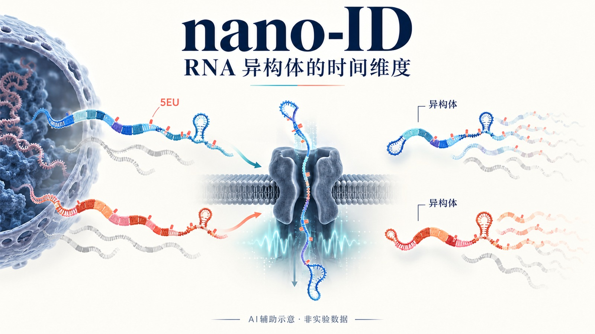

*AI 辅助原创示意，非实验数据；非真实分子尺度或仪器结构。*

## 从化学标记到新旧分类

一个基因的 RNA 总量没有明显变化，并不意味着这个基因没有响应。新分子可以更快产生，也可以更快消失；同一基因的两个异构体，还可能朝相反方向变化。常规表达量矩阵把这些过程压成一个数字，很多问题因此留在了矩阵之外。

2020 年，Maier、Gressel、Cramer 与 Schwalb 在 Genome Research 发表 nano-ID，尝试把两类信息接到同一条 RNA 分子上：长读长保留的转录本结构，以及代谢标记提供的“在这段时间内新合成”的线索。随后再把同一异构体的新旧分子比例，转成群体层面的合成和降解估计。

它值得重读，不是因为六年前的模型可以直接装到今天的平台上，而是因为它完整暴露了一条测量链：**化学标记能否被仪器读到，分类器究竟识别了什么，这些分类又怎样变成生物学参数。**这一篇先讲前两环，避免刚看到 ROC 曲线就跳到“测出了 RNA 寿命”。

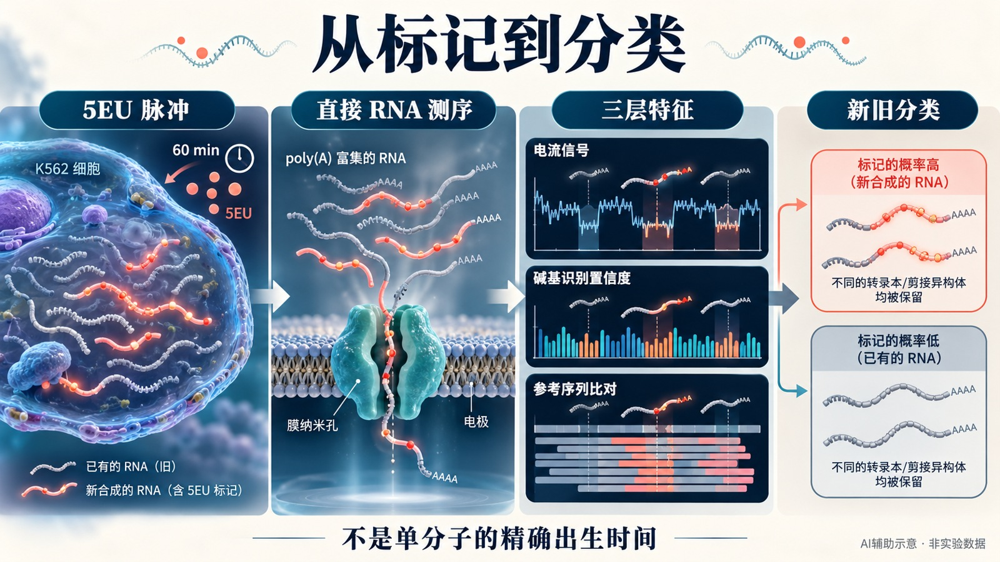

*本图为 AI 辅助原创示意，非实验数据。电流、置信度和比对图形仅解释信息类型，不是真实 read 或软件截图。*

### 先说清楚：nano-ID 给 RNA 的不是出生证明

在培养体系中加入 5-ethynyluridine，简称 5EU，新合成 RNA 有机会把它当作尿苷类似物掺进去。脉冲结束后，样本包含此前已经存在的 RNA，也包含脉冲期间合成、并且尚未降解的 RNA。

因此，“新”是相对于一个标记时间窗而言。即使分类完全正确，也不能知道某条分子是在第 3 分钟还是第 53 分钟出生；而已经在脉冲内降解掉的新 RNA，终点测序根本看不到。后面所谓半衰期，必须依赖群体计数与动力学模型，不能把单分子读出误写成单分子寿命追踪。

作者关注的是经过 poly(A) 富集、可以进入这套直接 RNA 文库的分子，主要目标是成熟转录本。这不是无选择地测全细胞所有 RNA，更不是把未加工前体、非 poly(A) RNA 和成熟 mRNA 同等纳入。测量对象的这道边界，也影响它与其他代谢标记方法是否可比。

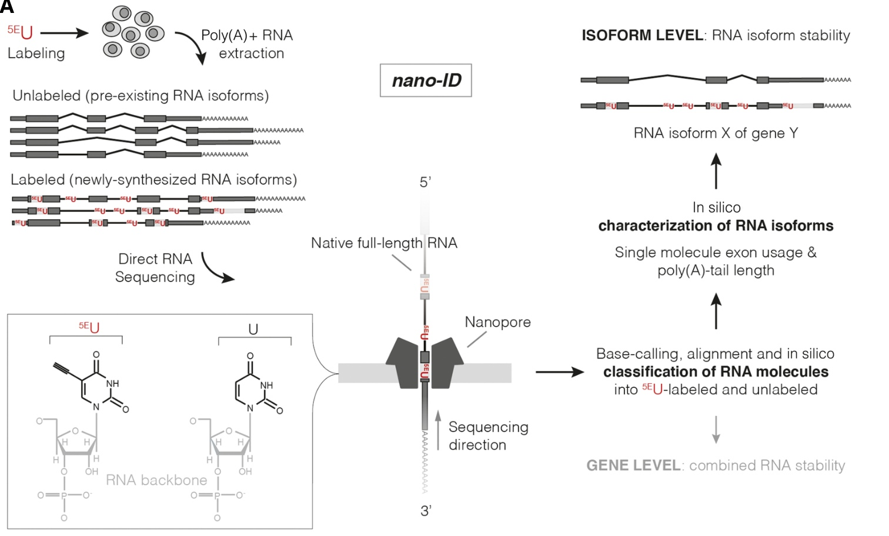

*原图来源：Maier 等，2020，Figure 1A，CC BY-NC 4.0。仅截取完整 panel、技术性缩放；未改动图内内容。*

图 1A 左边把旧分子与带红色 5EU 标记的新分子分开画，右边则强调每条 read 保留异构体身份。两者连起来，才可能在同一个基因内部追问不同外显子组合的周转是否一致。图中的 poly(A) 尾还是另一种读出，但它与稳定性的关系需要后续分析，不能只凭示意箭头当成已确立的因果链。

直接 RNA 测序的优势，是电流读出的底物本身是 RNA，并避免 PCR 扩增把分子计数进一步扭曲。它并不自动保证每条 read 都完整、每个剪接位点都正确。把“原生 RNA”与“无误差的全长转录本”画上等号，会掩盖后面 FLAIR 校正和覆盖度筛选的必要性。

### 化学标记必须先通过仪器这一关

5EU 并不是因为“常用”就天然适合纳米孔。作者先做了体外转录筛选：用约一千核苷酸的 ERCC 衍生模板，在可行条件下用不同类似物替代天然核苷酸，再测读长、错配和电流特征。它回答的是“哪种化学变化留下可利用的信号”，还不是人体细胞里新旧分子分类的最终准确度。

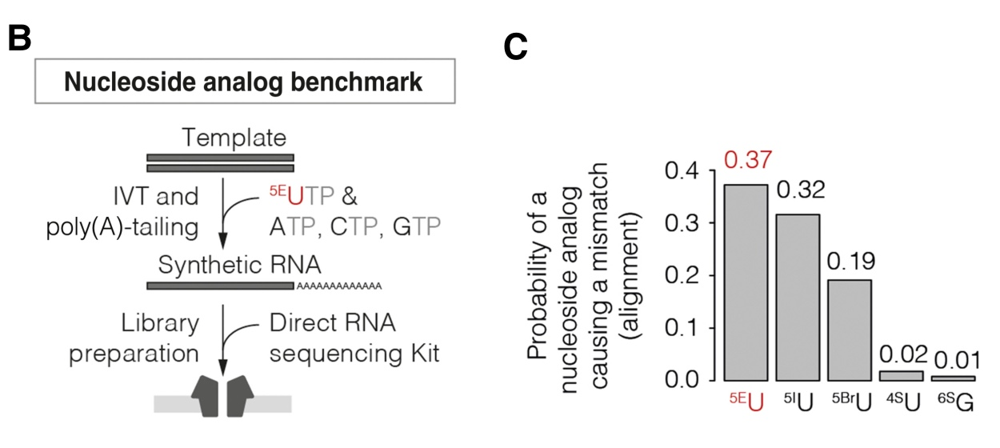

*原图来源：Maier 等，2020，Figure 1B–C，CC BY-NC 4.0。完整 panel 原样截取、缩放。*

B 是对照设计：相同模板分别生成天然 RNA 与类似物 RNA。C 的横轴是类似物种类，纵轴是类似物引发比对错配的概率；5EU 约为 0.37，5IU 约为 0.32。这里的 0.37 **不是 37% 的新生 RNA 被检出**，也不是 37% 的尿苷在活细胞中被替换，而是这套合成模板和分析条件下的位点信号指标。

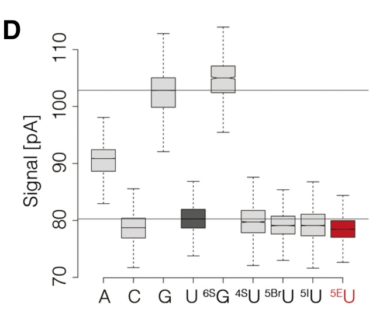

*原图来源：Maier 等，2020，Figure 1D，CC BY-NC 4.0。完整 panel 原样截取、缩放。*

D 的纵轴是电流，单位 pA，箱线图按 read 汇总；天然碱基与各类似物的分布并排展示，黑色水平线给出天然 G、U 的参考位置。不同类似物对电流的影响并不相同。“偏离较大”也不单独决定优劣：如果某种类似物让体外转录难以完成、读段明显变短，它即使产生强信号，也未必适合后续异构体分析。4sU、6sG 在这里就遇到了产物与读长方面的问题。

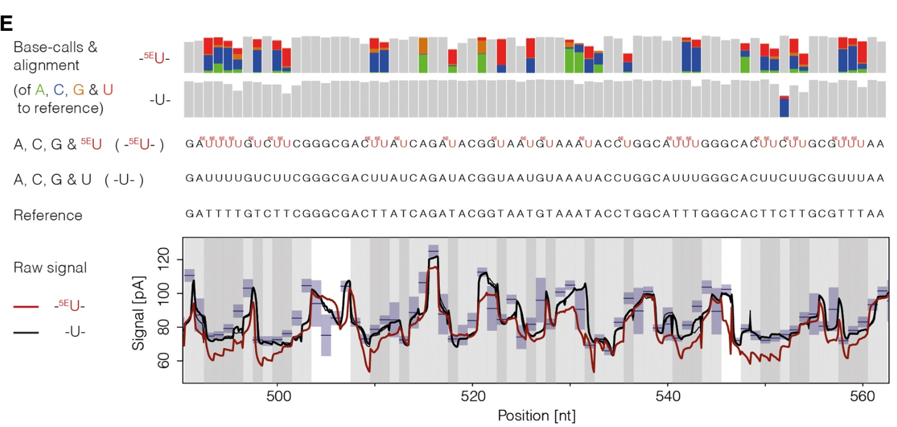

*原图来源：Maier 等，2020，Figure 1E，CC BY-NC 4.0。原样片段保留序列、颜色图例、坐标轴和单位。*

E 把“存在可检测差异”展示得更具体。上方彩色竖条是碱基识别与参考序列的偏差；下方横轴是模板位置，单位 nt，纵轴是 pA。红线对应 5EU 模板，黑线是天然 U 对照，蓝色框是原文所示 ONT 孔模型的期望均值与标准差。

尤其要注意统计单位：红、黑线分别来自 7,756 与 17,149 条分子的**平均信号**，不是两条单分子的轨迹。这张图证明在控制模板背景后，5EU 能改变观测信号；它没有证明任意细胞 RNA 上的每一个 5EU 位点都能被准确定位。

体外模板中高度替换的 5EU，与细胞内稀疏、受摄取和代谢影响的掺入，不是同一个难度。作者也发现可检测性依赖邻近序列，某些含 U 的五核苷酸组合更容易读出变化。原文基于掺入与可检测性模型估算，约 500 nt 的 RNA 可获得约 0.75 的识别机会；这是模型预测，不应冒充独立测试集上实测的敏感度。

### 为什么需要约 4700 个特征，而不只数错配

如果所有新 RNA 都带上密集、清晰而统一的标记，简单规则可能足够。但细胞内掺入稀疏，天然测序错误又不少；单看错配，多了可能是标签，也可能只是 read 质量差。

nano-ID 把信息分成三层。第一层是经过校准的原始电流及序列背景汇总；第二层是碱基识别器给出的置信度、flip/flop trace 和移动信息；第三层是比对后才能得到的错配、插入、缺失及相关统计。一个位点即使最后仍被识别成 U，其置信度也可能已经变化；而同样的错配数量，放在高质量与低质量 read 中，含义并不相同。

这不是端到端把全部原始信号交给一个黑箱。它是相当明确的特征工程，再接多层神经网络。补充表 S5 列出 4,694 维输入、逐层收缩的全连接网络、批归一化和 dropout。架构的作用，是综合不同证据并控制拟合，不是替代合适的训练标签和独立验证。

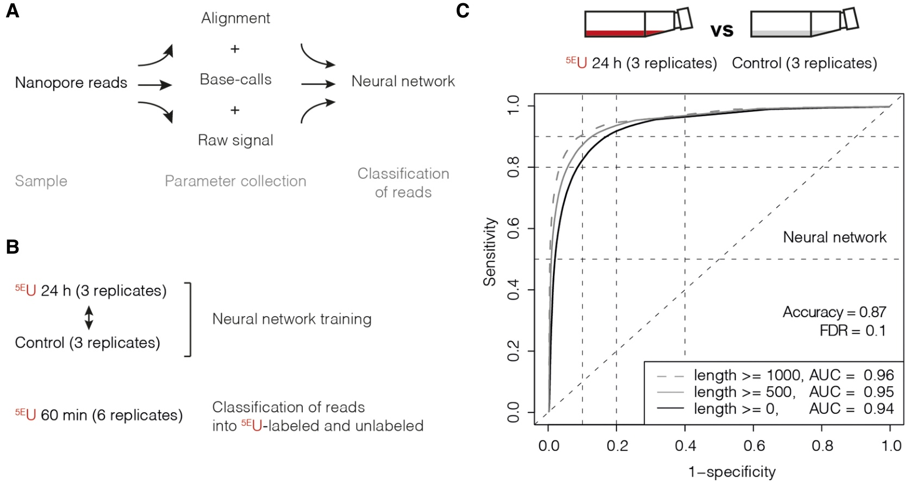

*原图来源：Maier 等，2020，Figure 2A–C，CC BY-NC 4.0。完整 panel 原样截取；下文另放 C 的放大片段便于阅读。*

图 2B 的训练设计需要慢读。作者用 24 小时 5EU 标记的三个生物学重复作为正类，用不加标记的三个重复作为负类，再将分类器用于 60 分钟脉冲的六个重复。长时间标记是为了让绝大多数 RNA 有机会带标记；但“24 小时样本全部视作正类”仍是训练假设，不能理解为每条分子的化学真值都经过独立确认。寿命很长的 RNA、掺入不充分的分子，仍可能造成标签噪声。

原文报告训练使用 294,467 条 reads，验证使用 126,130 条，并给出五折交叉验证结果。公开正文、补充表和我们读取的预测脚本，没有明确交代训练与验证是否按基因、按生物学重复或按批次严格隔离。因此，可以说它在作者的 K562 数据和历史流程内显示了分类能力；不能进一步改写成“已经验证跨样本、跨物种泛化”。

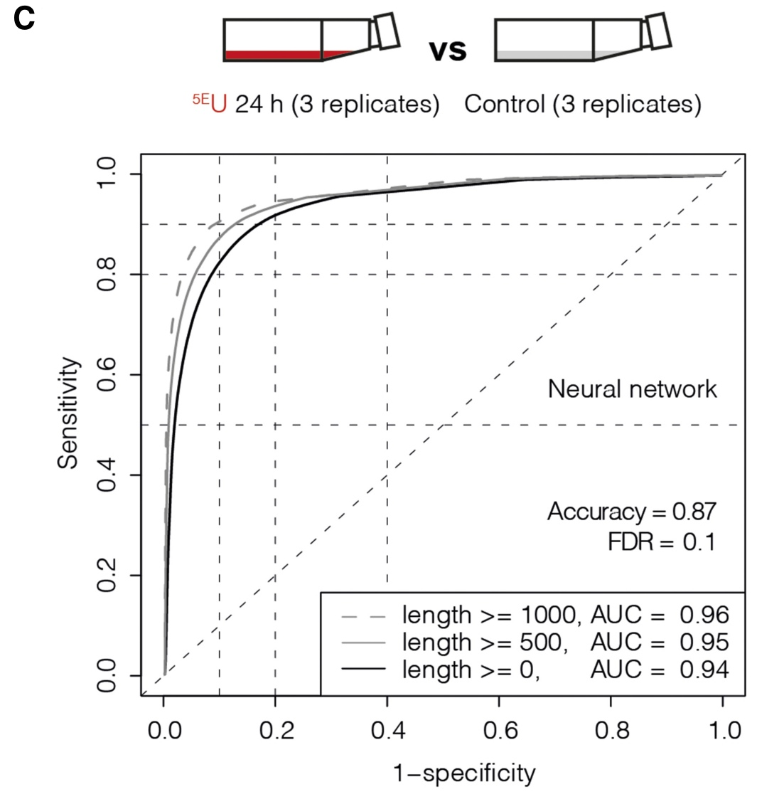

*原图来源：Maier 等，2020，Figure 2C，CC BY-NC 4.0。保留完整数据、坐标和图例，裁去邻近 A panel 的边缘文字。*

C 的横轴是 1−特异度，纵轴是敏感度。全体测试 reads 的 AUC 为 0.94，较长 reads 的曲线略好，约 500 nt 和 1000 nt 以上组分别为 0.95、0.96。这符合更长分子可能携带更多标记证据的直觉，但也提醒我们留意长度偏倚。

同图中的 accuracy=0.87、FDR=0.1 是另外两个量。AUC 汇总不同判别阈值的排序表现；accuracy 与选定阈值、类别比例有关；FDR 关心判为阳性的分子中有多少是假阳性。**0.94 不是 94% 准确率，更不是半衰期误差只有 6%。**测试条件下的 FDR，也不能不加校准就搬到新生 RNA 比例很低的短脉冲样本。

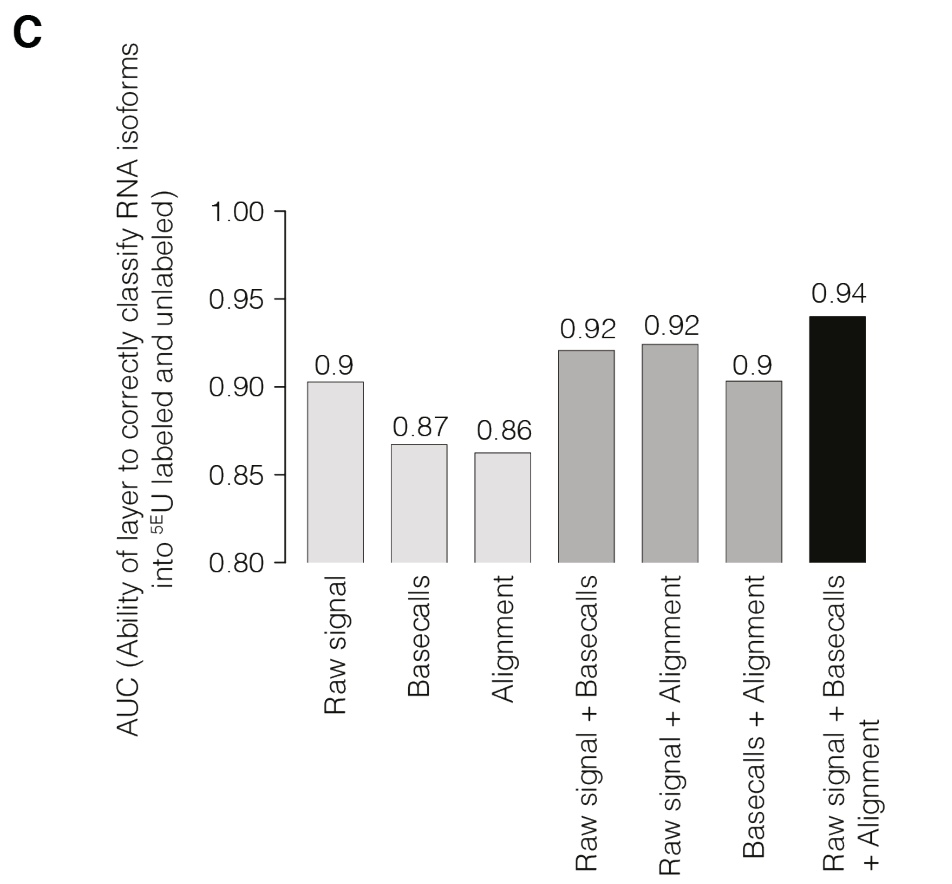

*原图来源：Maier 等，2020，Supplemental Figure S3C，CC BY-NC 4.0。原样截取 C 的数据及轴标签，清除相邻 A panel 伸入空白边缘的标签；柱高是作者报告的 AUC，不是本次重跑结果。*

S3C 的横轴是特征组合，纵轴仍是分类 AUC。只用原始信号约 0.90，只用 base-call 或 alignment 约 0.87、0.86；三层合用约 0.94。这支持额外信息有用，而不是只凭“模型更复杂”推断更好。但图中没有给出差值的置信区间，不能进一步声称每一次增益都经过显著性检验。消融也没有替代跨批次外部测试：三层信息仍可能共享同一种技术偏差。

### 模型之外，还有容易被忽略的实验背景

把控制组与长时间标记组区分开，并不保证网络只学到了 5EU 的化学效应。只要标签和某一种批次、RNA 质量或序列组成一起变化，分类器就有机会利用替代线索。dropout 能约束拟合，却无法自动拆开这种混杂；五折交叉验证也只有在切分单位与真正的使用场景相匹配时，才能回答相应的泛化问题。

补充表 S2 提供了一个应当检查、但不宜过度解释的线索：24 小时标记的三个样本，aligned reads 占比约 18%–26%；未标记对照约 48%–54%。这不证明模型的表现来自文库质量差异，也不等于作者的结论被推翻。但它说明两类输入不能只靠总 read 数就视为技术分布相同。若要把这套思想迁移到新项目，按独立建库批次留出测试、检查 read 长度和质量分层表现，比再给网络加一层更能直接回应这个问题。

原始电流的校准也有明确生物学假设。不同孔、不同电压背景会让整条 read 的信号水平或幅度偏移。作者借助不含 U 的序列上下文对齐到孔模型，希望校正整体差异，同时保留含 U 上可能来自 5EU 的相对改变。这样做把“仪器漂移”和“标记扰动”分开处理；但如果更换孔、化学体系或碱基识别器，原先的统计参照就需要重新验证，不能认为保存了同一个模型文件就保存了同一个测量系统。

这一点也决定了它不能被描述成只接受 FASTQ 就能运行的通用工具。完整特征包含 FAST5 中的原始信号、旧版碱基识别器输出的 trace/move，以及参考比对结果；仅有碱基序列并不足够。我们核读的官方预测脚本还会将特征缺失值置零，再加载预训练模型。这是具体实现，不是已经证明对任何缺失模式都稳健的原则。换一种输入格式或特征提取流程，即便最后维数相同，数值含义也未必相同。

实验投入同样需要放回历史条件中理解。作者在 K562 中使用 500 μM 5EU，基线脉冲为 60 分钟；24 小时训练样本每 8 小时补加一次。细胞 RNA 流程从 1 mg total RNA 做 poly(A) 富集，以约 1000 ng 输入直接 RNA 文库，使用 RNA001/RNA002 和 MinION Mk1B。它不是已经完成的单细胞或极低输入方案。补充 Note 1 也明确提醒，不同细胞和物种的摄取、掺入效率需要先评估。

这些细节不是照着配方就能迁移的操作推荐。它们帮助读者识别一篇方法论文究竟验证了多大范围：2020 年的 K562、当时的文库与 Guppy 3.1.5 流程。本文没有验证 RNA004 或现代碱基识别器上的兼容性；也没有把“不做 PCR”扩大成“没有任何实验选择偏倚”。

### 新旧分类之后，还要回答“它是哪一个异构体”

作者把长读长与短读长支持的剪接位点校正结合，使用 FLAIR 建立异构体目录，共识别 41,090 个候选异构体，约 63% 相对于所用 RefSeq 注释未被收录。这个数字描述的是流程产生的目录，不等于已经逐个证实了四万多个功能性、全长、无误差的新转录本。

“长读长能连接远端外显子组合”是优势；“短读长完全不能分析异构体”则过头了。这里作者自己也用短读长 RNA-seq 帮助修正 splice junction。更稳妥的理解是：长读长改变了结构归属的证据形式，却没有消灭比对、截短、低覆盖与注释误差。

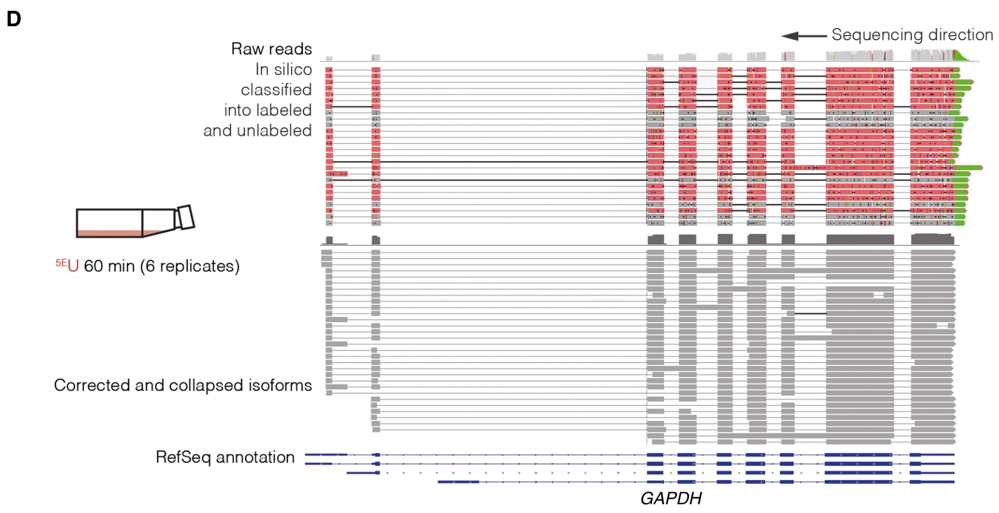

*原图来源：Maier 等，2020，Figure 2D，CC BY-NC 4.0。原样截取；对应 hg38 的 GAPDH 区域，原文给出 chr12:6532405–6540375。*

D 中，上方每一行是代表性 read：红色为模型判为带标记的分子，灰色为未标记，绿色延伸表示 poly(A) 尾估计；下方深灰轨道是校正、合并后的异构体，蓝色是 RefSeq 注释。横向是基因组位置和外显子连接关系，纵向堆叠不是时间轴，也不是每一行一个生物学重复。

它说明结构信息、标签分类和尾长可以落在同一批分子上；不能靠红色行看起来多，就直接判定这个基因合成更快。分母、测序深度、分类误差和读段如何分配到异构体，都要先进入定量模型。

读完这一步，nano-ID 的贡献已经很清楚：它把原本分开的结构与时间窗信息接起来了。下一道更难的题是，终点的新旧比例到底足以支持怎样的半衰期结论。分类器越漂亮，越有必要把这一关单独审查。

### 阅读范围与来源

本文依据完整正文、20 页补充材料以及官方代码的特征提取、预测和稳定性计算部分；补充表 S6 只核对结构、表头和部分记录，未逐行重算。没有运行模型或复现作者 benchmark。所有结果数字均归属于作者。

原文：[Maier 等，Genome Research，2020](https://doi.org/10.1101/gr.257857.119)；[合法开放全文与补充入口](https://europepmc.org/articles/PMC7545145)；[官方代码](https://github.com/birdumbrella/nano-ID)。原图按 [CC BY-NC 4.0](https://creativecommons.org/licenses/by-nc/4.0/) 用于本篇非商业教学分析，保留来源和未改动数据的说明；AI 图不替代实验图。

## 从分子比例到半衰期与稳定性特征

假设一次 60 分钟脉冲后，某个 RNA 异构体的一半读段被判为新合成。能不能说它的半衰期就是 60 分钟？如果只有五条读段，其中一条被判为新合成，这个寿命估计又有多可信？

nano-ID 把 5EU 标记、直接 RNA 长读长和分类器接到一起，但“新旧分子可区分”距离“半衰期可定量”还有一段路。本文围绕这段路展开：公式怎样来，分母包含什么，分类和抽样误差怎样传下去，以及 Figure 3 的稳定性预测究竟支持多强的机制解释。

*AI 辅助原创示意，非实验数据。图中的分子池、沙漏和生长稀释用于解释模型，RNA A/B 是假设分类，不是论文中的实测异构体。天平仅表示总量近似稳态，不表示新旧 RNA 数量相等。*

### 新分子占比为什么与寿命有关

先想一个保持稳定的 RNA 池。旧分子不断降解，新分子不断补入。如果每个分子单位时间内消失的机会近似恒定，旧分子比例会按指数形式下降。脉冲持续同样久时，周转快的 RNA 池换入的新分子较多，周转慢的池子留下的旧分子较多。

这给出了比例与速率之间的桥梁，但桥梁有条件：新旧分子的识别和采样需要可比；观察窗口内的速率要足够稳定；用来表示池子大小的总量不能发生未被模型处理的动态变化。对正在分裂的细胞，还要把细胞生长导致的浓度稀释与真正的分子降解区分开。

作者对异构体 i、样本 j 分别计数：T 是全部分子读段，L 是被分类为带 5EU 的读段，f=L/T 是新生比例。正文给出的公式可以写成：

**降解率 λ = −α − ln(1−f)/t**

**半衰期 h = ln(2)/λ**

其中 t 是标记时长，α 是生长稀释率，定义为 ln(2) 除以细胞周期长度。这里的半衰期针对模型中的降解过程；如果省略 α，就把降解与生长稀释合成了另一种有效消失速度。

我们读取的官方 stability.R 采用 t=60 分钟、细胞周期 24 小时，并把 λ≤0 的情况设成缺失值。下面的数字仅是根据公式计算的**假设教学例子，不是论文实验结果**：若 f=0.5，扣除这项生长稀释后，降解半衰期约为 62.6 分钟，而不是刚好 60 分钟；若 f=0.25，半衰期约为 160.7 分钟。

这也说明，“半衰期”并非分类器输出层的另一个名字。分类器判断一条 read 像不像带标记；半衰期来自许多 read 汇总后，再经过非线性变换。两个层级的验证目标、误差来源和统计单位都不同。

### 计数里的 T，不是自动校准的每细胞分子数

T 是测序及分配后得到的计数。它受测序深度、文库回收、read 是否足够完整、能否可靠归属于异构体等因素影响。若同一异构体的新旧分子有相同采样机会，比例 L/T 能抵消一部分共同的深度尺度；但这不意味着所有偏倚都会消失。

例如，带标记分子的比对率若系统性不同，或某种长度的异构体更容易分类成阳性，分子进入分母与分子的标签判断就不再相互独立。对“结构目录中的异构体”和“有足够数据估计周转的异构体”，也必须分别统计。检测到一条支持新剪接组合的 read，与能够稳定估计这一组合的新旧比例，是两种完全不同的证据强度。

作者还写出合成率 μ=T(α+λ)。补充表 S6 对合成率使用的单位是 a.u.，即任意单位。没有相应绝对定量标定，不能把它写成每个细胞每分钟产生多少条分子。它适合在明确归一化和模型前提下比较，不宜仅凭公式里出现了“rate”，就把它当作绝对物理通量。

这里有一个实际工作中很容易漏掉的检查：最终表格应同时保留 T、L、脉冲时长、重复编号、结构归属与筛选原因，而不是只输出一个半衰期。遇到异常长寿命、条件间大幅跳变或 NA，研究者才有机会回溯是比例接近边界、计数不足，还是模型真的提示了新的生物学现象。这是我们从测量链提出的分析建议，不是作者已经完成的额外实验。

### 五条 read 的门槛，不能理解成五条就足够精确

补充 Note 1 要求一般稳定性估计由每个重复至少五条 reads 支持。基线有六个生物学重复，热冲击有五个，分别对应合计最低约 30 和 25 条的门槛。主文在相关段落使用 RefSeq-TU，补充说明又使用 transcript、locus 等表述，因此我们不把这一阈值夸大成“每一个公布的异构体都已独立核实每重复五条”。

更重要的是，门槛只是过滤规则，并非精度保证。用刚才的公式做另一个假设演算：五条 read 中一条新生，f=0.2，估计半衰期约 214 分钟；若只多一条被判为新生，f=0.4，就变成约 86 分钟。改变的是一条 read，半衰期却发生很大变化。

这不是说所有低计数结果都无效，而是提醒我们：在非线性变换下，均值、区间、缺失和边界不能拆开报告。f 接近 0 时，对极长寿命的判断容易受少量假阳性影响；f 接近 1 时，旧分子几乎消失，另一端的估计也会变得困难。增加生物学重复可以检验一致性，但不能把同一个文库里的大量 reads 当作大量独立生物学重复。

分类误差会进一步改变这个比例。若真实新生比例为 f、分类敏感度为 s、特异度为 c，一个理想化的关系是：观测阳性比例约等于 s×f+(1−c)×(1−f)。这是我们的误差解释，不是作者报告已实现的校正公式。它说明即便假阳性率不高，在真实新生比例很低时，阳性中的相当部分仍可能来自旧分子。只报总体 AUC，无法告诉读者这个偏差最后给某个异构体的半衰期带来多大影响。

### 脉冲不是越短越好，也不是越长越稳

短脉冲接近瞬时响应，但新生分子少，计数与分类误差容易放大。很长的脉冲增加了标记机会，却可能让快周转分子的旧群体接近消失，同时把生物学响应在时间上平均掉。设计脉冲，本质上是在时间分辨率、动态范围和可估计性之间做选择。

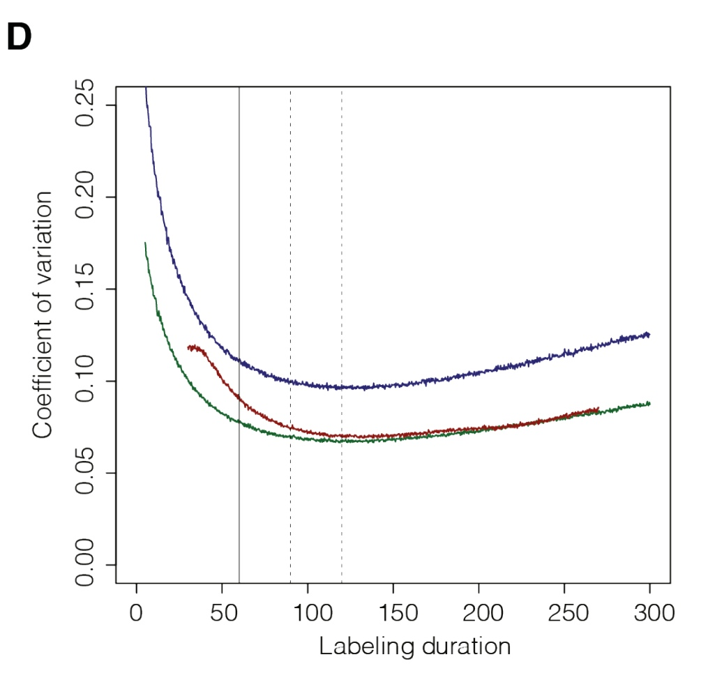

*原图来源：Maier 等，2020，Supplemental Figure S3D，CC BY-NC 4.0。原样保留曲线、坐标，裁去相邻 B panel 伸入上边缘的标题；无数据重绘。*

S3D 横轴为标记时长，范围约 5–300 分钟；纵轴是变异系数，即标准差除以均值。蓝线对应基本方案，绿线对应更深测序，红线对应加入一个比原时长多 30 分钟的测量方案。图中的曲线来自作者模拟，不是按每个时点实际做出的细胞实验。

模拟设置包含约 80 分钟的半衰期和依据基线数据设定的负二项计数参数，采样规模 n=10,000。在该设定下，约 60–120 分钟区间的估计变异较低；加深测序也表现出优势。这有助于解释作者为什么选择 60 分钟，但不能外推成“所有 RNA 的最佳脉冲都是一小时”，也不能证明多时间点通常不如加深。

两者解决的困难可能不同。加深主要减少抽样噪声；多时间点还能检验曲线形状、速率是否恒定，以及状态是否正在变化。如果模型假设本身不成立，再多 reads 也只是更精确地估计了一个受模型偏差影响的数。这个区别在热冲击分析里尤其重要。

### 与另一种方法相关，才算验证了半衰期吗

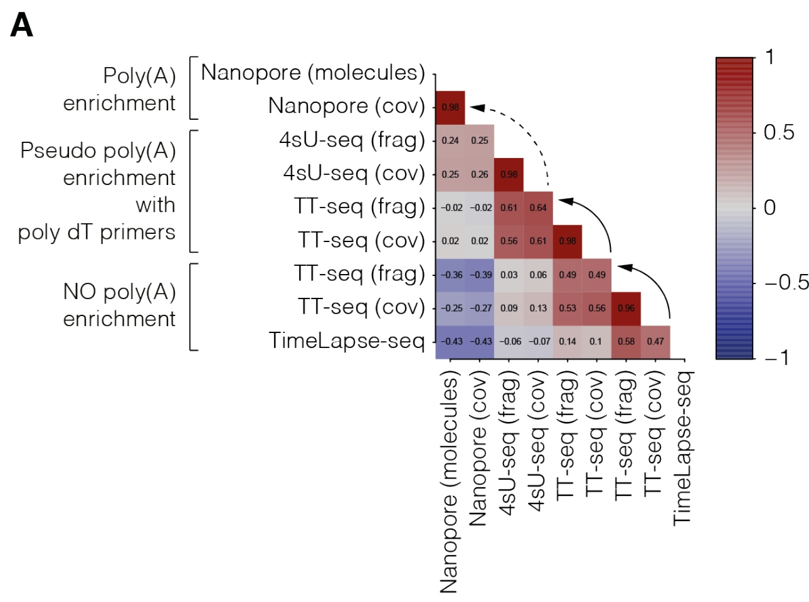

*原图来源：Maier 等，2020，Supplemental Figure S3A，CC BY-NC 4.0。原样片段保留行列方法名、数值和色标，去除邻近 C/D panel 的边缘标记。*

S3A 的横纵方向列出不同实验和计量方式。颜色表示 Spearman 等级相关：红色较正、蓝色较负，色标约从 −1 到 1；方格中的数字对应方法对之间的相关性。这里的单位是跨共同分析对象比较的稳定性排序，不是逐 read 的分类正确率。

nano-ID 与 4sU-seq 的相关约为 0.25，远不应概括成“独立方法高度一致地验证”。同一技术内部用 molecules、coverage 或 fragments 表示时的高相关，也不能替代跨技术验证。

作者提出，poly(A) 富集程度、是否包含前体 RNA，以及不同实验处理可能造成差异。这些解释有道理，却仍是对差异的解释，不能当作已经排除 nano-ID 误差的证据。反过来，相关低也不能单独证明 nano-ID 错了：如果两种方法实际测到的 RNA 池不同，本来就未必拥有完全相同的半衰期定义。

公平的比较应先对齐测量对象、细胞状态、脉冲范围和模型，再检查同一批对象上的偏差。特别是稳定性是多步骤估计量，相关系数只评价排序的一面；若未来要用于定量决策，还需要误差区间、系统偏移、可检测范围与失败对象的分布。这些属于我们建议的验证维度，本次未重跑相应比较。

### Figure 3 到底在预测什么

文章随后把得到的稳定性估计，与序列、poly(A) 尾长、二级结构、翻译和 RNA 结合蛋白特征联系起来。读到“决定因素”时，最容易犯的错误，是把预测能力直接翻译成调控机制。

实际任务更窄：作者将 RNA 按估计半衰期高于或低于中位数，分成“稳定”和“不稳定”两类，再用不同特征训练分类网络。它不是直接预测精确的半衰期，也不是估计某个 RBP 改变后寿命会增加多少分钟。这里又出现一组神经网络，但它们与识别 5EU 的分类器不是同一个任务。

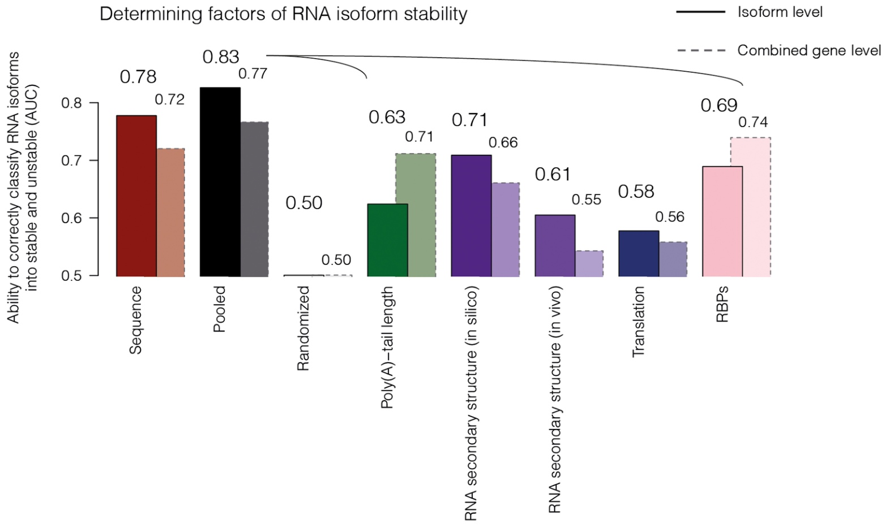

*原图来源：Maier 等，2020，Figure 3，CC BY-NC 4.0。完整原图技术性缩放，未修改数值、颜色、轴与图例。*

横轴依次是序列、合并特征、随机化、尾长、计算预测结构、体内结构、翻译和 RBP；纵轴是区分稳定/不稳定的 AUC。实线边框对应异构体层面，虚线边框对应合并的基因层面。颜色区分特征类别，黑色 pooled 合并了多种特征，但**不包含序列和随机化特征**，不能把它说成所有输入的大合并。

图中序列的 AUC 在异构体层面约 0.78，基因层面约 0.72；计算结构约 0.71 与 0.66。相反，尾长约 0.63 与 0.71，RBP 约 0.69 与 0.74，后两者在合并基因层面更高。随机化约 0.50，提供了接近随机分类的对照。合并特征约 0.83 与 0.77，说明在这些样本及任务下，组合信息能帮助区分两类对象。

作者由此提出，序列和结构等关系可能需要在异构体层面看，而某些尾长或蛋白结合特征在基因层面更容易被捕捉。这是值得跟进的线索，但没有一根柱子直接代表“解释了百分之多少的寿命变化”。AUC=0.78 不是解释了 78% 方差；实线高于虚线，也不等于已经排除了样本量、噪声和特征测量方式的影响。

补充 Note 1 还有一处对读图很重要的例外：为增加 Figure 3 的观察对象，reads 门槛由每重复五条降到两条。这让分析覆盖更广，也意味着稳定/不稳定标签中的估计噪声需要纳入判断，不能把该图与更严格过滤后的寿命比较视作相同可信度。

### 特征从哪里来，决定了机制能说多远

序列模型提取了 1–9-mer 信息；它能够利用局部序列组成，却不应被描述成已明确识别全长绝对位置或任意长程相互作用。计算结构主要通过 RNAfold 的自由能特征表示，这与细胞内真实结构不是同一种测量。

体内结构、翻译和 RBP 结合则利用既有 DMS-seq、Ribo-seq、eCLIP 数据。它们给新估计量接上已有生物学信息，是高效的研究设计；但外部数据的样本状态、短读长映射和异构体共享序列，会限制信息能否真正归到某一个异构体。把同一基因大部分共享的信号分到几个异构体上，不会自动制造出异构体特异的机制证据。

要从关联走向机制，最好提出可干预的预测。例如在控制表达量与序列背景后，改变某一段 UTR 或某个结合位点，是否改变目标异构体的衰减；改变结构但尽量保留其他因素，是否仍得到一致效应。这是我们依据本文提出的研究方向，不是 nano-ID 已经完成的验证。

因此，Figure 3 最有价值的用途，是帮助研究者挑选后续假设，并提醒“分析粒度”本身可能改变结论。它不是最终机制排名，更不能把 DMS、Ribo 或 eCLIP 原始研究中的结论全部算作我们亲自重新验证过。

### 本篇的落点

一条 read 的新旧标签、一个异构体的新生比例、模型推断的半衰期，以及与稳定性相关的特征，是四个相连但不能互相替代的层级。nano-ID 的独到之处是把它们接成可操作的研究路线；认真使用它，也意味着把每一级的假设、单位、分母与不确定性一起传下去。

本文依据完整正文与全部 20 页补充材料，读取官方稳定性计算与预测代码；S6 只核查表头及部分记录，未重算全矩阵。上述算例是明确标注的公式演算，不是本次运行测序流程。对 Miller 等 2011 的动力学原始文献，我们实读了相关方法、动态分析及讨论段落；其余结构/翻译/RBP 原始研究仅核对本文所用来源和数据集，未逐篇全文复核。

来源：[nano-ID 原文](https://doi.org/10.1101/gr.257857.119)、[补充材料入口](https://europepmc.org/articles/PMC7545145)、[官方代码](https://github.com/birdumbrella/nano-ID)、[Miller 等，2011](https://doi.org/10.1038/msb.2010.112)。原文和补充图按 [CC BY-NC 4.0](https://creativecommons.org/licenses/by-nc/4.0/) 用于非商业教学解读；数据图不是 AI 生成。

## 热冲击与异构体层面的证据

热冲击后，一个基因的 RNA 是产生得更快了，还是消失得更慢了？如果它同时产生多个异构体，这些分子会一起响应吗？

Maier 等在 2020 年的 nano-ID 论文中，把 5EU 脉冲标记与直接 RNA 长读长结合，尝试在异构体层面回答这些问题。它最有意思的应用图，不是一张更漂亮的表达热图，而是把“同一基因”拆开后，发现汇总曲线可能代表不了其中的每一种 RNA。

但热冲击也给模型出了难题：正在变化的细胞，未必满足从新旧分子比例推算半衰期时所需的稳态近似。这一篇把 Figure 4 从实验设计读到统计单位，再讨论哪些结论可以保留，哪些仍需另一层验证。

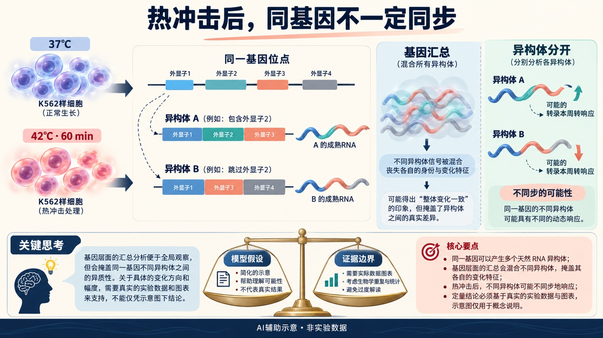

*AI 辅助原创示意，非实验数据。图中 A/B 外显子组合及箭头是明确的假设教学例子，并非本文测得的具体转录本或效应方向；生成画面不代替下面的原始证据图。*

### 六个基线重复、五个热冲击重复，比较的是什么

作者在 K562 细胞中进行 60 分钟 5EU 标记。基线维持常规培养温度，热冲击组在约 42°C 下标记一小时。Methods 更具体地说明：先经过约五分钟升温，待细胞悬液达到 42°C 后再加入 5EU，因此总热暴露约为 65 分钟，标记窗口仍为 60 分钟。

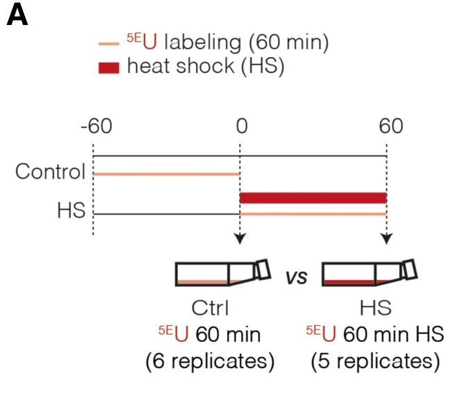

*原图来源：Maier 等，2020，Figure 4A，CC BY-NC 4.0。保留完整时间线、图例与重复数；裁去相邻 B panel 的边缘内容。*

A 中浅红线表示 5EU 标记，深红条表示热冲击。Ctrl 有六个生物学重复，HS 有五个；不是从同一条测序运行里切出十一份数据。两个终点都收集在标记结束后，用同一套分类和动力学流程估计参数。

作者还特意在处理前约 24 小时更换培养基，以减少“刚换培养基”本身造成的快速转录变化。这个细节值得实验设计者留意：当问题是几十分钟内的应激响应，操作历史本身可能与处理效应处在同一时间尺度上。

图 A 的时间线给出的是条件与采样设计，不是连续追踪每条 RNA 的录像。对照与热冲击之间的差别，也不能仅凭一个终点拆解为每一分钟的合成率和降解率轨迹。

### 长读长的一个具体好处：跨过局部比对歧义

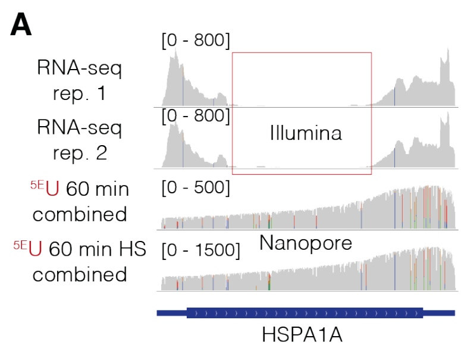

*原图来源：Maier 等，2020，Supplemental Figure S4A，CC BY-NC 4.0。原样截取；位点为 chr6:31813514–31819942，基因组版本见原文。*

S4A 展示 HSPA1A。上方两条轨道是短读长 RNA-seq 重复，下方是合并的纳米孔基线与热冲击样本；红框标出作者强调的局部比对困难区域。长读段能利用更长的上下文帮助定位，这是相对于短片段的实质优势，而不是抽象地说“信息更多”。

读覆盖图时有两个限制。其一，各轨道纵向范围不同：短读长轨道标为 0–800，纳米孔基线约 0–500，热冲击约 0–1500，不能直接拿图上山峰的像素高度比较倍数。其二，下方是合并轨道，不是逐个生物学重复都呈现同一幅形状的证据。图能够说明这个位点的可比对性与覆盖差异，不能单独证明转录本的降解机制。

也不要由一个实例推成“短读长无法研究热冲击”或“所有同源基因都能被长读长无歧义解决”。read 长度、错误率、参考结构和过滤参数依然决定最后能归属多少分子。

### “上调伴随更短半衰期”是怎样得到的

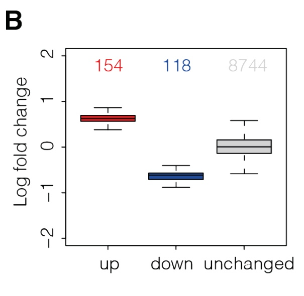

*原图来源：Maier 等，2020，Supplemental Figure S4B，CC BY-NC 4.0。原样截取，保留计数、分组与纵轴。正文与补充图注对分析单位和阈值的记载差异见下文。*

作者报告一组上调、下调对象：154 个上调，118 个下调；S4B 还标出 8,744 个未变化对象。红、蓝、灰分别对应这些组，纵轴是原图所写的 log fold change。它是已按变化方向与阈值筛选后的分组，不是未经选择的全部 RNA 自然分成三类。

这里必须保留一处原文内部不一致。结果段称 272 个 isoforms，并写 fold change>1.25、P<0.1；Methods 写 fold change≥1.25、P<0.05；S4B 图注又将单位称为 RefSeq-annotated genes，使用最高 P=0.1 的门槛。我们没有重新计算完整清单，也没有证据把这些 P 值改称多重检验校正后的 FDR。因此，本文保留作者报告的数量与趋势，不把“272 个已严格核验的异构体”当作无争议的精确结论。

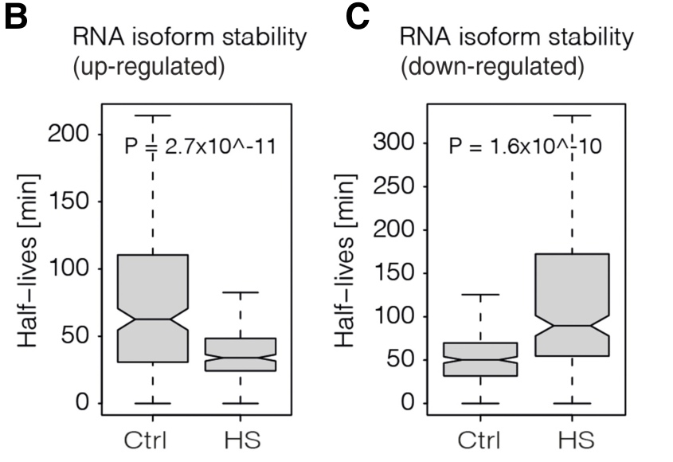

*原图来源：Maier 等，2020，Figure 4B–C，CC BY-NC 4.0。保留两组箱线图的轴、单位及作者 P 值；裁除邻近 A panel 的边缘文字。*

B、C 的横轴都是 Ctrl 与 HS，纵轴为半衰期，单位分钟。B 是被作者筛为合成上调的一组，热冲击时的半衰期分布更低；C 是下调的一组，热冲击时的分布更高。作者在图上给出很小的 P 值，但本次没有复算检验，也不据图补写未核实的检验名称或精确组内有效样本数。

箱线图比较的是筛选组内 RNA 对象的估计分布，不能把每根箱子理解成六个或五个重复的简单排列；重复用于每个对象参数的估计，组内对象则是另一层统计单位。分布移动也不意味着每个对象都朝同一方向变化。

作者提出，应激时新生增加、随后更易清除，可能有利于响应及时结束。这是合理的生物学解释，但“细胞为了快速恢复而主动降低这些 RNA 的寿命”属于更强的目的性、机制性表述，仅凭这两组箱线图还不能成立。

### 一个需要单独检查的地方：动态总量会进入寿命估计

nano-ID 正文使用的新旧比例公式是 λ=−α−ln(1−L/T)/t，其中 α 是生长稀释，t 是脉冲时长。它在总量近似稳态、速率条件相符时有清楚的解释。但热冲击的目的正是让转录状态变化：T 在这一个小时内可能不再保持原来的水平。

下面是一段**我们的数学检查，不是作者新增实验结果**。假设旧 RNA 的真实降解率 λ 和生长稀释 α 在窗口内恒定，旧分子数量就满足：

**U(t)=T(0)×exp[−(λ+α)t]。**

假设还可以完美识别新旧分子，那么 1−L(t)/T(t)=U(t)/T(t)。把它代回稳态式，会得到：

**λ估计 = λ真实 + ln[T(t)/T(0)]/t。**

这表示，若总 RNA 池在观察窗内增加，稳态套式可能把其中一部分总量变化解释成更快的降解；总量减少则可能产生相反方向的偏差。此处 T(0) 与 T(t) 指匹配尺度上的分子池总量，不能拿两个未经归一化的测序计数随便代入。

因此，“合成上调与半衰期缩短同时出现”既可能包含真实的生物学调节，也可能部分受到共享比例和模型前提的影响。合成率和半衰期又都由 T、L 计算，统计上本来就不是两个完全独立的观测。仅从两者的关联出发，无法排除这种估计层面的耦合。

这并不是判定整篇热冲击分析错误。它只是指出：分类再准确，也不会自动解决动态过程的参数可识别性。本文核读的正文、补充说明与公开稳定性脚本给出了上述公式，没有核到热冲击条件专用的非稳态修正式；被引用的 Miller 等 2011 方法也明确区分稳态与动态处理。要把趋势提升为准确的条件特异降解率，需要额外时间点、独立衰减测量，或在模型中明确容纳总量随时间变化。

### 尾巴长的 RNA 更稳定，不等于尾巴变化解释寿命变化

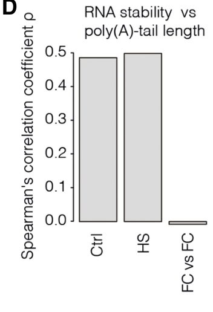

*原图来源：Maier 等，2020，Figure 4D，CC BY-NC 4.0。完整 panel 原样截取、缩放。*

D 的纵轴是 Spearman 相关系数。前两根柱子分别比较基线、热冲击条件下的基因层面半衰期与尾长；第三根“FC vs FC”比较两者在处理前后的变化倍数。这一分析覆盖 1,310 个 loci。

基线下相关约为 0.48，热冲击条件下也呈正相关。但变化倍数之间的相关接近零。它说明，横截面上较长尾巴和较高稳定性相伴，并不足以解释谁在应激后改变得更多。把不同对象之间的差异，与同一对象随处理发生的变化分开，是这里最有价值的阅读练习。

反过来，变化不相关也不等于 poly(A) 尾没有生物学作用。测量误差、时间滞后、不同转录本组成或多种机制共同作用，都可能削弱同步的线性或单调关联。作者的图给出的是这一条件、这一粒度下的统计关系，不是对所有尾长调控机制的否定。

### Figure 4E：黑色汇总线为什么不是每个蓝点的代表

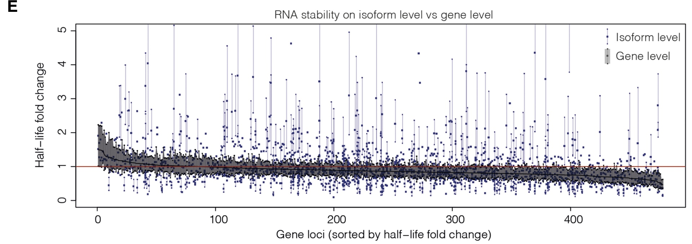

*原图来源：Maier 等，2020，Figure 4E，CC BY-NC 4.0。完整数据范围、轴和图例保留；仅移除相邻 D panel 伸入边缘的文字。图内误差线为作者报告，不是本次重算。*

这张图是全文最值得放大看的证据之一。横轴是 478 个高置信度基因位点，按基因层面半衰期变化倍数从高到低排序；它不是时间轴，也不是按基因组坐标排列。纵轴是热冲击相对于基线的半衰期倍数，红色水平线为 1，代表无变化。

黑色是将一个基因的 RNA 合并后得到的估计；蓝色是 1,988 个异构体的估计。同一横坐标上的多个蓝点来自同一位点，因此图中的点不是 1,988 个相互独立的基因。蓝点有的远离对应黑线，有的甚至分布在红线两侧，直观显示基因汇总可以掩盖异构体之间的差异。

误差线必须按图注解释：它们是生物学重复间的标准差，不是置信区间。图注给出各条件至少五个重复支持；蓝色标准差只在它与对应基因层面标准差不重叠时显示。没画蓝色误差线，不等于那个点没有变异；“误差条不重叠”也不能被我们擅自升级为每个异构体都通过了正式差异检验。

这种可视化支持的核心结论是：**在作者的计数、分配和模型条件下，异构体层面的估计变化，不总能用该基因的汇总估计代替。**它不单独证明每个偏离点都是真实机制差异，更没有验证这些异构体一定产生不同功能的蛋白。

为何不能把基因半衰期当作几个异构体半衰期的简单平均？因为基因层面先合并分子，再算新生比例，最后做非线性变换；不同异构体的丰度贡献不同。一个高丰度异构体很容易主导总量，而低丰度但反应强的异构体在汇总中被淡化。这是关于聚合与模型的解释，独立于是否喜欢某一种测序平台。

### 下一步最有价值的实验，不一定是再画一张大散点图

若把 Figure 4E 当作候选筛选入口，下一步可以选择几类位点：异构体与基因估计方向相反的、同一基因内部差异较大的、以及变化很一致的对照。优先选择结构证据清楚、每个重复覆盖充分、分类质量相近的对象，而不是只挑离黑线最远的蓝点。

随后应分别核查结构和动力学。结构上，确认区分这些异构体的剪接连接或末端边界有独立支持，避免截短 read 被当作另一种转录本。动力学上，增加合适的时间点或使用独立标记/衰减策略，检验异构体差异是否仍然成立。必要时把绝对或相对总量轨迹一起纳入模型，而不是只比较终点的新生比例。

如果最终要提出机制，再围绕候选异构体特有的 UTR、剪接结构或结合位点设计干预，观察预期的寿命变化，并设置不改变关键结构的对照。这样才能从“长读长显示异质性”，逐步走向“某种序列或过程造成异质性”。这些都是本文延伸建议，并非作者已完成的实验。

### 保留下来的贡献，与应当保留的疑问

nano-ID 展示了一种重要研究能力：对同一批 native RNA 分子同时读取结构、标记类别和尾长，再把问题推进到异构体周转。这条路线使得“一个基因的平均响应”不再是唯一可观察的对象。

与此同时，训练验证范围、低覆盖估计、特定历史测序条件、阈值记载差异以及非稳态模型限制，都需要跟着结果一起保留。指出它们不会抹去方法的贡献；恰恰相反，它让后来的研究者知道应在哪一级增加证据，而不是把所有改进希望都寄托在更高的 AUC 上。

本文已读完整正文与全部 20 页补充材料，并核读官方相关计算脚本；未重跑原始数据、未重算 S6 全表与差异清单。Miller 等原始动力学文献仅实读相关设计、动态方法和讨论，未声称全部参考文献均完成精读。

来源：[nano-ID 原文](https://doi.org/10.1101/gr.257857.119)、[补充材料入口](https://europepmc.org/articles/PMC7545145)、[官方代码](https://github.com/birdumbrella/nano-ID)、[Miller 等，2011](https://doi.org/10.1038/msb.2010.112)。原图按 [CC BY-NC 4.0](https://creativecommons.org/licenses/by-nc/4.0/) 用于非商业教学解读。

## Take-home messages

读完一篇方法论文，最值得带回课题组的，往往不是一个漂亮的准确率，而是一个新的问题拆法。

2020 年的 nano-ID 将 5EU 代谢标记、纳米孔直接 RNA 测序、分子分类和动力学模型相连接，尝试同时保留 RNA 异构体结构与周转信息。它提醒我们：基因总量只是表达调控的一种投影；但更细的分辨率也会引入更复杂的误差传递，不能只靠换成长读长就自动得到可靠机制。

这篇独立的 take-home messages 不重复整篇结果，而是把最可迁移的经验组织成一套能用于自己项目的判断顺序。以下实验和分析建议，是基于原文证据与局限提出的延伸，不是我们已经做过的实验或软件实测。

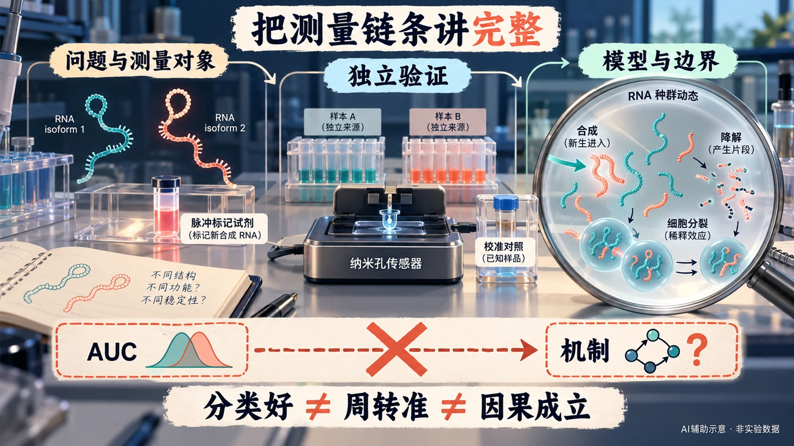

*AI 辅助原创示意，非实验数据、非真实仪器或软件截图。样本 A/B、RNA 图形和 AUC 曲线均为假设教学元素；图中的“独立验证”表示建议的验证设计，不暗示原论文已完成跨域验证。*

### 先把研究对象写成一句可以核查的话

“研究 RNA 稳定性”太宽。更可执行的问题是：在某个细胞状态下，两个结构已得到支持的成熟 poly(A) RNA 异构体，是否具有不同的周转；处理后，这种差异是否改变？

这句话同时限定了对象、状态、比较和终点。若真正关心的是未加工前体、非 poly(A) RNA 或极短暂的转录中间体，就必须重新考虑文库和标记策略，不能因为一篇论文写着 RNA dynamics，就假设它覆盖所有 RNA 池。

对异构体研究，还要区分“发现结构”和“估计数量”两个阶段。长 read 跨越几个外显子连接，是结构证据；在每个生物学重复里有足够分子支持新旧比例，是动力学证据。两者可以来自同一平台，却不能共用一个“检测到”的门槛。

实际写方案时，不妨列两张清单：哪些异构体进入结构目录，哪些异构体具备周转估计资格。它能阻止一个很常见的叙述跳跃——把新识别到的全部转录本，全部算成已可靠测到寿命的对象。

### 把“新”定义为时间窗，不把 read 当时钟

代谢脉冲提供的是一段时间内新合成的线索。终点留下来的新分子，只是脉冲期间产生且存活到收样的一部分。它既不是逐分子的确切出生时间，也不是直接拍到了完整的生成与降解过程。

因此，脉冲设计要同时照顾三件事：目标变化有多快，RNA 池的周转范围有多宽，以及可获得多少独立分子。短脉冲提升时间分辨率，却可能让新生比例很低；长脉冲增加检出机会，也可能让快速周转对象丢失旧分子参照。

nano-ID 的补充模拟提供了一个有价值的思路：在明确半衰期与噪声设定后，比较不同设计的误差传播。但模拟的最佳点依赖假设，不能把作者选择的一小时变成通用配方。最稳妥的迁移，是保留“先评估可估计性”的方法，而不是照搬某一个时间值。

同样，不应把某种细胞里使用的浓度、摄取效率和耐受性无条件外推到新的细胞或物种。实验条件能被复制，不代表生物学背景已经被复制。

### 训练标签、测试单位与真正的使用场景要对齐

nano-ID 使用长时间标记样本作为正类、未标记样本作为负类，解决了如何得到足够训练数据的问题。但这类标签是实验条件提供的近似真值，未必能逐条确认分子是否确实带标记。

一个可迁移的习惯，是在训练前先写清楚：标签在哪一级产生，样本在哪一级独立，未来模型将用到什么数据。按 reads 切分回答的问题，可能与按独立建库批次切分、按基因切分、按细胞类型切分完全不同。评估方案应服务于目标，而不是只选能得到最好曲线的切法。

如果未来只分析同一种细胞、同一平台下的另一批样本，那么至少要关注独立样本与批次。如果希望推到另一种细胞或新的化学体系，就需要相应的外部数据，不能用“做过交叉验证”一笔带过。

检查 read 长度、质量、比对率、序列组成是否同时随标签改变，也很重要。它们可能是有用的信号，也可能成为替代线索。面对这种问题，多加 dropout 或堆更深的网络，不能取代设计上的隔离和对照。

### 把验证拆成四层，不只交一张 ROC

第一层是标签识别：带标记与不带标记能否区分，阈值怎样定，短 read 与低质量 read 的表现是否不同。AUC、敏感度、特异度、precision 或 FDR 回答的并非同一个问题，尤其当新生分子的实际比例改变时，不能把一种测试条件的数字直接迁移。

第二层是结构分配：这条 read 是否真的属于目标异构体，关键 splice junction 或末端边界是否可靠，截短分子是否会制造伪异构体。一个正确的新旧标签，分到错误的结构类别后，仍会产生错误的异构体周转结论。

第三层是参数估计：在计数、分类和分配误差存在时，新生比例转换出的半衰期与合成率有多稳定，哪些对象应当保留为缺失，区间有多宽。这里的目标不再是正确分类一条 read，而是可靠估计一个群体参数。

第四层才是生物学解释：候选的结构或调控因素是否真正影响周转。预测相关、处理前后差异和干预机制是不同证据，不能只因同一张分析表里都有数值，就把它们看成相互独立的验证。

把这四层分别报告，会让方法显得不那么“简洁”。但当结果出问题时，也只有这样才知道应该增加训练数据、修结构目录、改动力学模型，还是重新设计实验。

### 算出了半衰期，要一起交付什么

至少应保留每个重复的总计数与新生计数、标记时长、结构归属、过滤原因、缺失值和不确定性。只有一个半衰期列，通常不足以让别人判断异常值的来源。

也要写清单位。nano-ID 的半衰期以分钟表示，而补充表中的合成率标为任意单位；没有绝对标定就不宜报成每细胞每分钟的分子数。生长稀释与真实降解也应区分，不能在两个项目之间直接比较名称相同、定义却不同的“寿命”。

对于快速变化的处理，尤其要问总 RNA 池是否还能近似稳态。旧分子比例的变化，既受到分子消失影响，也受到新分子补入以及总量变化影响。如果模型没有容纳这些动态，深测序可以减少噪声，却不能保证消除偏差。

这时，额外时间点与独立衰减测量的价值，不只是让样本数更多，而是提供模型原先无法区分的信息。何时加深、何时增加时间点，应根据瓶颈是抽样误差还是参数不可识别来决定。

### 基因汇总可以做入口，不必做终点

把一个基因的所有分子合并，能获得较高覆盖度，也便于看全局。但汇总会受到高丰度异构体主导；低丰度、结构特殊或反应方向不同的异构体，可能被平均掉。

nano-ID 的热冲击分析把这个问题具体化。值得继承的判断不是“以后都不要做基因分析”，而是：当问题涉及剪接、替代末端或 UTR 时，先检查基因层面是否足以代表研究对象。异构体分辨与基因汇总各有角色，比较它们本身就可能帮助发现值得验证的位点。

候选筛选也应避免只挑散点图最极端的对象。优先检查覆盖度、结构证据、跨重复一致性和分类质量，再选择不同模式的代表对象进入验证。极端变化可能是有趣生物学，也可能是最容易受低计数和非线性变换放大的估计。

### 关联可以用来提问题，不能替代机制实验

序列、结构、poly(A) 尾长、翻译和 RBP 特征，可以帮助区分稳定与不稳定对象。但“能预测”与“改变它会导致寿命改变”，中间还隔着混杂、测量粒度与干预证据。

特别是外部短读长数据，在共享外显子上的信号未必能被唯一归到某个异构体。若机制主张落在特定异构体上，就需要与该粒度匹配的验证，而不能只用一个基因的总体结合或翻译信号完成论证。

更有生产力的做法是提出可证伪的预测：某一段 UTR、某个结合位点或特定剪接结构改变后，目标异构体的周转应怎样变化；什么对照能够区分结构变化、表达变化与实验处理的副作用。把预测写清楚，才知道下一次实验究竟增加了什么证据。

### 复现历史研究，与直接迁移到今天，是两件事

这是一篇 2020 年的方法论文。其细胞直接 RNA 文库涉及 RNA001/RNA002，信号特征与 Guppy 3.1.5 等历史流程紧密相关。我们此次核读的官方代码版本来自 2021 年提交，没有实际安装或运行，也没有验证 RNA004 或现代碱基识别器的兼容性。

因此，只有 FASTQ 的项目不应被承诺可以原样跑完整 nano-ID；完整流程还依赖原始信号、特定 base-call 中间信息和比对特征。已有一个模型文件，也不等于已保存了它依赖的全部测量分布。

官方公开代码与数据入口有助于追踪实现，原文给出 GEO GSE127890 等数据标识。但公开可见不自动等于任何用途均已授权；我们没有在本次核读的仓库树中确认独立软件许可证，故不把它写成 MIT 或 Apache 项目。本文归档的是原创解读与合规配图，不是替作者重新分发整套代码、论文 PDF 或原始数据。

### 最后记住这一条

**分辨率的提升，应当伴随证据链的延长，而不是证据要求的缩短。**

nano-ID 的可迁移价值，在于把异构体结构与代谢时间窗接到了一起；它留下的关键提醒，则是分类表现、周转估计和机制解释需要各自的验证。能指出这三者之间还缺哪一块证据，比把一个旧模型包装成“现成答案”，更有助于设计新的研究。

本文依据完整正文、20 页补充材料与选定官方源码。S6 仅核查表头和部分记录；没有复算全部结果，没有软件实测。Miller 等动力学原始研究只实读相关章节，结构、翻译、RBP 原始研究未逐篇全文重审。原文部分阈值和基因/异构体称谓不一致，已在系列的热冲击分析中明确保留，不擅自修补成一致结论。

原始来源：[Maier 等，Genome Research，2020](https://doi.org/10.1101/gr.257857.119)；[开放正文与补充入口](https://europepmc.org/articles/PMC7545145)；[官方 nano-ID 仓库](https://github.com/birdumbrella/nano-ID)；[Miller 等，2011 动力学研究](https://doi.org/10.1038/msb.2010.112)。本篇 hero 为实际图像生成工具制作并经目视核查的原创示意，不声称使用无法核实的底层模型版本。
