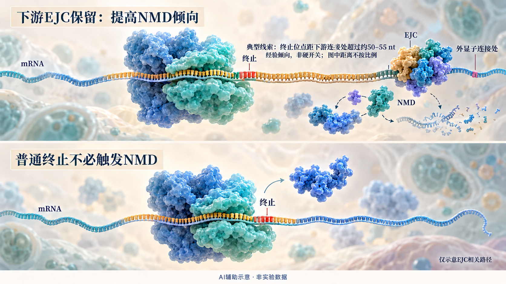
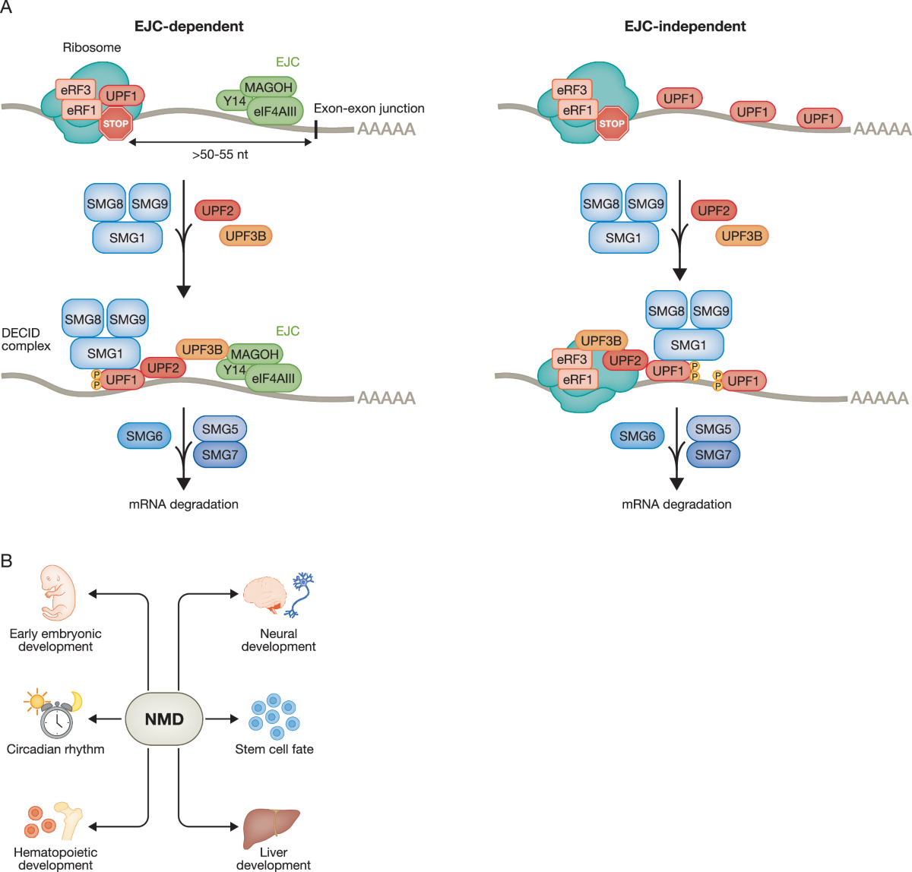
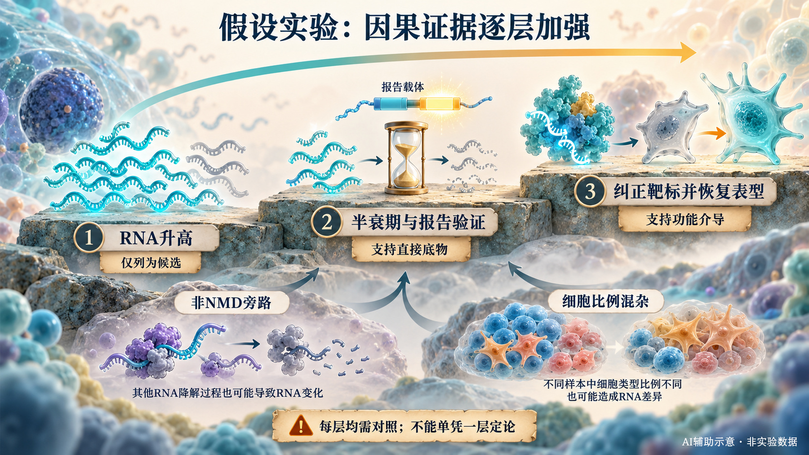
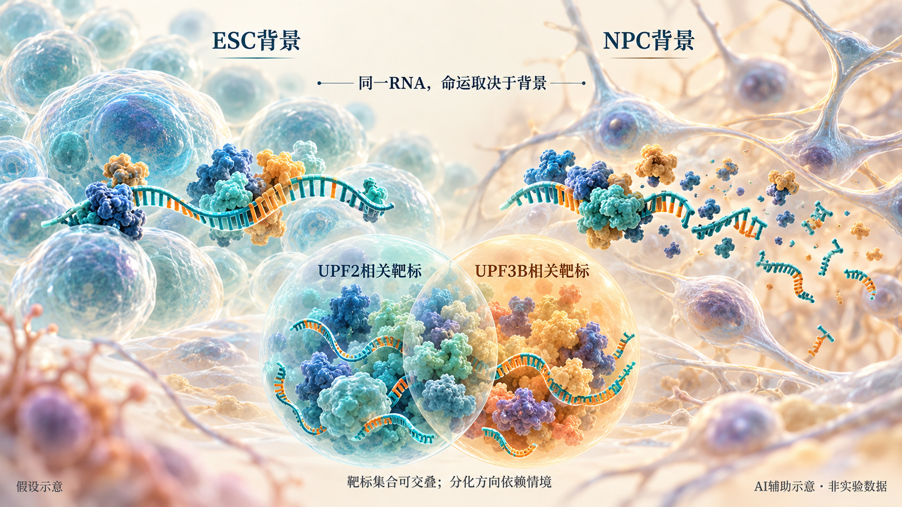
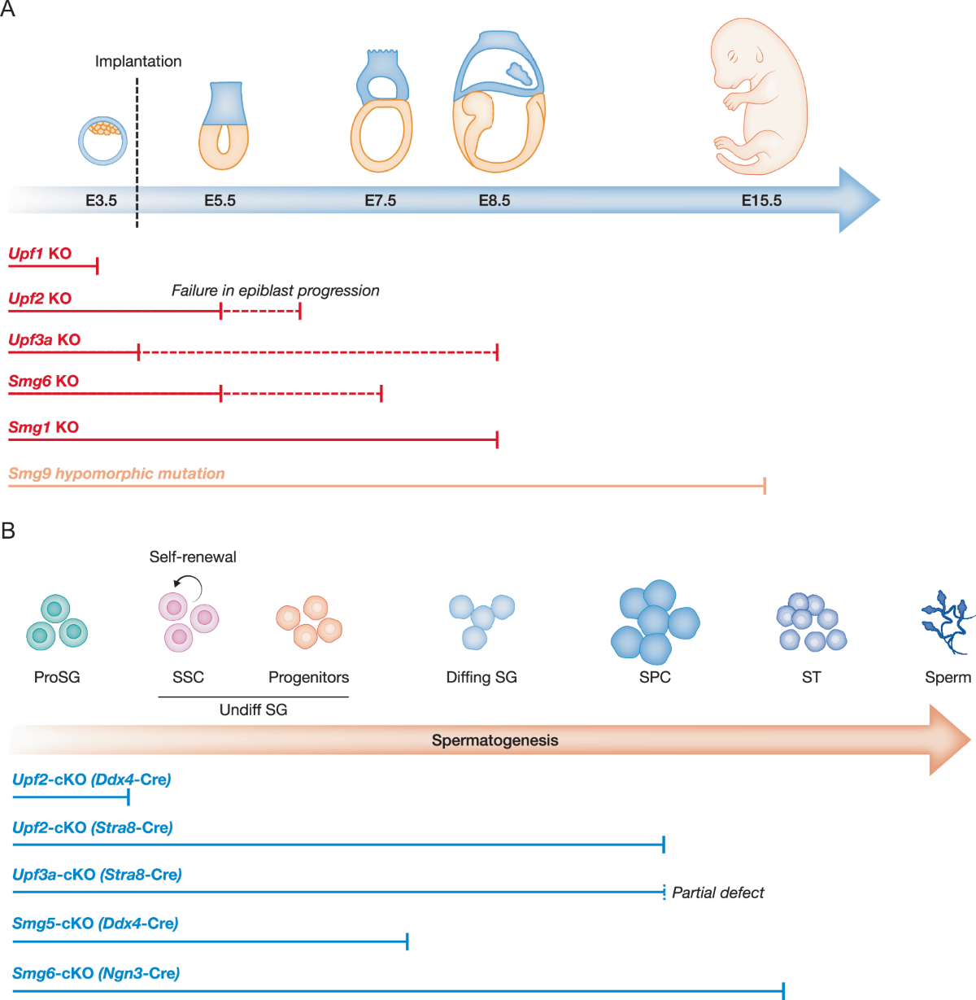
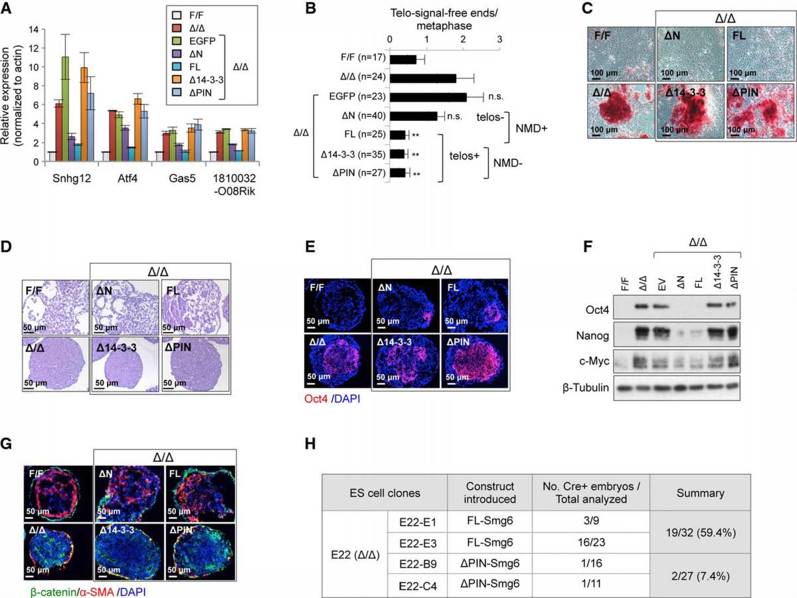
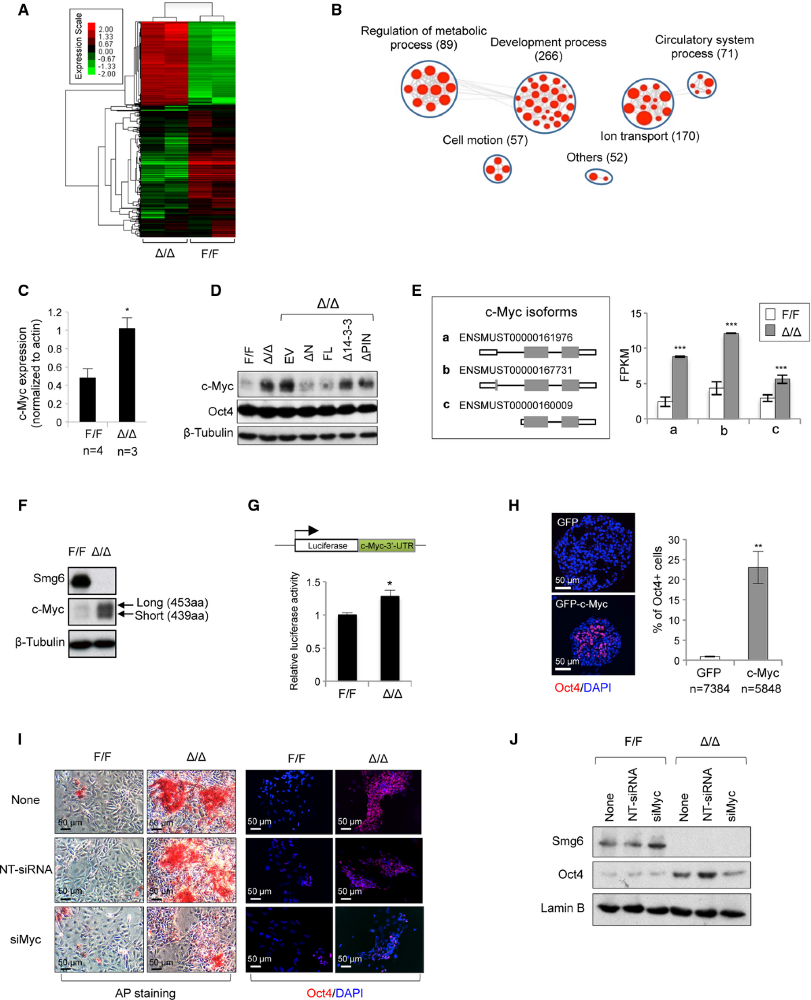
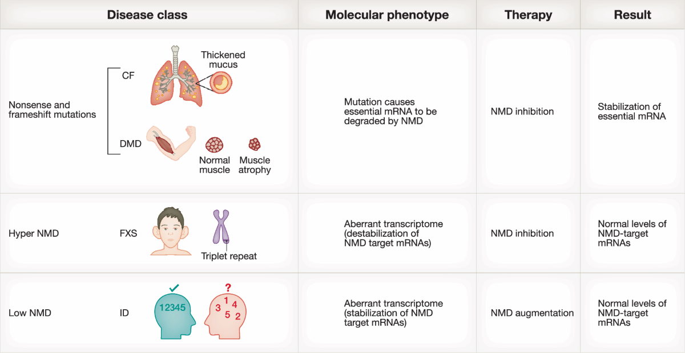

# NMD如何改变细胞命运？

::: {.book-source}
论文：[DOI 10.1038/s44318-026-00794-0](https://doi.org/10.1038/s44318-026-00794-0)。原有图注和许可说明见正文；未明确许可的图版标记为**授权待确认**。
:::

原文：[Beyond quality control: biological roles of nonsense-mediated RNA decay](https://doi.org/10.1038/s44318-026-00794-0)。The EMBO Journal，2026-05-09。

阅读范围：Complete Review body, Box1, Table1, corrected Figures1–3, correction and peer-review file. Li2015 complete main text/Methods and original Figures4/5. Other cited primary studies are graded as relevant fragments, abstracts, or Review synthesis in each section.

未独立核验与边界：No raw-data reanalysis or blanket fulltext verification of every cited primary study; no clinical safety/efficacy validation. The c-MYC directional error in Review is explicitly corrected against Li2015.

图像许可：Review Fig.1–3 and Table1: CC BY 4.0. Li2015 Fig.4/5: CC BY-NC-ND 4.0, full unmodified original evidence figures, noncommercial educational reuse. Seven generated illustrations are AI-assisted, non-experimental; PNG→JPEG delivery encoding only.

## 1. 结构线索如何走到可信NMD底物与机制证据

RNA测序里某个转录本升高，并不意味着它的基因启动得更勤。它也可能只是没有被及时降解。对无义介导的RNA降解（nonsense-mediated RNA decay，NMD）而言，这个区别尤其重要：同一个RNA在一种细胞里是底物，换一种细胞却可能逃逸；敲低两个都被称为“NMD因子”的蛋白，也未必得到同一批靶标。

本文解决一个具体问题：如果想用RNA组学研究NMD，怎样从序列特征、差异表达走到可信的直接底物和生物学机制，而不是给一张上调基因表贴上“NMD靶标”的标签？

图示为AI辅助原创教学示意，非实验数据。结构提供线索，细胞背景影响实际命运，实验决定结论可以走多远。

我们以Tan与Wilkinson发表于《EMBO Journal》的Review为主线。这篇文章首次上线于2026年5月9日，不是本周新论文。本轮将综述检索扩大到近12个月，选择它的原因是作者把发育、干细胞和疾病放在同一问题框架下，同时认真讨论了因子多功能性、直接与间接效应，以及不同模型之间的不一致。本文是围绕研究设计的教学分析，不按综述段落逐一翻译。

### 先把“清理错误RNA”这个模型补完整

NMD这个名字容易让人想到一道质检程序：RNA上出现提前终止密码子，产生截短蛋白的风险增加，于是细胞把它清掉。这个解释有用，却不能解释全部生理功能。

正常基因也可以产生具有NMD敏感结构的转录本。例如，可变剪接改变了阅读框或终止位置，使一部分异构体进入降解通路。调节这部分转录本的寿命，可以改变一个基因真正提供多少可翻译RNA。这里被调节的不一定是“错误产物”，还可能是正常表达程序的一部分。

另一个容易忽略的事实是：NMD依赖翻译。细胞需要在翻译过程中感知终止发生的位置和局部环境，才能形成有效的降解信号。因此，“RNA还存在”与“蛋白已经开始生成”不是互斥事件。一个RNA可以先提供短暂蛋白输出，随后被快速清除。用稳态RNA水平推断蛋白输出时，尤其要警惕这一点。

如果把RNA丰度理解成一个蓄水池，转录决定流入，降解决定流出，那么相同丰度既可以来自高转录、高降解，也可以来自低转录、低降解。这个比喻是我们的教学模型，不是作者测量出的动力学参数。它提醒我们：常规RNA-seq通常量到的是某个时间点的存量，不会自动告诉你是哪一端发生了改变。

### 原图1：终止位置如何变成降解线索

来源：Tan & Wilkinson，EMBO J，2026，Fig.1，CC BY 4.0，原样转载。图A是机制模型，图B是功能领域概览；都不是定量实验图，没有样本量、效应量或显著性检验。颜色用于区分分子组件，不能读成表达高低。

先看图A左侧。灰线代表RNA，核糖体在STOP处终止。绿色复合体是外显子连接复合体EJC，其中标出了MAGOH、Y14/RBM8A和eIF4AIII。图中STOP到下游外显子连接位置的距离标为大于约50–55个核苷酸，表达的是经典的结构倾向，而非一条在所有细胞中都严格执行的硬阈值。

剪接完成后，EJC通常位于外显子连接点上游约20–24个核苷酸处。正常经过编码区的核糖体会移走路径上的EJC；如果翻译已经终止，而下游还保留一个EJC，情况就不同了。这个残留的复合体可以帮助招募或组织NMD相关因子，使该RNA更容易进入降解过程。

为什么不能把“终止密码子后有连接点”直接写成必然降解？一个原因是几何位置：终止位置离最后连接点足够近时，核糖体的占位与EJC的位置关系可能使EJC被移除。另一个原因是生物背景：RNA结构、结合蛋白、翻译状态及可用因子共同决定这个线索是否真正生效。

图A下方的黄色P表示磷酸化。SMG1相关激酶复合体参与UPF1磷酸化，随后与SMG5、SMG6、SMG7等执行环节相联系。图把复杂、动态的分子组装压缩成易读流程，不能据此认为每一个底物在每种细胞中都经过完全相同的固定装配顺序。

再看右侧的EJC-independent模型。它提醒我们，NMD不只通过下游EJC识别底物。某些长3′UTR也可促进NMD，但综述特别指出，没有一个得到普遍验证的3′UTR长度阈值能把“降解”和“不降解”一刀切开。图中较多UPF1沿RNA分布是一种机制解释，不是“数够几个UPF1就必然降解”的实验定律。

图B把早期胚胎、神经、干细胞、肝脏、造血和昼夜节律连接到NMD。箭头只概括这些领域已有研究，不表示所有关系都具备同等因果证据，更不表示抑制NMD必然使每个器官同时受损。

### 做注释时，先明确你到底标记了什么

对转录本做NMD风险注释，必须先有可靠的外显子结构、阅读框和终止位置。仅拿基因名或某个外显子的覆盖度，无法恢复这些信息。一个基因的两个异构体可能具有不同终止位置，其中一个符合下游连接点规则，另一个不符合；把它们合并成基因总计数，会把关键区别抹掉。

有三个字段值得始终分开保存：结构规则预测的“NMD候选异构体”、扰动后丰度上升的“响应异构体”，以及有独立机制实验支持的“直接NMD底物”。它们可以重叠，但不应共用一个未经说明的标签。

上游短开放阅读框，即uORF，也要如此处理。它可能改变翻译起始和终止环境，却不是一张通用的降解许可证。综述指出，哺乳动物大量mRNA带有uORF，而并非都由此受到NMD。把所有uORF阳性的转录本一律剔除，会混淆翻译调控和RNA稳定性调控。

同样，短读长RNA-seq对共有外显子的支持，不等于已经可靠地区分全部异构体。实践中应报告无法唯一分配的读段、低表达异构体、可疑的新剪接边界和注释版本。这里是我们的分析建议，并非声称该综述提供了一套已经替读者验证的标准软件流程。

### 为什么“敲低UPF1后上调”还不够

敲低一个NMD因子后，RNA升高至少有几种解释：该RNA直接失去降解；上游转录调节因子改变；细胞发生应激；原本低表达该RNA的细胞死亡，剩下的细胞比例上升；或者细胞进入了不同分化阶段。

这些解释并不互斥。尤其是bulk组织RNA-seq，组成变化可以制造看似漂亮的通路富集。假设某项扰动减少了成熟细胞，而祖细胞比例相应增加，祖细胞标志物就可能整体升高。这个假设例子不需要任何单个RNA的半衰期改变，也能产生一张显著差异表达表。

因此，差异表达适合做发现入口，不适合独自承担“直接降解”的结论。即使再加一条下游连接点规则，也只是把候选范围收得更窄：结构符合与表达响应两条证据相容，不等于已经排除了转录和组成混杂。

有时研究将这类交集称为“高置信度靶标”。阅读时应问清“高置信度”是该研究的操作性定义，还是每个候选都做过RNA稳定性与功能验证。定义本身并没有错，问题出在把发现阶段的置信度升级为全部靶标都已确证。

### 一个有用的证据顺序：先直接性，再功能性

AI辅助示意，非实验数据；图中实验关系是教学假设。不同层级回答不同问题，不能把单一实验看作排除所有替代解释的绝对证明。

第一层是候选发现。采用匹配条件的扰动与对照，观察异构体变化，记录潜在NMD结构，并确认扰动确实影响了通路。此时最恰当的表述通常是“候选底物”或“与NMD抑制一致的变化”。

第二层追问直接性。测量RNA稳定性或衰减动力学，结合适当的报告系统，测试可疑顺式元件是否足以传递响应。RNA寿命变化比单一稳态丰度更接近降解机制，但任何方法都要考虑其扰动：抑制转录、改变翻译或引入外源报告元件，都可能影响细胞环境。

报告系统还要有相应的阴性对照。若只看到一个报告蛋白信号升高，不能立即把差异全部归因于RNA稳定性，因为翻译效率、蛋白稳定性和转染差异也会影响信号。配套测量报告RNA、参考构建及细胞状态，能减少这类歧义。

第三层是功能介导。即便某RNA确实是直接底物，也不意味着它解释了细胞表型。应当问：单独改变这个候选是否能模拟部分表型？在NMD受损背景下把它纠正回适当水平，能否救回关键终点？模拟与救援相互支持，才更接近“该RNA介导了某一生物学效应”。

救援也不是万能通行证。过强的外源表达或抑制可能通过旁路补偿，而非恢复原始机制。需要看剂量是否合理、救援是否只恢复某个读出、是否仍存在其他异常。部分救援的准确结论是“解释了一部分”，而不是“发现唯一原因”。

### 因子名称相同，不代表实验操作等价

UPF1参与NMD，但它也参与其他RNA代谢过程；若一个蛋白同时有多项功能，敲低它造成的表型不能自动全部归给NMD。综述还列举了若干因子的DNA损伤应答或端粒相关作用。这意味着研究不仅要有“蛋白没了”的证据，还要有“相关功能确实被分离”的证据。

比较不同因子的扰动是一种有用策略，但不是简单多数表决。不同程度的残余蛋白、敲低与敲除的差异、培养状态及时间窗口，都可能让两项实验看起来不一致。相反，多个因子产生相同表型也不能自动排除共同应激。

更有解释力的设计是功能分离：例如保留一种生化功能、破坏另一种功能的突变体，能否选择性恢复表型。后面的干细胞案例会用到这条思路。它把“这个蛋白重要”进一步分解成“这个蛋白的哪种功能重要”。

UPF3A和UPF3B尤其不适合被写成简单的两个等价备份。它们的相对表达、细胞背景与底物范围都可能不同。某些条件下观察到代偿，不表示所有组织、所有发育阶段都能代偿；也不能因为一个因子在部分培养细胞中作用弱，就认为它在动物体内不重要。

### 把实验时间当作一个变量

若NMD扰动已经引起明显死亡，再测转录组，得到的往往是直接响应、应激和细胞组成改变的混合结果。一个可迁移的设计原则是：在显著表型出现前设置较早采样点，并与较晚时间点连起来，而不是只选择“差异最大”的时间。

早采样也有代价。蛋白还未充分降低，直接底物变化可能尚未积累。因而需要同时记录因子水平、通路功能读出、细胞活性和RNA变化，不能把某个固定小时数视为适用于所有模型的最佳窗口。

单细胞数据可以帮助定位响应发生在哪类细胞，但不能自动解决因果问题。细胞数量和状态的变化本身就是扰动结果；如果只保留一个后验定义的细胞群，也可能引入新的选择偏差。更稳妥的是同时报告群体组成和群内变化，并说明重复的统计单位是动物、培养批次还是细胞，避免把同一样本中的许多细胞当作许多独立实验。

这篇综述真正值得带进项目的，不是另一套可以机械筛表的规则，而是一个更严格的提问顺序：结构是否允许、背景是否支持、降解是否实际改变，以及这种改变是否足以解释功能。顺着这四个问题，NMD才能从一项富集分析结果，变成可检验的RNA调控机制。

### 给RNA组学结果设置三个“刹车”

第一个刹车是分母。假如要说“某类异构体更容易受到NMD影响”，比较对象应是同样具备被检出机会的转录本，而非把低表达、无法可靠估计的异构体也一并塞进背景。不同细胞之间做靶标交集时，更要把“只在一类细胞表达”与“两边都表达、却只有一边响应”分开。前者可以来自可见性差异，后者才更直接地挑战靶标普适性的假设。

第二个刹车是测量层级。剪接比例变化、异构体丰度变化和基因总量变化，并不回答同一个问题。一个不稳定异构体被制造出来后很快消失，稳态测序可能低估它的产生；抑制NMD后它才变得可见，也不代表剪接选择本身刚刚发生改变。若想判断可变剪接与NMD之间谁先谁后，应有时间、结构或新生RNA等额外证据，而不能只看终点的比例差。

第三个刹车是通路读出。UPF1的mRNA升高不是NMD活性增强的直接证明，蛋白增多也未必等于所有底物降解更快。反馈调节、磷酸化状态、可用伙伴和翻译环境都会影响最终通量。读者应把“因子表达”“报告系统表现”“内源底物响应”并排放在证据表中，而不是选一个最顺眼的指标代替全部。

这些提醒也改变了阴性结果的含义。一个候选在某次敲低后没有上升，可能确实不是该背景下的底物，也可能是扰动不充分、背景转录下降抵消了稳定性变化，或该异构体本身未被充分测到。因此，阴性结果需要与检测能力和扰动强度一起解释，不能直接推广成“这个RNA永远不受NMD调节”。

### 什么情况下不宜从NMD解释开始

如果实验的主要变化是普遍翻译抑制、大规模死亡或严重细胞周期阻滞，应先确认这些变化与NMD读出的关系。翻译是NMD识别过程的重要前提，广泛改变翻译可能同时改变多种RNA和蛋白过程。此时，即便经典NMD报告信号发生变化，也未必意味着发现了一个选择性的NMD调节机制。

若项目只有未经匹配的病人样本与健康样本、没有功能扰动或动力学资料，更适合提出“与NMD相关的转录本模式”，而不是声称某种NMD分支已经被激活或关闭。关联数据仍有价值：它可以帮助选择模型、候选异构体和后续实验，却不应该被迫承担其本来无法回答的因果问题。

### 来源与核验范围

主文：Tan K, Wilkinson MF. Beyond quality control: biological roles of nonsense-mediated RNA decay. EMBO J, 2026。已阅读全文及图注，使用6月2日勘误后的现行版本；勘误纠正原图2与3的放置。本文机制图为综述原图，不是本团队实验结果；我们没有重新运行RNA-seq或做湿实验。

原文：https://doi.org/10.1038/s44318-026-00794-0

勘误：https://doi.org/10.1038/s44318-026-00822-z

图像许可：https://creativecommons.org/licenses/by/4.0/

## 2. 用SMG6功能分离和c-MYC救援读懂分化研究

同样叫“NMD受损”，有的实验看到干细胞难以分化，有的却看到神经分化提前。该相信哪一个？如果只把结果按“促进”或“抑制”归类，就会错过真正值得研究的变量：细胞处在哪个状态、扰动了哪个因子、改变发生在分化之前还是之后，以及最终测量的是存活、增殖还是谱系选择。

这一篇以干细胞和神经发育为例，说明怎样拆开这些变量。主线来自Tan与Wilkinson于2026年5月发表的NMD生物学功能综述，同时回到其中一项关键原始研究，查看“功能分离”和“救援”究竟提供了什么证据。

AI辅助原创示意，非实验数据。同一转录本在不同细胞中的命运、不同因子的靶标范围，不应预先假定相同；集合重叠程度需由实际数据测量，不能将ESC/NPC两侧示意解释为统一调控方向。

### 动物死亡时间，不是因子重要性排行榜

来源：Tan & Wilkinson，2026，Fig.2，CC BY 4.0，使用勘误后的现行原图，未改动。此处重点读A，B展示生精阶段，将在组织背景的讨论中解释。它汇集不同研究的模型，不是同一实验里随机分组得到的横向比较。

图A横向排列小鼠胚胎发育时间，E表示胚胎日龄，虚线附近标记着床。红色条对应不同NMD相关基因的全身敲除，浅橙色的Smg9是低功能等位基因，不能与完全缺失视为同一种干预。图注规定，最左的刻度表示首次缺陷，虚线后的刻度表示致死时间。

这些时间信息能告诉我们“哪个窗口已经出现异常”，却不能证明异常最早从哪个细胞开始，更不能以致死越早推断某因子越核心。不同研究的等位基因、残余功能、检测灵敏度和饲养背景并不完全一致。综述主动提醒这种可比性问题，这是它比简单功能清单更有价值的地方。

还需要区分几个不同命题：形成不了胚胎干细胞系，不等于已建立的干细胞不能继续存活；胚胎整体死亡，不等于每一种细胞都独立依赖同一种分子功能；培养条件下的分化缺陷，也不等于已证明动物全部表型由同一靶RNA解释。

### 为什么先建立细胞，再删除基因

Li等人在2015年研究SMG6时遇到一个典型困难：完全缺失该基因的胚胎不能正常发育，从其内细胞团直接建立干细胞系也失败。但如果先在SMG6仍正常时建立小鼠胚胎干细胞，再诱导删除Smg6，细胞可以继续增殖，却出现明显分化障碍。

这两种结果并不冲突。前一种实验把细胞建立过程、存活选择和状态转换混在一起，后一种则把扰动推迟到已有细胞系中，允许研究者观察一个更窄的问题：维持现有状态与离开现有状态，是否有不同需求？

该研究还用不同诱导条件、胚状体及嵌合实验检验分化，而不是只看一个标志物。多种读出一致，提高了“分化能力受损”这一判断的可信度。不过，它仍然是在特定培养体系和遗传背景中的发现，不能直接概括为所有干细胞都遵循同一规律。

这里可以提炼一个研究设计原则：如果某个全身敲除太早致死，优先考虑时间或细胞类型受控的干预，而不是把“无法建立模型”当作该基因所有功能的答案。

### 原研究图4：拆开SMG6的两种功能

来源：Li等，EMBO J，2015，Fig.4，DOI 10.15252/embj.201489947。CC BY-NC-ND 4.0，完整原图原样转载，用于免费非商业科学讲解；未改写图中数据或标签。这是补充核查的原始研究证据，不是2026年综述自己的实验。

SMG6同时涉及NMD和端粒相关功能，所以“删掉SMG6，分化失败”不能自动证明是NMD造成的。作者通过不同结构域构建做了功能拆分。图中的F/F是未删除对照，Δ/Δ是删除背景；FL表示全长，ΔN、Δ14-3-3、ΔPIN表示不同缺失构建。读图时要先认清这些操作，而不是先追星号。

A面板纵轴是相对于β-actin的RNA表达，横轴为若干已知NMD响应转录本，不同颜色代表对照、删除及回补构建。NMD功能正常的构建能压低异常升高的RNA，NMD缺陷构建不能同样恢复。这里有三次独立qRT-PCR实验；不能把横轴上的四种RNA误当四次生物重复。

B面板换了一个问题：端粒功能是否恢复。横轴是每个中期分裂相里缺乏端粒信号的末端数，图中n是计数的中期分裂相数，而不是小鼠数。ΔN保留NMD作用，却不能同样修复端粒读出；部分其他缺失构建能修复端粒，却缺乏NMD功能。正是这种交叉分离，使后面的分化结果有了解释力。

C至G检查分化：AP染色、胚状体结构、OCT4及其他标志物共同显示，恢复NMD功能的构建更能恢复分化表现。E中的红色为OCT4，蓝色为DAPI；G中绿色为β-catenin、红色为α-SMA、蓝色为DAPI。颜色不是计算得到的细胞命运评分，图像也不能只靠视觉印象替代全部定量。

F是蛋白印迹，β-Tubulin为上样参考；不同构建下OCT4、NANOG与c-MYC的变化，要结合表达构建是否有效以及其他面板一起看。H把视角推进到嵌合胚胎：表中分母是所分析胚胎数，全长回补与ΔPIN回补的贡献比例明显不同。具体为全长FL组19/32（59.4%）与ΔPIN组2/27（7.4%）：在E12.5胚胎中，用Cre序列PCR检测注入ESC的贡献。两组各列出两个ESC克隆；胚胎数不能当作独立构建数。这个分母不是拍摄视野数，也不是某张切片上的细胞数。

图4误差条为均值标准误（SEM），图注说明采用非配对Student t检验；B面板以Δ/Δ组为比较参照，n.s.表示不显著，双星表示P<0.01。A的“三次独立qRT-PCR实验”是原文的统计描述，不应擅自换成三只动物或三个独立细胞系。

图4支持的是：在这套模型中，SMG6促进分化的作用更符合其NMD功能，而不能仅用端粒维护解释。它没有证明SMG6所有生理作用都只靠NMD，也没有证明每一种NMD因子的非NMD功能都已被排除。功能分离是针对具体蛋白、具体构建和具体终点进行的。

### 原研究图5：从候选RNA走向功能介导

来源与许可同上，Fig.5完整原样展示。手机阅读建议点开原图查看字母面板；下文按证据问题拆开解释，未把原图重绘为示意数据。

A是差异表达热图，对照与删除背景各有两份RNA-seq样本；红绿表达标尺展示相对模式，不是直接降解速率。B是差异基因的功能富集网络，圆节点表示富集条目，节点大小对应基因数量、连接对应重叠。两者能发现候选和组织线索，不能凭借聚类或富集独自判定c-Myc为功能原因。

C、D进一步检查c-Myc的RNA与蛋白。C的n是独立ESC系数量，F/F为4、Δ/Δ为3，纵轴以β-actin归一化。D中保留NMD功能的回补构建压低了升高的c-MYC。值得说明的是，2026年综述对应段落有一句方向性表述与原始研究不一致；这里以原研究Fig.5D及其正文为准，结论是恢复NMD能力后c-MYC降低，不是升高。

E展示三个c-Myc异构体及其丰度，F展示两种蛋白产物。E面板每个基因型有两份RNA-seq样本。异构体RNA的FPKM与蛋白印迹属于不同层级，二者一致增加并不等于每个异构体都已测过独立半衰期。G把c-Myc的3′UTR接到报告系统，删除背景的相对荧光素酶信号提高，支持该区域传递NMD相关响应。G的纵轴为相对荧光素酶活性，数据来自三次独立实验。

但G不是直接逐时测量内源RNA消失速度的曲线。原研究将其解释为稳定性支持，我们保留一个方法学限定：报告蛋白信号仍可能受翻译或蛋白层面影响，不能仅凭这张柱状图宣称所有直接性问题都被解决。它的价值来自与其他实验相互补充。

H是模拟：在原本NMD正常的细胞中过表达c-Myc，观察分化中的OCT4阳性比例。H中GFP对照与c-Myc组分别计数7384和5848个细胞，不应等同为数千次独立培养。I和J是反向救援：在Smg6缺失背景下用siRNA降低c-Myc，AP与OCT4等分化阻滞读出减弱。NT-siRNA是非靶向对照，不能用“未处理”单独替代它。

图5误差条为SEM。C与H的图注明确采用非配对Student t检验；不能没有依据就把它推广为每个面板都使用同一种检验。C、G的单星表示P<0.05，H的双星表示P<0.01，E的三星表示P<0.001；这些阈值不能替代效应大小与独立重复的判断。

这条证据链比“c-Myc上调且功能富集显著”强得多，因为它同时包含上游功能恢复、候选过表达模拟和候选降低救援。准确结论仍然有限：c-Myc参与这套细胞体系中的分化障碍，不等于它是所有NMD相关发育表型的唯一效应分子。

### 为何不能把小鼠ESC结论直接搬到人ESC

综述汇总的人ESC研究提示，降低某些NMD因子可以抑制中胚层分化，却促进确定性内胚层分化。这与“小鼠ESC总体离开多能状态受阻”不是同一个实验问题：一种研究比较整体分化能力，另一种关心谱系之间的偏向。

培养条件也会改变问题。naive与primed状态并非同一种细胞背景；同一个遗传缺陷能否建立细胞系，可能随培养状态而改变。若把两项研究的培养名称当作小细节略掉，就很容易把真实的条件依赖误读成无法调和的矛盾。

更合理的比较单位应包括物种、细胞来源、状态、扰动因子、扰动程度、诱导方案及终点。只有这些条件足够接近，才能追问剩余差异是否真正挑战机制。若它们本来不同，首先应提出“在哪个窗口、哪个谱系成立”，而不是急着选出一个唯一正确方向。

### 神经分化里的矛盾，可能提供新问题

部分神经干/祖细胞实验支持NMD维持未分化状态，降低NMD可推动神经分化；另一些UPF3B研究却看到分化能力下降或自我更新偏高。综述没有把它们强行合并成一条箭头，而是讨论了细胞来源、发育阶段以及因子底物选择的差异。

这对组学项目很实际。不要预先把UPF3B敲除当作“温和版UPF2敲除”，然后仅用整体差异基因数判断效应强弱。若两种因子在当前背景下调节不同RNA集合，它们可能改变不同的调控回路；集合不同与效应强弱不同，是两个需要分开检验的假设。

还要区分祖细胞耗竭与神经元生成。某个神经标志物短期增加，可能来自提前分化，却造成后续祖细胞储备不足和最终神经元数量下降。“更早出现标志物”不等于“发育最终更好”。时间序列、细胞周期和不同谱系数量可以帮助分辨这些可能。

### 从神经祖细胞研究学到的救援逻辑

Lin等2024年在小鼠模型中发现，Upf2在胚胎神经祖细胞中的缺失影响脑发育；CRISPRi筛选将TRP53相关通路定位为一个可救援环节。其重要启发是：恢复某项增殖或组织终点，不一定需要把所有NMD靶标全部恢复。

这里我们对该原研究核查了摘要与公开全文中的相关结果说明，未独立复算全部组学或补充数据，也不在本文复制其受限图像。它是用于帮助理解证据设计的补充案例，而非本篇主要图证据。尤其不能把小鼠中的遗传救援改写成人类治疗结论。

从研究设计看，救援有助于缩小“哪一部分转录组改变真正影响该终点”的范围，但不能证明其他改变没有作用。某些改变可能影响未测量的分化、应激或长期功能。因此，最有用的下一步通常是把救援终点拓宽，并在不同时间和细胞背景下重复检验，而不是把整张转录组当作已经解释完毕。

### 另一个回路：降解与翻译为什么会互相影响

综述还讨论了Huth等关于Eif4a2异构体的研究。关键点不是再列一个靶标名字，而是把RNA降解和蛋白合成连接起来：一个携带提前终止信号的Eif4a2转录本在NMD缺陷背景中积累，并可产生截短蛋白，伴随mTORC1活性与翻译变化，以及分化延迟。

这一回路值得注意，因为NMD识别本身又依赖翻译。也就是说，改变降解可能通过特定产物反过来改变翻译环境，而翻译环境又可能影响NMD。分析这类系统时，不能假定“RNA降解”与“蛋白合成”是两个独立、单向的步骤。我们这里依照综述概括该机制，未独立阅读全文或复核其全部实验，不把它写成我们验证过的回路。

同一研究对Smg5、Smg6、Smg7的单独及组合扰动，还显示不同程度的靶标失调与分化表型。这不应被转写成适用于所有细胞的固定因子排名。它更适合用于提出组合实验：如果两个因子部分补偿，单独干预可能低估依赖；如果它们作用于不同步骤，组合表型又可能超过简单相加。要区分这两种解释，仍需要实际通路读出和功能分离，而不只是比较细胞长得好不好。

### 不要把“细胞数很多”误当证据很稳

原图5的某些成像面板统计了大量细胞，这有助于描述该培养中的分布，却不能自动弥补独立培养次数不足的问题。细胞嵌套在同一个胚状体、同一块培养板或同一个细胞系中，会共享环境与技术偏差。若把每个细胞都当作独立重复，显著性就可能显得比实际更强。

这不是否定原研究的功能链条，而是提醒读者把每张图的n读准确。图4B的分裂相、图4H的胚胎、图5C的细胞系以及图5H的被计数细胞，分别回答不同层级的问题。对自己的项目，最好在设计阶段就决定主要独立单位，并保留每个单位内的数据分布；到出图时再从“细胞数”倒推重复数，通常已经太晚。

同样，RNA-seq每组两份样本所得到的差异列表，适合与独立实验联合解释，不宜单凭显著性阈值宣布全部基因都是真正底物。2015年的测序和分析方法代表当时的设计，本文借鉴其因果验证思路，不建议把历史软件参数原封不动作为今天的默认分析流程。

### 一套可以迁移到自己项目的比较方式

准备比较两个NMD扰动实验时，可以先做一份简洁的证据表：细胞如何建立、基因何时被扰动、是否验证残余功能、表型出现前是否采样、RNA变化是否支持直接降解、候选是否做过模拟和救援，以及统计单位是否独立。

如果两项研究只有终点相似，机制还不能合并；如果它们终点相反，也不必立即认为谁错了。先把条件和证据层级摆在一起，常能找到更明确的下一轮问题。例如，分化方向变化究竟来自同一个RNA回路的时序差异，还是不同因子本来就选择了不同底物？这比再次得到一张更长的差异基因表，更接近可迁移的发现。

### 来源与阅读范围

主综述已全文阅读并核对勘误。Li等2015研究已阅读完整正文、方法及原图4、5，未重新分析原始测序，也未把补充表逐项审计。本文对其他干细胞研究的概括保留为综述归纳，不宣称每篇都完成独立全文核验。

综述：https://doi.org/10.1038/s44318-026-00794-0

Li等原研究：https://doi.org/10.15252/embj.201489947

Lin等原研究：https://doi.org/10.1016/j.neuron.2024.04.006

综述图2许可：https://creativecommons.org/licenses/by/4.0/

Li等原研究图4、5许可：https://creativecommons.org/licenses/by-nc-nd/4.0/

## 3. 拆开组织时间、细胞组成与局部RNA调控

把一个RNA降解因子在整个组织里敲掉，得到不育、器官异常或炎症表型之后，下一步该测什么？最容易想到的是做转录组，找上调RNA和富集通路。但如果组织里的细胞已经换了一批，这张表达图首先记录的可能是“谁还活着”，而不是“谁失去了降解”。

本文用生殖细胞、造血和成体神经系统说明，怎样把组织表型重新拆回可检验的问题：哪个细胞、哪个阶段、哪一种分子功能，以及哪些变化只是随之发生。主线仍来自2026年5月的NMD生物学功能综述，我们会明确区分作者归纳与本文提出的实验设计建议。

AI辅助原创示意，非实验数据。图中的阶段与组织是研究设计的概念层级，不是同一实验测量得到的时间曲线或效应强度。

### 生精系统为什么是理解背景依赖的好例子

生精并不是一群细胞同步从起点走向终点。组织里同时存在不同阶段的生殖细胞，也有提供支持的体细胞。早期细胞需要扩增，随后经历分化和减数分裂，后期又有大规模的形态与转录组调整。因此，同一个因子在两个阶段的缺失，既可能作用不同，也可能只是让后面的细胞来不及出现。

某些NMD因子在精子细胞阶段高度表达，并富集于染色质小体（chromatoid bodies，CBs）等生殖细胞胞质结构。这种定位提供了研究线索，却不能直接证明最重要的功能就在该阶段。一个蛋白在后期最显眼，不表示它在早期没有关键作用；表达峰值、定位和功能依赖，是三类需要相互验证的信息。

综述中SMG5就是有启发性的例子。研究者注意到它在某个较晚阶段发生核质分布变化，但条件性删除首先暴露出更早的分化和减数分裂进入问题。这个结果提醒我们，不要让最漂亮的显微定位预先替我们决定表型发生的时间。

### 原图2B：先认清Cre何时起作用，再看缺陷何时出现

来源：Tan & Wilkinson，EMBO J，2026，Fig.2，CC BY 4.0，原样转载，使用6月勘误后版本。本篇重点为B；A的胚胎时间轴用于提醒读者，全身敲除与生殖细胞条件敲除不是同一种实验。

B从左到右列出前精原细胞、精原干细胞及祖细胞、分化精原细胞、精母细胞、精子细胞和精子。蓝线对应不同基因与Cre驱动组合，末端刻度表示主要缺陷出现的阶段；它不是RNA浓度曲线，也不是各阶段存活率。图里“Partial defect”提示的是部分缺陷，不能读成完全发育停滞。

为什么Upf2使用Ddx4-Cre与Stra8-Cre会得到不同表型？关键在干预覆盖的细胞阶段不同。较早删除可以影响起始群体的建立和维持，较晚删除则可能让早期过程完成后才暴露后续需求。最终成年组织看起来都可能严重缺乏生殖细胞，但造成这一结果的路径不一定相同。

同理，Smg6与Smg5不能仅按图中蓝线长度排名。每条线来自不同模型和研究，有不同的删除窗口与蛋白残留过程。最有意义的比较，是把遗传操作起效时间、首次异常和细胞明显流失的时间区分开来。否则，“在精子细胞阶段发现问题”可能被误写成“该因子只在精子细胞阶段工作”。

原图汇总的是遗传表型，没有给出统一样本量、误差条或统计检验。它适合帮助构建实验时间表，不适合从图形长度估计效应大小，更不能拿不同研究的终点直接做一个未校正的优劣排行榜。

### 最大的混杂：丢失的细胞也会留下表达信号

假设一种条件敲除让晚期生殖细胞大量减少。测全睾丸RNA时，晚期细胞标志物下降是预期的组成效应；相反，支持细胞的RNA即使在每个细胞内完全没变，也可能在归一化后占比上升。这是本文的教学假设，不是新测量的数据。

如果这些上升RNA恰好含有长3′UTR，是否就能认定它们是直接NMD底物？还不够。细胞类型本身可能具有不同的3′UTR分布，组成变化与结构差异会一起进入分析。即使加上结构注释，也仍然需要同类细胞内的比较。

综述因此强调，在明显凋亡之前取样，并尽可能分别定义各阶段生殖细胞和体细胞的靶标。这个建议比“多做几个重复”更根本：重复可以使混杂估计得更稳定，却不能消除混杂本身。

早期时间点、分选、单细胞与空间信息各有作用，但不存在一个单独解决全部问题的技术。分选可能改变细胞状态，单细胞短读长数据未必能可靠区分关键异构体，组织定位也不直接测量RNA寿命。研究者需要根据具体问题组合证据，而不是用技术名称代替因果论证。

### 一条看似稳固的结构规则，到了生殖细胞会怎样

经典NMD注释常把终止密码子下游的外显子连接点作为重要线索。但综述汇总的若干生殖细胞研究中，这类转录本并未在NMD受损后上调集合中明显富集；相对地，长3′UTR在候选集合中更常见。

这并不等于已经证明“所有雄性生殖细胞都不识别下游连接点”。至少还有几种可能：特定阶段确实采用不同识别机制；技术与注释影响了异构体检测；扰动程度不同；或者细胞组成与间接响应掩盖了真正底物。综述把它保留为待检验问题，而没有把富集缺失写成普遍的机制缺失。

对生信分析，最实用的结论是不要仅凭默认注释就删除“非典型”候选，也不要把数据库里的NMD标签当作组织无关的事实。一个更透明的输出方式，是同时给出结构预测、当前细胞背景下的扰动响应、检测可靠性和直接性证据。

反过来，“长3′UTR富集”也不是建立一个任意长度阈值的理由。长度与表达、RNA结合蛋白和翻译调控都有可能相关。若要提出长度本身驱动降解，最好通过精心控制的顺式元件实验，而不是只比较两组平均长度。

### UPF3A：弱效应不能等同于不重要

在多种细胞中，UPF3A对NMD的贡献较弱，或在UPF3B存在时不明显；但这并不能推导出它在所有组织里都可有可无。精母细胞中，位于X染色体上的Upf3b会受到减数分裂性染色体失活的影响，这提供了一个重要的背景变化：原先可用的旁系同源因子，不一定仍然可用。

综述据此讨论了UPF3A在生殖细胞中的特殊需求，但也保留其生化功能尚未完全厘清的限制。研究中需要同时确认旁系同源因子的表达、蛋白水平和功能，而不是仅凭名称相似就假定存在充分补偿。

这类思路可以迁移到很多RNA调控家族：一个因子在常用细胞系里敲低没反应，可能是被代偿，也可能是所选底物不敏感。真正需要问的是“在哪些条件下这种代偿会失效”。发育、应激与染色体状态都可能改变答案。

支持细胞也不能被排除在外。综述中的Sertoli细胞Upf2条件敲除研究表明，生殖表型不一定只来自生殖细胞本身。若一个组织依赖细胞间支持，仅凭最终受损细胞的身份，无法锁定最初的分子故障发生在哪里。

### 原表1：为什么因子敲除不自动等于NMD特异扰动

原综述表1汇总了NMD因子的非NMD功能。为便于手机阅读，下面按因子重排为文字条目，保留原表的信息范围，不把空白解释为已证明不存在功能；这是依据CC BY 4.0许可进行的排版改编，非新实验结论。

UPF1：Staufen1介导的RNA降解、DNA损伤应答、S期末组蛋白mRNA降解、DNA复制、端粒维护及小RNA诱导的mRNA下调。

UPF2：DNA损伤应答与端粒维护。UPF3A：转录适应。UPF3B：原表未列出对应条目；这不意味着它绝无其他作用。

SMG1：DNA损伤应答与端粒维护。SMG5：端粒维护。SMG6和SMG7：DNA损伤应答与端粒维护。

这些条目不应该被当作同等强度、适用于所有物种和组织的已证实功能清单。例如，正文对UPF3A参与转录适应的讨论明确涉及斑马鱼，哺乳动物是否相同仍需验证。原表是检索线索，具体机制要回到相应原研究，而不能在没有背景信息时直接移植。

它对实验设计的意义很直接：如果一个干预同时破坏端粒、DNA应答和RNA降解，那么细胞死亡本身并不能告诉我们是哪条路径在起作用。功能分离突变体、不同因子的交叉验证、时间受控干预以及候选RNA救援，是逐步减少歧义的办法，但各自也需要相应对照。

### 造血与肝脏：增殖依赖不是一句话能概括的

综述汇总的造血系统研究显示，某些NMD干预严重影响干/祖细胞群体，另一些已分化细胞则可在相似干预后维持存活。这个对照提示状态相关需求，却不能直接推广成“只要不增殖，就不需要NMD”。存活是一个终点，分泌、代谢、应激响应和长期功能可能仍然改变。

T细胞发育还提供了与RNA质量控制紧密相关的场景：抗原受体重排可能产生非生产性转录本。综述讨论的功能性受体等位基因救援，帮助把发育缺陷与具体RNA生成背景联系起来。这里的启发是，应先理解细胞在正常情况下会制造什么RNA，再问NMD缺失后哪些产物最有可能成为负担。

肝脏的情况则提醒我们区分发育与成体。发育期删除导致终末分化问题，成体诱导删除可以暴露稳态与再生需求。一个在平静状态下看似耐受的组织，遇到损伤或再生需求时可能表现不同。因此，“短期无明显异常”并不等于在所有生理挑战下都安全。

这些案例在本文中依照综述归纳，未逐篇独立阅读全文或重新分析数据。我们借鉴的是比较设计，而不把跨研究差异拼接成一个经过统一控制的实验。

### 成体神经元：RNA降解也可能是局部调控

组织内不仅有不同细胞，同一个细胞内部也存在不同空间。综述讨论了轴突与树突中的NMD相关调控，强调RNA翻译与降解可以在局部影响蛋白供应，而非必须先改变整个细胞的平均RNA水平。

例如，Notaras等研究将UPF2相关调控与树突表面GLUR1联系起来，综述提出ARC与PRKAG3等RNA参与不同环节。本次核查了原研究公开摘要和相关结果片段，未声称全文与所有补充实验均已独立审计；本文不复制其受限证据图，也不把机制细节扩展成新的疾病结论。

这个例子更普遍的价值是测量尺度：若变化发生在树突或突触局部，全细胞RNA-seq可能稀释它；即便总RNA没有明显变化，也不能排除局部翻译或受体周转受到影响。反过来，局部干预实验也需要证明操作没有广泛扩散，才能支持局部因果解释。

因此，实验的空间分辨率应跟问题匹配。想研究局部蛋白供应，单靠整块组织的平均表达可能不够；想判断组织功能，也不能只凭一个微流控培养室里的局部结果就推断整只动物已经得到解释。

### 昼夜节律：功能分离不只用于发育问题

综述还以Katsioudi等2023年的研究说明，NMD可以参与持续运行的生理过程。该研究使用选择性破坏SMG6的NMD功能、但保留其端粒及基因组稳定性相关功能的突变体，观察到昼夜节律报告系统的周期延长。这种设计比单纯删除SMG6更有助于把节律变化归因到其NMD功能，而不是把蛋白的所有功能混在一起。

综述同时指出，编码节律转录抑制因子CRY2的RNA是NMD底物，因此CRY2是连接RNA降解与节律反馈的候选环节。但“属于底物”还不等于已经证明它解释全部周期表型；要建立功能介导，仍需相应模拟或救援证据。这里依据综述归纳，未独立阅读全文或审计该原研究数据。

这个案例给组学项目的启发是，不要只比较某个钟点的RNA高低。若系统本身在振荡，一次终点测量可能混合相位、振幅与平均水平变化。区分这些可能性需要覆盖周期的时间序列及匹配对照，这是本文提出的设计建议，而不是声称原研究已替所有模型完成验证。

### 一个更稳妥的阴性对照思路

如果某种组织对NMD扰动似乎耐受，值得把它当作机制比较的机会，而不只是“没有结果”。可以比较耐受与敏感细胞是否都达到相近的通路抑制程度、是否表达相同候选RNA、是否存在不同旁系因子补偿，以及是否承受相同的增殖或再生需求。这些是我们提出的问题，不是综述已经给出答案的实验。

这里有一个常见陷阱：把缺乏表型的组织当成技术失败，却把出现表型的组织当成机制证据。两边都应先验证干预是否生效。如果敏感组织只是删除得更彻底，差异还不足以支持组织特异性；如果干预强度相近但后果不同，才更有理由进一步寻找不同的底物网络与代偿机制。

同样值得保留的是“不符合主线”的功能读出。一个干预可能救回细胞数量，却仍然改变RNA异构体或局部蛋白分布。把这种结果记录为不同终点的分离，往往比笼统标成“成功救援”更有发现价值。真正有用的机制模型，应当解释哪些结果一起改变，也解释哪些结果没有跟着改变。

### 让一个组织表型变成可恢复的研究路线

我们的建议是把项目拆成三个连续问题。先定位首次异常的细胞与阶段，再在明显组成改变前捕捉分子响应，最后对少数候选做直接性与功能介导验证。每一步都应留下不支持预期的结果，避免只挑最符合故事的时间点。

如果发现早期RNA变化与后期组织损失相容，下一步仍要验证是否存在中间环节，而不是直接把两者连成因果箭头。若某个候选救回存活却未救回分化，也应分别报告；这可能说明一个分子同时影响多个过程，或不同表型有不同下游通路。

对RNA组学研究者来说，最重要的转换是：不要只问“哪个通路显著”，还要问“这个组织在测量时由谁组成，哪些细胞已被实验选择掉”。把细胞组成、时间和分子功能同时放进设计，才更有机会从NMD相关表型走向可迁移的调控机制。

### 来源与核验范围

主综述完整正文、图注及原表1已读取；原表按条目重排并保留物种与证据限制。其他组织案例主要为综述归纳，未逐项核查原始数据。本篇无自行运行的组学结果。

综述：https://doi.org/10.1038/s44318-026-00794-0

原表1：https://link.springer.com/article/10.1038/s44318-026-00794-0/tables/1

局部神经调控原研究：https://doi.org/10.1038/s41380-019-0547-5

许可：https://creativecommons.org/licenses/by/4.0/

## 4. 辨清NMD疾病策略的RNA、蛋白与功能证据

如果NMD会清除带有提前终止密码子的RNA，把它关弱一点，是否就能救回疾病基因的表达？这个推理只有前半句。RNA留下来以后，产生什么蛋白、这些蛋白是否有功能、正常组织会失去什么调控，以及病变发生的时间窗口是否已经过去，都可能改变答案。

本文讨论的是研究策略与证据判断，不提供临床用药建议，也不把综述中的候选方向写成已经证实的疗法。核心问题是：面对不同分子缺陷，为什么有时考虑抑制NMD，有时反而考虑增强，以及什么证据才足以支持继续开发。

AI辅助原创示意，非实验数据。图示为研究决策框架，不代表某项干预已具备临床有效性或安全性。右侧异常蛋白仅示意某些异常转录本可能带来的后果；NMD作用于RNA，并不直接识别或清除错误折叠蛋白。只有相关RNA确为NMD底物且干预有功能证据时，才可讨论增强方向；本图不把一般蛋白错误折叠当作增强NMD的指征。

### 先问被清除的RNA留下来以后能做什么

提前终止密码子可能同时带来两类后果：翻译产物变短，以及RNA更容易被NMD清除。两者不能合并为一个问题。即使成功提高RNA水平，也可能只是制造更多缺乏功能的截短蛋白；在另一种情形下，残余蛋白仍有一定作用，RNA稳定化才可能提供收益。

因此，治疗推理的起点不应是“NMD越低越好”，而应是变异位置、转录本结构、剩余蛋白功能和所需表达量。相同疾病名称下，不同变异也可能产生不同分子结果。一个病例或模型中的有效路径，不能仅凭疾病标签扩展到全部患者。

读穿策略又增加了另一个层级。读穿希望核糖体越过提前终止密码子，获得更完整的蛋白；NMD抑制则希望保留更多可供翻译的RNA。二者理论上可以配合，但一个改善RNA数量，另一个改变翻译终止，两项指标必须分别测量，不能用“总蛋白增加”把过程混为一谈。

### 原图3是一张策略地图，不是疗效汇总表

来源：Tan & Wilkinson，EMBO J，2026，Fig.3，CC BY 4.0，原样转载，已核对6月勘误后的正确图号与说明。图中无受试者数量、疗效效应量或试验阶段；右侧“Result”应读作策略希望实现的分子结果，而非每一行都已经达到的人体治疗结果。

第一行把囊性纤维化和杜氏肌营养不良等放在含无义或移码变异的情境下。中间列强调相关mRNA可能因NMD而减少，干预方向是抑制NMD，希望稳定转录本。疾病图标只是示意，不包含患者照片，也不是临床严重程度的比较。

这里必须补上图本身压缩掉的条件：稳定RNA不保证截短蛋白有用；若需要完整蛋白，可能还要结合读穿等策略；即便生成更长蛋白，也需要验证定位、结构和功能。图注讨论了这些不同分支，因此不能只截取“NMD inhibition”一列当作统一建议。

第二行是NMD异常偏高的情境，综述以脆性X相关模型为例。逻辑是：某些本应保留的正常靶RNA过度失稳，降低NMD可能使相关RNA回到更合适的范围。但“回到范围”是机制目标，不等于可以预言所有神经发育表型都会逆转。

第三行是NMD偏低的情境，以某些NMD因子变异相关的智力与神经发育异常为例，提出增强NMD的研究方向。它与前两行方向相反，正好说明疾病研究不能把NMD抽象成一个只需统一关闭的坏开关。

原图中人头与符号表达的是概念性神经功能差异，不是量化认知测验。我们不据此推断某种RNA调节可以恢复人的智力表现。把机制示意读成临床证据，是这张图最需要避免的误用。

### RNA、蛋白和功能，需要三个独立终点

一个候选方案至少要依次回答：目标RNA是否被稳定；产物是否按预期增加或改变；与疾病有关的功能是否改善。三个层级可能不同步。RNA增加而功能不变，可能意味着产物无效，也可能说明量、位置或时间不对。

蛋白层面还要确认检测的究竟是什么。某些抗体可以识别截短片段，看到条带增强并不自动证明全长蛋白恢复。条带大小、独立检测方式与功能实验，应当共同参与判断。若方案包含读穿，尤其不能把一个保留N端的信号等同于完整功能蛋白。

功能改善也必须有合适的参照。对照应能帮助分辨干预的特异作用与一般性应激变化，必要时比较单独稳定RNA、单独影响读穿与组合方案。这里是我们提出的证据组织原则，并非声称该综述已经完成所有组合实验。

最有说服力的结果通常不是某一个读出特别漂亮，而是多个层级按同一机制预测变化，同时能够解释无效条件。例如，某类变异有响应、另一类无响应，如果与剩余蛋白功能相符，往往比只报告平均改善更能帮助界定适用范围。

### 正常生理功能决定了安全性问题不能跳过

NMD同时调控正常RNA。为了救回一个疾病转录本而全面抑制通路，可能改变许多其他底物。综述在发育、干细胞、神经和组织稳态上的讨论，正是理解这一风险的基础，而非与治疗无关的背景章节。

但“有重要生理功能”也不自动等于“绝不能调节”。完全缺失、短暂部分抑制、特定组织递送以及选择某个因子，可能产生不同后果。研究需要找到的是收益与代价的条件范围，而不是从全身敲除致死直接跳到否定全部开发可能。

同样，成年小鼠某段观察期内未见明显异常，也不能宣布人类长期安全。发育阶段、给药范围、性别、剂量、基础疾病和挑战条件都可能影响结果。安全性不是一句“未见毒性”的标签，而是一组有明确观察范围的负结果。

### 怎样读诱导性小鼠模型的“耐受”结果

综述讨论了Echols等建立的诱导性显性负性UPF1小鼠。其价值在于可以改变表达时间与程度，观察不同强度的NMD抑制，而不只是从胚胎开始完全失去某个因子。

根据综述归纳，较温和的诱导在所测条件下未出现明显缺陷，而高水平诱导与部分白细胞群体变化及雌性小鼠骨相关改变相联系。这些结果同时包含希望与警告：存在可调节空间的可能，但效应依赖强度、组织和观察终点。

本文没有独立审计该研究全部原始数据，不把综述转述提升为自行验证的安全性结论。尤其不能由此给出人用剂量、持续时间或治疗建议。真正可以借鉴的是实验结构：在相同模型中明确干预梯度、时间与功能读出，让“耐受”具有可以复核的边界。

对类似研究，读者可以追问：测了哪些组织，漏了哪些长期终点；是否同时测到足够的目标RNA改善；是否有停用后的恢复观察；是否用敏感行为、代谢或免疫指标，而不只看体重和存活。没有测到的风险，不能被写成不存在。

### 回到原研究，观察窗口本身就是结论的一部分

我们进一步核查了Echols等公开原文中的相关结果与讨论。其较温和与较强诱导的关键观察窗口为一个月；作者还特别指出，神经组织在很低的显性负性UPF1表达下就可出现NMD底物丰度变化，长期神经影响仍需进一步研究。这些信息不能被“总体耐受”四个字抹掉。

本次只针对这些安全性边界核查了原文片段，未完成该研究全部补充数据审计，也不将它计为本栏新完成的一篇精读。它对判断最直接的影响，是把结论从“抑制NMD安全”改成“某种模型、某种程度、一个月观察及所测终点内，部分组织未见明显异常”。限定变长了，但科学信息也更准确。

对后续工作，可以把时间作为可检验变量：若分子收益快速出现，而某类代价迟发，短期终点就不足以说明两者真正分离。相反，若停止干预后RNA变化和功能读出恢复，也仍需确认是否留下不可逆的组织影响。上述是研究设计问题，不是作者已经完成的长期验证。

一个同样重要的变量是疾病背景。健康动物对某种扰动的耐受，不一定等同于已有组织损伤的模型；疾病模型中的某项改善，也不代表其他器官没有代价。只选择一个最有利模型，可能同时高估收益并低估风险。因此，应把模型差异写入适用条件，而不是把它们当作可以略去的实验细节。

### 选择一个分支，真的一定更安全吗

综述讨论了NMD可能存在不同分支或因子依赖模式。若某个因子只影响一部分靶标，理论上可以在保留更多正常调控的同时，改变所需RNA。这是选择性干预的吸引力。

但“调节的RNA较少”并不等于“副作用较少”。少量RNA也可能处在关键调控节点；不同组织中的底物集合又可能不同。某个因子在肝脏中的选择性，不能直接预测它在脑或生殖系统中的后果。

更重要的是，分支不是一个已经完全固定、彼此分离的电路图。综述本身对这种组织方式保留了讨论。现有证据更稳妥地支持：不同因子在不同背景下产生的靶标变化并不完全相同。至于能否据此划分稳定的功能分支，还需要更多机制实验。

因此，评估选择性时，应该报告“选择了什么”和“保留了什么”：目标疾病RNA有多大改变，背景内源RNA网络改变多少，重要功能终点是否仍稳定。仅凭某次RNA-seq差异基因数量较少，还不足以构成安全性依据。

### ASO与因子干预：递送范围也是机制的一部分

综述还介绍了用反义寡核苷酸降低某些NMD因子的动物研究。这里的可迁移点不是具体序列或给药方案，而是组织可达性：若递送主要影响肝脏，它提供的是该递送范围内的证据，不能直接代表全身NMD抑制。

同一个分子干预，在不同组织的暴露和作用程度可能不同。若某个器官没有表型，应先判断是没有达到有效干预，还是该器官在当前时间内确实耐受。若目标组织未被充分覆盖，即使全身指标看起来安全，也不能证明方案有效。

此外，针对一个蛋白的ASO并不天然只影响该蛋白的NMD功能。若它还参与其他过程，降低总蛋白就可能同时改变这些功能。选择因子、选择递送组织与选择剂量时间，实际上是三个不同层级的选择性，不能互相替代。

### 肿瘤场景需要单独推理

综述提到，NMD可能清除移码产生的某些转录本，降低相关抗原肽的表达机会。因此，在特定肿瘤背景下抑制NMD，被研究为增加免疫识别机会的一种方向。

这条逻辑与“恢复一个缺失蛋白”的疾病情境不同。它要求转录本能产生相应肽段、抗原加工与呈递过程有效，并且免疫系统能识别与响应。增加RNA并不保证增加可用抗原，更不保证产生肿瘤控制效果。

还要考虑正常组织和肿瘤细胞本身的多种响应。NMD可能同时改变应激、存活和免疫相关RNA网络，最终方向依赖背景。本文仅将这一领域作为综述提出的研究方向，不声称已经形成普适的抗癌策略，也不把相关预临床结果替代临床评价。

### 从“能调节”走向“值得开发”，还缺哪几步

一个透明的评价框架，可以把证据分成四栏：分子作用、疾病相关功能、正常组织影响和适用条件。分子作用回答通路是否按预期改变；功能栏回答改变是否有意义；正常组织栏记录代价；条件栏说明哪些变异、细胞和时间窗口有数据支持。

这四栏最好同时推进。只把前两栏做得很漂亮，最后才考虑正常组织，可能高估开发价值；反过来，如果还没有证明目标组织的有效作用，就用“全身没有异常”宣布安全，也可能只是干预没有到位。

阴性结果应当保留在这张框架中。哪些变异不响应、哪些组织出现异常、哪些蛋白虽然增加但无功能，都能帮助界定机制。它们不是可以从故事里删掉的杂音，而是决定下一轮模型与策略的重要信息。

若要进一步补充综述之后的进展，必须逐项核实发表时间、模型、对照与结果，不能把后来新闻中的候选疗法混成原文结论。本篇没有用未经核验的临床消息更新该综述，也没有声称已经全面调查所有正在开展的试验。

### 这篇综述的边界，也决定了我们怎样使用它

它主要是哺乳动物生物学功能的叙述性综述，大量证据来自小鼠与培养细胞，不是NMD治疗的系统评价，也不是统一标准下的效应量合并。它有助于提出值得检验的风险和机制问题，却不能直接回答某一种临床方案是否值得采用。

作者对许多机制使用“可能”“候选”或“仍待确定”，这些限定不是文章缺少结论，而是证据所处阶段的真实反映。阅读时如果只保留积极方向、删掉条件和模型范围，就会把一篇谨慎的综述改写成过度承诺。

最值得带走的判断标准是：NMD调节的价值不在于把通路一概推高或拉低，而在于能否在明确的分子情境中，保留有用RNA、产生所需功能，并把对其他RNA网络的影响控制在可接受范围。每个动词都需要独立证据，不能靠一张策略图一次性完成。

### 来源与阅读范围

主综述及现行Fig.3已完整核查。Echols等原研究核查了公开正文中的相关结果与讨论片段，未全文精读或重分析；ASO、脆性X与肿瘤案例主要为综述归纳，未宣称逐篇全文或原始数据重分析。本文为科研教学，不是临床诊断或治疗建议。

主文：https://doi.org/10.1038/s44318-026-00794-0

勘误：https://doi.org/10.1038/s44318-026-00822-z

诱导性小鼠原研究：https://doi.org/10.1242/dmm.044891

原图许可：https://creativecommons.org/licenses/by/4.0/

## 5. Take-home messages

### Take-home messages：把NMD变成一个可检验的问题

无义介导的RNA降解（NMD）既参与处理具有异常终止特征的RNA，也参与正常RNA表达调控。读完一个包含发育、干细胞和疾病的大领域，真正值得留下的不是几十个因子名字，而是下一次看到数据时，知道哪些问题应该先问、哪些结论还不能说。

这篇独立总结以Tan与Wilkinson于2026年5月发表的Review为依据，提炼可以带进项目的判断方法。不需要补读前几篇也能使用，但它不是对全部研究案例的压缩替代。

AI辅助原创示意，非实验数据。图中的路径表示证据组织顺序，不意味着每个实验都只能按同一流程执行，也不表示走到最后就排除了所有替代机制。

### 1．把三个常被混用的名词分开

“符合NMD结构规则的异构体”“NMD扰动后上调的异构体”和“已经验证的直接底物”，应是三个不同字段。结构告诉我们是否存在可能的识别线索，差异表达告诉我们系统发生了响应，直接性实验才更接近回答RNA是否实际失去降解。

研究中可以用前两者的交集筛选候选，但不能让一个便于分析的操作性定义，在结论段里变成每条RNA都已验证的事实。尤其要保留异构体信息：基因总量不变时，仍可能发生不同RNA产物之间的重要转换。

### 2．先确认背景，再讨论规则

终止密码子下游的外显子连接点是有力线索，但不是组织无关的绝对开关。长3′UTR、uORF也不能被机械当作降解许可证。某个RNA在一种细胞中响应，不代表它在另一种细胞里一定响应。

跨细胞比较时，把“仅在一侧表达”和“两侧都表达但响应不同”分开。后一种差异更能帮助判断背景依赖，前一种则可能只是检测机会不同。低表达与无法可靠分配的异构体，应作为不确定性记录，而不是强行加入阴性集合。

### 3．因子敲除与通路特异干预，不是一回事

UPF1、SMG6等蛋白可以承担NMD之外的功能。删除一个蛋白后出现分化障碍，首先证明它与该过程有关；要进一步归因于NMD，需要功能分离、合适的回补或其他相互支持的证据。

同样，不同NMD因子的扰动不应预设为同一个操作的强弱版本。它们可能选择不同底物、具有不同补偿关系，也可能在不同时间窗口发挥作用。先验证残余功能和当前细胞背景，才能有意义地比较表型。

### 4．差异表达回答“变了什么”，救援才逼近“为什么重要”

一个更可靠的证据链包括：候选RNA响应、直接降解支持、候选变化能模拟部分表型，以及纠正该候选能恢复相关终点。每一环都回答一个更窄的问题，不应让一张热图或富集网络替代全部环节。

救援应按终点报告。救回细胞数量而没有恢复分化，是部分解释；恢复某个蛋白水平，也不等于组织功能已经恢复。过强的干预可能通过旁路补偿，因此剂量、时间、对照与其他未恢复的读出同样重要。

### 5．把时间、组成和空间写进模型

明显死亡后的组织转录组，很容易混合直接底物、应激与细胞比例变化。尽量在显著表型前采样，并用后续时间点连接分子变化与细胞结果；不要只挑差异最大的终点。

单细胞数据可以定位响应，却不能自动提供因果解释，也不能把许多细胞变成许多独立动物。局部RNA调控还可能被全组织平均值稀释。应先决定研究问题发生在哪个尺度，再选择测量方式和统计单位。

### 6．不要急着把相反结果归为谁对谁错

干细胞分化、祖细胞扩增、成熟细胞功能，是不同问题。物种、naive或primed培养状态、扰动因子与时间窗口变化后，NMD的功能方向可能不同。一个早期分化标志物增加，也可能伴随后续祖细胞耗竭。

把矛盾拆成条件，往往比强行统一更有价值：是同一回路的时序差异，还是底物集合改变？是通路需求不同，还是干预程度不同？这些都能变成下一轮实验，而“文献结论不一致”本身不是研究的终点。

### 7．治疗推理必须经过RNA、蛋白和功能三道检验

稳定携带提前终止信号的RNA，不保证得到有用蛋白；蛋白信号增加，不保证全长、定位与功能正确。对NMD过高和过低的情境，研究方向甚至可能相反。

正常组织影响也要同时评估。全身完全缺失造成严重后果，不等于部分、短期、局部调节必然失败；短期动物实验未见明显异常，也不等于人体长期安全。这里讨论的是研究策略，不是临床建议。

### 一个值得实际执行的小项目

如果手里已有NMD扰动RNA-seq，我们建议先选择一个范围清楚的细胞状态和一个可重复的功能终点，不急着把全部差异基因写成网络故事。

先保留异构体结构与表达可靠性，记录细胞活性、组成和扰动程度；从早期响应中选择少量候选，检查其顺式结构与稳定性证据；再选择最有机制依据的候选做模拟和救援。若没有直接性证据，就把结果停在候选层级，这依然是有价值且可恢复的进展。

这套路线是我们从综述与原始案例提炼的研究建议，不是已经替读者运行过的标准工作流。它的优势是让每一步都有清楚的否定条件：发现候选不等于确认底物，确认底物不等于解释表型，解释某个表型不等于发现通用治疗靶点。

### 如何评价这篇Review

它的强项是把正常生理功能、细胞状态和疾病策略放在同一框架中，并保留许多尚未解决的机制问题。它不是系统评价，也没有将所有模型按统一效应量比较。大量结论来自小鼠和培养细胞，不能直接外推到人的所有组织或疾病。

我们核对原研究时，也遇到一个需要纠正的局部表述：综述关于SMG6与c-MYC的一句方向性描述，与Li等原研究不一致。依据原研究结果，恢复NMD能力的构建压低升高的c-MYC。局部错误应记录并按原证据纠正，而不是静默照抄，也不应据此否定所有独立支持的框架。

最重要的take-home是：NMD不只是一个“清理错误RNA”的开关，而是一个需要在特定细胞、特定时间和特定底物上验证的调控过程。把结论限定在证据实际覆盖的范围内，通常比一个更宏大的故事更能指导下一项实验。

### 阅读与图像边界

主综述已完整阅读，采用2026年6月2日勘误后的版本，勘误内容为图2和图3的放置纠正。Li等2015年原研究已阅读完整正文和方法并核对关键图；其他补充研究的阅读层级在相应正文中明确区分为全文、相关结果片段或综述归纳。未重新运行组学分析或独立审计全部补充数据。

本系列保留综述原图1–3，并补充Li等原研究图4、5；生成式封面、各篇hero与证据层级解释图均标为AI辅助示意，不充当实验数据。原图许可、来源与改动说明随图保留。

主综述：https://doi.org/10.1038/s44318-026-00794-0

勘误：https://doi.org/10.1038/s44318-026-00822-z

SMG6功能分离与救援原研究：https://doi.org/10.15252/embj.201489947
