# RNA 在哪里、何时产生、与谁相遇？

::: {.book-source}
论文：[DOI 10.1002/wrna.70057](https://doi.org/10.1002/wrna.70057)。原有图注和许可说明见正文；未明确许可的图版标记为**授权待确认**。
:::

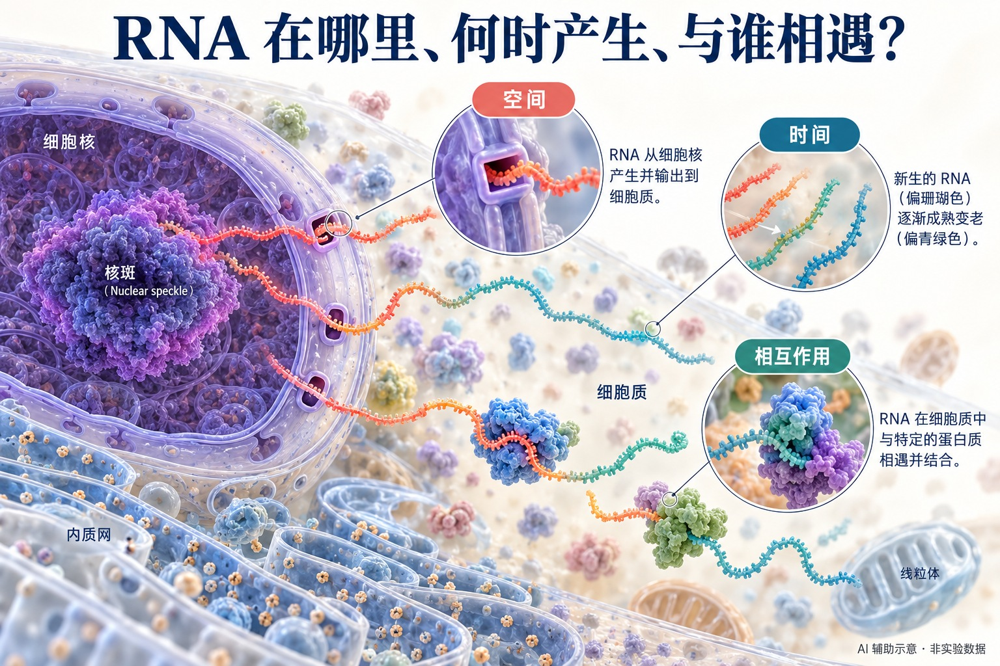

原文：[Toward Mapping Spatiotemporally Resolved Transcriptomes and RNA-Protein Interactions](https://doi.org/10.1002/wrna.70057)，首次上线 2026-09-30。

阅读与核验范围：Complete main text, all four figures, Table 1; representative original studies audited separately; no experimental re-run

限制：Proximity-CLIP primary paper figures not licensed for reuse by this run; limited method-layer discussion only, no unreproduced data-figure claims. All core Review figures/table shown.

图像许可：CC BY 4.0。逐图来源、原样片段或技术格式处理、补充原始研究身份及AI示意标记均保留于正文图注。

## 1. 一、先确定你真正想测的量

把一个基因的 RNA 测得更多，距离解释它为什么更多，往往还隔着几层问题：它刚刚被转录出来，还是降解变慢？它暂时停在核斑附近，还是已经进入细胞质？富集实验捕获到的蛋白，究竟与它直接接触，还是只是恰好同处一个邻域？这些区别会改变后续实验，也会改变一张差异表达表的生物学解释。

Norppa 与 Änkö 于 2026 年 9 月 30 日发表在 WIREs RNA 的综述《Toward Mapping Spatiotemporally Resolved Transcriptomes and RNA-Protein Interactions》，把近邻标记、代谢标记和 RNA—蛋白相互作用放在同一张方法地图里。本系列据完整正文展开独立教学分析；本篇先回答空间问题：**测序没有拍到位置，为什么仍能推断局部 RNA？这种推断又在哪里止步？**

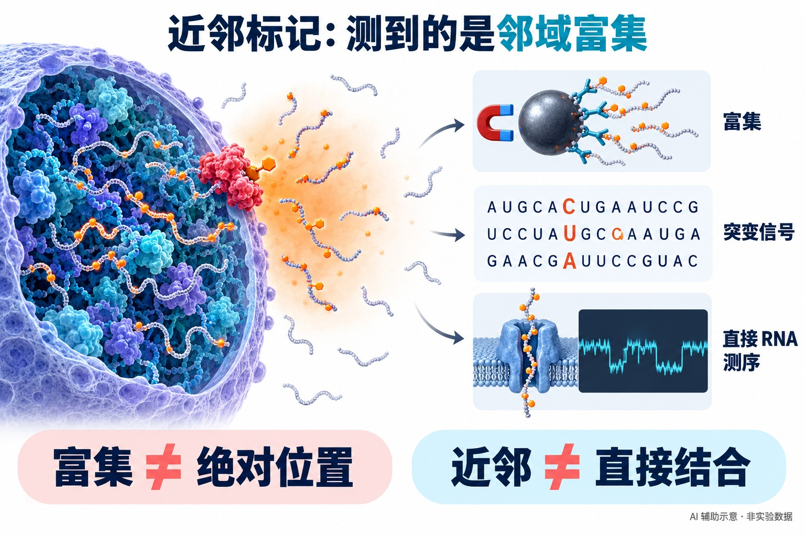

图示为 imagegen 生成的原创导读图，AI 辅助示意、非实验数据。左侧表示亚细胞结构附近的标记活动与渐变反应范围，不规定真实大小；右侧是三类读出概念。序列和电流轨迹均为示意，不对应实验输出。近邻不能独立证明直接结合。

### 一、先确定你真正想测的量

传统全细胞 RNA-seq 会把不同位置的分子合并计数。对基因表达总量，这很有用；对核内滞留、局部翻译或者颗粒组分，它把重要差异平均掉了。细胞分馏可以恢复一部分空间信息，却要面对分离纯度、处理耗时与结构解体。显微成像保留空间关系，但目标数量、探针设计和可识别的分子状态又是另一组约束。

近邻标记选择了一条不同路线：先让某种标记活动出现在目标结构附近，再把这个邻域的 RNA 留下可追踪的化学痕迹，最后在离开细胞环境后测序识别。关键不是“给所有核斑 RNA 盖一个绝对准确的章”，而是建立一个有背景、有反应偏好的抽样过程。一个转录本的富集程度同时受局部丰度、可接近性、标记反应和后续回收影响。

因此，把结果表写成“核斑定位 RNA 清单”通常过于肯定；“在某种核斑靶向标记条件下相对富集的 RNA”更接近真实测量。这个限定并不削弱方法价值，反而明确了为什么需要输入样本、位置对照与成像验证。它也解释了一个常见现象：两个方法的名单不完全重合，不一定是谁做错了，可能是它们观察的邻域、反应底物或分子状态不同。

### 二、原图 1：标记之后，有三种不同的读法

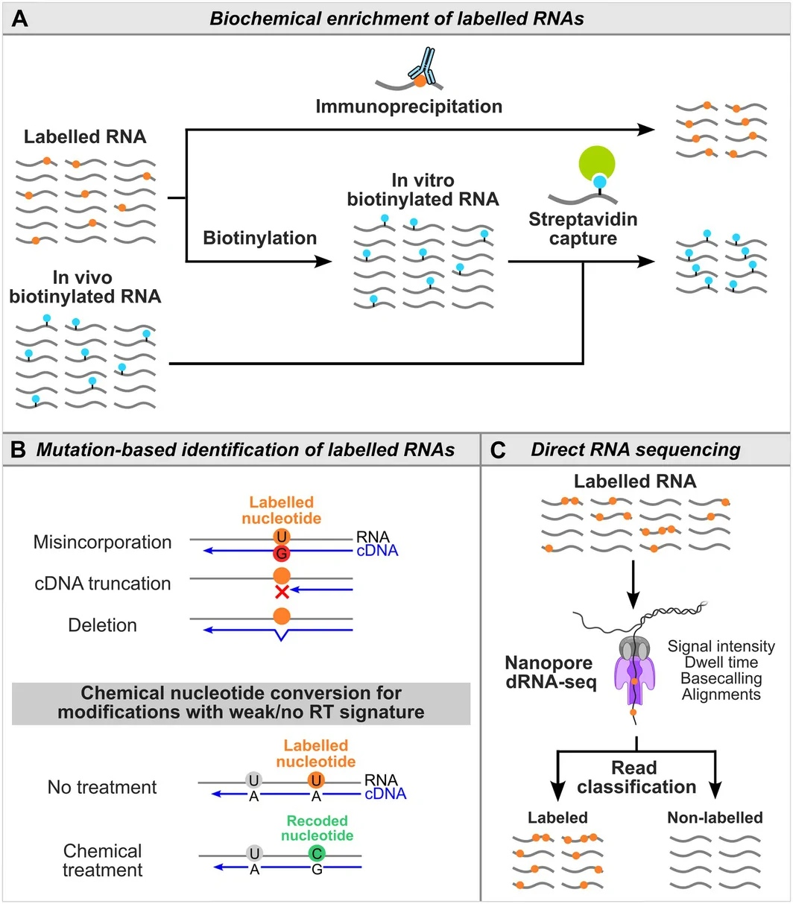

原综述 Figure 1，Norppa 与 Änkö，2026，[原文](https://doi.org/10.1002/wrna.70057)，[CC BY 4.0](https://creativecommons.org/licenses/by/4.0/)。完整保留原图，仅做 WebP 至 JPEG 格式转换；无裁切、无数据改写。原文声明图中部分元素来自 BioRender 与 NIH BioArt；此处随完整图保留署名，不提取单独图标。图为方法框架，不是实验结果。

先看 A：橙色点代表初始标记，蓝色点代表用于捕获的生物素。两种颜色不是两类 RNA 的丰度比较。有的反应在细胞内直接连接生物素；有的先留下化学基团，提取后再接生物素；还有的用识别修饰核苷的抗体捕获。目的都是把稀少的目标 RNA 从大量背景中浓缩出来。它能节省用于无关分子的测序，但多出的捕获、洗涤和洗脱步骤也会引入损失与偏倚。

B 展示另一条路线：让标记改变逆转录行为，产生错配、缺失或提前终止。读段中的特定异常便成为“可能被标记”的证据。这里的突变不是细胞基因组发生了突变，而是用于记录 RNA 化学状态的测序信号。若原始标记对逆转录影响太弱，可以先进行化学转换。不过，逆转录酶种类、反应条件和局部序列都会影响信号；换一套建库流程，背景与灵敏度就可能改变。

C 则直接读取 RNA 通过纳米孔时的信号。修饰可能影响电流、停留时间或碱基识别，模型据此给读段分类。它省去了部分转化步骤，却没有省掉校准：训练数据中的“已标记”和实验样品中的“已标记”是否同分布，必须另问。直接测 RNA 也不意味着对任何标记都直接可辨，更不保证低丰度分子的覆盖足够。

这三类读出回答的是不同技术问题。目标群体极少时，先富集往往值得考虑；不想引入捕获损失时，可以评估信号转换；想把标记状态和转录本结构放在同一分子上时，长读长有吸引力。它们不是从低级到高级的排序，甚至可以组合。选择依据应是目标分子的占比、所需信息和可承受的误差，而不是流程步骤越少越好。

### 三、原图 2：都是近邻标记，化学机制并不一样

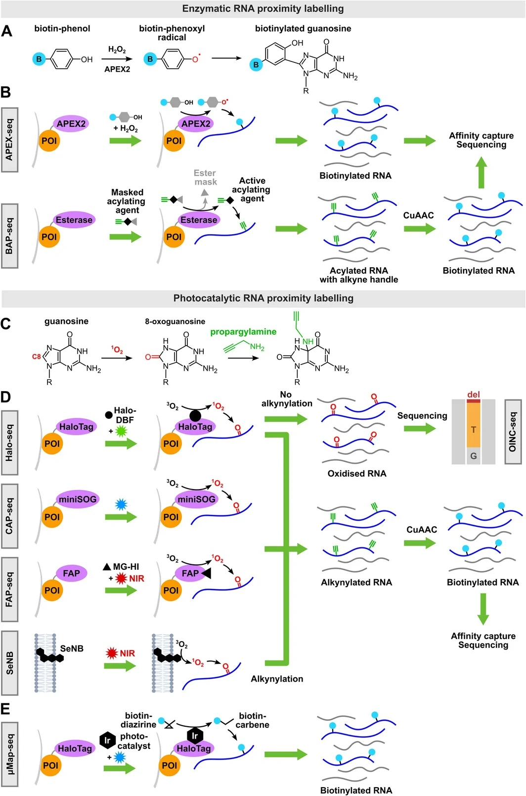

原综述 Figure 2，Norppa 与 Änkö，2026，[CC BY 4.0](https://creativecommons.org/licenses/by/4.0/)。整图保留，仅转换图片格式。A—E 是不同反应机制，不是同一实验的分组；绿色箭头表示操作流程，蓝色 RNA 与灰色 RNA 区分被标记与未标记的概念群体，不表示统计比例。图内没有实验样本量或显著性检验。

A、B 上半部分给出 APEX-seq 的关键机制：定位标记蛋白与 APEX2 融合，在短时过氧化氢刺激下生成可反应的生物素酚氧自由基，给附近 RNA 留下生物素。它的空间信息来自标记活动在哪里，而不是测序本身。下半部分 BAP-seq 换成了局部激活的酰化反应：酯酶解除探针的保护基，活性产物修饰邻近 RNA，随后再通过化学连接加上捕获标签。两者最后都能进入亲和捕获流程，但前端扰动、底物供应和反应偏好不同。

C、D 是氧化型光催化。不同系统把光敏组分定位在目标区域，照光后产生单线态氧，氧化附近 RNA 的鸟嘌呤。Halo-seq、CAP-seq、FAP-seq 的光敏部件与定位方式不同，但可汇入加炔基、连接生物素和捕获的路线。OINC-seq 则利用氧化后产生的逆转录异常，从总 RNA 读段识别信号，省去富集。省掉富集后，低 RNA 含量邻域的信号仍可能被全细胞背景淹没，测序预算随之成为限制。

E 的 μMap-seq 使用另一种光催化机制：产生寿命很短的卡宾来修饰邻近 RNA。它不是把前述氧化方案换个名字。更短的反应物寿命给精细定位带来希望，但文献中蛋白近邻实验的纳米级尺度，不能直接当作每一种 RNA 体系都已验证的空间分辨率。RNA 结构、局部环境和捕获过程仍会影响有效范围。

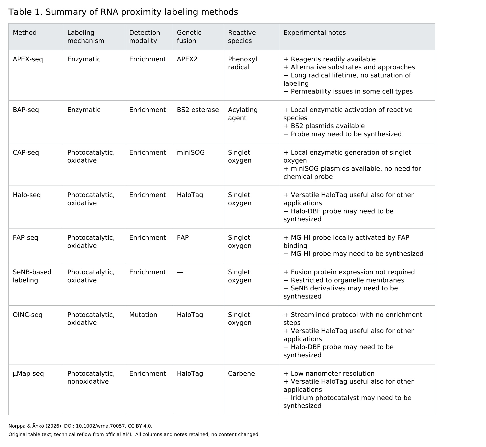

原综述 Table 1，Norppa 与 Änkö，2026，[CC BY 4.0](https://creativecommons.org/licenses/by/4.0/)。由官方全文 XML 原表直接排版为图片，六列、八种方法及全部实验注意事项完整保留，仅调整换行和列宽；未新增评分、未更改内容。这是原表的技术重排，不是 AI 生成的比较表。

原表 1 把这些差别列成六个维度：方法、标记机制、检测方式、所需融合蛋白、活性物种和实验注意事项。按表逐项比较，APEX-seq 需要 APEX2，BAP-seq 需要酯酶融合；CAP-seq 用 miniSOG，Halo-seq、OINC-seq 与 μMap-seq 依赖 HaloTag；FAP-seq 用荧光原激活蛋白。SeNB 类方案可以不表达融合蛋白，但目前依靠小分子偏向特定细胞器膜，不是任意结构都能自由指定。多数方案走富集读出，OINC-seq 的关键区别是突变读出。

表中“试剂可获得”与“可能需要自行合成”对落地同样重要。研究者能购买测序服务，不代表能复现特殊探针化学；能构建稳定细胞系，也不代表原代样本能接受同样操作。原表的加减号是作者归纳的实用注意事项，不是统一实验条件下的性能分数。本篇据此解释选择逻辑，不把表改造成未经证实的排行榜。

### 四、所谓标记半径，不能画成一道硬边界

设想在一个拥挤房间里释放短寿命反应物。离源头更近的分子一般更容易接触它，但“更近”不是唯一决定因素：反应物能活多久、向哪个方向扩散、周围是否有消耗它的物质、目标基团是否露在外面，都会改变命中概率。把这个过程简化成一个半径固定、内部全标记、外部绝不标记的圆，会掩盖实验最重要的不确定性。

综述特别提醒，部分常被引用的距离来自蛋白近邻实验；延长反应、改变底物或局部环境，都可能改变有效范围。因此，空间分辨率最好被当作与体系和操作绑定的实验性质。换细胞类型、换定位蛋白、换处理时长之后，应重新证明定位与背景，而不是直接沿用方法论文的一句尺度描述。

这对无膜凝聚体尤其重要。核斑、应激颗粒和 P-body 没有一圈把内外完全隔开的膜。颗粒附近转录出来、短暂停留或者向外转运的 RNA，都可能进入反应邻域。近邻富集可以帮助发现这种空间组织，却不能仅凭一次实验判断某条 RNA 是永久组分、过路分子，还是颗粒功能的必需参与者。要区分这些解释，往往需要时间窗口、扰动和独立定位证据。

### 五、用 Halo-seq 原始研究检查一次证据边界

本轮另外阅读全文核查了 Engel 等的 Halo-seq 原始研究，而不是只沿用综述中的方法简介。作者把 HaloTag 定位到不同亚细胞环境，比较输入与捕获 RNA，并用标记条件、定位和独立 RNA 信息检验富集是否符合预期。它支持的是：在作者测试的细胞和构建体条件下，这条标记—捕获路线能分辨有生物学意义的局部转录组差异。[原始研究](https://doi.org/10.1093/nar/gkab1185)

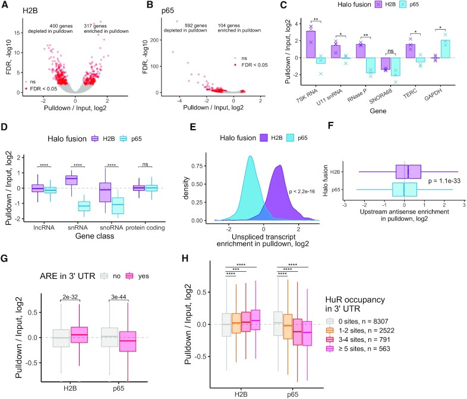

补充原始研究图：Engel 等，Halo-seq，Figure 2，[原文](https://doi.org/10.1093/nar/gkab1185)，[CC BY 4.0](https://creativecommons.org/licenses/by/4.0/)。这是原始方法研究的数据，不是本综述自己的实验；保留完整原图，未裁切、未改值。

A、B 的横轴是捕获相对输入的 log2 富集，纵轴是 FDR 的负对数；每个点代表基因，不是一个独立生物学重复。红点表示作者阈值下显著，灰点表示未达阈值。H2B 锚点与 p65 锚点得到不同的富集谱，但两张图纵轴尺度不同，不能凭点云看起来更高就比较两种定位的整体“质量”。C 用已知偏核或偏胞质的 RNA 作方向检查，紫色为 H2B、青色为 p65；小叉号表示重复测量，柱高概括富集。

D 按 RNA 类别汇总基因层面的富集分布；E 比较含内含子与已剪接转录本的比值，在捕获相对输入中如何改变；F 对启动子上游反义与下游转录信号作类似比值比较。三者为核相关分子状态提供交叉支持，却仍不是逐分子的坐标图。G 按 3′ UTR 是否含 AU-rich element 分组；H 按独立 CLIP 数据给出的 HuR 位点数量分组。H 图例中的 n 是各组基因数，不能当成细胞或实验重复数。G、H 的关联提示可进一步验证的输出机制，不能仅凭分组差异证明 HuR 对每个转录本的因果作用。作者图注所列组间检验采用 Wilcoxon 秩和检验；本轮未重新计算这些统计量。

它不支持把每条捕获 RNA 放到一个确定坐标上，也不支持“某方法在所有样本中优于另一个方法”。原文中的效率比较有其特定试剂、照光和细胞背景。我们读了主文和可取得的补充图说明，并核查了补表结构；未重跑原始测序数据。一个补表的变化方向字段存在命名或方向不一致的疑点，因此这里不引用该字段给特定转录本作方向性结论，也不把这一局部疑点扩张成否定全部主文结果。

这样的核查会改变文章的写法：可以解释作者怎样证明空间富集具有辨识度，却不该借方法名替自己体系背书。准备上手时，最有价值的不是抄下试剂清单，而是复用它的验证逻辑：标记活动是否真的位于预期区域，阴性条件是否够低，不同位置是否可区分，独立方法是否支持代表性分子的定位。

### 六、从测序表回到可检验的实验问题

一个有用的试验设计，可以先写成四句话。目标结构是什么；要比较的是局部比例还是局部绝对量；使用什么对照来排除全细胞丰度变化；如果富集改变，准备怎样验证它确实反映空间重分布。写不清这四句时，再深的测序也未必能补上解释缺口。

输入样本用于判断某个转录本是不是整体就变多了。无光、缺底物或缺标记活动的阴性条件用于估计背景。另一个亚细胞位置的靶向标记用于判断相对空间偏好。成像则可以在少量代表性 RNA 上提供独立的定位证据。这些对照不能互相顶替：全细胞输入纠正不了错误定位的融合蛋白，背景很低也不等于测到了直接结合。

还要考虑分母。某类 RNA 在捕获库中占比上升，既可能因为它被捕获更多，也可能因为别的 RNA 减少。若问题涉及跨条件的总量变化，单靠组成型测序比例并不够，应评估合适的外源校准和回收控制。对富集步骤，预先加入的已标记与未标记对照可以分别提示回收损失和非特异夹带；它们也必须放在与问题匹配的步骤，不能事后加入就宣称控制了全部过程。

读完这一篇，最值得留下的判断是：**近邻标记给空间问题增加了可测量的化学证据，但它首先产生的是有条件的富集量。**只有把定位、反应、回收、测序和对照串起来，名单才会变成可靠的生物学解释。下一层问题，是这些位于某处的 RNA 究竟何时产生、停留多久；那需要另一类标记与时间模型。

### 阅读范围与来源

完整阅读本综述正文、四幅原图与原表 1；主文未列需要额外取得才能理解其框架的补充数据。本篇对 Halo-seq 做了原始全文及部分补充核验，其余方法在此主要依据综述与所列原始引用解释，不声称全部独立复现。

- 综述：[Toward Mapping Spatiotemporally Resolved Transcriptomes and RNA-Protein Interactions](https://doi.org/10.1002/wrna.70057)，Norppa 与 Änkö，2026-09-30；[公开全文](https://europepmc.org/articles/PMC13627280)。
- 原始研究：[Analysis of subcellular transcriptomes by RNA proximity labeling with Halo-seq](https://doi.org/10.1093/nar/gkab1185)。
- 图像重用依据：[BioRender 的 CC BY 读者权限](https://help.biorender.com/hc/en-gb/articles/21283116932765-CC-BY-publishing-and-reader-permissions)，[NIH BioArt 条款](https://bioart.niaid.nih.gov/terms)。图 1 的第三方元素随作者完整图展示，不独立提取或改编。

## 2. 一、给新分子贴标签之前，先经过细胞代谢

处理后某个基因的 RNA 翻倍，最顺手的解释是“转录被激活”。但同样的变化也可能来自降解变慢；甚至在总量完全不变时，合成与降解都可能已经大幅加速。要区分这些机制，仅给表达矩阵增加测序深度不够，还需要知道哪些分子在什么时间窗口产生。

本篇围绕 Norppa 与 Änkö 的 2026 年 WIREs RNA 综述，解释 RNA 代谢标记怎样把时间信息带进测序，也解释为什么一个“新生 RNA 比例”不会自动变成可靠的半衰期。这里的目标不是提供可以不经验证直接照搬的实验配方，而是帮助读者把核苷选择、采样设计和模型假设连起来。

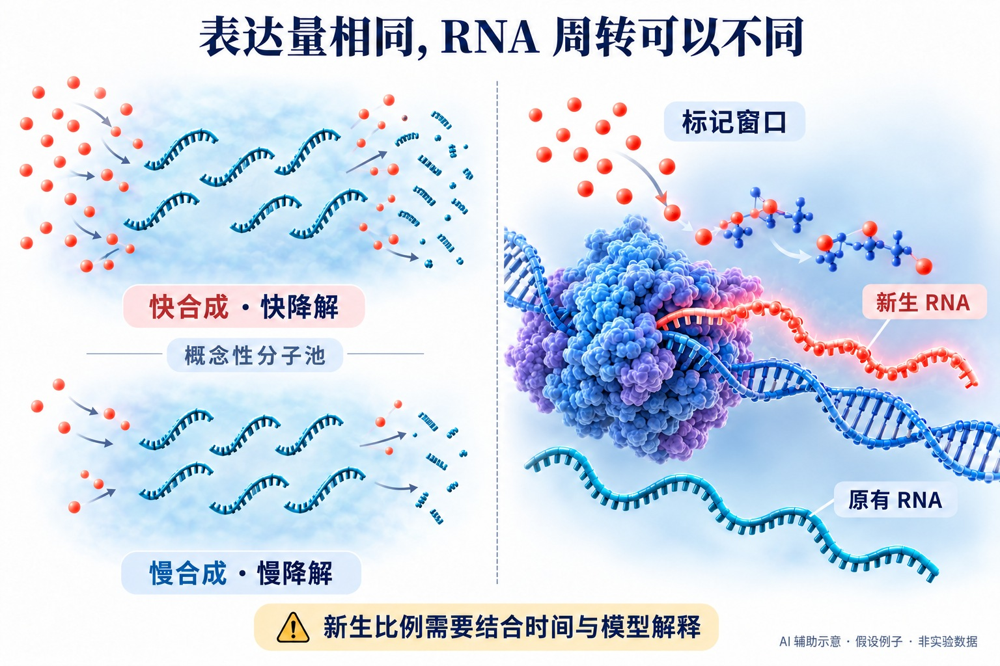

原创教学图，由 imagegen 生成并校正。AI 辅助示意、假设例子、非实验数据。左侧为抽象分子池，不代表真实细胞的空间结构；相同存量可以对应不同流入、流出速率。右侧只示意标记前体进入新生 RNA 的过程，不能从图示推断实际摄取速度或转录速率。

### 一、给新分子贴标签之前，先经过细胞代谢

代谢标记通常给细胞提供修饰过的核苷或核碱基，再让它们进入代谢通路、转成核苷酸，最终被 RNA 聚合酶掺入新合成的 RNA。实验者加入培养基的时刻，并不等于每个细胞、每条 RNA 立即开始获得同样的标签。转运、代谢转换、内源核苷酸池和检测阈值共同决定有效时间窗口。

这解释了为什么“标记五分钟”比“这条 RNA 恰好五分钟前出生”弱得多。对较长转录本，标签也可能只进入转录过程中的一段。若把带标签的整条分子捕获后测序，较早形成、未标记的区段也会被一并读到。TT-seq 之类方案在富集前打断 RNA，正是为了让短脉冲的读出更接近刚刚合成的片段，而不是把整条长转录本都当作那个时间窗口的产物。

因此，“新生”必须附带实验定义：哪种前体、何种剂量与脉冲、如何捕获或分类、测量的是分子还是片段。没有这层定义，不同研究中的新生比例往往无法直接比较。读者也应留意这里讨论的是活细胞中的代谢过程；把现成固定组织加入核苷，并不能补回过去的真实转录历史。

### 二、原图 3：选择核苷，就是同时选择读出与风险

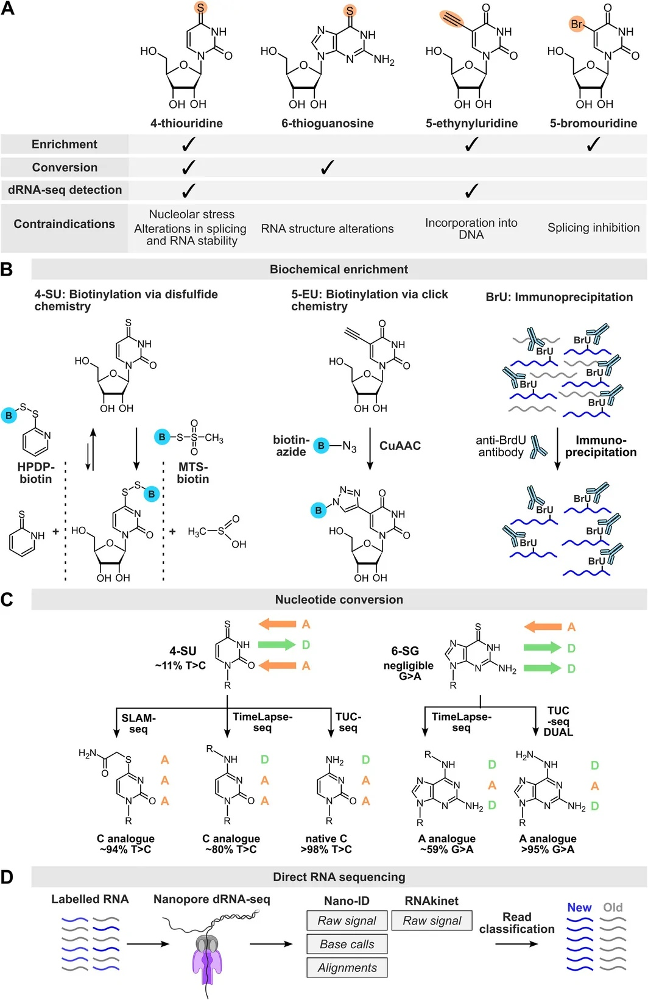

原综述 Figure 3，Norppa 与 Änkö，2026，[原文](https://doi.org/10.1002/wrna.70057)，[CC BY 4.0](https://creativecommons.org/licenses/by/4.0/)。完整原图，仅转换格式，无裁切或数值改动。原文声明部分元素来自 BioRender 与 NIH BioArt；此处随整图保留归因，不提取图标。图中化学转换百分数是综述引述特定反应的信号表现，不能读作完整流程对所有新生分子的检出率。

A 把四种常见类似物并排放置。4SU 的含硫基团可以支持富集、化学转换和直接 RNA 读出，是用途较广的一类；6SG 的转换可以产生与 4SU 不同的信号；5EU 带有可用于点击化学的炔基；BrU 则主要依靠抗体富集。表中的勾表示本文讨论的兼容路线，不是对灵敏度、毒性或数据质量的打分。空白也不应被解释成任何未来条件下都不可能实现。

B 进一步说明“富集”并非同一种操作。4SU 可以通过特定化学反应连上生物素，再用链霉亲和素捕获；不同试剂的反应效率会带来长度偏倚。5EU 常用点击反应接入生物素。BrU 依赖抗体，流程可以简洁，但抗体批次、非特异结合和可获得性成为要控制的因素。对长读长方案，还应评估反应是否损伤 RNA 完整性；一次成功拉下 RNA，不等于仍保留足够全长分子。

C 展示的是化学转换怎样改变核苷的配对界面。4SU 相关路线通常在测序中留下 T→C 信号；6SG 的一些转换路线产生 G→A 信号。图中的 A、D 标记氢键受体与供体，不是新的分组编号。不同反应报告的转换表现不能脱离原始实验条件横向排名，更不能把一次错配就等同于一条分子可靠地被归为新生。未标记背景、序列差异、酶反应与测序错误都需要进入识别规则。

D 把视角移到纳米孔：标记可能改变电流等特征，由模型区分读段。Nano-ID 与 RNAkinet 使用的信息不完全相同；图中后者主要利用原始信号，并不表示下游异构体归属、半衰期分析也完全不需要序列或比对。一个读段有标签与它属于哪个转录本，是两个不同的推断步骤。

### 三、标签并不天然“生物学惰性”

综述把副作用列得很具体。4SU 在某些条件下会影响核糖体 RNA 的合成与加工，高掺入水平还可能改变剪接和 RNA 稳定性。6SG 对 RNA 双链稳定性的影响可能依位置而异。5EU 在某些动物中主要进入 DNA 而非 RNA，因此一个细胞系中的顺利经验不能直接迁移到另一物种。标签的化学结构，正是它容易被检测、也可能干扰生物过程的共同来源。

BrU 常被考虑用于较长标记，但“耐受较好”不能写成无条件安全。综述提到的剪接抑制来自高掺入水平的体外实验，不能直接等同于常规活细胞剂量下已确定发生同样问题；反过来，也不能因为没有现成结果就假定完全没有影响。这里最有价值的不是给四种试剂排一个安全榜，而是承认系统比较仍然不足。

对自己的体系，剂量和时间应与细胞状态、RNA 完整性以及关心的生物过程一起评估。如果研究对象就是剪接、应激或降解，标签引起的轻微变化也可能与目标效应混淆。提高标记强度确实可能增加检出率，但同时可能改变原本想测的动力学。一个可靠的优化目标应同时考虑信噪比和扰动，而不是只追求测序中更多的转换读段。

### 四、原图 4：同一套标签，可以提出不同时间问题

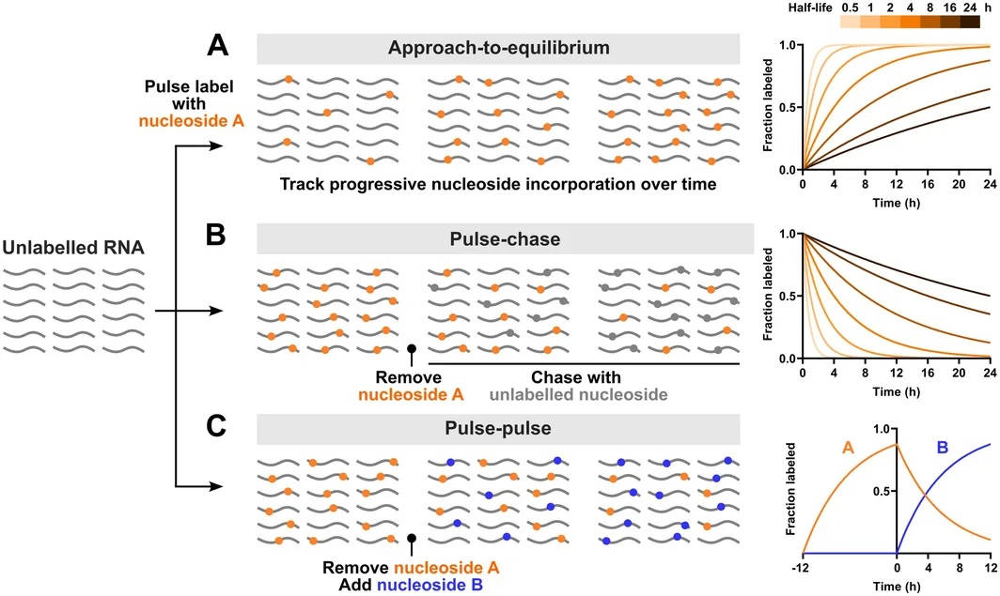

原综述 Figure 4，Norppa 与 Änkö，2026，[CC BY 4.0](https://creativecommons.org/licenses/by/4.0/)。完整原图，未裁切或改值。右侧曲线是作者用于解释设计的理论曲线，不是实测数据，无实验样本量或显著性检验。A、B 横轴为小时，纵轴为标记比例；颜色对应假设半衰期 0.5—24 小时。C 是两种标签依次使用的示例，不能当作通用推荐采样表。

A 是持续加入标记后，在多个时间点采样。新生分子逐渐进入被标记群体；在简单稳态模型下，周转越快，标记比例越快接近平台。非常稳定的 RNA 在短窗口内只形成很小的新生比例，估计容易受背景影响；极不稳定的 RNA 若早已接近饱和，较晚时间点又难以分辨它究竟有多快。单一时间点只能照顾一段动力学范围。

B 是脉冲后追踪：先标记一批 RNA，再换成未标记前体，观察原有标记群体逐渐减少。这更接近对一个分子队列的命运追踪。但撤掉培养基中的试剂，不等于细胞内已没有可用标签；残留或循环利用的前体会继续给新分子贴上同样标记，使衰减看起来更慢。若不处理这类背景，半衰期可能被高估。

C 先用标签 A，再换标签 B，一边观察 A 群体减少，一边观察 B 群体增加。不同信号提供额外约束，有助区分合成与降解，也有助识别单标签追踪中的延迟。但两种前体的摄取、转化和检出效率并不必然相等；残留、交叉信号和转换兼容性依然需要验证。双标签增加了可辨识信息，同时增加了化学与分析复杂度，不是自动免除校准。

选择设计的第一步，应是列出预计要观察的时间尺度。关注短寿命转录中间体与关注一天以上稳定的 RNA，不该机械共用同一套采样点。经费不足以覆盖所有尺度时，可以明确限制研究对象，或先用小规模预实验确定可识别范围。把不可估计的转录本标出来，通常比给每个基因都输出一个看似精确的半衰期更可信。

### 五、为什么一个比例仍然需要模型

用最简单的模型说明：设 RNA 存量为 N，单位时间合成量为 s，每个分子的降解速率常数为 k，那么存量变化可写作 dN/dt = s − kN。只有在稳态，即存量近似不变时，才有 s = kN。因此，两个体系即使 N 相同，也可能分别处于高合成—高降解与低合成—低降解状态。

若再假定标记瞬时且均匀生效、分子按单一一阶过程降解，持续标记 t 时间后的新生比例 f 可写作 f = 1 − exp(−kt)，相应半衰期为 ln(2)/k。这是帮助理解方法的简化推导，不是可对所有实验直接套用的公式。标记延迟、分类错误、不同亚群混合、细胞分裂稀释及跨区室转运，都可能使实际观测偏离这个关系；应在所用模型中说明如何处理。

尤其要警惕强扰动后的短时间响应。若合成和降解本来就在变化，一个时间点的新生比例未必能把两者唯一拆开。总 RNA 变化、多时间点、第二标签或独立测量可以增加约束，但这些约束必须真实进入拟合与误差评估。模型参数越多，越不能只凭拟合曲线看起来贴合数据就宣布机制已经确定。

还要区分群体平均与分子机制。基因层面的单一半衰期可能混合了不同异构体、细胞状态与亚细胞位置；一个弯曲的衰减轨迹，既可能意味着复杂降解步骤，也可能来自若干简单过程的混合。增加模型复杂度之前，先检查实验分层和观测误差，往往比直接增加一个速率参数更有解释力。

### 六、RNAkinet 案例：模型读得出标签，不代表所有条件下都读得准

本轮阅读全文核查了 Martinek 等 2024 年正式发表的 RNAkinet 研究。它用原始纳米孔电流识别 5EU 标记，结合卷积与循环结构，再将读段归属到转录本，估计动力学。其训练正类来自长时间标记后预期多数分子已含标签的样本，负类来自未标记样本；这本身就是实验近似，不是每条分子都有独立化学真值。[正式原始研究](https://doi.org/10.1093/nargab/lqae116)

作者在特定外部数据、细胞与物种条件中考察了迁移表现，给“从原始信号判断分子标签”提供了实际证据。本篇不复述其跑分或速度，也没有运行该模型。重要边界是：正式论文所用 SQK-RNA002、FLO-MIN106 等历史条件，以及部分既有 RNA001 数据，不能证明对未来所有孔、试剂化学和样本类型都无需重新校准。避免依赖某个碱基识别器，不等于免疫于原始信号分布变化。

这一点对 AI 生物学读者很有借鉴性。需要分别问：训练与测试是否隔离了序列信息；独立实验的标签质量是否相当；读长与表达覆盖是否相近；新平台有没有改变输入信号。一个标记分类器即使在测试集上可靠，也不能替代动力学模型的稳态假设。分类、异构体归属、参数拟合，是三个可以分别出错的环节。

### 七、从基因半衰期走向 RNA 生命周期

代谢标记还能与内含子、剪接连接或长读长一起使用，追踪加工过程。基因总量把多个内含子的行为平均后，可能看不见特定慢步骤；同一条长读段能同时保留多个内含子的状态，为剪接顺序与事件耦合提供信息。但一条分子上的共现关系仍需结合转录位置、富集对象和时间设计解释，不能把任意未剪接长读段都视为同一成熟阶段。

综述还讨论把染色质、核质、细胞质和多核糖体分馏与标记结合，估计分子在区室之间的流动。这类研究提示，对一些体系而言，核内加工与停留可能占据 mRNA 生命周期的重要部分。它不是所有基因、细胞和条件都共享的固定比例；“核内时间长”也不足以唯一定位到剪接慢、输出慢或其他加工障碍，需要更细的观察和模型比较。

真正的进步是把一个笼统的“RNA 增多”拆成可以检验的机制集合。研究者可以据此判断下一步该增加时间点、分离区室、测转录本结构，还是直接验证特定加工事件。技术的价值，最终体现在它排除了哪些原本同样合理的解释。

### 阅读范围与来源

本篇基于完整综述正文与 Figure 3、4 的逐项核读，并阅读全文核查 RNAkinet 正式版的实验、方法和限制；未取得可读的正式补充材料，未运行模型或重算作者数据。其余代谢标记与加工研究主要按综述所述解释，未写成逐篇独立复现。

- 综述：[Norppa 与 Änkö，2026，WIREs RNA](https://doi.org/10.1002/wrna.70057)，2026-09-30 首次上线。
- 原始研究：[Deep learning and direct sequencing of labeled RNA captures transcriptome dynamics](https://doi.org/10.1093/nargab/lqae116)，2024-08-29 正式发表；本篇引用正式版，不把早期预印本另算一篇。
- 原图许可：[CC BY 4.0](https://creativecommons.org/licenses/by/4.0/)；图 3 的第三方元素随作者完整图保留 [BioRender](https://help.biorender.com/hc/en-gb/articles/21283116932765-CC-BY-publishing-and-reader-permissions) 与 [NIH BioArt](https://bioart.niaid.nih.gov/terms) 归因。

## 3. 一、RNA 的伙伴会变化，整细胞名单很难保留这个过程

一条 RNA 在核斑附近富集，某个 RNA 结合蛋白也在这里出现。把两张名单取交集，就能说这个蛋白把 RNA 留在核斑了吗？还不能。空间接近、物理接触、特定蛋白身份，以及接触是否改变 RNA 命运，是四个需要逐层建立的问题。

Norppa 与 Änkö 的 WIREs RNA 综述把 RNA 标记进一步连接到相互作用分析。本篇从这些证据层级出发，讨论怎样把“在哪里”“何时产生”“与谁接触”组合成可解释的实验，以及哪些看似顺理成章的联合读出，目前仍属于研究方向。

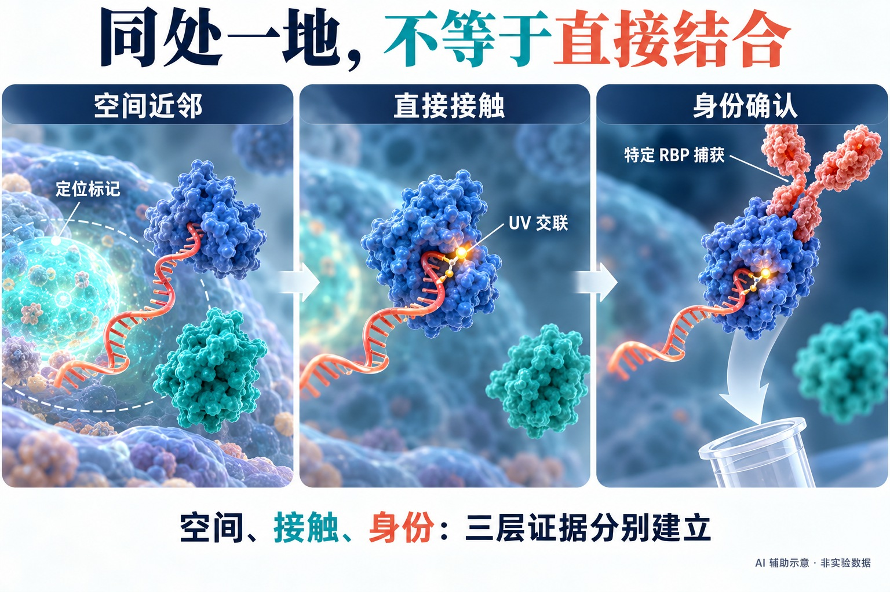

原创 hero，由 imagegen 生成，AI 辅助示意、非实验数据。图中三格分别表示空间选择、接触交联与特定蛋白捕获的证据逻辑，不是宣称所有方法都按同一操作顺序完成。虚线仅提示概念邻域，不表示已测定的硬半径；分子形状与大小不按比例。

### 一、RNA 的伙伴会变化，整细胞名单很难保留这个过程

细胞中的 RNA 通常与多种蛋白共同存在。刚刚转录、尚在加工、准备输出、参与翻译或者走向降解的分子，可能具有不同的蛋白组合。于是，同一个 RBP 的整细胞结合图谱，可能把不同位置与生命周期阶段的接触叠加在一起。一个基因的不同异构体，也可能携带不同序列、结构与结合机会。

研究者可以从蛋白出发：用交联免疫沉淀等方法捕获某个 RBP 及其接触的 RNA。也可以从 RNA 出发：捕获一类 RNA，再鉴定与之连接的蛋白。例如经典的 RNA interactome capture 常结合 UV 交联、寡聚 dT 捕获和质谱，观察 poly(A) RNA 所连接的蛋白群。两者的起点不同，输出对象也不同，不能把一个“某蛋白结合哪些 RNA”的结果直接等价为“某条 RNA 在每个时间点结合哪些蛋白”。

交联的意义是把接触转成能够经受后续处理的共价痕迹，但它也有选择性：并非所有真实接触都以相同概率交联，RNA 序列、核苷、蛋白性质和照射条件都会影响回收。因此，阴性结果可能来自没有接触，也可能来自检测不到；阳性结果则仍要看纯化特异性与背景。方法输出中的“结合”，必须和具体实验定义一起阅读。

### 二、Proximity-CLIP 把哪两类选择串在了一起

本轮阅读全文核查了 Benhalevy 等的 Proximity-CLIP 原始研究。它先借 APEX2 等定位设计，为某个亚细胞邻域中的蛋白加上可捕获的标记，再利用 RNA—蛋白交联保留接触关系，随后捕获这些局部 RNP。分支读出可以包括局部蛋白组、RNA 群体以及蛋白保护的 RNA 片段。[原始研究](https://doi.org/10.1038/s41592-018-0220-y)

这里要辨清一个容易混淆的细节：空间标签主要加到近邻蛋白上，接触信息则由 RNA—蛋白交联提供。它不等于把前面介绍的 RNA 近邻标记流程简单接上一个测序步骤。RNA 片段中的交联信号，可以帮助区分实际进入交联复合物的部分和背景；但“这个片段在局部被某种蛋白占据”仍未必揭示“占据它的就是哪一个 RBP”。

即便同一实验的质谱发现了一批 RBP，也不能把名单中的每一个蛋白自动与每一个 RNA footprint 配成直接相互作用对。这就像知道一个房间里有哪些人、哪些物品被使用过，却还没有记录具体是谁使用了哪一件物品。要进一步限定身份，需要额外选择，例如针对目标 RBP 的特异免疫捕获，并控制其特异性与回收偏倚。

综述讨论的 coCLIP、RBProximity-CLIP 通过加入指定 RBP 的选择步骤，朝这个方向推进。本篇对它们的定位是综述所总结的方法逻辑；本轮未另行通读这两项研究，因而不复述其数值结果，也不声称独立验证了它们在任意细胞区室中的表现。Proximity-CLIP 的主文与 Online Methods 已读，但其作者手稿中的原图转载权限未确认，本篇不展示或临摹这些图，也不把未展示的原始数据图作为核心结果展开。这里核查的是方法链条与推断层级。

### 三、相同的 4SU，在两种实验里可能承担不同角色

代谢标记常被用来区分新旧 RNA，但 4SU 也能提高某些 UV 交联策略的效率。在 Proximity-CLIP 原始演示中，较长时间的 4SU 处理主要服务于交联增强。仅仅看到试剂表里有 4SU，不能就把输出改写成“精确出生时间已知的新生 RNA”。要获得年龄信息，必须有为时间问题设计的脉冲、追踪与标签识别。

RICK 则利用 5EU 标记 RNA，再通过交联、点击化学和捕获鉴定与这些 RNA 相连的蛋白。它的时间选择来自代谢窗口，而 RNA 选择不必只依赖 poly(A) 尾。另一类时间分辨 RNP 研究用 4SU 脉冲追踪，结合交联、寡聚 dT 捕获与质谱，观察标记分子群在不同阶段关联的蛋白组合。两者可以提出相近问题，却有不同的 RNA 范围与纯化门槛。

这里还有一个分母问题：某蛋白在捕获物中减少，可能是单位 RNA 上结合减少，也可能是被捕获 RNA 的总量或组成改变。若实验条件改变了 RNA 寿命、poly(A) 状态或标签掺入，质谱信号的变化就不能自动解释为结合亲和力改变。应检查对应的 RNA 回收、蛋白输入及选择对象，必要时把“关联组分变化”与“单分子占有率变化”分开陈述。

同样，poly(A) 捕获天然偏向已获得相应尾部状态的分子。没有被捕获到的早期转录中间体，不一定没有蛋白伙伴；它可能从一开始就不在这套实验的观察范围内。这种选择性不是缺陷清单里的一行小字，而是决定文章最终能够回答什么问题的边界。

### 四、把多种标签放进同一实验，先要证明能分得开

空间与时间联合分析很吸引人：先用代谢标签定义一个出生窗口，再观察这些 RNA 是否经过特定结构。然而，“两种方法各自可用”并不推出“混在一起依然可解释”。如果两种流程都靠同样的炔基把手与同类捕获化学，最终拉下来的标签就可能无法说明自己来自哪一个步骤。

综述因此强调正交性：激活条件和化学连接必须尽量互不干扰，读出也需要能够区分不同标记。不同光波长不必然意味着完全独立激活；不同核苷的转换信号，也要检查背景和交叉影响。应先验证单独标记，再验证联合标记能否保留各自特异性，最后才解释联合实验的生物学差异。

还要注意，某些代谢类似物会提高近邻标记反应效率。这样确实可能增强信号，却会使结果偏向新近合成、掺入更多类似物的 RNA。如果研究问题是新生转录本去向，这种偏好可能正合目的；如果原本想描绘稳态局部转录组，它就改变了被观察的人群。把这两种目的混用，会把技术增强误写成某类 RNA 在空间上更富集。

作为本篇提出的设计建议，可以把联合流程拆成三个可检查的条件：标签是否仍指向预期空间，时间标签是否仍对应预期窗口，两种标签能否在同一读出中可靠区分。若其中一项只能在群体平均上成立，就不要把结果直接宣称为单分子联合定位。这个检查框架是根据综述作的实验推理，不是作者已完成的统一验证标准。

### 五、长读长最有价值的增量，是把信息连接在同一分子上

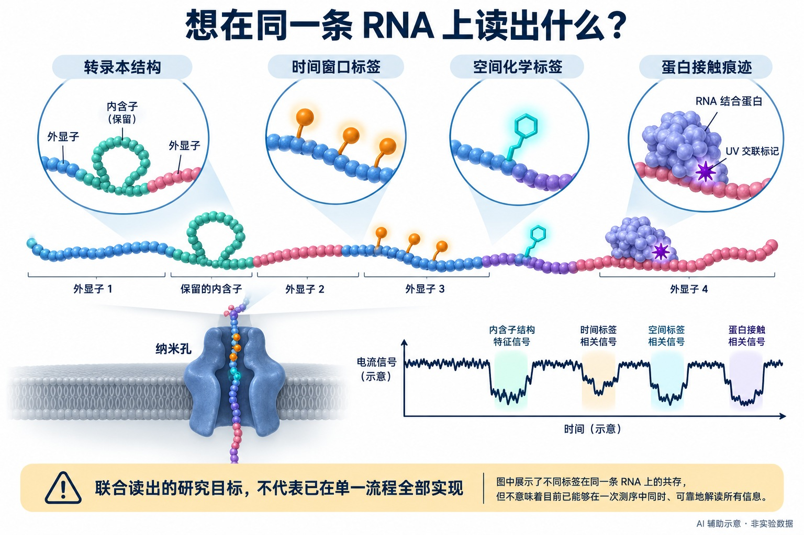

原创正文解释图，由 imagegen 实际生成并目视核对。AI 辅助示意、非实验数据。图中把转录本结构、时间标签、空间标签和接触痕迹放在同一条假设 RNA 上，表示联合测量的研究目标；不代表目前已经在单一标准流程中全部实现。下方波形仅用于提示信号解码问题，不是实验输出，也不表示这四类特征必然产生所画出的特定电流形状。

短读段常常能告诉我们某个局部连接发生过，却未必能把远处的剪接事件、末端选择和蛋白接触组合到同一条转录本上。长读长的潜力，在于减少这种跨分子拼接的不确定性：哪种异构体带有时间标签，哪些内含子仍未剪接，某个接触痕迹位于哪种完整结构背景，都有机会放在同一分子层面讨论。

但这种潜力有几道实际门槛。富集和化学处理可能打断 RNA；读段不完整时，“没有读到某段”不能当作生物学缺失。稀有异构体需要足够分子数才能估计比例；分类器的误差可能随读长、序列和平台改变。想连接多种修饰，还需要证明它们的信号可分，而不是模型只学到某种更强的共同扰动。

综述提到部分近邻标记产物在直接 RNA 测序中可能可辨，也提到作者实验室尚未发表的相关方法进展。这里将它们明确放在展望层面，不把“原理上有希望”升级为已完成跨体系验证的能力。尤其不能根据 DNA 中某种损伤可被纳米孔识别，就直接宣布 RNA 上相似化学结构已经达到同样可靠性。分子、孔环境、信号模型和实验背景都需要对应验证。

对分析者来说，联合读出的价值也不只是增加更多特征。真正值得问的是：同一分子的联合观测，能否排除分别测量时无法排除的解释？若某项结论本来只需要清楚的核质分馏与少量成像，未必有必要一开始就承担四种标签、长读长和复杂模型的全部成本。

### 六、一个“核内滞留”问题，至少有几种竞争解释

设想某种处理后，目标 RNA 在核斑附近的近邻富集增加。这是本篇构建的假设例子，不是综述报告的特定实验。可能解释包括：这个 RNA 全细胞表达增加；新生分子短时涌入；输出受阻导致较老分子积累；或者定位标签及反应环境改变，使检测更容易。四种情况都可能给出相似的富集方向，却对应不同机制。

全细胞输入帮助检查第一种解释。加入时间信息后，若增加主要集中在新生群体，优先考虑转录或早期加工相关变化；若较老群体比例升高，停留、输出或降解问题更值得检查。但新旧比例本身也受标签与分类误差影响，不能只看一个阈值就作机制选择。定位蛋白成像、反应阴性条件与独立 RNA 定位，可帮助识别最后一种技术解释。

接着才是某个 RBP 是否参与。如果其局部丰度与 RNA 富集一起变化，可以提出关联假设。若要说它介导滞留，就需要更直接的接触证据和有针对性的干预，例如区分影响定位与影响 RNA 结合的改变，并观察结果是否符合预先设定的预测。这里没有一种普适的必做实验套餐；重要的是干预能针对所声称的机制，而非只让细胞整体处于另一种状态。

这也给结果展示一个建议：不要只画一条从“RBP 增多”直达“RNA 滞留”的箭头。可以同时列出被证据支持的环节和仍然开放的替代解释，说明下一项实验会在哪些结果下支持或削弱模型。一个能够被检验推翻的解释，比一张把所有关联连成因果链的漂亮示意图更有研究价值。

### 七、从细胞系走向组织，改变的不只是样本来源

许多近邻标记需要表达融合蛋白，这对可工程化细胞系方便，却可能限制原代细胞和临床材料。抗体或核酸探针定位到固定样本的方案可以绕开部分表达难题，但固定过程是否保留原有超微结构、抗体是否特异、批次是否稳定，又成为新的约束。固定样本保留的是处理后可观察的空间状态，不能重新进行活细胞代谢时间标记。

活体光催化还受到组织穿透深度、光照均匀性、底物输送和局部环境的限制。透明胚胎中的成功不能直接外推到厚实、不透明组织。近红外可能改善部分条件，却不自动解决所有组织的可达性。单细胞分析则进一步面对低输入与稀疏覆盖：平均每个基因有一点信号，不代表每个细胞都能可靠估计同样多的动力学参数。

空间转录组、成像、分馏和化学标记因而更适合被视为互补观察。组织坐标保留了细胞邻里，近邻标记提供局部化学选择，代谢标记提供时间窗口，交联增加接触信息。未来整合的方向很清楚，但每增加一个维度，也应增加与之对应的校准和不确定性说明。

### 阅读范围与证据边界

本篇完整阅读综述相关章节，并全文核查 Proximity-CLIP 的合法作者手稿及 Online Methods；未取得可用补充材料、未重跑质谱或测序。其原图转载权本轮未确认，因此不复用、不临摹，也不展开依赖那些未展示数据图的数值论断。两幅原创图用于讲解综述原图未覆盖的证据层级与联合读出目标，不替代综述的原始图表：本系列已在相应正文展示并解释其全部四幅图和原表 1。

- 综述：[Norppa 与 Änkö，Toward Mapping Spatiotemporally Resolved Transcriptomes and RNA-Protein Interactions](https://doi.org/10.1002/wrna.70057)，WIREs RNA，2026-09-30。
- 原始研究：[Proximity-CLIP provides a snapshot of protein-occupied RNA elements in subcellular compartments](https://doi.org/10.1038/s41592-018-0220-y)，Benhalevy 等，Nature Methods，2018-11-26；[合法作者手稿](https://pmc.ncbi.nlm.nih.gov/articles/PMC6289640/)。

## 4. Take-home messages

### Take-home messages：把方法地图变成自己的实验判断

同一个 RNA-seq 差异，可能来自合成、加工、转运或降解；同一份近邻富集名单，也可能同时包含稳定组分、路过的分子与技术背景。Norppa 与 Änkö 于 2026 年 9 月 30 日发表的 WIREs RNA 综述，值得保留的贡献，是把空间标记、代谢时间窗口和 RNA—蛋白接触放到同一个生命周期框架里。

这篇独立 take-home 不要求读者先读完前文。它把完整综述及本轮代表性原始研究核查转化为几条可直接用于选方法、看结果和设计下一步实验的判断。它不是操作规程，也不把不同方法硬排成优劣榜。

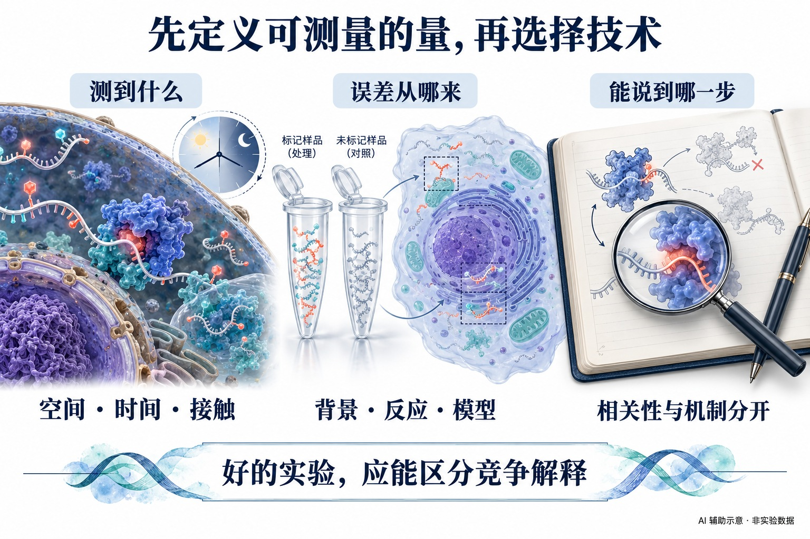

原创 take-home hero，由 imagegen 生成，AI 辅助示意、非实验数据。试管、细胞与分子画面均为教学示意，不是真实显微图片或软件输出；图中处理与对照只表达验证思路，不构成完整实验条件表。

### 1. 先用一句话定义输出，避免技术名代替问题

“我要做 APEX-seq”尚未说明要测什么。“我要比较处理前后某个核内邻域中，一类 RNA 相对全细胞输入的富集变化”就具体得多。空间标记常给出条件化的富集量；代谢标记给出一定时间窗口与识别规则下的新生分子信息；交联提供与蛋白接触的痕迹。它们可以互补，但不能自动互相替代。

因此，计划书里最好把测量对象、分母与解释边界写在同一句话中。究竟按基因、异构体、RNA 片段还是完整分子计数？比较的是局部比例、绝对量还是新生比例？这些定义通常比先选哪个软件更早决定实验是否可解释。

### 2. 近邻富集应被当作概率性观察

标签在空间中产生，反应物扩散并消耗，RNA 的暴露程度与化学基团决定命中机会。所谓标记半径不是内部全中、外部全不中的硬边界。富集上升可能来自真实重分布，也可能来自全细胞表达、反应效率或回收组成改变。

有针对性的对照包括全细胞输入、反应阴性条件、不同定位锚点和代表性 RNA 的独立成像。它们各自排除不同解释，不能只挑一个最容易做的来代替其余证据。若融合蛋白自身改变位置，首先要解释这个变化，再讨论 RNA 是否移动。

### 3. 时间标签记录的是窗口，动力学参数来自模型

核苷进入细胞、转成可用前体、掺入 RNA 并被检出的过程存在延迟。短脉冲定义了一个操作性的时间窗口，不会给每条分子自动附上精确出生时刻。一个新生比例想变成降解常数，需要稳态、一阶动力学及可控标记误差等条件，具体前提应跟随所用方法说明。

单个时间点无法同时照顾极短与极长寿命 RNA。若大多数读数接近零或接近饱和，拟合出的精细数字可能没有相应信息支持。多时间点、第二种标签、总量变化或区室分离可以增加约束；其中哪一种最有价值，应由当前无法区分的机制决定。

### 4. 多一种标签，也多一层校准责任

更强标签不一定更接近真实生物学。代谢类似物可能改变剪接、稳定性或细胞应激；近邻反应可能偏好某些碱基与可接近的 RNA。两种方法组合后，还要验证标签能否独立激活、区分和回收。把两个各自成熟的流程拼起来，不等于得到一个成熟的联合测量。

可以先问三个小问题：单独使用时是否正常；联合使用时，各自信号与背景是否改变；联合结果到底对应同一分子，还是两个群体的平均。若无法回答第三问，应把结论停在群体层面，而不是把“联合组学”写成单分子机制已经解析。

### 5. 直接接触、蛋白身份与因果作用应分开建证据

一批局部蛋白和一批局部 RNA 同时出现，只能提出候选关系。RNA footprint 可以支持某段分子被蛋白接触，却不一定把接触唯一归给一个 RBP；指定 RBP 的纯化可以进一步限定身份，但仍需要背景与交联偏倚控制。

若要说某个蛋白导致 RNA 滞留或降解，还应设计针对该机制的干预，明确哪些结果会支持、哪些会削弱解释。把同一方向的关联画成很多箭头，不能替代这一步。一个结论没有越过其证据层级，并不代表文章不够有力；恰当边界常常使下一步研究更清晰。

### 6. 长读长和 AI 增加信息，不豁免验证

长读长有机会把标签、异构体与加工状态放在同一分子上，但样品是否完整、覆盖是否足够、读段归属是否可靠，仍要单独检查。识别原始电流中的标签，也需要训练与应用条件之间的校准。RNAkinet 正式研究给出的是特定样本与历史测序化学下的证据，不能自动替未来所有孔和试剂版本背书。

这里最重要的区分是：模型识别标签是否可靠，和生物动力学参数是否可辨识，是两道题。前者通过了测试，后者仍可能因时间点、稳态假设或群体混合而失败。对低覆盖转录本保留不确定、暂不估计，往往比给每个基因都输出一个结果更负责任。

### 7. 让下一项实验针对一个竞争解释

假设某条 RNA 的核内近邻富集升高。先检查总量是否同步升高，再看变化集中在新生还是较老群体，随后验证定位标记、独立成像与反应背景。只有在这些替代解释逐渐受限后，再把资源集中到某个 RBP 的接触和干预上。这个例子只是设计思路，不是对任何具体样本的结果预测。

好的方法选择不必追求一次测尽所有维度。若一个简单分馏加成像已经能够排除最关键的解释，它可能比堆叠四种标签更适合当前阶段。相反，如果不同异构体和分子年龄的混合正是问题所在，同分子联合读出才有不可替代的增量。问题决定需要多少技术，而不是技术清单决定应该提出什么问题。

### 读这篇综述时，也保留对综述本身的判断

这篇文章的优势，是把标记化学、信号读出和 RNA 生命周期连接起来，并持续提示生物扰动、空间分辨率与模型假设。它不是系统性横向 benchmark：多数方法来自不同实验背景，试剂可获得性和应用范围也不同。因此，原表中的注意事项可以帮助筛选方案，不能替代在同一样本上的公平比较。

若把它当作研究起点，最有价值的行动是挑出与你的推断最相关的一两项原始研究，核查其对照和假设。本轮据此全文核查了 Halo-seq、RNAkinet 正式版与 Proximity-CLIP；没有运行模型、重跑原始测序或声称验证全部补充数据。Halo-seq 补表 S4 的差值方向字段存在局部不一致，本系列未据该字段给单基因作方向性结论；这也提醒我们，通读综述之后仍有必要回到原始材料。

**最终可以留下三句话：先定义真正观测到的量；为每一层标签和模型设置合适的校准；让结论停在证据支持的位置，并用下一项实验区分竞争解释。**

### 来源与本轮阅读范围

- 完整综述：[Toward Mapping Spatiotemporally Resolved Transcriptomes and RNA-Protein Interactions](https://doi.org/10.1002/wrna.70057)，Norppa 与 Änkö，WIREs RNA，2026-09-30。本系列阅读全文、四幅图及原表 1，并在对应正文全部展示和解释。
- 原始研究：[Halo-seq](https://doi.org/10.1093/nar/gkab1185)，完整正文、部分补充图说明与补表结构/方向核查；未重跑原始数据。
- 原始研究：[RNAkinet 正式版](https://doi.org/10.1093/nargab/lqae116)，完整正式正文；未取得可读正式补充材料、未运行软件。
- 原始研究：[Proximity-CLIP](https://doi.org/10.1038/s41592-018-0220-y)，合法作者手稿及 Online Methods；其图像转载权未确认，未复制原图，讨论限于方法链条与推断层级。
