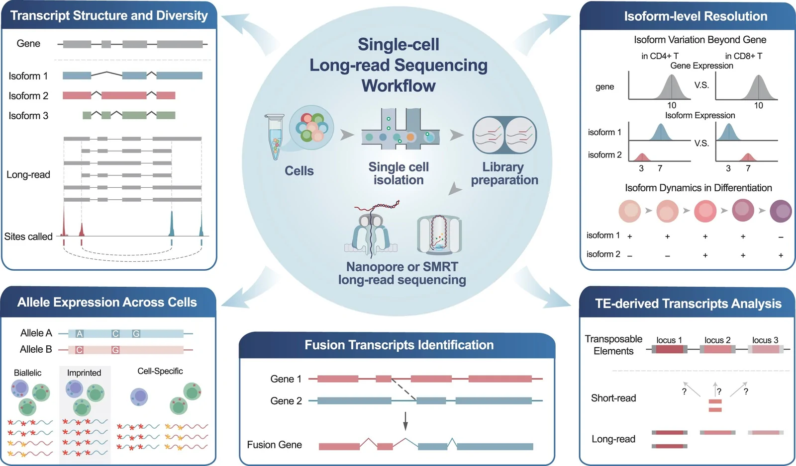
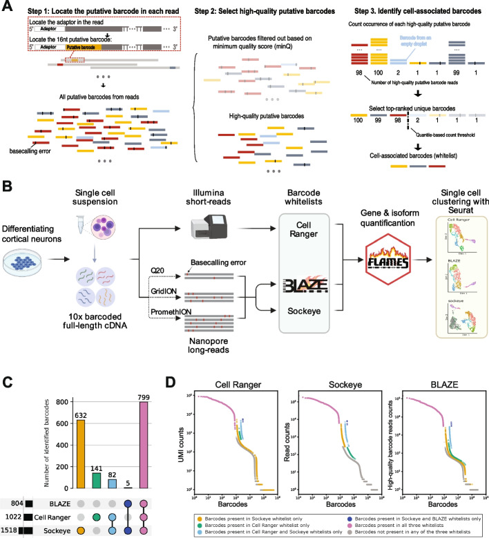
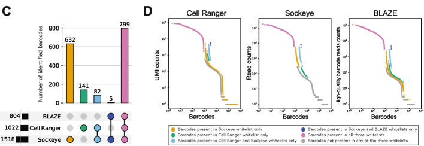
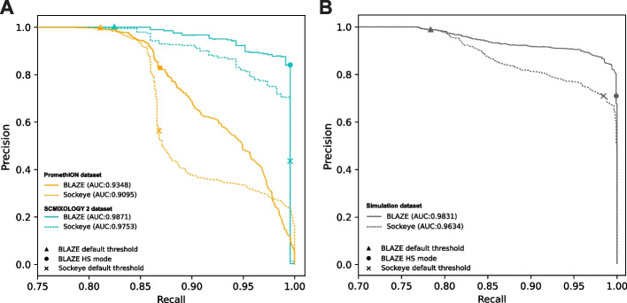
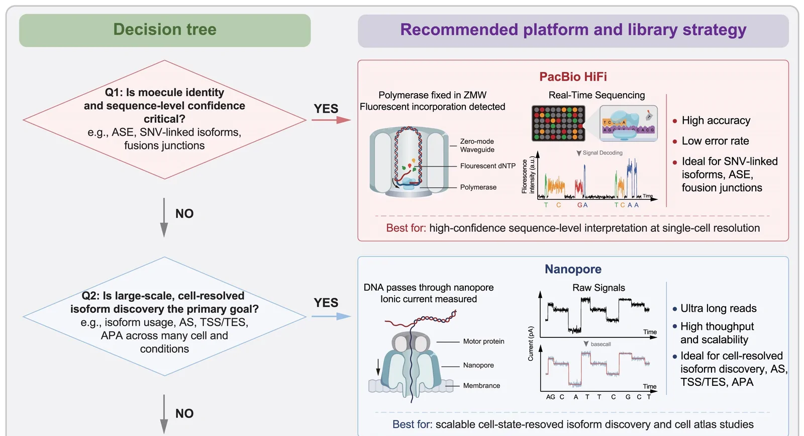
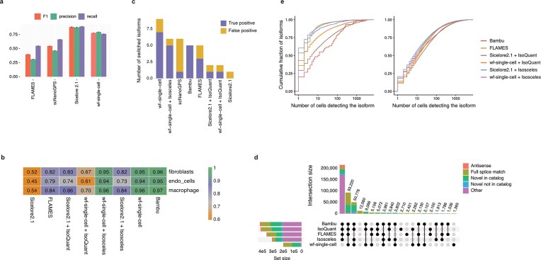
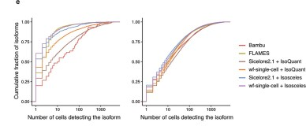
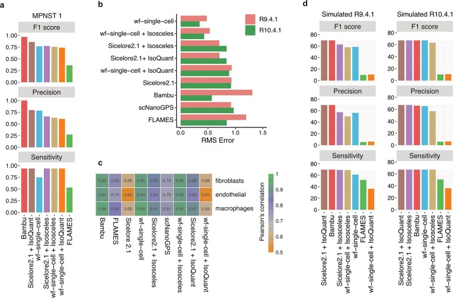
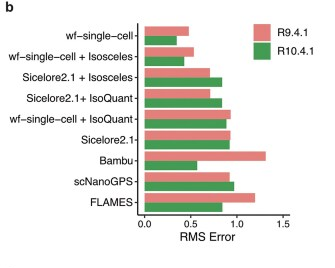
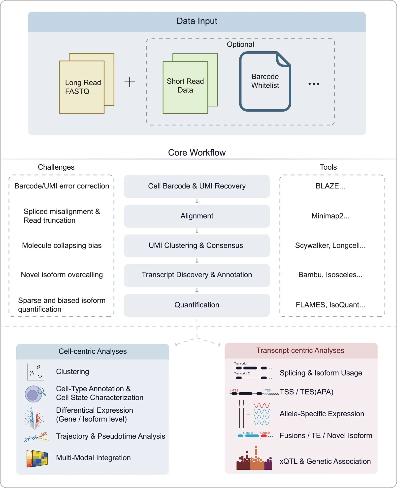

# 单细胞长读长：每一种转录本，凭什么数得准？

::: {.book-source}
论文：[DOI 10.1093/gigascience/giag082](https://doi.org/10.1093/gigascience/giag082)。原有图注和许可说明见正文；未明确许可的图版标记为**授权待确认**。
:::

封面：AI 辅助原创示意，非实验数据。

上半部导读：归属与计数：AI 辅助原创示意，非实验数据。

## 纵览｜测序前问清：你缺的是结构，还是计数？

两群细胞都检测到一个基因，每群恰好 10 个独立 RNA 分子。第一群里 7 个包含外显子 E、3 个跳过 E；第二群则是 3 个包含、7 个跳过。两群在基因计数矩阵上完全相同，转录本构成却不一样。这个例子里的数字是示意，不能当统计检验。真正实验里还有个更麻烦的第三种读段：只读到两个异构体共有的尾部。它能帮助我们确认这个基因有表达，却不能自己告诉我们是包含，还是跳过。

这就是读 Ren 等人这篇 GigaScience 综述时最有用的一条线：**读段更长、分子属于某个细胞、分子确实带有特定转录本结构，是三件要分别证明的事。** 原综述的图 1 从中央的细胞分离、建库和长读长测序，展开到外显子连接、异构体、等位基因、融合和重复来源转录本。图里右上的 10、7、3 是帮助理解同一基因总量下组成变化的示意，不是 CD4⁺ 与 CD8⁺ T 细胞的比较数据，更没有供体数或误差条。图中融合分支也不是“遇到一条长读段就能确认真融合”的质量保证。本篇把原图当问题地图，把关键证据放在实际的条码和分子计数案例上。

Ren 图 1：横向读作问题地图。右上 10、7、3 只是示意，不是细胞组比较数据；任何融合分支都不是对单条读段的真伪保证。WebP 无损转为 PNG，图像像素未改。 来源：[Ren、Liu、Yin 与 Liu，GigaScience（2026）](https://doi.org/10.1093/gigascience/giag082)，[CC BY 4.0](https://creativecommons.org/licenses/by/4.0/)。

## 1｜长片段解决了“连在一起”，未必解决“有几条”

普通 3′ 标签式单细胞 RNA 测序擅长为许多细胞提供基因层表达矩阵。两条转录本若只在靠前外显子不同，而 3′ 端共享序列，标签可能没有读到区分它们的位置。覆盖多个连接的长读段则可以观察这些连接是否在同一分子上。因此在要识别外显子组合、把启动端同末端连起来，或者判断远端异质位点是否和某个转录本共现时，长读长提供了一类短读长标签不足以提供的直接证据。这里比较的是常见的末端标签设计，不能泛化为所有短读长方法：覆盖局部接头的短读长、专门端点测量、目标基因的独立验证依然有价值。

辨认完整转录本至少有两种定义。第一种只关心内部的剪接链，比如起点或末端偏差一小段，仍然认作同一个结构类别。第二种把转录起始和终止也视为结构，测错一个端点就算错。问替代剪接时两者有时可以分开；问启动子、替代多聚腺苷酸化（APA）时就不能混用。长读段跨度很大也可能从中间才开始：RNA 降解、逆转录提前终止或技术性引物事件都可以让真实的长转录本表现为较短读段。原综述图 3 把截断列在比对附近，但真正的偏差可能起源于更早的采样和建库，后面的统计不能凭空恢复被丢失的序列。

还有一层常被忽略：同一分子重复扩增产生的多个测序读段，应尽量按分子而非读段计数；而多个真实分子却可能被错误合并。长读长提高了一部分结构的可观测性，不自动让每个细胞样本有足够的有效分子，更不增加独立供体数。先确定交付品是细胞图谱、候选结构目录，还是能在供体间检验的亚型用量。前两种允许保留更多探索性结果；后一种需要更高的每供体有效分子覆盖和固定计数口径。

一个容易误读的结果是“处理组多出一种短异构体”。如果两组真实 RNA 相同，但处理组材料中长分子更多在前半截丢失，按内部剪接尾链做归属就可能把一部分看成短异构体。有帮助的是先切开问题：两组的 RNA 完整度、读段长度和端到端支持是否可比？只看有独占接头的分子、匹配深度的细胞或短截比例接近的样本，方向是否仍然一致？若结论主要由共享尾链推动，应该把它降级为“不同分配假设下可见的候选变化”，不是已发现新结构。对终点问题如此，对基因计数与细胞标签的关系也如此。

## 2｜细胞条码和 UMI 像两级身份证，丢错一种后果不同

细胞条码（CB）用来把读段归到细胞或分区；唯一分子标识（UMI）在合适的组合上下文里帮助辨认独立分子。CB 错了，一条本来属于 A 的读段可能跑去 B，或者从分析中消失。UMI 错了，同一个分子可能被拆成两个，或者不同分子被误并成一个。后果不同，质控也不该只发一个“回收率”数字。

看一个不对应任何真实样本的玩具例子。某个细胞一个基因有 2 个真实分子，第一分子产生 4 条测序读段，第二个产生 1 条。没有 UMI 去重时是 5 条，不该直接叫 5 个分子。若第一分子的 4 条读段中有 1 条 UMI 错了，原样按字符串计会得 3 个假定分子；若真实的第二个 UMI 碰巧和第一个非常接近，纠错过宽又可能把 2 个真分子并成 1 个。在非玩具数据，UMI 数还受碰撞率、位置与基因归属所影响。提示读者记住两类错误的方向即可：**纠错少了可能拆开，纠错多了可能合并。** 同时也报告 UMI 缺失的细胞或基因，别在删掉以后办成“完全计数”。

有人会问：单碱基准确度已经 99%，为什么还在讨论条码？在假设各位点独立、每个碱基都有相同 1% 错误概率的教学模型中，16 个碱基的短标签出现至少一个错误的概率是 1 − 0.99^16 ≈ 14.85%。这不是任一仪器或真实标签的实测率。端部和局部错误可能不独立，过滤与共识也会改变最终观测值；即使出现一个错误，也不等于最终错分到细胞。这个计算只说明“每碱基质量”和“整个标签正确的概率”不能混为一个指标。更关键的是你的库类型有没有可靠效验信息：候选条码列表、同一库的短读长参考，以及只来自长读长自身的错误模式，是三种不同的证据。

## 3｜三种找细胞的思路，真正的取舍是漏掉谁、错收谁

第一种用同一条码库的匹配短读长来找细胞，再把长读段的结构证据接回去。短读长基因层的注释对高通量样本有用，也给你一个核对掉队细胞的坐标。它的代价不仅是测两套数据，还要协调两个平台滤掉的细胞是否一样。短读长工作流认出的真细胞，长读长那边可能只有三五条弱读段；这时“匹配到一个细胞”与“知道那个细胞的转录本组成”应分开报告。反过来，匹配列表也可能包含环境 RNA 影响下的空分区，不能把同源测量当绝对真值。

第二种直接从长读段找标准条码。综述表 3 把 BLAZE、wf-single-cell 等放在这个思路下举例。这里要区分两张表：试剂设计给出的**允许序列集合**，与数据分析推出来的**这一次样本中被叫出的细胞条码集合**。前者不是所有列表成员都有细胞，后者不是成员之外绝无细胞。BLAZE 在原始论文的主要输出是一张细胞条码列表；综述表 3 的短句容易读成 BLAZE 单独完成了完整 UMI 去重和异构体定量。本篇用原始方法范围界定它，后续分子去重和计数看接了什么工具、用了什么参数。

第三种从读段支持中从头找候选，或者允许可配置条码架构，适用于缺少合适列表、试剂结构不同的场景。综述举 scNanoGPS 及 Flexiplex 为例，但二者并不是“同一种从头算法”的不同实现。关键是报告候选间的相似关系、试验条件下预期的细胞数、候选支持强度分布、低分子量真细胞可能被丢掉的比例，以及如何识别污染或双细胞。把总细胞数最大当目标，容易给稀疏背景或测序错误更多空间；一刀切地追求最干净，同样可能整群漏掉低 RNA 的细胞。有可信的细胞组成或匹配数据时，不妨专看每种细胞类型的保留率，以及阈值变动是否对某一种细胞更不利。

## 4｜看一组真实比较：804 与 1,518，差别不在数字大小

You 等人的 BLAZE 原始研究在一个人 iPSC 来源皮层分化体系，用深测的 PromethION 长读长与配对短读长作比较。原文表 2 / 图 1C 中，短读长 Cell Ranger、长读长 BLAZE、长读长 Sockeye 分别报 1,022、804、1,518 个细胞条码。在该比较中，BLAZE 叫出的条码有 99.4% 同时见于另外两种策略；分母是 BLAZE 的 804 个条码，不是所有实际细胞，也不是读段。三套条码作为下游文件时可分析的长读段份额约 70%、69%、69%（原文表 1，分母已过测序质量门槛的长读段）。这是同一数据集内的两组量，条码召回、读段利用率和细胞类型覆盖不应相互代替。即使 BLAZE 保留的细胞条码更少，它在这组数据中保留的可分析读段份额几乎没变，提示差异主要集中在低长读段支持的边缘候选。具体的集合关系看图 1C 上方各组合交集柱；图 1D 横轴按各策略的支持量排序，也不应该把不同曲线同一名次当成同一个细胞。

这也并非“少叫几个总是更好”。研究者将不同条码列表接到相同下游 FLAMES 后，发现更宽松或包含低支持条码的设置可以在投影中多出一簇，作者用空分区与标记检查解释其中不少候选。图 7 的实样 precision–recall 对照把短读长 Cell Ranger 减去判为空分区的条码当参照；模拟图才有设计出来的条码真值。真实参照不完美，模拟也未必完全复现测序末端和连在一起的错误。原文另有高灵敏模式更愿意要边缘候选。适合迁移的是同一套诊断：看集合交集，追查仅某工具报告的条码，检查参照看不到与确属假的区别，最后才看不同列表怎样移动每种细胞的用量估计。不能把一篇方法作者的比较结论自动延长到所有测序化学、样本和版本。

Hamraoui 等后来比较了十个长读长单细胞和空间分析框架，并在不同 ONT 测序条件下比较方法。它提供了一个很好的交叉检查：没有配对短读长也能在部分成熟的标准库开展有用分析，但流程的表现会随测序质量、深度、评估任务和组合改变。该研究最大价值不是几款软件谁 “赢了”，而是把条码、UMI、基因量、转录本量与结构发现分项评估。在你自己的项目里，也应分别问：参照细胞找回多少；已叫出细胞中有多少弱支持；同一个细胞里，读段能数成多少独立、还保留结构信息的分子。一个总 “通过率”解决不了后两个问题。

You 图 1：C 面板区分条码集合及交集，D 面板按各流程的支持量排序；不同流程同一名次不是同一个细胞。 来源：[You 等，Genome Biology（2023）](https://doi.org/10.1186/s13059-023-02907-y)，[CC BY 4.0](https://creativecommons.org/licenses/by/4.0/)。

补充原始研究图 1C/D：C 上方交集柱与下方点为组合，D 横轴为条码排名、纵轴为各工作流使用的支持量；不同曲线上的同名次不是同一个细胞。 来源：[You 等，Genome Biology（2023）](https://doi.org/10.1186/s13059-023-02907-y)，[CC BY 4.0](https://creativecommons.org/licenses/by/4.0/)。只裁并无损导出所标原图面板，未更改数据、轴线或图例。

You 图 7：A 实样用 Cell Ranger 减判空滴作参照，B 是模拟真值；横轴召回，纵轴精确率。 来源：[You 等，Genome Biology（2023）](https://doi.org/10.1186/s13059-023-02907-y)，[CC BY 4.0](https://creativecommons.org/licenses/by/4.0/)。

## 5｜选平台时，把预算换算成支持目标结论的分子

图 2 左边是研究问题的决策树，右边把一致性高的 HiFi、可调通量的 nanopore 和特殊目标库分列。右上荧光与中右电流的曲线都是平台原理示意，不是同一批样品的精度对照。作者对读级碱基可靠性和可扩展性的判断提供了合适的询问顺序，却不是跨项目固定排名。看公开评审第二轮正好能见到这个分歧：评审以自己的平台经验质疑“同等输出时 HiFi 因重复读同一分子先天回收更少”的泛化；作者在正式稿删除了这种说法，改用不同平台当前工作流都可能达到类似的去重分子回收、复杂度和成本则因量级而异。评审经历本身不是对照 benchmark。它提醒你，应拿同一类样本、同一计数口径和相近的有效信息需求来谈成本与产出。

实际询价与试跑时，我会分开看每投入样本读出了多少条，通过背景与条码筛选后留下多少，再看按预定结构标准和 UMI 去重最终剩下多少。一个通量很高的方案若采集了很多共用尾端，回答 sQTL 或端点联动未必便宜；一个极精确的方案若只评价高表达基因，也未必适合找稀有转录本。若目的只是验证少数已有结构，定向信息可提高每个目标的覆盖，但不能把目标集合之外的“没见到”解释为不表达，富集后的分子构成也不能未经校正外推到全转录组。本篇不展开特殊建库或改造实验细节，表 2 的实用读法是识别数据是否改变采样空间和分母，记录何种信号不再可比较。

Ren 图 2（上部裁切）：左为平台选择决策框，右为测序原理。仅裁取相关原面板，未改数据或标签；不构成同一数据集上性能对照。 来源：[Ren、Liu、Yin 与 Liu，GigaScience（2026）](https://doi.org/10.1093/gigascience/giag082)，[CC BY 4.0](https://creativecommons.org/licenses/by/4.0/)。

## 从试跑到扩样：保留一张可对账的表

在几十、几百个示范细胞后盲目扩大规模，比没有试跑更容易跑偏。拿一份匹配目标组织和库类型的小批数据，按样本、细胞群和基因整理漏斗：原始合格读段、能看见 CB 的读段、唯一细胞归属、可信 UMI 或可用的替代计数、结构可区分、含端点证据、最后保留的解析单位。哪些步骤判不出也给出来。用每组真实独立供体内的细胞/分子分布、深度匹配、短读长对照（如有）来问：某一步的丢失是否偏向某组或某种细胞？如果预算只够多测两个供体或给现有供体加深，先看现在的瓶颈究竟在哪层。转录本一个都看不清，先解决结构可分性；每个供体的用量已经足够稳定但方向在人之间不确定，需要更多独立样本。空间区域、技术复测和额外细胞不能冒充新供体。

读这篇综述时，可先对照图 1 和图 2 画出自己研究的证据链，再去表 1 与表 3 对方法族分层，最后用原始 BLAZE 的图 1C/D 和表 1/2 检查刚才说的几种分母。**先证明哪一个细胞、多少独立分子、其中有多少读段能分辨目标结构，再去比较用量。**

来源：Ren 等，GigaScience 15, giag082（2026），[正式版](https://doi.org/10.1093/gigascience/giag082)，2026 年 7 月 22 日首次上线、8 月 26 日排版更正；[You 等，Genome Biology 24:66（2023）](https://doi.org/10.1186/s13059-023-02907-y)；[Hamraoui 等，NAR Genomics and Bioinformatics（2026）](https://doi.org/10.1093/nargab/lqag070)。术语解释和玩具数字为本稿自制，未运行真实数据或比较软件性能。

下半部导读：辨识与复现：AI 辅助原创示意，非实验数据。

## 纵览｜从一条长读段到一个可重复发现，有三道关

前面讨论读段来自谁、同一分子出现多少次。到了这一步，实际拿到的通常不是“每条读段都写着转录本名称”，而是某些读段能区分结构，某些同时与多条转录本兼容，还有些很可能是截断或比对误差。目录告诉你要比较哪些结构，计数决定各结构的占比，统计检验决定能不能把这次观察推到新的供体上。三道关不能交给同一个“检测到新异构体”的标签。

## 1｜先分清用途：目录发现，还是用固定目录估量

把参考注释理解成一组已有路线。同一条长读段如果跨过两个能区分路线的接头，说明力不小。若它只覆盖了共同路段，不能仅凭它同时匹配两条路线，就说两条路线各走了一次。参考导向流程常借助已知剪接位点纠正少量比对偏差，样本覆盖浅、注释相对可靠时很有用；不过它也可能把真实的新变化拉回参考。允许更多未注释结构的流程更适合探索，再多一个新类别也会增加对弱支持、截短和偶然接头的敏感性。

综述表 4 可以按三层读：Bambu、IsoQuant 等代表把参考与跨接头证据纳入发现；TALON 等强调跨样本追踪和目录稳定性；Oarfish、lr-kallisto 被列在定量侧，用已有转录本集合估量，不负责宣布发现任意新结构。真实软件可以跨过这些边界，更不能只看某列的“yes”选择。例如原表 SCOTCH 和 Mandalorion 用了同一编号 [68]，但参考文献 [68] 指向 Volden 等的 Mandalorion；SCOTCH 应另查 Xu 等 Nature Communications 正式论文。这是引用错位，不是两个工具同源。类似地，表 4 对“annotation-free de novo”的划分容易和“没有转录本注释也运行”混起来；使用参考基因组比对但没有 GTF，不等于参考基因组也不用。选择时应对照原始输入和输出，先确定到底缺什么参考。这也是读工具表时比记名称更有用的一件事。

同数据发现与检验容易相互影响。若一条候选结构因为恰在病例几颗细胞特别高而进目录，再用同一批样本说该结构病例特异，实际把发现过程当成了事先定义的比较。探索时可以并列报告候选，不要附上独立检验的口吻。若目标是验证某个差异，先约定可比的目录、结构判定（只剪接链，还是含双端点）、最低分子及供体支持；有独立样本就留出来验证。没有时，可按供体拆分探索与确认，或者只做内部稳健性分析并老实报限制。即使一个方法同时输出目录和矩阵，也不表示从同批数据筛出来的每项比较无需校正。

## 2｜有些分子可以归属，有些只能估量

看一个玩具例子。某个供体的同类细胞汇总后，一个基因中 A 有 20 个可唯一支持的分子，B 有 10 个，另外 30 个分子与两者都兼容。如果 A、B 仅此两类且所有共享分子都可能来自任一者，A 的可行份额从 20/60（约 33%）到 50/60（约 83%）。仅看可辨认分子会得到 20/30（约 67%）；在某种平等的可见性假设下可以把共享分子按约 2:1 分配，仍给出 40/60（约 67%），但第二个值混入模型估计，不能在图里把这 20 个补上的分子画成实际跨到独有接头的读段。两种方法看起来结果一样，是因为例子设计成这样；一旦两种异构体的特征段长度、可见性、截短比例不同，不能无条件按同一比例分配。

Isosceles 原始方法用“哪些转录本与读段相容”的集合表示证据，并在假设下用期望最大化等方法估计丰度。它的实用之处在于把可多重归属的观察纳入模型，不必丢掉含信息但不能唯一指认的读段。它不能消除不可识别的情形：两个真结构只在本批数据统一没测到的位置不同，再精巧的分配算法也不能从共享区域独立学出比例。更严谨的报法是同时给唯一支持量、含歧义分子的估计量、歧义率和分配模型，不同前处理下结果是否稳健。发现本身若全靠共享读段，不该因此被升成确认。

看 Kabza 等的 Isosceles 原文图 2a/c。图 2a 的横轴是模拟中基于 TPM 的中位相对差，分母是预测和真值的平均。Isosceles 为 0.23，Bambu 为 0.29，越低越好；这是转录本丰度预测误差，不是“23% 细胞错分”。图 2b 的五列把注释内、被隐藏、全部结构的召回以及 FDR、F1 分开。模拟里人为从参考中去掉 30% 转录本，Isosceles 单独时，被隐藏结构召回 29.6%；在图示的 Isosceles + IsoQuant 预发现组合中为 50.5%，整体 FDR 是 4.3%。把注释藏起来只是近似“未注释”：序列来自设计的模拟真值，匹配结构时不要求精确双端，也不包括你队列所有的降解和截短失真。模拟结果能帮助比较方法，对真实材料里一条具体新结构是真是假的判断仍要回分子证据。

另看 Hamraoui 等的独立比较，主文图 5E 在真实的 MPNST1 PromethION 数据里按“每个结构被多少细胞检测到”绘制累积分布。横轴是细胞数（对数尺度），纵轴是落在该细胞数及以下的结构比例，左右分开看新结构和已知结构。跨工具平均约 75.6% 的新结构最多出现在 10 个细胞，已知结构相应是 50.8%。这不是 75.6% 新结构为假；真罕见细胞、弱覆盖、未充分处理的转录本和误报都可能进这个低支持桶。图 6B 用模拟真值上的标准化 RMSE 衡量丰度，与 5E 真实数据中“哪个结构被多少细胞叫出来”完全不同。把同一软件在两个任务中的表现放一起看，才知道所谓优劣是在定量、结构发现，还是稀有噪声控制上。没有我们的重跑，不能将原研究的结果变成新榜单。

Hamraoui 图 5：E 比较各结构由多少细胞支持，真实数据的低支持不是已知假阳性。 来源：[Hamraoui 等，NAR Genomics and Bioinformatics（2026）](https://doi.org/10.1093/nargab/lqag070)，[CC BY 4.0](https://creativecommons.org/licenses/by/4.0/)。

补充原始研究图 5E：横轴为支持的细胞数（对数），纵轴为累积分数。左为新结构、右为已知结构，线区分方法；低细胞支持并非已知假阳性。 来源：[Hamraoui 等，NAR Genomics and Bioinformatics（2026）](https://doi.org/10.1093/nargab/lqag070)，[CC BY 4.0](https://creativecommons.org/licenses/by/4.0/)。只裁并无损导出所标原图面板，未更改数据、轴线或图例。

Hamraoui 图 6：A 真实数据 TUSCO，B 模拟丰度误差，C 聚合相关，D 模拟遮盖注释；统计标准不同。 来源：[Hamraoui 等，NAR Genomics and Bioinformatics（2026）](https://doi.org/10.1093/nargab/lqag070)，[CC BY 4.0](https://creativecommons.org/licenses/by/4.0/)。

补充原始研究图 6B 放大：横轴为 RMS Error（越低越好），同一方法两色对应两种测序化学条件，只能在相应模拟范围内解读。 来源：[Hamraoui 等，NAR Genomics and Bioinformatics（2026）](https://doi.org/10.1093/nargab/lqag070)，[CC BY 4.0](https://creativecommons.org/licenses/by/4.0/)。只裁并无损导出所标原图面板，未更改数据、轴线或图例。

## 3｜同一位点的局部比例、整条使用率、基因总量，是三个数

替代剪接事件使用率常问局部选择，例如某个外显子包含比例。整条转录本使用率问由哪些启动、剪接组合和末端共同定义的分子，除以该基因在同一口径下的总量。一个外显子可能由两条转录本共同包含，局部比例变了也不能说具体是哪一条转录本变了；两次远端事件的平均比例变化还可能发生在不同分子上。长读长有机会直接观察二者相连，但若只保留共尾端的截短读段，仍没有这项直接观察。无论报告 DSE（差异剪接事件）还是 DTU（差异转录本使用），把证据到底是局部接头、完整结构还是模型推出来的比例写在图例里。

再看一个极简单的构成例子：健康组 A 10、B 10；另一组 A 10、B 30。A 的相对份额从 50% 降到 25%，绝对观测计数没变。这不意味着在真实样本中可按未校正的原始计数宣称绝对表达不变，这里只在同单位的假想计数展示分母效应。真实研究至少报基因总量、分子覆盖、各亚型份额，并检查是否某一高丰度转录本改变了分母。反过来，基因总量变化而两条份额保持不变，也不是结构使用切换。用 RT 端点或蛋白数据补证时先问它验证的是结构、相对用量还是功能。

Longcell 给了另一个有用的分解：同一个细胞中多种相关读段共现，以及有的细胞只偏向一种、另一些却偏向另一种，是细胞内与细胞间两种不同的剪接异质性。把所有细胞先合起来，两种图景可能得到几乎同一比例；过度解读单分子细胞也会让可见比例变得极端。这个思想帮助确定报告单位，不意味着任意稀疏数据都能识别这两层。好图应显示细胞可辨识分子深度和哪些单位缺数，而不是只放漂亮的均值或平滑图。Longcell 这里仅引用其统计思路，不把原工作里其他实验推广为本稿验证。

## 4｜条件差异要在供体上成立，不在细胞数上凑齐

想知道病例与对照中同一种细胞是否改变了 A 的用量，先把每个供体内的相同细胞类型作为一个分析块汇总；若设计允许，也可以直接在细胞层建模，但模型必须明确供体层次与样本内相关性。几万个细胞都属于两三个人时，观察到很多分子能提高该样本内部的测量精度，却不能替代复现。写出聚合规则、分子或计数偏差、供体内最小覆盖、没有该细胞群的供体数。比如 A 位点病例只覆盖 3/8 个供体、对照覆盖 7/8，比较比例前先看这是不是缺失构成、深度或含目标细胞量的问题。不要把一个显示 0 的箱子同时解释成“有读过却未检出”和“无可辨别的分子、根本没法估”。第二种应在数据上标不可估，第一种也需要给出分母和不确定性。

实操上先固定目录、定义细胞类型、在样本层保留多个独立重复。做供体级图，分别显示基因支持分子及结构可分辨数，再问 A 的份额移动多少、置信区间多宽。低覆盖类群可单列探索，群内等深度比较能检查技术方向，但不必把主结论只交给下采样；将其作为稳健性分析，并看删去单个高深度供体后方向如何。全基因范围的测试保持多重校正、记录过滤窗口。如果人和条件完全绑定，比如病例都来自一个中心、对照都来自另一个，无法靠堆叠读段或随意加入协变量解开群体差异。设计补证优先。同一切片上的连片区域不该算多个独立受试者；坐标分辨率也不自动等同于单细胞归属。对不确定的图谱可以写区域模式，跨切片和供体一致性的证据再单列。

## 5｜定位机制：在哪些场景，读段证据该停在哪站

替代启动和 APA 的价值是把端点与内部连接放到一条分子上。第一步明确端点证据类型；意外短读段不足以确认新启动子，含内部 A 富集区域也不能直接断言是真末端。按问题选独立的端点数据或其他验证，回查位点级、样本级支持。基因总量可以很稳定，边界仍可变化；结构的变化给出潜在调控解释，不是蛋白功能已验证。原综述举脑发育与皮层层次为说明，不把其空间性误当时序因果。

等位基因表达（ASE）是同一基因两个等位拷贝的转录偏好，和不同供体的遗传变异是否影响某 RNA 特征（QTL）分开。长读段把多个能区分的位点与转录本接起来，能降低某些归属歧义；仍要防参考比对偏差、测序错配和低覆盖。可比较的等位分子、独立供体与合适的 DNA 参照能分别处理不同的不确定性。找到同一细胞群的 isoQTL，并在另一个性状中看到相近位点，提示优先验证；共定位和同细胞共测不能独自证成由此异构体中介的因果路径。

融合的“一条读段跨断点”可建立候选，不能一笔排除制备中嵌合、比对错误或正常基因间连续转录。重复序列相关转录本则应区分序列家族级和位点级证据。新结构标记是相对指定注释版本的新，不是功能新。RNA 修饰的读出也需标性质：普通 cDNA 序列不是直接的原生电流信息；某些读法产生间接信号，单分子的修饰调用与确定真实占比仍有距离。本篇保留测量层级辨别，不展开工程构建或应用配方。至于多组学整合，同一个细胞中染色质与转录本都被测到，强于事后猜它们来自同一群细胞，仍只是两层信号共现；受共享细胞状态驱动的解释必须摆在因果解释旁边。

综述列举免疫、神经和肿瘤图谱，是展示结构信息在哪类问题可能有收益，而不是为各场景设了统一表现阈值。把细胞分类、状态与结构发现分开验证：先用既有可靠表型或基因表达建立细胞标签，再问新结构是否在留出的样本中提供额外信息；不要让同一条稀疏特征既定义簇又当作分簇正确的验证。这点对新样本、不同测序平台及参考版本尤其重要。

## 6｜拿到一张论文图，我会追问什么？

先写这张图展示哪种单位：细胞、去重分子、转录本、空间位置，还是供体。然后问面对真实的三种噪声：结构读不全、分配不唯一，以及同一供体的细胞彼此相关，作者分别用了什么证据来缓解？如果换一个合理的注释、分配或截短处理，这个差异还在不在？在机制场景下再问，哪一步需要另一种读出才能排除主要替代解释？

这种顺序比在表 3、表 4、表 5 里背排名有用。表 3 是细胞或分子归属接口、表 4 是结构发现和定量、表 5 是实际的科学问题，不是三张在竞争第一名的排行榜。原综述图 3 上层列输入，居中列五步、左边列失败原因、右边列举工具，底层蓝色与粉色框分出以细胞和以转录本为中心的分析；没有样本数、坐标或统计结果。最值得做的改进是给每一步加一条“落到下游的误差是什么”，再把真实原始证据接上。这样即使最后只剩几个结果，它们也比一整张未经审计的异构体热图更能指导下一轮。

Ren 图 3：上层输入，中间五步，左为误差、右为工具，底部为两类分析；来源是综述归纳，不是性能数据。WebP 无损转为 PNG，图像像素未改。 来源：[Ren、Liu、Yin 与 Liu，GigaScience（2026）](https://doi.org/10.1093/gigascience/giag082)，[CC BY 4.0](https://creativecommons.org/licenses/by/4.0/)。

来源：[Ren 等综述](https://doi.org/10.1093/gigascience/giag082)；[Kabza 等 Isosceles](https://doi.org/10.1038/s41467-024-51584-3)；[Hamraoui 等 benchmark](https://doi.org/10.1093/nargab/lqag070)；[Fu 等 Longcell](https://doi.org/10.1038/s41467-025-60902-2)；[Xu 等 SCOTCH](https://doi.org/10.1038/s41467-026-72665-5)。供体、计数和构成示例均为教学用假想数；模型适用范围与统计建议为本解读补充。

## 版本、证据范围与图件许可

[Ren 等正式综述](https://doi.org/10.1093/gigascience/giag082)于 2026 年 7 月 22 日首次上线、8 月 26 日更正排版；按正式版通读 14 页主文、图 1–3 与表 1–5，也阅读随文公开的 4 份评审意见及 2 份作者回应。较早三版稿件只用于识别版本。评审意见不是新对照实验；此处没有逐条复核原综述的 127 条参考文献，也没有运行数据、工具或仪器。原综述是叙述性综合，而不是系统综述或荟萃分析。正式版披露 BGI 与期刊所有者的关联、其中一位作者的编辑身份，并报告独立处理和外审。

三篇 CC BY 4.0 原文的证据图分开标注作者、文献、许可与裁切情况。Kabza 等 [Isosceles 图 2](https://www.nature.com/articles/s41467-024-51584-3/figures/2) 为 CC BY-NC-ND 4.0，本笔记仅链接，不附原图、不裁切、不复刻布局。其对照是另一个研究，不应和 Hamraoui 图件合成总榜。自作示意、假想数字与正式研究结果区分。

## Take-home messages｜给每个转录本结果建一张证据账单

结语导读：每份证据的分母：AI 辅助原创示意，非实验数据。

下一次看到“某个细胞群特异使用一种新转录本”，先找这三条数据：**这个细胞是怎么叫出来的、支持结构有多少独立分子、换一批独立样本还看不看得到。** 它们分别处理细胞归属、分子归属、结论可推广性，谁都不替另一个回答问题。

**1. 用对你的测量单位。** 原始读段、一个分配到细胞的读段、一个去重分子、一个足以区分 A/B 结构的分子，含义不同。开头写清预期输出。研究局部剪接不必承诺全部起止端；研究多聚腺苷酸化时只有内部接头也不能代替终点。结构定义应在组间相同。

**2. 把条码阈值当成测量设计。** BLAZE 原论文一个配对数据集的候选条码数从 804 到 1,518，可分析长读段的比例却相近。着急扩样前先检查仅某工具保留的是低表达真细胞、空分区还是误分。短读长高质量细胞名单与有足够长读段结构证据的细胞名单也不一定相同。UMI 拆分、误并和缺失单独记录。

**3. 新目录和丰度矩阵是两个交付品。** 发现库容纳待验证候选；确认库应有一致定义和最低支撑。报告几个分子确实跨过独占结构，几个需要模型分配。不妨先给共享分子全部拨到两边的极端界限，看方向会不会反过来。没有特异片段时，应说明数据不够区分，不用 EM 的小数掩盖。

**4. 结合证据强弱来写句子。** 测到剪接链可支持结构；同一细胞群多种异构体比例有差可支持给定模型下的用量变化；多个供体方向一致才接近可复现结果；定位调控机制还需独立读出。端点、重复来源、等位基因、RNA 修饰和融合各有容易误判的环节。没有独立验证就标候选，不承诺功能或临床价值。

**5. 热图漂亮也要看分母。** 先在供体内汇总相同细胞类型，把供体当独立重复；做细胞层模型要处理嵌套。记录可识别分子、样本覆盖和按组缺失率。同一供体加细胞可以稳定其估计，不能替代独立样本。原始计数 0 与无可分辨信息要分开。

**6. Benchmark 拆题，别看一张总榜买方案。** 条码、UMI、定量与结构发现分开；合成真值、已知分子比例、正交配对、真实样本的支持分布各补一块。公开数据的获胜工具不一定适合你的输入和问题。最后比较目标分子每单位预算的产出和独立样本中的复现。

| 问题 | 主指标 | 底层分母 | 关键反例 | 参照或验证 | 独立重复 | 结论边界 |
|---|---|---|---|---|---|---|
| 同一细胞类型是否换用另一条转录本？ | 供体内 A 份额及区间 | 去重、结构可分辨的分子，另列模糊支持 | 一组长分子的前端更容易丢 | 匹配深度、按样本查端点和独占接头 | 供体；技术重复单列 | 可复现用量，不代替功能验证 |

最后留个组会问题：如果预算只够多收两位供体，或给现有供体测得更深，你怎么从试跑“有多少可分辨且可复现的转录本证据”判断先买哪一个？不要只用总读段数作答。

来源：[Ren 等正式综述](https://doi.org/10.1093/gigascience/giag082)；[BLAZE 原始研究](https://doi.org/10.1186/s13059-023-02907-y)；[Hamraoui 等原始比较](https://doi.org/10.1093/nargab/lqag070)。表格及结论分级为本解读的可迁移建议，未重新运行真实数据。
