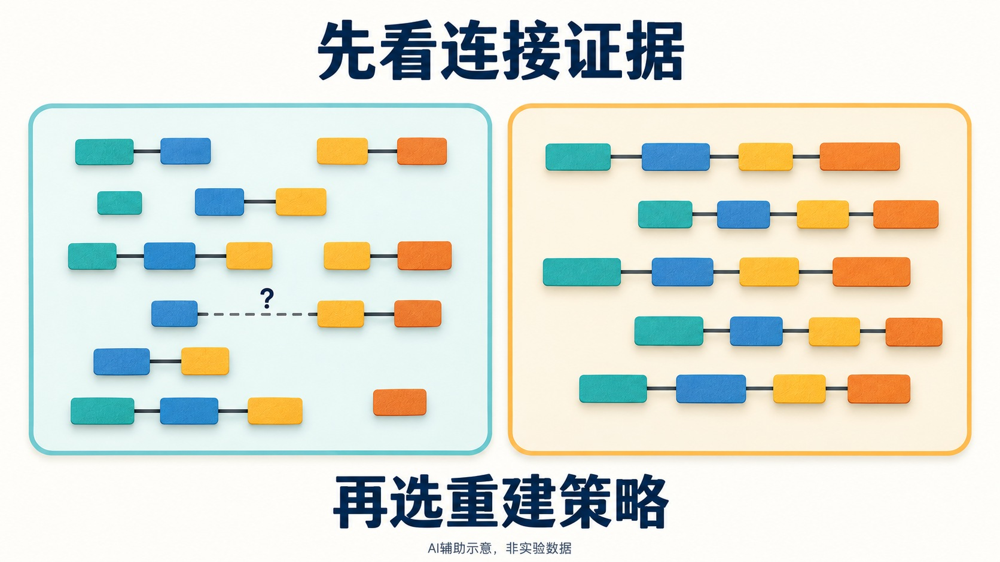

# TransGram：长读长怎样拼得更准

::: {.book-source}
论文：[DOI 10.1038/s41467-026-78013-x](https://doi.org/10.1038/s41467-026-78013-x)。原有图注和许可说明见正文；未明确许可的图版标记为**授权待确认**。
:::

论文：TransGram for heterogeneity-aware transcriptome reconstruction from long read RNA-Seq data。Nature Communications，首次上线 2026-10-05。[DOI](https://doi.org/10.1038/s41467-026-78013-x)

本页将已核对的公众号解读合并为一篇完整笔记，保留全部正文、阅读边界、引文与配图；仅取消分篇标题和导航，末节为 take-home messages。它属于公众号解读归档，尚未自动提升为需要引用或改变项目决策的精选文献笔记。

*AI辅助原创封面示意，非实验数据。*

## 机制与方法

AI辅助原创解读示意，非实验数据。

概念示意：读段是否覆盖关键连接，决定还需要多少组装推断；不代表实验数据。

### 平台名字够不够决定分析方法？

拿到一份PacBio转录组数据，你很可能选择软件的PacBio模式。这个决定通常有理由，但如果这份数据的读长分布、覆盖深度和局部连接关系偏离默认假设呢？软件面对的是实际读段，而不是仪器标签。TransGram把这一问题变成了一套可执行的分析：先检查数据能直接支持多少剪接连接，再决定还需要多少组装推断。

2026年10月5日，Ren、Qi、Han等在Nature Communications发表《TransGram for heterogeneity-aware transcriptome reconstruction from long read RNA-Seq data》，DOI：10.1038/s41467-026-78013-x。这是经过同行评审的原创方法研究，当前为Article in Press，并非预印本。本文依据完整主文及相关补充方法展开独立教学分析，第一节讲机制，第二节审视基准，第三节单列核心提醒。

作者关注的是从长读长RNA测序数据重建转录本。它与检测融合基因、证明RNA功能、鉴定RNA修饰不是同一个任务。输入读段支持什么结构，程序怎样生成候选，候选怎样筛选，是本文的核心链条。把任务边界先划清，才能判断一项性能改进对自己的项目究竟意味着什么。

### 读段很长，为什么还需要“拼”？

设想一个虚构基因有两个相隔很远的剪接选择：前半段可经过甲或乙，后半段可经过丙或丁。局部读段分别证明四个零件出现过，却未必说明甲连接丙还是丁。即使所有局部位置覆盖都很高，远处两次选择的组合仍可能不确定。我们需要的是把选择连在一起的分子证据，而不仅是每个零件都有人见过。

长读长能够减少组合歧义，但并不保证每条读段都覆盖完整RNA。分子长度、降解、制备过程和比对结果会共同影响可见范围。某条读段比短读长长得多，也可能恰好没有跨越关键的两个选择。因此，“仪器能读多长”“数据平均多长”“关键连接实际被支持多少”是三个不同的问题。

把这个问题画成图更容易理解：节点表示外显子区域，边表示相邻区域之间的剪接连接，一条转录本对应图中的一条路径。读段提供局部或完整路径，覆盖信息给节点和边附上权重。局部边全部存在，并不保证任意组合成的整条路径都曾以完整RNA的形式存在；算法需要在可行结构与真实支持之间作选择。

这里的图不是生物学的完整复制品。它由比对结果建立，哪些位点被合并、哪些连接被纠正，会改变后续搜索空间。如果上游遗漏一个连接，下游再聪明也未必能恢复它；如果上游引入错误连接，下游就需要识别并压低它。理解这一点，才能看出“重建”和“过滤”为何要分成两个环节。

### 从一个反常结果提出假设

研究的起点是IsoQuant的模式比较。作者在一批PacBio数据上分别运行PacBio和Nanopore设置，发现部分数据在后者下表现更好。这不是建议把所有PacBio数据都切成Nanopore模式，而是提示：模式名称承载的是一组参数假设，数据本身可能更接近另一组假设。

作者随后检查25个人类公开数据集，包括16个PacBio和9个ONT数据集，提出Alpha与Beta两类计算情形。这个分类针对转录本重建所需的连接证据，并非细胞状态分群，也不是把全部生物样本划分成两种天然类别。阅读“heterogeneity”时，如果直接联想到肿瘤异质性或单细胞群体差异，就会理解错层级。

这种研究思路值得初学者学习：先观察软件行为的异常，再寻找能够解释异常、且可以独立计算的数据特征。若只是事后把表现好的样本归一类，分类很容易变成结果的另一种说法；若能在运行最终重建前从输入中测得特征，才有机会真正指导算法选择。

### Alpha和Beta究竟在分什么

TransGram从剪接图及读段支持的子路径入手，判断哪些连接被可靠子路径覆盖。可靠性在这里是算法定义，包含读段支持与路径结构要求，并非“经过独立实验验证”。随后，对每个基因区域计算未被这类子路径覆盖的边占全部边的比例，再汇总为数据集层面的分类依据。

主文方法将未充分支持边比例不超过0.2的图划为支持较好的图；其余为支持较差的图。再用后者数量除以前者数量得到γ，以0.12为当前实现中的分类阈值：γ较高归入Alpha，低于阈值归入Beta。注意两个数字管的是不同层级：0.2判断一个图，0.12判断整份数据，不能混成“12%的读段不可靠”。

从直觉上说，Alpha数据中较多剪接关系不能直接靠可靠子路径串起来，额外图搜索更有价值；Beta数据已有较充分的连接支持，重建更接近沿着已有证据延伸与衔接。它们描述的是组装需求，不是质量等级。Alpha不等于坏数据，Beta也不意味着所有候选都真实。

这些阈值是经验选择，不是RNA世界的物理常数。补充说明比较了若干分界参数，并依据现有数据的分离情况确定实现。我们据此提出一个使用提醒：新协议、新物种或非常稀疏的数据应关注分类稳定性，而不应把自动打印的类别当作不可质疑的样本属性。这个提醒属于本刊分析。

### 为什么读长与覆盖能改变类别

研究不仅比较了不同来源数据，也改变同一数据的读长或覆盖条件，观察分类及匹配模型的表现。降低覆盖或保留更短的片段，会让原本较充分的连接证据变少；反过来，在另一份数据中选择较长、较高支持区域的读段，可形成另一类子集。比起只看不同样本间的相关，这种干预更接近在检验分类依据。

但对子集的解释仍需谨慎。只保留较长读段或高覆盖基因，改变的不只是一个统计数，还可能改变被研究的转录本集合。它能说明算法会随证据结构作出不同选择，却不能证明所有组织、协议都能通过同样操作得到相同收益。我们不应把用于机制检查的富集步骤直接照搬成每个项目的常规过滤。

对实际分析更有帮助的问题是：同一份数据在质控、降采样或合并后，连接证据是否发生变化？如果发生变化，沿用原来的分类、参数或模型可能就不再合适。记录输入数据及处理步骤，比只在方法里写“使用某软件默认参数”更有助于解释复现差异。

### 重建模块：尽量使用已有证据，再补缺口

TransGram接收排序后的剪接比对BAM，输出转录本GTF。它首先在基因区域建立剪接图，并识别读段对应的路径。两类数据都利用直接支持的路径及兼容子路径的重叠关系进行延伸；Alpha类还增加基于分块剪接图的组装环节。二者的差别并不是“一个用读段、一个完全不用读段”。

可以把重叠路径理解为两份有共同内容的记录。若一份覆盖甲到丙，另一份覆盖乙到丁，且重叠部分一致，二者可能帮助恢复更长结构。但“可以连接”仍不同于“唯一正确连接”。复杂图中可能存在多种兼容组合，程序会利用覆盖权重和搜索规则选择候选，而不是同时把所有理论组合都宣布为生物学事实。

Alpha类的额外步骤将图按关键位置分块，在块内寻找路径，再在共享关键节点处连接。这样做的计算动机是把复杂的全局搜索拆成较容易处理的局部问题。它仍是一种带假设的重建策略，不能凭空创造缺失的观测；把局部结构拼完整，必须随后接受质量评估。

教学上最重要的区分是“直接看见”与“依据规则补全”。两种信息都可能有用，但可信度来源不同。若一个关键候选的大部分结构靠直接跨越读段支持，我们主要检查这些读段是否可靠；若结构依赖多个局部证据的组合，就还要审视组合是否存在歧义，以及替代路径能否解释同样的数据。

### 加入注释以后，哪些信息真正进入了流程

在注释引导模式下，已有转录本先被投射到剪接图，能够匹配图中结构的路径加入候选集合，再与新重建路径一起接受后续筛选。这不是无条件复制整个注释目录。注释提供的是结构先验，最终判断仍与输入比对及图有关。

“不提供注释”和“不依赖任何先验”也不同。这里的annotation-free重建仍使用参考基因组，默认分类器的训练还与既有注释有关。因此，不宜把它称为完全无参考或完全摆脱注释偏差的方法。对非模式物种，参考质量、剪接结构差异和训练域是否匹配，仍然是需要单独检查的问题。

一个实用读法是逐项追问：参考基因组参与哪里？参考转录本参与哪里？训练标签又来自哪里？同一个工具可以在发现阶段不直接输入注释，却在模型学习阶段使用注释。把三种依赖分开，才能理解为什么切换参考版本不仅可能改变评分，还可能影响软件偏好的候选类型。

### 过滤模块：分数来自哪些证据

TransGram对重建路径提取27个图相关特征，交给XGBoost分类器评分。特征涉及路径的边数、覆盖权重、共享或独有连接，以及对应图的复杂程度和读段支持等。Alpha与Beta使用分别训练的模型。这是基于结构证据的监督学习，不是把RNA序列输入一个大型语言模型。

过滤器的价值在于综合多种信号，而非只按表达量一刀切。两条候选可以有相近丰度，却在独特连接支持、图分支复杂程度或直接读段支持上不同。分类器有机会利用这些差异。不过，特征较多不自动意味着更客观；训练集覆盖了什么、标签如何定义，决定它能够学到什么。

默认模型分别来自R16和R17。作者先生成候选，再与参考注释比较：匹配者作为正例，未收录者作为负例。这种做法提供了规模化训练标签，也留下重要局限：未收录不必然是假转录本。因此模型学习的是与该标注方案相容的模式，不能把输出分数解释成已经严格校准的“天然真实概率”。

这并不等于分类器没有价值。弱标签在方法研究中常见，关键是明确它能回答什么，并用不同真值来源检验迁移。对于发现新异构体的项目，低分候选可进入人工审查或正交验证，而不是被贴上永远错误的标签。高分候选同样需要满足项目要求的证据，尤其当其生物学解释很重要时。

### 一个模块还可以服务另一套流程

作者将过滤模块独立用于其他重建工具的输出，展示了“生成候选”与“评估候选”可以组合。这种模块化视角比争论是否必须换掉整个流程更实用：已有流程可能在某类结构上召回较好，另一种评分方式可能帮助缩小后续审查范围。具体收益仍要在相同候选集合和明确阈值下比较。

同时要守住一个简单边界：过滤器能够重排或剔除已有候选，却不能找回上游从未生成的结构。如果问题是漏检，单纯换一个更严格的过滤器可能无济于事。诊断流程时，应先区分候选生成不足、错误组合过多、排序不佳和末端不确定，再决定应该修改哪一环。

### 读完整个方法，还需要保留哪些问号

作者明确指出当前不支持多样本同时重建，也没有专门解决微外显子等特定结构。因此，不能把总体转录本重建的表现自动扩展为微外显子检测、跨样本联合推断或融合检出能力。某个模块理论上可被改进，不等于论文已经完成这些验证。

同样，图上的完整路径并不保证RNA的真实起点、终点和功能都已确定。后续基准主要考察内含子链匹配，下一节会进一步解释这一点。对新手而言，最值得建立的习惯是给结论加上对象：恢复了哪一级结构、在什么参考下正确、哪些部分还没有被验证。

本节的核心可以缩成一句话：先测量输入已经提供了多少连接信息，再安排组装与筛选。它把“不同数据可能需要不同方法”从经验口号推进到可计算规则；而能否成为自己项目里的可靠选择，还取决于训练标签、比较设置和实际目标。下一节将不看冠军标题，直接检查这些证据。

### 来源与阅读边界

原始研究：Ren等，Nature Communications，2026，DOI：10.1038/s41467-026-78013-x；已读17页主文、方法与图注，并核对补充说明中分类、重建及机器学习方法。文中虚构基因例子和使用建议为独立教学分析，不是论文新增实验。原文CC BY-NC-ND 4.0；本文不翻译或转载原图，概念插图不表示真实实验数据。

原论文：TransGram for heterogeneity-aware transcriptome reconstruction from long read RNA-Seq data；DOI：10.1038/s41467-026-78013-x。

本文为独立文献解读；原创示意不代表实验数据。原文图如有使用，见各图来源、许可及改动说明。延伸建议不代表作者已完成的实验。

https://www.nature.com/articles/s41467-026-78013-x

https://github.com/yutingsdu/TransGram

## 基准、应用与证据边界

AI辅助原创解读示意，非实验数据。

概念示意：三种基准互相补充，但各有自己的真值边界。

### 看到性能领先，先问领先的是哪一道题

如果一个软件报告了更多转录本，是发现能力增强，还是多生成了错误组合？如果精确率更高，是识别更准，还是只保留了最容易的少数候选？TransGram的基准提供了一个很好的阅读练习：不要急着找最高的点，先把任务、真值、阈值和比较对象写清楚。

本节继续解读Ren等发表于2026年10月5日Nature Communications的TransGram研究，DOI：10.1038/s41467-026-78013-x。第一节解释其数据分类与重建机制；这里讨论哪些实验支持它，哪些结论还不能由这些实验推出。我们特别保留比较中的例外，因为例外常常比平均排名更能帮助选择工具。

### 第一层：输出“正确”究竟如何定义

论文主要比较多外显子转录本，以预测内含子链与参考转录本内含子链完全一致作为正确恢复的标准。这是严格的内部剪接结构判定，但不是整条RNA每个碱基及两端都已确认。若研究重点是启动子、末端选择或完整分子的精确边界，仅有这一指标仍不足以回答问题。

精确率与召回率也有不同分母。前者问输出候选中多少匹配真值，后者问真值中多少被找回。主文若干比较图用正确恢复的转录本数量表示召回方向：在同一固定参考集合内，这个数与召回率成比例；它本身却不是一个百分比。换了参考集合或数据集，不能直接把两个“找回数”当作同一检测率比较。

进一步说，多外显子评价不自动代表单外显子、微外显子或融合转录本评价。作者补充了四个代表性数据集的单外显子分析，但这仍是较小范围的扩展，不能替代对特定结构的专门基准。把“转录本重建更好”改写成“所有RNA结构都能更准地识别”，会越过论文证据。

### 第二层：真实数据的参考并不等于全部真相

真实数据有复杂度优势，却很难知道每条实际表达RNA的完整清单。研究主要使用RefSeq注释作为参照，另以GENCODE进行补充检查。匹配已知转录本是有用证据，但一个未匹配候选可能是错误，也可能是真实而尚未收录的结构。这样的精确率，首先衡量的是相对于所用参考的匹配表现。

反过来，参考注释中列出的转录本不一定全部在这一份样本里表达。如果分母包含大量本次实验本就不该看到的结构，绝对召回率就不能读成“软件只发现了细胞内这些比例的RNA”。因此，读者应同时看计数、参考范围与任务定义。低比例可能部分来自分母设计，而不是程序漏掉了几乎所有已存在分子。

我们的建议是把两种陈述分别写出来：一是对既有注释的恢复能力，二是对未知结构的发现与验证能力。前一种可以用目录匹配大规模评估；后一种往往还需要合成标准、正交测量或针对性实验。两者都重要，但不能只完成前一种，就宣称所有新增结构已得到真实性证明。

### 第三层：默认参数和曲线比较不是同一种使用场景

作者先展示默认设置，再改变筛选强度形成精确率与召回方向的曲线。随后，还将不同工具输出的候选数量调到大致可比，再比较正确恢复数与精确率。这样能够减少“一个程序报得多、另一个报得少”造成的简单误导，但它评的是特定调参流程下的结果。

例如，完全虚构的甲方法输出一千个候选，其中八百正确；乙输出两千个，其中一千二百正确。甲的精确率高，乙的正确恢复数多。若研究目标是挑选少量值得昂贵实验验证的候选，与建立尽可能完整的初筛目录，二者可能有不同价值。这个例子不是论文数据，只说明一个分数无法同时表达两种成本。

当候选数量被调到相近后，比较更加聚焦于排序和筛选效果；但现实用户通常没有完整真值帮助自己挑到最漂亮的阈值。因此，调参曲线能展示方法潜力，默认结果更接近开箱使用，两者应并列阅读。把调参后的平均收益写成“任何新样本默认运行都提升同样幅度”，没有依据。

另一点是阈值的含义不完全相同。TransGram使用模型评分等参数，其他工具还根据输出中的丰度进行过滤。研究解释了这样做的原因，也补充部分策略比较。但这不是说每个方法都被穷尽所有可能设置。读者可以认可该协议下的优势，同时保留对不同调参预算与目标函数的疑问。

### 证据最强的部分：数据特征与模型选择能够对应

这项研究较有说服力的地方，并不只是最终与其他软件的比较。作者还让Alpha、Beta两种模型分别处理匹配和不匹配的数据，并在改变读长或覆盖后再次比较。若数据类别变化时更合适的模型也随之变化，就比单纯展示两群样本在图上分开，更接近支持“分类可指导重建”的主张。

不过，论文中的cross-validation主要指类型匹配与错配比较，不能自动理解成常见的严格独立多折交叉验证。方法阅读时，应沿着具体数据如何进入训练、分类规则选择和评估逐项追踪，而不是仅凭一个术语判断验证强度。这也是生信论文中非常值得养成的习惯。

R1至R15用于主要真实数据性能比较，R16和R17用于默认过滤模型训练，这给出明确的数据集层面分工。但分类阈值的经验选择涉及更广的25个数据集。因而，“过滤器训练数据与主要测试数据分开”不等于“研究中所有设计选择都在完全独立于测试的信息上完成”。这是我们对证据范围的分析，并非声称作者存在数据造假。

如果要为自己的新项目建立更强外推证据，可以在规则与阈值确定后，预留未用于开发的新批次或新协议数据。若研究涉及多个物种，还应按物种或项目分层保留测试集。真正要防的是相似样本在开发和测试中反复出现，使分数看起来很稳定，却没有经历预期的分布变化。

### 隐藏注释试验回答什么，也遗漏什么

注释引导模式将已有目录的一部分隐藏，只向程序提供剩余部分，再看能否恢复隐藏转录本。研究考察了隐藏25%、50%和75%的情形。这种设计让“缺少注释”有可核对答案，是检验参考不完整条件下恢复能力的有效办法。

但随机隐藏已知转录本，不等于自然界所有未知转录本的难度分布。真正未收录结构可能偏低表达、具有特殊剪接或来自罕见细胞，恰恰不是随机抽掉的平均成员。更重要的是，过滤模型的训练标签仍依赖参考，隐藏输入注释不自动消除所有注释相关先验。应把它解释为受控恢复实验，而不是完全未知生物学的最终裁判。

该模式下也存在例外：在R2的调整后比较中，StringTie2表现更好。论文还补充了StringTie3，不能把比较对象只概括成一个永远停留在旧版本的名单。它们提醒我们，工具更新和数据条件都会影响结论，方法论文展示的是一个版本化的实验结果，而非永久排行榜。

### 模拟与SIRV：更清楚的真值，更有限的世界

两个模拟数据集分别采用不同模拟框架，优点是表达的转录本及其数量已知。这样可以更直接评价精确率、召回率和F1，也能按表达层次观察恢复情况。缺点是模拟器决定了错误、读长与表达的生成方式；只要真实实验偏离这些假设，模拟优势就可能变化。

补充方法显示，这两个模拟集都被归入Beta类。它们可以检验已知真值条件下的表现，却不能单独证明两种数据类别上的全面适用性。真实数据、模拟数据与类别转换实验需要一起阅读，各自填补一部分证据，而不是把“有两个模拟器”当作覆盖所有情况的保证。

在默认模拟结果中，TransGram恢复更多真值转录本、取得较好的综合平衡，但IsoQuant的精确率最高。两种判断并不冲突：一个方法可能更擅长避免错误，另一个更擅长减少漏检。选择取决于后续代价，尤其不能把F1领先写成精确率也在每个点领先。

SIRV是合成RNA标准，真值更可控，但结构数量和复杂度有限。在论文的两个SIRV数据集上，ESPRESSO在较宽松条件下具有更高召回；提高筛选强度后，各工具的平衡又会改变。这里最有用的信息不是抹掉例外维持一个冠军，而是承认不同阈值对应不同使用需求。

作者还把TransGram过滤器用于其他工具输出，说明高召回候选生成器与更有区分力的过滤器可能互补。这为实际流程改进提供了思路：先定位问题在候选生成还是排序，再决定是否组合工具。组合后的效果属于新流程，也应重新评估，不能直接继承两个单独工具各自最好的数字。

### 运行资源：工程选择也要对应比较口径

StringTie2在文中资源比较中总体更快、内存更低；TransGram资源消耗相对温和，却并非最快或最省内存的方法。对小项目，较好的结构重建可能值得增加计算成本；对大批样本，任务总量、失败重跑和维护复杂度同样重要。准确性比较与工程效率比较应分别陈述。

主文与补充表的资源汇总并不完全一致，且部分方法存在缺失记录。本文因此不制作精确百分比降幅图，也不把平均资源数字当作每个新样本的预算。读者做复现时更适合查看逐数据集记录，注明失败、超时和统计分母，再在自己的机器上测量代表性样本。

同理，论文写明了比较的计算时限，但补充运行记录中出现超过该时长的数值。我们不能仅据这些文字替作者补出完整的超时处理规则。最稳妥的实践是自行预设资源预算、记录是否完成，并将未完成与“输出中没有正确转录本”分开。这是复现检查项，不是给原结果作未经核验的修正。

### 把论文变成学生能做的小型评估

以下是本刊的项目建议，不是作者已经完成的新实验。第一步先写问题：要恢复已知异构体，探索新剪接链，还是筛出少量待验证候选？若目标其实是融合检测，应建立专门的融合真值与评价规则；TransGram的一般重建基准不能替代这一步。

第二步固定数据、参考及版本。保留建库协议、读长与覆盖摘要、比对器参数、基因组和注释版本；记录TransGram推断类别及输入是否经过筛选。相同原始数据经过不同过滤后，已经可能成为不同分析对象。比较时不要让某工具获得额外参考信息，却只给另一工具不完整输入。

第三步同时保留默认结果与一组预先规定的阈值结果。阈值范围应在看最终结论前确定，测试集只用于评价；如果必须调整，就另留验证数据。对于真实样本，至少并列给出候选总数、注释匹配数和待核验的新结构数，不要将未匹配集合直接命名为假阳性集合。

第四步检查具有代表性的位点，而非只挑最成功的图。可按低覆盖、多分支、末端不稳和读段冲突等情况抽样，回到支持读段判断失败原因。一个平均指标下降可能由少数复杂基因主导；反过来，一个全局改进也不保证自己关心的关键基因没有变差。

第五步报告不确定性与成本。对需要实验跟进的候选，可以列出直接支持范围、替代结构和最有价值的验证方式；对批量流程，记录运行时间、峰值内存、失败率与重跑条件。这样得到的结论更接近“在我的任务与预算下适合怎样用”，而不只是复述论文里某条曲线更高。

### 最终结论要有多大，证据就应有多大

TransGram的贡献是将连接证据的差异纳入重建策略，并把图特征过滤做成可组合模块。现有基准支持它值得纳入长读长转录本分析的候选方案，同时明确了参考真值、阈值和数据条件的重要性。它没有把转录本真实性、末端完整性、功能和特殊结构检测一次性全部解决。

学会读这篇论文，最重要的成果也许不是记住一个新软件，而是学会给每个性能结论补上限定语：在哪些数据上、相对什么真值、采用什么阈值、比较什么结构、付出多少成本。限定语不是削弱结论，而是告诉别人这个结论可以在哪里被可靠地使用。

### 来源与阅读边界

原始研究：Ren等，Nature Communications，2026，10.1038/s41467-026-78013-x。本文依据完整主文、图注及56页补充文件中的基准设计、参数、关键结果表与方法说明；未独立重跑全部数据，也未逐条验证全部原始读段。对资源汇总和文字口径不一致处保留不确定性，不自行修补为新结论。文中教学例子和复现建议为独立评论，全部配图为原创概念示意。

原论文：TransGram for heterogeneity-aware transcriptome reconstruction from long read RNA-Seq data；DOI：10.1038/s41467-026-78013-x。

本文为独立文献解读；原创示意不代表实验数据。原文图如有使用，见各图来源、许可及改动说明。延伸建议不代表作者已完成的实验。

https://www.nature.com/articles/s41467-026-78013-x

https://github.com/yutingsdu/TransGram

## Take-home messages

AI辅助原创解读示意，非实验数据。

独立阅读提示：让数据特征、验证证据与项目目标一起决定分析选择。

### THM｜先判断证据，再选择重建方式

读完TransGram，最值得记住的不是“又有一个软件领先”，而是一个分析原则：长读长数据已经提供多少可连接的信息，应该参与决定后续怎样组装与筛选。2026年10月5日发表于Nature Communications的这项原创研究，把这个原则实现为数据分类、路径重建和质量过滤三个相互配合的部分。

本文是整个系列的独立核心总结。原文为Ren等的《TransGram for heterogeneity-aware transcriptome reconstruction from long read RNA-Seq data》，DOI：10.1038/s41467-026-78013-x，当前为同行评审后的Article in Press。想理解算法请回看第一节，想核查比较证据请回看第二节。

### 一｜平台标签不能代替输入特征

同一个平台产生的数据，也可能拥有不同的读长、覆盖与剪接连接支持。TransGram的Alpha/Beta分类描述组装需求，而不是样本好坏：Alpha通常需要更多图搜索补足连接，Beta更多依赖已有子路径的衔接。它们也不是两种细胞类型或两类生物学机制。

实际使用时，值得保留的是输入及处理记录。质控、降采样、按长度过滤、合并样本，都可能改变连接证据。程序给出的类别是针对当前输入的计算判断，不是附着在原始样本上的永久标签。对接近阈值或明显偏离训练数据的输入，应特别留意结果稳定性。

### 二｜重建出候选，不等于验证了天然RNA

图搜索可以把局部证据组织成完整路径，但“在图中可连接”与“细胞中存在这个完整分子”不是同一判断。候选越依赖多个局部片段的推断组合，越需要检查替代解释。直接支持、组合推断和正交验证，应在记录中分开。

论文主要按内含子链匹配评价多外显子结构。该标准不自动验证精确起点、终点、功能，也不能替代融合转录本或微外显子的专门检测基准。如果项目关注这些问题，应先定义相应真值与验证要求，再判断哪一模块可以借用。

### 三｜“不输入注释”仍可能带有注释先验

TransGram的annotation-free模式仍依赖参考基因组；默认过滤模型的标签又来自候选与参考注释的匹配关系。因此，不输入转录本注释，不意味着整个流程对注释知识完全无依赖。使用非模式物种或探索非常新颖结构时，这一区别尤其重要。

分类器分数是对训练任务的预测，不应写成已经校准的天然真实性概率。未被注释收录的结构可能是真实新发现，也可能是伪影。对于重要候选，分数有助于排序，却不能单独取代读段检查、独立样本及针对性实验。

### 四｜性能结论要带上条件

默认输出、阈值扫描和调整到相近候选数量后的比较，回答不同问题。真实数据的参考匹配、模拟数据的已知真值与合成RNA标准，也有不同边界。不要把一个设置下的平均改进，扩展成所有新样本、所有阈值、所有结构都必然领先。

比较中的例外必须留下：默认模拟结果里IsoQuant的精确率更高；SIRV中ESPRESSO在较宽松条件下召回更高；资源方面StringTie2更快且更省内存。它们不否定TransGram的价值，而是说明工具选择需要同时考虑错误、漏检、后续验证成本和计算预算。

### 五｜训练与测试的边界要逐层检查

主要真实数据比较与默认过滤模型训练使用了不同数据集，这是重要分工；但分类规则和阈值的选择还涉及更广的数据。判断外推强度时，要分别追踪模型训练、规则开发和最终评价，不能仅凭“交叉验证”几个字下结论。

隐藏部分已知注释是有用的受控实验，却不等同于真正未知转录本的全部困难。模拟器能给出清楚真值，却仍受生成假设限制。对自己的项目，最有价值的补充往往是一份开发时没有用过、且接近预期使用条件的新数据。

### 六｜先定位问题，再决定换哪一环

如果上游没有生成目标结构，单独换过滤器无法把它找回来；如果候选很多但排序不佳，独立质量评估模块可能有帮助；如果问题出在末端或特殊连接，则需要对应证据。将故障定位到具体阶段，比不断替换整套软件更节省时间。

可以给学生一个明确的小任务：固定参考和版本，在相同输入上保留默认结果及预先规定的阈值结果；报告候选数、注释匹配数、待验证结构及资源使用；再选有代表性的成功与失败位点回看读段。这是本刊提出的学习方案，不是作者在本文之外完成的实验。

### 最后留下的判断

TransGram值得关注，因为它把数据特征转化为重建策略，并让过滤模块可以与其他工具组合。真正可迁移的经验是：用输入证据安排推断，用清楚真值评价结果，用项目目标决定取舍。把候选目录做得更长不是终点，把每一类结论的支持范围讲清楚，才更接近可复现的生信分析。

### 来源与边界

依据完整17页主文、方法与图注，以及56页补充文件中的相关设计、参数和关键结果表；未独立重跑全部数据。原文CC BY-NC-ND 4.0，本文为独立评论，不转载、翻译或改绘原图。全部插图为概念示意，不代表实验结果。工具结论限于论文测试的版本与条件。

原论文：TransGram for heterogeneity-aware transcriptome reconstruction from long read RNA-Seq data；DOI：10.1038/s41467-026-78013-x。

本文为独立文献解读；原创示意不代表实验数据。原文图如有使用，见各图来源、许可及改动说明。延伸建议不代表作者已完成的实验。

https://www.nature.com/articles/s41467-026-78013-x

https://github.com/yutingsdu/TransGram
